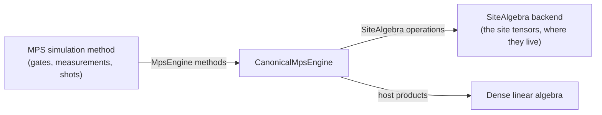

# canonical_mps: a canonical-form MPS engine, its backend contract, and the CPU algebra

The `canonical_mps` crate was designed to solve the problem of running a
QDK simulator's matrix product states (MPS), in canonical form, on several
backends, the host CPU and GPU libraries, by one set of rules. The problem
includes:

- rules that are the same on every backend: where the orthogonality
  centre moves, which sites a gate splits, how gates on distant qubits are
  applied, how the retained weight is kept, and the bounds every
  truncation stays within; written once per backend, they drift apart;
- so a backend should write only what differs: where its tensors live,
  which library factors them, and which values a truncation keeps within
  those bounds;
- and a new backend, such as one on a GPU library, should need no change
  to the rules or to the backends before it;
- each backend then needs its operations checked, and the rules run on
  them, without writing those checks again;
- a simulator needs an engine where no GPU is present, on every platform
  the QDK ships to;
- and a shot's cost should stay low, since it applies many gates, and the
  observables it reads hold hundreds of Pauli strings.

The crate solves these with an engine that holds the rules, written once
over a contract of tensor operations that a backend implements. A
simulator calls `tensornet`'s `MpsEngine` methods on the engine; the
engine checks each call, and turns it into the backend's operations on
site tensors: it uploads, reads and duplicates sites, splits two
neighbours after a gate, and moves the centre. A backend's tests run the
contract's conformance kit, and the engine's conformance circuits, on it.
The crate's own backend is the CPU algebra: its tensors are vectors in the
host's memory, and its products, QR and SVD are the crate's
[dense linear algebra](#the-dense-linear-algebra)'s, on the calling
thread. A backend on a GPU library goes in a crate of its own, which runs
it on an NVIDIA GPU, for the chemistry instances that are slow on the CPU,
such as benzene, or N₂ at a large bond dimension. The engine keeps the
cost low by deferring and sharing work: it fuses gates into one
application, and reads an observable's sites once for all its terms.

Today the crate holds:

- **[The engine](#the-engine):**
  [`CanonicalMpsEngine`](src/engine.rs) implements `tensornet::MpsEngine`
  over any `SiteAlgebra`: it fuses, applies, truncates and reads by one
  set of rules. [`CpuMpsEngine`](src/lib.rs) is the engine on the CPU
  algebra.
- **[Its state, settings and statistics](#settings-and-statistics):**
  [`CanonicalMpsState`](src/engine/state.rs), a chain of the backend's
  tensors; [`DEFAULT_CUTOFF`](src/engine/policy.rs) and
  `CanonicalMpsEngine::with_cutoff`, which trade time for accuracy; and
  [`CanonicalMpsStatistics`](src/engine/statistics.rs), what a state's
  history cost.
- **Refusals and failures:**
  [`CanonicalMpsError`](src/engine/error.rs): a call `MpsEngine`'s contract
  refuses (one whose arguments break its rules, or a projection or condition
  on a value of probability zero), the backend's own failure, or the
  engine's (a sample too large for memory, a truncation that would leave too
  little weight, a failed factorisation of a gate window's operator).
- **[The backend contract](#the-backend-contract):**
  [`SiteAlgebra`](src/site_algebra.rs), the tensor operations a backend
  implements.
- **What passes between the engine and a backend:** site tensors, of
  the backend's type `SiteAlgebra::Tensor`, in the contract's
  [layout](#the-layout); a gate split's
  [`GateSplitCall`](src/site_algebra/gate_split.rs) and
  `GateSplitOutcome`; a centre move's
  [`QrMoveCall`](src/site_algebra/qr_move.rs) and `QrMoveOutcome`; and
  [`CentreSide`](src/site_algebra/centre_side.rs), the site of the pair
  that holds the centre after either call.
- **[Conformance](#conformance-the-kit-and-the-engines-circuits):** the
  kit, `site_algebra::conformance`, and the engine's conformance circuits,
  `engine_conformance`, which check a backend against the contract.
- **[The CPU algebra](#the-cpu-algebra):**
  [`CpuAlgebra`](src/site_algebra/cpu_algebra.rs), the contract on the
  host CPU, which passes the kit and on which the engine's tests run.
- **[The dense linear algebra](#the-dense-linear-algebra):** the
  products, QR and checked SVD of the CPU algebra and of the engine's
  computations on the host; private, but for its error,
  [`SvdError`](src/dense_linalg/svd.rs); the `conformance` feature makes
  it public for a backend's test fakes.

A simulator uses the engine: it starts with `CpuMpsEngine`, as in
[On the host CPU](#on-the-host-cpu), or names `CanonicalMpsEngine` on
another backend's algebra. A backend's author implements `SiteAlgebra` and
runs the conformance kit and circuits on it, as
[The backend contract](#the-backend-contract) shows.

**Why this approach.**

- **One implementation of the rules.** The centre's moves, the fusion of
  gates, their application to distant sites, the truncation's bookkeeping
  and the checks of every call belong to the engine alone, so every
  backend runs them alike, and a fix reaches every backend.
- **Small backends.** A backend writes only the trait's tensor
  operations, on a site's storage or on two neighbouring sites; it checks
  no argument, since the engine checks every one before it calls, and
  reports only its own failures.
- **Open to more backends.** A new backend is a new type implementing the
  trait, in its own crate; nothing here changes.
- **Checks written once.** The conformance kit checks each operation of
  a backend against the contract's formulas, and the engine's conformance
  circuits run the engine on it against an exact reference, so no backend
  writes those checks again.
- **Portable.** The crate depends on `tensornet`, `num-complex`,
  `t4a-faer` and `thiserror`, all pure Rust, so it builds on every
  [platform](#platforms) the QDK supports.
- **Low cost.** Gates fused into one application per window, one read per
  site for all of an observable's terms, and a fast route for the dense
  linear algebra's SVD keep a shot's cost low;
  [`accuracy_and_cost`](examples/accuracy_and_cost.rs) measures it.

## Terms

An MPS engine's documentation uses terms of MPS simulation, and the
engine's own for the work it defers or reorders:

- **Site:** the tensor of one qubit, `T[a, s, b]`, with `s` the qubit's
  value and `a` and `b` the indices of its left and right **bonds**, which
  it shares with its neighbours. A bond's **extent** is its number of
  values; the **cut** `c` is the bond between sites `c` and `c + 1`.
- **Isometry:** a site that, read as a matrix towards one side, has
  orthonormal columns (or rows); it carries none of the state's norm.
- **Canonical form, orthogonality centre:** one site, the centre, holds
  the state's norm, and every other site is an isometry towards it, so the
  state's reads and truncations at the centre are local.
- **Gated pair:** the tensor $\theta$ of two neighbouring sites contracted over
  their bond, with a two-qubit gate applied.
- **Truncation, cutoff, capacity:** a split factors $\theta$ by an SVD and
  keeps only its largest singular values, which truncates the bond between
  the pair. The **cutoff** is the share of the squared singular values a
  split may drop, beyond values of rounding's size; the **capacity** is the
  shape a caller prepares a state with, whose bond at each cut, its $\chi$,
  is the largest a split may keep there; the contract calls the largest
  bond one split may keep its **cap**.
- **Retained fraction, retained weight:** the share of the squared
  singular values a split keeps; the state's **retained weight** is the
  product of its splits' retained fractions, the weight its truncations
  kept.
- **Pending gate:** a gate the engine has accepted but not yet applied to
  the backend's tensors. A one-site gate waits on its site; the two-site
  gates of the pending window wait as one operator on its sites.
- **Window, fusion:** the two-site gates on up to three sites, neighbours
  or not, one-site gates on those sites included, multiply into one
  pending operator, the **window**, so that one application applies them
  all; its **span** is the sites from its first to its last.
- **MPO (matrix product operator):** a window that is not on two
  neighbours is applied as one tensor per site of its span, multiplied
  into the sites, and the span compressed back by splits
  ([`docs/distant_sites.md`](docs/distant_sites.md)). Factoring the
  window's operator into those tensors drops its singular values at or
  below the operator's **rank cutoff**, a fixed share of the largest
  ([`policy.rs`](src/engine/policy.rs) gives it, with why); the retained
  weight does not count that part.
- **Bond at rest, transient bond:** a bond **at rest** is one a cut
  holds between calls, as a split leaves it; a **transient** bond is one
  at a cut inside an MPO's span, after its sites are multiplied and
  before its split, up to the capacity's times the operator's bond.

## The engine

[`CanonicalMpsEngine`](src/engine.rs) implements `tensornet`'s
[`MpsEngine`](../tensornet/src/engine.rs) over any
[`SiteAlgebra`](src/site_algebra.rs). What the trait requires is in
[`tensornet`'s README](../tensornet/README.md) and the trait's rustdoc;
this section says how this engine meets it, and why;
[`docs/engine.md`](docs/engine.md) gives the backend calls of each phase,
where the centre goes, and the numerics, and each file's header the
details.

Two kinds of method meet here: an _MPS simulation method_ is the algorithm
that runs a program's gates, measurements and shots on an MPS, and it calls
the _`MpsEngine` methods_ (`apply`, `project`, `probability_of_one`, …).
The engine calls the backend's _operations_ (`gate_split`, `qr_move`, …).



### On the host CPU

[`CpuMpsEngine`](src/lib.rs) is the engine on the
[CPU algebra](#the-cpu-algebra), `CpuAlgebra`. Its state is
`CanonicalMpsState<CpuAlgebra>`, and its error
`CanonicalMpsError<SvdError>`. The GHZ state on three qubits, its last
qubit reached from the first by a gate on sites that are not neighbours
(the crate's doctest):

```rust
use canonical_mps::{CpuAlgebra, CpuMpsEngine};
use num_complex::Complex64;
use tensornet::{MpsEngine, MpsShape};

let c = |re: f64| Complex64::new(re, 0.0);
let h = std::f64::consts::FRAC_1_SQRT_2;
let hadamard = [c(h), c(h), c(h), c(-h)];
let mut cx = [c(0.0); 16];
for (row, col) in [(0, 0), (1, 1), (2, 3), (3, 2)] {
    cx[4 * row + col] = c(1.0);
}

let engine = CpuMpsEngine::new(CpuAlgebra);
let capacity = MpsShape::qubit_chain(3, 2).expect("three sites");
let mut ghz = engine.prepare(&capacity).expect("a chain of qubits");
engine.apply(&mut ghz, &[0], &hadamard).expect("a one-site gate");
engine.apply(&mut ghz, &[0, 1], &cx).expect("neighbours");
engine.apply(&mut ghz, &[0, 2], &cx).expect("sites further apart");

let p = engine.probability_of_one(&ghz, 2).expect("a site in range");
assert!((p - 0.5).abs() < 1e-12);
let given = engine
    .conditional_probability_of_one(&ghz, 2, &[(0, true)])
    .expect("a possible condition");
assert!((given - 1.0).abs() < 1e-12);
```

### The engine's parts

[`src/engine.rs`](src/engine.rs) holds the engine and its `MpsEngine`
implementation, which calls one part per kind of work:

- [`state.rs`](src/engine/state.rs): `CanonicalMpsState`, a state of the
  engine, which holds its chain;
- [`chain.rs`](src/engine/chain.rs): the sites, the centre, the pending
  gates, the retained weight and the statistics;
- [`fusion.rs`](src/engine/fusion.rs): the pending window, which gathers
  the gates;
- [`gate_products.rs`](src/engine/gate_products.rs): the arithmetic of
  the pending gates' operators;
- [`truncation.rs`](src/engine/truncation.rs): a window applied by one
  split of two neighbours, the one place where the state's bonds are
  truncated;
- [`mpo.rs`](src/engine/mpo.rs): any other window, applied as an
  [MPO](#terms) across its span;
- [`centre_moves.rs`](src/engine/centre_moves.rs): the centre's moves;
- [`host_site.rs`](src/engine/host_site.rs): a site's elements on the
  host, its pending gate applied, for the computations on the host;
- [`measurement.rs`](src/engine/measurement.rs): the probabilities,
  conditional probabilities and projections of one site;
- [`expectation.rs`](src/engine/expectation.rs): an observable's
  expectation;
- [`statistics.rs`](src/engine/statistics.rs): what a state's history
  cost ([statistics](#settings-and-statistics));
- [`policy.rs`](src/engine/policy.rs): the default cutoff and the
  operator's rank cutoff, with their reasons;
- [`error.rs`](src/engine/error.rs): `CanonicalMpsError`, why a call was
  refused or failed;
- [`conformance.rs`](src/engine/conformance.rs): the engine's
  [conformance circuits](#conformance-the-kit-and-the-engines-circuits).

### Phases

The engine defers work it can share: a gate waits, pending, until an
operation needs the tensors it changes. So the engine's work on a state
falls into eight phases, which each `MpsEngine` method combines
([the table below](#how-each-mpsengine-method-is-implemented)):

- **check**: the method's `tensornet::checks` function, so the backend
  never sees a refused call.
- **pend**: a gate is multiplied into a pending gate, on the host; no
  backend call.
- **window**: the pending window is applied: on two neighbours by one
  `gate_split`, which truncates; otherwise as an [MPO](#terms), its span's
  sites read, multiplied on the host and uploaded, then compressed by
  `qr_move`s and one `gate_split` per cut. The centre is left on the end
  of the span the next operation needs.
- **move**: the centre moves one site at a time, by one `qr_move` per site
  crossed, which applies the pending gate of the site it leaves.
- **read**: a site is copied to the host (`read`), its pending gate
  applied.
- **contract**: the expectation's products of host matrices, by the
  [dense linear algebra](#the-dense-linear-algebra).
- **upload**: a site computed on the host becomes a backend tensor
  (`upload`).
- **duplicate**: every site is copied, by the backend (`duplicate`).

### How each `MpsEngine` method is implemented

The table names the phases each method runs, in order.

| `MpsEngine` method               | Phases                                                                                                          | How                                                                                                                                                                                                                                                            | Why                                                                                                                                                                                                                                                                      |
| -------------------------------- | --------------------------------------------------------------------------------------------------------------- | -------------------------------------------------------------------------------------------------------------------------------------------------------------------------------------------------------------------------------------------------------------- | ------------------------------------------------------------------------------------------------------------------------------------------------------------------------------------------------------------------------------------------------------------------------ |
| `prepare`                        | check; upload                                                                                                   | a site holding $\lvert 0 \rangle$ per qubit, its bonds of extent 1; the centre on site 0, a retained weight of 1                                                                                                                                               | a product state needs no split; the bonds grow only as gates entangle                                                                                                                                                                                                    |
| `apply`, one site                | check; pend                                                                                                     | the gate joins the pending window's operator when its site is in the window, else its site's pending gate                                                                                                                                                      | the next application of the window, or move of the centre, applies it in a call it makes anyway                                                                                                                                                                          |
| `apply`, two sites               | check; pend, or window then pend                                                                                | the gate joins the pending window when the window's sites and its own number at most three; else the window is applied, toward the gate's lower site, and the gate opens a new window                                                                          | the gates on up to three sites share one application ([fusion](#terms)): one split on two neighbours, otherwise an [MPO](#terms), which keeps the chain in the caller's order and truncates only at the caller's cuts ([`docs/distant_sites.md`](docs/distant_sites.md)) |
| `probability_of_one`             | check; window, toward the site; move; read                                                                      | the centre's site's values' weights are summed; P(One) is the One value's weight over both values' weights                                                                                                                                                     | a value of weight exactly zero reads exactly 0; a gate's drift from norm 1, within the unitarity check's tolerance, divides out on the centre's site, and elsewhere shifts reads by at most that order                                                                   |
| `project`                        | check; window, toward the site; move; read; upload                                                              | refused, leaving what every read sees unchanged, when the value's probability `p` is zero or NaN; else the other value's elements are zeroed, and the site divided by the norm of what it kept, computed scaled; returns `p`; the retained weight is unchanged | the state's norm is 1 to rounding, however few digits `p` holds                                                                                                                                                                                                          |
| `conditional_probability_of_one` | check; window and duplicate (a fork), with conditions; as `project` per condition; then as `probability_of_one` | the conditions are projected in order on one fork, each refused as `project` refuses; without conditions, the state is read directly                                                                                                                           | the caller's state is not projected; a rare condition whose complement rounds to 1 is not refused, as each value is read from its own weight                                                                                                                             |
| `sample`                         | check; as `conditional_probability_of_one` per new prefix                                                       | `tensornet::sampling`'s shared sampler, over this engine's conditional probabilities                                                                                                                                                                           | one sampler for every engine, so the rule for drawing values is written once; a value of probability zero is never drawn                                                                                                                                                 |
| `expectation`                    | check; window, toward the centre; read; contract                                                                | the sites between the terms and the centre are read once each; the terms walk a trie of their factors, from the plain chain's environments; the sum is divided by the squared norm at the centre                                                               | a chemistry reading holds hundreds of Pauli strings that share their sites; one walk per term would read the sites many times over                                                                                                                                       |
| `fork`                           | window, toward the centre; duplicate                                                                            | the copy keeps the centre, the pending one-site gates, the retained weight and the statistics                                                                                                                                                                  | a pending window is applied once, in the parent, not once per fork; a fork is the same state                                                                                                                                                                             |
| `shape`                          | window, toward the centre                                                                                       | the extents of the chain's bonds                                                                                                                                                                                                                               | a pending window's truncation sets its bonds                                                                                                                                                                                                                             |
| `retained_weight`                | window, toward the centre                                                                                       | the product of the splits' retained fractions                                                                                                                                                                                                                  | a pending window's truncations set their retained fractions; the chain's norm stays about 1, so the weight is kept apart                                                                                                                                                 |

A split that would take the retained weight below the smallest normal
`f64` fails with `CanonicalMpsError::WeightUnderflow`, since callers divide
by the weight, and the window fails with
`CanonicalMpsError::OperatorDecomposition` when the host's factorisation
of its operator fails, which checked gates are not expected to reach.
After any failure the state is unspecified, as the contract says, and the
caller drops it.

### Settings and statistics

The cutoff and the capacity's $\chi$ trade time for accuracy:
[`CanonicalMpsEngine::with_cutoff`](src/engine.rs) says how, and
[`policy.rs`](src/engine/policy.rs) gives the default cutoff with how it
was chosen. A caller that tunes them reads a state's
[`CanonicalMpsStatistics`](src/engine/statistics.rs): its splits, MPOs and moves of
the centre, and its largest bond at rest and inside an MPO's span, apart.

## The backend contract

### The operations

[`SiteAlgebra`](src/site_algebra.rs) has one associated type for where a site's
elements live (`Tensor`) and one for its failures (`Error`). Its rustdoc
states each operation's guarantees, to rounding; the table says what each
is for.

| Operation    | What the backend computes                                                                                                                                                          | What the engine needs it for                                                                                                                             |
| ------------ | ---------------------------------------------------------------------------------------------------------------------------------------------------------------------------------- | -------------------------------------------------------------------------------------------------------------------------------------------------------- |
| `upload`     | a new tensor holding host values                                                                                                                                                   | a new state's sites, and the sites it computes on the host (a projected site, an MPO's multiplied site)                                                  |
| `read`       | a tensor's elements on the host, borrowed where they already live there                                                                                                            | the reads, which contract sites on the host (a probability), and an MPO's span, multiplied on the host                                                   |
| `duplicate`  | a new tensor holding a copy of another's elements                                                                                                                                  | a fork of a state, whose sites then change independently                                                                                                 |
| `gate_split` | $\theta$ factored by one SVD, truncated as the call says, the kept values normalised and absorbed on the centre's side, the other side an isometry; the bond and retained fraction | a window of gates on two neighbouring qubits, with the centre on the pair; and the compression of an MPO's span, one cut at a time, the identity as gate |
| `qr_move`    | the centre moved across a bond, exactly, by one QR of the site it leaves, a one-site gate applied to that site first                                                               | bringing the centre to a gate or a read without truncating, applying a pending one-site gate on the way, and the exact sweep of an MPO's span            |

[`GateSplitCall`](src/site_algebra/gate_split.rs) and
[`QrMoveCall`](src/site_algebra/qr_move.rs) define each operation's inputs
exactly, and [`GateSplitOutcome`](src/site_algebra/gate_split.rs) and
[`QrMoveOutcome`](src/site_algebra/qr_move.rs) its outputs. `gate_split` and `qr_move` leave their input tensors
unchanged, since the caller may still hold them, as the sites of a state
it forked.

### The layout

Every tensor holds complex doubles, its first mode fastest, so a backend
factors a site read as a matrix with no copy; the
[module's documentation](src/site_algebra.rs) gives the layout in full.

### Conformance: the kit and the engine's circuits

A backend's tests check it against the contract with two parts, public
under the crate's `conformance` feature, which a backend enables in its
dev-dependencies (the feature also makes
[`dense_linalg`](src/dense_linalg.rs) public, for a backend's test
fakes):

- **The kit,**
  [`site_algebra::conformance::check`](src/site_algebra/conformance.rs), calls each
  operation on seeded inputs, from a pair whose extents are all one ($\theta$ of
  2 × 2) to a gated pair of 64 × 64, and compares what it returns with the
  contract's formulas, never with another algebra. It returns every case the
  algebra fails, each naming the pair and the setting at fault. A truncated
  split is checked by the Eckart–Young theorem, since its factors are not
  unique; the latitude the contract leaves (a bond larger than the cutoff needs,
  the side of a tie) is not checked.
- **The engine's conformance circuits,**
  [`engine_conformance`](src/engine/conformance.rs), run a `CanonicalMpsEngine`
  on the backend over two long circuits, one without truncation and one
  truncated, and compares its reads with `tensornet`'s exact reference:
  hundreds of calls in a row, on the backend's own memory and settings.

A backend's test of the contract (the kit's documentation):

```rust
use canonical_mps::site_algebra::{SiteAlgebra, conformance};

fn assert_conforms<A: SiteAlgebra>(algebra: &A) {
    let failures = conformance::check(algebra);
    assert!(failures.is_empty(), "{failures:#?}");
}
```

A backend's tests of the engine on its algebra; each function takes the
algebra by value and builds the engine itself (`engine_conformance`'s
documentation, with `CpuAlgebra` standing for the backend's algebra):

```rust
use canonical_mps::CpuAlgebra;
use canonical_mps::engine_conformance::{
    assert_truncated_circuit_stays_within_its_truncation_bound,
    assert_untruncated_circuit_agrees_with_exact_reference,
};

assert_untruncated_circuit_agrees_with_exact_reference(CpuAlgebra);
assert_truncated_circuit_stays_within_its_truncation_bound(CpuAlgebra);
```

## The CPU algebra

[`CpuAlgebra`](src/site_algebra/cpu_algebra.rs), exported at the crate's root,
is the contract on the host CPU. Each operation is computed directly from
its contract; it passes the [conformance kit](#conformance-the-kit-and-the-engines-circuits), and
the engine's tests run on it. It needs no device, so it runs wherever the
QDK runs.

`CpuAlgebra` holds each site in a `Vec<Complex64>`, in the contract's
layout, which is the column-major order of the dense linear algebra's
matrices, so the operations read a site as a matrix without reordering
it.

| Operation    | How                                                                                                                                                                                                                                 | Why                                                                                                                                                                                                                    |
| ------------ | ----------------------------------------------------------------------------------------------------------------------------------------------------------------------------------------------------------------------------------- | ---------------------------------------------------------------------------------------------------------------------------------------------------------------------------------------------------------------------- |
| `upload`     | a copy of the host values into a new vector                                                                                                                                                                                         | the tensors already live on the host                                                                                                                                                                                   |
| `read`       | the site's elements, borrowed (the tensor may hold more)                                                                                                                                                                            | the engine's host reads need no copy                                                                                                                                                                                   |
| `duplicate`  | a copy of the site's elements                                                                                                                                                                                                       | a fork's sites change apart from its parent's                                                                                                                                                                          |
| `gate_split` | $\theta$ by one product and the gate's loops; one `Svd::of`; the values the [truncation rule](src/site_algebra/cpu_algebra/truncation.rs) keeps, normalised, multiplied into the centre's side, the other side the singular vectors | the SVD's factors are checked against $\theta$ before the truncation: when they do not give $\theta$ back, the split fails with `SvdError` rather than spread them; what it keeps is $\theta$'s truncation, normalised |
| `qr_move`    | the one-site gate applied to the site the centre leaves; one thin `Qr::of` of it; the small factor multiplied into the other site                                                                                                   | a QR moves the centre exactly, and never fails                                                                                                                                                                         |

The truncation rule drops the longest tail of singular values whose
squares sum to at most the cutoff's share, then keeps at most the cap;
its [documentation](src/site_algebra/cpu_algebra/truncation.rs) states it in
full. Only `gate_split` fails, when the SVD does
([`SvdError`](src/dense_linalg/svd.rs)): `DidNotConverge` when its
rotations still turn after their last sweep, `FailedChecks` when $\theta$
holds a value that is not finite or the factors fail the SVD's checks.
The engine reports it as `CanonicalMpsError::Algebra`.

## The dense linear algebra

The CPU algebra's products, QR decompositions and SVD, and the
engine's computations on the host (an MPO's operator, the expectation's
contractions), come from the crate's module
[`dense_linalg`](src/dense_linalg.rs): dense complex matrices with a thin
QR and a checked SVD, which either answers factors checked against the
matrix or reports a failure (`SvdError`, exported at the crate's root).
[`docs/dense_linalg.md`](docs/dense_linalg.md) gives the SVD's guarantees
and steps, and t4a-faer, the library that computes the module's products
and QR decompositions and the SVD's fast route, with why.

## Examples

The examples measure `CpuMpsEngine` on circuits larger than the tests
run, up to recorded chemistry shots; they assert nothing.

- [`h2_shots`](examples/h2_shots.rs): recorded shots of H₂'s phase
  estimation (its header gives their size and formats); for each shot,
  the total variation distance (TVD) between the engine's distribution of
  the readout qubits and the recorded exact one, and the time.
  The shots are recorded by a simulator run outside this crate.
- [`accuracy_and_cost`](examples/accuracy_and_cost.rs): circuit families
  (random brickworks, an Ising quench, the Fourier transform) or a gate
  list; how far the engine's state is from the exact state vector, its
  time and its bonds, or with `--engine-only` its peak memory.

Each file's header gives its command line and the formats of its input
files; run them with `--release`. What they share is in
[`examples/support`](examples/support/support.rs).

## Tests

The [unit tests](src/tests) check the dense linear algebra, the
truncation rule, and the engine's rules on the CPU algebra; where
the engine reads values, they compare them with closed-form values, or
with `tensornet`'s exact reference, among them the
[engine's conformance circuits](src/engine/conformance.rs). The CPU algebra passes
the [conformance kit](tests/site_algebra_conformance.rs). The
[integration tests](tests) also compare `CpuMpsEngine` with the exact
reference on [every intrinsic gate and read](tests/exact_gates_and_reads.rs),
and run [circuits of known outcome](tests/circuits_of_known_outcome.rs) on
up to 48 qubits: Clifford circuits, whose reads are 0, ½ or 1; a GHZ
state across the chain; and mirror circuits that return every qubit to
zero. A backend in another crate runs the
[conformance kit and the engine's conformance circuits](#conformance-the-kit-and-the-engines-circuits) in its
own tests.

## Platforms

| Platform               | Builds                | Tests run |
| ---------------------- | --------------------- | --------- |
| Linux, macOS, Windows  | Yes                   | Yes       |
| WebAssembly (`wasm32`) | Yes (not built in CI) | No        |
