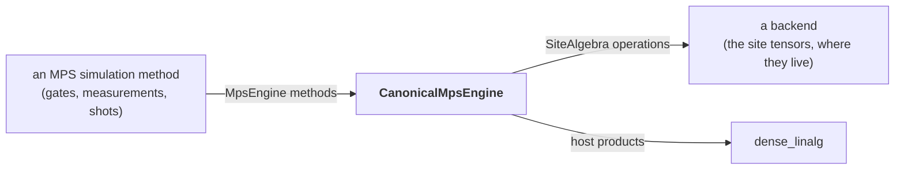

# canonical_mps: a canonical-form MPS engine, its backend contract, and the reference algebra

The `canonical_mps` crate lets a QDK simulator written against
`tensornet`'s `MpsEngine` trait run its matrix product states (MPS) in
canonical form on any backend that implements a small set of tensor
operations, the host CPU's included. It has three parts:

- **[The engine](#the-engine):**
  [`CanonicalMpsEngine`](src/engine.rs) implements `tensornet::MpsEngine`
  over any `SiteAlgebra`: it fuses, applies, truncates and reads by one
  set of rules. [`CpuMpsEngine`](src/lib.rs) is the engine on the reference
  algebra.
- **[The backend contract](#the-backend-contract):**
  [`SiteAlgebra`](src/algebra.rs), the tensor operations a backend
  implements.
- **[The reference algebra](#the-reference-algebra):**
  [`CpuAlgebra`](src/algebra/cpu_algebra.rs), the contract on the host CPU,
  whose answers a backend on another library can be compared with.

**The problem.** Some of an MPS engine's rules are the same on every
backend, the CPU or a GPU library: where the orthogonality centre moves,
which sites a gate splits, how gates on distant qubits are applied, how the
retained weight is kept, and the bounds every truncation stays within.
What differs is where the tensors live, which library factors them, and
which values a truncation keeps within those bounds. Written once per
backend, those rules drift apart. A simulator also needs an engine where
no GPU is present, on every platform the QDK ships to, and a backend on a
GPU library needs a reference to compare its operations with.

**How it is solved.** The engine holds the rules, written once over the
contract, and a backend writes only the contract's operations. The
reference algebra is this crate's backend: its tensors are vectors in the
host's memory, and its products, QR and SVD are `dense_linalg`'s, on the
calling thread. A backend on a GPU library is planned, in its own crate.

**Why this approach.**

- **One implementation of the rules.** The centre's moves, the fusion of
  gates, their application to distant sites, the truncation's bookkeeping
  and the checks of every call belong to the engine alone, so every
  backend runs them alike, and a fix reaches every backend.
- **Small backends.** A backend writes five operations, on a site's
  storage or on two neighbouring sites; it checks no argument, since the
  engine checks every one before it calls, and reports only its own
  failures.
- **Open to more backends.** A new backend is a new type implementing the
  trait, in its own crate; nothing here changes.
- **A reference.** Each of the reference algebra's operations is computed
  directly from its contract, with an SVD whose factors are checked, so a
  backend on another library can be compared with it call by call.
- **Portable.** The crate depends on `tensornet`, `dense_linalg`,
  `num-complex` and `thiserror`, all pure Rust, so it builds on every
  [platform](#platforms) the QDK supports.

## Terms

An MPS engine's documentation uses terms of MPS simulation, and the
engine's own for the work it defers or reorders:

- **Site:** the tensor of one qubit, `T[a, s, b]`, with `s` the qubit's
  value and `a` and `b` the indices of its left and right **bonds**, which
  it shares with its neighbours. A bond's **extent** is its number of
  values; the **cut** `c` is the bond between sites `c` and `c + 1`.
- **Isometry:** a site that, read as a matrix towards one side, has
  orthonormal columns (or rows); it carries none of the state's norm.
- **Canonical form, orthogonality centre:** one site, the centre, holds
  the state's norm, and every other site is an isometry towards it, so the
  state's reads and truncations at the centre are local.
- **Gated pair:** the tensor `θ` of two neighbouring sites contracted over
  their bond, with a two-qubit gate applied.
- **Truncation, cutoff, capacity:** a split factors `θ` by an SVD and
  keeps only its largest singular values, which truncates the bond between
  the pair. The **cutoff** is the share of the squared singular values a
  split may drop; the **capacity** is the shape a caller prepares a state
  with, whose bond at each cut, its `χ`, is the largest a split at rest
  may keep there; the contract calls the largest bond one split may keep
  its **cap**.
- **Retained fraction, retained weight:** the share of the squared
  singular values a split keeps; the state's **retained weight** is the
  product of its splits' retained fractions, the weight its truncations
  kept.
- **Pending gate:** a gate the engine has accepted but not yet applied to
  the backend's tensors. A one-site gate waits on its site; the two-site
  gates of the pending window wait as one operator on its sites.
- **Window, fusion:** the two-site gates on up to three sites, neighbours
  or not, one-site gates on those sites included, multiply into one
  pending operator, the **window**, so that one application applies them
  all; its **span** is the sites from its first to its last.
- **MPO (matrix product operator):** a window that is not on two
  neighbours is applied as one tensor per site of its span, multiplied
  into the sites, and the span compressed back by splits
  ([`docs/distant_sites.md`](docs/distant_sites.md)).

## The engine

[`CanonicalMpsEngine`](src/engine.rs) implements `tensornet`'s
[`MpsEngine`](../tensornet/src/engine.rs) over any
[`SiteAlgebra`](src/algebra.rs). What the trait requires is in
[`tensornet`'s README](../tensornet/README.md) and the trait's rustdoc;
this section says how this engine meets it, and why;
[`docs/engine.md`](docs/engine.md) gives the backend calls of each phase,
where the centre goes, and the numerics, and each file's header the
details.

Two kinds of method meet here: an _MPS simulation method_ is the algorithm
that runs a program's gates, measurements and shots on an MPS, and it calls
the _`MpsEngine` methods_ (`apply`, `project`, `probability_of_one`, …).
The engine calls the backend's _operations_ (`gate_split`, `qr_move`, …).



### On the host CPU

[`CpuMpsEngine`](src/lib.rs) is the engine on the
[reference algebra](#the-reference-algebra), `CpuAlgebra`. Its state is
`CanonicalMpsState<CpuAlgebra>`, and its error
`CanonicalMpsError<dense_linalg::SvdError>`. The GHZ state on three
qubits, its last qubit reached from the first by a gate on sites that are
not neighbours (the crate's doctest):

```rust
use canonical_mps::{CpuAlgebra, CpuMpsEngine};
use num_complex::Complex64;
use tensornet::{MpsEngine, MpsShape};

let c = |re: f64| Complex64::new(re, 0.0);
let h = std::f64::consts::FRAC_1_SQRT_2;
let hadamard = [c(h), c(h), c(h), c(-h)];
let mut cx = [c(0.0); 16];
for (row, col) in [(0, 0), (1, 1), (2, 3), (3, 2)] {
    cx[4 * row + col] = c(1.0);
}

let engine = CpuMpsEngine::new(CpuAlgebra);
let capacity = MpsShape::qubit_chain(3, 2).expect("three sites");
let mut ghz = engine.prepare(&capacity).expect("a chain of qubits");
engine.apply(&mut ghz, &[0], &hadamard).expect("a one-site gate");
engine.apply(&mut ghz, &[0, 1], &cx).expect("neighbours");
engine.apply(&mut ghz, &[0, 2], &cx).expect("sites further apart");

let p = engine.probability_of_one(&ghz, 2).expect("a site in range");
assert!((p - 0.5).abs() < 1e-12);
let given = engine
    .conditional_probability_of_one(&ghz, 2, &[(0, true)])
    .expect("a possible condition");
assert!((given - 1.0).abs() < 1e-12);
```

### The engine's parts

[`src/engine.rs`](src/engine.rs) holds the engine, its state
(`CanonicalMpsState`, a chain of the backend's tensors) and the
`MpsEngine` implementation, which calls one part per kind of work:

- [`chain.rs`](src/engine/chain.rs): the sites, the centre, the pending
  gates, the retained weight and the [statistics](#settings-and-statistics);
- [`window.rs`](src/engine/window.rs) and
  [`gates.rs`](src/engine/gates.rs): the pending window, which gathers the
  gates, and the arithmetic of their operators;
- [`split.rs`](src/engine/split.rs), [`mpo.rs`](src/engine/mpo.rs) and
  [`canonical_form.rs`](src/engine/canonical_form.rs): a window applied by
  one split of two neighbours, the one place where the state's bonds are
  truncated, or as an [MPO](#terms) across its span, and the centre's
  moves;
- [`reads.rs`](src/engine/reads.rs) and
  [`expectation.rs`](src/engine/expectation.rs): the reads of one site, and
  an observable's expectation;
- [`policy.rs`](src/engine/policy.rs) and
  [`error.rs`](src/engine/error.rs): the default cutoff and the
  operator's rank cutoff, with their reasons, and `CanonicalMpsError`, why
  a call was refused or failed.

### Phases

The engine defers work it can share: a gate waits, pending, until an
operation needs the tensors it changes. So the engine's work on a state
falls into eight phases, which each `MpsEngine` method combines
([the table below](#how-each-mpsengine-method-is-implemented)):

- **check**: the method's `tensornet::checks` function, so the backend
  never sees a refused call.
- **pend**: a gate is multiplied into a pending gate, on the host; no
  backend call.
- **window**: the pending window is applied: on two neighbours by one
  `gate_split`, which truncates; otherwise as an [MPO](#terms), its span's
  sites read, multiplied on the host and uploaded, then compressed by
  `qr_move`s and one `gate_split` per cut. The centre is left on the end
  of the span the next operation needs.
- **move**: the centre moves one site at a time, by one `qr_move` per site
  crossed, which applies the pending gate of the site it leaves.
- **read**: the centre's site is copied to the host (`read`), its pending
  gate applied, and its values' weights are summed.
- **contract**: the expectation's products of host matrices, by
  `dense_linalg`.
- **upload**: a site computed on the host becomes a backend tensor
  (`upload`).
- **duplicate**: every site is copied, by the backend (`duplicate`).

### How each `MpsEngine` method is implemented

Each method first runs its check, when the contract has one; the table
names the phases that follow.

| `MpsEngine` method               | Phases                                                                                                          | How                                                                                                                                                                                                                                                   | Why                                                                                                                                                                                                                                                                      |
| -------------------------------- | --------------------------------------------------------------------------------------------------------------- | ----------------------------------------------------------------------------------------------------------------------------------------------------------------------------------------------------------------------------------------------------- | ------------------------------------------------------------------------------------------------------------------------------------------------------------------------------------------------------------------------------------------------------------------------ |
| `prepare`                        | check; upload                                                                                                   | a site holding \|0⟩ per qubit, its bonds of extent 1; the centre on site 0, a retained weight of 1                                                                                                                                                    | a product state needs no split; the bonds grow only as gates entangle                                                                                                                                                                                                    |
| `apply`, one site                | check; pend                                                                                                     | the gate joins the pending window's operator when its site is in the window, else its site's pending gate                                                                                                                                             | the next application of the window, or move of the centre, applies it in a call it makes anyway                                                                                                                                                                          |
| `apply`, two sites               | check; pend, or window then pend                                                                                | the gate joins the pending window when the window's sites and its own number at most three; else the window is applied, toward the gate's lower site, and the gate opens a new window                                                                 | the gates on up to three sites share one application ([fusion](#terms)): one split on two neighbours, otherwise an [MPO](#terms), which keeps the chain in the caller's order and truncates only at the caller's cuts ([`docs/distant_sites.md`](docs/distant_sites.md)) |
| `probability_of_one`             | check; window, toward the site; move; read                                                                      | P(One) is the One value's weight over both values' weights                                                                                                                                                                                            | a value of weight exactly zero reads exactly 0; a gate's drift from norm 1, within the unitarity check's tolerance, divides out on the centre's site, and elsewhere shifts reads by at most that order                                                                   |
| `project`                        | check; window, toward the site; move; read; upload                                                              | refused when the value's probability `p` is zero or NaN, what every read sees unchanged; else the other value's elements are zeroed, and the site divided by the norm of what it kept, computed scaled; returns `p`; the retained weight is unchanged | the state's norm is 1 to rounding, however few digits `p` holds                                                                                                                                                                                                          |
| `conditional_probability_of_one` | check; window and duplicate (a fork), with conditions; as `project` per condition; then as `probability_of_one` | the conditions are projected in order on one fork, each refused as `project` refuses; without conditions, the state is read directly                                                                                                                  | the caller's state is not projected; a rare condition whose complement rounds to 1 is not refused, as each value is read from its own weight                                                                                                                             |
| `sample`                         | check; as `conditional_probability_of_one` per new prefix                                                       | `tensornet::sampling`'s shared sampler, over this engine's conditional probabilities                                                                                                                                                                  | the draws are `tensornet`'s shared sampler's, as for every engine that uses it, and a value of probability zero is never drawn                                                                                                                                           |
| `expectation`                    | check; window, toward the centre; read; contract                                                                | the sites between the terms and the centre are read once each; the terms walk a trie of their factors, from the plain chain's environments; the sum is divided by the squared norm at the centre                                                      | a chemistry reading holds hundreds of Pauli strings that share their sites; one walk per term would read the sites many times over                                                                                                                                       |
| `fork`                           | window, toward the centre; duplicate                                                                            | the copy keeps the centre, the pending one-site gates, the retained weight and the statistics                                                                                                                                                         | a pending window is applied once, in the parent, not once per fork; a fork is the same state                                                                                                                                                                             |
| `shape`                          | window, toward the centre                                                                                       | the extents of the chain's bonds                                                                                                                                                                                                                      | a pending window's truncation sets its bonds                                                                                                                                                                                                                             |
| `retained_weight`                | window, toward the centre                                                                                       | the product of the splits' retained fractions                                                                                                                                                                                                         | a pending window's truncations set their share; the chain's norm stays about 1, so the weight is kept apart                                                                                                                                                              |

A split that would take the retained weight below the smallest normal
`f64` fails with `CanonicalMpsError::WeightUnderflow`, since callers divide
by the weight, and the window fails with
`CanonicalMpsError::OperatorDecomposition` when the host's factorisation
of its operator fails, which checked gates are not expected to reach.
After any failure the state is unspecified, as the
contract says, and the caller drops it.

### Settings and statistics

The cutoff and the capacity's `χ` trade time for accuracy:
[`CanonicalMpsEngine::with_cutoff`](src/engine.rs) says how, and
[`policy.rs`](src/engine/policy.rs) gives the default cutoff with how it
was chosen. A caller that tunes them reads a state's
[`SplitStatistics`](src/engine/chain.rs): its splits, MPOs and moves of
the centre, and its largest bond at rest and inside an MPO's span, apart.

## The backend contract

### The operations

[`SiteAlgebra`](src/algebra.rs) has one associated type for where a site's
elements live (`Tensor`) and one for its failures (`Error`). Its rustdoc
states each operation's guarantees, to rounding; the table says what each
is for.

| Operation    | What the backend computes                                                                                                                                                     | What the engine needs it for                                                                                                                             |
| ------------ | ----------------------------------------------------------------------------------------------------------------------------------------------------------------------------- | -------------------------------------------------------------------------------------------------------------------------------------------------------- |
| `upload`     | a new tensor holding host values                                                                                                                                              | a new state's sites, and the sites it computes on the host (a projected site, an MPO's multiplied site)                                                  |
| `read`       | a tensor's elements on the host, borrowed where they already live there                                                                                                       | the reads, which contract sites on the host (a probability), and an MPO's span, multiplied on the host                                                   |
| `duplicate`  | a new tensor holding a copy of another's elements                                                                                                                             | a fork of a state, whose sites then change independently                                                                                                 |
| `gate_split` | `θ` factored by one SVD, truncated as the call says, the kept values normalised and absorbed on the centre's side, the other side an isometry; the bond and retained fraction | a window of gates on two neighbouring qubits, with the centre on the pair; and the compression of an MPO's span, one cut at a time, the identity as gate |
| `qr_move`    | the centre moved across a bond, exactly, by one QR of the site it leaves, a one-site gate applied to that site first                                                          | bringing the centre to a gate or a read without truncating, applying a pending one-site gate on the way, and the exact sweep of an MPO's span            |

[`GateSplitCall`](src/algebra.rs) and [`QrMoveCall`](src/algebra.rs) define
each operation's inputs exactly, and
[`GateSplitOutcome`](src/algebra.rs) and [`QrMoveOutcome`](src/algebra.rs)
its outputs.

### The layout

Every tensor holds complex doubles, its first mode fastest, so a backend
factors a site read as a matrix with no copy; the
[module's documentation](src/algebra.rs) gives the layout in full.

## The reference algebra

[`CpuAlgebra`](src/algebra/cpu_algebra.rs), exported at the crate's root,
is the contract on the host CPU. Each operation is computed directly from
its contract, so a backend on another library can be compared with its
answers, call by call, and the engine's tests run on it. It needs no
device, so it runs wherever the QDK runs.

`CpuAlgebra` holds each site in a `Vec<Complex64>`, in the contract's
layout, which is the column-major order of `dense_linalg`'s matrices, so
the operations read a site as a matrix without reordering it.

| Operation    | How                                                                                                                                                                                                           | Why                                                                                                                                                                                                     |
| ------------ | ------------------------------------------------------------------------------------------------------------------------------------------------------------------------------------------------------------- | ------------------------------------------------------------------------------------------------------------------------------------------------------------------------------------------------------- |
| `upload`     | a copy of the host values into a new vector                                                                                                                                                                   | the tensors already live on the host                                                                                                                                                                    |
| `read`       | the tensor's first `len` elements, borrowed                                                                                                                                                                   | the engine's host reads need no copy                                                                                                                                                                    |
| `duplicate`  | a copy of the tensor's first `len` elements                                                                                                                                                                   | a fork's sites change apart from its parent's                                                                                                                                                           |
| `gate_split` | `θ` by one product and the gate's loops; one `Svd::of`; the values the [truncation rule](src/algebra/truncation.rs) keeps, normalised, multiplied into the centre's side, the other side the singular vectors | the SVD's factors are checked against `θ` before the truncation: when they do not give `θ` back, the split fails with `SvdError` rather than spread them; what it keeps is `θ`'s truncation, normalised |
| `qr_move`    | the one-site gate applied to the site the centre leaves; one thin `Qr::of` of it; the small factor multiplied into the other site                                                                             | a QR moves the centre exactly, and never fails                                                                                                                                                          |

The truncation rule drops the longest tail of singular values whose
squares sum to at most the cutoff's share, then keeps at most the cap;
its [documentation](src/algebra/truncation.rs) states it in full. Only
`gate_split` fails, when the SVD does
([`SvdError`](../dense_linalg/src/svd.rs)): `DidNotConverge` when its
rotations still turn after their last sweep, `FailedChecks` when `θ` holds
a value that is not finite or the factors fail the SVD's checks. The
engine reports it as `CanonicalMpsError::Algebra`.

## Tests

The [unit tests](src/tests) check the truncation rule, the reference
algebra against the contract, and the engine's rules on that algebra;
where the engine reads values, they compare them with closed-form values,
or with `tensornet`'s exact reference on circuits too large to check by
hand, without truncation and within the distance its truncations allow.
A backend in another crate is to check its own implementation of the
contract there.

## Platforms

| Platform               | Builds                                                                                                                             | Tests run |
| ---------------------- | ---------------------------------------------------------------------------------------------------------------------------------- | --------- |
| Linux, macOS, Windows  | Yes                                                                                                                                | Yes       |
| WebAssembly (`wasm32`) | Yes, checked by a build and by Clippy for `wasm32-unknown-unknown`, but not in CI, since no WebAssembly package uses the crate yet | No        |
