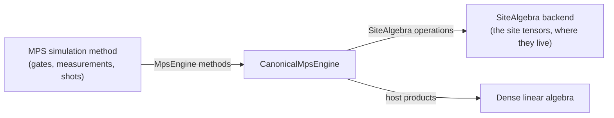

# canonical_mps: a canonical-form MPS engine, its backend contract, and the CPU algebra

The `canonical_mps` crate provides an engine for QDK simulators that hold
the state as a matrix product state (MPS) in canonical form, enabling the
implementation of multiple backends, such as CPU and GPU ones. It
decouples the MPS rules from the tensor operations. The engine,
`CanonicalMpsEngine`, keeps the rules: where the orthogonality centre
moves, which sites a gate splits, how gates on distant qubits are applied,
how the retained weight is kept, and the bounds of every truncation. It
delegates the operations on site tensors (upload, read, duplicate, split
two neighbours, move the centre) to a `SiteAlgebra`, which each backend
implements. A simulator calls `tensornet`'s `MpsEngine` methods on the
engine, which checks each call and turns it into the backend's
operations.

This approach solves several problems:

- **Rules written once do not drift apart.** Every backend runs them
  alike, and a fix reaches every backend.
- **A backend writes only what differs:** where its tensors live, which
  library factors them, and which values a truncation keeps within the
  engine's bounds. Its operations act on a site's storage or on two
  neighbouring sites. It checks no argument but a read's length, since
  the engine checks every other one first, and reports only its own
  failures.
- **A new backend, such as one on a GPU library, changes nothing here:**
  it is a new type implementing `SiteAlgebra`, in its own crate.
- **Checks are written once:** the conformance kit checks each operation
  of a backend against the contract's formulas, and the engine's
  conformance circuits run the engine on each backend against an exact
  reference.
- **An engine where no GPU is present:** the crate depends on
  `tensornet`, `dense_linalg`, `num-complex` and `thiserror`, all pure
  Rust, so it builds on every [platform](#platforms) the QDK supports.

The engine also keeps a shot's cost low: it fuses gates into one
application per window, and reads each site once for all of an
observable's terms.

Today the crate holds:

- **[The engine](#the-engine):**
  [`CanonicalMpsEngine`](src/engine.rs) implements `tensornet::MpsEngine`
  over any `SiteAlgebra`. It fuses, applies, truncates and reads by one
  set of rules. Beside it are its state, settings and statistics, and
  its error, [`CanonicalMpsError`](src/engine/canonical_mps_error.rs).
- **[The backend contract](#the-backend-contract):**
  [`SiteAlgebra`](src/site_algebra.rs), the tensor operations a backend
  implements, and the conformance kit and circuits that check a backend
  against it.
- **[The CPU algebra](#the-cpu-algebra):**
  [`CpuAlgebra`](src/cpu_algebra.rs), the crate's own backend: the
  contract on the host CPU, its tensors vectors in host memory, and
  [`CpuMpsEngine`](src/lib.rs), the engine on it. It gives
  simulators an engine where no GPU is present, validates the engine in
  CI, and serves other backends as a comparison point for truncating
  circuits. Chemistry instances too slow on the CPU need a backend on a
  GPU library, which goes in a crate of its own.

A simulator starts with `CpuMpsEngine`, as in
[The CPU algebra](#the-cpu-algebra), or names `CanonicalMpsEngine` on
another backend's algebra. A backend's author starts with
[The backend contract](#the-backend-contract).

## Concepts

MPS simulation has its own terms. The engine adds its own for the work it
defers or reorders. The crate's modules use these words, defined here
once, with background in [Further reading](#further-reading):

- **Matrix product state (MPS):** the state of `n` qubits held as a chain
  of `n` small tensors, one per qubit, instead of its $2^n$ amplitudes.
  Neighbouring tensors share a bond, and a cut is the place between them
  (Site and Cut, below, define both). The chain holds any state exactly
  once its bond at cut $c$ reaches $2^{\min(c+1,\, n-c-1)}$, about
  $2^{n/2}$ in the middle, which saves nothing. So the engine bounds each
  bond by the capacity (below). A split drops the smallest singular
  values (Truncation, below) when a bond would exceed its bound, or when
  they fall within the cutoff. Six qubits: the bonds that hold any state
  exactly, and those at a capacity of 4:

  ```text
  cut              0      1      2      3      4
  exact:        A ─2── A ─4── A ─8── A ─4── A ─2── A
  capacity 4:   A ─2── A ─4── A ─4── A ─4── A ─2── A
                                 ▲ truncated
  ```

  An MPS is therefore approximate only for some states, not by nature. A
  state whose Schmidt ranks fit within the capacity, or whose dropped
  values were of rounding's size, stays exact. Its retained weight
  (below) says which: 1, up to rounding, when nothing more was dropped,
  and less by the share dropped otherwise.

- **Site:** the tensor of one qubit, `T[a, s, b]`. `s` is the qubit's
  value, and `a` and `b` index its left and right **bonds**, which it
  shares with its neighbours. An amplitude is the product of the sites'
  entries, summed over every value of every bond. A bond's **extent** is
  its number of values. It bounds how much entanglement the state carries
  across the bond: larger bonds hold more states exactly, and cost more
  time and memory.

  ```text
  a ── T ── b      a, b: the indices of its left and right bonds
       │           s: its qubit's value
       s
  ```

- **Cut:** a place in the chain: cut `c` lies between sites `c` and
  `c + 1`, and site `c`'s right bond crosses it. The cut stays where it
  is, while its bond's extent changes as gates entangle and splits
  truncate. The capacity bounds the bond at each cut, and a split
  truncates there.

  ```text
  site   0 ── 1 ── 2 ── 3
  cut       0    1    2
  ```

- **Gate:** a unitary matrix, one that keeps every state's norm, on one
  or two qubits.
- **Isometry:** a site that, read as a matrix towards one side, has
  orthonormal columns (or rows). It neither stretches nor shrinks what
  passes through it, so it carries none of the state's norm.
- **Canonical form, orthogonality centre:** one site, the centre, holds
  the state's norm. Every other site is an isometry towards it. So reads
  and truncations at the centre are local. The engine keeps the state in
  canonical form, and moves the centre to a gate's or a read's sites
  before it acts there (Move, below). A chain of four qubits, its
  centre on site 2, each arrow pointing from an isometry towards it:

  ```text
  site         0           1           2           3
               A₀ ── b₀ ── A₁ ── b₁ ── C₂ ── b₂ ── A₃
               │   cut 0   │   cut 1   │   cut 2   │
                    ──►         ──►         ◄──
  ```

- **Singular value decomposition (SVD), QR decomposition:** an SVD writes
  a matrix as `U·S·V†`, with `U` and `V` isometries and `S` a diagonal of
  nonnegative singular values, largest first. Dropping the smallest
  values changes the matrix least. A QR writes a matrix as an isometry
  `Q` times a triangular `R`. The engine uses an SVD to factor each gated
  pair (Split, below) and to factor a window's operator into one tensor
  per site (MPO, below); it uses a QR to move the centre (Move, below).
- **Schmidt decomposition:** the state $\lvert \psi \rangle$ written, at a
  cut, as a sum of products of a state of the qubits left of the cut and
  one of those right of it:

  ```math
  \lvert \psi \rangle = \sum_{i=1}^{r} \lambda_i \,
    \lvert L_i \rangle \otimes \lvert R_i \rangle,
  \qquad \lambda_1 \ge \lambda_2 \ge \cdots \ge \lambda_r > 0
  ```

  The $\lvert L_i \rangle$ are orthonormal, and so are the
  $\lvert R_i \rangle$. Each $\lambda_i$ is a **Schmidt value**. Their
  squares, the **Schmidt weights**, sum to the squared norm,
  $\sum_i \lambda_i^2 = \langle \psi \vert \psi \rangle$. Their number $r$,
  the **Schmidt rank**, is the smallest bond that holds the state exactly
  at that cut. The engine gets it from a split: with the centre on one of
  the two sites, the SVD of their gated pair (below) is the state's
  Schmidt decomposition at their cut, its singular values the
  $\lambda_i$. So
  keeping the $k$ largest (Truncation, below) gives a closest state
  with a bond of $k$, in norm. It drops $\sum_{i > k} \lambda_i^2$ of the
  squared norm; the split's retained fraction is the share it keeps.

- **Gated pair:** the tensor $\theta$ of two neighbouring sites contracted
  over their bond, with a two-qubit gate applied. Sites 1 and 2, the
  centre on site 2, and a gate `G`:

  ```text
    ── A₁ ─b₁─ C₂ ──
       │       │
     ┌─┴───────┴─┐         ┌───────────┐
     │     G     │   =   ──┤     θ     ├──
     └─┬───────┬─┘         └─┬───────┬─┘
       │       │             │       │
    the pair and G         the gated pair
  ```

  `C` marks the centre, `A` an isometry.

- **Environment:** the sites on one side of a bond, each contracted with
  its own complex conjugate (a term's Pauli between them on its sites),
  folded into one small matrix on that bond. An expectation value reuses
  one environment for every term that shares those sites
  ([`environment.rs`](src/engine/expectation/environment.rs)).
- **Split:** one of the backend's two operations on two neighbours. It
  applies a two-site gate to the pair, and factors the gated pair
  $\theta$ by an SVD, keeping its largest singular values (Truncation,
  below). The split of the gated pair above, keeping `k` values, the
  centre left on site 1:

  ```text
     ┌───────────┐
   ──┤     θ     ├──     →     ── C₁ ─── k ── Q₂ ──
     └─┬───────┬─┘                │           │
       │       │
    the gated pair            θ = U·S·V†, k values kept:
                              C₁ = U·S, Q₂ = V†
  ```

  `Q` marks an isometry.

- **Move:** the backend's other operation on two neighbours. It carries
  the centre from one to the other by a QR: `Q` stays on the site it
  leaves and `R` goes into the other, so it drops nothing. The centre
  moved from site 2 to site 3:

  ```text
    ── C₂ ─ b₂ ─ A₃ ──     →        ── Q₂ ─ k ── C₃ ──
       │         │                     │         │
    C₂ = Q·R: Q stays on site 2, and C₃ = R·A₃
  ```

- **Host, upload, read:** the host is the CPU's memory, where the engine
  computes the little it does itself, as opposed to the backend's (a
  GPU's, for instance). To **upload** a site is to hand the backend
  values computed on the host, which it stores as its own tensor: a new
  state's sites, a projected site, an MPO's multiplied sites. To **read**
  a site is the reverse: its values copied to the host, or borrowed where
  they already live there.
- **Truncation, cutoff, capacity:** a split keeps only the largest
  singular values of $\theta$. This truncates the bond
  between the pair. The **cutoff** is the share of the squared singular
  values a split may drop, beyond values of rounding's size. The
  **capacity** is the shape a caller prepares a state with. Its bond at
  each cut, its $\chi$, is the largest a split may keep there. The
  largest bond one split may keep is the split's **cap** (`max_extent` in
  the contract).
- **Retained fraction, retained weight:** a split's retained fraction is
  the share of the squared singular values it keeps. The state's
  **retained weight** is the product of its splits' retained fractions.
- **Pending gate:** a gate the engine has accepted but not yet applied to
  the backend's tensors. A one-site gate waits on its site. The two-site
  gates of the pending window wait as one operator on its sites.
- **Window, fusion:** the two-site gates on up to three sites, neighbours
  or not, and the one-site gates on those sites, multiply into one
  pending operator, the **window**. One application then applies them
  all. Its **span** is the sites from its first to its last. Three gates
  fused, time running down (`●──[X]` a CNOT: control `●`, target `[X]`),
  with site 2 passing through the window untouched
  ([`fusion.rs`](src/engine/fusion.rs) follows each call):

  ```text
    site      0     1     2     3     4
              │     │     │     │     │
              ●────[X]    │     │    [H]    H waits on site 4
              │     │     │     │     │
              │     ●─────┼────[X]    │     joins: sites 0, 1, 3
              │     │     │     │     │
              │   [Rz]    │     │     │     joins: on site 1
              │     │     │     │     │

    fused into one window:

              │     │     │     │     │
            ┌─┴─────┴─────┴─────┴─┐   │
            │ window W            │  [H]    its sites 0, 1, 3; span 0 to 3
            └─┬─────┬─────┬─────┬─┘   │     site 2: in the span, untouched
              │     │     │     │     │
  ```

- **MPO (matrix product operator):** a window that is not on two
  neighbours is applied as one tensor per site of its span. These are
  multiplied into the sites, and the span is compressed back by splits
  ([`docs/engine.md`](docs/engine.md#windows-applied-as-an-mpo)). Factoring the
  window's operator into those tensors drops its singular values at or
  below the operator's **rank cutoff**, a fixed share of the largest
  ([`cutoffs.rs`](src/engine/cutoffs.rs) gives it, with why). The retained
  weight does not count that part.
- **Bond at rest, transient bond:** a bond **at rest** is one a cut
  holds between calls, as a split leaves it. A **transient** bond is one
  at a cut inside an MPO's span, after its sites are multiplied and
  before its split. It reaches up to the capacity's times the operator's
  bond. A CNOT on sites 1 and 4, applied as an MPO of operator bond 2 to
  a chain whose bonds are at their capacity `χ`, then compressed for a
  read on site 4 ([`mpo.rs`](src/engine/mpo.rs) gives each step):

  ```text
  site:        0       1       2       3       4       5
  chain:       A₀ ─χ── A₁ ─χ── A₂ ─χ── A₃ ─χ── A₄ ─χ── A₅
                       │       │       │       │
  MPO:                 W₁ ─2── I  ─2── I  ─2── W₄

  multiplied:  A₀ ─χ── B₁ ─2χ─ B₂ ─2χ─ B₃ ─2χ─ B₄ ─χ── A₅
  compressed:  A₀ ─χ── Q₁ ─χ── Q₂ ─χ── Q₃ ─χ── C₄ ─χ── A₅
  ```

  `W` is an MPO tensor, `I` the identity carrying the operator bond, `B`
  a multiplied site. The `2χ` bonds are transient; the compression's
  splits bring them back to at most `χ`.

## The engine

[`CanonicalMpsEngine`](src/engine.rs) implements `tensornet`'s
[`MpsEngine`](../tensornet/src/engine.rs) over any
[`SiteAlgebra`](src/site_algebra.rs). What the trait requires is in
[`tensornet`'s README](../tensornet/README.md) and the trait's rustdoc.
This section says how this engine meets it, and why.

Two kinds of method meet here. An _MPS simulation method_ is the
algorithm that runs a program's gates, measurements and shots on an MPS.
It calls the _`MpsEngine` methods_ (`apply`, `project`,
`probability_of_one`, …). The engine calls the backend's _operations_
(`gate_split`, `qr_move`, …).



The engine defers work it can share, and moves the centre only as far as
an operation needs:

- A gate waits, pending, until an operation needs the tensors it
  changes. Two-site gates on up to three sites gather into one window
  ([fusion](#concepts)), applied by one call the engine makes anyway.
- A window on two neighbours is applied by one split. Any other is
  applied as an [MPO](#concepts) across its span. That keeps the chain in
  the caller's order, and truncates only at the caller's cuts.
- A probability or a projection reads the site at the centre, where the
  rest of the chain drops out.
- An expectation reads each site it needs once, for all of an
  observable's terms.

[`docs/engine.md`](docs/engine.md) gives how each `MpsEngine` method is
implemented: the phases it runs, how and why, their backend calls, where
the centre goes, and the numerics. The header of
[`src/engine.rs`](src/engine.rs) lists the engine's parts, one file per
part under [`src/engine/`](src/engine).

### When each guarantee holds

[`CanonicalMpsError`](src/engine/canonical_mps_error.rs) tells a refused
call, after which the state can still be used, from a failure. The
rustdoc of [`CanonicalMpsEngine`](src/engine.rs) and its methods states
each guarantee in full:

- **At construction:** `with_cutoff` panics on a cutoff outside `[0, 1)`.
- **At each call, before any backend call:** the contract's checks refuse
  a malformed call, so the backend never sees one.
- **At each projection or condition:** a value of probability zero or
  NaN is refused, leaving what every read sees unchanged.
- **At each conditional read or sample:** an answer of NaN is refused
  too, as on a state whose norm is zero or NaN.
- **At each split:** the bounds of its Truncation paragraph hold. A
  retained weight below the smallest normal `f64` gives
  `CanonicalMpsError::WeightUnderflow` instead.
- **At each window applied as an MPO:** the host's factorisation of its
  operator may fail, with `CanonicalMpsError::OperatorDecomposition`.
  Checked gates are not expected to reach it.
- **After a failure:** the state is unspecified (its Failures paragraph),
  and the caller drops it.

### State, settings and statistics

A state, [`CanonicalMpsState`](src/engine/state.rs), is a chain of the
backend's tensors. The cutoff and the capacity's $\chi$ trade time for
accuracy. [`CanonicalMpsEngine::with_cutoff`](src/engine.rs) says how.
[`cutoffs.rs`](src/engine/cutoffs.rs) gives the default cutoff and how it
was chosen. A caller that tunes them reads a state's
[`CanonicalMpsStatistics`](src/engine/statistics.rs). It counts the
splits, MPOs and moves of the centre. It keeps the largest bond at rest
apart from the largest inside an MPO's span.

## The backend contract

A backend's author implements `SiteAlgebra`'s five tensor operations, and
runs the conformance kit and the circuits on the backend. The backend
then gets, with no code of its own, every `MpsEngine` method and the
rules behind them: the fusion of gates, gates on sites far apart,
measurement, sampling, expectations, the contract's refusals, the
retained weight and the state's statistics.

### The operations

[`SiteAlgebra`](src/site_algebra.rs) has one associated type for where
a site's elements live (`Tensor`) and one for its failures (`Error`). Its
rustdoc states each operation's guarantees, up to rounding.
[`docs/site_algebra.md`](docs/site_algebra.md) writes them as formulas,
with pictures, for a backend's author. The table says what each is for.

| Operation    | What the backend computes                                                                                                                                                                                    | What the engine needs it for                                                                                                                                               |
| ------------ | ------------------------------------------------------------------------------------------------------------------------------------------------------------------------------------------------------------ | -------------------------------------------------------------------------------------------------------------------------------------------------------------------------- |
| `upload`     | a new tensor holding host values                                                                                                                                                                             | a new state's sites, and the sites it computes on the host (a projected site, an MPO's multiplied site)                                                                    |
| `read`       | a tensor's elements on the host, borrowed where they already live there                                                                                                                                      | the reads, which contract sites on the host (a probability); and an MPO's span, multiplied on the host                                                                     |
| `duplicate`  | a new tensor holding a copy of another's elements                                                                                                                                                            | a fork of a state, whose sites then change independently                                                                                                                   |
| `gate_split` | $\theta$ factored by one SVD and truncated as the call says. The kept values are normalised and absorbed on the centre's side. The other side is an isometry. It returns the bond and the retained fraction. | a window of gates on two neighbouring qubits, with the centre on the pair; and the compression of an MPO's span, one cut at a time, the identity as gate                   |
| `qr_move`    | the centre moved across a bond, exactly, by one QR of the site it leaves. A one-site gate is applied to that site first.                                                                                     | bringing the centre to a gate or a read without truncating, applying a pending one-site gate on the way; and the exact moves that precede the compression of an MPO's span |

[`GateSplitCall`](src/site_algebra/gate_split.rs) and
[`QrMoveCall`](src/site_algebra/qr_move.rs) define each operation's
inputs exactly. [`GateSplitOutcome`](src/site_algebra/gate_split.rs) and
[`QrMoveOutcome`](src/site_algebra/qr_move.rs) define its outputs.
[`CentreSide`](src/site_algebra/centre_side.rs) names the site of the
pair that holds the centre after either call. `gate_split` and `qr_move`
leave their input tensors unchanged. The caller may still hold them, as
the sites of a state it forked.

### The layout

Every tensor holds complex doubles, its first mode fastest. So a backend
factors a site read as a matrix with no copy.
[`docs/site_algebra.md`](docs/site_algebra.md#the-layout) draws the
layout.

### Conformance: the kit and the engine's circuits

A backend's tests check it against the contract with two parts. Both
are public under the crate's `conformance` feature, which a backend
enables in its dev-dependencies. A backend's test fakes that need a host
SVD, QR or LQ depend on the [`dense_linalg`](../dense_linalg/README.md) crate.

- **The kit,**
  [`site_algebra::conformance::check`](src/site_algebra/conformance.rs),
  calls each operation on seeded inputs, and compares what each call
  returns with the contract's formulas, never with another algebra
  ([how](docs/site_algebra.md#how-the-conformance-kit-checks-them)). It
  returns every case the algebra fails, each naming the pair, the setting
  at fault and the kit seed that repeats it. `check_with_seed` draws the
  inputs from another seed, so that a backend is not fitted to one set of
  inputs.
- **The engine's conformance circuits,**
  [`engine_conformance`](src/engine/conformance.rs), run a
  `CanonicalMpsEngine` on the backend over two long circuits, one without
  truncation and one truncated. They compare its reads with `tensornet`'s
  exact reference, over hundreds of calls in a row, on the backend's own
  memory and settings.

A backend's test of the contract (the kit's documentation):

```rust
use canonical_mps::site_algebra::{SiteAlgebra, conformance};

fn assert_conforms<A: SiteAlgebra>(algebra: &A) {
    let failures = conformance::check(algebra);
    assert!(failures.is_empty(), "{failures:#?}");
}
```

A backend's tests of the engine on its algebra follow. Each function
takes the algebra by value and builds the engine itself. The example is
`engine_conformance`'s documentation, with `CpuAlgebra` standing for the
backend's algebra:

```rust
use canonical_mps::CpuAlgebra;
use canonical_mps::engine_conformance::{
    assert_truncated_circuit_stays_within_its_truncation_bound,
    assert_untruncated_circuit_agrees_with_exact_reference,
};

assert_untruncated_circuit_agrees_with_exact_reference(CpuAlgebra);
assert_truncated_circuit_stays_within_its_truncation_bound(CpuAlgebra);
```

## The CPU algebra

[`CpuAlgebra`](src/cpu_algebra.rs) is the crate's own backend: the
contract on the host CPU, each site tensor a vector in host memory. It
computes each operation directly from its contract, and passes the
[conformance kit](#conformance-the-kit-and-the-engines-circuits).
[`CpuMpsEngine`](src/lib.rs) is the engine on it. Its state is
`CanonicalMpsState<CpuAlgebra>`, and its error
`CanonicalMpsError<SvdError>`: only a gate split can fail, when its SVD
does ([`SvdError`](../dense_linalg/src/svd.rs) says when), and the engine
reports it as `CanonicalMpsError::Algebra`. The header of
[`src/cpu_algebra.rs`](src/cpu_algebra.rs) says how each operation is
computed. The CPU algebra is useful in three ways:

- **An engine where no GPU is present.** It needs no device and no setup,
  so `CpuMpsEngine` runs wherever the QDK runs. A simulator can offer it
  beside a GPU backend, for machines without one.
- **Validation in CI.** CI has no GPU, so the engine's tests, the
  conformance kit and the engine's conformance circuits run there on it.
  A change to the engine's rules is checked on every pull request.
- **A comparison point for truncating circuits.** The exact reference
  never truncates, so it cannot check what a truncation keeps. Another
  backend can run a truncating circuit beside `CpuMpsEngine`, at the
  same cap and cutoff, and compare their reads where the bounds decide
  what both keep.

The crate's doctest builds the GHZ state on three qubits with
`CpuMpsEngine`. Its last qubit is reached from the first by a gate on
sites that are not neighbours:

```rust
use canonical_mps::{CpuAlgebra, CpuMpsEngine};
use num_complex::Complex64;
use tensornet::{MpsEngine, MpsShape};

let c = |re: f64| Complex64::new(re, 0.0);
let h = std::f64::consts::FRAC_1_SQRT_2;
let hadamard = [c(h), c(h), c(h), c(-h)];
let mut cx = [c(0.0); 16];
for (row, col) in [(0, 0), (1, 1), (2, 3), (3, 2)] {
    cx[4 * row + col] = c(1.0);
}

let engine = CpuMpsEngine::new(CpuAlgebra);
let capacity = MpsShape::qubit_chain(3, 2).expect("three sites");
let mut ghz = engine.prepare(&capacity).expect("a chain of qubits");
engine.apply(&mut ghz, &[0], &hadamard).expect("a one-site gate");
engine.apply(&mut ghz, &[0, 1], &cx).expect("neighbours");
engine.apply(&mut ghz, &[0, 2], &cx).expect("sites further apart");

let p = engine.probability_of_one(&ghz, 2).expect("a site in range");
assert!((p - 0.5).abs() < 1e-12);
let given = engine
    .conditional_probability_of_one(&ghz, 2, &[(0, true)])
    .expect("a possible condition");
assert!((given - 1.0).abs() < 1e-12);
```

## The dense linear algebra

The CPU algebra's products, QR and LQ decompositions, and truncated SVDs
come from the [`dense_linalg`](../dense_linalg/README.md) crate, and so do
the engine's computations on the host (an MPO's operator, the
expectation's contractions, a site's norm). `dense_linalg`'s checked SVD
either answers factors checked against the matrix, or reports a failure,
`SvdError`, which this crate re-exports at its root as the CPU algebra's
error.

## Tests

Each module with behaviour of its own has its unit tests beside it, in
its folder's `tests.rs` (for instance
[`src/engine/fusion/tests.rs`](src/engine/fusion/tests.rs)). They check
the truncation rule, and the engine's rules on the CPU algebra. Where the engine reads values, they compare them
with closed-form values, or with `tensornet`'s exact reference. The
[engine's conformance circuits](src/engine/conformance.rs) are among them.
The CPU algebra passes the
[conformance kit](tests/site_algebra_conformance.rs). The engine's tests
also compare `CpuMpsEngine` with the exact reference on
[every intrinsic gate and projection](src/engine/tests/exact_gates_and_projections.rs).
They run
[circuits of known outcome](src/engine/tests/circuits_of_known_outcome.rs)
on up to 48 qubits: Clifford circuits, whose reads are 0, ½ or 1; a GHZ
state across the chain; and mirror circuits that return every qubit to
zero. A backend in another crate runs the
[conformance kit and the engine's conformance circuits](#conformance-the-kit-and-the-engines-circuits)
in its own tests.

## Platforms

| Platform               | Builds                | Tests run |
| ---------------------- | --------------------- | --------- |
| Linux, macOS, Windows  | Yes                   | Yes       |
| WebAssembly (`wasm32`) | Yes (not built in CI) | No        |

## Further reading

- U. Schollwöck,
  ["The density-matrix renormalization group in the age of matrix product states"](https://arxiv.org/abs/1008.3477),
  arXiv:1008.3477, 2011, published in Ann. Phys. 326(1):96–192: matrix
  product states, the canonical form, the Schmidt decomposition and
  truncation by an SVD, and matrix product operators.
- G. H. Golub and C. F. Van Loan, _Matrix Computations_, 4th ed., Johns
  Hopkins University Press, 2013: the QR decomposition and the SVD, and
  how each is computed.

The module headers cite the sections each file follows.
