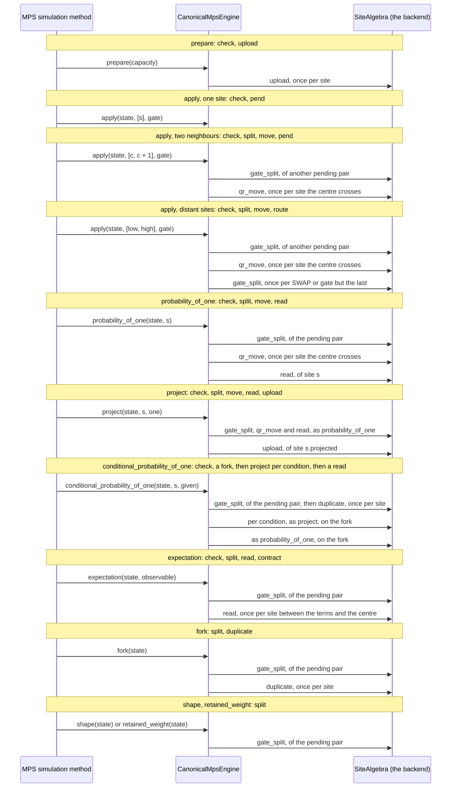

# The canonical-form MPS engine: backend calls, the centre, and numerics

The details behind [the engine](../README.md#the-engine) of the crate's
README: the backend operations each of its [phases](../README.md#phases)
calls, in order, where each method leaves the orthogonality centre, and the
numerics of its truncations and reads.

## Backend calls of each phase

Each band of the diagram is one `MpsEngine` method, or one case of
`apply`, with the phases it runs and their `SiteAlgebra` operations in
order. The check and the pend phases call no operation.

A `gate_split` "of the pending pair" runs only when a pair is pending, and
"of another pending pair" only when the pending pair is not the one the
gate acts on. A route's SWAPs and gate each act on the pair next to the
previous one's, so each splits the previous pair; the last stays pending
until the next operation elsewhere.

## Where the centre goes

The centre moves only as far as an operation needs, and a split leaves it
on the side of its pair the next operation needs, so a sequence of
operations on nearby sites moves it little. After each method, with `c` the
centre before it:

| `MpsEngine` method                 | The centre after it                                                                                                                                                                |
| ---------------------------------- | ---------------------------------------------------------------------------------------------------------------------------------------------------------------------------------- |
| `prepare`                          | site 0                                                                                                                                                                             |
| `apply`, one site                  | `c`: the gate waits, pending                                                                                                                                                       |
| `apply`, two neighbours at cut `k` | `k` when `c ≤ k`, else `k + 1`: the site of the pair nearer the centre, the pair left pending; a split of another pending pair first leaves `c` on that pair's side nearer cut `k` |
| `apply`, distant sites             | in the last return SWAP's pair, left pending: each outbound split leaves the centre on the pair's left site, where the next SWAP needs it, and each return split on its right      |
| `probability_of_one`, `project`    | the site read: the pending pair is split toward it first                                                                                                                           |
| `expectation`                      | `c`: the pending pair is split toward it, and the reads copy the sites to the host without moving it                                                                               |
| `fork`, `shape`, `retained_weight` | `c`, as for `expectation`; a fork starts with its parent's centre                                                                                                                  |

## Numerics

**The truncation.** A split's `gate_split` keeps the largest singular
value and drops values whose squares sum to at most the cutoff times the
sum of all their squares, unless the cap cuts more: the capacity's bond at
the cut for a split at rest, none for a route's outbound SWAP, whose bond
stays within twice the capacity's largest ([`routing.md`](routing.md)).
These are the bounds of `gate_split`'s contract
([`algebra.rs`](../src/algebra.rs)); which values a split drops within
them is the algebra's to choose, and an algebra that truncates by
[`Truncation`](../src/algebra/truncation.rs) drops the longest such tail. A
split normalises the values it keeps, so the chain keeps a norm of about 1.

**The retained weight.** Each split returns the share `f ∈ (0, 1]` of the
squared singular values it kept, and the state's retained weight is the
product of the shares, `W = Π fᵢ`. The engine keeps `W` apart from the
chain's norm, and fails a split with `WeightUnderflow` when `W` would fall
below the smallest normal `f64`, about `2.2e-308`, rather than let it reach
zero, by which callers divide.

**A probability.** With the centre on site `s`, the rest of the chain drops
out of the site's reads. The weight of a value `b` is
`w_b = Σ_{a,c} |T[a, b, c]|²` over the centre's tensor `T`, its pending
gate applied, and

`P(b) = w_b / (w₀ + w₁)`.

Each value's probability is read from its own weight, so a value of weight
exactly zero reads exactly 0, and a gate's drift from norm 1 divides out.

**A projection.** It returns `p = P(b)`, refuses `p` of zero or NaN, zeroes
the other value's elements, and divides the site by the norm of what it
kept. It computes the norm as `m · √(Σ |x / m|²)`, with `m` the largest
modulus, not as `√p`, so the state's norm does not shrink with `p`, even
when `p` is subnormal, and later projections stay possible. It truncates
nothing, so `W` is unchanged.

**An expectation.** An observable `c₀ + Σₖ cₖ Pₖ`, each `Pₖ` a product of
one-site Paulis, has the value `c₀ + Σₖ cₖ ⟨ψ|Pₖ|ψ⟩ / ‖T_centre‖²`; the
division takes out a gate's drift from norm 1. The sites left of the centre
are isometries from the left, so the environment on any bond left of the
centre is the identity, and likewise from the right; a term's contraction
runs only over the sites between its own and the centre. The terms are
evaluated together:

- the sites between the terms and the centre are read once each, whatever
  the number of terms;
- the terms are walked as a trie of their factors, sorted by site, from the
  environments of the plain chain;
- a term's last factor is closed by a right environment with its Pauli.
