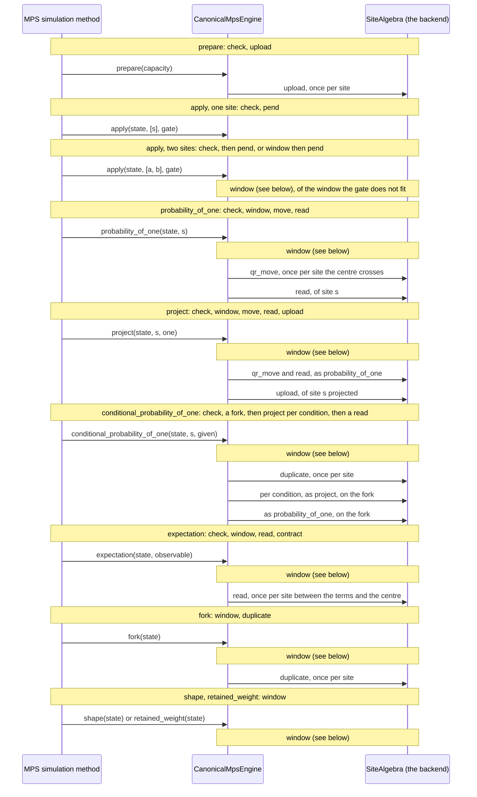

# The canonical-form MPS engine: backend calls, the centre, and numerics

The details behind [the engine](../README.md#the-engine) of the crate's
README: the backend operations each of its [phases](../README.md#phases)
calls, in order, where each method leaves the orthogonality centre, and the
numerics of its truncations and reads.

## Backend calls of each phase

Each band of the diagram is one `MpsEngine` method, or one case of
`apply`, with the phases it runs and their `SiteAlgebra` operations in
order. The check and the pend phases call no operation.

A "window" step runs only when a window is pending. Its calls depend on
the window's sites:

- **two neighbours:** `qr_move`s to bring the centre onto the pair, then
  one `gate_split`;
- **any other window**, an MPO on a span of `d + 1` sites: `qr_move`s to
  bring the centre into the span; per site of the span, a `read` and an
  `upload` of the site multiplied by its operator tensor; `d − 1`
  `qr_move`s across the span; and `d` `gate_split`s, the identity as gate,
  one per cut ([`distant_sites.md`](distant_sites.md)).

## Where the centre goes

The centre moves only as far as an operation needs, and the application of
a window leaves it on the end of the window's span the next operation
needs, so a sequence of operations on nearby sites moves it little. After each method, with `c` the
centre before it:

| `MpsEngine` method                 | The centre after it                                                                                                                       |
| ---------------------------------- | ----------------------------------------------------------------------------------------------------------------------------------------- |
| `prepare`                          | site 0                                                                                                                                    |
| `apply`, one site                  | `c`: the gate waits, pending                                                                                                              |
| `apply`, two sites                 | `c` when the gate joins the window, which stays pending; else the end of the applied window's span nearer the gate's lower site           |
| `probability_of_one`, `project`    | the site read: the pending window is applied toward it first, which leaves the centre on its span's end nearer the site                   |
| `expectation`                      | `c`, or the end of the pending window's span nearer `c`, when a window is pending; the reads copy the sites to the host without moving it |
| `fork`, `shape`, `retained_weight` | as for `expectation`; a fork starts with its parent's centre                                                                              |

## Numerics

**The truncation.** A split's `gate_split` keeps the largest singular
value and drops values whose squares sum to at most the cutoff times the
sum of all their squares, unless the cap cuts more: the capacity's bond at
the cut. Every split, an MPO's included, is at a caller's cut, so every
split is at rest; inside an MPO's span, a bond grows, before its split,
to at most the capacity's times the operator's bond, at most 4
([`distant_sites.md`](distant_sites.md)).
These are the bounds of `gate_split`'s contract
([`algebra.rs`](../src/algebra.rs)); which values a split drops within
them is the algebra's to choose. A split normalises the values it keeps,
so the chain keeps a norm of about 1.

**The retained weight.** Each split returns the share `f ∈ (0, 1]` of the
squared singular values it kept, and the state's retained weight is the
product of the shares, `W = Π fᵢ`. The engine keeps `W` apart from the
chain's norm, and fails a split with `WeightUnderflow` when `W` would fall
below the smallest normal `f64`, about `2.2e-308`, rather than let it reach
zero, by which callers divide.

**A probability.** With the centre on site `s`, the rest of the chain drops
out of the site's reads. The weight of a value `b` is
`w_b = Σ_{a,c} |T[a, b, c]|²` over the centre's tensor `T`, its pending
gate applied, and

`P(b) = w_b / (w₀ + w₁)`.

Each value's probability is read from its own weight, so a value of weight
exactly zero reads exactly 0. A gate may drift from norm 1 within the
unitarity check's tolerance; on the centre's site it divides out, elsewhere
it shifts reads by at most that order.

**A projection.** It returns `p = P(b)`, refuses `p` of zero or NaN, zeroes
the other value's elements, and divides the site by the norm of what it
kept. It computes the norm as `m · √(Σ |x / m|²)`, with `m` the largest
modulus, not as `√p`, so the site it hands the algebra, and with it the
state, has a norm of 1 to rounding, even when `p` is subnormal, and later
projections stay possible. It truncates nothing, so `W` is unchanged,
and it does not compress the chain again: recompressing was measured
slower at the same accuracy, on H₂ phase estimation and a polyene's, as
the gates that follow regrow the bonds it shrinks.

**An expectation.** An observable `c₀ + Σₖ cₖ Pₖ`, each `Pₖ` a product of
one-site Paulis, has the value `c₀ + Σₖ cₖ ⟨ψ|Pₖ|ψ⟩ / ‖T_centre‖²`; the
division takes out a gate's drift on the centre's site, and a drift
elsewhere shifts the value by at most the order of the unitarity check's
tolerance. The sites left of the centre are isometries from the left, so
the environment on any bond left of the centre is the identity, and
likewise from the right; a term's contraction runs only over the sites
between its own and the centre. The terms are evaluated together:

- the sites between the terms and the centre are read once each, whatever
  the number of terms;
- the terms are walked as a trie of their factors, sorted by site, from the
  environments of the plain chain;
- a term's last factor is closed by a right environment with its Pauli.
