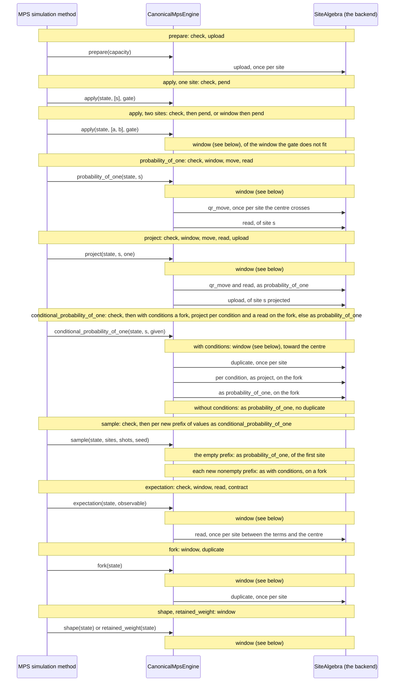

# The canonical-form MPS engine: its phases, methods, backend calls, MPO windows and numerics

This page says how [the engine](../README.md#the-engine) of the crate's
README implements each `MpsEngine` method. It names the engine's
phases, then the phases each method runs, how and why. It lists the
backend operations each phase calls, in order. It says where each method
leaves the orthogonality centre. It says how a window that is not on
two neighbours is applied as an MPO, and why. It gives the numerics of
the engine's truncations and reads. The README's
[Concepts](../README.md#concepts) define the terms it uses.

## Phases

The engine defers work it can share. A gate waits, pending, until an
operation needs the tensors it changes. So the engine's work on a state
falls into eight phases. Each `MpsEngine` method combines some of them
([the table below](#how-each-mpsengine-method-is-implemented)):

- **check**: the method's `tensornet::checks` function, so the backend
  never sees a refused call.
- **pend**: a gate is multiplied into a pending gate, on the host, with
  no backend call.
- **window**: the pending window is applied. On two neighbours, one
  `gate_split` applies it and truncates. Otherwise it is applied as an
  [MPO](../README.md#concepts): its span's sites are read, multiplied on the host and
  uploaded, then compressed by `qr_move`s and one `gate_split` per cut.
  The centre is left on the end of the span the next operation needs.
- **move**: the centre moves one site at a time, by one `qr_move` per site
  crossed. Each applies the pending gate of the site it leaves.
- **read**: a site is copied to the host (`read`), its pending gate
  applied.
- **contract**: the expectation's products of host matrices, by the
  [dense linear algebra](../README.md#the-dense-linear-algebra).
- **upload**: a site computed on the host becomes a backend tensor
  (`upload`).
- **duplicate**: the backend copies every site (`duplicate`).

## How each `MpsEngine` method is implemented

The table names the phases each method runs, in order.

| `MpsEngine` method               | Phases                                                                                                          | How                                                                                                                                                                                                                                                                     | Why                                                                                                                                                                                                                                                                                                                        |
| -------------------------------- | --------------------------------------------------------------------------------------------------------------- | ----------------------------------------------------------------------------------------------------------------------------------------------------------------------------------------------------------------------------------------------------------------------- | -------------------------------------------------------------------------------------------------------------------------------------------------------------------------------------------------------------------------------------------------------------------------------------------------------------------------- |
| `prepare`                        | check; upload                                                                                                   | One site holding $\lvert 0 \rangle$ per qubit, its bonds of extent 1. The centre is on site 0, and the retained weight is 1.                                                                                                                                            | A product state needs no split. The bonds grow only as gates entangle.                                                                                                                                                                                                                                                     |
| `apply`, one site                | check; pend                                                                                                     | The gate joins the pending window's operator when its site is in the window. Otherwise it joins its site's pending gate.                                                                                                                                                | The next application of the window, or move of the centre, applies it in a call it makes anyway.                                                                                                                                                                                                                           |
| `apply`, two sites               | check; pend, or window then pend                                                                                | The gate joins the pending window when the window's sites and its own number at most three. Otherwise the window is applied, toward the gate's lower site, and the gate opens a new window.                                                                             | The gates on up to three sites share one application ([fusion](../README.md#concepts)). On two neighbours it is one split. Otherwise it is an [MPO](../README.md#concepts), which keeps the chain in the caller's order and truncates only at the caller's cuts ([Windows applied as an MPO](#windows-applied-as-an-mpo)). |
| `probability_of_one`             | check; window, toward the site; move; read                                                                      | The weights of the centre's site's values are summed. P(One) is the One value's weight over both values' weights.                                                                                                                                                       | When the other value's weight is positive and finite, a value of weight exactly zero reads exactly 0. A gate's drift from norm 1 divides out on the centre's site ([Numerics](#numerics)).                                                                                                                                 |
| `project`                        | check; window, toward the site; move; read; upload                                                              | Refused, leaving what every read sees unchanged, when the value's probability `p` is zero or NaN. Otherwise the other value's elements are zeroed, and the site is divided by the norm of what it kept, computed scaled. Returns `p`. The retained weight is unchanged. | Up to rounding, the state's norm is 1, however few digits `p` holds.                                                                                                                                                                                                                                                       |
| `conditional_probability_of_one` | check; window and duplicate (a fork), with conditions; as `project` per condition; then as `probability_of_one` | The conditions are projected in order on one fork, each refused as `project` refuses. Without conditions, the state is read directly. An answer of NaN is refused, as `project` refuses it.                                                                             | The caller's state is not projected. Each value is read from its own weight, so a rare condition whose complement rounds to 1 is not refused.                                                                                                                                                                              |
| `sample`                         | check; as `conditional_probability_of_one` per new prefix                                                       | `tensornet::sampling`'s shared sampler, over this engine's conditional probabilities.                                                                                                                                                                                   | One sampler for every engine, so the rule for drawing values is written once. A value of probability zero is never drawn, and one of NaN is refused.                                                                                                                                                                       |
| `expectation`                    | check; window, toward the centre; read; contract                                                                | The sites between the terms and the centre are read once each. The terms walk their factors in site order, the terms that start alike sharing one path, from the plain chain's environments. The sum is divided by the squared norm at the centre.                      | A chemistry reading holds hundreds of Pauli strings that share their sites. One walk per term would read the sites many times over.                                                                                                                                                                                        |
| `fork`                           | window, toward the centre; duplicate                                                                            | The copy keeps the centre, the pending one-site gates, the retained weight and the statistics.                                                                                                                                                                          | A pending window is applied once, in the parent, not once per fork. A fork is the same state.                                                                                                                                                                                                                              |
| `shape`                          | window, toward the centre                                                                                       | The extents of the chain's bonds.                                                                                                                                                                                                                                       | A pending window's truncation sets its bonds.                                                                                                                                                                                                                                                                              |
| `retained_weight`                | window, toward the centre                                                                                       | The product of the splits' retained fractions.                                                                                                                                                                                                                          | A pending window's truncations set their retained fractions. The chain's norm stays about 1, so the weight is kept apart.                                                                                                                                                                                                  |

## Backend calls of each phase

Each band of the diagram is one `MpsEngine` method, or one case of
`apply`. It shows the phases the method runs, and their `SiteAlgebra`
operations in order. The check and the pend phases call no operation.



A "window" step runs only when a window is pending. Its calls depend on
the window's sites:

- **Two neighbours:** `qr_move`s bring the centre onto the pair, then
  one `gate_split` runs.
- **Any other window** is an MPO on a span of $d + 1$ sites
  ([Windows applied as an MPO](#windows-applied-as-an-mpo)). Its calls
  are, in order: `qr_move`s to bring the centre into the span; per site
  of the span, a `read`, then an `upload` of the site multiplied by its
  operator tensor; $d - 1$ `qr_move`s across the span; and $d$
  `gate_split`s, one per cut, the identity as gate.

## Where the centre goes

The centre moves only as far as an operation needs. Applying a window
leaves it on the end of the window's span the next operation needs. So a
sequence of operations on nearby sites moves it little. After each
method, with $c$ the centre before it:

| `MpsEngine` method                 | The centre after it                                                                                                                                                                          |
| ---------------------------------- | -------------------------------------------------------------------------------------------------------------------------------------------------------------------------------------------- |
| `prepare`                          | site 0                                                                                                                                                                                       |
| `apply`, one site                  | $c$: the gate waits, pending                                                                                                                                                                 |
| `apply`, two sites                 | $c$ when the gate joins the pending window or opens one. Otherwise, the end of the applied window's span nearer the gate's lower site.                                                       |
| `probability_of_one`, `project`    | the site read. The pending window is applied toward it first, which leaves the centre on its span's end nearer the site.                                                                     |
| `conditional_probability_of_one`   | With conditions, as for `fork`: the conditions and the read are on the fork. Without, as for `probability_of_one`.                                                                           |
| `sample`                           | The first site sampled, when it asks for a probability, since its first read is that site's, without conditions. $c$ when it asks for none (no shots, no sites, a refusal, too many values). |
| `expectation`                      | $c$. When a window is pending, the end of its span nearer $c$. The reads copy the sites to the host without moving it.                                                                       |
| `fork`, `shape`, `retained_weight` | As for `expectation`. A fork starts with its parent's centre.                                                                                                                                |

## Windows applied as an MPO

A window that is not on two neighbours (on sites further apart, or on
three sites) acts on more than a pair, so no split can apply it. The
engine applies it as an [MPO](../README.md#concepts) across its span: it
factors the window's operator on the host, multiplies each site of the
span by its tensor, then compresses the span back by splits.
[`src/engine/mpo.rs`](../src/engine/mpo.rs) walks the three steps, its
functions with a diagram each. This section says why the approach loses
little weight, what it costs, and why routing by SWAPs is not used.

Here, a split of the compression, at cut 2 of a chain of six, before and
after it runs:

```text
  Before: the gated pair θ, on sites 2 and 3

  site:   0        1           2     3          4        5
                            ┌───────────┐
          L₀ ───── L₁ ───── │     θ     │ ───── R₄ ───── R₅
                            └───────────┘

  After: θ = U·diag(s)·V†, cut at bond 2

  site:   0        1        2           3        4        5
          L₀ ───── L₁ ───── U ─── s ─── V† ───── R₄ ───── R₅
                                  ↑
                                cut 2

  L: an isometry towards the cut from the left; R: from the right
  U, V†: isometries; s: θ's singular values, of which the split keeps
  the largest and absorbs them into the centre's site
```

The sites left of the cut, with $U$, give orthonormal states
$\lvert L_k \rangle$ of sites 0 to 2. Those right of it, with $V^\dagger$,
give orthonormal states $\lvert R_k \rangle$ of sites 3 to 5. So the split
factors the state's exact Schmidt decomposition at the caller's cut 2:

$$
\lvert \psi \rangle = \sum_k s_k \, \lvert L_k \rangle \lvert R_k \rangle,
\qquad
\langle L_j \vert L_k \rangle = \langle R_j \vert R_k \rangle = \delta_{jk}.
$$

Keeping its largest $s_k$ gives a closest state, in norm, of that bond,
and the state must fit the capacity at that cut anyway. An MPO thus
discards only:

- what the cutoff drops at its splits (negligible at `DEFAULT_CUTOFF`);
- what the capacity cuts at the caller's cuts;
- in the factorisation of the operator, the part at or below the
  operator's rank cutoff (`OPERATOR_RANK_CUTOFF`, in
  [`cutoffs.rs`](../src/engine/cutoffs.rs)) times the largest singular
  value. The retained weight does not count it.

**The cost.** The operator's bond $D$ is 2 for a CNOT, and at most 4 for
any window. A window on a span of $d + 1$ sites costs:

- the moves that bring the centre into the span;
- $d - 1$ moves of the centre and $d$ splits, each on matrices up to
  $\chi D$ on a side, with $\chi$ the capacity's largest bond;
- the reads, products and uploads of the span's sites on the host.

Every backend call is one the engine already makes elsewhere: moves and
splits as for a gate, reads and uploads as for a projection.

**Compared with routing by SWAPs.** Routing by SWAPs moves the window's
last site down, by adjacent SWAPs, until it neighbours the first. It
applies the gate to that pair, then moves the site back. Each SWAP is
a split. On a CNOT on sites 1 and 4 of six, the qubits' order after
each split, and the cut it factors:

```text
  split        qubits' order    cut factored       a caller's cut?
  SWAP 3, 4    0 1 2 4 3 5      0 1 2 4 │ 3 5      no
  SWAP 2, 3    0 1 4 2 3 5      0 1 4 │ 2 3 5      no
  CNOT 1, 2    0 1 4 2 3 5      0 1 │ 4 2 3 5      yes: cut 1
  SWAP 2, 3    0 1 2 4 3 5      0 1 2 │ 4 3 5      yes: cut 2
  SWAP 3, 4    0 1 2 3 4 5      0 1 2 3 │ 4 5      yes: cut 3
```

The MPO factors the same CNOT by three splits, one at each of cuts 1, 2
and 3. The two compared, for sites $d$ apart:

| Compared                    | MPO                                                                                        | Routing by SWAPs                                                 |
| --------------------------- | ------------------------------------------------------------------------------------------ | ---------------------------------------------------------------- |
| Backend calls over the span | $d$ splits and $d - 1$ moves                                                               | $2(d - 1) + 1$ splits                                            |
| Gates per window            | the window's, fused on up to three sites                                                   | one: a route acts on a pair at a time                            |
| The cuts its splits factor  | the caller's only                                                                          | $d - 1$ outbound splits at cuts that are not the caller's        |
| A split's matrices          | up to $\chi D$ on a side, split back to the capacity                                       | up to $2\chi$ on a side at a cut that is not the caller's        |
| What it drops               | the cutoff's tail and the capacity's cut, at the caller's cuts; the operator's rank cutoff | also a tail below the cutoff, at cuts outside the caller's order |

A cut that is not the caller's may need twice the bond of the caller's
cut below it, so up to $2\chi$: one qubit has moved across it.
Truncated to the capacity, a route loses weight from states that fit it
in the caller's order. Kept within $2\chi$, it pays for bonds the caller
never asked for. [The crate's MPO tests](../src/engine/mpo/tests.rs)
hold a case: a state whose Schmidt weights at the caller's cuts all
exceed the cutoff, where the MPO keeps a weight of 1 and a route would
end near 0.98.

**What it saves.** With fusion, on one shot of the H₂ phase estimation
at $\chi = 128$, the engine makes 5.4× fewer splits than gate by gate
with SWAP routing. Where each split is latency-bound, as on a GPU, time
follows the splits. On a 12-qubit circuit at $\chi = 128$, where the
spans' bonds grow largest, the time stayed about the same.

## Numerics

**The truncation.** A split's `gate_split` gets the engine's cutoff, and
as its cap the capacity's bond at the cut. It truncates within the bounds
of its contract ([`site_algebra.md`](site_algebra.md)). Every split, an
MPO's included, is at a caller's cut, so every split leaves a bond at
rest. Inside an MPO's span, a bond grows before its split. It reaches at
most the capacity's times the operator's bond, which is at most 4
([Windows applied as an MPO](#windows-applied-as-an-mpo)). A split
normalises the values it keeps, so the chain keeps a norm of about 1.

**The retained weight.** Each split returns the retained fraction
$f \in (0, 1]$, the share of the squared singular values it kept. The
state's retained weight is the product of the retained fractions,
$W = \prod_i f_i$. It does not count the part of a window's operator
that its factorisation drops, at or below the operator's rank cutoff
([Windows applied as an MPO](#windows-applied-as-an-mpo)). The engine
keeps $W$ apart from the chain's norm. Callers divide by $W$, so it must
not reach zero. So the engine fails a split with `WeightUnderflow` when
$W$ would fall below the smallest normal `f64`, about `2.2e-308`.

**A probability.** With the centre on site $s$, the rest of the chain
drops out of the site's reads. Let $T$ be the centre's tensor, its
pending gate applied. The weight of a value $b$ is
$w_b = \sum_{a,c} \lvert T[a, b, c] \rvert^2$, and

$$P(b) = \frac{w_b}{w_0 + w_1}.$$

[`measurement.rs`](../src/engine/measurement.rs) states the rules a
read keeps: each value's probability comes from its own weight, and the
state is unchanged.

**A gate's drift.** A checked gate may drift from norm 1 within the
unitarity check's tolerance (`tensornet::checks::UNITARITY_TOLERANCE`).
On the centre's site the drift divides out, since every read divides by
the squared norm at the centre. Elsewhere it shifts reads by at most that
order.

**A projection.** It returns $p = P(b)$, and refuses $p$ of zero or NaN.
It zeroes the other value's elements, and divides the site by the norm
of what it kept. It computes that norm as
$m \sqrt{\sum_x \lvert x / m \rvert^2}$ over the kept elements $x$,
with $m$ their largest modulus, not as $\sqrt{p}$. So, up to rounding,
the site it hands the algebra, and with it the state, has a norm of 1,
even when $p$ is subnormal. Later projections then stay possible. It
truncates nothing, so $W$ is unchanged. It does not compress the chain
again: `CanonicalMpsEngine`'s `project`, in
[`engine.rs`](../src/engine.rs), says why.

**An expectation.** An observable $c_0 + \sum_k c_k P_k$, each $P_k$ a
product of one-site Paulis, has the value

$$c_0 + \sum_k c_k \frac{\langle \psi \vert P_k \vert \psi \rangle}{\lVert T_\text{centre} \rVert^2}.$$

The sites left of the centre are isometries from the left. So the
environment on any bond left of the centre is the identity, and likewise
from the right. A term's contraction runs only over the sites between its
own and the centre.
[`expectation.rs`](../src/engine/expectation.rs) says how the terms are
evaluated together, each site read once.
