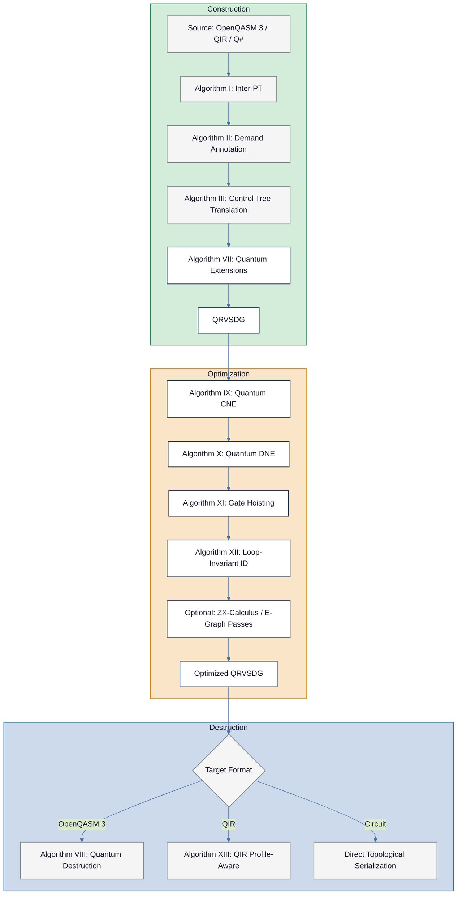

# QRVSDG Addendum: Consolidated Algorithms for Classical and Quantum Compilation

**Companion to:** *QRVSDG: A Regionalized Value State Dependence Graph for Hybrid Quantum-Classical Compilation*

**Source Papers:**

- [1] Reissmann, Meyer, Bahmann, Själander. "RVSDG: An Intermediate Representation for Optimizing Compilers." ACM TECS 19(6), 2020.
- [2] QRVSDG paper (this work).

## Overview

This addendum consolidates all algorithms from the RVSDG [1] and QRVSDG [2] papers into a single reference document. For each classical RVSDG algorithm (I–VI), we present the original specification followed by its quantum extension (VII–X). Two additional algorithms (XI–XII) formalize quantum gate hoisting and loop-invariant quantum identification. A final algorithm (XIII) specifies QIR interoperability translation.

Terminology cross-reference: for the reason this addendum uses `Eff` (instead of overloaded "state") in typing notation, see the disambiguation rationale in the Notation section.

The algorithms are organized in three groups:

1. **Construction** (Algorithms I, II, III, VII): Building the (Q)RVSDG from source programs.
2. **Destruction** (Algorithms IV, VIII, XIII): Recovering control flow and quantum assembly from the (Q)RVSDG.
3. **Optimization** (Algorithms V, VI, IX, X, XI, XII): Transforming the (Q)RVSDG to improve programs.

## Notation

The following notation is used throughout, combining conventions from both papers:

| Symbol | Meaning |
|--------|---------|
| $\mathcal{R} = (A, N, E, Res)$ | Region with arguments $A$, nodes $N$, edges $E$, results $Res$ (written $R$ in [1, 2]; renamed here to avoid collision with region annotations $R_U, R_H, R_{EC}$) |
| $n$ | A node (simple or structural) |
| $I_n, O_n$ | Input tuple and output tuple of node $n$ |
| $I_q(n)$ | Quantum-typed inputs of node $n$ |
| $i^k_n, o^k_n$ | $k$-th input and $k$-th output of node $n$ |
| $\text{origin}(i)$ | The output that input $i$ is connected to |
| $\text{users}(o)$ | The set of inputs connected to output $o$ |
| $\text{classical\_inputs}(n)$ | Ordered tuple of classical inputs to node $n$ |
| $a \cong b$ | $a$ and $b$ are congruent (produce identical results) |
| $EV = \{(i, A)\}$ | Entry variables of a γ-node (input $i$, arguments $A = \{a^{R_0}, \ldots, a^{R_k}\}$) |
| $EX = \{(R, o)\}$ | Exit variables of a γ-node (results $R = \{r^{R_0}, \ldots, r^{R_k}\}$, output $o$) |
| $LV = \\{(i, a, r, o)\\}$ | Loop variables of a θ-node (input $i$, argument $a$, result $r$, output $o$). Per [1] Def. 3: for the $l$-th loop variable, $r$ is the $(l+1)$-th result (index 0 is the predicate) |
| $CV = \{(i, a)\}$ | Context variables of a λ-/φ-node (input $i$, argument $a$) |
| $RV = \\{(r, a, o)\\}$ | Recursion variables of a φ-node (result $r$, argument $a$, output $o$). Per [1] Def. 6: for a φ-node with $n$ context variables, the $l$-th recursion variable's argument is the $(l+n)$-th φ-region argument |
| call-node (apply-node) | Call-site node that invokes a λ-node subroutine |
| $O_q(n)$ | Quantum-typed outputs of node $n$ |
| $O_c(n)$ | Classical-typed outputs of node $n$ |
| $\text{type}(e)$ | Type of edge $e$ (Qubit, LogicalQubit(code, $d$), MResult($S$), Int, Float, Bool, Eff$_d$, QFunc) |
| $\text{Array}(\tau, n)$ | Homogeneous fixed-size array of $n$ values of type $\tau$ |
| $\text{Tuple}(\tau_1, \ldots, \tau_k)$ | Heterogeneous product type |
| $\text{Struct}(\text{name}, \text{fields})$ | Named product with labeled fields |
| $\text{linear}(\tau)$ | Predicate: true if $\tau$ contains quantum data |
| $\text{contains\_quantum}(\tau)$ | Predicate: true if $\tau$ contains Qubit or LogicalQubit at any nesting depth |
| $\text{contents}(\text{arr})$ | Identity-to-container mapping: qubit identities within compound value |
| ArraySwap$(j)$ | Element exchange at static index $j$ |
| ArrayMultiGate$(\text{gate}, \text{indices})$ | In-place gate application to selected array elements |
| ArrayApplyGate$(j, \text{gate})$ | Shorthand for ArrayMultiGate$(\text{gate}, (j))$ |
| ArrayTransport$(Z_{\text{src}} \to Z_{\text{dst}})$ | Bulk zone transition for array of qubits |
| VIII-CE | Algorithm VIII-CE: Compound Elimination pre-destruction pass |
| X-DFE | Algorithm X-DFE: Dead Field Elimination |
| SROA | Scalar Replacement of Aggregates |

**QRVSDG typing invariants (enforced by all algorithms):**

$$\forall o \in O_q(n) : |\text{users}(o)| = 1 \quad \text{(no-cloning: quantum outputs have exactly one user)}$$

$$\forall o \in O_c(n) : |\text{users}(o)| \geq 0 \quad \text{(classical outputs may fan out)}$$

Here, `Eff` denotes the RVSDG effect token (called the state edge in [1]) used for ordering side effects. The main paper [2] §4.1 defines three independent effect domains (`Eff_qpool` for qubit allocation, `Eff_cmem` for classical memory, `Eff_io` for I/O); for brevity, this addendum uses `Eff` to refer to the relevant domain-specific token unless domain distinction matters. `MResult(S)` is the measurement outcome type parameterized by outcome set $S$ (see [2] §4.1); the default $S = \{0, 1\}$ may be written simply as `MResult`. A convenience alias `Bit` $\equiv$ `MResult({0, 1})` is used in target-language emission (e.g., OpenQASM 3 `bit = measure qubit;`) where only binary outcomes are relevant. `LogicalQubit(code, d)` (see [2] §4.3) is the type of logical qubits within $R_{EC}$ regions, parameterized by error-correcting code family and code distance.

Disambiguation rationale: this addendum uses `Eff` to separate side-effect sequencing from quantum data semantics. "Quantum state" denotes Qubit-typed program values, while `Eff` denotes only the ordering carrier used to sequence side effects.

---

## Part 1: Construction Algorithms

### Algorithm I: Inter-Procedural Translation (RVSDG)

*Source: [1] Section 5.1*

Compute all SCCs in an Inter-Procedure Graph (IPG) and process them in topological order of the DAG formed by the SCCs as follows:

**1. Trivial SCC:**

- **(a) Function with CFG:** Begin a λ-node by adding all context variables, function arguments, and an additional state argument to the λ-region. Translate the CFG with Intra-PT (Section 5.1.2 of [1]), and finish the λ-node by adding the function results and the state result to the λ-region. If a function is exported, add a result to the ω-region and connect the λ-node's output to it.

- **(b) Global variable with CFG:** Begin a δ-node by adding all context variables to the δ-region. Translate the CFG with Intra-PT, and finish the δ-node by adding the result to the δ-region. If a global variable is exported, add a result to the ω-region and connect the δ-node's output to it.

- **(c) Without CFG:** Add an ω-region argument for the external entity.

**2. Non-trivial SCC:** Begin a φ-node by adding all functions/global variables as well as context variables to the φ-region. Translate each entity in the SCC according to Trivial SCC without exporting them. Finish the φ-node by adding all outputs as results to the φ-region. If an entity is exported, add a result to the ω-region and connect the φ-node's output to it.

---

### Algorithm II: Demand Annotation (RVSDG)

*Source: [1] Section 5.1.2*

**1. Read-Write Annotation:** Process the control tree nodes in post-order as follows:

- **Basic Block:** For each instruction $i$ processed bottom-up, the read set is $R = (R \setminus W_i) \cup R_i$. The write set is $W = \bigcup W_i$.

- **Linear Node:** For each child $c$ processed right to left, the read set is $R = (R \setminus W_c) \cup R_c$. The write set is $W = \bigcup W_c$.

- **Branch Node:** For each child $c$, the read set and write set is $R = \bigcup R_c$ and $W = \bigcap W_c$, respectively.

- **Loop Node:** For the child $c$, the read set and write set is $R = R_c$ and $W = W_c$, respectively.

**2. Demand-Set Annotation:** Process the control tree nodes with an empty demand set $D_t$ as follows:

- **Basic Block:** Set $D = D_t = (D_t \setminus W) \cup R$ and continue processing.

- **Linear Node:** Recursively process the children right to left. Set $D = D_t = (D_t \setminus W) \cup R$ and continue processing.

- **Branch Node:** Set $D_{tmp} = D_t$. Recursively process each child with a copy of $D_t$. Set $D = D_t = (D_{tmp} \setminus W) \cup R$ and continue processing.

- **Loop Node:** Set $D = D_t \cup R$. Recursively process the child with $D_t = D$ and continue processing.

---

### Algorithm III: Control Tree Translation (RVSDG)

*Source: [1] Section 5.1.2*

Process the control tree nodes as follows:

- **Basic Block:** Process the node's operations top-down creating simple nodes in the RVSDG.

- **Linear Node:** Recursively process the node's children top-down.

- **Branch Node:** Begin a γ-node with inputs according to the node's demand set. Create subregions by recursively processing the node's children. Finish the γ-node with outputs according to the branch merge-demand set at the branch boundary.

- **Loop Node:** Begin a θ-node with inputs according to the node's demand set. Create its region by recursively processing its child. Finish the θ-node with outputs according to its demand set.

---

### Algorithm VII: Quantum Inter-Procedural Translation (QRVSDG)

*Source: [2] Section 5.1. Extends Algorithm I.*

Extend Algorithm I with the following quantum-specific rules, applied during Intra-PT processing of each region:

**1. Qubit allocation:** For each `qubit` declaration, create a Prep node in the corresponding region with output type Qubit. Register the output edge in the quantum symbol table.

**2. Gate operations:** For each gate application `gate(params) qubits`, create a UGate simple node:

- Connect quantum inputs from the current qubit state edges (looked up in quantum symbol table).
- Connect classical inputs from parameter value edges (looked up in classical symbol table).
- Quantum outputs produce new qubit state edges; update the quantum symbol table for each affected qubit:

```
for i, q in enumerate(qubits):
    symbol_table.update_qubit_edge(q, node.quantum_output(i))
```

**3. Measurement:** For each `measure` statement, create a Measure node:

- Connect quantum input from the measured qubit's current state edge.
- Register the `MResult(S)` output in the classical symbol table, where $S$ is determined by the target hardware's outcome set.
- Register the post-measurement Qubit output in the quantum symbol table (replacing the consumed edge).

**4. Classical control flow:** `if`/`else` constructs map to γ-nodes using the standard CFR → structural analysis → demand annotation (Algorithm II) → control tree translation (Algorithm III) pipeline. The predicate input is a classical `MResult(S)` from a measurement (or a Bool/Int for non-measurement branching). For measurement-driven branching, the γ-node has $|S|$ subregions (one per outcome), ensuring exhaustive handling of all hardware-specific measurement outcomes.

Quantum state edges flowing into the γ-node become entry variables. Each region has a corresponding quantum entry argument, and at runtime exactly one selected region consumes the active state. Quantum state edges flowing out become exit variables, subject to the linear typing constraint.

**5. Loops:** `while`/`for` constructs map to θ-nodes. Quantum states flowing through the loop become quantum loop variables with linear typing:

- The quantum state from one iteration's result $r$ maps to the next iteration's argument $a$.
- The predicate is always classical-typed.

**6. Subroutine definitions (`def`, `gate`):** Map to λ-nodes. Gate definitions produce λ-nodes with unitary region annotation ($R_U$). Subroutines containing measurements produce λ-nodes with hybrid region annotation ($R_H$).

**7. Uncomputation patterns (conjugation):** Map to Conjugate structural nodes (see [2] §4.2.1). The outer block (e.g., Q#'s `within` block) becomes the $\mathcal{R}_{\text{outer}}$ region (annotated $R_U$); the inner block (e.g., Q#'s `apply` block) becomes the $\mathcal{R}_{\text{inner}}$ region. The compiler auto-generates the adjoint of $\mathcal{R}_{\text{outer}}$ for the third phase. Through-qubits thread linearly through all three phases; ancilla-qubits are guaranteed restored to $|0\rangle$.

**8. Linear Type Verification:** At each region boundary, verify:

- $\forall o \in O_q(n) : |\text{users}(o)| = 1$ (every quantum output has exactly one user).
- Every quantum argument is transitively consumed (reaches a result, measurement including `MeasureD`, or another consuming quantum operation).

**9. Compound value tracking:** The qubit symbol table gains compound-value tracking. When constructing from a source language declaration such as `use q = Qubit[n]` (Q#) or `qubit[n] q` (OpenQASM 3), create a PrepRegister node to allocate the compound value and register `q` as $\text{Array}(\text{Qubit}, n)$ in the symbol table.

**10. Construction-time loop unrolling:** When the source language contains a loop over array elements with a statically known bound (e.g., `for i in 0..n { H(q[i]); }`), and $n$ is known at construction time, unroll the loop into $n$ individual ArrayApplyGate nodes rather than creating a θ-node. This avoids dynamic indices in the static-only index strategy (Phase 1).

**11. Compound literal construction:** When the source language constructs a tuple or struct (e.g., Q# tuple expression `(a, b, c)` or struct literal `new MyStruct { ... }`), emit TupleConstruct or StructConstruct nodes with appropriate edges.

**12. Array element access:** When the source language accesses an array element (e.g., `q[i]`), and $i$ is a compile-time constant, emit ArraySwap with a placeholder qubit (via Prep) to extract the element. If $i$ is not a compile-time constant, use γ-node branching to enumerate possible index values (Phase 1 strategy). Dynamic indices are deferred to Phase 2.

---

### Algorithm VII-B: Construction from QIR (QRVSDG)

*Source: [2] Section 5.2. Extends Algorithm I via QIR-specific pattern recognition.*

**1. Qubit identification:** For each `inttoptr (i64 k to ptr)` pattern, assign qubit identifier $k$. Track static vs. dynamic qubit management via module flags `dynamic_qubit_management`.

**2. QIS function recognition:** For each call to `@__quantum__qis__<gate>__body(ptr, ...)`:

- Extract gate name from the function name suffix.
- Extract qubit operands from `ptr` arguments (resolve `inttoptr` patterns to qubit identifiers).
- Create a UGate simple node with appropriate quantum and classical inputs.
- Update the quantum symbol table with new qubit state edges.

**3. Measurement recognition:** For each call to `@__quantum__qis__mz__body(ptr, ptr writeonly)`:

- Create a Measure node consuming the qubit state edge.
- Register the result pointer for subsequent `@__quantum__rt__read_result(ptr readonly)` calls.

**4. Result reading:** For each call to `@__quantum__rt__read_result(ptr readonly) -> i1`:

- Create a classical value edge from the corresponding Measure node's `MResult(S)` output.

**5. Control flow recovery:** Apply standard RVSDG control flow restructuring (CFR) [1, Bahmann et al. 2015] to the LLVM IR basic block structure:

- For Base Profile inputs: the single-block body maps to a flat sequence of simple nodes.
- For Adaptive Profile inputs: conditional `br i1` instructions map to γ-nodes; backward branches map to θ-nodes.

**6. Inter-procedural structure:** Process `entry_point` function attributes to identify the main λ-node. Process module metadata (`qir_major_version`, `qir_minor_version`) for version compatibility.

---

## Part 2: Destruction Algorithms

### Algorithm IV: Inter-Procedural Control Flow Recovery (RVSDG)

*Source: [1] Section 5.2*

**1.** Create IPG nodes for all arguments of the ω-region.

**2.** Process all nodes of the ω-region in topological order as follows:

- **λ-nodes:** Create an IPG node, and mark it exported if the λ-node's output has an ω-region's result as user. For every context variable $cv = (i, a)$, add an edge from the λ-node's IPG node to the corresponding IPG node of the producer of $i$. Create a CFG from the λ-node's subregion (via Intra-PCFR [Bahmann et al.]) and attach it to the IPG node.

- **δ-nodes:** Create an IPG node, and mark it exported if the δ-node's output has an ω-region's result as user. For every context variable $cv = (i, a)$, add an edge from the δ-node's IPG node to the corresponding IPG node of the producer of $i$. Create the expression from the δ-node's subregion and attach it to the IPG node.

- **φ-nodes:** For every argument of the φ-region, create an IPG node for the corresponding δ-/λ-node and add IPG edges from this node to the corresponding IPG nodes of the context variables. Translate the δ-/λ-nodes in the φ-region according to the rules above. Mark the IPG node as exported if the corresponding φ-node's output has an ω-region's result as user.

---

### Algorithm VIII: Quantum Destruction to Quantum Assembly (QRVSDG)

*Source: [2] Section 5.3. Extends Algorithm IV.*

**1.** Process the ω-region's nodes in topological order.

**2.** For each node type, emit corresponding quantum assembly:

- **λ-nodes:** Create a quantum subroutine definition (`def` or `gate` in OpenQASM 3):
  - If region annotation is $R_U$ (unitary), emit a `gate` definition.
  - If region annotation is $R_H$ (hybrid), emit a `def` subroutine.
  - Process the λ-region creating gate, measurement, and classical operations.

- **δ-nodes:** Emit constant declarations / hardware parameter configurations.

- **φ-nodes:** Unroll recursive structures to bounded depth, then emit as λ-nodes.

**3.** Within each region, serialize operations respecting the topological order:

- **UGate nodes:** Emit gate invocation statements `name(params) qubits;` (for example `rz(theta) q;`). Emit `gate` declarations separately when serializing reusable gate definitions.
- **Measure nodes:** Emit `bit = measure qubit;` statements.
- **Prep nodes:** Emit `qubit q;` declarations (implicit $|0\rangle$ preparation).
- **Reset nodes:** Emit `reset q;` statements.
- **Barrier nodes:** Emit `barrier q[...];` statements.

**4.** For structural nodes within regions:

- **γ-nodes:** Emit `if (predicate) { R_1 } else { R_0 }` (2-region) or `switch` (multi-region).
- **θ-nodes:** Emit `while (predicate) { body }` loops.
- **Conjugate nodes:** Emit the outer region, then the inner region, then the auto-generated adjoint of the outer region. In Q#, emit as `within { outer } apply { inner }`. In OpenQASM 3, emit as sequential blocks with explicit adjoint gate sequence.

**5.** For each qubit state chain (linear sequence of quantum edges), emit the corresponding wire in circuit order.

**6.** Circuit depth is lower-bounded by the longest dependency path in topological order, and equals that value only under the stated dependency model and scheduler assumptions.

**7. Compound type emission (target-aware):**

- **OpenQASM 3:** ArrayConstruct nodes emit `qubit[n]` register declarations. TupleConstruct and StructConstruct emit variable decomposition with metadata comments preserving struct names. ArraySwap nodes emit indexed register access `q[j]`.
- **Nested compounds:** Apply outside-in decomposition. For $\text{Array}(\text{Tuple}(\text{Qubit}, \text{Float}), n)$, peel the array level first, then the tuple level, emitting per-element declarations with appropriate type annotations.

---

### Algorithm VIII-CE: Compound Elimination (QRVSDG)

*Source: [2] Section 5.3 supplement. Pre-destruction pass.*

Algorithm VIII-CE is a pre-destruction pass that eliminates compound gate and transport nodes, leaving only basic compound construction/destruction nodes for target-aware emission in Algorithms VIII and XIII. If SROA runs during optimization, VIII-CE is unnecessary (compounds are already decomposed). If SROA is skipped (Level 0 optimization), VIII-CE is required for correctness.

**Input:** Optimized QRVSDG with compound types.

**Output:** QRVSDG with no ArrayMultiGate, ArrayApplyGate, or ArrayTransport nodes.

**Process:** Regions are processed recursively in topological order. For each compound node:

```
Case ArrayTransport(Z_src → Z_dst) [if target lacks bulk transport]:
    ArrayDestruct → per-element Transport with chained effects → ArrayConstruct

Case ArrayMultiGate(gate, indices):
    Prep placeholders →
    for idx in indices:
        ArraySwap(idx) to extract element →
        UGate(gate) on extracted element →
        ArraySwap(idx) to reinsert element →
    MeasureD placeholders

Case ArrayApplyGate(j, gate):
    Same as ArrayMultiGate with indices = (j,)
```

**Lowering order:**

1. ArrayTransport → per-element Transport (when target lacks bulk transport support)
2. ArrayMultiGate / ArrayApplyGate → ArraySwap + Gate sequences
3. ArraySwap → element-level operations
4. ArrayConstruct / ArrayDestruct → per-element allocation/deallocation patterns (handled by target-aware emission in Algorithm VIII or XIII)

**Remaining nodes** after VIII-CE (ArrayConstruct, ArrayDestruct, ArraySwap, TupleConstruct, TupleExtract, StructConstruct, StructExtract) are handled by target-aware emission in Algorithm VIII (OpenQASM 3) or Algorithm XIII (QIR).

---

### Algorithm XIII: QIR Profile-Aware Destruction (QRVSDG → QIR)

*Source: [2] Section 8.4. Targets QIR Base or Adaptive Profile.*

**Input:** Optimized QRVSDG. Target QIR profile (Base or Adaptive).

**1. Profile capability check:** Analyze the QRVSDG for features requiring specific profile capabilities:

| QRVSDG Feature | Required Profile |
|---|---|
| All measurements at end, no classical control | Base |
| Mid-circuit measurement (γ-node with Measure predicate) | Adaptive |
| Classical branching (γ-node with classical predicate) | Adaptive |
| Loops (θ-nodes) | Adaptive (backward branching) |
| Classical computation in regions | Adaptive (classical compute) |
| Recursion (φ-nodes) | Neither (must unroll) |

If the QRVSDG contains features beyond the target profile's capabilities, apply transformations:

- For Base Profile: apply deferred measurement principle only when each affected branch is provably unitary-equivalent under control lifting and has no branch-only irreversible side effects; otherwise reject Base lowering or require prior legalizing rewrites. Unroll all θ-nodes and inline all λ-node calls when required by profile restrictions.
- For Adaptive Profile without backward branching: unroll θ-nodes to bounded depth.

**2. Module setup:**

- Create LLVM module with module flags: `qir_major_version = 2`, `qir_minor_version = 1`, `dynamic_qubit_management = false` (default static).
- Set profile: `qir_profiles = "base_profile"` or `"adaptive_profile"`.

**3. Entry point generation from ω-node:**

- Identify the main λ-node (the exported function).
- Create entry point function with attributes: `"entry_point"`, `"qir_profiles"`, `"required_num_qubits"`, `"required_num_results"`, `"output_labeling_schema"`.

**4. Function body generation (per λ-node):**

**Base Profile (4-block structure):**

```llvm
entry:
  call void @__quantum__rt__initialize(ptr null)
  br label %body
body:
  ; [UGate nodes → __quantum__qis__<gate>__body calls]
  ; [All reversible operations in topological order]
  br label %measurements
measurements:
  ; [Measure nodes → __quantum__qis__mz__body calls]
  br label %output
output:
  ; [__quantum__rt__*_record_output calls]
  ret i64 0
```

**Adaptive Profile:**

- UGate nodes → `call void @__quantum__qis__<gate>__body(ptr %q, ...)`.
- Measure nodes → `call void @__quantum__qis__mz__body(ptr %q, ptr writeonly %r)`.
- Result reading → `%b = call i1 @__quantum__rt__read_result(ptr readonly %r)`.
- γ-nodes → `br i1 %b, label %then, label %else` with corresponding basic blocks.
- θ-nodes → backward `br` instructions (if backward branching capability is available).

**5. Qubit/Result encoding:**

- Static management: `inttoptr (i64 k to ptr)` for qubit $k$.
- Assign sequential indices to Prep nodes (qubit allocation order).
- Assign sequential indices to Measure nodes (result allocation order).

**6. Metadata emission:**

- Emit `required_num_qubits` = total Prep node count.
- Emit `required_num_results` = total Measure node count.

**7. Compound type emission:**

QIR v2.1 uses native LLVM aggregate types (replacing the custom `%Array`/`%Tuple` runtime types from QIR v1). Construction maps directly to LLVM aggregate instructions:

| QRVSDG Node | LLVM IR Pattern |
|---|---|
| ArrayConstruct$(\tau, n)$ | `[n x ptr]` with `insertvalue` chain |
| StructConstruct(name, fields) | `%name = type {...}` identified struct with `insertvalue` chain |
| TupleConstruct$(\tau_1, \ldots, \tau_k)$ | Anonymous struct `{τ_1, ..., τ_k}` with `insertvalue` chain |
| ArraySwap$(j)$ | `extractvalue` + `insertvalue` pair at index $j$ |

**Nested compounds:** $\text{Array}(\text{Tuple}(\text{Qubit}, \text{Float}), n)$ maps to `[n x {ptr, double}]` with nested `extractvalue` for element access and nested `insertvalue` for element update.

**Named struct types:** StructConstruct nodes emit LLVM identified struct types (e.g., `%MyStruct = type {ptr, double}`) using the struct name metadata from the edge annotation or fused node name list. If no name is available, an anonymous struct type is emitted.

---

### Struct Name Metadata Conventions

Struct names are source-level metadata that improve readability of emitted code but do not affect correctness. The following conventions govern how struct names are preserved through optimization and resolved during destruction.

**Edge-annotated provenance** (primary mechanism): Each value edge carries an optional `struct_name` metadata annotation. Set at StructConstruct time, propagated through structural nodes. When CNE diverts edges, the diverted edges carry the original user's name annotation.

**Fused node-level name list** (fallback): When CNE merges nodes, the surviving node accumulates `names: union(n1.names, n2.names)`.

**Per-pass metadata preservation rules:**

| Pass | Rule |
|---|---|
| CNE (IX) | Fuse node names on merge; preserve edge metadata on diverted edges |
| DNE (X) | No action (dead nodes unreachable) |
| X-DFE | Preserve struct name, drop dead field metadata |
| SROA | Attach `{origin_struct, origin_field}` provenance to each decomposed scalar edge |
| Hoisting / Pull-In (XI) | Metadata moves with the node |
| γ-node | Exit variable metadata is union of all region names if they differ |
| θ-node | Preserve input metadata if struct is unchanged across iterations |

**Destruction-time name resolution priority:**

1. Edge metadata (most specific)
2. Fused node name list, first entry
3. Reverse lookup from target type system symbol table
4. Synthetic `Struct_N` name (fallback)

Metadata is best-effort and correctness-independent. A struct without a name is still valid. This follows the same principle as LLVM debug info: metadata enhances diagnostics without affecting semantics.

---

## Part 3: Optimization Algorithms

### Algorithm V: Common Node Elimination (RVSDG)

*Source: [1] Section 6.1*

**1. Mark:** Process all nodes in topological order as follows:

- **Simple nodes:** Denote this node as $n$. Mark $n$ as congruent to all nodes $n'$ which represent the same operation and where $|I_n| = |I_{n'}| \wedge i^k_n \cong i^k_{n'}$ for all $k \in [0..|I_n|-1]$. Mark all outputs $o^k_n \cong o^k_{n'}$ for all $k \in [0..|O_n|-1]$.

- **γ-node:** For all entry variables $ev_1, ev_2 \in EV$ where $i_{ev_1} \cong i_{ev_2}$, mark $a^k_{ev_1} \cong a^k_{ev_2}$ for all $k \in [0..|A_{ev_1}|-1]$. Recursively process the γ-regions. For all exit variables $ex_1, ex_2 \in EX$ where $r^k_{ex_1} \cong r^k_{ex_2}$ for all $k \in [0..|R_{ex_1}|-1]$, mark $o_{ex_1} \cong o_{ex_2}$.

- **θ-node:** For all loop variables $lv_1, lv_2 \in LV$ where $i_{lv_1} \cong i_{lv_2} \wedge r_{lv_1} \cong r_{lv_2}$, mark $a_{lv_1} \cong a_{lv_2}$ and $o_{lv_1} \cong o_{lv_2}$. Recursively process the θ-region.

- **λ-node:** For all context variables $cv_1, cv_2 \in CV$ where $i_{cv_1} \cong i_{cv_2}$, mark $a_{cv_1} \cong a_{cv_2}$. Recursively process the λ-region.

- **φ-node:** For all context variables $cv_1, cv_2 \in CV$ where $i_{cv_1} \cong i_{cv_2}$, mark $a_{cv_1} \cong a_{cv_2}$. Recursively process the φ-region.

- **ω-node:** Recursively process the ω-region.

**2. Divert:** Process all nodes in topological order as follows:

- **Simple nodes:** Denote this node as $n$. For all nodes $n'$ which are congruent to $n$, divert all edges from $o^k_{n'}$ to $o^k_n$ for all $k \in [0..|O_n|-1]$.

- **γ-node:** For all entry variables $ev_1, ev_2 \in EV$ where $i_{ev_1} \cong i_{ev_2}$, divert all edges from $a^k_{ev_2}$ to $a^k_{ev_1}$ for all $k \in [0..|A_{ev_1}|-1]$. Recursively process the γ-regions. For all exit variables $ex_1, ex_2 \in EX$ where $r^k_{ex_1} \cong r^k_{ex_2}$ for all $k \in [0..|R_{ex_1}|-1]$, divert all edges from $o_{ex_2}$ to $o_{ex_1}$.

- **θ-node:** For all loop variables $lv_1, lv_2 \in LV$ where $a_{lv_1} \cong a_{lv_2} \wedge o_{lv_1} \cong o_{lv_2}$, divert all edges from $a_{lv_2}$ to $a_{lv_1}$ and from $o_{lv_2}$ to $o_{lv_1}$. Recursively process the θ-region.

- **λ-node:** For all context variables $cv_1, cv_2 \in CV$ where $i_{cv_1} \cong i_{cv_2}$, divert all edges from $a_{cv_2}$ to $a_{cv_1}$. Recursively process the λ-region.

- **φ-node:** For all context variables $cv_1, cv_2 \in CV$ where $i_{cv_1} \cong i_{cv_2}$, divert all edges from $a_{cv_2}$ to $a_{cv_1}$. Recursively process the φ-region.

- **ω-node:** Recursively process the ω-region.

**Complexity:** The mark phase processes each node once in topological order. For each simple node, candidates are found from users of the origin of the node's first input, avoiding costly all-node traversals. Constant nodes (no inputs) are stored separately per region. Commutative simple node inputs are sorted before comparison. Overall $O(N \cdot \alpha(N))$ using union-find for congruence tracking.

---

### Algorithm IX: Quantum Common Node Elimination (QRVSDG)

*Source: [2] Section 6.1. Extends Algorithm V.*

**Modifications to Algorithm V:**

**1. Mark phase: extended congruence for quantum nodes:**

- **UGate simple nodes:** Two UGate nodes $n_1$ and $n_2$ are congruent ($n_1 \cong n_2$) if:
  - They represent the same gate operation: $\text{op}(n_1) = \text{op}(n_2)$
  - They have the same number of inputs: $|I_{n_1}| = |I_{n_2}|$
  - All corresponding inputs originate from congruent sources: $i^k_{n_1} \cong i^k_{n_2}$ for all $k$

- **Extended identity congruence:** Additionally mark as congruent nodes matching known quantum identities:
  - $R_z(\pi/4) \cong T$
  - $R_z(\pi/2) \cong S$
  - Gate sequences recognized as identities: $HH \cong I$, $XX \cong I$, $\text{CNOT} \cdot \text{CNOT} \cong I$

- **Measurement nodes:** Two Measure nodes are congruent if they have the same basis, the same outcome set $S$, and their quantum inputs are congruent. Classical (`MResult(S)`) outputs are marked congruent at the *distributional* level (same outcome probability distribution), not the *instance* level (same realized value). Because measurement is inherently non-deterministic, `MResult(S)` congruence is recorded for downstream structural passes (e.g., Push-Out) but must not be used to divert (merge) measurement outputs.

- **Structural nodes:** All structural node rules from Algorithm V apply unchanged, with additional quantum-type awareness propagated through entry/exit/loop/context variables.

**2. Divert phase: no-cloning constraint:**

- **Simple nodes with all classical-typed outputs:** Divert as in Algorithm V (standard edge redirection).

- **Simple nodes with any quantum-typed output:** **Do not divert any outputs** (no-cloning for quantum outputs; non-determinism for measurement classical outputs). Record the congruence information for downstream passes (Push-Out, dead code analysis).

  Formally: For congruent nodes $n_1 \cong n_2$ where $\exists k : \text{type}(o^k_{n_2}) = \text{Qubit}$: skip all diversions and annotate congruence for downstream passes.

- **λ-nodes (cross-function CNE):** Two λ-nodes with congruent bodies define the same subroutine. All call-node references to the redundant λ-node can be diverted to the canonical one. DNE (Algorithm X) then removes the dead λ-node.

**Complexity:** Same as Algorithm V: $O(N \cdot \alpha(N))$. The quantum typing check adds $O(1)$ per output during diversion.

---

### Algorithm VI: Dead Node Elimination (RVSDG)

*Source: [1] Section 6.2*

**1. Mark:** Mark output or argument as alive and continue as follows:

- **ω-region argument:** Stop marking.

- **φ-node output:** Mark the result origin of the corresponding recursion variable.

- **φ-region argument:** Mark the input origin if the argument belongs to a context variable. Otherwise, mark the output of the corresponding recursion variable.

- **λ-node output:** Mark all result origins of the λ-region.

- **λ-region argument:** Mark the input origin if the argument is a dependency (context variable).

- **θ-node output:** Mark the θ-node's predicate origin as well as the result and input origin of the corresponding loop variable.

- **θ-region argument:** Mark the input origin and output of the corresponding loop variable.

- **γ-node output:** Mark the γ-node's predicate origin as well as the origins of all results of the corresponding exit variable.

- **γ-region argument:** Mark the input origin of the corresponding entry variable.

- **Simple node output:** Mark the origin of all inputs.

**2. Sweep:** Process all nodes in reverse topological order and remove them if they are dead. Otherwise, process them as follows:

- **ω-node:** Recursively process the ω-region. Remove all dead arguments.

- **γ-node:** For all exit variables $(R, o) \in EX$ where $o$ is dead, remove $o$ and all $r \in R$. Recursively process the γ-regions. For all entry variables $(i, A) \in EV$ where all $a \in A$ are dead, remove all $a \in A$ and $i$.

- **θ-node:** For all loop variables $(i, a, r, o) \in LV$ where $a$ and $o$ are dead, remove $o$ and $r$. Recursively process the θ-region. Remove $i$ and $a$.

- **λ-node:** Recursively process the λ-region. For all context variables $(i, a) \in CV$ where $a$ is dead, remove $a$ and $i$.

- **φ-node:** For all recursion variables $(r, a, o) \in RV$ where $a$ and $o$ are dead, remove $o$ and $r$. Recursively process the φ-region. Remove $a$. For all context variables $(i, a) \in CV$ where $a$ is dead, remove $a$ and $i$.

**Invocation:** The mark phase is invoked for all result origins of the ω-region.

**Complexity:** Mark phase traverses each edge at most once: $O(E)$. Sweep processes each node once in reverse topological order: $O(N)$. Total: $O(N + E)$.

---

### Algorithm X: Quantum Dead Node Elimination (QRVSDG)

*Source: [2] Section 6.2. Extends Algorithm VI.*

**Modifications to Algorithm VI:**

**1. Mark phase: quantum-specific rules (extend the rule set):**

All rules from Algorithm VI apply. Add the following quantum-specific rules:

- **Measurement node output (MResult(S)):** Mark the quantum input origin as alive. (Standard: classical output → all inputs alive.)

- **Measurement node output (Qubit, post-measurement state):** Mark as alive only if any downstream consumer is alive. If the post-measurement qubit is unused, the Measure node is still alive for its `MResult(S)` output (if that output is alive), but the post-measurement quantum output may be dead.

- **UGate node output (Qubit):** Mark the origin of all inputs (both quantum and classical) as alive. **Multi-qubit gate entanglement rule:** If any quantum output of a multi-qubit gate is alive, mark *all* quantum input origins as alive.

  Formally: For a UGate node $n$ with $n_q > 1$ qubit operands:
  $$\exists k : o^k_n \in O_q(n) \text{ is alive} \implies \forall j : \text{origin}(i^j_n) \text{ where } i^j_n \in I_q(n) \text{ is marked alive}$$

  Rationale: Entanglement through multi-qubit gates means an operation on one qubit may affect the measurement statistics of others.

 We can refine this rule by consulting the entanglement partition lattice (§4.4): if a multi-qubit gate's output qubits are provably separable (belong to disjoint entanglement classes at the gate boundary), only the alive class's inputs are marked alive rather than all inputs. This is a valid refinement of Algorithm X that preserves correctness while allowing more aggressive dead-chain removal in circuits with known separability structure.

- **Prep node output (Qubit):** Alive only if any downstream consumer is alive (qubit is used).

**2. Sweep phase: quantum-specific removals (extend the sweep rules):**

All sweep rules from Algorithm VI apply. Add:

- **Dead Prep nodes:** Remove the Prep node and its quantum output. (Removes unused qubit allocations.)

- **Dead UGate chains:** If a UGate node is dead, remove it. Its quantum input edges are freed, potentially making upstream UGate nodes dead as well (cascading removal along qubit chains).

- **Dead Measure nodes:** If both the `MResult(S)` output and the post-measurement Qubit output are dead, remove the Measure node.

**Quantum-specific eliminations achieved:**

| Elimination Type | Mechanism |
|---|---|
| Unused qubit elimination | Prep → UGate chain → no Measure: entire chain dead |
| Unreachable quantum branch | Dead γ-region: quantum ops inside are dead |
| Post-measurement dead ops | Gates after final Measure with unused post-measurement state |
| Dead quantum subroutine | λ-node with no live call-nodes (ω-level DNE) |

**Complexity:** Same as Algorithm VI: $O(N + E)$. The multi-qubit entanglement rule adds constant overhead per gate.

---

### Algorithm XI: Quantum Gate Hoisting (Push-Out / Pull-In)

*Source: [2] Section 6.3. Novel quantum optimization.*

**Push-Out (hoisting out of γ-nodes):**

**1.** For each γ-node $\gamma$ in the QRVSDG, examine each entry variable $ev = (i, A)$ where $\text{type}(i) = \text{Qubit}$:

**2.** For each entry variable's argument $a^{R_j}$ in region $R_j$, identify the first operation $n_j$ consuming $a^{R_j}$.

**3.** If the same gate operation is the first consumer in *all* regions:

$$\forall j, j' : \text{op}(n_j) = \text{op}(n_{j'}) \wedge |\text{classical\_inputs}(n_j)| = |\text{classical\_inputs}(n_{j'})| \wedge \text{classical\_inputs}(n_j) \cong \text{classical\_inputs}(n_{j'})$$

then the gate can be hoisted:

- **(a)** Create the gate node $n_{hoisted}$ before the γ-node, consuming the entry variable's input $i$.
- **(b)** Update the entry variable's input to $n_{hoisted}$'s quantum output.
- **(c)** Connect the entry variable's arguments directly to the former outputs of $n_j$ in each region.
- **(d)** Remove the now-dead $n_j$ nodes from each region (via DNE or direct removal).

**Pull-In (sinking into γ-nodes):**

**4.** For each UGate node $n$ immediately before a γ-node $\gamma$ where $n$'s quantum output is used as an entry variable:

**5.** If $n$'s quantum output is used in *only one* γ-region (all other regions pass the pre-gate state through unchanged):

- **(a)** Move $n$ into the single region that uses the transformed state.
- **(b)** Update the entry variable to pass $n$'s quantum input directly.
- **(c)** Connect $n$'s classical inputs as additional entry variables if they come from outside the γ-node.

**Correctness conditions:**

- No dependence path exists from the moved gate to any operation that contributes to the γ predicate computation.
- The moved gate commutes with all operations crossed during movement.
- The gate appears identically in all regions (Push-Out) or only in one region (Pull-In).
- Linear typing is preserved: each quantum state edge has exactly one user after transformation.

---

### Algorithm XII: Loop-Invariant Quantum Identification

*Source: [2] Section 6.4. Novel quantum optimization.*

For each θ-node $\theta$ in the QRVSDG:

**1. Identify invariant loop variables:** For each loop variable $lv = (i, a, r, o)$:

- If $\text{origin}(r) = a$ (the result is the argument itself, and the value passes through the loop body unchanged), then $lv$ is loop-invariant.

**2. Classical invariant hoisting:** For each node $n$ in the θ-region whose *all* inputs originate from invariant loop variables or constants:

- Move $n$ before the θ-node.
- Update the θ-node's inputs to include $n$'s outputs.
- Create new loop variables that pass $n$'s outputs through unchanged.

**3. Quantum-specific invariant identification:**

- **Fixed subcircuit identification:** For each sequence of UGate nodes within the θ-region that consume only invariant quantum loop variables and constant classical parameters:
  - These nodes form a parameter-independent subcircuit.
  - Mark the subcircuit for single-compilation (the circuit description is compiled once, not per iteration).

- **Quantum state invariant caveat:** Unlike classical values, quantum *state* cannot be hoisted across measurement boundaries (measurement collapses the state, and quantum state is re-prepared each iteration in variational algorithms). However, the classical *description* of quantum operations (the gate sequence) can be computed once and cached.

**4. Shot-parallel identification:** If the θ-node's body contains independent quantum circuit evaluations (subgraphs with no shared quantum state edges), mark them for parallel execution:

- Parameter-shift gradient circuits: $2p$ independent circuits for $p$ parameters.
- Pauli string measurements: independent circuits for non-commuting measurement groups.

---

## Algorithm Summary Table

| # | Name | Paper | Phase | Extends |
|---|------|-------|-------|---------|
| I | Inter-Procedural Translation | RVSDG [1] | Construction | N/A |
| II | Demand Annotation | RVSDG [1] | Construction | N/A |
| III | Control Tree Translation | RVSDG [1] | Construction | N/A |
| IV | Inter-Procedural CFR | RVSDG [1] | Destruction | N/A |
| V | Common Node Elimination | RVSDG [1] | Optimization | N/A |
| VI | Dead Node Elimination | RVSDG [1] | Optimization | N/A |
| VII | Quantum Inter-PT | QRVSDG [2] | Construction | I, II, III |
| VII-B | Construction from QIR | QRVSDG [2] | Construction | I |
| VIII | Quantum Destruction | QRVSDG [2] | Destruction | IV |
| VIII-CE | Compound Elimination | QRVSDG [2] | Destruction | VIII |
| IX | Quantum CNE | QRVSDG [2] | Optimization | V |
| X | Quantum DNE | QRVSDG [2] | Optimization | VI |
| XI | Quantum Gate Hoisting | QRVSDG [2] | Optimization | Novel |
| XII | Loop-Invariant Quantum ID | QRVSDG [2] | Optimization | Novel |
| XIII | QIR Profile-Aware Destruction | QRVSDG [2] | Destruction | IV, VIII |

---

## Compilation Pipeline

The complete QRVSDG compilation pipeline proceeds as follows:



**Optimization pass ordering.** The optimization passes in the Optimization phase can be applied in any order, as the QRVSDG's invariants (SSA, demand-dependence, linear typing) are preserved by each pass. A recommended ordering is:

1. CNE (Algorithm IX): detect and merge congruent computations.
2. DNE (Algorithm X): remove dead nodes generated by CNE and the source program.
3. Gate Hoisting (Algorithm XI): factor common gates out of conditionals.
4. Loop-Invariant ID (Algorithm XII): identify and hoist loop-invariant computations.
5. Repeat CNE + DNE: catch opportunities created by hoisting and invariant identification.

Alternatively, equality saturation (Section 8.2 of [2]) can replace the fixed pass ordering with non-destructive exploration of all transformations simultaneously.

---

## Iteration Group Protocol (Optional Framework)

An Iteration Group is an ordered sequence of passes $[P_1, \ldots, P_k]$ with a maximum iteration count $M$. The group protocol runs all passes in order, repeating until no pass reports changes or $M$ iterations are reached:

```
IterGroup([P₁, ..., Pₖ], M):
    for iteration in 1..M:
        changed = false
        for P in [P₁, ..., Pₖ]:
            changed = changed || P.run(IR)
        if not changed: break
```

Each pass reports a boolean `changed` flag. If no pass in a group reports changes, the group exits early. Maximum iterations are a safety bound, not the expected iteration count.

This specification is optional. Implementations may expand each IterGroup to $M$ sequential invocations or use genuine early-exit loops. Both produce equivalent results, since each pass preserves all QRVSDG invariants and the pass sequence is deterministic.

**Four Iteration Groups:**

| Group | Passes | Complexity per Iteration | Max Iterations | Convergence Metric |
|---|---|---|---|---|
| A | CNE (IX) → DNE (X) | $O(N + E)$ | 3 | Node count $\downarrow$ |
| B | Gate Cancel (XIX) → Fusion (XXV) | $O(N_q^2 + N_q \cdot T)$ | 3 | Gate count $\downarrow$ |
| C | Const Fold (XXXVIII) → BSCP (XXXIX) → DCE (XIV) | $O(N + E)$ | 2 | Lattice height bounded |
| D | Hoist (XI) → Suffix Factor (XV) → CNE (IX) | $O(N \cdot k)$ | 3 | γ-internal nodes $\downarrow$ |

**Convergence:** All groups are provably convergent. Each group has a monotonically decreasing metric that strictly decreases with each productive iteration. Group A decreases node count; Group B decreases gate count; Group C is bounded by the finite height of the constant-propagation lattice; Group D decreases the number of nodes internal to γ-regions. Since each metric is a non-negative integer, termination within $M$ iterations is guaranteed.

---

## References

[1] N. Reissmann, J. C. Meyer, H. Bahmann, and M. Själander, "RVSDG: An Intermediate Representation for Optimizing Compilers," *ACM Transactions on Embedded Computing Systems*, vol. 19, no. 6, pp. 1–28, 2020.

[2] QRVSDG: A Regionalized Value State Dependence Graph for Hybrid Quantum-Classical Compilation. (This work.)

[3] H. Bahmann, N. Reissmann, M. Jahre, and J.C. Meyer, "Perfect Reconstructability of Control Flow from Demand Dependence Graphs," *ACM Transactions on Architecture and Code Optimization*, vol. 11, no. 4, pp. 1–25, 2015.

[4] B. Heim, S. Wernli, K. Singhal, S. Costa, I. Davis, et al., "Quantum Intermediate Representation (QIR) Specification," QIR Alliance, 2025. https://github.com/qir-alliance/qir-spec.

[5] A.W. Cross, A. Javadi-Abhari, et al., "OpenQASM 3: A broader and deeper quantum assembly language," *ACM Transactions on Quantum Computing*, vol. 3, no. 3, 2022.
