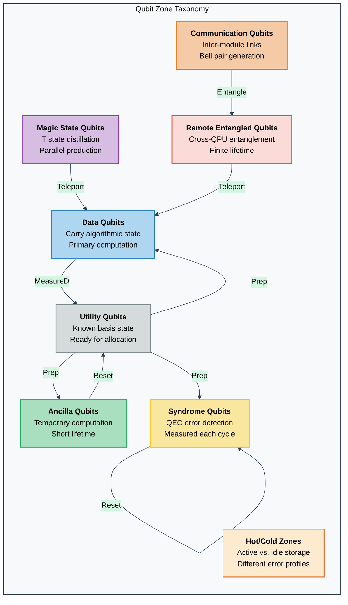
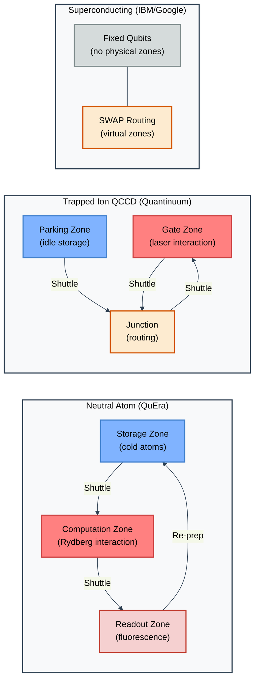
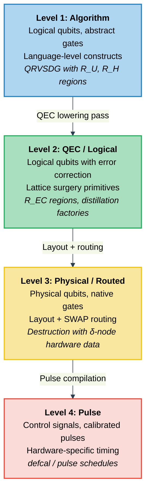
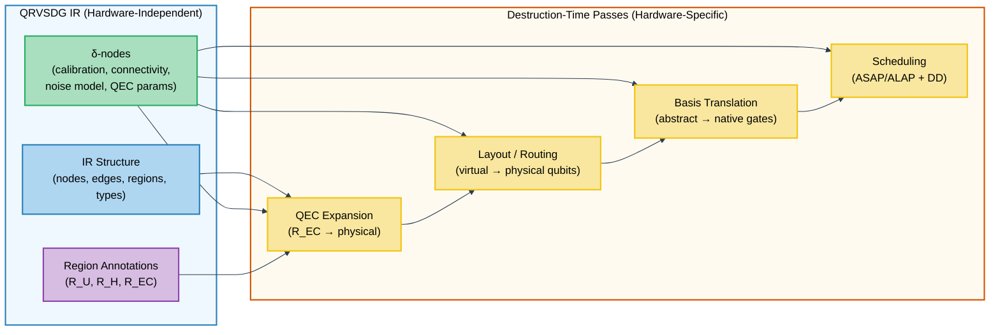
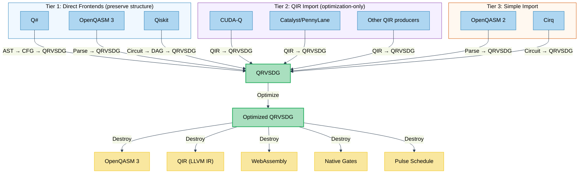
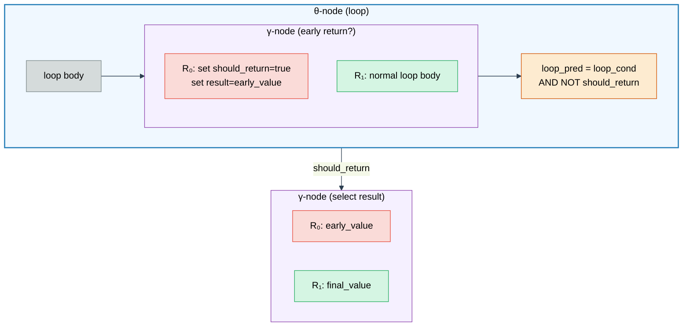
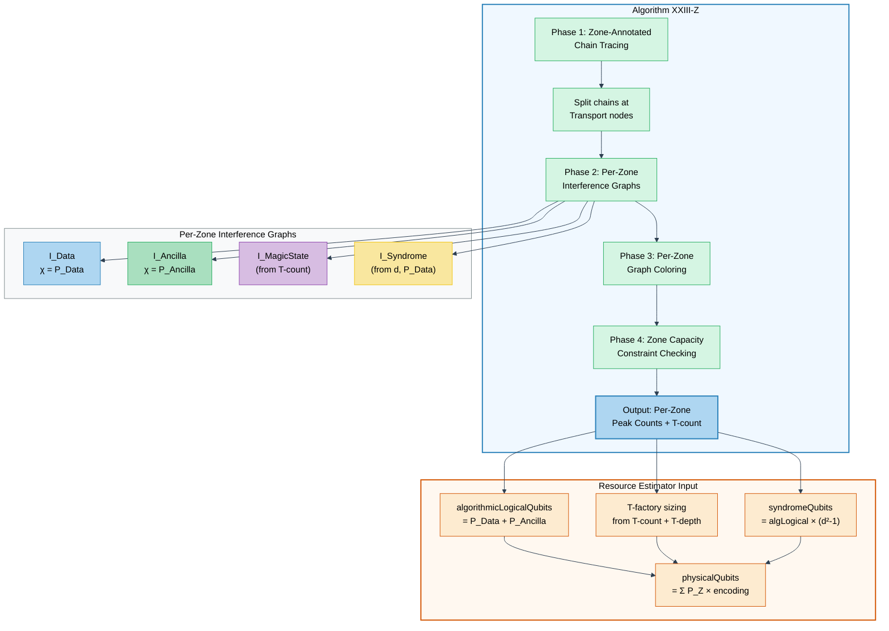

# Toward a Universal Intermediate Representation for Hybrid Quantum-Classical Programs: Design Principles, Qubit Zone Management, and Multi-Level Compilation

## Abstract

We present the design and analysis of a language-agnostic intermediate representation (IR) for hybrid quantum-classical programs that supports multi-language ingestion, source-to-source optimization, multi-target emission, heterogeneous qubit resource management, and integration with quantum error correction, layout, and noise modeling. Building on the Regionalized Value State Dependence Graph (RVSDG) and its quantum extension (QRVSDG), we identify the foundational properties—linear-typed value semantics, demand-dependence, hierarchical regions, and strong normalization—that make this class of IR uniquely suited for quantum compilation. We introduce a qubit zone taxonomy capturing the heterogeneous roles of qubits in modern quantum architectures (data, ancilla, syndrome, magic state, communication, remote entangled, utility, and hot/cold zones), propose zone-annotated edges and explicit transport nodes for zone-aware compilation, and analyze three architectural strategies for integrating quantum error correction, layout/routing, and noise modeling into the compilation pipeline. We evaluate nine existing quantum IRs against our requirements, survey the multi-language frontend landscape and source-to-source compilation challenges, and present a layered compilation architecture with hardware-independent optimization and parameterized destruction-time lowering. Our analysis demonstrates that a hierarchical, data-flow-centric IR with linear typing provides the strongest foundation for universal quantum compilation, offering automatic parallelism exposure, inter-procedural optimization, and structured control flow preservation that flat, control-flow-centric alternatives cannot match.

## 1. Introduction

Quantum computing has entered an era of increasing hardware capability: Google's Willow processor demonstrated below-threshold quantum error correction with 105 qubits [1], IBM has deployed 1,000+ qubit processors [2], and Quantinuum's H-series achieves record two-qubit gate fidelities [3]. As hardware scales, the compilation challenge grows correspondingly: compilers must manage hybrid quantum-classical control flow, multiple abstraction levels (algorithm → logical → physical → pulse), heterogeneous qubit resources, dynamic qubit allocation, and multi-target emission across a fragmented ecosystem of quantum programming languages.

The classical compiler community has converged on a key insight: the choice of intermediate representation determines the quality of analysis and transformation. LLVM's SSA-based CFG [4], MLIR's multi-dialect infrastructure [5], and the RVSDG [6] each demonstrate how IR design shapes what optimizations are natural, efficient, or even possible. Quantum compilation has yet to achieve similar convergence. Existing quantum IRs occupy different points in the design space:

- **QIR** [7] embeds quantum operations as opaque function calls in LLVM IR, inheriting LLVM's ecosystem but preventing quantum-aware optimization.
- **OpenQASM 3** [8] provides rich hybrid semantics but uses imperative sequential notation unsuited for dependency analysis.
- **Qiskit's DAGCircuit** [9] exposes intra-procedural data flow but lacks hierarchy and inter-procedural scope.
- **HUGR** [10] offers hierarchical nesting with linear types but lacks demand-dependence and strong normalization.
- **MLIR quantum dialects** [11, 12, 13] leverage MLIR's infrastructure but fragment the representation across dialects.

None of these IRs simultaneously provides: (i) hierarchical, whole-program representation with inter-procedural scope; (ii) demand-dependence with strong normalization for optimal parallelism exposure; (iii) linear-typed value semantics enforcing the no-cloning theorem; (iv) multi-language ingestion and multi-target emission including source-to-source; (v) support for heterogeneous qubit zones and dynamic allocation; and (vi) a coherent strategy for integrating QEC, layout, and noise modeling.

In this paper, we present a comprehensive design analysis for a universal quantum IR that addresses all six requirements. Our contributions are:

1. **A systematic evaluation of nine quantum IRs** against a unified set of requirements covering type systems, hierarchical structure, optimization properties, multi-language support, and hardware integration (Section 3).

2. **A qubit zone taxonomy and zone-aware IR extensions** that model the heterogeneous roles of qubits across modern quantum architectures—including neutral atom zoned processors, trapped-ion QCCD devices, and distributed quantum networks (Section 5).

3. **An analysis of three architectural strategies** for integrating QEC, layout/routing, and noise modeling, with a recommendation for layered integration via hardware-parameter nodes and destruction-time lowering (Section 6).

4. **A multi-language compilation architecture** with frontend adapters, source-to-source round-tripping via provenance-tracked optimization, and multi-target backend emission including QIR, OpenQASM 3, LLVM IR, and WebAssembly (Section 7).

5. **A four-level compilation model** mapping algorithm-level, QEC/logical, physical/routed, and pulse-level compilation stages to the IR's construction-optimization-destruction pipeline (Section 8).

## 2. Background

### 2.1 The RVSDG and Its Properties

The Regionalized Value State Dependence Graph (RVSDG) [6, 14] is a data-flow-centric IR where nodes represent computations, edges represent dependencies, and regions capture the hierarchical structure of programs. A region $\mathcal{R} = (A, N, E, R)$ consists of arguments $A$, nodes $N$, edges $E$, and results $R$. Structural nodes contain sub-regions:

- **γ-nodes** model conditionals, with a predicate selecting among $k+1$ sub-regions.
- **θ-nodes** model tail-controlled loops, with a predicate result determining continuation.
- **λ-nodes** model functions, with context variables capturing closures.
- **δ-nodes** model global variables and constants.
- **φ-nodes** model mutually recursive function groups.
- **ω-nodes** model translation units as the top-level program container.

The RVSDG provides four key properties:

1. **Inherent SSA form**: Each value is defined exactly once. No SSA restoration passes are needed.
2. **Demand-dependence**: Nodes are ordered only by true data dependencies, avoiding artificial sequentialization.
3. **Strong normalization**: Programs differing only in the ordering of independent operations produce identical representations.
4. **Unified program representation**: The entire program resides in a single graph, enabling inter-procedural analysis.

These properties directly address quantum computing requirements: SSA aligns with no-cloning, demand-dependence exposes circuit parallelism, regions capture abstraction layers (algorithm → subroutine → QEC), and whole-program scope enables cross-function gate cancellation.

### 2.2 The QRVSDG Extension

The QRVSDG [15] extends the RVSDG with:

- **Linear-typed quantum edges** enforcing $\forall o \in O_q(n) : |\text{users}(o)| = 1$ (no-cloning, no-deleting).
- **Quantum node types**: UGate (unitary gates), Measure/MeasureD (measurement), Prep (state preparation), Reset, Barrier, Conjugate (structured uncomputation).
- **Region annotations**: $R_U$ (unitary), $R_H$ (hybrid), $R_{EC}$ (error-corrected with LogicalQubit type, Encode/Decode boundary nodes, SyndromeExtract, LogicalGate, and Distill operations).
- **The MResult(S) type**: Measurement outcomes parameterized by hardware outcome sets.
- **QFunc types**: First-class quantum subroutine values with adjoint/controlled annotations.
- **Multiple independent effect domains**: $\text{Eff}_{\text{qpool}}$ (qubit allocation), $\text{Eff}_{\text{cmem}}$ (classical memory), $\text{Eff}_{\text{io}}$ (I/O), enabling automatic parallelism across independent effect domains.
- **Canonical form CNE**: Phase polynomial canonical forms for complete Clifford+$R_z$ congruence detection; ZX-calculus simplified forms for universal circuit soundness.
- **Entanglement partition lattice**: Formal transfer functions with measurement-induced disentanglement and stabilizer-based refinement for Clifford subcircuits.

The QRVSDG's key insight is that the RVSDG's properties are not merely compatible with quantum computing—they are *demanded* by it. Where classical SSA allows fan-out (a value may have multiple uses), quantum physics requires linear usage (a quantum state can be used exactly once). The QRVSDG restricts fan-out for quantum-typed edges while preserving classical fan-out, turning a physical constraint into a compile-time guarantee.

### 2.3 Quantum Computing Landscape

Modern quantum computing spans multiple hardware platforms with distinct characteristics:

| Platform | Connectivity | Native Gates | Zones | Measurement |
|----------|-------------|-------------|-------|-------------|
| Superconducting (IBM) | Sparse planar (heavy-hex) | CX, RZ, SX, X | Fixed | Binary $\{0,1\}$ |
| Superconducting (Google) | Square grid | $\sqrt{\text{iSWAP}}$, Phased-XZ | Fixed | Binary $\{0,1\}$ |
| Trapped ion (Quantinuum) | All-to-all (within zones) | RZZ, Rz, U1q | QCCD shuttling | Binary $\{0,1\}$ |
| Neutral atom (QuEra) | Reconfigurable | Rydberg blockade | Physical zones | $\{0,1,\text{loss}\}$ |
| Photonic (Xanadu) | Interferometer layout | Beam splitter, phase | Spatial modes | $\{0,1,...,n\}$ |

The diversity of hardware platforms, programming languages, and compilation requirements motivates the need for a universal IR that abstracts over these differences while enabling hardware-specific lowering.

## 3. Evaluation of Existing Quantum Intermediate Representations

We evaluate nine existing quantum IRs against seven requirements: (R1) hierarchical structure, (R2) value semantics with linear typing, (R3) demand-dependence, (R4) inter-procedural analysis, (R5) multi-language support, (R6) qubit zone support, and (R7) QEC/noise integration.

### 3.1 QIR (Quantum Intermediate Representation)

QIR [7] embeds quantum operations as external function calls within LLVM IR. Qubits are opaque pointers identified by integer-to-pointer casts. QIR defines Base Profile (static circuits) and Adaptive Profile (mid-circuit measurement, branching, optional loops and dynamic allocation). Version 2.1 was released in March 2026.

**Strengths**: Universal target from multiple frontends (Q#, CUDA-Q, Catalyst). Leverages LLVM ecosystem. Well-specified profiles with clear capability tiers. Dynamic qubit management via `__quantum__rt__qubit_allocate`/`release`.

**Limitations**: Flat LLVM CFG (R1:✗). Reference semantics with no linear enforcement (R2:✗). No demand-dependence (R3:✗). Limited inter-procedural support—functions must return void or simple types (R4:partial). No QEC or noise concepts (R7:✗).

### 3.2 OpenQASM 3

OpenQASM 3 [8] is simultaneously a quantum assembly language and a multi-level IR with classical control flow, timing constructs (`duration`, `stretch`, `delay`), and pulse-level descriptions via `defcal` blocks. It distinguishes real-time (within coherence) and near-time timescales.

**Strengths**: Rich hybrid semantics. Pulse-level integration via `defcal`. Timing constraint model. Widely supported as hardware submission format.

**Limitations**: Text-based sequential format—not a graph (R1:✗). No explicit data dependencies (R3:✗). No linear typing (R2:✗). Subroutines are opaque to cross-boundary analysis (R4:partial). No native graph rewriting or pattern matching.

### 3.3 MLIR Quantum Dialects

**Catalyst** [11] (PennyLane/Xanadu) uses MLIR for JIT compilation of hybrid quantum programs. The pipeline traces Python programs via JAX, lowers through MLIR dialects (StableHLO → quantum → LLVM), applies peephole quantum optimizations and automatic differentiation, and emits QIR-compatible LLVM IR.

**CUDA-Q Quake** [12] (NVIDIA) defines two semantic models: a memory model (`!quake.ref`) for natural expression and a value model (`!quake.wire`) for optimization. The value model directly demonstrates why value semantics matter: adjacent cancellable gates are trivially detectable in the wire model but require alias analysis in the reference model.

**QIRO** [13] (Ittah et al., CGO 2022) was the first SSA-based quantum IR for optimization, demonstrating that value semantics for qubits naturally expose data dependencies and enable standard compiler optimizations.

**Strengths**: MLIR ecosystem (progressive lowering, pattern rewriting). Value semantics demonstrated (R2:partial). Multi-level compilation validated.

**Limitations**: No full linear type enforcement—MLIR's type system doesn't enforce linearity (R2:partial). No demand-dependence (R3:✗). Limited hierarchical region usage beyond MLIR's standard regions (R1:partial). Each dialect is ecosystem-specific.

### 3.4 HUGR (Hierarchical Unified Graph Representation)

HUGR [10] is Quantinuum's hierarchical directed graph IR underlying tket2 and Tierkreis. It represents mixed quantum-classical programs using a tree of nested regions with six edge types (Hierarchy, Value, Const, Function, Order, ControlFlow). Linear types are enforced at the graph level: output ports with non-copyable types must have exactly one edge.

**Strengths**: True hierarchical nesting (R1:✓). Linear type enforcement (R2:✓). Formal rewriting system. Extensible via plugin extensions. Serializable for inter-tool communication. Inter-procedural (FuncDefn, Call nodes) (R4:✓).

**Limitations**: No demand-dependence—ordering is explicit via Order edges (R3:✗). No strong normalization (R3:✗). Extension-heavy design adds complexity. QEC support via extensions (tket-qec), not core IR (R7:partial).

### 3.5 Qiskit DAGCircuit

Qiskit's DAGCircuit [9] represents quantum circuits as DAGs with three node types (DAGInNode, DAGOpNode, DAGOutNode) and edges labeled by qubit/classical bit wires. The Qiskit transpiler uses a six-stage pass manager (init → layout → routing → translation → optimization → scheduling).

**Strengths**: Mature ecosystem with hundreds of transpiler passes. Well-understood flat DAG model. Excellent transpiler pass infrastructure.

**Limitations**: Flat—no hierarchical structure (R1:✗). No inter-procedural scope—each circuit transpiled independently (R4:✗). No linear types (R2:✗). No QEC (R7:✗).

### 3.6 tket/tket2

tket [16] uses a circuit graph representation with ZX-calculus integration. tket2 rebuilds the compiler on HUGR, adding equality saturation via Badger (using QUESO/Quartz ECC rewrite rules). tket-qec (March 2026) adds early QEC support.

**Strengths**: Sophisticated optimization (ZX-calculus, Badger). Noise-aware routing. tket2/HUGR provides hierarchy (R1:✓ via HUGR).

**Limitations**: Inherits HUGR's limitations for demand-dependence (R3:✗). Circuit-level focus rather than whole-program.

### 3.7 Tierkreis

Tierkreis operates at the workflow orchestration level—scheduling jobs across CPUs, GPUs, and QPUs. It is distinct from program-level IRs, representing task graphs rather than instruction-level computations. HUGR was designed to unify the circuit-level (tket) and workflow-level (Tierkreis) representations.

### 3.8 Comparative Summary

| Property | QIR | QASM3 | Catalyst | Quake | HUGR | DAGCircuit | tket2 | QRVSDG |
|----------|-----|-------|---------|-------|------|------------|-------|--------|
| R1: Hierarchy | ✗ | ✗ | Partial | ✗ | ✓ | ✗ | ✓ | ✓ |
| R2: Linear types | ✗ | ✗ | ✗ | Partial | ✓ | ✗ | ✓ | ✓ |
| R3: Demand-dep. | ✗ | ✗ | ✗ | ✗ | ✗ | ✗ | ✗ | ✓ |
| R4: Inter-proc. | Partial | Partial | Partial | Partial | ✓ | ✗ | ✓ | ✓ |
| R5: Multi-lang. | ✓ | Partial | ✗ | ✗ | Partial | ✗ | Partial | ✓ |
| R6: Qubit zones | ✗ | ✗ | ✗ | ✗ | Ext. | ✗ | ✗ | Proposed |
| R7: QEC/noise | ✗ | ✗ | ✗ | ✗ | Ext. | ✗ | Partial | Proposed |
| R8: Compound types | Partial | Partial | ✗ | ✗ | ✓ | ✗ | Partial | ✓ |

QIR inherits LLVM's native array types (`[N x ptr]`) but provides no type-level linearity on aggregates. OpenQASM 3 supports classical arrays but forbids quantum types as array elements; `qubit[n]` is separate register syntax, not an array type. Catalyst and Quake have no standard compound quantum types. HUGR provides `array<N, T>`, `list<T>`, and Sum types with borrow-based linear access. Qiskit DAGCircuit uses QuantumRegister as metadata, not as typed edges. tket2 offers register grouping but not type-level compound types. The QRVSDG provides `Array(τ, n)`, `Tuple(τ_1, ..., τ_k)`, and `Struct(name, fields)` with swap-based linear access, enforcing type-level linearity for compound values containing quantum data.

The QRVSDG is the only IR providing demand-dependence with strong normalization alongside hierarchical regions, linear types, and inter-procedural scope. HUGR is the closest alternative, sharing hierarchy and linear types but lacking the demand-dependence and normalization properties that enable automatic parallelism exposure and phase-ordering-resistant optimization.

## 4. IR Design Principles

Based on our evaluation, we identify six foundational principles for a universal quantum IR:

### 4.1 Principle 1: Value Semantics with Linear Typing

Quantum states must be represented as values (not references) with linear typing constraints. This insight, independently discovered by QIRO [13], Quake [12], and HUGR [10], eliminates the need for alias analysis on quantum state and provides compile-time enforcement of the no-cloning and no-deleting theorems.

**Formally**: For all quantum-typed outputs $o$: $|\text{users}(o)| = 1$. Classical-typed outputs have no fan-out restriction: $|\text{users}(o)| \geq 0$.

The QRVSDG's type system extends this with the MResult($S$) type parameterized by hardware outcome sets, enabling exhaustive branching on measurement outcomes including hardware-specific events (e.g., atom loss in neutral atom platforms: $S = \{0, 1, \text{loss}\}$).

Linearity extends to compound types: a value of type `Array(Qubit, n)` or `Tuple(Qubit, Int)` is itself linear if any constituent element is linear. The QRVSDG formalizes this via the `linear(τ)` predicate, which recurses into compound type constructors: $\text{linear}(\text{Array}(\tau, n)) \iff \text{linear}(\tau)$, and similarly for tuples and structs. This ensures that an array of qubits cannot be duplicated or discarded, just as a single qubit cannot. For element access, the QRVSDG uses swap-based operations (ArraySwap) that exchange an element with a replacement value, preserving linearity by construction. Tuples and structs use destructive extraction (TupleExtract, StructExtract) that returns all fields simultaneously, maintaining the single-use invariant. This contrasts with HUGR's borrow-based approach, where a borrowed reference must be returned before the container can be used again; borrow violations produce runtime panics rather than compile-time errors. The swap-based design eliminates this class of runtime failure entirely, making linearity enforcement purely static.

### 4.2 Principle 2: Demand-Dependence and Strong Normalization

Nodes should be ordered only by true data dependencies. This is the QRVSDG's unique advantage: quantum gates on non-interacting qubits with no data dependency appear as unordered nodes, automatically exposing circuit parallelism without explicit scheduling analysis.

Strong normalization ensures that programs differing only in the ordering of independent operations produce identical IR representations. For quantum compilation, this means:

- Commuting gates need not be separately ordered—they are inherently unordered.
- Fewer template variants are needed for pattern matching and equality saturation.
- Equivalence checking between circuits is simplified.

No other quantum IR provides both demand-dependence and strong normalization.

### 4.3 Principle 3: Hierarchical Regions with Semantic Annotations

Programs must be represented as nested regions capturing the hierarchical structure of quantum computation: gates → subcircuits → algorithm layers → subroutines → programs → error-corrected programs. Region annotations ($R_U$, $R_H$, $R_{EC}$) classify regions by their quantum properties:

- **Unitary regions** ($R_U$): Only unitary gates; reversible, controllable, qubit-count-preserving. Enables ZX-calculus, equality saturation, T-count optimization.
- **Hybrid regions** ($R_H$): Arbitrary quantum-classical mix including measurements. General case for variational algorithms.
- **Error-corrected regions** ($R_{EC}$): Logical qubit operations with QEC layer abstracted. Enables mixed programs with both error-corrected and unprotected sections.

### 4.4 Principle 4: Whole-Program Inter-Procedural Scope

The IR must represent the entire program in a single graph. The RVSDG's ω/λ/φ-node hierarchy captures the full program: ω-nodes represent translation units, λ-nodes represent functions, φ-nodes represent mutual recursion. This enables:

- Cross-function gate cancellation (if $f$ ends with $X$ and $g$ starts with $X$, and $f$ always precedes $g$, the gates cancel).
- Dead quantum subroutine removal.
- Quantum function specialization (specializing a function for known input states).
- Whole-program qubit lifetime analysis for register allocation.

### 4.5 Principle 5: Hardware Parameters as Data, Not Types

Machine-specific information (gate fidelities, coherence times, connectivity, QEC code parameters) should reside in the IR as queryable data (via δ-nodes) rather than embedded in the type system. This preserves:

- **Portability**: The same optimized IR structure targets different backends.
- **Retargetability**: Only the destruction pass (parameterized by δ-node data) changes per target.
- **Dynamic recalibration**: δ-node data can be updated without restructuring the IR. Programs can be re-destroyed with fresh calibration data without re-optimization.

### 4.6 Principle 6: Structured Control Flow with Source Correspondence

Structured control flow constructs (γ for conditionals, θ for loops, λ for functions) directly correspond to source-level constructs (if/else, while/for, def/gate). This provides:

- **Source-to-source round-tripping**: Destruction recovers structured control flow without relooper algorithms.
- **Provenance preservation**: Each structural node can carry metadata tracing back to the source construct that generated it.
- **Natural quantum mappings**: γ-nodes directly model mid-circuit measurement branching; θ-nodes directly model variational loops and RUS protocols.

## 5. Qubit Zone Taxonomy and Zone-Aware IR Extensions

Modern quantum architectures employ qubits in fundamentally different roles. As hardware scales toward fault-tolerant quantum computing with distributed and zoned processors, the IR must distinguish these roles to enable zone-aware compilation.

### 5.1 Qubit Zone Taxonomy

We identify eight categories of qubit roles. These categories are not mutually exclusive—a single physical qubit may transition between roles during program execution:



**Data qubits** carry the algorithmic state. In fault-tolerant computing, each data qubit is encoded across $d^2$ physical qubits (distance-$d$ surface code). In the QRVSDG, data qubits are the primary Qubit-typed edges flowing through the program graph.

**Ancilla qubits** are allocated temporarily for sub-computations (Toffoli decompositions, oracle implementations, uncomputation patterns). Their lifetime is scoped—typically to a region or subroutine. In the QRVSDG, ancilla qubits are modeled by Prep nodes inside λ-nodes (function-scoped) or θ-nodes (iteration-scoped).

**Syndrome qubits** extract error syndromes in QEC without disturbing encoded data. They are measured every QEC cycle, reset, and reused. For a distance-$d$ surface code, approximately $d^2 - 1$ syndrome qubits are needed per logical qubit. Within $R_{EC}$ regions, syndrome extraction is a θ-node pattern (repeated measurement + decoding + correction).

**Magic state qubits** are prepared in T-states via distillation factories, then teleported into the main computation for non-Clifford gates. Azure Quantum Resource Estimator explicitly separates `physicalQubitsForAlgorithm` from `physicalQubitsForTfactories` [17], with independent error budgets ($\varepsilon_{\log}$, $\varepsilon_{\text{dis}}$, $\varepsilon_{\text{syn}}$). In the IR, T-factory regions are parallel λ-nodes whose outputs feed into the algorithm.

**Communication qubits** participate in inter-module entanglement generation for distributed/modular quantum computing. They interface with photonic links and consume shared Bell pair resources.

**Remote entangled qubits** are halves of Bell pairs shared across quantum network links. They have finite lifetime (entanglement fidelity degrades with decoherence) and may require purification. The IR must track that a qubit is entangled with a partner on a remote node.

**Utility qubits** are in known computational basis states ($|0\rangle$ or $|1\rangle$), ready for allocation. They are the outputs of Prep and Reset nodes—the available pool of qubits not currently engaged in computation.

**Hot/cold zones** classify qubits by activity level: hot qubits are actively participating in gates (gate fidelity and decoherence during gates dominate); cold qubits are idle in storage (idle error rates dominate). Neutral atom architectures physically manifest this distinction with separate storage and computation zones [18].

### 5.2 Zone-Aware IR Extensions

We propose three IR extensions for zone management:

**1. Optional zone annotations on Qubit edges.**
$$\text{Qubit}\langle Z \rangle \text{ where } Z \in \{\text{Data}, \text{Ancilla}, \text{Syndrome}, \text{MagicState}, \text{Comm}, \text{Utility}, \text{Unspecified}\}$$

Zone annotations are optional; `Qubit<Unspecified>` (abbreviated `Qubit`) is the default for hardware-agnostic programs. During destruction, zone annotations guide layout and scheduling decisions. Zone compatibility rules prevent invalid operations (e.g., a unitary gate on a syndrome qubit during syndrome extraction must follow the stabilizer schedule).

**2. Explicit Transport nodes for zone transitions.**
$$\text{Transport}(Z_{\text{src}} \to Z_{\text{dst}}) : (\text{Qubit}\langle Z_{\text{src}} \rangle, \text{Eff}) \to (\text{Qubit}\langle Z_{\text{dst}} \rangle, \text{Eff})$$

Transport nodes make zone transitions explicit in the dataflow graph. On neutral atom platforms, transport corresponds to physical atom shuttling between zones [18, 19]. On trapped-ion QCCD platforms (Quantinuum H-series), transport corresponds to ion shuttling between gate zones, parking zones, and junction zones [3]. The effect-token threading ensures transport ordering is preserved.

**3. Remote preparation nodes for distributed computing.**
$$\text{PrepRemote}(\text{NodeID}) : (\text{Eff}) \to (\text{Qubit}\langle\text{Comm}\rangle, \text{Eff})$$

This creates half of a Bell pair, with the partner materialized on the specified remote node. The node consumes and produces effect tokens for ordering. Remote entanglement is consumed by teleportation protocols, which the IR represents as a sequence of local gates, measurement, classical communication (through γ-node predicates), and correction operations.

**4. Zone-annotated compound types.**
$$\text{Array}(\text{Qubit}\langle Z \rangle, n)$$

An array of zone-annotated qubits carries a homogeneous zone annotation: all elements share the same zone. This matches physical hardware where qubit registers reside in a single zone (e.g., a row of atoms in a neutral-atom storage zone, or a chain of ions in a trapped-ion gate zone). Mixed-zone arrays are not representable, enforcing the physical constraint that a register is spatially colocated.

**5. ArrayTransport for bulk zone transitions.**
$$\text{ArrayTransport}(Z_{\text{src}} \to Z_{\text{dst}}) : (\text{Array}(\text{Qubit}\langle Z_{\text{src}} \rangle, n), \text{Eff}) \to (\text{Array}(\text{Qubit}\langle Z_{\text{dst}} \rangle, n), \text{Eff})$$

ArrayTransport transitions an entire array between zones as a single primitive operation, modeling bulk physical transport (atom row shuttling in neutral-atom architectures, ion chain movement in trapped-ion QCCD devices). This is more efficient than iterating single-qubit Transport nodes and reflects that hardware moves registers as atomic units. The existing single-qubit Transport node remains for individual qubit zone transitions.

**6. Mixed-zone handling via unpack/repack.**
Since arrays enforce homogeneous zones, mixed-zone scenarios require explicit decomposition: unpack the array into individual qubits, transport each qubit to its target zone using single-qubit Transport nodes, and repack into separate typed arrays per zone. This pattern is explicit and type-safe, preventing accidental mixing of qubits from different zones within a single array.

### 5.3 Physical Zone Mapping

Modern hardware architectures implement physical zones:



The Dynamically Field-Programmable Quantum Array (DPQA) compilation work by Tan et al. [19] demonstrates zone-aware compilation for neutral atom processors, achieving 5.1× gate count reduction through zone-aware layout synthesis. The QRVSDG's Transport node directly models the physical atom shuttling these architectures require.

### 5.4 Dynamic Qubit Allocation and Lifetime Management

The IR must support both static and dynamic qubit allocation:

**Static allocation**: All qubits allocated at program start. In QIR: `dynamic_qubit_management = false`, `required_num_qubits` declared as entry-point attribute. Simple but wasteful.

**Dynamic allocation**: Qubits allocated and deallocated during execution. Peak live qubit count may be much less than total allocated over the program lifetime. QIR 2.1 provides `__quantum__rt__qubit_allocate`/`qubit_release` APIs.

The QRVSDG naturally captures dynamic allocation via Prep nodes inside structural nodes:
- **Prep inside θ-nodes**: Each iteration allocates a fresh ancilla. Peak count bounded by single iteration body.
- **Prep inside γ-nodes**: Qubits allocated only in one branch. Must be consumed within that branch.
- **Prep inside λ-nodes**: Function-scoped allocation. Caller does not see internal ancillae.

**Qubit lifetime analysis** follows linear typing chains: $\text{Prep} \to q_0 \to \text{UGate}_1 \to q_1 \to \cdots \to q_n \to \text{MeasureD/Dealloc}$. Classical register allocation algorithms (graph coloring, linear scan) apply to qubit lifetime intervals with the critical constraint that qubits cannot be spilled (no-cloning). If the chromatic number exceeds device qubit count, the program cannot execute.

## 6. QEC, Layout, and Noise Modeling: Integration Architecture

A central design question is whether QEC, layout/routing, and noise modeling should be modeled in the IR or as separate layers. We analyze three strategies and recommend a hybrid approach.

### 6.1 The Multi-Level Compilation Problem

Quantum compilation spans at least four abstraction levels:



Each level has distinct optimization concerns. Level 1 focuses on gate count, depth, and algorithmic structure. Level 2 focuses on space-time volume and T-count. Level 3 focuses on SWAP count and noise-aware mapping. Level 4 focuses on pulse shaping and crosstalk.

### 6.2 Strategy Analysis

#### Strategy A: Full IR Integration
Encode QEC parameters, noise models, and connectivity in the IR's type system and edges.

**For**: Enables joint optimization across all concerns in a single representation.
**Against**: Types change with calibration (violating type stability), non-portable across hardware, exponential type complexity, QEC-aware optimization requires specialized passes regardless of IR visibility.

#### Strategy B: Complete Separation
QEC, noise, and layout are entirely external to the IR. The IR operates only on abstract logical qubits.

**For**: Maximum simplicity and portability.
**Against**: Cannot perform noise-aware optimization. Misses 2.9× fidelity improvements demonstrated by Murali et al. [20]. Cannot represent mixed programs with error-corrected and unprotected sections. No integration point for calibration data.

#### Strategy C: Layered Integration (Recommended)



The IR structure (nodes, edges, regions, types) remains hardware-independent. Machine-specific data resides in δ-nodes: calibration data (gate fidelities, $T_1/T_2$), connectivity graphs, native gate sets, QEC code parameters. Region annotations ($R_{EC}$) mark error-corrected sections at the algorithm level. Hardware-specific lowering happens during destruction passes, parameterized by δ-node data.

**Rationale**: This approach preserves the four key benefits:

1. **Portability**: The same optimized QRVSDG targets different backends by updating δ-nodes and re-running destruction.
2. **Noise-aware optimization**: Optimization passes can query δ-node calibration data for noise-weighted cost functions (e.g., equality saturation extraction using hardware-specific fidelity costs).
3. **Dynamic recalibration**: Programs compiled and optimized at time $t_0$ can be re-destroyed at time $t_1$ with fresh calibration data. The optimization work is amortized.
4. **Mixed abstraction**: The same program can contain $R_U$ (unprotected unitary), $R_H$ (hybrid), and $R_{EC}$ (error-corrected) regions.

### 6.3 QEC Integration Details

**Lattice surgery compilation** is the dominant approach for surface code logical operations. The Watkins et al. compiler [21] demonstrates that a dedicated lattice surgery IR is needed between the logical and physical levels. We propose that QEC lowering invokes a lattice surgery compiler as a subroutine during destruction:

1. **$R_{EC}$ regions** in the QRVSDG establish the logical-level representation. Qubit-typed edges within $R_{EC}$ regions represent logical qubits.
2. **The QEC lowering pass** expands each logical gate into its lattice surgery implementation (merge, split, distill primitives), parameterized by δ-node QEC data (code type, distance, decoder type).
3. **The lattice surgery IR** captures the spatial-temporal layout of surface code patches, T-factory placement, and magic state routing. This is an intermediate representation between the QRVSDG and the physical output.
4. **Physical emission** lowers the lattice surgery IR to individual stabilizer measurements, producing output compatible with tools like Stim [22] for simulation and verification.

### 6.4 Layout and Routing as Destruction-Time Passes

Layout and routing should be destruction-time transformations. The QRVSDG operates on logical/virtual qubits; physical assignment happens during destruction.

**Key insight**: The QRVSDG's demand-dependence property actually helps routing. Since independent gates have no ordering constraint in the IR, the router has maximum scheduling freedom. SABRE [23] and other routing algorithms benefit from this flexibility—they can insert SWAPs at any point along the schedule without violating explicitly-stated ordering constraints.

**Noise-aware layout**: The destruction pass queries δ-node calibration data to score layout candidates. VF2-style layout finding uses error rates as heuristic weights. The QRVSDG structure remains unchanged; only the mapping from virtual to physical qubits is hardware-specific.

### 6.5 Noise Modeling via δ-Nodes

Calibration data in δ-nodes follows a structured schema:

```
δ-node: HardwareCalibration {
    per_qubit: {
        qubit_id → { T1: Duration, T2: Duration, readout_error: Float, idle_error: Float }
    },
    per_gate: {
        (gate_name, qubit_ids) → { error: Float, duration: Duration }
    },
    connectivity: {
        (qubit_id, qubit_id) → { available: Bool, error: Float }
    },
    crosstalk: {
        ((qubit_id, qubit_id), (qubit_id, qubit_id)) → { correlation: Float }
    }
}
```

This matches Qiskit's Target/InstructionProperties model [9] and extends it with crosstalk data. Optimization passes that reference hardware data (noise-aware CNE, scheduling with dynamical decoupling insertion) query this δ-node. During re-destruction with fresh calibration, only the δ-node data changes.

## 7. Multi-Language Compilation Architecture

### 7.1 Frontend Architecture

A universal quantum IR requires frontends for the major quantum programming languages. We propose a hybrid strategy with three tiers:



**Tier 1 (Direct Frontends)** parse source languages and construct the QRVSDG directly, preserving high-level structure (function boundaries, loop constructs, gate definitions, type information). This enables source-to-source round-tripping. The construction path follows the RVSDG construction pipeline: parse → CFG → structural analysis → demand annotation → control tree translation → QRVSDG construction (Algorithms I–III, VII).

**Tier 2 (QIR Import)** accepts QIR (LLVM IR) from any language that can compile to QIR. This minimizes frontend work but loses high-level structure. Construction uses Algorithm VII-B (QIR pattern recognition + CFR). Suitable for optimization-only workflows where source emission is not needed.

**Tier 3 (Simple Import)** handles simple circuit-level languages (OpenQASM 2, Cirq circuit dumps) that map trivially to flat sequences of gate nodes. No control flow restructuring needed.

### 7.2 Language-Specific Challenges

Certain language features require special handling during QRVSDG construction:

| Feature | Language | QRVSDG Mapping |
|---------|----------|----------------|
| Adjoint functors | Q# | λ-node region reversal with per-gate adjoint substitution |
| Controlled functors | Q# | λ-node region wrapping with added control qubit |
| Automatic uncomputation | Silq | Ancilla lifetime analysis + inverse region generation |
| Timing constraints | OpenQASM 3 | δ-node scheduling data + Barrier/Order edges |
| Trainable parameters | PennyLane | Classical loop variables in θ-nodes with gradient metadata |
| GPU kernel integration | CUDA-Q | Separate ω-nodes for QPU and GPU portions |

**Compound type mapping.** QRVSDG compound types map to source and target language constructs as follows:

| QRVSDG Type | Q# | OpenQASM 3 | QIR (LLVM) |
|---|---|---|---|
| `Array(Qubit, n)` | `Qubit[n]` | `qubit[n]` | `[n x ptr]` |
| `Array(Float, p)` | `Double[p]` | `array[float[64], p]` | `[p x double]` |
| `Tuple(Int, Float)` | `(Int, Double)` | N/A (decompose) | `{i64, double}` |
| `Struct{a: Int, b: Qubit}` | `struct S { A: Int, B: Qubit }` | N/A (decompose) | `{i64, ptr}` |
| `Array(MResult(S), n)` | `Result[n]` | `bit[n]` | `[n x ptr]` |

OpenQASM 3 forbids quantum types as classical array elements; `qubit[n]` is separate syntax for quantum register declaration rather than an array-of-quantum-type constructor. Tuples and structs do not exist in OpenQASM 3 and must be decomposed into individual variables during destruction. Q# and QIR provide direct structural correspondences for all compound types, though QIR loses type-level linearity information when lowering to LLVM types.

### 7.3 Source-to-Source Round-Tripping

The QRVSDG's structured control flow provides a key advantage for source-to-source optimization. The RVSDG's destruction algorithm (Algorithm IV) recovers structured control flow from the graph representation without requiring relooper algorithms—γ-nodes directly emit `if`/`switch`, θ-nodes emit `while`/`for`, and λ-nodes emit function definitions.

**Provenance tracking** preserves source-level metadata through optimization:

```
SourceProvenance {
    node_id → {
        source_file: String,
        source_line: Int,
        source_language: Enum,
        original_construct: String,
        applied_transformations: [String]
    }
}
```

This enables the emitter to generate readable, well-commented output that explains what optimizations were applied and why.

### 7.4 Backend Emission

**QIR emission** follows the QRVSDG destruction algorithm (Algorithm VIII/XIII), mapping structural nodes to LLVM basic blocks with quantum function calls. Profile selection (Base vs. Adaptive) is determined by analyzing QRVSDG feature usage: the presence of γ-nodes with Measure predicates requires Adaptive Profile.

**OpenQASM 3 emission** is the most natural target for source-to-source: γ → `if`/`switch`, θ → `while`, λ → `def`/`gate`, Prep → `qubit`, Measure → `bit = measure`, UGate → gate application.

**WebAssembly emission** has no established quantum WASM proposal. The most practical approach is compiling classical portions to WASM and representing quantum operations as host function imports:

```wasm
(import "quantum" "h" (func $h (param i32)))
(import "quantum" "cx" (func $cx (param i32 i32)))
(import "quantum" "mz" (func $mz (param i32) (result i32)))
(import "quantum" "alloc" (func $alloc (result i32)))
```

The WASM runtime calls into a quantum backend (simulator or hardware API) for quantum operations. This model mirrors how QIR works with LLVM, adapted to WASM's sandboxed execution model. Benefits include portability (WASM runs in browsers, cloud, edge), JIT compilation for classical portions, and sandboxing for security.

**Native gate/pulse emission** uses basis translation (converting abstract gates to target-native sets via equivalence libraries) followed by pulse compilation (looking up calibrated pulse schedules from δ-node data).

## 8. The Complete Compilation Pipeline

The full compilation pipeline integrates construction, optimization, and destruction through the four-level model:

```mermaid
%%{init: {'theme':'base','themeVariables':{'primaryColor':'#e8f4f8','primaryTextColor':'#000000','primaryBorderColor':'#2980b9','lineColor':'#2c3e50','fontFamily':'Courier New, Courier, monospace'}}}%%
flowchart TD
    subgraph construction["Construction Phase"]
        SRC["Source Language<br/>(Q#, OpenQASM 3, Qiskit, QIR)"]:::src
        PARSE["Parse + CFG Construction"]:::pass
        CFR["Control Flow Restructuring<br/>(Bahmann et al.)"]:::pass
        SA["Structural Analysis +<br/>Demand Annotation"]:::pass
        BUILD["QRVSDG Construction<br/>(Algorithms I-III, VII)"]:::pass
        SRC --> PARSE --> CFR --> SA --> BUILD
    end

    subgraph optimization["Optimization Phase (Level 1: Algorithm)"]
        QRVSDG["QRVSDG"]:::ir
        CNE["Common Node Elimination<br/>(Algorithm IX)"]:::opt
        DNE["Dead Node Elimination<br/>(Algorithm X)"]:::opt
        EQSAT["Equality Saturation<br/>(Region-scoped)"]:::opt
        HOISTING["Gate Hoisting<br/>(Push-Out / Pull-In)"]:::opt
        CANCEL["Gate Cancellation<br/>+ Rotation Merging"]:::opt
        DCE["Extended DCE<br/>+ Vacuum"]:::opt
        QRVSDG --> CNE --> DNE --> EQSAT --> HOISTING --> CANCEL --> DCE
    end

    subgraph destruction["Destruction Phase (Levels 2-4)"]
        OPT_IR["Optimized QRVSDG"]:::ir
        QEC_LOW["QEC Lowering<br/>(R_EC → physical via δ-node)"]:::pass
        LAYOUT["Layout + Routing<br/>(SABRE via δ-node connectivity)"]:::pass
        BASIS["Basis Translation<br/>(δ-node native gate set)"]:::pass
        SCHED["Scheduling + DD<br/>(δ-node timing data)"]:::pass
        EMIT["Target Emission<br/>(QIR / OpenQASM / WASM / Pulse)"]:::target
        OPT_IR --> QEC_LOW --> LAYOUT --> BASIS --> SCHED --> EMIT
    end

    BUILD --> QRVSDG
    DCE --> OPT_IR

    classDef src fill:#aed6f1,stroke:#2980b9,stroke-width:1px,color:#000
    classDef pass fill:#d5f5e3,stroke:#27ae60,stroke-width:1px,color:#000
    classDef ir fill:#a9dfbf,stroke:#27ae60,stroke-width:2px,color:#000
    classDef opt fill:#fdebd0,stroke:#d35400,stroke-width:1px,color:#000
    classDef target fill:#f9e79f,stroke:#f1c40f,stroke-width:2px,color:#000

    style construction fill:#f0f8ff,stroke:#2980b9,stroke-width:2px,color:#000
    style optimization fill:#fff8f0,stroke:#d35400,stroke-width:2px,color:#000
    style destruction fill:#f5fff0,stroke:#27ae60,stroke-width:2px,color:#000
```



### 8.1 Key Design Decisions

**The optimization-destruction boundary** is the critical architectural decision. All hardware-independent optimizations (gate cancellation, commutation, CNE, DNE, equality saturation, loop-invariant identification) operate on the QRVSDG. All hardware-specific transformations (layout, routing, basis translation, QEC expansion, scheduling) are destruction-time passes parameterized by δ-node data.

This separation enables:

1. **Optimization caching**: An optimized QRVSDG can be serialized and re-used across multiple hardware targets.
2. **Calibration-agile compilation**: Re-destruction with fresh calibration data without re-optimization.
3. **Different optimization levels**: Optimization level (0–4, as defined in the QRVSDG optimization addendum) is independent of target selection.

### 8.2 (S)CFG Transformation Considerations

The user's request raises whether (S)CFG transformation should be considered pre/post IR lowering. The RVSDG's design already addresses this:

**Pre-lowering (Construction)**: Source programs in imperative form (C-like, Python-like) are parsed to CFGs, then restructured into structured form via Control Flow Restructuring (CFR) [14]. This is a one-time cost during construction that converts arbitrary control flow (including `goto`, `break`, `continue`, irreducible loops) into the RVSDG's structured γ/θ-node representation. Bahmann et al. [14] proved that this restructuring does not limit the complexity of recoverable control flow.

**Post-lowering (Destruction)**: The RVSDG destruction naturally recovers structured control flow. For targets that require CFGs (LLVM IR/QIR), the destruction algorithm produces basic blocks with branches from γ/θ-nodes. For targets that accept structured control flow (OpenQASM 3, WebAssembly), the destruction directly emits structured constructs.

**WebAssembly connection**: WASM's structured control flow model (block, loop, if, br) aligns well with the RVSDG's structural nodes. The "stackifier" algorithm used by LLVM's WebAssembly backend is closely related to the RVSDG destruction algorithm—both convert structured graph representations to structured text format.

## 9. Discussion

### 9.1 Comparison with Alternative Approaches

**MLIR-based multi-dialect approach**: Using MLIR infrastructure with quantum-specific dialects is attractive for leveraging the MLIR ecosystem (progressive lowering, dialect conversion, pattern rewriting). However, MLIR does not provide demand-dependence, strong normalization, or the RVSDG's specific hierarchical region structure. MLIR's region model is designed for structured control flow, not for the demand-dependence graphs that quantum compilation benefits from. A QRVSDG implementation could coexist with MLIR—using MLIR as a lowering target during destruction—without adopting MLIR as the primary IR.

**HUGR as the universal IR**: HUGR is architecturally the closest to the QRVSDG, sharing hierarchical nesting, linear types, and inter-procedural scope. The key differences are:

| Property | HUGR | QRVSDG |
|----------|------|--------|
| Demand-dependence | No (explicit Order edges) | Yes (inherent) |
| Strong normalization | No | Yes |
| Extension system | Yes (plugin-based) | No (fixed node types) |
| Serialization format | Yes (JSON Schema) | Proposed |
| Formal optimization | Rewriting only | CNE, DNE, equality saturation |

The tradeoff is extensibility vs. formal properties. HUGR's extension system enables third-party operations and types, while the QRVSDG's fixed structure enables stronger invariants. A production system might combine both: use QRVSDG semantics and optimization framework with HUGR-style serialization and extensibility for custom gate sets.

### 9.2 The Value of Demand-Dependence for Quantum Compilation

Demand-dependence is the QRVSDG's most distinctive feature relative to other quantum IRs. Its value for quantum compilation includes:

1. **Automatic circuit depth optimization**: The longest dependency path in the QRVSDG directly yields the minimum circuit depth under the dependency model, without explicit scheduling analysis.

2. **Maximum routing freedom**: SABRE and other routing algorithms need schedule flexibility to insert SWAPs optimally. Demand-dependence provides this by leaving independent operations unordered.

3. **Phase ordering resistance**: Combined with equality saturation, demand-dependence ensures that the ordering of optimization passes is less critical, because the IR doesn't sequentialize operations during optimization.

4. **Reduced template variants**: For pattern matching and equality saturation, strong normalization means fewer pattern variants are needed. Commuting gates that differ only in ordering match the same pattern.

### 9.3 Pulse-Level Integration: R_P as Level 4

OpenQASM 3's `defcal` blocks and OpenPulse specification define pulse-level operations on three core abstractions: **ports** (hardware I/O), **frames** (stateful NCO with frequency, phase, time), and **waveforms** (complex envelopes). Key operations include `play`, `capture`, `shift_phase`, `set_frequency`, `delay`, and `barrier`.

We recommend that pulse-level compilation occupy a **separate Level 4** rather than a new region type ($R_P$) within the QRVSDG, for four reasons:

1. **Definite-duration constraint**: `defcal` bodies must have compile-time-known durations, conflicting with the QRVSDG's demand-dependence which deliberately avoids time-ordered scheduling.
2. **Physical qubit binding**: Pulse programs bind to physical qubits ($\$0$, $\$1$, ...), while the QRVSDG operates on logical/virtual qubits. Pulse level is inherently post-routing.
3. **Frame statefulness**: Frames maintain mutable state (phase, frequency, time) across operations, violating the QRVSDG's pure value semantics. Encoding frame state as explicit state edges would substantially complicate the representation.
4. **Optimization incompatibility**: Gate-level optimizations (CNE, equality saturation, ZX-calculus) are invalid at pulse level. Pulse optimizations (DRAG pulse shaping, cross-talk cancellation, optimal control theory) require fundamentally different mathematical frameworks.

The recommended approach is a **gate-pulse boundary** at Level 3: during destruction, each UGate node is looked up in a `defcal` table (stored in δ-nodes) and lowered to pulse instructions. Pulse-level optimization then occurs in a separate pulse schedule representation. Results feed back as calibration data in δ-nodes (updated gate durations, fidelities).

Demand-dependence does extend partially to pulse-level *inter-frame* parallelism (operations on different frames with no shared qubits are inherently unordered), but intra-frame sequencing is strictly time-ordered. This further supports treating pulse-level as a distinct compilation stage rather than embedding it in the QRVSDG.

### 9.4 Verified Compilation via VyZX and Compositional Proofs

Formal verification of quantum compiler passes is an emerging field. Two key tools exist:

**VOQC** (Verified Optimizer for Quantum Circuits) [32] provides fully verified gate cancellation, rotation merging, Hadamard reduction, not propagation, and routing in Coq. However, VOQC operates exclusively on **flat circuits**—it has no concept of hierarchical regions, structural nodes, or inter-procedural scope.

**VyZX** [24] provides verified ZX-calculus in Coq with two representations (graph-based and block-based), depending on SQIR/VOQC. It enables verified ZX-calculus transformations but, like VOQC, only for flat diagrams.

A verified QRVSDG compiler requires a **compositional proof strategy** that leverages the hierarchical region structure:

1. **Per-region verification**: Each $R_U$ (unitary) region is verified independently via VyZX/SQIR. The region's input-output unitary is preserved under transformation.
2. **γ-node verification**: Each branch region is verified independently; the γ-node's semantics guarantee that exactly one branch executes, so branch-local correctness implies γ-node correctness.
3. **θ-node verification**: The loop body transformation preserves the iteration semantics—the loop invariant (input-output relation per iteration) is maintained.
4. **λ-node verification**: Function specification (input-output type and unitary relation) is preserved by body transformations.
5. **Inter-procedural composition**: CNE and DNE correctness at the ω-level follows from node-local and region-local correctness.

**Major gaps** between existing tools and QRVSDG requirements include: hierarchical region verification, linear type checking proofs, loop invariant frameworks for quantum programs, measurement and classical reasoning, and inter-procedural composition. This represents a multi-person-year formal verification effort. Lean 4 quantum verification projects (QunityX, LeanQuantum) offer an alternative foundation to Coq-based approaches.

### 9.5 QRVSDG ↔ HUGR Translation Feasibility

Bidirectional translation between the QRVSDG and HUGR [10] would enable access to both ecosystems—the QRVSDG's optimization framework and HUGR's serialization format, tket2's Badger optimizer, and the Quantinuum toolchain.

**Structural correspondence**: Five of seven node types map cleanly:

| QRVSDG | HUGR | Translation Notes |
|--------|------|-------------------|
| γ-node | Conditional | Predicate → Sum type selector; entry/exit vars → Conditional I/O |
| θ-node | TailLoop | Predicate → Sum(Continue, Break); loop vars → TailLoop I/O |
| λ-node | FuncDefn | Context vars → non-local Ext edges; QFunc → Function edge |
| δ-node | Const | Direct; LoadConstant decompresses references |
| ω-node | Module | Direct; imports → FuncDecl, exports → public FuncDefn |
| apply-node | Call | Direct for monomorphic; polymorphism requires monomorphization |

**Two significant gaps**:

1. **φ-node ↔ No HUGR equivalent**: HUGR handles recursion implicitly through FuncDefn self-calls and mutual Call edges, creating semantic cycles. QRVSDG→HUGR: decompose φ-node into multiple FuncDefn nodes with cross-references. HUGR→QRVSDG: compute SCCs in the call graph and wrap non-trivial ones in φ-nodes (exactly Algorithm I from the RVSDG paper).

2. **HUGR CFG nodes ↔ No QRVSDG equivalent**: HUGR supports arbitrary control flow via CFG nodes (BasicBlock children connected by ControlFlow edges). HUGR→QRVSDG requires the full Bahmann et al. Control Flow Restructuring algorithm to convert CFG regions to structured γ/θ-nodes.

**Demand-dependence preservation**: QRVSDG→HUGR trivially preserves demand-dependence by omitting Order edges between independent nodes. HUGR→QRVSDG requires analysis to distinguish true dependencies from artificial ordering, which can be aided by metadata tagging during the forward translation.

**Forward translation (QRVSDG→HUGR)** is moderate effort. **Reverse translation (HUGR→QRVSDG)** is high effort due to CFG restructuring, non-local edge decompression, and SCC analysis for recursion.

### 9.6 Empirical Scalability

The jlm prototype RVSDG compiler [6] demonstrates feasibility for classical programs: it achieves **2.70× speedup** over LLVM -O0 on the Polybench benchmark suite, with performance competitive with LLVM -O1, while eliminating **21% of LLVM's 266 pass invocations** (SSA restoration, loop detection, alias analysis helper passes that the RVSDG renders unnecessary). Both memory usage and compilation time scale linearly with program size.

For quantum programs, the QRVSDG's **λ-node compression** provides dramatic memory savings for structured circuits. For a QAOA program with $p$ layers of $n$ qubits, the cost and mixer unitaries are represented as λ-nodes applied $p$ times, yielding approximately $n/p$ compression relative to a fully-expanded flat circuit. For $p = 100$, $n = 50$, this is an estimated **43× reduction** in graph size. For VQE with $T$ optimizer iterations, the ansatz circuit λ-node is shared across all iterations, yielding $T\times$ compression.

Key complexity bounds for QRVSDG operations:
- **CNE**: $O(N \cdot \alpha(N))$ via union-find congruence tracking
- **DNE**: $O(N + E)$ mark-sweep
- **Construction**: $O(V + E)$ where $V$ and $E$ are CFG vertices and edges
- **Destruction**: $O(N + E)$ topological traversal
- **Equality saturation**: Bounded by per-region budget $B$

Region-scoped optimization provides the critical scalability lever: superlinear passes (ZX-calculus simplification at $O(n^3)$, equality saturation) operate on individual regions rather than the full circuit. For 10 QAOA layers of 100 qubits, region-scoped ZX operates on ~100-gate regions rather than a ~1000-gate flat circuit.

The largest known quantum compilation benchmark is Watkins et al.'s lattice surgery compiler [21], which processed **80 million logical surface code instructions** for 128-qubit QFT within seconds using a streaming pipeline.

### 9.7 QEC-Aware T-Count Optimization

In fault-tolerant quantum computing, T gates dominate resource costs because they require magic state distillation. T-factory qubits typically constitute **50–80% of total physical qubits** in resource estimation runs [17]. The 15-to-1 Reed-Muller distillation protocol consumes 15 noisy T states to produce 1 high-fidelity T state, and the distillation process can be iterated for higher fidelity.

**Phase polynomial optimization** (Amy, Maslov, Mosca [37]) achieves up to **65.7% T-count reduction** on benchmark circuits by representing all T/T†/Rz gates as a phase polynomial $\sum_k \theta_k |x_k\rangle\langle x_k|$ and canceling redundant terms. This maps naturally to QRVSDG equality saturation rules within $R_U$ regions: phase polynomial identities become rewrite rules, and the extraction cost function uses T-count instead of generic gate-count:

$$\mathcal{C}(n) = \begin{cases} 1 & \text{if op}(n) \in \{T, T^\dagger\} \\ f(\theta, \varepsilon) & \text{if op}(n) = R_z(\theta) \text{ (synthesis cost)} \\ 0 & \text{if op}(n) \text{ is Clifford} \end{cases}$$

**T-factory parameters as δ-node data** fits the QRVSDG's "hardware parameters as data" principle. The space-time tradeoff (more factories = more qubits, less time) integrates naturally: during equality saturation extraction, the cost function can incorporate T-factory production rate from δ-node data to choose between circuits with different T-count vs. T-depth profiles. Azure Quantum Resource Estimator's Pareto frontier algorithm [17] navigates this tradeoff explicitly with independent error budgets ($\varepsilon_{\log}$, $\varepsilon_{\text{dis}}$, $\varepsilon_{\text{syn}}$) for algorithm qubits, distillation, and synthesis respectively.

$R_{EC}$ regions naturally accommodate T-factory sub-regions alongside the main computation, with demand-dependence exposing parallelism between algorithm execution and T-state production.

### 9.8 Early Returns in Q# and WebAssembly

A critical question for a language-agnostic IR based on structured control flow is whether early returns—common in Q# and essential to WebAssembly's control model—complicate the design. **The answer is no**: early returns are naturally handled by the existing RVSDG construction framework without any specification changes.

**The mechanism**: The RVSDG's Control Flow Restructuring (CFR) algorithm [14] transforms arbitrary control flow—including early returns, multi-level breaks, and irreducible flow—into structured γ/θ-node form using two techniques:

1. **γ-node subsumption**: A simple early return (`if (cond) return val; ...rest...`) becomes a γ-node where one region produces the early value and the other computes the continuation. No additional machinery needed.

2. **Predicate threading**: An early return from within a loop introduces a boolean "should\_return" loop variable that gates the loop predicate and selects the return value post-loop:



**Q# specifics**: Q# supports early `return` from within nested scopes. The current Q# compiler does not support early returns inside measurement-dependent (dynamic) branches—it reports `Unimplemented("early return")`—but this is a compiler limitation, not a language or IR limitation. The Q# compiler handles qubit deallocation on early return paths by inserting `__quantum__rt__qubit_release` calls before the return. In the QRVSDG, linear typing verification at region boundaries catches any path that fails to consume allocated qubits.

**Q#'s `within/apply` pattern** is correctly handled because the RVSDG's SESE structure ensures adjoint uncomputation always executes. The `within` block's adjoint gates follow the inner γ-node in the enclosing linear region—they are not gated by the early-return predicate.

**WebAssembly specifics**: WASM already requires structured control flow (`block`, `loop`, `if`, `br`, `br_if`, `br_table`, `return`). WASM's `return` is syntactic sugar for `br` to the outermost function block. The QRVSDG's structured γ/θ-nodes map directly to WASM's `if`/`loop`/`block` constructs, and multi-level breaks (exiting nested structures) map to WASM's `br N` targeting the Nth enclosing block. This makes QRVSDG→WASM emission particularly natural—no relooper algorithm is needed.

**Quantum-specific patterns**: Repeat-until-success with early return is a natural θ-node + predicate pattern. Early abort on quantum error detection maps to predicate-gated loop exit. In all cases, linear typing ensures qubits are properly consumed on every control flow path.

### 9.9 Further Open Challenges

**Pulse-level integration**: As analyzed in Section 9.3, pulse-level compilation should occupy Level 4, below the QRVSDG.

**Distributed quantum compilation**: Modeling remote entanglement, Bell pair consumption, classical communication latency, and multi-QPU scheduling in the IR requires careful attention to the interaction between zone annotations, Transport nodes, and the demand-dependence model. Andres-Martinez et al.'s circuit partitioning work [25] provides the theoretical foundation.

### 9.10 Zone-Sensitive Qubit Count Minimization for Resource Estimation

Existing qubit lifetime analysis (Algorithm XXIII) and qubit reuse optimization (Algorithm XXIV) treat all qubits as fungible — they compute a single global peak live count. However, resource estimation for fault-tolerant quantum computing requires **per-zone qubit counts**, because different qubit zones correspond to physically independent resource pools. Azure Quantum Resource Estimator explicitly separates `physicalQubitsForAlgorithm` from `physicalQubitsForTfactories` [17], each with independent error budgets and physical qubit requirements.

**The classical analog is multi-bank register allocation.** In VLIW and DSP architectures, registers are partitioned into classes (integer, floating-point, address) that cannot be freely mixed. Smith, Ramsey, and Holloway [38] extended Chaitin's algorithm for constrained graph coloring with multiple register classes. The zone-sensitive qubit allocation problem maps exactly to this formulation: zone annotations correspond to register classes, physical qubit indices within a zone correspond to colors, and zone capacity constraints from δ-nodes correspond to bank sizes.

**Per-zone interference coloring is provably independent** when zones correspond to disjoint physical qubit pools. A data qubit and a magic state qubit never compete for the same physical slot, so their interference edges can be ignored. The per-zone chromatic numbers are additive:

$$P_{\text{total}} = \sum_{Z} P_Z = P_{\text{Data}} + P_{\text{Ancilla}} + P_{\text{Syndrome}} + P_{\text{MagicState}} + P_{\text{Comm}}$$

**Transport nodes create split lifetimes** that decompose naturally into per-zone segments. When a qubit undergoes `Transport(Z_1 \to Z_2)`, its lifetime splits: the pre-transport segment goes into $\mathcal{I}_{Z_1}$, the post-transport segment into $\mathcal{I}_{Z_2}$. The two segments cannot interfere (they are temporally disjoint).

We propose **Algorithm XXIII-Z** (Zone-Sensitive Qubit Lifetime Analysis), extending Algorithm XXIII:

1. **Zone-annotated chain tracing**: Follow linear chains as in Algorithm XXIII, additionally tracking zone annotations and splitting chains at Transport nodes into per-zone segments.
2. **Per-zone interference graph construction**: Build $\mathcal{I}_Z = (V_Z, E_Z)$ for each zone $Z$, where $V_Z$ contains all segments in zone $Z$ and $E_Z$ connects simultaneously-live segments.
3. **Per-zone peak computation**: $P_Z = \chi(\mathcal{I}_Z)$ for each zone.
4. **Zone capacity checking**: Compare $P_Z$ against `zone_capacity[Z]` from δ-nodes. Report the bottleneck zone.
5. **Resource estimation output**:
$$\text{algorithmicLogicalQubits} = P_{\text{Data}} + P_{\text{Ancilla}}$$
$$\text{syndromeQubits} = \text{algorithmicLogicalQubits} \times (d^2 - 1)$$

where $d$ is the surface code distance from δ-node QEC parameters. T-count (tracked during chain tracing) determines T-factory sizing independently.



**Algorithm XXIV-Z** (Zone-Sensitive Qubit Reuse) extends Algorithm XXIV with per-zone coloring. Within each zone, Chaitin's algorithm (or linear scan for interval-graph cases) assigns physical indices independently. Reset nodes are inserted per-zone to enable qubit reuse within each pool. The **no-spilling constraint** applies per-zone: if $P_Z > \text{zone\_capacity}_Z$, the program cannot execute on that zone configuration.

The complexity of both algorithms remains $O(N + E + \sum_Z Q_Z^2)$, which is no worse—and typically better—than the zone-unaware versions, because partitioning reduces per-zone subproblem sizes.

**Connection to reversible pebbling**: The standard pebbling game (minimizing simultaneous pebbles on a computation DAG) extends to **multi-color pebbling** where each pebble color corresponds to a zone. Data pebbles (blue), ancilla pebbles (green), and magic pebbles (purple) each draw from separate pools, and the objective is to minimize $\max_Z \text{pebbles}_Z(t)$ or $\sum_Z \text{pebbles}_Z(t)$. This formulation, applicable to the Ancilla zone in particular (via Bennett-style uncomputation strategies [39]), represents a novel extension of the Meuli et al. reversible pebbling framework [39].

**No existing tool fills this gap**: DPQA compilers [19] manage physical zone capacity constraints; the Azure RE [17] consumes logical qubit counts; lattice surgery compilers [21] spatially place patches. But none performs logical-level, zone-partitioned qubit lifetime analysis for resource estimation input. Algorithm XXIII-Z provides this missing link.

## 10. Related Work

### 10.1 Quantum Compilation Surveys

Bharti et al. [26] survey NISQ algorithms. Cerezo et al. [27] review variational quantum algorithms. These surveys establish the hybrid quantum-classical paradigm that our IR targets.

### 10.2 Classical IR Design

Reissmann et al. [6] present the RVSDG with construction, destruction, and optimization algorithms. Bahmann et al. [14] prove perfect reconstructability of control flow from demand-dependence graphs. Click and Paleczny [28] introduce the Sea of Nodes IR, which shares the data-flow-centric philosophy but lacks regions, acyclicity guarantees, and strong normalization. (V8 abandoned Sea of Nodes in 2022 due to complexity.) Lattner et al. [5] present MLIR's multi-level approach.

### 10.3 Quantum Circuit Optimization

Quartz [29] generates verified rewrite rules via superoptimization. QUESO [30] and GUOQ [31] apply equality saturation to quantum circuits. VOQC [32] provides verified optimization. The QRVSDG integrates these techniques within its hierarchical framework: equality saturation is region-scoped, rewrite rules apply as subgraph replacements (Algorithm XVII), and verification leverages the ZX-calculus [33, 34].

### 10.4 Noise-Aware and QEC Compilation

Murali et al. [20] demonstrate 2.9× fidelity improvement from noise-aware compilation. Tannu and Qureshi [35] show 2.5× from variability-aware qubit allocation. Google Quantum AI [1] achieves below-threshold QEC with error suppression factor $\Lambda = 2.14 \pm 0.02$ per code distance step. Watkins et al. [21] present the first high-performance lattice surgery compiler.

### 10.5 Distributed Quantum Computing

Andres-Martinez et al. [25] address circuit distribution over heterogeneous modular networks. Circuit cutting [36] provides an alternative without entanglement but with exponential classical overhead.

## 11. Conclusion

We have presented a comprehensive design analysis for a universal intermediate representation for hybrid quantum-classical programs, grounded in the QRVSDG's foundational properties of linear-typed value semantics, demand-dependence, hierarchical regions, and strong normalization. Our analysis demonstrates that these properties are not merely beneficial—they are naturally demanded by quantum computing's physical constraints and compilation requirements.

The eight-category qubit zone taxonomy (data, ancilla, syndrome, magic state, communication, remote entangled, utility, hot/cold) captures the heterogeneous roles of qubits across modern and emerging quantum architectures. Zone-annotated edges and explicit Transport nodes provide a lightweight mechanism for zone-aware compilation without over-constraining hardware-agnostic programs.

The layered integration strategy for QEC, layout, and noise modeling—keeping the IR structure hardware-independent while providing hardware data via δ-nodes and performing hardware-specific lowering during destruction—balances portability with optimization capability. This enables calibration-agile compilation: optimize once, target many. T-count optimization integrates naturally through phase polynomial equality saturation rules with T-factory-aware extraction cost functions.

The multi-language frontend architecture (direct frontends + QIR import + simple import) and multi-target backend emission (QIR, OpenQASM 3, WASM, native gates, pulses) demonstrate that the QRVSDG can serve as the universal hub for quantum compilation. The structured control flow of γ/θ/λ-nodes enables source-to-source round-tripping without relooper algorithms—a capability not available in flat, CFG-based IRs. Importantly, language features such as early returns in Q# and multi-level breaks in WebAssembly are handled naturally by the existing RVSDG construction framework via γ-node subsumption and predicate threading, requiring no specification changes.

Bidirectional translation between the QRVSDG and HUGR is feasible for five of seven node types (moderate effort forward, high effort reverse), enabling access to both ecosystems. Pulse-level compilation is best handled as a separate Level 4 below the QRVSDG rather than as an in-IR region type, due to conflicts between frame statefulness and demand-dependence. Verified compilation via VyZX and compositional proofs is achievable through bottom-up region verification but represents a multi-person-year effort. Empirical evidence from the jlm RVSDG compiler (2.70× speedup, linear scaling) and λ-node compression analysis (~43× for QAOA) supports the QRVSDG's scalability claims.

The four-level compilation model (algorithm → QEC/logical → physical/routed → pulse) maps naturally to the QRVSDG's construction-optimization-destruction pipeline, establishing a complete architecture for quantum compilation from source to hardware control signals.

## References

[1] Google Quantum AI, "Quantum error correction below the surface code threshold," *Nature*, vol. 638, pp. 920–926, 2025. arXiv:2408.13687.

[2] IBM Quantum, "IBM Quantum System Two," 2024. https://www.ibm.com/quantum/systems

[3] S.A. Moses, C.H. Baldwin, M.S. Allman, et al., "A Race-Track Trapped-Ion Quantum Processor," *Physical Review X*, vol. 13, p. 041052, 2023.

[4] C. Lattner and V. Adve, "LLVM: A Compilation Framework for Lifelong Program Analysis and Transformation," *Proceedings of CGO 2004*, IEEE, 2004.

[5] C. Lattner, M. Amini, U. Bondhugula, et al., "MLIR: Scaling Compiler Infrastructure for Domain Specific Computation," *Proceedings of CGO 2021*, IEEE, 2021.

[6] N. Reissmann, J.C. Meyer, H. Bahmann, and M. Själander, "RVSDG: An Intermediate Representation for Optimizing Compilers," *ACM Transactions on Embedded Computing Systems*, vol. 19, no. 6, pp. 1–28, 2020.

[7] B. Heim, S. Wernli, K. Singhal, S. Costa, I. Davis, et al., "Quantum Intermediate Representation (QIR) Specification," QIR Alliance, 2025. https://github.com/qir-alliance/qir-spec

[8] A.W. Cross, A. Javadi-Abhari, T. Alexander, et al., "OpenQASM 3: A broader and deeper quantum assembly language," *ACM Transactions on Quantum Computing*, vol. 3, no. 3, pp. 1–50, 2022. arXiv:2104.14722.

[9] A. Javadi-Abhari, M. Treinish, K. Krsulich, et al., "Quantum computing with Qiskit," arXiv:2405.08810, 2024.

[10] Quantinuum, "HUGR: Hierarchical Unified Graph Representation," 2024. https://quantinuum.github.io/hugr/specification/index.html

[11] D. Ittah, T. Häner, V. Kliber, T. Isseroff, and J.J. Kremer, "Catalyst: a Python JIT compiler for auto-differentiable hybrid quantum programs," *JOSS*, vol. 9, no. 99, p. 6720, 2024.

[12] NVIDIA Corporation, "CUDA-Q: Quake Dialect Specification." https://nvidia.github.io/cuda-quantum/latest/specification/quake-dialect.html

[13] D. Ittah, T. Häner, and V. Kliber, "QIRO: An SSA-based Quantum IR for Optimization," *Proceedings of CGO 2022*, ACM.

[14] H. Bahmann, N. Reissmann, M. Jahre, and J.C. Meyer, "Perfect Reconstructability of Control Flow from Demand Dependence Graphs," *ACM Transactions on Architecture and Code Optimization*, vol. 11, no. 4, pp. 1–25, 2015.

[15] QRVSDG Paper (this project). "QRVSDG: A Regionalized Value State Dependence Graph for Hybrid Quantum-Classical Compilation."

[16] S. Sivarajah, S. Dilkes, A. Cowtan, et al., "tket: A Retargetable Compiler for NISQ Devices," *Quantum Science and Technology*, vol. 6, no. 1, p. 014003, 2021. arXiv:2003.10611.

[17] Azure Quantum Resource Estimator. https://learn.microsoft.com/en-us/azure/quantum/overview-resources-estimator

[18] D. Bluvstein, S.J. Evered, A.A. Geim, et al., "Logical quantum processor based on reconfigurable atom arrays," *Nature*, 2023. arXiv:2312.03982.

[19] B. Tan, A. Chu, M. Cesa, et al., "Compiling Quantum Circuits for Dynamically Field-Programmable Neutral Atoms Array Processors," *Quantum*, vol. 8, p. 1281, 2024. arXiv:2306.03487.

[20] P. Murali, J.M. Baker, A. Javadi-Abhari, F.T. Chong, and M. Martonosi, "Noise-Adaptive Compiler Mappings for Noisy Intermediate-Scale Quantum Computers," *Proceedings of ASPLOS 2019*, ACM, 2019. arXiv:1901.11054.

[21] G. Watkins, H.M. Nguyen, K. Watkins, S. Pearce, H.K. Lau, and A. Paler, "A High Performance Compiler for Very Large Scale Surface Code Computations," *Quantum*, vol. 8, p. 1354, 2024. arXiv:2302.02459.

[22] C. Gidney, "Stim: a fast stabilizer circuit simulator," *Quantum*, vol. 5, p. 497, 2021. arXiv:2103.02202.

[23] G. Li, Y. Ding, and Y. Xie, "Tackling the Qubit Mapping Problem for NISQ-Era Quantum Devices," *Proceedings of ASPLOS 2019*, ACM, 2019. arXiv:1809.02573.

[24] A. Lehmann, B. Rand, R. Rand, and R. Vilmart, "VyZX: A Framework for Verified ZX-Calculus in Coq," arXiv:2205.05781, 2022.

[25] P. Andres-Martinez, T. Sherlock, et al., "Distributing circuits over heterogeneous, modular quantum computing network architectures," arXiv:2305.14148, 2023.

[26] K. Bharti, A. Cervera-Lierta, et al., "Noisy intermediate-scale quantum algorithms," *Reviews of Modern Physics*, vol. 94, no. 1, 2022.

[27] M. Cerezo, A. Arrasmith, R. Babbush, et al., "Variational quantum algorithms," *Nature Reviews Physics*, vol. 3, no. 9, pp. 625–644, 2021.

[28] C. Click and M. Paleczny, "A Simple Graph-Based Intermediate Representation," *SIGPLAN Notices*, vol. 30, no. 3, pp. 35–49, 1995.

[29] M. Xu, Z. Li, O. Padon, et al., "Quartz: Superoptimization of Quantum Circuits," *Proceedings of PLDI 2022*, ACM, 2022. arXiv:2204.09033.

[30] M. Xu, A. Hirth, et al., "QUESO: Quantum Equality Saturation for Circuit Optimization," *Proceedings of PLDI 2023*, ACM, 2023.

[31] M. Xu, A. Hirth, et al., "GUOQ: A Guided Approach to Quantum Circuit Optimization," *Proceedings of ASPLOS 2025*, ACM, 2025.

[32] K. Hietala, R. Rand, S.-H. Hung, X. Wu, and M. Hicks, "A Verified Optimizer for Quantum Circuits," *Proceedings of POPL 2021*, ACM, 2021. arXiv:1912.02250.

[33] R. Duncan, A. Kissinger, S. Perdrix, and J. van de Wetering, "Graph-theoretic Simplification of Quantum Circuits with the ZX-calculus," *Quantum*, vol. 4, p. 279, 2020. arXiv:1902.03178.

[34] J. van de Wetering, "ZX-calculus for the working quantum computer scientist," arXiv:2012.13966, 2020.

[35] S.S. Tannu and M.K. Qureshi, "Not All Qubits Are Created Equal: A Case for Variability-Aware Policies for NISQ-Era Quantum Computers," *Proceedings of ASPLOS 2019*, ACM, 2019.

[36] C. Piveteau and D. Sutter, "Circuit knitting with classical communication," *IEEE Transactions on Information Theory*, 2023. arXiv:2205.00016.

[37] M. Amy, D. Maslov, and M. Mosca, "Polynomial-time T-depth Optimization of Clifford+T circuits via Matroid Partitioning," *IEEE Transactions on Computer-Aided Design of Integrated Circuits and Systems*, vol. 33, no. 10, 2014. arXiv:1303.2042.

[38] M.D. Smith, N. Ramsey, and G. Holloway, "A Generalized Algorithm for Graph-Coloring Register Allocation," *Proceedings of PLDI 2004*, ACM, 2004.

[39] R. Meuli, M. Soeken, M. Roetteler, N. Bjorner, and G. De Micheli, "Reversible Pebbling Game for Quantum Memory Management," *Proceedings of DATE 2019*, IEEE, 2019. arXiv:1904.02121.
