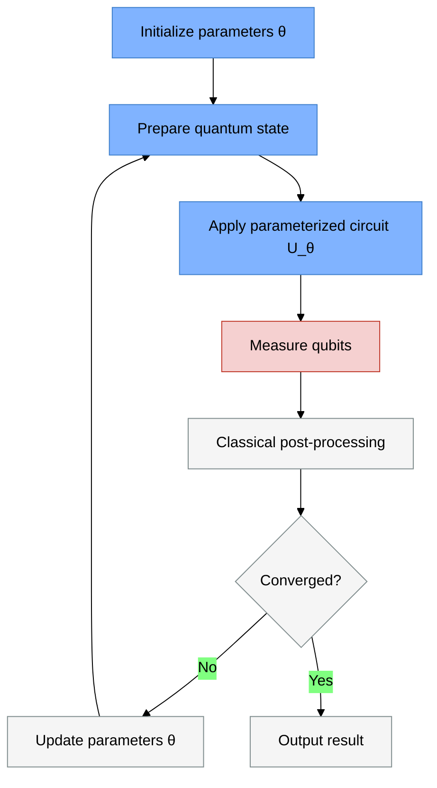
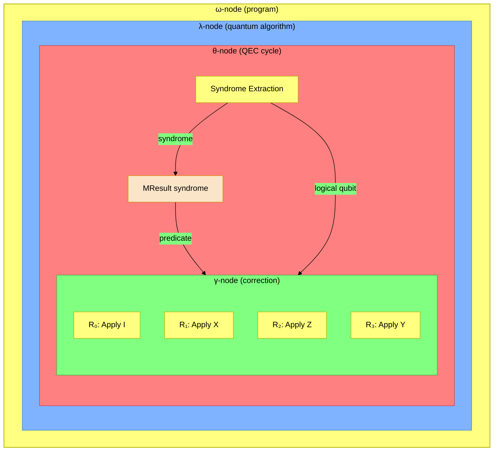
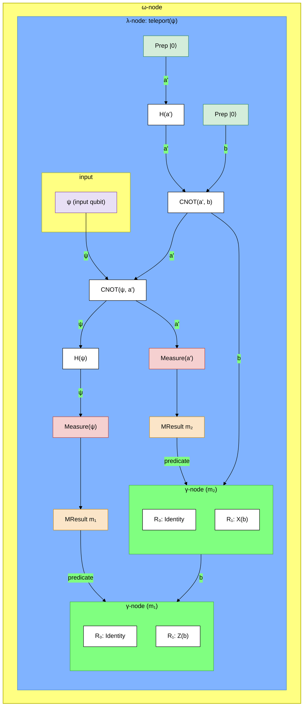
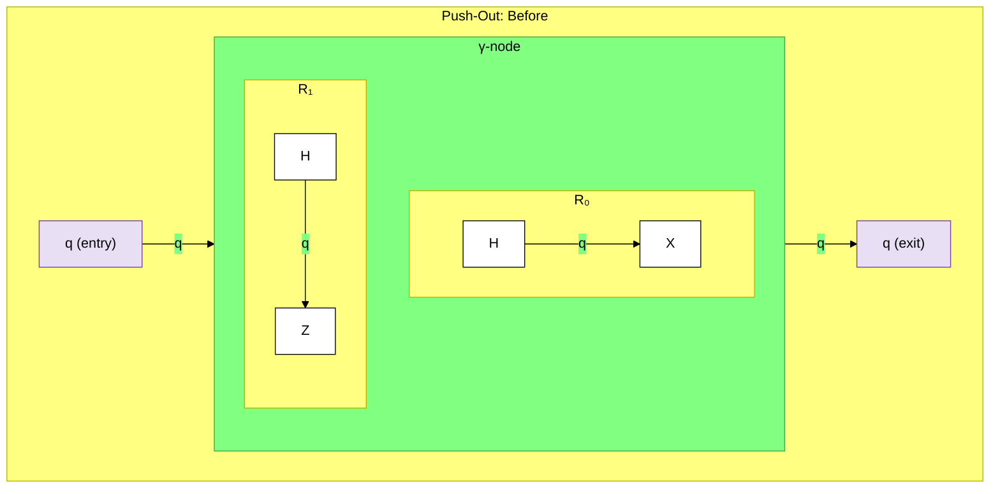
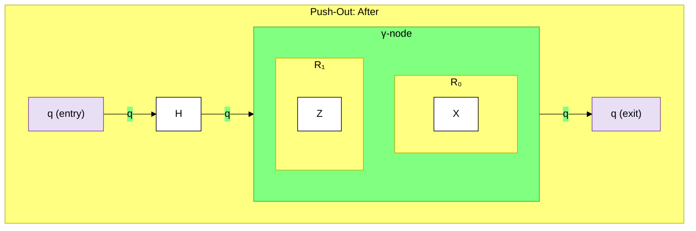
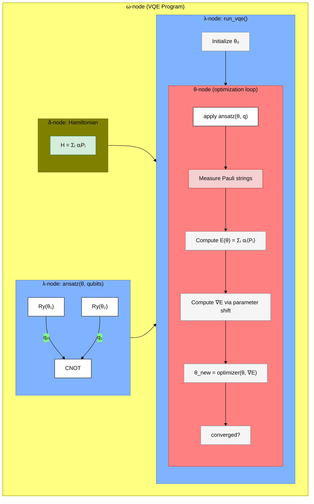
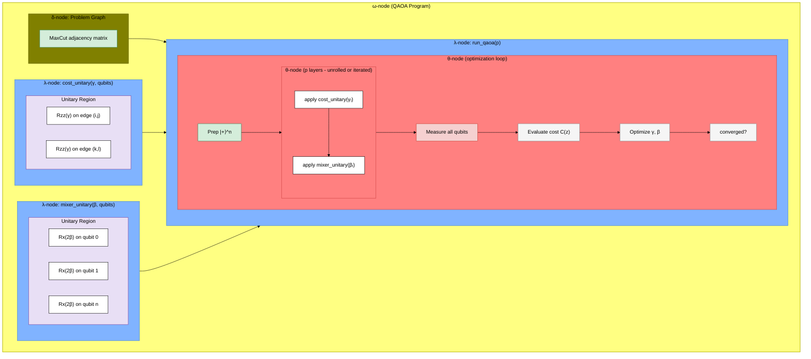

# QRVSDG: A Regionalized Value State Dependence Graph for Hybrid Quantum-Classical Compilation

## Abstract

Hybrid quantum-classical algorithms represent the dominant paradigm for near-term and fault-tolerant quantum computing, yet existing quantum intermediate representations (IRs) do not provide a unified, hierarchical, data-flow-centric view of complete hybrid programs. We propose the Quantum Regionalized Value State Dependence Graph (QRVSDG), an extension of the RVSDG intermediate representation [1] for quantum-classical workloads.

The QRVSDG introduces linear-typed quantum state edges enforcing the no-cloning theorem, quantum-specific node types for gates and measurements, and region annotations distinguishing unitary, hybrid, and error-corrected regions. We show that RVSDG constructs map naturally to quantum concepts: γ-nodes model mid-circuit measurement branching, θ-nodes capture variational loops and repeat-until-success protocols, and λ-nodes represent quantum subroutines with adjoint and controlled variants. We present extended Common Node Elimination and Dead Node Elimination algorithms for quantum programs, construction and destruction methods for hybrid quantum-classical programs, and case studies on the Variational Quantum Eigensolver (VQE) and Quantum Approximate Optimization Algorithm (QAOA).

## 1. Introduction

Quantum computing promises exponential speedups for certain computational problems, but current quantum devices are noisy, limited in qubit count, and constrained in connectivity [2]. To extract practical value from these devices, the field has converged on hybrid quantum-classical algorithms, programs that interleave quantum circuit execution with classical computation [3]. The Variational Quantum Eigensolver (VQE) [4], the Quantum Approximate Optimization Algorithm (QAOA) [5], and quantum machine learning models [6, 36, 47] all follow this pattern: a classical optimizer iteratively adjusts parameters of a quantum circuit, executes the circuit, and processes measurement results in a feedback loop.

Compiling these hybrid programs presents unique challenges. The quantum portion requires gate-level optimization (cancellation, commutation, synthesis), qubit routing to physical hardware, and circuit depth minimization to combat decoherence [7]. The classical portion requires standard compiler optimizations. The boundary between quantum and classical domains is especially important: measurement results feed classical processing, which in turn determines future quantum operations. That boundary requires a unified representation.

Existing quantum intermediate representations fall short:

- **QIR** [8] represents quantum operations as opaque LLVM function calls, preventing quantum-aware optimization. Its flat CFG-based structure loses hierarchical information.
- **OpenQASM 3** [9] provides rich syntax for hybrid programs but uses imperative sequential semantics that do not naturally expose data flow or parallelism.
- **DAG-based representations** such as Qiskit's `DAGCircuit` [10] expose intra-procedural data flow but lack hierarchical structure, inter-procedural analysis, and unified classical-quantum representation.
- **MLIR quantum dialects** [11, 12] provide value semantics for qubits within the MLIR framework [41] but have not converged on a unified hierarchical representation with strong normalization.

In this paper, we propose the **Quantum Regionalized Value State Dependence Graph (QRVSDG)**, an extension of the RVSDG [1] that addresses these limitations. The RVSDG is a data-flow-centric IR where nodes represent computations, edges represent dependencies, and regions capture the hierarchical structure of programs. It represents programs in demand-dependence form, implicitly supports structured control flow, and models entire programs within a single IR. We show that these properties are naturally aligned with quantum computing requirements:

1. **SSA form matches the no-cloning theorem.** Qubits cannot be cloned, so each qubit state has a single definition point, which *is* single static assignment by the laws of physics. Moreover, quantum states cannot be duplicated (fan-out), strengthening SSA to linear SSA.

2. **Demand-dependence improves depth optimization.** Quantum gates on non-interacting qubits have no data dependency and appear as unordered nodes, exposing available logical parallelism under the dependency model.

3. **Hierarchical regions capture quantum program structure.** Quantum programs have natural hierarchies: gates → subcircuits → algorithms → programs, with error correction adding additional nesting layers.

4. **Strong normalization simplifies quantum pattern matching.** Under the stated normalization assumptions, programs that differ only in the ordering of independent operations map to the same QRVSDG form.

Specifically, we make the following contributions:

- (i) A complete QRVSDG specification extending the RVSDG with linear-typed quantum state edges, quantum node types (unitary gates, measurements, state preparation), and region annotations (unitary, hybrid, error-corrected).

- (ii) Construction and destruction methods for hybrid quantum-classical programs, mapping from and to quantum assembly representations (OpenQASM 3, QIR).

- (iii) Extended Common Node Elimination (CNE) and Dead Node Elimination (DNE) algorithms that incorporate quantum semantics, including no-cloning constraints and entanglement-aware liveness analysis.

- (iv) Novel inter-procedural quantum optimizations enabled by the RVSDG's unified program representation, including cross-function gate cancellation and quantum dead function removal.

- (v) Case studies demonstrating the QRVSDG's utility for representing and optimizing VQE and QAOA programs.

## 2. Background

### 2.1 The Regionalized Value State Dependence Graph

The RVSDG [1, 13] is an acyclic hierarchical multigraph consisting of nested regions. A region $\mathcal{R} = (A, N, E, R)$ represents a computation with argument tuple $A$, nodes $N$, edges $E$, and result tuple $R$. Nodes are either simple (representing primitive operations) or structural (containing regions). Edges are either value-typed (representing data flow) or state-typed (imposing ordering on side-effecting operations).

The RVSDG defines the following structural nodes:

- **γ-nodes** model conditionals with symmetric control flow splits and joins. A predicate input selects which of $k+1$ subregions to evaluate.
- **θ-nodes** model tail-controlled loops. A single region represents the loop body, with a predicate result determining continuation.
- **λ-nodes** model functions, with context variables capturing external dependencies and apply-nodes representing invocations.
- **δ-nodes** model global variables.
- **φ-nodes** model mutually recursive environments, preserving acyclicity.
- **ω-nodes** model translation units as the top-level program container.

**Structural node interface variables.** Structural nodes communicate with their subregions through typed interface variables [1]:

- **Entry variables** on a γ-node pass values from outside the node into each subregion. Each entry variable has one input on the γ-node and a corresponding argument in every subregion. At evaluation time, values are routed to the selected region's arguments.
- **Exit variables** on a γ-node carry results out. Each exit variable has a corresponding result in every subregion and one output on the γ-node. The output takes the result value from whichever region was selected.
- **Loop variables** on a θ-node thread state across iterations. Each loop variable consists of an input on the θ-node (the initial value), a corresponding argument in the loop region, a result in the loop region (the value for the next iteration), and an output on the θ-node (the final value when the loop terminates).
- **Context variables** on a λ-node pair an input on the λ-node with the corresponding argument in the function body region, making an externally defined value available inside the function. Formally, the $l$-th context variable is the pair $cv_l = (i_l, a_l)$ consisting of the $l$-th input $i_l$ and the $l$-th argument $a_l$ [1, Def. 4].

The RVSDG has several key properties relevant to our quantum extension:

1. **Inherent SSA form:** Each value is defined exactly once: edges connect each operand input to exactly one output. No SSA restoration passes are needed.
2. **Demand-dependence:** Nodes are ordered only by true data dependencies, avoiding artificial sequentialization.
3. **Acyclicity:** The graph is always acyclic; loops are modeled as θ-nodes with nested regions.
4. **Strong normalization:** Programs differing only in the ordering of independent operations produce identical representations.
5. **Unified program representation:** The entire program is captured in a single graph, enabling inter-procedural analysis and optimization.

### 2.2 Quantum Computing Fundamentals

A quantum bit (qubit) exists as a superposition $|\psi\rangle = \alpha|0\rangle + \beta|1\rangle$ where $\alpha, \beta \in \mathbb{C}$ and $|\alpha|^2 + |\beta|^2 = 1$. Quantum operations are governed by several fundamental principles:

- **Unitarity:** Quantum evolution is described by unitary operators $U$ such that $UU^\dagger = I$. Quantum gates are reversible.
- **No-cloning theorem** [14]: An unknown quantum state cannot be perfectly copied. There exists no unitary $U$ such that $U|\psi\rangle|0\rangle = |\psi\rangle|\psi\rangle$ for all $|\psi\rangle$.
- **Measurement collapse:** Measuring a qubit in the computational basis yields outcome $|0\rangle$ with probability $|\alpha|^2$ or $|1\rangle$ with probability $|\beta|^2$, irreversibly collapsing the superposition. On some hardware platforms, measurement may produce additional outcomes beyond $\{0, 1\}$: for example, neutral atom processors can report atom loss during measurement, yielding a three-valued outcome set $\{0, 1, \text{loss}\}$.
- **Entanglement:** Multi-qubit gates can create correlations between qubits that have no classical analog. Operations on one entangled qubit affect the joint state of all correlated qubits.

A quantum circuit is a sequence of quantum gates applied to a register of qubits, followed by measurement. Common gates include:

| Gate | Matrix | Qubits | Parameters |
|------|--------|--------|------------|
| $H$ (Hadamard) | $\frac{1}{\sqrt{2}}\begin{pmatrix} 1 & 1 \\ 1 & -1 \end{pmatrix}$ | 1 | 0 |
| $R_z(\theta)$ | $\begin{pmatrix} e^{-i\theta/2} & 0 \\ 0 & e^{i\theta/2} \end{pmatrix}$ | 1 | 1 |
| CNOT | $\begin{pmatrix} 1&0&0&0\\0&1&0&0\\0&0&0&1\\0&0&1&0 \end{pmatrix}$ | 2 | 0 |

### 2.3 Hybrid Quantum-Classical Algorithms

Hybrid algorithms interleave quantum circuit execution with classical computation. The dominant pattern is the **variational hybrid loop** [3]:



**Variational Quantum Eigensolver (VQE)** [4] finds the ground-state energy of a Hamiltonian $H = \sum_i \alpha_i P_i$ by minimizing the expectation value $\langle\psi(\vec{\theta})|H|\psi(\vec{\theta})\rangle$ over parameters $\vec{\theta}$ of an ansatz circuit.

**Quantum Approximate Optimization Algorithm (QAOA)** [5] solves combinatorial optimization problems by alternating cost and mixer unitaries: $U(\vec{\gamma}, \vec{\beta}) = \prod_{i=1}^{p} e^{-i\beta_i H_M} e^{-i\gamma_i H_C}$.

Both algorithms share the outer-loop/inner-circuit pattern that is naturally captured by the RVSDG's θ-node.

### 2.4 Quantum Control Flow Patterns

Beyond the variational loop, hybrid programs exhibit several control flow patterns that require IR support:

- **Mid-circuit measurement and feedforward:** Measuring a subset of qubits and using the classical results to condition subsequent quantum operations [9, 15].
- **Repeat-until-success (RUS) protocols:** Attempting a quantum operation repeatedly until a measurement indicates success [16].
- **Quantum error correction (QEC) cycles:** Periodic syndrome measurement, classical decoding, and correction operations [17, 18, 37].
- **Adaptive circuits:** Circuits where the structure adapts based on intermediate measurement results, such as measurement-based quantum computation (MBQC) [19].

## 3. Related Work

### 3.1 Quantum Intermediate Representations

**QIR (Quantum Intermediate Representation)** [8] extends LLVM IR for quantum programs by representing quantum operations as calls to external functions (e.g., `__quantum__qis__h__body`). QIR defines two profiles: Base (static circuits only) and Adaptive (mid-circuit measurements and branching). While QIR leverages the LLVM ecosystem, its opaque quantum operations prevent LLVM's optimizer from reasoning about quantum semantics. Qubit identity is tracked through pointer values rather than value semantics, making static analysis of qubit independence difficult.

**OpenQASM 3** [9] extends the quantum assembly language with classical control flow (`if`, `for`, `while`, `switch`), classical data types, timing constructs, and pulse-level descriptions. It recognizes two distinct timescales: real-time (within qubit coherence) and near-time (less stringent). However, OpenQASM 3's imperative semantics do not naturally expose data dependencies or parallelism, requiring conversion to a DAG-based IR for optimization.

**MLIR Quantum Dialects.** Catalyst [11] (PennyLane) and CUDA-Q's Quake dialect [12] both build quantum representations within MLIR [41], using value semantics for qubits, where gates consume and produce qubit values rather than acting as side effects on references. QIRO [20] introduced this SSA-based approach for quantum optimization. These dialects enable MLIR's optimization infrastructure but lack the RVSDG's unified hierarchical representation, strong normalization, and demand-dependence.

**Qiskit's DAGCircuit** [10] represents quantum circuits as directed acyclic graphs where nodes are operations and edges represent qubit/classical bit wires. While this exposes intra-procedural data flow, the representation is flat (no hierarchical structure), intra-procedural only (no inter-procedural analysis), and cannot naturally represent hybrid classical-quantum control flow.

**tket** [21] uses a circuit graph representation with sophisticated routing and optimization, including ZX-calculus-based transformations. However, it operates at a single level of abstraction with limited support for hybrid program structure.

**HUGR (Hierarchical Unified Graph Representation)** [63] is a hierarchical directed graph IR developed within the Quantinuum ecosystem (underlying TKET2 and Tierkreis). HUGR represents mixed quantum-classical programs using a tree of nested regions, with Module, FuncDefn, FuncDecl, and Call nodes supporting inter-procedural structure, and Conditional, TailLoop, and CFG nodes capturing control flow. Static and Value edges carry typed data (including linear types), and the representation targets whole-program encoding for compilation. HUGR shares several design goals with the QRVSDG, notably hierarchical nesting, typed edges, and whole-program scope. Where HUGR provides extensibility via a plugin extension system and targets practical toolchain integration (serialization, linking), the QRVSDG emphasizes demand-dependence with strong normalization and inherits the RVSDG's formal optimization framework (CNE, DNE, structured region semantics). The two representations are complementary more than competing: HUGR focuses on production infrastructure while the QRVSDG focuses on formal optimization properties.

### 3.2 Quantum Circuit Optimization

Quantum circuit optimization encompasses gate cancellation and commutation [22], circuit identity elimination, gate synthesis [23, 24], T-gate count optimization [25, 26], circuit depth minimization, qubit routing [27, 42], template-based optimization [28], ZX-calculus simplification [29, 30, 44], and phase polynomial optimization [25, 31].

**Quartz** [28] automatically generates and verifies circuit transformation rules for arbitrary gate sets via superoptimization. **VOQC** [32] provides the first fully verified optimizer for quantum circuits, implementing gate cancellation, rotation merging, and commutation with formal correctness proofs in Coq.

Many established quantum optimizers operate primarily at the flat circuit level within a single procedure. Compared with those approaches, the QRVSDG places stronger emphasis on inter-procedural optimization across quantum subroutines and unified optimization of complete hybrid programs.

### 3.3 Data Flow Graphs and Quantum Computing

The connection between data flow graphs and quantum circuits has been noted previously. Ittah et al. [20] showed that SSA value semantics for qubits naturally expose data dependencies. CUDA-Q's Quake dialect [12] demonstrated that a value model (consuming and producing wire values) simplifies optimization compared to a reference model. However, these approaches lack the RVSDG's comprehensive framework: hierarchical regions, demand-dependence with strong normalization, inter-procedural constructs, and unified program representation.

## 4. The Quantum Regionalized Value State Dependence Graph

The QRVSDG extends the RVSDG [1] to support hybrid quantum-classical programs. We preserve all existing RVSDG constructs and properties while adding quantum-specific constraints and capabilities.
Terminology cross-reference: for disambiguation between RVSDG state-edge ordering and program-level quantum state, see the `Eff` note in Section 4.1.

**Definition 1 (QRVSDG).** A QRVSDG is an RVSDG augmented with:

1. **Types.** The type system is extended with Qubit (quantum state) and MResult (measurement result, parameterized by the hardware outcome set). Qubit-typed edges are subject to linear typing (Section 4.1).

2. **Simple node operators.** The set of simple node operators is extended with quantum-specific operators:
    - $\text{UGate}(\text{op}, n_q, n_p)$: unitary quantum gate applying operation op to $n_q$ qubits with $n_p$ classical parameters.
    - $\text{Measure}(\text{basis}, S)$: quantum measurement, converting a qubit state to a classical measurement result parameterized by outcome set $S$.
    - $\text{MeasureD}$: destructive measurement (consumes the qubit).
    - $\text{Prep}(\text{init})$: state preparation, allocating a qubit in a specified initial state.
    - $\text{Reset}$: qubit reinitialization to $|0\rangle$.
    - $\text{Barrier}$: scheduling barrier (identity unitary with ordering side effect).
    - Within $R_{EC}$ regions: $\text{Encode}$, $\text{Decode}$, $\text{SyndromeExtract}$, $\text{LogicalGate}$, $\text{Distill}$ (see Section 4.3).

3. **Structural nodes.** All RVSDG structural nodes (γ, θ, λ, δ, φ, ω) are retained with quantum-specific constraints on entry/exit/loop variables when they carry Qubit-typed edges (Section 4.2.3). A new Conjugate structural node models the $U \cdot V \cdot U^\dagger$ uncomputation pattern (Section 4.2.1).

4. **Region annotations.** Each region is annotated as unitary ($R_U$), hybrid ($R_H$), or error-corrected ($R_{EC}$), constraining the node types permitted within the region (Section 4.3).

Extensions are detailed at three levels: the type system (Section 4.1), node types (Section 4.2), and region annotations (Section 4.3).

### 4.1 Type System Extension

The QRVSDG extends the RVSDG type system with quantum types and linear typing rules:

$$\tau ::= \underbrace{\text{Qubit} \mid \text{LogicalQubit}(\text{code}, d)}_{\text{quantum}} \mid \underbrace{\text{MResult}(S) \mid \text{Syndrome} \mid \text{Int} \mid \text{Float} \mid \text{Bool} \mid \text{Eff}_d \mid \text{QFunc}(\bar{\tau}_\text{in} \to \bar{\tau}_\text{out})}_{\text{classical}} \mid \underbrace{\text{Array}(\tau, n) \mid \text{Tuple}(\tau_1, \ldots, \tau_k) \mid \text{Struct}(\textit{name}, \{f_1: \tau_1, \ldots, f_k: \tau_k\})}_{\text{compound}}$$

The quantum types include `Qubit` (physical quantum state) and `LogicalQubit(code, d)` (logical quantum state within $R_{EC}$ regions, parameterized by error-correcting code family and code distance; see Section 4.3). Both obey the linear typing constraint. The `Syndrome` type represents a vector of stabilizer measurement outcomes used for QEC decoding.

The compound types provide structured aggregation over existing types. $\text{Array}(\tau, n)$ is a homogeneous fixed-size collection of $n$ values of type $\tau$. $\text{Tuple}(\tau_1, \ldots, \tau_k)$ is a heterogeneous product of $k$ values with distinct positional types. $\text{Struct}(\textit{name}, \{f_1: \tau_1, \ldots, f_k: \tau_k\})$ is a named product with labeled fields, where the $\textit{name}$ parameter serves as metadata for readability and destruction-time mapping but does not participate in type equality (see the structural equality rule below). Compound types compose recursively: $\text{Array}(\text{Tuple}(\text{Qubit}, \text{Float}), m)$ is a valid type. These constructors formalize the existing $\text{Qubit}^{n_q}$ notation; where the specification previously used superscript shorthand for $n$ individual qubit edges, $\text{Array}(\text{Qubit}, n)$ provides a first-class type for qubit registers.

**The MResult type.** `MResult(S)` is the type of measurement outcomes, parameterized by an outcome set $S$. The outcome set is determined by the measurement basis and the target hardware:

| Hardware | Typical outcome set $S$ | Notes |
|---|---|---|
| Superconducting (IBM, Google) | $\{0, 1\}$ | Standard computational basis |
| Trapped ion (Quantinuum) | $\{0, 1\}$ | Fluorescence detection |
| Neutral atom (QuEra, Pasqal, Atom Computing) | $\{0, 1, \text{loss}\}$ | Atom loss during measurement is a distinct, detectable outcome |
| Photonic (Xanadu, PsiQuantum) | $\{0, 1, 2, \ldots, n\}$ | Photon number-resolving detectors |

The default outcome set is $S = \{0, 1\}$, written simply as `MResult` when the binary case is unambiguous. For hardware with richer outcome sets, the parameterization enables the type system to enforce exhaustive branching: a γ-node predicated on an `MResult({0, 1, loss})` value requires three subregions, preventing silent mishandling of loss events. A convenience alias `Bit` $\equiv$ `MResult({0, 1})` may be used in contexts where only binary outcomes are relevant.

**MResult vs. Bool.** The type system distinguishes `MResult` from `Bool`. An `MResult(S)` is a measurement outcome produced by `Measure` nodes; it is the type used as a γ-node predicate for mid-circuit measurement branching. A `Bool` is a classical boolean value produced by classical comparison or logical operations (e.g., convergence checks in variational loops). The two types are explicitly convertible when $S = \{0, 1\}$: `MResult({0,1}) → Bool` is a coercion (interpreting a measurement outcome as a truth value). For richer outcome sets, conversion to `Bool` requires an explicit discriminator (e.g., testing whether the outcome equals a specific value). This distinction allows the type system to track which values originate from quantum measurement (and therefore exhibit probabilistic, hardware-dependent behavior) versus deterministic classical computation.

**Disambiguation note.** We use `Eff` for the RVSDG ordering carrier (state edge in [1]) to avoid overloading the term "state." In this paper, "quantum state" refers to program-level quantum data on Qubit-typed edges, while `Eff` refers only to sequencing of side effects.

**Effect token threading.** `Eff`-typed edges impose a sequential ordering on side-effecting operations. An `Eff` token is produced by the ω-region's argument (representing the initial program state) and threaded through side-effecting nodes: `Prep` consumes and produces an `Eff` token (qubit allocation is a side effect), and operations with externally visible effects (I/O, hardware communication) similarly consume and produce `Eff` tokens. Measurement nodes (`Measure`, `MeasureD`) do not require explicit `Eff` threading because their ordering is already determined by the linear quantum state edge — the qubit input imposes a data dependency that prevents reordering. Within γ-nodes and θ-nodes, `Eff` tokens are threaded through entry/exit variables and loop variables respectively, ensuring side-effect ordering is preserved across control flow boundaries.

**Multiple independent effect domains.** As noted in the RVSDG paper [1], a single effect token is overly conservative: different computations may have mutually exclusive side-effects. For hybrid quantum-classical programs, we distinguish three independent effect domains:

- $\text{Eff}_{\text{qpool}}$: Qubit allocation pool (Prep, Dealloc, Reset side effects).
- $\text{Eff}_{\text{cmem}}$: Classical memory (array loads/stores, optimizer state updates).
- $\text{Eff}_{\text{io}}$: I/O and hardware communication (circuit submission, result retrieval).

Operations in different domains have no ordering dependency. For example, allocating a qubit ($\text{Eff}_{\text{qpool}}$) and loading a Hamiltonian coefficient from classical memory ($\text{Eff}_{\text{cmem}}$) can proceed in parallel — they share no Eff edge. The ω-region produces one argument per Eff domain; each structural node threads only the Eff tokens its region actually uses. A pure unitary λ-node (R_U) needs no Eff tokens at all — ordering is fully determined by linear qubit edges. The $\text{Eff}_{\text{cmem}}$ domain may be further split for programs with provably disjoint classical memory regions (e.g., read-only Hamiltonian data vs. read-write optimizer state), exposing additional parallelism. The single-Eff model is a special case where all domains are collapsed.

**Linearity propagation.** A type is *linear* if it contains quantum data that cannot be duplicated or discarded:

$$\text{linear}(\text{Qubit}) = \text{true}$$
$$\text{linear}(\text{LogicalQubit}(\text{code}, d)) = \text{true}$$
$$\text{linear}(\text{Array}(\tau, n)) = \text{linear}(\tau)$$
$$\text{linear}(\text{Tuple}(\tau_1, \ldots, \tau_k)) = \exists i.\; \text{linear}(\tau_i)$$
$$\text{linear}(\text{Struct}(\textit{name}, \{f_1: \tau_1, \ldots, f_k: \tau_k\})) = \exists i.\; \text{linear}(\tau_i)$$
$$\text{linear}(\tau) = \text{false} \quad \text{for all other types}$$

For any output $o$ of type $\tau$ where $\text{linear}(\tau)$: $|\text{users}(o)| = 1$ (no-cloning) and $|\text{users}(o)| \neq 0$ (no-deleting). For classical types where $\neg\text{linear}(\tau)$: $|\text{users}(o)| \geq 0$ (classical fan-out permitted). This predicate generalizes the per-output constraints in the edge typing rules below from individual Qubit edges to any type containing quantum data.

**Quantum content detection.** The predicate $\text{contains\_quantum}(\tau)$ identifies types that contain quantum data at any nesting depth, used by Algorithm XV for linearity verification:

$$\text{contains\_quantum}(\text{Qubit}) = \text{true}$$
$$\text{contains\_quantum}(\text{LogicalQubit}(\_, \_)) = \text{true}$$
$$\text{contains\_quantum}(\text{Array}(\tau, n)) = \text{contains\_quantum}(\tau)$$
$$\text{contains\_quantum}(\text{Tuple}(\tau_1, \ldots, \tau_k)) = \exists i.\; \text{contains\_quantum}(\tau_i)$$
$$\text{contains\_quantum}(\text{Struct}(\_, \{f_1: \tau_1, \ldots, f_k: \tau_k\})) = \exists i.\; \text{contains\_quantum}(\tau_i)$$
$$\text{contains\_quantum}(\_) = \text{false}$$

In the current type system, $\text{linear}(\tau)$ and $\text{contains\_quantum}(\tau)$ are equivalent because all linear types are quantum types. The separate predicate is provided for clarity and forward-compatibility if non-quantum linear types (e.g., unique file handles) are introduced in the future.

**Struct type equality.** Struct types use structural equality; the name is metadata for documentation, IR dumps, and destruction-time target mapping. It does not participate in type identity:

$$\text{Struct}(\_, \text{fields}_1) = \text{Struct}(\_, \text{fields}_2) \iff \text{fields}_1 = \text{fields}_2$$

Two structs with identical field label and type mappings are the same type regardless of name. This maximizes opportunities for Common Node Elimination (Algorithm IX), which depends on type equality for congruence detection. Struct names are preserved through optimization passes as best-effort metadata (see Metadata Conventions in the algorithms addendum).

**Theorem (Compound Linearity Sufficiency).** If the following three conditions hold for all compound-type operations in the IR:

1. Each input to a compound construction node becomes unreachable except through the compound output (construction consumes element inputs).
2. Every extraction operation on a linear compound value has exactly one user per extracted output: $|\text{users}(o)| = 1$.
3. No compound-type operation produces a duplicate of any sub-element. The closed set of compound operations {ArrayConstruct, ArraySwap, ArrayDestruct, TupleConstruct, TupleExtract, StructConstruct, StructExtract, ArrayMultiGate, ArrayApplyGate, ArrayTransport} satisfies this by construction. Convenience operations defined as compositions of closed-set operations (PrepRegister, DeallocRegister, MeasureAll) inherit this guarantee through their decompositions.

Then compound-level $|\text{users}(o)| = 1$ checking is sufficient to guarantee that no individual qubit is duplicated. Algorithm XV does not need to peer inside compound types to verify linearity.

*Note:* This theorem depends on a closed set of compound-type operations. Any future compound operation must be verified against these three conditions before inclusion.

**Edge typing rules.** Edges are classified by their type:

- **Classical edges** $e_c$ (types where $\neg\text{linear}(\tau)$, including MResult, Int, Float, Bool, Eff, QFunc, and compound types without quantum elements): Standard RVSDG semantics apply. An output can be the origin of zero or more edges: $\forall o \in O_c(n) : |\text{users}(o)| \ge 0$.

- **Linear edges** $e_l$ (types where $\text{linear}(\tau)$, including Qubit, LogicalQubit, and any compound type containing quantum data): Linear typing enforces the no-cloning theorem. Each linear output must be the origin of *exactly one* edge: $\forall o : \text{linear}(\text{type}(o)) \Rightarrow |\text{users}(o)| = 1$.

The linear constraint ensures that quantum states, whether carried individually or within compound structures, form chains (one producer, one consumer) rather than trees. For individual qubit edges, this directly mirrors the structure of quantum circuit diagrams where each qubit wire passes through a sequence of gates without branching. For compound types, the Compound Linearity Sufficiency Theorem (above) establishes that compound-level checking is sufficient to guarantee individual qubit non-duplication.

**No-deleting constraint.** Every linear output must be consumed by a subsequent operation, a measurement (including `MeasureD` when used), or a region/program result. This enforces the no-deleting theorem: $\forall o : \text{linear}(\text{type}(o)) \Rightarrow |\text{users}(o)| \neq 0$.

Combined, the linear and no-deleting constraints give: $\forall o : \text{linear}(\text{type}(o)) \Rightarrow |\text{users}(o)| = 1$.

**The QFunc type.** $\text{QFunc}(\bar{\tau}_\text{in} \to \bar{\tau}_\text{out})$ is the type of first-class quantum subroutine values. A λ-node whose region has argument types $\bar{\tau}_\text{in}$ (excluding context-variable arguments) and result types $\bar{\tau}_\text{out}$ produces a single output of type $\text{QFunc}(\bar{\tau}_\text{in} \to \bar{\tau}_\text{out})$. This output is consumed by apply-nodes, which invoke the subroutine. QFunc is classified as a classical type: subroutine references can be freely copied ($|\text{users}(o)| \ge 0$), enabling a single λ-node to be invoked at multiple call sites.

**Quantum capture constraint.** A λ-node's context variables may include quantum-typed (Qubit) values. When at least one context variable has type Qubit, the resulting QFunc value captures live quantum state and becomes *affine*: it must be applied exactly once ($|\text{users}(o)| = 1$), because invoking the subroutine consumes the captured qubits. A QFunc with only classical context variables remains freely copyable.

**Derivation annotations.** A QFunc type may carry optional annotations indicating that the referenced subroutine supports adjoint derivation ($\dagger$), controlled derivation, or both. These annotations are inferred from the λ-node's region annotation: a subroutine whose region is annotated $R_U$ (unitary) supports both adjoint and controlled derivation, while a subroutine with an $R_H$ (hybrid) region supports neither.

### 4.2 Quantum Node Types

#### 4.2.1 Quantum Simple Nodes

Simple nodes are extended with quantum-specific operators:

**Unitary gate nodes** model quantum gates. Their signature is:

$$\text{UGate}(\text{op}, n_q, n_p) : (\underbrace{q_1, \ldots, q_{n_q}}_{\text{Qubit}^{n_q}}, \underbrace{p_1, \ldots, p_{n_p}}_{\text{Float}^{n_p}}) \to (\underbrace{q'_1, \ldots, q'_{n_q}}_{\text{Qubit}^{n_q}})$$

where op is the gate name (e.g., $H$, $\text{CNOT}$, $R_z$), $n_q$ is the number of qubits, and $n_p$ is the number of classical parameters. For parameterized gates (e.g., $R_z(\theta)$), classical parameters enter via classical value edges while qubit states enter via quantum state edges.

*Notation:* The $\text{Qubit}^{n_q}$ notation in UGate denotes $n_q$ individual Qubit-typed input ports, not an $\text{Array}(\text{Qubit}, n_q)$ type on a single port. Each qubit enters as a separate edge. For applying gates to elements within a qubit array without extraction, see ArrayMultiGate and ArrayApplyGate in §4.2.2.

**Measurement nodes** convert quantum information to classical information:

$$\text{Measure}(\text{basis}, S) : (\text{Qubit}) \to (\text{MResult}(S), \text{Qubit})$$

A measurement node produces a classical measurement result of type $\text{MResult}(S)$ and a post-measurement quantum state. The outcome set $S$ is determined by the measurement basis and target hardware: for standard computational-basis measurement on superconducting or trapped-ion hardware, $S = \{0, 1\}$ and the post-measurement state collapses to $|0\rangle$ or $|1\rangle$. For neutral atom hardware, $S = \{0, 1, \text{loss}\}$ where the loss outcome indicates the atom was lost during measurement, yielding no valid post-measurement state—the Qubit output in the loss case carries an invalid state that must be handled by downstream control flow (typically a γ-node branching on the loss outcome to re-prepare the qubit). A destructive variant $\text{MeasureD} : (\text{Qubit}) \to (\text{MResult}(S))$ consumes the qubit without producing a post-measurement state.

Measurement nodes are the unique boundary between quantum and classical graph regions. They are the only nodes converting quantum edges to classical edges, introducing non-determinism and irreversibility.

**State preparation nodes** create quantum states:

$$\text{Prep}(\text{init}) : (\text{Eff}) \to (\text{Qubit}, \text{Eff})$$

This allocates a qubit in state $|0\rangle$ (or a specified initial state). It serves as the quantum analog of variable declaration. The effect-token input and output impose ordering on qubit allocations relative to other side-effecting operations, consistent with the RVSDG state-edge convention for modeling side effects [1].

**Reset nodes** reinitialize qubits:

$$\text{Reset} : (\text{Qubit}) \to (\text{Qubit})$$

This resets a qubit to $|0\rangle$ regardless of its current state, enabling qubit reuse after measurement.

**Barrier nodes** prevent optimization across boundaries:

$$\text{Barrier} : (\text{Array}(\text{Qubit}, n)) \to (\text{Array}(\text{Qubit}, n))$$

A barrier acts as the identity unitary but imposes scheduling constraints, creating explicit dependencies that prevent gate reordering across the boundary. The barrier accepts a qubit register as a single compound input, in contrast to UGate which takes individual qubit inputs on separate ports.

**Conjugate nodes** model structured uncomputation — the $U \cdot V \cdot U^\dagger$ conjugation pattern of preparing intermediate state, performing a computation, then reversing the preparation to restore ancilla qubits to $|0\rangle$:

$$\text{Conjugate} : (\text{Qubit}^m, \text{Qubit}^k, \text{Classical}^p) \to (\text{Qubit}^m, \text{Qubit}^k, \text{Classical}^r)$$

A Conjugate node contains two sub-regions: $\mathcal{R}_{\text{outer}}$ (annotated $R_U$, required) and $\mathcal{R}_{\text{inner}}$ ($R_U$ or $R_H$). The compiler auto-generates $\mathcal{R}_{\text{outer}}^\dagger$ (the adjoint of the outer region). Execution proceeds as: outer → inner → Adjoint(outer). Through-qubits flow through all three phases; ancilla-qubits enter in $|0\rangle$ and are guaranteed to return to $|0\rangle$ after the adjoint phase completes when $\mathcal{R}_{\text{inner}}$ is $R_U$. When $\mathcal{R}_{\text{inner}}$ is $R_H$, the guarantee holds only if the inner region does not modify the ancilla-qubit states that the outer region's adjoint depends on. The $R_U$ requirement on the outer region ensures the adjoint is well-defined. This captures the mathematical conjugation $U V U^\dagger$, Q#'s `within { } apply { }` pattern [65], Bennett's uncomputation method [66], and general ancilla cleanup in arithmetic circuits.

**Motivation.** The Conjugate node is a dedicated structural node rather than a recognized pattern over flat gate sequences because it provides three properties that post-hoc pattern recognition cannot:

1. **Guaranteed adjoint correctness.** The adjoint phase is structurally derived from the outer region — it is impossible for the cleanup to diverge from the preparation when the preparation changes. Without a Conjugate node, the programmer or compiler must manually construct and synchronize the reverse gate sequence, a common source of errors in arithmetic circuit uncomputation.

2. **Ancilla restoration as a type-level contract.** When $\mathcal{R}_{\text{inner}}$ is $R_U$, the Conjugate node guarantees ancilla qubits return to $|0\rangle$ by construction. Downstream passes — qubit lifetime analysis (Algorithm XXIII), qubit reuse (Algorithm XXIV), and resource estimation — can exploit this guarantee via a single node-type check ($O(1)$) rather than tracing the full gate sequence to verify restoration ($O(n)$ per ancilla chain). This directly reduces the peak qubit count reported by resource estimation.

3. **Algebraic fusion.** Adjacent Conjugate nodes with congruent outer regions fuse: $U V_1 U^\dagger \cdot U V_2 U^\dagger = U (V_1 V_2) U^\dagger$, saving two applications of $U$. Without a Conjugate node, this pattern requires identifying an identical gate subsequence and its adjoint in flat gate sequences, matching them across a variable-length inner computation, and proving the match — a substantially harder pattern-matching problem that structural CNE alone does not reliably solve.

#### 4.2.2 Compound Data Node Operators

The following simple nodes construct, access, and destructure compound types. Compounds that contain linear elements are themselves linear: construction consumes all element inputs, and destructive extraction is required for element access.

**TupleConstruct.** Packs $k$ values into a tuple:

$$\text{TupleConstruct} : (\tau_1, \ldots, \tau_k) \to \text{Tuple}(\tau_1, \ldots, \tau_k)$$

All inputs are consumed: if any $\tau_i$ is linear, the input edge is the sole use of that value. The output tuple is linear when any element type is linear.

**TupleExtract.** Destructively unpacks a tuple into all its components:

$$\text{TupleExtract} : \text{Tuple}(\tau_1, \ldots, \tau_k) \to (\tau_1, \ldots, \tau_k)$$

For linear tuples, this is the only access pattern: the tuple is consumed and all fields are returned. For classical tuples, individual field projection is also available:

$$\text{TupleProject}(j) : \text{Tuple}(\tau_1, \ldots, \tau_k) \to \tau_j \quad (\text{classical only: } \neg\text{linear}(\text{Tuple}(\ldots)))$$

**StructConstruct.** Packs $k$ named fields into a struct:

$$\text{StructConstruct}(\textit{name}, f_1, \ldots, f_k) : (\tau_1, \ldots, \tau_k) \to \text{Struct}(\textit{name}, \{f_1: \tau_1, \ldots, f_k: \tau_k\})$$

Consumption rules follow TupleConstruct: all inputs are consumed.

**StructExtract.** Destructively unpacks a struct into all fields:

$$\text{StructExtract} : \text{Struct}(\textit{name}, \{f_1: \tau_1, \ldots, f_k: \tau_k\}) \to (\tau_1, \ldots, \tau_k)$$

Classical-only field projection:

$$\text{StructProject}(f_j) : \text{Struct}(\textit{name}, \ldots) \to \tau_j \quad (\text{classical only})$$

**ArrayConstruct.** Packs $n$ values of type $\tau$ into an array:

$$\text{ArrayConstruct}(\tau, n) : (\tau^n) \to \text{Array}(\tau, n)$$

All $n$ inputs are consumed.

**ArraySwap.** Exchanges the element at index $j$ with a provided replacement value:

$$\text{ArraySwap}(j) : (\text{Array}(\tau, n), \tau) \to (\text{Array}(\tau, n), \tau)$$

The modified array and the extracted element are both returned. The array remains the same size; it is always "full." This is the primary element access mechanism for linear arrays, providing $O(1)$ element access while maintaining linearity. The index $j$ is an operator parameter (static, known at compile time).

The swap-based design avoids the need for borrow semantics. In a borrow model, a temporary reference to an array element would require tracking the borrow's scope, preventing other accesses during the borrow, and reinserting the element on return. ArraySwap achieves the same effect with a simpler, type-safe-by-construction mechanism: the replacement value fills the vacated slot, so the array is never partially occupied. This eliminates an entire class of aliasing errors and keeps the type system free of lifetime annotations.

**ArrayDestruct.** Unpacks an array into all its elements:

$$\text{ArrayDestruct} : \text{Array}(\tau, n) \to (\tau^n)$$

For linear arrays, this is the alternative to ArraySwap when all elements need simultaneous access.

For classical arrays where $\neg\text{linear}(\tau)$, non-destructive element access is also available:

$$\text{ArrayProject}(j) : \text{Array}(\tau, n) \to \tau \quad (\text{classical only: } \neg\text{linear}(\tau))$$

**ArrayMultiGate.** Applies a $k$-qubit gate to elements at specified indices within a qubit array, without extracting the elements:

$$\text{ArrayMultiGate}(\text{gate}, (i_1, \ldots, i_k)) : (\text{Array}(\text{Qubit}, n), \text{Float}^{n_p}) \to \text{Array}(\text{Qubit}, n)$$

The gate and indices are operator parameters. Classical gate parameters (rotation angles) are value-edge inputs. The array size is preserved. ArrayMultiGate is restricted to single-array operations; cross-array gates require the extract-operate-reinsert pattern using ArraySwap and UGate.

Zone-gate compatibility is required: the gate must be executable in the zone $Z$ annotating the array's qubit type.

**ArrayApplyGate.** Shorthand for single-qubit gate application at index $j$:

$$\text{ArrayApplyGate}(j, \text{gate}) \equiv \text{ArrayMultiGate}(\text{gate}, (j))$$

ArrayApplyGate is not a separate node type. It is a single-index special case of ArrayMultiGate. Consecutive ArrayApplyGate nodes targeting different indices commute and may be freely reordered. The entanglement transfer function for ArrayApplyGate is identity ($\tau(P) = P$), since single-qubit gates do not create entanglement.

**Gate lowering.** ArrayMultiGate lowers to an ArraySwap extraction sequence, followed by UGate application on the extracted qubits, followed by ArraySwap reinsertion. ArrayApplyGate lowers identically with a single index. Late lowering (after compound-level optimization) is recommended so that compound-level commutation rules remain available during optimization passes.

**ArrayTransport.** Transitions an entire qubit array from one zone to another:

$$\text{ArrayTransport}(Z_\text{src} \to Z_\text{dst}) : (\text{Array}(\text{Qubit}\langle Z_\text{src}\rangle, n), \text{Eff}) \to (\text{Array}(\text{Qubit}\langle Z_\text{dst}\rangle, n), \text{Eff})$$

ArrayTransport is a primitive IR node, not syntactic sugar for per-element transport. It models real hardware operations: atom row shuttling in neutral-atom systems, ion chain movement in trapped-ion QCCD architectures. The effect token is required because zone transitions may involve physical operations with observable ordering constraints.

No existing quantum IR (HUGR, Quake, QIR, OpenQASM 3) models bulk transport. ArrayTransport is novel to the QRVSDG.

Lowering during destruction follows target capability:

- Neutral-atom and trapped-ion targets: maps to a native bulk transport instruction.
- Superconducting targets: elided (no physical transport exists).
- OpenQASM 3 and QIR targets: decomposed to ArrayDestruct, per-element Transport with chained effect tokens, and ArrayConstruct.

**Dealloc.** Releases a single qubit back to the allocation pool without measuring:

$$\text{Dealloc} : (\text{Qubit}, \text{Eff}) \to (\text{Eff})$$

The qubit is consumed (linear typing enforced). Dealloc nodes are prohibited in $R_U$ (unitary) regions, which must preserve qubit count.

**DeallocRegister.** Bulk deallocation of an entire qubit register:

$$\text{DeallocRegister} : (\text{Array}(\text{Qubit}, n), \text{Eff}) \to (\text{Eff})$$

Equivalent to ArrayDestruct followed by $n$ individual Dealloc nodes, but represented as a single node for compactness and target mapping. Maps to bulk deallocation instructions in QIR and Q#. DeallocRegister is prohibited in $R_U$ regions.

**PrepRegister.** Bulk allocation of $n$ qubits into an array:

$$\text{PrepRegister}(n) : (\text{Eff}) \to (\text{Array}(\text{Qubit}, n), \text{Eff})$$

Equivalent to $n$ individual Prep nodes followed by ArrayConstruct, but represented as a single node. Maps to `qubit[n]` declarations in OpenQASM 3 and `use q = Qubit[n]` in Q#. PrepRegister is prohibited in $R_U$ regions.

**MeasureAll.** Measures all qubits in an array, producing an array of measurement results:

$$\text{MeasureAll}(S) : \text{Array}(\text{Qubit}, n) \to \text{Array}(\text{MResult}(S), n)$$

This is a destructive measurement: all qubits are consumed. Maps to measuring an entire `qubit[n]` register.

#### 4.2.3 Mapping of Structural Nodes to Quantum Constructs

The RVSDG's structural nodes map to quantum computing concepts with quantum-specific constraints:

**Quantum γ-nodes.** A γ-node in the QRVSDG models mid-circuit measurement branching. The predicate input is a classical value: an `MResult(S)` for measurement-driven branching (with $|S|$ subregions, one per outcome), or an encoded multi-value selector for general $k+1$-way branching. Entry variables (see §2.1) may carry quantum state edges subject to the no-cloning constraint: each entry variable's input is routed to the corresponding argument in the selected region, and at runtime exactly one region consumes the active quantum state. Exit variables carry quantum state edges out: each region produces a result, and the γ-node's output takes the value from the selected region.

When the predicate is an `MResult(S)` with $|S| > 2$ (e.g., neutral atom measurement with loss detection), the γ-node naturally requires one region per outcome, ensuring exhaustive handling of all possible measurement results including hardware-specific outcomes like atom loss.

**Critical constraint:** Only region $R_v$ (selected by the predicate) is evaluated. Unselected regions never receive quantum states. This is naturally enforced by the γ-node's evaluation semantics.

Quantum γ-nodes arise in:

| Application | γ-node Structure |
|---|---|
| Quantum teleportation correction | 4-way branch on 2 measurement results |
| QEC syndrome decoding | $\prod_i |S_i|$-way branch on $k$ syndrome measurements |
| Neutral atom loss detection | 3-way branch: 0 vs. 1 vs. loss |
| Repeat-until-success branching | 2-way branch: success vs. retry |
| Classically-controlled gates | 2-way branch: apply gate vs. identity |

**Quantum θ-nodes.** A θ-node models iterative quantum-classical computation. Loop variables (see §2.1) carry both classical and quantum states across iterations — each loop variable's input provides the initial value, and the loop region's result feeds back as the argument for the next iteration:

- **Classical loop variables** carry parameters, iteration counters, and cost function values with standard semantics.
- **Quantum loop variables** thread quantum state through iterations linearly: the qubit state from one iteration's result maps to the next iteration's argument, preserving the linear typing invariant ($|\text{users}| = 1$) at each iteration boundary.

The predicate is always a classical value (determined by measurement or classical computation).

Quantum θ-nodes arise in:

| Pattern | θ-node Loop Body |
|---|---|
| VQE/QAOA optimization | Parameterized circuit + measurement + classical cost evaluation |
| Repeat-until-success | Attempt circuit + ancilla measurement |
| QEC cycles | Syndrome extraction + classical decoding + correction |
| Grover iterations | Oracle + diffusion operator |

**Quantum λ-nodes.** A λ-node models a quantum subroutine. It contains a single region representing the subroutine body, features a tuple of inputs (context variables) and a single output. The output carries type $\text{QFunc}(\bar{\tau}_\text{in} \to \bar{\tau}_\text{out})$, where $\bar{\tau}_\text{in}$ and $\bar{\tau}_\text{out}$ are the argument and result types of the region (excluding context-variable arguments). Context variables capture external dependencies (hardware parameters, classical data), while function arguments include both quantum registers (qubit inputs) and classical parameters. For pure unitary subroutines, qubit count is conserved: $|A_\lambda^q| = |R_\lambda^q|$.

**Quantum apply-nodes.** An apply-node invokes a quantum subroutine. Its first input (the *function input*) takes the QFunc-typed output of a λ-node as its origin. Its remaining inputs provide the subroutine's arguments, which may include both Qubit-typed and classical-typed values. The apply-node's outputs correspond to the subroutine's results. When qubit arguments are passed to an apply-node, linear typing is preserved: each Qubit-typed argument input consumes a quantum edge, and each Qubit-typed result output produces a fresh quantum edge.

$$\text{Apply} : (\text{QFunc}(\bar{\tau}_\text{in} \to \bar{\tau}_\text{out}),\; \bar{\tau}_\text{in}) \to \bar{\tau}_\text{out}$$

Quantum λ-nodes naturally support:
- **Adjoint derivation:** If λ defines $U$, then $\lambda^\dagger$ defines $U^\dagger$ by reversing the region's operations and replacing each gate with its adjoint. The output type carries the adjoint annotation: $\text{QFunc}^\dagger(\bar{\tau}_\text{in} \to \bar{\tau}_\text{out})$.
- **Controlled derivation:** Adding a control qubit that enables/disables all operations in the region. The output type reflects the added control qubit in its signature.

**Quantum δ-nodes.** δ-nodes model quantum hardware parameters: gate fidelities, $T_1$/$T_2$ coherence times, qubit connectivity graphs, noise model parameters, and error correction code parameters. They are defined once at the translation unit level and referenced by many functions.

**Quantum φ-nodes.** φ-nodes model recursive quantum algorithms, including the recursive quantum Fourier transform, quantum walks, and concatenated error correction codes. Recursion is always bounded in quantum computing (finite qubit registers limit recursion depth), and the φ-node captures this without introducing graph cycles.

**Quantum ω-nodes.** The ω-node represents the complete hybrid quantum-classical program. Its region arguments represent external quantum hardware interfaces and classical library imports. Its results mark exported quantum algorithms and reusable subroutines. The single-graph representation enables whole-program optimizations.

#### 4.2.4 Compound Type Patterns in Structural Nodes

Compound types interact with structural nodes through specific patterns that maintain linearity and type preservation.

**γ-node reinsert mandate.** All regions of a γ-node must produce matching output types. When operating on individual elements of a compound value inside a γ-node region, the correct pattern is: extract the element via ArraySwap, operate on the extracted element, reinsert via ArraySwap, and produce the restored compound as the region output. This ensures all regions produce the same $\text{Array}(\text{Qubit}, n)$ output type regardless of which branch executes. Omitting the reinsertion step would change the output type (the array would be missing an element), violating the γ-node's requirement that all regions produce values of the same type on each exit variable.

**θ-node fixed-type constraint.** Loop variable types are fixed across iterations. An $\text{Array}(\text{Qubit}, n)$ loop variable retains size $n$ in every iteration; size-changing operations within θ-node bodies are disallowed. The correct pattern for per-element operations is: extract the target element by index via ArraySwap, operate on it, reinsert via ArraySwap, and advance the index. This maintains the invariant that the array type at the iteration boundary matches across all loop iterations.

**ArraySwap essentiality.** Without ArraySwap, single-element operations on linear arrays require $O(n)$ full deconstruction via ArrayDestruct and $O(n)$ reconstruction via ArrayConstruct. ArraySwap reduces this to $O(1)$ element access while maintaining type preservation and linearity. For quantum algorithms that iterate over array elements (e.g., applying a gate to each qubit in a register), the difference between $O(1)$ and $O(n)$ per-element access compounds to $O(n)$ versus $O(n^2)$ total node count.

**λ-node compound parameters.** Function parameters and return values may be compound types, including $\text{Array}(\text{Qubit}, n)$ for qubit registers. An $\text{Array}(\text{Qubit}, 0)$ (empty array after full extraction) is well-defined and vacuously satisfies linearity: it contains no quantum data that could violate no-cloning. Qubit count conservation in pure unitary subroutines is verified through transitive chain tracing across compound construction and extraction nodes.

**δ-node compound classical data.** δ-nodes naturally hold compound classical data, such as $\text{Array}(\text{Tuple}(\text{Float}, \text{PauliString}), m)$ for Hamiltonian representations or $\text{Struct}(\text{NoiseModel}, \{T_1: \text{Float}, T_2: \text{Float}, \ldots\})$ for hardware calibration. Linear types cannot appear in δ-nodes: global constants cannot contain qubits.

### 4.3 Region Annotations

We introduce region annotations to classify regions by their quantum properties.

**Definition 2 (Region Annotation).** Every region $\mathcal{R}$ in a QRVSDG carries an annotation $\rho(\mathcal{R}) \in \{R_U, R_H, R_{EC}\}$ that constrains the node types permitted within the region:

| Annotation | Name | Permitted Nodes | Invariant |
|---|---|---|---|
| $R_U$ | Unitary | UGate, Barrier, Conjugate (with both regions $R_U$), Apply (of $R_U$-annotated QFunc) | $|A_q| = |R_q|$ (qubit-count preserving) |
| $R_H$ | Hybrid | All simple and structural nodes (UGate, Measure, MeasureD, Prep, Reset, Barrier, Conjugate, classical) | None beyond linear typing |
| $R_{EC}$ | Error-corrected | All, plus LogicalGate, SyndromeExtract, Distill, Encode, Decode | Logical *data* qubit count preserved; ancilla/magic-state logical qubits may be consumed by distillation |

**Unitary regions** ($R_U$) contain only unitary gate nodes: no measurements, state preparations, or classical operations. Properties:
- Reversible: a unique adjoint region $R_U^\dagger$ exists.
- Controllable: adding a control qubit is well-defined.
- Qubit-count preserving: $|A_q| = |R_q|$.
- Enables quantum-specific optimizations: gate cancellation, ZX-calculus simplification, T-count optimization.

**Hybrid regions** ($R_H$) contain arbitrary mixtures of quantum and classical operations, including measurements and classical control. This is the most general region type, occurring in λ-regions of hybrid functions and θ-regions of variational loops.

**Error-corrected regions** ($R_{EC}$) operate on logical qubits encoded in physical qubit registers. Internally they contain syndrome extraction circuits, correction circuits (γ-nodes branching on syndrome), and the protected logical operation. The RVSDG's hierarchical nesting naturally captures the encoding/decoding boundary.

**Logical qubit types.** Within $R_{EC}$ regions, qubit-typed edges carry a refined type $\text{LogicalQubit}(\text{code}, d)$ parameterized by the error-correcting code family and code distance. The mapping from physical to logical qubits is managed by explicit **Encode** and **Decode** boundary nodes:

$$\text{Encode}(\text{code}, d) : (\text{Array}(\text{Qubit}, n_{\text{phys}}), \text{Eff}) \to (\text{LogicalQubit}(\text{code}, d), \text{Eff})$$
$$\text{Decode}(\text{code}, d) : (\text{LogicalQubit}(\text{code}, d), \text{Eff}) \to (\text{Array}(\text{Qubit}, n_{\text{phys}}), \text{Eff})$$

where $n_{\text{phys}}$ is determined by the code and distance (e.g., $2d^2$ for surface codes). LogicalQubit edges obey the same linear typing as Qubit edges: $|\text{users}(o)| = 1$.

**R_EC internal operations.** Within $R_{EC}$, the following additional simple nodes are available:

- $\text{SyndromeExtract} : (\text{LogicalQubit}) \to (\text{LogicalQubit}, \text{Syndrome})$ — extracts error syndrome without destroying logical state.
- $\text{LogicalGate}(\text{op}) : (\text{LogicalQubit}^{n_q}) \to (\text{LogicalQubit}^{n_q})$ — applies a logical-level gate (transversal or via lattice surgery [67, 68]).
- $\text{Distill} : (\text{LogicalQubit}^{n_{\text{in}}}) \to (\text{LogicalQubit}^{n_{\text{out}}})$ — T-state distillation, consuming noisy magic states to produce fewer high-fidelity states.

Syndrome extraction within $R_{EC}$ is naturally modeled as a θ-node (repeated stabilizer measurement cycle) containing SyndromeExtract nodes, a classical Decode node, and a γ-node for correction selection. QEC parameters (code type, distance, error rates, cycle times) reside in δ-nodes, matching the parameterization used by resource estimators [17].



### 4.4 Entanglement Tracking

Rather than explicit "entanglement edges," the QRVSDG tracks entanglement implicitly through graph structure. Two qubits become potentially entangled when they are both inputs to a multi-qubit gate node.

**Definition 3 (Entanglement Set).** An *entanglement set* $E(q)$ for qubit state edge $q$ is the set of qubit state edges that share a common ancestor multi-qubit gate. If $E(q_1) \cap E(q_2) = \emptyset$, then operations on $q_1$ and $q_2$ are independent and can be parallelized.

Entanglement sets are computed on demand by traversing ancestor multi-qubit gate nodes, and the results may optionally be cached as annotations on qubit state edges for use by downstream passes.

**Entanglement partition lattice.** The entanglement partition over active qubit state edges forms a lattice $\mathcal{L}_E = (\Pi(Q), \sqsubseteq)$ ordered by refinement, where $\bot$ is complete separability (all singletons) and $\top$ is maximal entanglement (all qubits in one class). Transfer functions for each node type propagate the partition forward:

$$\tau_{\text{UGate}_1}(P, q) = P \quad \text{(single-qubit gates preserve partition)}$$
$$\tau_{\text{CNOT}}(P, a, b) = P[\text{class}(a) \leftarrow \text{class}(a) \cup \text{class}(b)] \quad \text{(multi-qubit gates merge classes)}$$
$$\tau_{\text{Measure}}(P, q) = (P \setminus \text{class}(q)) \cup \{\text{class}(q) \setminus \{q\}\} \cup \{\{q_{\text{post}}\}\} \quad \text{(measurement disentangles)}$$
$$\tau_{\text{Reset}}(P, q) = (P \setminus \text{class}(q)) \cup \{\text{class}(q) \setminus \{q\}\} \cup \{\{q_{\text{post}}\}\} \quad \text{(reset disentangles, like measurement)}$$
$$\tau_{\text{Prep}}(P, q_{\text{new}}) = P \cup \{\{q_{\text{new}}\}\} \quad \text{(fresh qubit starts as singleton)}$$

For general multi-qubit gates ($n_q > 1$), the rule generalizes CNOT: all input qubit classes are merged. Barrier preserves the partition ($\tau_{\text{Barrier}} = P$). Conjugate node entanglement follows from sequential analysis of its three phases (outer, inner, adjoint of outer).

The measurement-splitting rule reflects the physical fact that projective measurement always disentangles: after measuring qubit $a$, the post-measurement state of $a$ is a computational basis state, which is always separable from all other qubits. The classical result (MResult) may be correlated with remaining qubits' states, but the *quantum* entanglement is broken.

For γ-nodes, the output partition is the join over all branch partitions ($P_\gamma = \bigsqcup_j P_j$). For θ-nodes, the partition reaches a fixed point in at most $n-1$ iterations (each iteration merges at most one class pair).

**Compound data operations.** The entanglement partition lattice operates over individual qubit identities, not compound containers. An $\text{Array}(\text{Qubit}, 4)$ value containing qubits $[q_0, q_1, q_2, q_3]$ may have $q_0$ entangled with $q_1$ while $q_2$ and $q_3$ remain separable. To maintain this precision, the analysis tracks a contents mapping from each compound value to its constituent qubit identities:

$$\text{contents}(\text{arr}) = [q_1, \ldots, q_n]$$

All pure data-movement operations are identity transfer functions: they manipulate bookkeeping structure without physical quantum interaction.

$$\tau_{\text{ArrayConstruct}}(P, q_1, \ldots, q_n) = P \quad \text{(register } \text{contents}(\text{arr}) = [q_1, \ldots, q_n]\text{)}$$
$$\tau_{\text{ArraySwap}}(P, \text{arr}, q_{\text{in}}) = P \quad \text{(update contents mapping at index } j\text{)}$$
$$\tau_{\text{ArrayDestruct}}(P, \text{arr}) = P \quad \text{(unregister compound)}$$
$$\tau_{\text{TupleConstruct}}(P, \ldots) = P$$
$$\tau_{\text{TupleExtract}}(P, \ldots) = P$$
$$\tau_{\text{StructConstruct}}(P, \ldots) = P$$
$$\tau_{\text{StructExtract}}(P, \ldots) = P$$
$$\tau_{\text{ArrayTransport}}(P, \text{arr}) = P \quad \text{(zone change, no entanglement change)}$$

The single non-trivial compound transfer function is ArrayMultiGate. For a multi-qubit gate ($k > 1$) applied to elements at indices $(i_1, \ldots, i_k)$:

$$\tau_{\text{ArrayMultiGate}(\text{gate}, (i_1, \ldots, i_k))}(P, \text{arr}) = P[\text{class}(q_{i_1}) \leftarrow \bigcup_j \text{class}(q_{i_j})]$$

where $q_{i_j} = \text{contents}(\text{arr})[i_j]$. This merges the entanglement classes of all targeted elements, following the standard multi-qubit gate rule indexed into the container. For single-qubit gates ($k = 1$, the ArrayApplyGate special case), $\tau(P) = P$ (identity), since single-qubit gates do not create or destroy entanglement. This transfer function is provably equivalent to the extract-swap-operate-swap-reinsert pattern in partition effects, but ArrayMultiGate avoids the transient placeholder qubit overhead.

The contents mapping is updated by the following operations:

- **ArrayConstruct** creates a new compound, registering qubit identities at their respective positions.
- **ArraySwap** exchanges an element, updating the position mapping at the target index.
- **ArrayDestruct** destroys a compound, unregistering the mapping entirely.
- **ArrayMultiGate** operates on elements in place; the mapping is unchanged (same array, same positions).

Compound type operations never merge or split entanglement classes on their own. Only gate operations (UGate, ArrayMultiGate with $k > 1$) merge classes.

**Stabilizer refinement for Clifford subcircuits.** For $R_U$ regions composed entirely of Clifford gates ($\{H, S, S^\dagger, \text{CNOT}, \text{CZ}\}$), the stabilizer tableau [64] provides *exact* entanglement information: two qubits are separable iff the stabilizer generators factor over their respective qubit subsets. This is computable in $O(mn)$ for $m$ gates on $n$ qubits. For regions containing non-Clifford gates, stabilizer tracking provides exact information up to the first non-Clifford gate, after which the analysis falls back to the conservative partition refinement.

This entanglement information enables:
- **Parallelization:** Operations on non-entangled qubit groups execute simultaneously.
- **Circuit cutting:** The program can be split at boundaries where qubit groups are separable [39].
- **Simulation optimization:** Separable qubit groups can be simulated independently.
- **Quantum memory management:** Ancilla qubit lifetimes are bounded by entanglement set membership, informing allocation and uncomputation strategies [38].

### 4.5 QRVSDG Example

The following diagram illustrates a QRVSDG for a simple quantum teleportation protocol with mid-circuit measurement and classical feedforward:



In this graph:
- State preparation nodes create Bell pair qubits.
- The CNOT and H gates create entanglement and perform the teleportation protocol.
- Measurement nodes produce classical measurement results that serve as predicates for γ-nodes.
- Each γ-node conditionally applies a correction gate based on the measurement outcome.
- Quantum state edges (from the unmeasured qubit $b$) flow linearly through the γ-nodes.

## 5. Construction and Destruction

### 5.1 Construction from Quantum Assembly

QRVSDG construction maps quantum programs to the QRVSDG. We describe construction from OpenQASM 3 as the input language, as it is the most comprehensive quantum assembly language for hybrid programs [9]. The construction extends Algorithm I (Inter-PT) and the intra-procedural stages of the RVSDG construction [1].

**Algorithm VII: Quantum Inter-Procedural Translation**

*Note: Algorithms I–VI are defined in [1]; we continue the numbering.*

Extend Algorithm I as follows:

1. **Qubit allocation:** For each `qubit` declaration, create a Prep node in the corresponding region with output type Qubit.

2. **Gate operations:** For each gate application `gate(params) qubits`, create a UGate simple node with:
   - Quantum inputs from the current qubit state edges.
   - Classical inputs from parameter value edges.
   - Quantum outputs producing new qubit state edges (replacing the old ones in the symbol table).

3. **Measurement:** For each `measure` statement, create a Measure node with:
   - Quantum input from the measured qubit's current state edge.
   - Classical output (`MResult(S)`) registered in the classical symbol table, where $S$ is determined by the target hardware's outcome set.
   - Quantum output (post-measurement state) registered in the quantum symbol table.

4. **Classical control flow:** `if`/`else` constructs map to γ-nodes using the standard Control Flow Restructuring (CFR) → structural analysis → demand annotation → control tree translation pipeline [1, 13]. CFR transforms irreducible control flow into reducible form, enabling conversion to the RVSDG's structured γ/θ-node hierarchy. The predicate is a classical `MResult(S)` from a measurement (or a Bool/Int for non-measurement branching).

5. **Loops:** `while`/`for` constructs map to θ-nodes. Quantum states flowing through the loop become quantum loop variables with linear typing.

6. **Subroutine definitions (`def`, `gate`):** Map to λ-nodes. Gate definitions produce unitary λ-nodes (region annotated as unitary). Subroutines with measurements produce hybrid λ-nodes.

7. **Reset and barrier:** `reset q` maps to a Reset node consuming and producing the qubit state edge. `barrier q[...]` maps to a Barrier node.

8. **Destructive measurement:** When a qubit is measured and never used again (`measure` as final operation on a qubit), create a MeasureD node consuming the qubit without producing a post-measurement state.

9. **Conjugation patterns:** Source-language conjugation constructs (e.g., Q#'s `within { } apply { }`) map to Conjugate structural nodes. The outer block becomes $\mathcal{R}_{\text{outer}}$ (annotated $R_U$); the inner block becomes $\mathcal{R}_{\text{inner}}$.

10. **Inter-procedural constructs:** δ-nodes, φ-nodes, and ω-nodes are constructed following Algorithm I from [1] without modification. $R_{EC}$ region construction (Encode, Decode, SyndromeExtract, LogicalGate, Distill) requires QEC-specific frontend support and is detailed in the companion addendum.

**Linear Type Enforcement During Construction:**

During construction, the symbol table tracks the *current* state edge for each qubit. When a gate consumes a qubit state edge, the symbol table is updated to point to the gate's output edge. This ensures:
- No qubit state edge is used after being consumed (enforced by symbol table replacement).
- No qubit state edge is duplicated (enforced by the single-output-per-UGate rule).
- Every qubit state edge is eventually consumed (verified at region boundaries).

The following pseudocode illustrates construction of gate operations:

```python
def construct_gate(gate_op, qubits, params, symbol_table):
    """Construct a UGate node from a gate operation."""
    # Retrieve current qubit state edges
    q_inputs = [symbol_table.get_qubit_edge(q) for q in qubits]
    c_inputs = [symbol_table.get_classical_edge(p) for p in params]
    
    # Create UGate node
    node = UGateNode(op=gate_op.name, n_q=len(qubits), n_p=len(params))
    node.connect_inputs(q_inputs + c_inputs)
    
    # Update symbol table with new qubit state edges
    for i, q in enumerate(qubits):
        symbol_table.update_qubit_edge(q, node.quantum_output(i))
    
    return node
```

### 5.2 Construction from QIR

Construction from QIR follows a similar pattern, but must recover quantum data flow from QIR's opaque function calls and pointer-based qubit identity:

1. **Qubit identification:** Map `inttoptr (i64 k to ptr)` patterns to qubit identifiers.
2. **QIS function recognition:** Map `@__quantum__qis__<gate>__body` calls to UGate nodes.
3. **Measurement recognition:** Map `@__quantum__qis__mz__body` calls to Measure nodes, and `@__quantum__rt__read_result` calls to classical value extraction.
4. **Control flow recovery:** Use standard RVSDG Control Flow Restructuring (CFR) [13] on the LLVM IR basic block structure.

### 5.3 Destruction to Quantum Assembly

QRVSDG destruction recovers quantum assembly from the graph. It extends Algorithm IV (Inter-PCFR) with quantum-specific serialization:

**Algorithm VIII: Quantum Destruction**

1. Process the ω-region's nodes in topological order.
2. For each λ-node, create a quantum subroutine definition:
   - Process the λ-region creating gate, measurement, and classical operations.
   - γ-nodes become `if`/`switch` statements with measurement-derived predicates.
   - θ-nodes become `while` loops.
   - Conjugate nodes emit the outer region, then the inner region, then the adjoint of the outer region. In Q#, emit as `within { outer } apply { inner }`. In OpenQASM 3, emit as sequential blocks with explicit adjoint gate sequence.
   - Reset nodes emit `reset q;` statements. Barrier nodes emit `barrier q[...];`. MeasureD nodes emit destructive measurement.
3. Serialize quantum operations respecting the graph's topological order.
4. For each qubit state chain, emit the sequence of gate operations as a qubit wire.
5. δ-nodes, φ-nodes, and ω-nodes follow Algorithm IV from [1]. $R_{EC}$ regions require a separate logical-to-physical lowering pass during destruction (see §6.3 of the companion IR design paper).

The destruction phase benefits from the QRVSDG's demand-dependence: a topological sort of the graph directly yields a valid operation schedule, and the graph's longest path gives a logical lower bound on circuit depth under the dependency model.

## 6. Optimizations

The QRVSDG's properties make it an appealing IR for quantum-classical program optimization. All classical RVSDG optimizations extend to quantum programs with quantum-specific modifications: Common Node Elimination (CNE, §6.1), Dead Node Elimination (DNE, §6.2), Invariant Value Hoisting (INV, §6.4), Push-Out (PSH, §6.3 — hoisting common operations out of γ-node branches), and Pull-In (PLL, §6.3 — sinking operations into γ-node branches). Additionally, the QRVSDG enables novel quantum optimizations.

### 6.1 Quantum Common Node Elimination

Common Node Elimination (CNE) in the RVSDG detects congruent nodes, nodes that always produce the same results, and diverts edges to a single node [1]. Quantum CNE extends this with quantum-specific congruence and constraints.

**Quantum congruence.** Two quantum simple nodes $n_1$ and $n_2$ are congruent ($n_1 \cong n_2$) if they represent the same gate operation, have the same number of inputs, and all corresponding inputs originate from congruent sources. This is identical to classical CNE for structural congruence.

**Extended congruence via canonical forms.** Structural congruence can be strengthened using canonical form representations that capture unitary equivalence tractably. For the Clifford+$R_z$ gate family ($\{\text{CNOT}, R_z(\theta), T, T^\dagger, S, S^\dagger, Z\}$), every circuit can be represented as a *phase polynomial* $p(x) = \sum_k \theta_k \cdot f_k(x)$ paired with a linear reversible function $A \in GL(n, \mathbb{F}_2)$, implementing $U|x\rangle = e^{ip(x)}|Ax\rangle$. The canonical form — $A$ in reduced row echelon form with phase terms sorted and merged — uniquely determines the unitary (up to global phase) and is computable in $O(nm + n^3)$ for $n$ qubits and $m$ gates [25, 31].

**Theorem (Canonical Form CNE Completeness for Clifford+$R_z$).** Two $R_U$ regions $R_1, R_2$ containing only Clifford+$R_z$ gates implement the same unitary (up to global phase) if and only if their phase polynomial canonical forms are identical. *(Follows from the uniqueness of the phase polynomial representation [25, 31]: the canonical tuple $(A, \{(f_k, \theta_k)\})$ uniquely determines the unitary $U|x\rangle = e^{ip(x)}|Ax\rangle$, so equal canonical forms imply equal unitaries and vice versa.)*

For pure Clifford circuits, the stabilizer tableau provides an even faster canonical form ($O(n^2)$) that is complete by the Gottesman-Knill theorem. For universal circuits, ZX-calculus simplification [29] produces a reduced graph-like form in $O(n^3)$; comparison of simplified forms is *sound* (identical simplified forms guarantee equivalence) though not complete for the polynomial-time procedure alone. The ZX-calculus itself is complete for universal circuits [52], guaranteeing that a rewrite sequence exists.

These canonical forms provide a practical **tiered CNE** strategy: (1) structural congruence (cheapest), (2) stabilizer canonical form for Clifford regions, (3) phase polynomial canonical form for Clifford+$R_z$ regions, (4) ZX-calculus simplification for universal regions. All canonical forms preserve the QRVSDG linear typing invariant (wire count is conserved by construction in each framework [53, 54]), and all operate within the natural scope of $R_U$ regions.

**No-cloning constraint on CNE.** Unlike classical values, quantum states cannot be duplicated. If two congruent quantum operations consume the same qubit state, only one can execute. This restricts CNE for quantum outputs: edges cannot be diverted to merge quantum outputs from two nodes, because that would require the quantum state to fan-out. However, CNE still applies to:
- Classical outputs of congruent quantum operations when those outputs are deterministic functions of identical classical and quantum inputs under the same state instance; CNE must not merge distinct probabilistic measurement outcomes unless semantic equivalence is explicitly proven.
- Detection and elimination of identical quantum subcircuits within γ-regions (factoring common gates out of conditionals, as in Push-Out).

**Algorithm IX: Quantum Common Node Elimination**

Extend Algorithm V with the following modification to the Divert phase:

- For simple nodes: if $n_1 \cong n_2$ and all outputs are classical-typed, divert all outputs $o^k_{n_2}$ to $o^k_{n_1}$ as in standard CNE. If any output is quantum-typed, the diversion is skipped (no-cloning), but the congruence information is recorded for use by other passes (e.g., Push-Out may factor the common operation out of conditional branches).
- For Conjugate nodes: congruent if both outer regions are congruent and both inner regions are congruent (recursive region comparison). Conjugate fusion applies when adjacent Conjugate nodes have congruent outer regions (see §6.8).

**Cross-function quantum CNE.** Two λ-nodes with congruent bodies define the same quantum subroutine. All call-node (apply-node) references to the redundant λ-node can be diverted to the canonical one. DNE then removes the dead λ-node. Compared with flat, intra-procedural circuit IR workflows, this optimization is more naturally expressible in the QRVSDG's whole-program hierarchical representation.

### 6.2 Quantum Dead Node Elimination

Dead Node Elimination (DNE) removes all nodes that do not contribute to the result of a computation [1]. Quantum DNE extends this with entanglement-aware liveness analysis.

**Quantum liveness.** A quantum operation is live if any of its output qubit states transitively reaches a measurement, a function return, or an ω-region result. Multi-qubit gate liveness requires special care:

- A single-qubit gate on qubit $q$ that never reaches a measurement (directly or through subsequent multi-qubit entangling operations with measured qubits) is dead.
- A multi-qubit gate where *any* output state reaches a measurement is conservatively marked live for *all* its operands, because entanglement means the gate affects the joint state.

**Algorithm X: Quantum Dead Node Elimination**

Extend Algorithm VI with the following quantum-specific marking rules:

1. **Mark** an output or argument as alive and continue as follows:
   - **Measurement node output (MResult):** Mark the quantum input origin.
   - **Measurement node output (Qubit post-measurement):** Mark if any downstream consumer is alive.
   - **UGate node output (Qubit):** Mark the origin of all inputs (both quantum and classical). For multi-qubit gates, if any quantum output is alive, mark *all* quantum input origins as alive.
   - All other structural node rules from Algorithm VI apply with the additional quantum-type awareness.

2. **Sweep** as in Algorithm VI, additionally removing dead Prep nodes and their downstream dead UGate chains. For Conjugate nodes: if dead, remove the entire node including both sub-regions. If alive, recursively process both the outer and inner sub-regions. A Conjugate node whose inner region contains only identity-equivalent operations is removable (see §6.8 Conjugate identity elimination).

**Quantum-specific eliminations achieved by DNE:**
- Unused qubit elimination: Qubits allocated but never measured and never entangled with measured qubits.
- Unreachable quantum branch elimination: Dead γ-regions containing quantum operations.
- Post-measurement dead operations: Gates applied to a qubit after its final measurement when the post-measurement state is never used.
- Dead quantum subroutine removal: λ-nodes (quantum functions) that are never called, detected at the ω-level.

### 6.3 Quantum Gate Hoisting (Push-Out / Pull-In)

**Push-Out:** A quantum gate inside a γ-node can be hoisted out if it appears identically in all branches on the same qubit state input. The gate is moved before the conditional, reducing total gate count.





**Pull-In:** A quantum gate before a γ-node that is only used in one branch can be sunk into that branch. This avoids unnecessary gate execution when the branch is not taken (beneficial for NISQ noise considerations) and may enable further cancellations within the branch.

**Correctness.** Gate hoisting preserves semantics only when additional side conditions hold. The RVSDG's entry and exit variable mechanism tracks quantum state flow across γ-nodes, but safety also requires that no dependence path exists from the moved gate to any operation contributing to the branch predicate, and that the moved gate commutes with operations crossed during movement. Under these conditions, and when the gate appears identically in all branches, hoisting is safe.

### 6.4 Loop-Invariant Quantum Identification

In θ-nodes representing variational optimization loops, the RVSDG's loop variable structure directly identifies invariant values: if a value's entry-port connects directly to its exit-port, the corresponding computation is loop-invariant.

For quantum programs, this enables:
- **Fixed subcircuit identification:** Parts of parameterized circuits that do not depend on optimized parameters are invariant. Their classical description can be cached and compiled once.
- **Classical computation hoisting:** Angle calculations, Hamiltonian decomposition, and other classical computations that do not depend on measurement results.

Note that quantum _state_ cannot be hoisted across measurement boundaries (measurement collapses the state), but the _circuit description_, the sequence of operations to apply, can be computed once and reused. This distinction is important for variational algorithms where the optimization landscape may exhibit barren plateaus [40], making efficient circuit compilation critical for practical convergence.

### 6.5 Automatic Circuit Depth Optimization

An important advantage of the QRVSDG for quantum computing is circuit-depth reduction through demand-dependence. In CFG-based quantum compilers, gates are often sequenced even when they act on different qubits, requiring additional analysis to recover parallelism.

Within this model, the QRVSDG addresses this directly:
- Quantum gates on different qubits with no data or control dependency have no edges between them, making them implicitly parallel.
- The only ordering constraints are true data dependencies (qubit state flow) and control dependencies (measurement-dependent conditionals).
- Circuit depth is lower-bounded by the longest path in the QRVSDG dependency graph, and equals that bound only under the stated dependency model and scheduler assumptions.

This property is maintained *throughout* all optimization passes. Under the QRVSDG dependency model and pass assumptions, an RVSDG-based compiler preserves exposed logical parallelism without requiring repeated parallelism recovery analyses common in CFG-centric workflows.

### 6.6 Inter-Procedural Quantum Optimizations

The QRVSDG represents entire programs in a single IR, enabling optimizations across function boundaries:

**Cross-function gate cancellation.** If function $f(q)$ ends with $X(q)$ and $g(q)$ begins with $X(q)$, and $f$ is always followed by $g$ (visible through the apply-node chain), the two $X$ gates cancel. This can be detected by analyzing the boundary operations of λ-node regions connected through apply-nodes.

**Quantum function specialization.** If a quantum function is always called with a known initial state (e.g., $|0\rangle$), the function body can be specialized: $X$ gates on $|0\rangle$ become direct $|1\rangle$ preparation; measurements of provably-$|0\rangle$ states yield the constant 0.

**Cross-function common subcircuit elimination.** The CNE algorithm operating at the ω-level detects quantum subroutines with congruent bodies and merges them.

**Conjugate boundary cancellation.** The auto-generated Adjoint(outer) phase of a Conjugate node creates cancellation opportunities at the node's boundary. If a gate $G$ immediately follows a Conjugate node on a through-qubit, and $G$ is the adjoint of the first gate of the outer region, the two cancel: $U^\dagger \cdot G = I$ when $G = U_{\text{first}}$. Similarly, a gate immediately before the Conjugate node may cancel with the first gate of the outer region.

These inter-procedural optimizations align strongly with the QRVSDG design. In practice, they are less directly expressible in workflows that rely on intra-procedural circuit IRs (for example DAGCircuit) or opaque quantum operations (for example QIR-level calls).

### 6.7 Integration with Quantum-Specific Optimizers

The QRVSDG's hierarchical structure enables integration of specialized quantum optimizers as passes within specific regions:

**ZX-calculus optimization** [29, 30] can be applied to unitary regions ($R_U$) extracted from the QRVSDG. The RVSDG's region boundaries provide natural scope for ZX-diagram extraction, simplification, and circuit re-extraction.

**Quartz superoptimization** [28] generates rewrite rules that apply as subgraph replacements within QRVSDG regions. The RVSDG's normalized form reduces the search space, as fewer rule variants are needed to cover ordering differences.

**T-count optimization** [25, 26] targets unitary regions where T-gate cost dominates. Phase polynomial optimization maps to specialized CNE where congruence is computed over phase polynomial algebra.

### 6.8 Conjugate Node Optimizations

The Conjugate node's three-phase structure ($U \cdot V \cdot U^\dagger$) introduces optimization opportunities beyond those available for arbitrary structural nodes.

**Conjugate identity elimination.** If $\mathcal{R}_{\text{inner}}$ is empty (no operations) or contains only identity-equivalent gates, the entire Conjugate reduces to identity: $U \cdot I \cdot U^\dagger = I$. The Conjugate node can be removed, directly connecting its qubit inputs to outputs. This is detected by DNE (Algorithm X) when no inner-region operations produce live outputs, or by CNE when the inner region's canonical form is identity.

**Conjugate fusion.** Two adjacent Conjugate nodes with identical outer regions can be fused:

$$U \cdot V_1 \cdot U^\dagger \cdot U \cdot V_2 \cdot U^\dagger = U \cdot V_1 \cdot V_2 \cdot U^\dagger$$

since $U^\dagger \cdot U = I$. This is detected by CNE: if two consecutive Conjugate nodes on the same qubit wire have congruent outer regions, merge their inner regions into a single Conjugate node with the combined inner body $V_1 ; V_2$. The fused node saves two applications of $U$ (one $U$ and one $U^\dagger$).

**Inner-region optimization.** Because the outer region is fixed ($R_U$), the inner region can be optimized independently without affecting the conjugation structure. All standard QRVSDG optimizations (CNE, DNE, Push-Out, LICM, gate cancellation) apply within $\mathcal{R}_{\text{inner}}$ as a self-contained region. Additionally:

- If $\mathcal{R}_{\text{inner}}$ is $R_U$, the inner region's canonical form (phase polynomial or ZX normal form) can be used for the entire Conjugate's canonical form: the Conjugate's overall unitary is $U \cdot V_{\text{canon}} \cdot U^\dagger$.
- If $\mathcal{R}_{\text{inner}}$ is $R_H$ (contains measurements), optimization is restricted to the unitary subcircuits between measurements within the inner region.

**Conjugate congruence (CNE).** Two Conjugate nodes $C_1, C_2$ are congruent if their outer regions are congruent ($\mathcal{R}^1_{\text{outer}} \cong \mathcal{R}^2_{\text{outer}}$) and their inner regions are congruent ($\mathcal{R}^1_{\text{inner}} \cong \mathcal{R}^2_{\text{inner}}$). This extends Algorithm IX with recursive region congruence for the Conjugate node type.

**Conjugate liveness (DNE).** A Conjugate node is dead if all its through-qubit and classical outputs are dead. If any output is alive, all inputs are marked alive (both through-qubits and ancilla-qubits). Specifically: because the outer region's adjoint depends on the ancilla-qubit states produced by the outer region, the ancilla inputs must be alive whenever the Conjugate node itself is alive — even if the ancilla outputs (restored $|0\rangle$) are only consumed by a Dealloc.

**Push-Out through Conjugate.** Gate hoisting across Conjugate boundaries follows the general Push-Through rule: a gate before a Conjugate node on a through-qubit can be pushed *into* the outer region (becoming the first operation on that qubit in the outer phase, with its adjoint becoming the last operation of the adjoint phase). This is safe only if the gate commutes with the outer region's first operation on that qubit — in general, it is simpler to push into the inner region instead, where it becomes subject to inner-region optimization.

**Conjugate invariant identification (LICM).** When a Conjugate node appears inside a θ-node, the outer region's classical parameters determine whether the Conjugate's structure is loop-invariant. If all classical inputs to the outer region are loop-invariant, the compiled outer and adjoint circuit descriptions are loop-invariant (the circuit *structure* is fixed across iterations, even though the quantum *state* flowing through changes each iteration).

## 7. Case Studies

### 7.1 Variational Quantum Eigensolver (VQE) in QRVSDG

The VQE algorithm [4, 34, 45] finds the ground-state energy of a Hamiltonian $H = \sum_i \alpha_i P_i$ by variationally optimizing parameters $\vec{\theta}$ of an ansatz circuit. We illustrate how the QRVSDG captures VQE's full computational structure.

**QRVSDG structure for VQE:**



**Analysis of optimization opportunities:**

1. **θ-node loop variable identification:** Parameters $\vec{\theta}$ are classical loop variables updated each iteration. Qubit states are NOT loop variables (they are re-prepared each iteration from $|0\rangle$).

2. **Loop-invariant hoisting:** The Hamiltonian decomposition ($\delta$-node), the ansatz circuit structure (λ-node), and the Pauli string grouping are all invariant across optimization iterations. They are automatically identified by the RVSDG's loop variable analysis.

3. **Parallelism exposure:** The $2p$ parameter-shift circuits for gradient computation are independent (no data dependencies between them). In the QRVSDG, they appear as independent subgraphs within the θ-region, naturally exposed for parallel execution.

4. **Automatic circuit depth optimization:** Within each ansatz circuit evaluation, gates on non-interacting qubits are unordered in the QRVSDG, yielding a low-depth schedule consistent with the dependency model without explicit rescheduling passes.

5. **Dead node elimination:** If a Pauli string's coefficient $\alpha_i = 0$ (stored in the δ-node), the corresponding measurement circuit produces a dead value (multiplied by zero). DNE removes the entire measurement subcircuit.

**Gradient computation: Parameter Shift Rule:**

The parameter shift rule [33] requires evaluating the circuit at $\theta_j \pm \pi/2$ for each parameter $\theta_j$:

$$\frac{\partial f}{\partial \theta_j} = \frac{1}{2}\left[f\left(\theta_j + \frac{\pi}{2}\right) - f\left(\theta_j - \frac{\pi}{2}\right)\right]$$

In the QRVSDG, the $2p$ shifted-parameter circuit evaluations appear as independent subregions with no shared quantum state edges. Their independence is structurally evident: no edges connect them, enabling automatic parallel dispatch.

**Compound type representation of VQE:**

The compound type system (§4.2) enables a significantly more concise representation of the VQE structure. Rather than threading individual scalar values through node interfaces, compound types bundle related data into single edges.

*δ-node (Hamiltonian).* The Hamiltonian $H = \sum_{i=1}^{m} \alpha_i P_i$ is represented as a single compound constant:

$$\text{hamiltonian} : \text{Array}(\text{Tuple}(\text{Float}, \text{PauliString}), m)$$

Each array element is a coefficient-operator pair $(\alpha_i, P_i)$. Without compound types, this requires $2m$ separate δ-node outputs ($m$ floats and $m$ Pauli string identifiers).

*λ-node (ansatz).* The ansatz circuit takes a parameter vector and qubit register as compound inputs:

$$\text{ansatz} : (\text{Array}(\text{Float}, p),\; \text{Array}(\text{Qubit}, n)) \to \text{Array}(\text{Qubit}, n)$$

The body applies parameterized rotations using ArrayApplyGate. For example, applying $R_y(\theta_j)$ to qubit $j$:

$$\text{ArrayApplyGate}(R_y, j) : (\text{Array}(\text{Qubit}, n),\; \text{Float}) \to \text{Array}(\text{Qubit}, n)$$

The rotation angle is extracted from the parameter array via ArraySwap, applied, and the modified qubit register is returned. Without compound types, the λ-node requires $p + n$ individual entry variables for parameters and qubits.

*θ-node (optimization loop).* The optimization loop carries a single compound loop variable:

$$\text{loop\_state} : \text{Tuple}(\text{Array}(\text{Float}, p),\; \text{Float},\; \text{Int})$$

This bundles the parameter vector $\vec{\theta}$, the current cost value $E(\vec{\theta})$, and the iteration counter into one edge. TupleExtract unpacks the components at the start of each iteration; TupleConstruct repacks the updated values at the end. Without compound types, the θ-node requires $p + 2$ individual loop variables.

**Interface variable reduction:**

| Node | Without compound types | With compound types | Reduction |
|---|---|---|---|
| δ-node outputs | $2m$ (coefficients + Pauli strings) | 1 (Array of Tuples) | $2m \to 1$ |
| λ-node entry variables | $p + n$ (parameters + qubits) | 2 (parameter array + qubit array) | $(p + n) \to 2$ |
| θ-node loop variables | $p + 2$ (parameters + cost + counter) | 1 (Tuple) | $(p + 2) \to 1$ |

For a typical VQE instance with $n = 8$ qubits, $p = 16$ parameters, and $m = 100$ Hamiltonian terms, the total interface variable count drops from $2(100) + (16 + 8) + (16 + 2) = 242$ to $1 + 2 + 1 = 4$. This reduction simplifies both the visual representation and the algorithmic complexity of graph traversals during optimization passes.

### 7.2 QAOA in QRVSDG

The QAOA [5, 35, 46] applies alternating cost ($e^{-i\gamma H_C}$) and mixer ($e^{-i\beta H_M}$) unitaries for $p$ layers:

$$|\vec{\gamma}, \vec{\beta}\rangle = \prod_{l=1}^{p} e^{-i\beta_l H_M} e^{-i\gamma_l H_C} |+\rangle^{\otimes n}$$

**QRVSDG structure for QAOA:**



**QAOA-specific optimizations in QRVSDG:**

1. **Commuting gate parallelization.** Within the cost unitary, $R_{zz}(\gamma)$ gates on non-overlapping qubit pairs commute and appear as independent nodes. The QRVSDG automatically exposes this parallelism. Similarly, all $R_x(2\beta)$ gates in the mixer unitary act on different qubits and are independent.

2. **Layer unrolling.** If $p$ is known at compile time, the $p$-layer structure can be fully unrolled within the θ-node, exposing cross-layer gate cancellations and commutations.

3. **Inter-layer gate cancellation.** After unrolling, if the last gate of layer $l$'s mixer and the first gate of layer $l+1$'s cost commute, they can be reordered for potential cancellation. The QRVSDG's demand-dependence automatically enables this: gates with no data dependency are unordered regardless of which "layer" they belong to.

4. **Cost unitary structure.** The δ-node holding the problem graph determines the cost unitary's structure. Changes to the problem graph automatically propagate through the QRVSDG, updating the cost unitary without manual recompilation.

### 7.3 Repeat-Until-Success Protocol in QRVSDG

A repeat-until-success (RUS) protocol [16] attempts a quantum operation repeatedly until a measurement indicates success:

```mermaid
%%{init: {'theme':'base','themeVariables':{'primaryColor':'#ffff82','primaryTextColor':'#000000','primaryBorderColor':'#b3b300','lineColor':'#000000','secondaryColor':'#80ff80','tertiaryColor':'#ff8080','fontFamily':'Courier New, Courier, monospace'}}}%%
graph TD
    subgraph θ_rus["θ-node (RUS loop)"]
        TARGET["target (loop variable)"]:::qubit
        PREP_A["Prep ancilla |0⟩"]:::prep
        ENT["Entangle(target, ancilla)"]:::gate
        MEAS_A["Measure ancilla"]:::measure
        
        subgraph γ_check["γ-node (success check)"]
            R0_s["R₀: Apply correction"]:::gate
            R1_s["R₁: Done (identity)"]:::gate
        end
        
        TARGET -- "target" --> ENT
        PREP_A -- "ancilla" --> ENT
        ENT -- "ancilla" --> MEAS_A
        ENT -- "target" --> γ_check
        MEAS_A --> PRED["predicate: success?"]:::bit
        PRED -- "predicate" --> γ_check
        TARGET_OUT["target (loop result)"]:::qubit
        γ_check -- "target" --> TARGET_OUT
    end

    classDef gate fill:#ffffff,stroke:#000000,stroke-width:1px,color:#000000
    classDef prep fill:#d4edda,stroke:#2d8659,stroke-width:1px,color:#000000
    classDef measure fill:#f5d0d0,stroke:#c0392b,stroke-width:1px,color:#000000
    classDef qubit fill:#e8dff5,stroke:#7d3c98,stroke-width:1px,color:#000000
    classDef bit fill:#fbe5c8,stroke:#d48806,stroke-width:1px,color:#000000

    style θ_rus fill:#ff8080,stroke:#cc4040,stroke-width:1px,color:#000000
    style γ_check fill:#80ff80,stroke:#40aa40,stroke-width:1px,color:#000000
```



The θ-node naturally captures the loop: the target qubit state is a quantum loop variable threaded through iterations, the ancilla is freshly prepared each iteration (Prep inside the loop body), and the predicate is a classical value from the ancilla measurement.

### 7.4 Quantum Teleportation with Compound Types

Quantum teleportation [62] transfers a qubit state $|\psi\rangle$ from Alice to Bob using a shared Bell pair and two classical bits of communication. This protocol demonstrates how Tuple types bundle heterogeneous quantum-classical data and how γ-nodes interact with compound measurement results.

**QRVSDG structure for teleportation:**

```mermaid
%%{init: {'theme':'base','themeVariables':{'primaryColor':'#ffff82','primaryTextColor':'#000000','primaryBorderColor':'#b3b300','lineColor':'#000000','secondaryColor':'#80ff80','tertiaryColor':'#ff8080','fontFamily':'Courier New, Courier, monospace'}}}%%
graph TD
    subgraph λ_teleport["λ-node: teleport(ψ)"]
        INPUT["ψ : Qubit"]:::qubit
        
        PREP_A["Prep |0⟩"]:::prep
        PREP_B["Prep |0⟩"]:::prep
        
        H_BELL["H"]:::gate
        CNOT_BELL["CNOT"]:::gate
        
        CNOT_ALICE["CNOT"]:::gate
        H_ALICE["H"]:::gate
        
        MEAS_PSI["Measure"]:::measure
        MEAS_A["Measure"]:::measure
        
        TUPLE_M["TupleConstruct"]:::classical
        
        subgraph γ_correct["γ-node (Pauli corrections)"]
            EXT_0["TupleExtract"]:::classical
            
            subgraph γ_X["γ-node (X correction)"]
                R0_X["R₀: identity"]:::gate
                R1_X["R₁: X gate"]:::gate
            end
            
            subgraph γ_Z["γ-node (Z correction)"]
                R0_Z["R₀: identity"]:::gate
                R1_Z["R₁: Z gate"]:::gate
            end
        end
        
        OUTPUT["Bob's qubit : Qubit"]:::qubit

        PREP_A --> H_BELL --> CNOT_BELL
        PREP_B --> CNOT_BELL
        
        INPUT --> CNOT_ALICE
        CNOT_BELL -- "Alice's half" --> CNOT_ALICE
        CNOT_ALICE --> H_ALICE
        H_ALICE --> MEAS_PSI
        CNOT_ALICE -- "Alice's half" --> MEAS_A
        
        MEAS_PSI --> TUPLE_M
        MEAS_A --> TUPLE_M
        
        CNOT_BELL -- "Bob's half" --> γ_correct
        TUPLE_M --> γ_correct
        
        γ_correct --> OUTPUT
    end

    classDef gate fill:#ffffff,stroke:#000000,stroke-width:1px,color:#000000
    classDef prep fill:#d4edda,stroke:#2d8659,stroke-width:1px,color:#000000
    classDef measure fill:#f5d0d0,stroke:#c0392b,stroke-width:1px,color:#000000
    classDef qubit fill:#e8dff5,stroke:#7d3c98,stroke-width:1px,color:#000000
    classDef classical fill:#f5f5f5,stroke:#7f8c8d,stroke-width:1px,color:#000000

    style λ_teleport fill:#80b3ff,stroke:#4080cc,stroke-width:1.5px,color:#000000
    style γ_correct fill:#80ff80,stroke:#40aa40,stroke-width:1px,color:#000000
    style γ_X fill:#80ff80,stroke:#40aa40,stroke-width:1px,color:#000000
    style γ_Z fill:#80ff80,stroke:#40aa40,stroke-width:1px,color:#000000
```



**Compound type analysis:**

The two measurement outcomes are bundled into a single compound value:

$$\text{measurements} : \text{Tuple}(\text{MResult}(\{0,1\}),\; \text{MResult}(\{0,1\}))$$

The first component is the result of measuring $|\psi\rangle$ after the CNOT and H gates; the second is the result of measuring Alice's half of the Bell pair. TupleConstruct packs these into a single edge entering the γ-node.

*Corrections via TupleExtract.* Inside the correction region, TupleExtract unpacks the measurement tuple:

$$\text{TupleExtract} : \text{Tuple}(\text{MResult}(\{0,1\}),\; \text{MResult}(\{0,1\})) \to (\text{MResult}(\{0,1\}),\; \text{MResult}(\{0,1\}))$$

The first result predicates a γ-node for the $X$ correction (applied to Bob's qubit if the result is 1). The second result predicates a γ-node for the $Z$ correction. Each γ-node has two regions: $R_0$ (identity, no correction needed) and $R_1$ (apply the Pauli gate).

*Benefits of the Tuple representation.* Without compound types, the two measurement results travel as separate classical edges, each independently routed to its respective γ-node. With the Tuple, the measurements are grouped as a logical unit through the graph until the point of use. This grouping has two advantages:

1. **Semantic clarity.** The Tuple makes it explicit that both measurements belong to the same teleportation protocol instance. In a graph with many concurrent teleportation channels, the Tuple prevents accidental cross-wiring of measurement results.

2. **Algorithm efficiency.** Graph traversal algorithms (construction, destruction, optimization) process one Tuple edge instead of two independent edges. For protocols producing $k$ measurement outcomes, the reduction from $k$ edges to one Tuple edge reduces the interface width of the enclosing region.

## 8. Advanced Topics

### 8.1 Formal Verification via ZX-Calculus

The ZX-calculus [29, 30, 48, 49] is a complete graphical language for reasoning about quantum computations. Progressive completeness results, Backens 2014 for stabilizer circuits [50], Jeandel, Perdrix, and Vilmart 2018 for Clifford+T [51], and Vilmart 2019 for universal circuits [52], establish that any valid unitary transformation can be verified using purely diagrammatic rewriting.

The QRVSDG and ZX-diagrams share a common mathematical foundation: both are string diagrams in monoidal categories [53, 54]. This connection enables a formal bridge between QRVSDG optimization passes and ZX-calculus rewrite rules:

| ZX-Calculus Rule | QRVSDG Optimization |
|---|---|
| Spider fusion | Gate merging in unitary regions |
| Color change | Basis transformation |
| Bialgebra rule | CNOT commutation |
| π-commutation | Pauli propagation through gates |
| Local complementation / pivoting | Global circuit simplification [29] |
| Phase gadget fusion | Parametric rotation merging |

Crucially, ZX-calculus automatically preserves the QRVSDG linearity invariant, since wire count is conserved by construction. This simplifies verification of the no-cloning constraint.

**Hierarchical verification.** Existing verified quantum optimizers (VOQC [32], CertiQ [55]) verify flat circuit transformations only. The QRVSDG's hierarchical region structure requires a new verification approach: decomposing correctness proofs into region-local steps composed via categorical reasoning. For a γ-node transformation, one verifies that each region's unitary is preserved independently; for θ-node loop optimizations, one verifies that the loop body's transformation preserves the iteration semantics. This compositional proof strategy leverages the RVSDG's formal structure (acyclicity, well-defined evaluation semantics, region isolation) as proof infrastructure.

### 8.2 Equality Saturation for Quantum Rewriting

Equality saturation [56, 57] avoids the phase ordering problem, the challenge that the optimal ordering of optimization passes is unknown, by exploring all rewrite rule applications simultaneously using e-graphs (equivalence graphs). The technique represents equivalence classes of expressions, applies rewrite rules non-destructively to grow the e-graph, and extracts the optimal program from the saturated graph using a cost function.

Recent work has applied equality saturation to quantum circuits: QUESO [58] and GUOQ [59] synthesize quantum rewrite rules via path sum semantics and apply them using equality saturation, outperforming hand-tuned optimizers across multiple gate sets.

**Integration with QRVSDG.** The RVSDG's hierarchical regions provide natural scopes for e-graph optimization: each unitary region can be saturated independently, controlling the exponential blowup of the e-graph. The key technical challenge is the linear typing constraint: classical e-graphs assume terms can be shared (fan-out), but quantum state edges require exactly-once use. We identify three solutions:

1. **Restricted rewrite rules:** Only allow rewrites that preserve qubit count and linearity.
2. **ILP-based extraction:** Formulate extraction as an integer linear program with linearity constraints ensuring each qubit is used exactly once.
3. **Separate e-graphs:** Maintain distinct e-graphs for classical and quantum subexpressions, with linking constraints at measurement/preparation boundaries.

E-graphs also solve the phase ordering problem for quantum compilation: gate cancellation, commutation, decomposition, and hoisting rules are applied simultaneously, with cost-based extraction selecting the globally optimal combination.

### 8.3 Noise-Aware Compilation

NISQ-era quantum devices exhibit significant noise from gate errors, decoherence, and crosstalk. Noise-aware compilation adapts optimization decisions to the specific noise characteristics of the target device, achieving 2.5–18× improvement in output fidelity [43, 60, 61].

The QRVSDG's δ-node framework provides a natural integration point for noise models. A structured δ-node encodes hardware calibration data:

- Per-qubit properties: $T_1$, $T_2$ coherence times, readout error rates
- Per-gate fidelities: error rates for each gate type on each qubit or qubit pair
- Crosstalk map: gate error correlations between simultaneously executing gates
- Connectivity graph: physical qubit adjacency constraints

**Noise-aware optimization strategies in QRVSDG:**

1. **Noise-aware CNE:** When two congruent implementations exist, select the one with higher fidelity on the target hardware (informed by δ-node data).
2. **Noise-aware gate hoisting:** Push-Out decisions consider gate fidelity differences across qubit locations. Hoisting a gate may change which physical qubit it executes on after routing.
3. **Error budget allocation:** The hierarchical region structure enables systematic top-down distribution of error budgets across regions, with bottom-up aggregation of realized error rates.
4. **Dynamic δ-node updates:** The optimized QRVSDG structure is preserved while only the hardware-mapping (destruction) phase is re-run with fresh calibration data, amortizing optimization cost across calibration cycles.

Noise-aware extraction from e-graphs (Section 8.2) unifies structural optimization and noise adaptation: all equivalent circuits are discovered by equality saturation, and the hardware-specific fidelity cost function from δ-node data selects the optimal one.

### 8.4 QIR Interoperability

Integration with the quantum software ecosystem requires bidirectional translation between the QRVSDG and the Quantum Intermediate Representation (QIR) [8], the LLVM-based standard for quantum program interchange.

**QRVSDG → QIR (Destruction).** The destruction phase targets a specific QIR profile:

| QRVSDG Construct | QIR Base Profile | QIR Adaptive Profile |
|---|---|---|
| ω-node | Module with entry point | Module with entry point |
| λ-node | Function definition | Function definition |
| γ-node | Circuit duplication (static) | Conditional `br i1` |
| θ-node | Loop unrolling (static) | Backward branching |
| φ-node | Full unrolling (no recursion) | Full unrolling (no recursion) |
| UGate node | `__quantum__qis__<gate>__body` | `__quantum__qis__<gate>__body` |
| Measure node | `__quantum__qis__mz__body` (end only) | Mid-circuit via `read_result` |

Information losses during destruction include hierarchical optimization metadata, entanglement tracking, demand-dependence ordering, and strong normalization.

**QIR → QRVSDG (Construction).** Construction recovers the QRVSDG from QIR by:

1. Recognizing `__quantum__qis__*` function call patterns to create UGate nodes.
2. Recovering linear quantum edge chains from pointer-based qubit identity (`inttoptr` convention).
3. Applying standard RVSDG control flow restructuring (CFR) [13] to QIR's LLVM control flow.
4. Constructing hierarchical structure via structural analysis and demand annotation.

The most practical integration model is a **QIR-to-QIR optimization pass**: consume QIR from any frontend (Q#, Qiskit, Cirq), construct a QRVSDG, optimize, and produce optimized QIR for hardware execution.

### 8.5 Scalability

The QRVSDG's hierarchical structure provides scalability advantages over flat circuit representations:

**λ-node compression.** Structured circuits (QAOA layers, QEC cycles, Trotterization steps) with repeated structure are represented as λ-node subroutines with apply-nodes, providing analytically estimated 80–600× memory savings compared to fully-expanded representations.

**Region-scoped optimization.** Superlinear optimization passes (e.g., ZX-calculus simplification at $O(n^3)$) are applied to individual regions rather than the full circuit. For a QAOA program with 10 layers of 100 qubits, region-scoped ZX optimization operates on ~100-gate regions rather than a ~1000-gate flat circuit, yielding estimated 300× speedup.

**Near-linear core passes.** CNE and DNE scale near-linearly: CNE's mark phase is $O(N \cdot \alpha(N))$ using union-find for congruence tracking, and DNE's mark-sweep is $O(N + E)$ where $N$ is node count and $E$ is edge count.

## 9. Comparison with Existing Approaches

| Property | QRVSDG | QIR [8] | DAGCircuit [10] | MLIR Quantum [11,12] | OpenQASM 3 [9] | HUGR [63] |
|----------|--------|---------|----------------|---------------------|---------------|----------|
| Data-flow centric | Yes | No (CFG) | Partial (DAG) | Yes (SSA) | No (imperative) | Yes |
| Hierarchical regions | Yes | No | No | Partial (MLIR regions) | No | Yes |
| Inter-procedural | Yes (ω/λ/φ) | Via LLVM | No | Via MLIR modules | Limited | Yes (Module/FuncDefn/Call) |
| Demand-dependence | Yes | No | Partial | No | No | No |
| Strong normalization | Yes | No | No | No | No | No |
| No-cloning enforcement | Type system | No | No | Partial (value model) | No | Yes (linear types) |
| Unified Q+C program | Yes | Yes (LLVM) | No (Q only) | Yes (multi-dialect) | Partial | Yes |
| Whole-program optimization | Yes | Via LLVM (no Q) | No | Partial | No | Partial (rewriting) |
| Circuit depth optimization | Automatic | Manual | Via DAG analysis | Manual | Manual | Via pass infrastructure |
| SSA restoration needed | Never | Yes (LLVM) | N/A | Never (SSA) | N/A | Never |

The QRVSDG's key differentiators among the surveyed IRs are:
1. **Unified hierarchical data-flow representation** of the complete hybrid program.
2. **Automatic parallelism exposure** through demand-dependence.
3. **Inter-procedural quantum optimization** through the ω-node program representation.
4. **Strong normalization** eliminating superficial differences between equivalent programs.

## 10. Discussion

### 10.1 RVSDG Properties Well Suited to Quantum Computing

The alignment between RVSDG properties and quantum computing requirements is strong:

**SSA and no-cloning.** The RVSDG's inherent SSA form, where each value has exactly one definition point, provides single-definition guarantees without restoration passes. Quantum computing goes further: qubits cannot be *used* more than once (no-cloning), strengthening SSA to linear SSA where each value has exactly one definition *and* exactly one use. The QRVSDG enforces this through linear typing on quantum state edges, turning a physical constraint into a compile-time guarantee. Standard SSA (as in LLVM) allows fan-out (a value can have multiple uses); the QRVSDG's linear typing restricts fan-out for quantum-typed edges only, preserving classical fan-out. Compared with general-purpose SSA IRs, this provides a particularly direct alignment between typing and quantum use constraints.

**Demand-dependence and circuit depth.** Circuit depth is the critical quantum performance metric due to decoherence. The RVSDG's demand-dependence form keeps ordering constraints close to true dependencies, exposing substantial logical parallelism under the model. This reduces repeated sequentialization-and-recovery cycles common in CFG-based flows.

**Regions and quantum abstraction layers.** Error-corrected quantum computing introduces multiple abstraction layers: physical gates → logical gates → algorithmic subroutines → programs. The RVSDG's nested regions naturally capture these layers, enabling optimization at each level and across levels.

### 10.2 Novel Capabilities

The QRVSDG enables several capabilities that are less directly supported in many existing quantum compilation frameworks:

1. **Inter-procedural quantum optimization.** Cross-function gate cancellation, quantum function specialization, and dead quantum subroutine removal operate across the entire program.

2. **Unified classical-quantum optimization.** Classical optimizations (constant folding, dead code elimination) and quantum optimizations (gate cancellation, circuit depth minimization) operate on the same IR simultaneously.

3. **Multi-level quantum optimization.** Gate-level optimization within regions, control-flow-level optimization across γ/θ-nodes, and program-level optimization through the ω-node all occur in a single representation.

4. **Automatic canonical forms.** Under the normalization assumptions used by the representation, programs differing only in commuting-gate ordering map to the same QRVSDG form, improving consistency for optimization and equivalence checking.

### 10.3 Limitations and Future Work

**Conservative entanglement analysis.** The entanglement partition refinement (Section 4.4) with stabilizer tracking is exact for Clifford subcircuits but falls back to conservative analysis at non-Clifford gates. Extending the exact analysis to the full Clifford+T family via approximate stabilizer simulation or ZX-calculus causal flow analysis remains an open problem. The current approach identifies substantially more dead operations than the purely structural approach, but the gap between the refined analysis and the theoretical optimum is unexplored.

**Unitary equivalence completeness for universal circuits.** The canonical form CNE (Section 6.1) is complete for Clifford+$R_z$ circuits (via phase polynomials) and Clifford circuits (via stabilizer canonical forms). For universal circuits, the ZX-calculus simplification procedure is sound but not guaranteed complete in polynomial time — the completeness of the efficient simplification procedure remains an open problem, separate from the completeness of the ZX-calculus itself [52].

**Timing and latency model.** The QRVSDG's demand-dependence expresses *what* can be parallel but not *when* operations must complete. Real hybrid programs operate under two fundamentally different timescales: coherence-critical quantum operations that must execute within $T_2$ decoherence windows, and latency-tolerant classical computation. A dedicated Duration type or timing constraint annotations on nodes and edges would enable the scheduler to reason about decoherence budgets and real-time deadlines, extending Section 8.3's scheduling discussion.

**Resource estimation interface.** The paper provides no standardized output format for resource counts. For practical use, compilers must answer: "How many qubits per zone? How many T gates? What circuit depth? What space-time volume?" A resource estimation interface producing zone-partitioned qubit counts, T-counts, and depth bounds — directly consumable by tools such as the Azure Quantum Resource Estimator — would complete the compilation pipeline.

**Multi-device and asynchronous semantics.** The current ω-node models a single translation unit targeting a single quantum device. Real hybrid programs increasingly involve multi-QPU execution, asynchronous classical-quantum interaction, and batched shot execution. Extending the effect domain model (Section 4.1) with per-device Eff chains and `Future<MResult>` types for asynchronous measurement results would capture real deployment patterns.

**Shot and sampling semantics.** Quantum programs are inherently probabilistic. A single execution produces one sample; real programs execute circuits thousands of times and process statistical aggregates. The QRVSDG models a single execution path. Integrating shot semantics — perhaps as a specialized θ-node where the predicate is "more samples needed" and the loop body is statistically independent — would enable shot-count optimization and error mitigation integration.

**Pluggable cost model.** Different optimizations target different costs: gate count (NISQ fidelity), T-count (fault-tolerant resources), circuit depth (decoherence), CNOT count (routing), space-time volume (QEC). A standardized `CostModel` interface queried by optimization passes would replace the current ad hoc per-algorithm cost functions.

**Error and exception handling.** The paper does not address hardware errors during execution, atom loss events beyond the MResult({0,1,loss}) type, classical exceptions within hybrid control flow, or program abort mechanisms (Q#'s `fail` statement). A mechanism for error propagation — perhaps via distinguished error tokens or γ-nodes guarding recovery paths — would make the IR more production-ready.

**Pulse-level integration.** OpenQASM 3 supports pulse-level descriptions via `defcal` blocks [9]. The pulse level's definite-duration constraints and frame statefulness conflict with the QRVSDG's demand-dependence and value semantics; pulse-level compilation is best handled as a separate level below the QRVSDG during destruction (see the IR design paper for detailed analysis).

**Mechanized proofs.** While the ZX-calculus foundation (Section 8.1) and canonical form theorems (Section 6.1) enable formal verification, full mechanization in Coq or Lean — integrating VyZX [62] for ZX-calculus and extending it for hierarchical regions — remains a multi-year effort.

**Prototype implementation.** A QRVSDG compiler implementation, consuming QIR and producing optimized QIR (Section 8.4), would provide empirical validation. The jlm prototype compiler [1] demonstrates RVSDG feasibility; extending it with quantum support is a natural path.

## 11. Conclusion

We have presented the QRVSDG, an extension of the Regionalized Value State Dependence Graph for hybrid quantum-classical compilation. The QRVSDG introduces linear-typed quantum state edges enforcing the no-cloning theorem, quantum-specific node types for gates and measurements, and region annotations for unitary, hybrid, and error-corrected quantum programs. We have shown that the RVSDG's core properties, inherent SSA form, demand-dependence, hierarchical regions, and strong normalization, are naturally aligned with quantum computing requirements, providing advantages including automatic circuit depth optimization, inter-procedural quantum gate cancellation, and multi-level optimization.

Extended CNE and DNE algorithms incorporate quantum semantics while preserving the simple graph-traversal structure of the originals. Construction and destruction methods map between quantum assembly representations and the QRVSDG, and case studies on VQE and QAOA demonstrate the IR's utility for representing and optimizing the dominant class of hybrid quantum-classical algorithms.

Beyond the core IR, we have shown that the QRVSDG provides foundations for formal verification via ZX-calculus (with hierarchical compositional proofs as a novel contribution), equality saturation for quantum rewriting (with hierarchical e-graphs resolving the phase ordering problem), noise-aware compilation (with δ-node integration of hardware calibration data), and practical interoperability with the QIR ecosystem (enabling adoption without disrupting existing toolchains).

The QRVSDG represents a new direction for quantum compilation: rather than extending classical compiler IRs with quantum constructs (as in QIR/LLVM) or building specialized flat circuit representations (as in DAGCircuit), it provides a fundamentally data-flow-centric, hierarchical, and strongly normalized representation that captures the full structure of hybrid quantum-classical programs. This paves the way for a new generation of quantum compilers that can optimize at multiple levels of abstraction, across function boundaries, and throughout the complete hybrid program. This combination of capabilities is not commonly available in current production workflows.

## References

[1] N. Reissmann, J. C. Meyer, H. Bahmann, and M. Själander, "RVSDG: An Intermediate Representation for Optimizing Compilers," *ACM Transactions on Embedded Computing Systems*, vol. 19, no. 6, pp. 1–28, 2020.

[2] J. Preskill, "Quantum Computing in the NISQ era and beyond," *Quantum*, vol. 2, p. 79, 2018. arXiv:1801.00862.

[3] M. Cerezo, A. Arrasmith, R. Babbush, S.C. Benjamin, S. Endo, K. Fujii, J.R. McClean, K. Mitarai, X. Yuan, L. Cincio, and P.J. Coles, "Variational quantum algorithms," *Nature Reviews Physics*, vol. 3, no. 9, pp. 625–644, 2021.

[4] A. Peruzzo, J. McClean, P. Shadbolt, M.-H. Yung, X.-Q. Zhou, P. J. Love, A. Aspuru-Guzik, and J.L. O'Brien, "A variational eigenvalue solver on a photonic quantum processor," *Nature Communications*, vol. 5, p. 4213, 2014.

[5] E. Farhi, J. Goldstone, and S. Gutmann, "A Quantum Approximate Optimization Algorithm," arXiv:1411.4028, 2014.

[6] M. Schuld, A. Bocharov, K.M. Svore, and N. Wiebe, "Circuit-centric quantum classifiers," *Physical Review A*, vol. 101, no. 3, 2020.

[7] K. Bharti, A. Cervera-Lierta, T.H. Kyaw, T. Haug, S. Alperin-Lea, A. Anand, M. Degroote, H. Heimonen, J.S. Kottmann, T. Menke, W.-K. Mok, S. Sim, L.-C. Kwek, and A. Aspuru-Guzik, "Noisy intermediate-scale quantum algorithms," *Reviews of Modern Physics*, vol. 94, no. 1, 2022.

[8] B. Heim, S. Wernli, K. Singhal, S. Costa, I. Davis, et al., "Quantum Intermediate Representation (QIR) Specification," QIR Alliance, 2025. https://github.com/qir-alliance/qir-spec.

[9] A.W. Cross, A. Javadi-Abhari, T. Alexander, N. de Beaudrap, L.S. Bishop, S. Heidel, C.A. Ryan, P. Sivarajah, J. Smolin, J.M. Gambetta, and B.R. Johnson, "OpenQASM 3: A broader and deeper quantum assembly language," *ACM Transactions on Quantum Computing*, vol. 3, no. 3, pp. 1–50, 2022. arXiv:2104.14722.

[10] A. Javadi-Abhari, M. Treinish, K. Krsulich, C.J. Wood, J. Lishman, J. Gacon, S. Martiel, P.D. Nation, L.S. Bishop, A.W. Cross, B.R. Johnson, and J.M. Gambetta, "Quantum computing with Qiskit," arXiv:2405.08810, 2024.

[11] D. Ittah, T. Häner, V. Kliber, T. Isseroff, and J.J. Kremer, "Catalyst: a Python JIT compiler for auto-differentiable hybrid quantum programs," *Journal of Open Source Software*, vol. 9, no. 99, p. 6720, 2024.

[12] NVIDIA Corporation, "CUDA-Q: Quake Dialect Specification," https://nvidia.github.io/cuda-quantum/latest/specification/quake-dialect.html.

[13] H. Bahmann, N. Reissmann, M. Jahre, and J.C. Meyer, "Perfect Reconstructability of Control Flow from Demand Dependence Graphs," *ACM Transactions on Architecture and Code Optimization*, vol. 11, no. 4, pp. 1–25, 2015.

[14] W.K. Wootters and W.H. Zurek, "A single quantum cannot be cloned," *Nature*, vol. 299, pp. 802–803, 1982.

[15] IBM Quantum, "Dynamic Circuits," IBM Quantum Learning, 2022.

[16] A. Paetznick and K.M. Svore, "Repeat-Until-Success: Non-deterministic decomposition of single-qubit unitaries," *Quantum Information & Computation*, vol. 14, no. 15&16, pp. 1277–1301, 2014. arXiv:1311.1074.

[17] A.G. Fowler, M. Mariantoni, J.M. Martinis, and A.N. Cleland, "Surface codes: Towards practical large-scale quantum computation," *Physical Review A*, vol. 86, no. 3, p. 032324, 2012.

[18] Google Quantum AI, "Quantum error correction below the surface code threshold," *Nature*, vol. 638, pp. 920–926, 2025. arXiv:2408.13687.

[19] R. Raussendorf and H.J. Briegel, "A One-Way Quantum Computer," *Physical Review Letters*, vol. 86, no. 22, pp. 5188–5191, 2001.

[20] D. Ittah, T. Häner, and V. Kliber, "QIRO: An SSA-based Quantum IR for Optimization," *Proceedings of CGO 2022*, ACM, doi:10.1145/3491247.

[21] S. Sivarajah, S. Dilkes, A. Cowtan, W. Simmons, A. Edgington, and R. Duncan, "tket: A Retargetable Compiler for NISQ Devices," *Quantum Science and Technology*, vol. 6, no. 1, p. 014003, 2021. arXiv:2003.10611.

[22] Y. Nam, N.J. Ross, Y. Su, A.M. Childs, and D. Maslov, "Automated optimization of large quantum circuits with continuous parameters," *npj Quantum Information*, vol. 4, p. 23, 2018. arXiv:1710.07345.

[23] N.J. Ross and P. Selinger, "Optimal ancilla-free Clifford+T approximation of z-rotations," *Quantum Information & Computation*, vol. 16, 2016.

[24] C.M. Dawson and M.A. Nielsen, "The Solovay-Kitaev algorithm," *Quantum Information & Computation*, vol. 6, no. 1, 2006.

[25] M. Amy, D. Maslov, and M. Mosca, "Polynomial-time T-depth Optimization of Clifford+T circuits via Matroid Partitioning," *IEEE Transactions on Computer-Aided Design of Integrated Circuits and Systems*, vol. 33, no. 10, 2014. arXiv:1303.2042.

[26] J. Heyfron and E.T. Campbell, "An efficient quantum compiler that reduces T count," *Quantum Science and Technology*, vol. 4, no. 1, 2018.

[27] G. Li, Y. Ding, and Y. Xie, "Tackling the Qubit Mapping Problem for NISQ-Era Quantum Devices," *Proceedings of ASPLOS 2019*, ACM, 2019. arXiv:1809.02573.

[28] M. Xu, Z. Li, O. Padon, Z. Lin, E. Pointing, A. Hirth, H. Ma, J. Palsberg, and A. Aiken, "Quartz: Superoptimization of Quantum Circuits," *Proceedings of PLDI 2022*, ACM, 2022. arXiv:2204.09033.

[29] R. Duncan, A. Kissinger, S. Perdrix, and J. van de Wetering, "Graph-theoretic Simplification of Quantum Circuits with the ZX-calculus," *Quantum*, vol. 4, p. 279, 2020. arXiv:1902.03178.

[30] A. Kissinger and J. van de Wetering, "PyZX: Large Scale Automated Diagrammatic Reasoning," *EPTCS*, vol. 318, pp. 229–241, 2020.

[31] M. Amy and N.J. Ross, "The phase/state duality in reversible circuit design," *Physical Review A*, vol. 104, p. 052602, 2021. arXiv:2105.13410.

[32] K. Hietala, R. Rand, S.-H. Hung, X. Wu, and M. Hicks, "A Verified Optimizer for Quantum Circuits," *Proceedings of POPL 2021*, ACM, 2021. arXiv:1912.02250.

[33] M. Wierichs, J. Izaac, C. Wang, and C.Y.-Y. Lin, "General parameter-shift rules for quantum gradients," *Quantum*, vol. 6, p. 677, 2022.

[34] J. Tilly, H. Chen, S. Cao, D. Picozzi, K. Setia, Y. Li, E. Grant, L. Wossnig, I. Rungger, G.H. Booth, and J. Tennyson, "The Variational Quantum Eigensolver: A review of methods and best practices," *Physics Reports*, vol. 986, pp. 1–128, 2022.

[35] K. Blekos, D. Brand, A. Ceschini, C.-H. Chou, R.-H. Li, K. Selber, and N. Xie, "A Review on QAOA and its Variants," *Physics Reports*, vol. 1068, pp. 1–66, 2024.

[36] I. Cong, S. Choi, and M.D. Lukin, "Quantum convolutional neural networks," *Nature Physics*, vol. 15, pp. 1273–1278, 2019.

[37] A. Erhard, H. Poulsen Nautrup, M. Meth, L. Postler, R. Stricker, M. Stadler, V. Negnevitsky, M. Ringbauer, P. Schindler, H.J. Briegel, R. Blatt, N. Friis, and T. Monz, "Entangling logical qubits with lattice surgery," *Nature*, vol. 589, pp. 220–224, 2021.

[38] R. Meuli, M. Soeken, M. Roetteler, N. Bjorner, and G. De Micheli, "Reversible Pebbling Game for Quantum Memory Management," *Proceedings of DATE 2019*, IEEE, 2019. arXiv:1904.02121.

[39] C. Piveteau and D. Sutter, "Circuit knitting with classical communication," *IEEE Transactions on Information Theory*, 2023. arXiv:2205.00016.

[40] J.R. McClean, S. Boixo, V.N. Smelyanskiy, R. Babbush, and H. Neven, "Barren plateaus in quantum neural network training landscapes," *Nature Communications*, vol. 9, p. 4812, 2018.

[41] C. Lattner, M. Amini, U. Bondhugula, A. Cohen, A. Davis, J. Pienaar, R. Riddle, T. Shpeisman, N. Vasilache, and O. Zinenko, "MLIR: Scaling Compiler Infrastructure for Domain Specific Computation," *Proceedings of CGO 2021*, IEEE, 2021.

[42] S. Tan and J. Cong, "Optimality Study of Existing Quantum Computing Layout Synthesis Tools," *IEEE Transactions on Computers*, 2020. arXiv:2002.09783.

[43] S. Nishio, Y. Pan, T. Satoh, H. Amano, and R. Van Meter, "Extracting Success from IBM's 20-Qubit Machines Using Error-Aware Compilation," *ACM Journal on Emerging Technologies in Computing Systems*, vol. 16, no. 3, 2020. arXiv:1903.10963.

[44] N. de Beaudrap, R. Duncan, D. Horsman, and S. Perdrix, "Pauli Fusion: a computational model to realise quantum transformations from ZX terms," *Proceedings of QPL 2020*, 2020.

[45] N. Kandala, A. Mezzacapo, K. Temme, M. Takita, M. Brink, J.M. Chow, and J.M. Gambetta, "Hardware-efficient variational quantum eigensolver for small molecules and quantum magnets," *Nature*, vol. 549, pp. 242–246, 2017.

[46] S. Hadfield, Z. Wang, B. O'Gorman, E.G. Rieffel, D. Venturelli, and R. Biswas, "From the Quantum Approximate Optimization Algorithm to a Quantum Alternating Operator Ansatz," *Algorithms*, vol. 12, no. 2, p. 34, 2019.

[47] M. Benedetti, E. Lloyd, S. Sack, and M. Fiorentini, "Parameterized quantum circuits as machine learning models," *Quantum Science and Technology*, vol. 4, no. 4, p. 043001, 2019.

[48] B. Coecke and R. Duncan, "Interacting quantum observables: categorical algebra and diagrammatics," *New Journal of Physics*, vol. 13, p. 043016, 2011. arXiv:0906.4725.

[49] J. van de Wetering, "ZX-calculus for the working quantum computer scientist," arXiv:2012.13966, 2020.

[50] M. Backens, "The ZX-calculus is complete for stabilizer quantum mechanics," *New Journal of Physics*, vol. 16, p. 093021, 2014. arXiv:1307.7025.

[51] E. Jeandel, S. Perdrix, and R. Vilmart, "A Complete Axiomatisation of the ZX-Calculus for Clifford+T Quantum Mechanics," *Proceedings of LICS 2018*, ACM, 2018. arXiv:1705.11151.

[52] R. Vilmart, "A Near-Minimal Axiomatisation of ZX-Calculus for Pure Qubit Quantum Mechanics," *Proceedings of LICS 2019*, IEEE, 2019. arXiv:1903.10477.

[53] P. Selinger, "A survey of graphical languages for monoidal categories," *New Structures for Physics*, Lecture Notes in Physics 813, Springer, 2011. arXiv:0908.3347.

[54] S. Abramsky and B. Coecke, "Categorical quantum mechanics," *Handbook of Quantum Logic and Quantum Structures*, Elsevier, 2009. arXiv:0808.1023.

[55] K. Shi, Y. Li, X. Deng, and M. Ying, "CertiQ: A Mostly-automated Verification of a Realistic Quantum Compiler," arXiv:1908.08963, 2019.

[56] R. Tate, M. Stepp, Z. Tatlock, and S. Lerner, "Equality Saturation: A New Approach to Optimization," *Proceedings of POPL 2009*, ACM, 2009.

[57] M. Willsey, C. Nandi, Y.R. Wang, O. Flatt, Z. Tatlock, and P. Panchekha, "egg: Fast and Extensible Equality Saturation," *Proceedings of POPL 2021*, ACM, 2021.

[58] M. Xu, A. Hirth, Z. Lin, E. Pointing, J. Palsberg, and A. Aiken, "QUESO: Quantum Equality Saturation for Circuit Optimization," *Proceedings of PLDI 2023*, ACM, 2023.

[59] M. Xu, A. Hirth, Z. Lin, E. Pointing, J. Palsberg, and A. Aiken, "GUOQ: A Guided Approach to Quantum Circuit Optimization," *Proceedings of ASPLOS 2025*, ACM, 2025.

[60] P. Murali, J.M. Baker, A. Javadi-Abhari, F.T. Chong, and M. Martonosi, "Noise-Adaptive Compiler Mappings for Noisy Intermediate-Scale Quantum Computers," *Proceedings of ASPLOS 2019*, ACM, 2019. arXiv:1901.11054.

[61] S.S. Tannu and M.K. Qureshi, "Not All Qubits Are Created Equal: A Case for Variability-Aware Policies for NISQ-Era Quantum Computers," *Proceedings of ASPLOS 2019*, ACM, 2019.

[62] A. Lehmann, B. Rand, R. Rand, and R. Vilmart, "VyZX: A Framework for Verified ZX-Calculus in Coq," arXiv:2205.05781, 2022.

[63] Quantinuum, "HUGR: Hierarchical Unified Graph Representation," 2024. Available: https://github.com/quantinuum/hugr. Specification: https://quantinuum.github.io/hugr/specification/index.html.

[64] S. Aaronson and D. Gottesman, "Improved simulation of stabilizer circuits," *Physical Review A*, vol. 70, p. 052328, 2004. arXiv:quant-ph/0406196.

[65] Microsoft, "Q# Language Reference: Conjugations (within/apply)," https://learn.microsoft.com/en-us/azure/quantum/user-guide/language/expressions/conjugations.

[66] C.H. Bennett, "Logical Reversibility of Computation," *IBM Journal of Research and Development*, vol. 17, no. 6, pp. 525–532, 1973.

[67] D. Litinski, "A Game of Surface Codes: Large-Scale Quantum Computing with Lattice Surgery," *Quantum*, vol. 3, p. 128, 2019. arXiv:1808.02892.

[68] G. Watkins, H.M. Nguyen, K. Watkins, S. Pearce, H.K. Lau, and A. Paler, "A High Performance Compiler for Very Large Scale Surface Code Computations," *Quantum*, vol. 8, p. 1354, 2024. arXiv:2302.02459.
