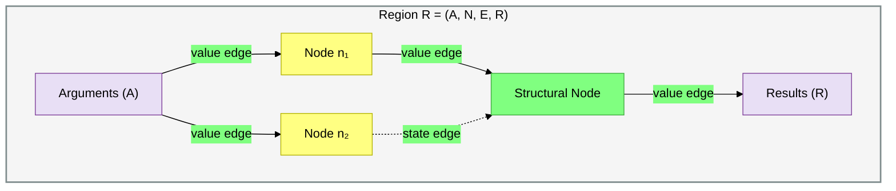
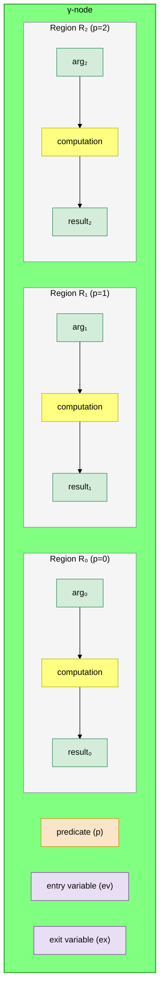
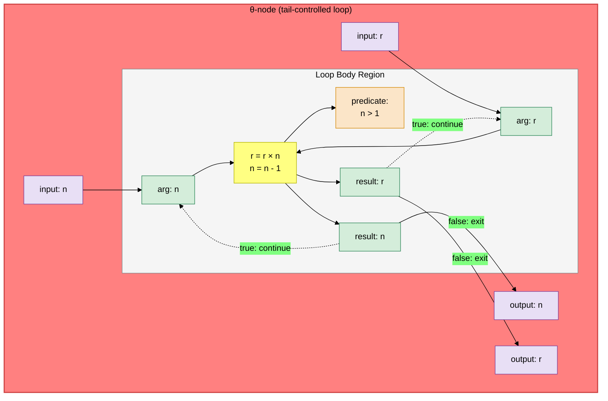
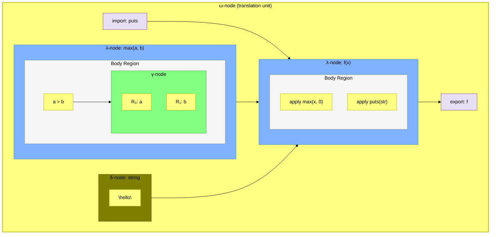
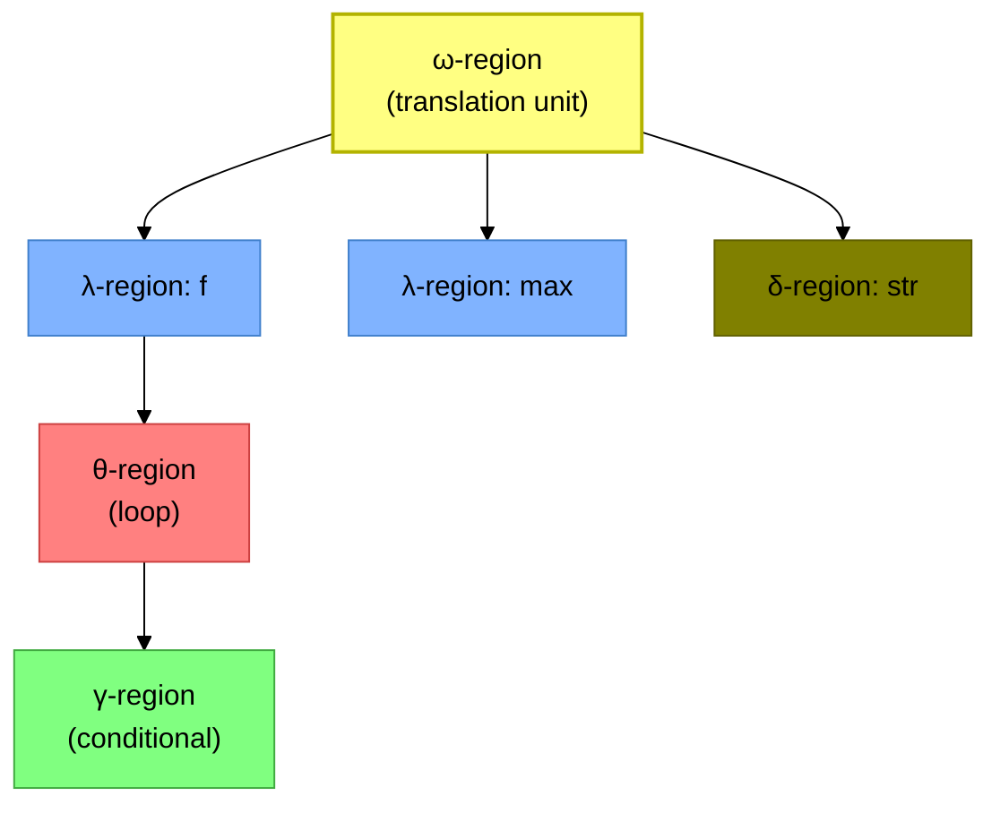
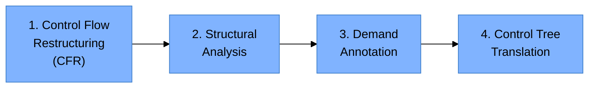

# RVSDG: An Intermediate Representation for Optimizing Compilers

**Nico Reissmann, Jan Christian Meyer, Helge Bahmann, and Magnus Själander**

## Abstract

Intermediate Representations (IRs) are central to optimizing compilers as the way the program is represented may enhance or limit analyses and transformations. Suitable IRs focus on exposing the most relevant information and establish invariants that different compiler passes can rely on. While control-flow centric IRs appear to be a natural fit for imperative programming languages, analyses required by compilers have increasingly shifted to understand data dependencies and work at multiple abstraction layers at the same time. This is partially evidenced in recent developments such as the MLIR proposed by Google. However, rigorous use of data flow centric IRs in general purpose compilers has not been evaluated for feasibility and usability as previous works provide no practical implementations.

We present the Regionalized Value State Dependence Graph (RVSDG) IR for optimizing compilers. The RVSDG is a data flow centric IR where nodes represent computations, edges represent computational dependencies, and regions capture the hierarchical structure of programs. It represents programs in demand-dependence form, implicitly supports structured control flow, and models entire programs within a single IR. We provide a complete specification of the RVSDG, construction and destruction methods, as well as exemplify its utility by presenting Dead Node and Common Node Elimination optimizations. We implemented a prototype compiler and evaluate it in terms of performance, code size, compilation time, and representational overhead. Our results indicate that the RVSDG can serve as a competitive IR in optimizing compilers while reducing complexity.

## 1. Introduction

Intermediate representations (IRs) are at the heart of every modern compiler. These data structures represent programs throughout compilation, connect individual compiler stages, and provide abstractions to facilitate the implementation of analyses, optimizations, and program transformations. A suitable IR highlights and exposes program properties that are important to the transformations in a specific compiler stage. This reduces the complexity of optimizations and simplifies their implementation.

Modern embedded systems have become increasingly parallel as system designers strive to improve their computational power and energy efficiency. Increasing the number of cores in a system enables each core to be operated at a lower clock frequency and supply voltage, improving overall energy efficiency while providing sufficient system performance. Multi-core systems also reduce the total system cost by enabling the consolidation of multiple functionalities onto a single chip. In order to take full advantage of these systems, optimizing compilers need to expose a program's available parallelism. This has led to an interest in developing more efficient program representations and methodologies and frameworks for exposing the necessary information.

Data flow centric IRs, such as the Value (State) Dependence Graph (V(S)DG) [Weise94, Johnson03, Johnson04, Lawrence07, Stanier11, Stanier12], show promises as a new class of IRs for optimizing compilers. These IRs are based on the observation that many optimizations require data flow rather than control flow information, and shift the focus to explicitly expose data instead of control flow. They represent programs in demand-dependence form, encode structured control flow, and explicitly model data flow between operations. This raises the IR's abstraction level, permits simple and powerful implementations of data flow optimizations, and helps to expose the inherent parallelism in programs. However, the shift in focus from explicit control flow to only structured and implicit control flow requires more sophisticated construction and destruction methods. In this context, Bahmann et al. [Bahmann15] presents the *Regionalized Value State Dependence Graph* (RVSDG) and conclusively addresses the problem of intra-procedural control flow recovery for demand-dependence graphs. They show that the RVSDG's restricted control flow constructs do not limit the complexity of the recoverable control flow.

In this work, we are concerned with the aspects of unified program representation in the RVSDG. We present the required RVSDG constructs, consider construction and destruction at the program level, and show feasibility and practicality of this IR for optimizations by providing a practical compiler implementation.

Specifically, we make the following contributions:

- (i) A complete RVSDG specification, including intra- and inter-procedural constructs.
- (ii) A complete description of RVSDG construction and destruction, augmenting the previously proposed algorithms with the construction and destruction of inter-procedural constructs, as well as the handling of intra-procedural dependencies during construction.
- (iii) A presentation of Dead Node Elimination (DNE) and Common Node Elimination (CNE) optimizations to demonstrate the RVSDG's utility. DNE combines dead and unreachable code elimination, as well as dead function removal. CNE permits the removal of redundant computations by detecting congruent operations.
- (iv) A publicly available [jlm] prototype compiler that implements the discussed concepts. It consumes and produces LLVM IR, and is to our knowledge the first optimizing compiler that uses a demand dependence graph as IR.
- (v) An evaluation of the RVSDG in terms of performance and size of the produced code, as well as compile time and representational overhead.

Our results show that the RVSDG can serve as the IR in a compiler's optimization stage, producing competitive code even with a conservative modeling of programs using a single memory state. Even though this leaves significant parallelization potential unused, it already yields satisfactory results compared to control-flow based approaches. This work paves the way for further exploration of the RVSDG's properties and their effect on optimizations and analyses, as well as its usability in code generation for dataflow and parallel architectures.

## 2. Motivation

Contemporary optimizing compilers are mainly based on variants of the control flow graph as imperative program representations. These representations preserve sequential execution semantics of the input program, such as access order of aliased references. The LLVM representation is based on the instruction set of a virtual CPU with operation semantics resembling real CPUs. This choice of representation is somewhat at odds with the requirements of code optimization analysis, which often focuses on *data dependence* instead. As Table 1 shows, most executed optimization passes are concerned with data flow analysis in the form of SSA construction and interpretation, or in-memory data structures in the form of alias analysis and/or memory SSA.

We propose the data-dependence centric RVSDG as an alternative. While it requires more effort to construct the RVSDG from imperative programs and recover control flows for code generation, we believe this cost is more than recovered by benefits to analyses and optimizations. The following sections provide illustrative examples.

**Table 1: Thirteen most invoked LLVM 7.0.1 passes at O3.**

| # | Optimization | Invocations |
|---|---|---|
| 1 | Alias Analysis (`-aa`) | 19 |
| 2 | Basic Alias Analysis (`-basicaa`) | 18 |
| 3 | Optimization Remark Emitter (`-opt-remark-emitter`) | 15 |
| 4 | **Natural Loop Information (`-loops`)** | 14 |
| 5 | Lazy Branch Probability Analysis (`-lazy-branch-prob`) | 14 |
| 6 | Lazy Block Frequency Analysis (`-lazy-block-freq`) | 14 |
| 7 | **Dominator Tree Construction (`-domtree`)** | 13 |
| 8 | Scalar Evolution Analysis (`-scalar-evolution`) | 10 |
| 9 | **CFG Simplifier (`-simplifycfg`)** | 8 |
| 10 | Redundant Instruction Combinator (`-instcombine`) | 8 |
| 11 | **Natural Loop Canonicalization (`-loop-simplify`)** | 8 |
| 12 | **Loop-Closed SSA Form (`-lcssa`)** | 7 |
| 13 | **Loop-Closed SSA Form Verifier (`-lcssa-verification`)** | 7 |
| | **Total** | **155** |
| | **SSA Restoration** | **14** |

### 2.1 Simplified Compilation by Strong Representation Invariants

The Control Flow Graph (CFG) in Static Single Assignment (SSA) form [Cytron91] is the dominant IR for optimizations in modern imperative language compilers. Its nodes represent a list of totally ordered operations, and its edges a program's possible control flow paths, permitting efficient control flow optimizations and simple code generation. The CFG's translation to SSA form improves the efficiency of many data flow optimizations.

SSA form is not an intrinsic property of the CFG, but a specialized variant that must be actively maintained. Compiler passes such as jump threading or live-range splitting may perform transformations that cause the CFG to no longer satisfy this form. As shown in Table 1, LLVM requires SSA restoration in 14 different passes.

Moreover, CFG-based compilers must frequently (re-)discover and canonicalize loops, or establish various invariants besides SSA form. Table 1 shows that six of the 13 most invoked passes in LLVM only perform such tasks, and account for 21% of all invocations. This lack of invariants complicates implementation of optimizations and analyses, increases engineering effort, prolongs compilation time, and leads to compiler bugs.

In contrast, the RVSDG is always in strict SSA form as edges connect each operand input to only one output. It explicitly exposes program structures such as loops in a tree structure (Section 4), similarly to the Program Structure Tree. This makes SSA restoration and the other helper passes from Table 1 redundant.

### 2.2 Unified Representation of Different Levels of Program Structures

While the CFG can represent a single procedure, representation of programs as a whole requires additional data structures such as call graphs. The RVSDG can represent a program as a unified data structure where a def-use dependency of one function on another is modeled the same way as the def-use dependency of scalar quantities. This makes it possible to apply the same transformation at multiple levels, and considerably reduce the number of transformation passes and algorithms, e.g., by uniform treatment of unreachable code, dead function analysis, and dead variable analysis (Section 6.2).

### 2.3 Strongly Normalized Representation

The RVSDG program representation is much more strongly normalized than control flow representations. Programs differing only in the ordering of (independent) operations result in the same RVSDG representation, while state edges ensure the correct evaluation order of stateful computations. Loops and conditionals always take a single canonical form. These normalizations already simplify the implementation of transformations and eliminate the need for (repeated) compiler analysis passes such as loop detection.

### 2.4 Exposing Independent Computations

CFGs implicitly represent a single global machine state by sequencing every operation that affects it. While the RVSDG can model the same machine, it is not limited to this interpretation. The RVSDG can also model systems consisting of multiple *independent* states. Disjoint memory regions (consisting of, e.g., `int`-typed and `float`-typed memory objects) can be modeled as disjoint states, exposing the independence of affecting operations in the representation. The RVSDG can in principle go even further in representing a *memory SSA* form that is not formally any different from *value SSA* form, enabling the same kind of optimizations to be applied to both.

### 2.5 Multiple Levels of Abstraction

The RVSDG is fairly abstract in nature and can contain operational nodes at vastly different abstraction levels: operational nodes may closely correspond to "source code" level constructs operating on data structures modeled as state, or may map to individual machine instructions affecting machine and memory state. This offers an opportunity to structure compilers in a way that can preserve considerably more source code semantics and utilize it at any later stage in the translation.

## 3. Related Work

### 3.1 Control (Data) Flow Graph

The Control Flow Graph (CFG) [Allen70] exposes the intra-procedural control flow of a function. Its nodes represent basic blocks (an ordered list of operations without branches or branch targets), and its edges represent the possible control flow paths. The CFG's translation to SSA form, or one of its variants (gated SSA, thinned gated SSA, future gated SSA), additionally improves the efficiency of data flow optimizations. These properties made the CFG in SSA form the predominant IR for imperative language compilers, such as LLVM and GCC. However, the CFG has been criticized:

1. It is incapable of representing inter-procedural information, requiring additional IRs such as call graphs.
2. It provides no structural information about a procedure's body — loops and their nesting must be constantly (re-)discovered.
3. It emphasizes control dependencies, even though many optimizations are based on data flow.
4. It is an inherently sequential IR — operations in basic blocks are sequenced even if independent.
5. It provides no means to encode additional dependencies other than control and true data dependencies.

The Control Data Flow Graph (CDFG) [Namballa04] mitigates the sequential nature by replacing the operation sequence in basic blocks with the Data Flow Graph (DFG), but does not expose parallelism beyond basic block boundaries.

### 3.2 Program Dependence Graph/Web

The Program Dependence Graph (PDG) [Ferrante87, Horwitz88] combines control and data flow within a single representation, with data and control flow edges, plus statement, predicate, and region nodes. Region nodes relax the overly restrictive operation sequence, simplifying complex optimizations such as code vectorization or thread-level parallelism extraction. However, the unified data and control flow representation results in multiple edge types that must be maintained, and the PDG suffers from aliasing and side-effect problems.

The Program Dependence Web (PDW) [Ottenstein90] extends the PDG and gated SSA to provide a unified representation for control-, data-, or demand-driven execution models, but inherits PDG's aliasing problems and is limited to programs with reducible control flow.

### 3.3 Value (State) Dependence Graph

The Value Dependence Graph (VDG) [Weise94] abandons explicit control flow representation and only models value flow using ports. It is implicitly in SSA form and abandons the sequential order of operations. However, modeling only data flow between stateful computations raises a termination problem: "evaluation of the VDG may terminate even if the original program would not."

The Value State Dependence Graph (VSDG) [Johnson03, Johnson04] addresses this by introducing state edges to model sequential execution of stateful computations. Like the VDG, the VSDG is implicitly in SSA form, and nodes are solely dependent on required operands. However, the VSDG supports no inter-procedural constructs, its selection operator handles only two values, and operations with side-effects are no longer guarded by predicates in the flat graph. Lazy evaluation becomes the only safe strategy for graphs with stateful computations, and restoration of eager evaluation semantics complicates destruction immensely.

**The RVSDG solves the VSDG's eager evaluation problem by introducing regions.** These regions enable the modeling of control flow constructs as nested nodes and the guarding of operations with side-effects, avoiding any possibility of duplicated evaluation and simplifying destruction. Moreover, nested nodes permit explicit encoding of a program's hierarchical structure, further simplifying optimizations.

## 4. The Regionalized Value State Dependence Graph

A Regionalized Value State Dependence Graph (RVSDG) is an acyclic hierarchical multigraph consisting of nested regions. A region $\mathcal{R} = (A, N, E, R)$ represents a computation with argument tuple $A$, nodes $N$, edges $E$, and result tuple $R$.

A node can be either *simple* (representing a primitive operation) or *structural* (containing regions). Each node $n \in N$ has a tuple of inputs $I$ and outputs $O$. For nodes $n_1, n_2 \in N$, an edge $e(g, u) \in E$ connects either output $g \in O_{n_1}$ or argument $g \in A$ to either input $u \in I_{n_2}$ or result $u \in R$ of matching type. We refer to $g$ as the *origin* of an edge, and to $u$ as the *user* of an edge. Every input or result is the user of *exactly one* edge, whereas outputs or arguments can be the origins of multiple edges.

The types of inputs and outputs are either *values* (representing arguments or results of computations) or *states* (used to impose an order on operations with side-effects). A node's *signature* are the types of its inputs and outputs, whereas a region's *signature* are the types of its arguments and results.

The RVSDG can model programs at different abstraction levels — from simple data-flow graphs used in machine learning frameworks to machine-level programs used in compiler back-ends.

### 4.1 Intra-Procedural Nodes

#### Simple Nodes

Simple nodes model primitive operations such as addition, subtraction, load, and store. They have an operator associated with them, and a node's signature must correspond to the signature of its operator. Simple nodes map their input value tuple to their output value tuple by evaluating their operator with the inputs as arguments. Solid lines represent value edges, while dashed lines represent state edges. The ordering of load and store nodes is preserved by sequentializing them with state edges.

#### γ-Nodes (Gamma-Nodes)

A γ-node models a decision point and contains regions $\mathcal{R}_0, \ldots, \mathcal{R}_k \mid k > 0$ of matching signature. Its first input is a *predicate*, which determines the region under evaluation. It evaluates to an integer $v$ with $0 \leq v \leq k$. The values of all other inputs are mapped to the corresponding arguments of region $\mathcal{R}_v$, $\mathcal{R}_v$ is evaluated, and the values of its results are mapped to the outputs of the γ-node.

γ-nodes represent conditionals with symmetric control flow splits and joins, such as `if-then-else` or `switch` statements without fall-throughs.

**Definition 1 (Entry Variable).** The pair $ev_l = (i_{l+1}, A_l)$ is the $l$-th *entry variable* of a γ-node with $k+1$ regions. It consists of the $(l+1)$-th input and tuple $A_l = \{a^{\mathcal{R}_0}_l, \ldots, a^{\mathcal{R}_k}_l\}$ with the $l$-th argument from each region. The set of all entry variables is $EV$.

**Definition 2 (Exit Variable).** The pair $ex_l = (R_l, o_l)$ is the $l$-th *exit variable* of a γ-node with $k+1$ regions. It consists of a tuple $R_l = \{r^{\mathcal{R}_0}_l, \ldots, r^{\mathcal{R}_k}_l\}$ of the $l$-th result from each region and the $l$-th output they would map to. The set of all exit variables is $EX$.

#### θ-Nodes (Theta-Nodes)

A θ-node models a tail-controlled loop. It contains one region that represents the loop body. The length and signature of its input tuple equals that of its output, or the region's argument tuple. The first region result is a *predicate*. Its value determines the continuation of the loop:

- When a θ-node is evaluated, the values of all its inputs are mapped to the corresponding region arguments and the body is evaluated.
- When the predicate is **true**, all other results are mapped to the corresponding arguments for the next iteration.
- When the predicate is **false**, the result values are mapped to the corresponding outputs and the loop terminates.

The loop body of an iteration is always fully evaluated before the next iteration begins.

**Definition 3 (Loop Variable).** The quadruple $lv_l = (i_l, a_l, r_{l+1}, o_l)$ is the $l$-th *loop variable* of a θ-node. It consists of the $l$-th input $i_l$, argument $a_l$, and output $o_l$, and the $(l+1)$-th result. The set of all loop variables is $LV$.

θ-nodes permit the representation of `do-while` loops. In combination with γ-nodes, it is possible to model head-controlled loops (`for` and `while`). Employing tail-controlled loops as the basic construct normalizes the representation and reduces optimization complexity. Another benefit is that the loop body is guaranteed to execute at least once, enabling unconditional hoisting of invariant code with side-effects.

### 4.2 Inter-Procedural Nodes

#### λ-Nodes (Lambda-Nodes)

A λ-node models a function and contains a single region representing the function's body. It features a tuple of inputs and a single output. The inputs refer to external variables the λ-node depends on, and the output represents the λ-node itself.

An *apply-node* represents a function invocation. Its first input (the *function input*) takes a λ-node's output as origin; all other inputs represent the function arguments.

**Definition 4 (Context Variable).** The pair $cv_l = (i_l, a_l)$ is a λ-node's $l$-th *context variable*. It consists of the $l$-th input and argument. The set of all context variables is $CV$.

**Definition 5 (Callee/Caller).** The λ-node connected to a function input is the *callee* of an apply-node, and an apply-node is the *caller* of a λ-node. The set of all callers of a λ-node is $CLL$.

#### δ-Nodes (Delta-Nodes)

A δ-node models a global variable and contains a single region representing the constant's value. It features a tuple of inputs (external dependencies) and a single output (the δ-node itself). The region has arguments representing external dependencies and a single result corresponding to the right-hand side value.

#### φ-Nodes (Phi-Nodes)

A φ-node models an environment with mutually recursive functions, and contains a single region with λ-nodes. φ-nodes permit a program's mutually recursive functions to be expressed in the RVSDG without the introduction of cycles.

**Definition 6 (Recursion Variable).** For a φ-node with $n$ context variables, the triple $rv_l = (r_l, a_{l+n}, o_l)$ is the $l$-th *recursion variable*. It consists of the $l$-th result and $(l+n)$-th argument of the φ-region as well as the $l$-th output of the φ-node. The set of all recursion variables is $RV$.

#### ω-Nodes (Omega-Nodes)

An ω-node models a translation unit. It is the top-level node of an RVSDG and has no inputs or outputs. It contains exactly one region. This region's arguments represent entities external to the translation unit (imports), and its results mark all exported entities.

### 4.3 Edges

Edges connect node outputs or region arguments to node inputs or region results, and are either *value-typed* (representing the flow of data between computations) or *state-typed* (imposing an ordering on operations with side-effects). State edges preserve the observational semantics of the input program by ordering its side-effecting operations, including memory reads and writes, as well as exceptions.

In practice, a richer type system permits further distinction between different kinds of values or states. For example, different types for fixed- and floating-point values help to distinguish between these arithmetics, and a type for functions permits correctly specifying the output types of λ-nodes and the function input of apply-nodes.

### 4.4 Region Tree

The RVSDG's hierarchical nesting of regions and structural nodes forms a tree structure — the *region tree*. The ω-region is the root, and each structural node's sub-regions are children. The region tree explicitly exposes the program's hierarchical structure.

## 5. Construction and Destruction

RVSDG construction and destruction generate an RVSDG from an input program and reestablish control flow for code generation, respectively. We present both stages with an *Inter-Procedure Graph* (IPG) and a CFG as input and output. The IPG is an extension of a call graph that captures all static dependencies between functions and global variables. The utilization of an IPG and a CFG permits a language-independent presentation.

### 5.1 Construction

RVSDG construction maps all constructs, concepts, and abstractions of an input language to the RVSDG. The mapping is language-specific. Languages that permit unstructured control flow (C, C++) cannot be mapped directly to the RVSDG and require a CFG as a stepping stone, while languages such as Haskell permit direct construction.

Construction is split into two phases:

1. **Inter-Procedural Translation (Inter-PT)** translates functions, global variables, and inter-procedural dependencies, creating λ-, δ-, and φ-nodes.
2. **Intra-Procedural Translation (Intra-PT)** translates intra-procedural control and data flow, creating a δ-/λ-region from a function's/global variable's body.

#### Algorithm I: Inter-Procedural Translation

Compute all SCCs in an IPG and process them in topological order of the DAG formed by the SCCs as follows:

**1. Trivial SCC:**

- **(a) Function with CFG:** Begin a λ-node by adding all context variables, function arguments, and an additional state argument to the λ-region. Translate the CFG with Intra-PT, and finish the λ-node by adding the function results and the state result to the λ-region. If a function is exported, add a result to the ω-region and connect the λ-node's output to it.

- **(b) Global variable with CFG:** Begin a δ-node by adding all context variables to the δ-region. Translate the CFG with Intra-PT, and finish the δ-node by adding the result to the δ-region. If a global variable is exported, add a result to the ω-region and connect the δ-node's output to it.

- **(c) Without CFG:** Add an ω-region argument for the external entity.

**2. Non-trivial SCC:** Begin a φ-node by adding all functions/global variables as well as context variables to the φ-region. Translate each entity in the SCC according to Trivial SCC without exporting them. Finish the φ-node by adding all outputs as results to the φ-region. If an entity is exported, add a result to the ω-region and connect the φ-node's output to it.

#### Intra-Procedural Translation

The intra-procedural translation creates a δ-/λ-region from a function's or global variable's body in four stages:

**1. Control Flow Restructuring (CFR)** restructures a CFG to make it amenable to RVSDG construction. It converts the CFG to a form containing only tail-controlled loops and conditionals with properly nested splits and joins. CFR consists of two interlocked phases: loop restructuring (transforms all loops to tail-controlled) and branch restructuring (ensures symmetric splits and joins). CFR avoids exponential code blowup by inserting additional predicates and branches instead of cloning nodes [Bahmann15].

**2. Structural Analysis** constructs a control tree from the restructured CFG. After CFR, a restructured CFG consists of three single-entry/single-exit control flow regions:
- *Linear Region*: entry and all intermediate nodes have one outgoing edge
- *Branch Region*: entry and exit represent control flow split and join
- *Loop Region*: a single node with a self-edge

**3. Demand Annotation** annotates control tree nodes with the variables demanded by their instructions:

**Algorithm II: Demand Annotation**

*Read-Write Annotation* (post-order):

- **Basic Block:** For each instruction $i$ processed bottom-up, $R = (R \setminus W_i) \cup R_i$; $W = \bigcup W_i$.
- **Linear Node:** For each child $c$ processed right to left, $R = (R \setminus W_c) \cup R_c$; $W = \bigcup W_c$.
- **Branch Node:** For each child $c$, $R = \bigcup R_c$; $W = \bigcap W_c$.
- **Loop Node:** For child $c$, $R = R_c$; $W = W_c$.

*Demand-Set Annotation* (with empty demand set $D_t$):

- **Basic Block:** $D = D_t = (D_t \setminus W) \cup R$.
- **Linear Node:** Recursively process children right to left. $D = D_t = (D_t \setminus W) \cup R$.
- **Branch Node:** Set $D_{tmp} = D_t$. Recursively process each child with a copy of $D_t$. $D = D_t = (D_{tmp} \setminus W) \cup R$.
- **Loop Node:** $D = D_t \cup R$. Recursively process child with $D_t = D$.

**4. Control Tree Translation** converts the annotated control tree into a δ-/λ-region:

**Algorithm III: Control Tree Translation**

- **Basic Block:** Process operations top-down creating simple nodes.
- **Linear Node:** Recursively process children top-down.
- **Branch Node:** Begin a γ-node with inputs according to the node's demand set. Create subregions by recursively processing children. Finish the γ-node with outputs according to its right sibling's demand set.
- **Loop Node:** Begin a θ-node with inputs according to the node's demand set. Create its region by recursively processing its child. Finish the θ-node with outputs according to its demand set.

#### Modeling Stateful Computations

Algorithm I adds an additional state argument and result to every λ-node. This state is used to sequentialize all stateful computations within a function. Nodes with side-effects consume this state and produce a new state for the next node.

The utilization of a single state is overly conservative, as different computations can have mutually exclusive side-effects. These stateful computations can be modeled independently with distinct states, explicitly exposing more concurrent computations. Alias analysis can directly encode independent memory operations into the RVSDG by introducing additional memory states.

### 5.2 Destruction

The destruction stage reestablishes control flow by extracting an IPG from an RVSDG and generating CFGs from individual λ-regions.

**Algorithm IV: Inter-Procedural Control Flow Recovery**

1. Create IPG nodes for all arguments of the ω-region.
2. Process all nodes of the ω-region in topological order:

- **λ-nodes:** Create an IPG node, mark exported if the λ-node's output has an ω-region result as user. For every context variable $cv = (i, a)$, add an edge from the λ-node's IPG node to the corresponding IPG node of the producer of $i$. Create a CFG from the λ-node's subregion (via Intra-PCFR) and attach it.

- **δ-nodes:** Create an IPG node, mark exported if applicable. For every context variable, add corresponding IPG edges. Create the expression from the δ-node's subregion.

- **φ-nodes:** For every argument of the φ-region, create an IPG node for the corresponding δ-/λ-node and add IPG edges from this node to the corresponding IPG nodes of the context variables. Translate the δ-/λ-nodes in the φ-region.

#### Intra-Procedural Control Flow Recovery

Bahmann et al. [Bahmann15] explored two approaches:

- **Structured Control Flow Recovery (SCFR):** Uses the region hierarchy within a λ-region to recover control flow. Recovers control flow resembling structural nodes (`if-then-else`, `switch`, `do-while`).

- **Predicative Control Flow Recovery (PCFR):** Generates branches for predicate producers and follows predicate consumers to destinations. Can recover arbitrarily complex control flow not restricted to RVSDG constructs. Reduces the number of static branches, but might produce undesirable control flow for certain architectures.

## 6. Optimizations

The properties of the RVSDG make it an appealing IR for optimizing compilers. Many optimizations can be expressed as simple graph traversals, where subgraphs are rewritten, nodes are moved between regions, nodes or edges are marked, or edges are diverted.

### 6.1 Common Node Elimination (CNE)

Common Node Elimination permits the removal of redundant computations by detecting congruent nodes. These nodes always produce the same results, enabling the redirection of their result edges to a single node, rendering the others dead. CNE is similar to common subexpression elimination and value numbering in that it detects equivalent computations, but as the RVSDG represents all computations uniformly as nodes, it can be extended to conditionals, loops, and functions.

Two simple nodes $n_1$ and $n_2$ are **congruent** ($n_1 \cong n_2$) if they represent the same computation, have the same number of inputs ($|I_{n_1}| = |I_{n_2}}|$), and the inputs $i^k_{n_1}$ and $i^k_{n_2}$ are congruent for all $k$. Two inputs are congruent if their respective origins are congruent.

**Algorithm V: Common Node Elimination**

**1. Mark:** Process all nodes in topological order:

- **Simple nodes:** Mark $n$ as congruent to all nodes $n'$ with the same operation where $|I_n| = |I_{n'}|$ and $i^k_n \cong i^k_{n'}$ for all $k$. Mark all outputs $o^k_n \cong o^k_{n'}$.

- **γ-node:** For all entry variables $ev_1, ev_2 \in EV$ where $i_{ev_1} \cong i_{ev_2}$, mark corresponding arguments as congruent. Recursively process γ-regions. For all exit variables with congruent results, mark outputs as congruent.

- **θ-node:** For all loop variables $lv_1, lv_2 \in LV$ where $i_{lv_1} \cong i_{lv_2}$ and $r_{lv_1} \cong r_{lv_2}$, mark arguments and outputs as congruent. Recursively process the θ-region.

- **λ-node:** For all context variables with congruent inputs, mark arguments as congruent. Recursively process the λ-region.

- **φ-node:** For all context variables with congruent inputs, mark arguments as congruent. Recursively process the φ-region.

- **ω-node:** Recursively process the ω-region.

**2. Divert:** Process all nodes in topological order, diverting edges from congruent nodes to a single survivor for each congruent class.

### 6.2 Dead Node Elimination (DNE)

Dead Node Elimination removes all nodes that do not contribute to the result of a computation. An operation is dead when its results are either not used or only used by other dead operations. The RVSDG's uniform representation permits DNE to remove not only simple computations but also compound computations such as conditionals, loops, or entire functions.

**Algorithm VI: Dead Node Elimination**

**1. Mark:** Mark output or argument as alive and continue:

- **ω-region argument:** Stop marking.
- **φ-node output:** Mark the result origin of the corresponding recursion variable.
- **φ-region argument:** Mark the input origin if the argument belongs to a context variable; otherwise, mark the output of the corresponding recursion variable.
- **λ-node output:** Mark all result origins of the λ-region.
- **λ-region argument:** Mark the input origin if the argument is a dependency.
- **θ-node output:** Mark the predicate origin as well as the result and input origin of the corresponding loop variable.
- **θ-region argument:** Mark the input origin and output of the corresponding loop variable.
- **γ-node output:** Mark the predicate origin as well as the origins of all results of the corresponding exit variable.
- **γ-region argument:** Mark the input origin of the corresponding entry variable.
- **Simple node output:** Mark the origin of all inputs.

**2. Sweep:** Process all nodes in reverse topological order. Remove dead nodes. For alive structural nodes, recursively process subregions and remove dead interface variables.

## 7. Implementation and Evaluation

### 7.1 Implementation

We implement **jlm**, a publicly available [jlm] prototype compiler that uses the RVSDG for optimizations.

```mermaid
%%{init: {'theme':'base','themeVariables':{'primaryColor':'#ffff82','primaryTextColor':'#000000','primaryBorderColor':'#b3b300','lineColor':'#000000','secondaryColor':'#80ff80','tertiaryColor':'#ff8080','fontFamily':'Courier New, Courier, monospace'}}}%%
flowchart LR
    LLVM_IN["LLVM IR<br/>(input)"]:::io
    SSA_D["SSA<br/>Destruct"]:::stage
    INTER["Inter-PT"]:::stage
    INTRA["Intra-PT"]:::stage
    OPT["RVSDG<br/>Optimize"]:::opt
    SCFR["SCFR"]:::stage
    SSA_C["SSA<br/>Construct"]:::stage
    LLVM_OUT["LLVM IR<br/>(output)"]:::io

    LLVM_IN --> SSA_D --> INTER --> INTRA --> OPT --> SCFR --> SSA_C --> LLVM_OUT

    classDef io fill:#e8dff5,stroke:#7d3c98,stroke-width:1px,color:#000000
    classDef stage fill:#80b3ff,stroke:#4080cc,stroke-width:1px,color:#000000
    classDef opt fill:#ffff82,stroke:#b3b300,stroke-width:2px,color:#000000
```

jlm takes LLVM IR as input, constructs an RVSDG, transforms and optimizes the RVSDG, and destructs it again to LLVM IR. jlm supports LLVM IR function, integer, floating point, pointer, array, structure, and vector types and their corresponding operations. The compiler uses two distinct states to model side-effects: one for memory accesses and one for non-terminating loops.

Implemented optimizations:

| Abbreviation | Optimization | Description |
|---|---|---|
| ILN | Inlining | Simple function inlining |
| INV | Invariant Value Redirection | Redirects invariant values from θ- and γ-nodes |
| PSH | Node Push-Out | Moves all invariant nodes out of γ- and θ-regions |
| PLL | Node Pull-In | Moves nodes only used in one γ-region into the γ-node |
| RED | Node Reduction | Constant folding, strength reduction |
| URL | Loop Unrolling | Unrolls all inner loops by a factor of four |
| IVT | θ-γ Inversion | Inverts γ- and θ-nodes with the same predicate origin |

**Pass ordering:** ILN INV RED DNE IVT INV DNE PSH INV DNE URL INV RED CNE DNE PLL INV DNE

### 7.2 Performance Results

The evaluation uses the polybench 4.2.1 beta benchmark suite on an Intel Xeon E5-2695v4 at 2.0 GHz.

**Key findings:**

- jlm executables (gmean speedup 2.70× over O0) are faster than O1 (gmean 2.49×) but slower than O3 (gmean 3.22×), O3-novec (gmean 2.95×), and O3-novec-stripped (gmean 2.91×).
- O3 vectorization produces measurable results for eight benchmarks; jlm would require a vectorizer to match.
- Without vectorization (O3-novec-stripped), jlm achieves similar speedups for fdtd-2d, gemm, heat-3d, jacobi-1d, and jacobi-2d.
- jlm is outperformed by O1 at four benchmarks (adi, durbin, seidel-2d, syrk) due to missing loop load elimination, loop-idiom recognition, and alias analysis — not inherent RVSDG limitations.

### 7.3 Code Size

- jlm produces ~39% bigger text sections compared to Os, attributable to naive loop unrolling heuristics.
- Without loop unrolling, jlm produces text sections between O3-novec and Os, indicating excessive code size is due to naive heuristics, not inherent RVSDG characteristics.

### 7.4 Compilation Overhead

- **Representational overhead:** Clear linear relationship between LLVM instruction count and RVSDG node count, confirming feasibility in terms of space requirements.
- **Time overhead:** Also indicates a linear dependency with some structural variation. Construction, optimizations, and destruction are practically feasible.

### 7.5 Comparison to LLVM

LLVM 7.0.1 invokes 85 different analyses and optimization passes at O3, with a total of 266 invocations. 57 invocations (21%) are from six helper passes that only establish invariants and detect structures. LLVM necessitates SSA restoration in fourteen optimization passes.

In contrast, the RVSDG establishes necessary invariants during construction and maintains them throughout compilation. jlm requires none of the helper passes or SSA restoration. The cost is a more elaborate construction and destruction — but these only need to be performed once and are practically feasible.

## 8. Conclusion

This paper presents a complete specification of the RVSDG IR for optimizing compilers. We provide construction and destruction algorithms, and show the RVSDG's efficacy by presenting Dead Node and Common Node Elimination. The results suggest that the RVSDG combines the abstractions of data centric IRs with the CFG's advantages to optimize and generate efficient control flow. This makes the RVSDG an appealing IR for optimizing compilers.

Future Directions:
- Explore how features such as exceptions can be efficiently mapped to the RVSDG.
- Extend optimizations and heuristics to a competitive level with CFG-based compilers.
- Investigate alias analysis integration through independent memory states.
- Explore code generation for dataflow and parallel architectures.

## References

[Allen70] Frances E. Allen. "Control flow analysis." ACM Sigplan Notices, 5:1–19, 1970.

[Bahmann15] Helge Bahmann, Nico Reissmann, Magnus Jahre, and Jan Christian Meyer. "Perfect reconstructability of control flow from demand dependence graphs." ACM Transactions on Architecture and Code Optimization, 11(4):66:1–66:25, 2015.

[Cytron91] Ron Cytron, Jeanne Ferrante, Barry K. Rosen, Mark N. Wegman, and F. K. Zadeck. "Efficiently computing static single assignment form and the control dependence graph." *ACM Transactions on Programming Languages and Systems*, 13(4):451–490, 1991.

[Ferrante87] Jeanne Ferrante, Karl J. Ottenstein, and Joe D. Warren. "The Program Dependence Graph and its use in optimization." ACM Transactions on Programming Languages and Systems, 9(3):319–349, 1987.

[Horwitz88] Susan Horwitz, Thomas Reps, and David Binkley. "Interprocedural slicing using dependence graphs." PLDI, 1988.

[Johnson03] Neil Johnson and Alan Mycroft. "Combined code motion and register allocation using the value state dependence graph." CC, 2003.

[Johnson04] Neil Johnson. "Code size optimization for embedded processors." PhD thesis, University of Cambridge, 2004.

[Lattner04] Chris Lattner and Vikram Adve. "LLVM: A Compilation Framework for Lifelong Program Analysis and Transformation." *Proceedings of CGO 2004*, IEEE, 2004.

[Lattner21] Chris Lattner, Mehdi Amini, Uday Bondhugula, Albert Cohen, Andy Davis, Jacques Pienaar, River Riddle, Tatiana Shpeisman, Nicolas Vasilache, and Oleksandr Zinenko. "MLIR: Scaling Compiler Infrastructure for Domain Specific Computation." *Proceedings of CGO 2021*, IEEE, 2021.

[Lawrence07] Andrew C. Lawrence. "Optimizing compilation with the value state dependence graph." PhD thesis, University of Cambridge, 2007.

[Namballa04] Rajat Namballa, Nataraj Ranganathan, and Abdur Rauf. "Control and Data Flow Graph Extraction from VHDL." ISCAS, 2004.

[Ottenstein90] Karl J. Ottenstein, Robert A. Ballance, and Arthur B. MacCabe. "The program dependence web: a representation supporting control-, data-, and demand-driven interpretation of imperative languages." PLDI, 1990.

[Stanier11] James Stanier and Des Watson. "A study of irreducibility in C programs." *Software: Practice and Experience*, 42(1):117–130, 2012.

[Stanier12] James Stanier. "Removing and restoring control flow with the Value State Dependence Graph." PhD thesis, De Montfort University, 2012.

[Weise94] Daniel Weise, Roger F. Crew, Michael Ernst, and Bjarne Steensgaard. "Value dependence graphs: representation without taxation." POPL, 1994.

[jlm] Nico Reissmann. "jlm: An RVSDG-based compiler." https://github.com/phate/jlm
