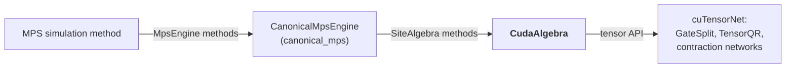
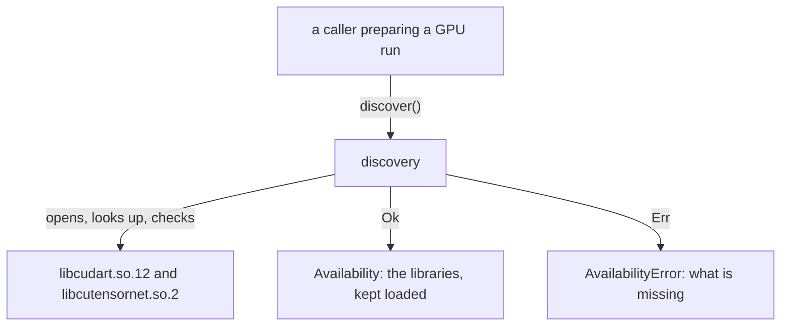

# cuTensorNet for the QDK: the MPS engine, and the discovery and loading of its libraries

The `qdk_cutensornet` crate was designed to solve the problem of running
a QDK simulator's matrix product states (MPS) on an NVIDIA GPU, with
NVIDIA's cuTensorNet library, without making NVIDIA software part of the
QDK. The problem includes:

- an MPS engine's rules (where the orthogonality centre moves, how gates
  are fused and applied, what a truncation keeps track of) are the same on
  the CPU and on a GPU; written once per backend, they drift apart;
- the instances a GPU is wanted for are slow on the CPU, such as
  chemistry at a large bond dimension, so their site tensors should stay
  in the GPU's memory and be factored there;
- most QDK users have neither cuTensorNet nor the CUDA Runtime it runs on
  (NVIDIA's library for driving a GPU), so the QDK must build, load and
  simulate on the CPU without them;
- and when a GPU run is asked for, its caller needs to know what is
  missing, to tell the user or to run on the CPU instead.

The crate solves these with `canonical_mps`'s engine on a cuTensorNet
algebra, and with libraries opened at run time. The engine's rules are
written once, in `canonical_mps`; this crate writes only the five tensor
operations of its `SiteAlgebra` trait, run by cuTensorNet on one GPU,
with the sites in the GPU's memory. cuTensorNet and the CUDA Runtime are
never linked: they are opened at run time and checked
([discovery](#the-discovery-and-loading-of-the-libraries)), which returns
the loaded libraries, on which an engine opens, or why they cannot be
used: every fault it found, or, off Linux x86-64, that the platform is
unsupported.

Today the crate holds:

- **[The MPS engine](#the-mps-engine):**
  [`CudaMpsEngine`](src/engine.rs), `canonical_mps`'s canonical-form MPS
  engine on [`CudaAlgebra`](src/engine/cuda_algebra.rs), its
  `SiteAlgebra` on cuTensorNet's tensor API.
- **What passes between the engine and the algebra:**
  [`DeviceTensor`](src/engine/cuda_algebra/device_tensor.rs), one site in
  the GPU's memory, which only the algebra that made it accepts.
- **Failures:** [`CudaAlgebraError`](src/engine/cuda_algebra_error.rs),
  why a call of the algebra failed, which the engine wraps as
  `CanonicalMpsError::Algebra`.
- **[The discovery and loading of the libraries](#the-discovery-and-loading-of-the-libraries):**
  [`discover`](src/discovery.rs), which opens and checks the libraries,
  and [`Availability`](src/discovery.rs), which keeps them loaded.
- **Reports and faults:** [`AvailabilityReport`](src/discovery/report.rs),
  with a [`LibraryReport`](src/libraries/report.rs) per library and the
  [`Version`](src/libraries/report.rs)s it reports; and
  [`AvailabilityError`](src/discovery/error.rs), with the
  [`LibraryFault`](src/libraries/report.rs)s it lists.

The extension point is an MPS simulation method: written once against
`tensornet::MpsEngine`, it runs on this engine as on `canonical_mps`'s
`CpuMpsEngine`, and gets the GPU for free. A simulator calls
`discover()`, then makes the engine with
`CudaMpsEngine::try_from(&availability)` (Linux x86-64), at the engine's
default cutoff (`.with_cutoff(c)` sets another), as the example on
[`CudaMpsEngine`](src/engine.rs) does; or, to hold the algebra itself,
with `CudaMpsEngine::new(CudaAlgebra::new(&availability)?)`. It opens the
engine in each run's first step, on the thread that runs it, and drops it
at the run's end: the engine holds device 0's stream and cuTensorNet
handle, and the memory it lent cuTensorNet, grown to the run's largest
call, until it is dropped. On an error, the simulator tells the user what
is missing, or runs on `CpuMpsEngine`.

## The MPS engine

**The problem.** `canonical_mps`'s engine asks its algebra for
synchronous calls that hand over site tensors, while cuTensorNet's calls
run asynchronously on the GPU, on tensors it knows by descriptors, with
memory its caller lends.

**How it is solved.** [`CudaMpsEngine`](src/engine.rs) is
`CanonicalMpsEngine<CudaAlgebra>`. What the engine does, and the contract
its algebra meets, are in
[`canonical_mps`'s README](../canonical_mps/README.md#the-backend-contract)
and the trait's rustdoc; this section says how this algebra meets the
contract, and why; [`docs/engine.md`](docs/engine.md) gives the native
calls of each phase and the numerics, and each file's header the details.

**Why this approach.**

- **One set of rules.** The engine's rules run alike on the CPU and the
  GPU, and a fix to them reaches both.
- **Small GPU code, checked once.** The GPU code is the operations alone,
  checked by `canonical_mps`'s conformance kit.
- **Compared read by read.** The GPU engine reads as `canonical_mps`'s
  `CpuMpsEngine` does, up to rounding.
- **Why a GPU.** The CPU engine is slow on the large chemistry instances,
  and the GPU engine is meant for them; its speed on them is not measured
  yet. Its sites stay in the GPU's memory, and only an upload or a read
  copies one between the host and the GPU.

Here the engine's `MpsEngine` methods call the _`SiteAlgebra` methods_
(`upload`, `read`, `duplicate`, `gate_split`, `qr_move`), which this
algebra turns into cuTensorNet's tensor calls.



### The algebra's terms

These terms name what the algebra keeps to bridge the engine's
synchronous calls and cuTensorNet's asynchronous ones:

- **CUDA device:** one GPU, as CUDA numbers them; the algebra runs on
  device 0 ([`policy.rs`](src/engine/cuda_algebra/policy.rs)), and a
  process selects another with `CUDA_VISIBLE_DEVICES`.
- **Device session:** the algebra's device, its stream (the queue the
  device runs the algebra's work in, in order) and its cuTensorNet handle
  (the library's context, on which each native object is created), in a
  [`DeviceSession`](src/engine/device_session.rs). The algebra shares it
  with its tensors, so it closes after the last of them.
- **Device tensor:** one site, a device buffer of complex doubles in the
  contract's layout ([`DeviceTensor`](src/engine/cuda_algebra/device_tensor.rs)).
  It keeps the session alive, so it may outlive the algebra; only the
  algebra that made it accepts it.
- **Workspace:** the memory cuTensorNet asks its caller to lend a call, in
  four slots (device or host, scratch or cache). The algebra keeps one
  workspace descriptor and, per slot, one buffer, its
  [scratch](src/engine/cuda_algebra/scratch.rs), grown to the largest
  call's and never shrunk.
- **Prepared contraction network:** a pairwise contraction whose path
  cuTensorNet has found and prepared, kept per shape
  ([`contraction.rs`](src/engine/cuda_algebra/contraction.rs)), up to the
  bound in [`policy.rs`](src/engine/cuda_algebra/policy.rs).
- **Call scope:** what one method creates (descriptors, SVD settings,
  intermediate buffers, its outputs), released in one place when it
  returns ([`call_scope.rs`](src/engine/cuda_algebra/call_scope.rs)).
- **Poison:** a failed method that cannot even wait for the device leaves
  nothing to say when the device is done with its buffers, so the algebra
  is poisoned: every later method returns `CudaAlgebraError::Poisoned`
  ([`algebra_session.rs`](src/engine/cuda_algebra/algebra_session.rs)).

The settings the algebra fixes, with how each was chosen, are in
[`policy.rs`](src/engine/cuda_algebra/policy.rs);
[`cuda_algebra.rs`](src/engine/cuda_algebra.rs) maps its files.

### When each guarantee holds

The guarantees the sections below state, grouped by when they hold:

- **At discovery** (`discover`): no device selected and no GPU work;
  every fault found at once; the audited versions only.
- **At the opening** (`CudaAlgebra::new`, `CudaMpsEngine::try_from`):
  `CudaAlgebraError::NoDevice` on a host without device 0, before any
  device is selected; a failed opening releases what it had made.
- **At each method:** another engine's tensor refused before the bind; a
  tensor shorter than the call reads, or an empty one, refused before any
  native object; the inputs left unchanged; a return with the device
  idle; on a failure, the outputs freed once the device is waited for, or
  the algebra poisoned when that wait fails.
- **At a drop:** every release attempted, a failed one leaked, never
  retried, and written to stderr in debug builds; nothing freed when the
  device cannot be selected, so nothing is freed on another device.

### The algebra's phases

Each `SiteAlgebra` method of this algebra combines some of these phases
([the table below](#how-each-sitealgebra-method-is-implemented)):

- **bind**: the algebra's device selected (`cudaSetDevice`), since CUDA's
  current device is per thread.
- **copy**: values copied to the device, to the host or on the device,
  then waited for: the copies run on CUDA's legacy default stream, which
  the algebra's stream does not wait for.
- **describe**: a descriptor per tensor of the call (its extents and mode
  labels) and, for a gate split, the SVD's settings and a record of its
  truncation.
- **lend**: cuTensorNet sizes the call's workspace, and the algebra lends
  each slot the call asks memory for its scratch, grown if the call asks
  for more; a device buffer never grows beyond the device's free memory,
  and a host slot's growth the allocator refuses fails the call
  (`CudaAlgebraError::HostAllocationFailed`).
- **factor**: one `GateSplit` or one `TensorQR`, waited for.
- **prepare**: for a contraction of a shape the algebra has not kept, a
  network, its path found, its workspace sized and lent (as in **lend**),
  and the network prepared for contraction, then kept for later calls of
  that shape.
- **contract**: for a network kept from an earlier call, its workspace
  sized and lent (as in **lend**); then a pairwise contraction on that
  network, waited for.
- **release**: the call scope's descriptors, settings and intermediate
  buffers released.

### How each `SiteAlgebra` method is implemented

This algebra's implementation of each `SiteAlgebra` method runs the
phases its row names, bind first. Of the engine's arguments, it checks
only each tensor it reads: that this algebra made it (else
`CudaAlgebraError::ForeignTensor`, before the bind), since a tensor is
freed through its own algebra's session, which waits only for that
algebra's device work; and that it holds the elements the call asks for
(else `CudaAlgebraError::InvalidNativeCall`, before any native object).
The engine checks the others before it calls. Each method writes only
the buffers it allocates and the algebra's own (its scratch, the gate's
buffer), so its inputs are left unchanged, as the contract asks; an
allocation that returns an input's buffer, which only a faulty allocator
would, is refused (`CudaAlgebraError::InvalidNativeResult`).
Each returns with the device idle, its stream and its copies waited for,
so the engine may use a tensor at once and the next call may grow the
scratch.

| `SiteAlgebra` method  | Phases                                                                                                 | How                                                                                                                                                                                                                                                                                                                                                                                                                                    | Why                                                                                                                                                                                              |
| --------------------- | ------------------------------------------------------------------------------------------------------ | -------------------------------------------------------------------------------------------------------------------------------------------------------------------------------------------------------------------------------------------------------------------------------------------------------------------------------------------------------------------------------------------------------------------------------------- | ------------------------------------------------------------------------------------------------------------------------------------------------------------------------------------------------ |
| `upload`              | bind; copy                                                                                             | a new device buffer, the host values copied into it                                                                                                                                                                                                                                                                                                                                                                                    | the sites live on the device, where they are factored                                                                                                                                            |
| `read`                | bind; copy                                                                                             | the first `len` elements copied into a host vector, with no copy for none; refused with `CudaAlgebraError::InvalidNativeCall` when the tensor holds fewer                                                                                                                                                                                                                                                                              | the engine contracts the sites a read needs on the host; the check keeps the device from reading memory the tensor does not own                                                                  |
| `duplicate`           | bind; copy                                                                                             | a new device buffer, the first `len` elements copied into it on the device; refused as `read` is                                                                                                                                                                                                                                                                                                                                       | a fork's sites change apart from its parent's, with no round trip through the host                                                                                                               |
| `gate_split`          | bind; describe; copy (the gate); lend; factor; release                                                 | one `GateSplit`, cuTensorNet's reduced algorithm, with the values normalised and absorbed on the centre's side and the cutoff as a discarded weight, into factors sized by [Numerics](docs/engine.md#numerics); its report checked, a discarded weight rounded just below 0 read as nothing discarded                                                                                                                                  | one native call contracts the gate and splits the pair; a reported bond or discarded weight outside the contract's bounds is `CudaAlgebraError::InvalidNativeResult`, never passed to the engine |
| `qr_move`             | bind; copy, prepare and contract (a one-site gate); describe; lend; factor; prepare; contract; release | the gate, if any, contracted into the site the centre leaves; one `TensorQR` of that site, its small factor contracted into the other site                                                                                                                                                                                                                                                                                             | a QR moves the centre exactly; a network costs a path search and a preparation, and a run's moves repeat their shapes, so each shape's is made once                                              |
| `Drop` of a tensor    | bind and free; if the algebra is poisoned, kept by the session (no native call)                        | `cudaFree`, or, if the algebra is poisoned, the buffer kept by the session; if the bind fails, the buffer leaked, as its free needs that device; a failed bind or free is not returned, and debug builds write it to stderr                                                                                                                                                                                                            | `Drop` cannot return an error; every method returns with the device idle, so nothing uses the buffer, unless a failed method could not wait for the device                                       |
| `Drop` of the algebra | bind; release of what it keeps; if poisoned, the device waited for first                               | the networks, the workspace descriptor, the lent memory, the gate's and singular values' buffers released; if poisoned, they are kept by the session, and released with what it kept before only once a wait for the device (its stream and its copies) succeeds; if the bind fails, nothing released (leaked); the device session closes once its last tensor is dropped too, but for a handle the library refuses to destroy (below) | the session's stream and handle are shared with the tensors, which free their own buffers; an unpoisoned algebra's device is idle                                                                |

A method that fails also frees its outputs, once it has waited for the
device, since the failed work may still write the call's buffers. If that
wait fails too, nothing says when the device is done with them, with the
method's inputs, or with the algebra's memory: the algebra is poisoned,
every later method returns `CudaAlgebraError::Poisoned`, whatever its
arguments, and a buffer the device may still use is freed only after a
successful wait for the device, its stream and its copies (when the
algebra is dropped, or else when its last tensor is); otherwise it is kept
until one succeeds, or leaked.

A release that fails with the device idle leaks its object, which is
never retried; every other release is still made. In a method (the
destroy of a call's descriptor, or of a kept network when the cache starts
again), it fails only that method, which returns the error: the algebra is
not poisoned, and the next method runs. On a library that refuses to
destroy a handle while an object of it lives, any object leaked (so, or by
a poisoned algebra) leaks the handle too, at the session's close; that
failure, like any failed release in a `Drop`, is written to stderr in
debug builds.

## The discovery and loading of the libraries

[`src/discovery.rs`](src/discovery.rs) finds, opens and checks the libraries
a GPU run needs; each library's module in [`src/libraries/`](src/libraries)
says what the crate needs of it. Discovery sits at the crate's root, not
under the engine, because it is the crate's entry point: a caller runs it
before making any engine, and the engine takes its result.

**The problem.** cuTensorNet and the CUDA Runtime are shared libraries
(`libcutensornet.so.2`, `libcudart.so.12`), and linking them would make
every QDK build, and every process that loads the QDK, fail without them.

**How it is solved.** Nothing is linked. When a GPU run is asked for,
[`discover`](src/discovery.rs) opens the two libraries, looks up by name
each C function the crate uses (its _symbol_), cuTensorNet's tensor API
among them, and checks the versions the libraries report. It returns an
`Availability`, which keeps them loaded and which
[`CudaAlgebra::new`](src/engine/cuda_algebra.rs) takes, or an
`AvailabilityError` that says what is missing.

**Why this approach.**

- **Optional by construction.** The QDK builds, loads and simulates on the
  CPU with no GPU, no NVIDIA header or library and no linker setting. Off
  Linux x86-64 the crate still builds, and `discover` reports the platform
  as unsupported.
- **Failing early, with every cause.** A missing library, dependency or
  function, or a version other than the audited one, is found before any
  GPU work and reported with the path, function or version at fault, for
  every library at once, so an installation is fixed in one pass.
- **One audited surface.** The functions the algebra may call are the rows
  of one table per library, each checked against NVIDIA's header when the
  crate compiles ([The bindings](docs/loading.md#the-bindings)).
- **Open to more libraries.** Each library is one module; adding one changes
  no public type, as the report is a list with an entry per library.
- **Explicit, no global state.** Nothing happens until `discover` is called,
  and its result is a value the caller holds, so tests and threads choose
  what they share.

### The model



- [`discover`](src/discovery.rs) selects no device, allocates no GPU memory
  and runs no GPU work.
- [`Availability`](src/discovery.rs) holds each library's functions as typed
  function pointers, which the algebra calls. It is `Send` and `Sync`, so
  one discovery serves every thread; an engine, its algebra and its states
  stay on the thread that created them.
- Its [`AvailabilityReport`](src/discovery/report.rs) has a
  [`LibraryReport`](src/libraries/report.rs) per library, in the order they
  are opened: its name, the path it was opened from, the
  [`Version`](src/libraries/report.rs)s it reports, and its faults.
- [`AvailabilityError`](src/discovery/error.rs) is `UnsupportedPlatform` off
  Linux x86-64, or else `Unusable` with the report, whose
  [`LibraryFault`](src/libraries/report.rs)s name the variable, path,
  function or version at fault.

Copied from [`tests/availability.rs`](tests/availability.rs), which runs on a
host with the libraries installed:

```rust
// Load both libraries, look up their functions and check their versions.
let availability = discover().expect("the audited libraries are installed");

// What was loaded, from where; `availability` keeps it loaded.
let report = availability.report();
let cutensornet = report.library("cuTensorNet").expect("cuTensorNet is used");
assert_eq!(cutensornet.version("cuTensorNet"), Some(21_300));
assert_eq!(
    cutensornet.version("cuTensorNet's CUDA Runtime"),
    Some(12_090)
);
let cuda_runtime = report
    .library("CUDA Runtime")
    .expect("the CUDA Runtime is used");
assert_eq!(cuda_runtime.version("CUDA Runtime"), Some(12_090));
println!("{report:#?}");
```

[`docs/loading.md`](docs/loading.md) shows how discovery turns each library
into an `Availability`, the steps it takes and the faults each one finds,
and how the bindings are made and checked.

### Where the libraries are looked for

| Library      | Override variable         | Default paths, in order                                                                     |
| ------------ | ------------------------- | ------------------------------------------------------------------------------------------- |
| cuTensorNet  | `QDK_CUTENSORNET_LIBRARY` | `/usr/lib/x86_64-linux-gnu/libcuquantum/12/libcutensornet.so.2`, then `libcutensornet.so.2` |
| CUDA Runtime | `QDK_CUDART_LIBRARY`      | `/usr/local/cuda-12.9/targets/x86_64-linux/lib/libcudart.so.12`, then `libcudart.so.12`     |

An override must be an absolute path to a file, or to a symlink to one, and
is then the only path tried, so a wrong setting fails instead of loading
another installation. A default path is skipped when there is no file
there, or none the process can see (a symlink loop, or a directory it cannot
search); a bare file name is searched for on the system loader's usual path,
and skipped when the loader reports no file of that name (glibc reports so
too when its search found only files of that name it could not use, such as
another machine's). A library that is found but fails to load, for instance
for a missing dependency, fails discovery.

### Versions

Discovery accepts exactly the versions the bindings were audited against:
cuTensorNet 2.13.0 (reported as `21300`), the CUDA Runtime 12.9 (`12090`), and
a cuTensorNet built against the CUDA Runtime 12.9. A newer release is not
assumed compatible. The CUDA driver's version is reported for diagnostics
only. A [`LibraryReport`](src/libraries/report.rs) names each version by its
component: `CUDA Runtime` and `CUDA driver` in the CUDA Runtime's,
`cuTensorNet` and `cuTensorNet's CUDA Runtime` in cuTensorNet's.

## Tests

The [engine's tests](src/tests/engine.rs) run in CI, without a GPU, most
on [fake libraries](src/engine/native_calls/fake_libraries.rs) that enforce
cuTensorNet's call order and its rules on streams and copies; the fake
libraries' [own tests](src/tests/engine/native_calls/fake_libraries.rs) pin
how they simulate cuTensorNet's tensor API. On them, the
[CUDA algebra's tests](src/tests/engine/cuda_algebra.rs) run
`canonical_mps`'s conformance kit, and check the algebra's release of every
native object, its scratch, its failures and its refusals.
[`tests/cuda_algebra_on_the_gpu.rs`](tests/cuda_algebra_on_the_gpu.rs) runs
the kit and `canonical_mps`'s engine circuits on a GPU, with the real
libraries, and the fake libraries' tests include the cases they also run
on a GPU; these tests are ignored unless asked for (`--ignored`), as they
need a GPU. The [unit tests](src/tests) drive each way discovery fails
without NVIDIA's libraries, and
[`tests/availability.rs`](tests/availability.rs) discovers the audited
libraries where they are installed.

## Platforms

What the crate requires is checked when it runs; where it has run is listed
apart. Anything else is expected to work, but not verified.

| Requirement   | Checked by                                                   | Verified on                                                                                      |
| ------------- | ------------------------------------------------------------ | ------------------------------------------------------------------------------------------------ |
| Linux x86-64  | `discover`: `UnsupportedPlatform` elsewhere                  | Ubuntu 22.04 on an NVIDIA A100 host                                                              |
| The libraries | `discover`: the exact versions of [Versions](#versions)      | from NVIDIA's apt packages, at the default paths, and from its pip wheels, through the overrides |
| A CUDA driver | not checked: its version is reported only                    | NVIDIA's driver 580.178.04, from Ubuntu's packages                                               |
| An NVIDIA GPU | `CudaAlgebra::new`: `CudaAlgebraError::NoDevice` without one | an A100 80GB: run pending (below)                                                                |

- **On an A100 80GB, run pending:** the run checks that `CudaAlgebra`
  passes `canonical_mps`'s conformance kit; that `CudaMpsEngine` passes
  `canonical_mps`'s engine conformance circuits and reads a capped circuit
  as `CpuMpsEngine` does; and that the kit, the capped circuit and the fake
  libraries' cases that also run on a GPU pass NVIDIA's `compute-sanitizer`
  memcheck, with its leak check, and synccheck without error.
- **Expected, not verified:** other x86-64 Linux distributions, with the
  libraries from NVIDIA's pip wheels or at a path an override gives (the
  default paths are those of NVIDIA's apt packages).
- **Not supported:** other architectures (ARM included), other systems,
  and other releases of the libraries, CUDA 13 among them: each needs its
  bindings generated and audited.

The bindings generator has requirements of its own (Ubuntu 22.04's
libclang), which
[`scripts/generate_bindings.py`](scripts/generate_bindings.py) states.
