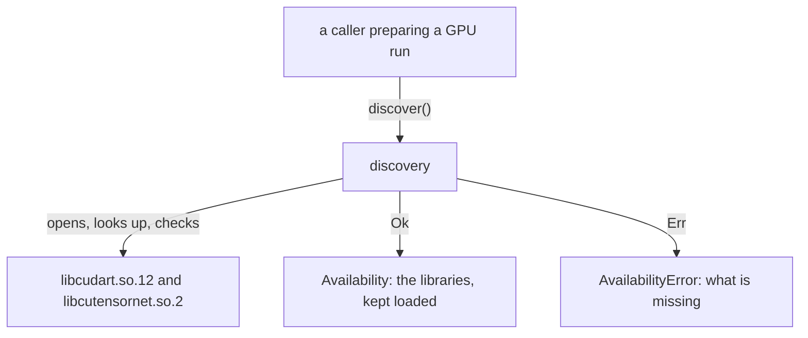
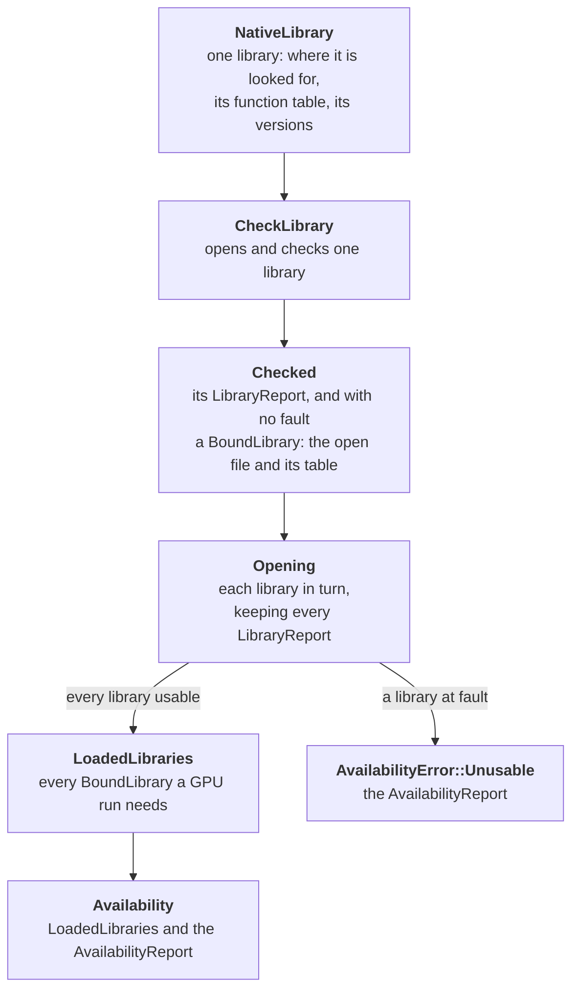
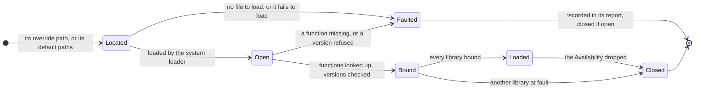
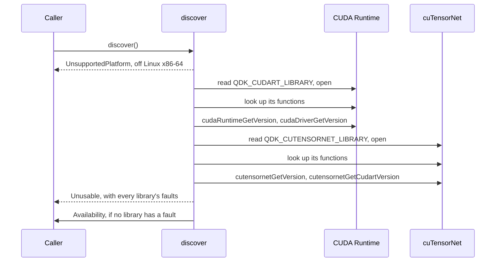

# Loading cuTensorNet at run time

The `qdk_cutensornet` crate lets the QDK run tensor-network simulations on an
NVIDIA GPU, through NVIDIA's cuTensorNet library, without making NVIDIA
software part of the QDK's build. Its first user is the MPS (matrix product
state) simulator; another simulator would widen the bound functions by adding
rows to the cuTensorNet table of
[`src/libraries/cutensornet.rs`](src/libraries/cutensornet.rs).

**The problem.** cuTensorNet is a tensor-network library that runs on the
CUDA Runtime, NVIDIA's library for driving a GPU. Both are shared libraries
(`libcutensornet.so.2`, `libcudart.so.12`) that most QDK users do not have.
Linking them, as Rust code normally links a C library, would make every QDK
build and every process that loads the QDK need them, and fail to start
without them.

**How it is solved.** Nothing is linked. When a GPU run is asked for,
[`discover`](src/discovery.rs) finds and opens the two libraries installed on the
host, looks up by name each C function of a table per library (each such
exported name is a _symbol_), and checks the versions the libraries report
against the audited ones. It returns an [`Availability`](src/discovery.rs), which
keeps the libraries loaded, or an [`AvailabilityError`](src/discovery/error.rs) that
says what is missing, so the caller can tell the user or run on the CPU.

**Why this approach.**

- **Optional by construction.** Building the QDK, loading it and simulating
  on the CPU need no GPU, no CUDA, no NVIDIA header or library and no linker
  setting. Off Linux x86-64, the crate still builds, and `discover` reports
  the platform as unsupported.
- **Failing early, with every cause.** A missing library, a missing
  dependency of one, a missing function, or a cuTensorNet or CUDA Runtime
  version other than the audited one is found before any GPU work, and
  reported with the path, the function or the version at fault. Every
  fault of every library is reported at once, so the user fixes an
  installation in one pass.
- **One audited surface.** The cuTensorNet functions the MPS engine may call
  are listed once, as the rows of the cuTensorNet table in
  [`src/libraries/cutensornet.rs`](src/libraries/cutensornet.rs); the C
  declarations come from bindgen's output for NVIDIA's header. Each row
  names its field, its function-pointer type and its symbol once, and the
  type is checked against the symbol's declaration when the crate compiles.
- **Open to more libraries.** Each library is one file that says what the
  crate needs of it; adding one changes no public type, since the report
  is a list with an entry per library.
- **Explicit, no global state.** Nothing happens until `discover` is called;
  the result is a value the caller holds, not a process-wide singleton, so
  tests and threads choose what they share.

**Evidence.** The crate's [unit tests](src/tests) drive each way discovery
fails, on any Unix host and without NVIDIA's libraries: missing and refused
libraries, missing functions, failed version probes, refused versions, and
bad override variables, each reported with the others. On a host with the audited libraries,
[`tests/availability.rs`](tests/availability.rs) discovers them.

## The model



- [`discover`](src/discovery.rs) does the whole check once. It selects no device,
  allocates nothing and runs no GPU work.
- [`Availability`](src/discovery.rs) holds the loaded libraries and the table of
  each library's functions, typed function pointers ready to call; the MPS
  engine, added in a later change, calls cuTensorNet through them. It is
  `Send` and `Sync`.
- [`AvailabilityReport`](src/discovery/report.rs) has a
  [`LibraryReport`](src/libraries/report.rs) per library, in the order they are
  opened: the library's name, the path it was opened from, the
  [`Version`](src/libraries/report.rs)s it reports, and its faults.
- Each library's file,
  [`src/libraries/cutensornet.rs`](src/libraries/cutensornet.rs) and
  [`src/libraries/cuda_runtime.rs`](src/libraries/cuda_runtime.rs), holds
  everything the crate assumes of that library: its name, where it is looked
  for, the table of its functions, and its versions and the ones accepted.
- [`AvailabilityError`](src/discovery/error.rs) is `UnsupportedPlatform` off Linux
  x86-64, or else `Unusable` with the report, in which each library at fault
  lists its [`LibraryFault`](src/libraries/report.rs)s: the variable, path, function or
  version at fault.

Copied from [`tests/availability.rs`](tests/availability.rs), which runs on a
host with the libraries installed:

```rust
// Load both libraries, look up their functions and check their versions.
let availability = discover().expect("the audited libraries are installed");

// What was loaded, from where; `availability` keeps it loaded.
let report = availability.report();
let cutensornet = report.library("cuTensorNet").expect("cuTensorNet is used");
assert_eq!(cutensornet.version("cuTensorNet"), Some(21_300));
assert_eq!(cutensornet.version("cuTensorNet's CUDA Runtime"), Some(12_090));
let cuda_runtime = report.library("CUDA Runtime").expect("the CUDA Runtime is used");
assert_eq!(cuda_runtime.version("CUDA Runtime"), Some(12_090));
println!("{report:#?}");
```

## From a library to an `Availability`

Discovery is the same for every library, and knows none of them: each
library says what the crate needs of it, and one list says which libraries
a GPU run needs.



- [`NativeLibrary`](src/libraries.rs) is one library as the crate needs it,
  implemented once per library, in its module: its name, its override
  variable and default paths, the table of its functions
  ([`FunctionTable`](src/libraries/loader.rs)), and how its versions are
  read and which are accepted.
- [`CheckLibrary`](src/libraries.rs) opens and checks one library. It
  returns the library's [`LibraryReport`](src/libraries/report.rs), with
  every fault found, and, when it found none, the
  [`BoundLibrary`](src/libraries.rs): the open library file and its table
  of functions, ready to call. It is a trait so that what discovery
  concludes from the checks is tested without library files.
- [`Opening`](src/libraries.rs) checks the libraries one at a time, with a
  `CheckLibrary`, and keeps every report, the usable libraries' included.
- [`LoadedLibraries`](src/libraries.rs) is the one list of the libraries a
  GPU run needs, each bound, and the order they are opened in. It opens
  every library before it requires any, so the report lists every fault
  of every library.
- [`Availability`](src/discovery.rs) holds the loaded libraries with their
  report; with any library at fault, discovery returns
  `AvailabilityError::Unusable` with the report instead.

A library's life, from discovery to the `Availability` that keeps it:



A loaded library stays open while the `Availability` lives, and is closed
with it, cuTensorNet before the CUDA Runtime it runs on.

## The steps of discovery

The CUDA Runtime, and then cuTensorNet, goes through the same steps: read
its override variable, open it, look up its functions, and read and check
its versions. Each library is checked whatever the other's faults, and each
fault is recorded in the library's report:

- reading the variable and opening: `InvalidOverride` (an override that is
  not an absolute path to a file), `NotFound` or `LoadFailed`. These leave
  nothing more to check of that library;
- looking up: `MissingRequiredSymbol`, one per missing function;
- the versions: `VersionProbeFailed` or `UnsupportedVersion`, one per
  version. The functions that read them are looked up on their own, so the
  versions are read even when other functions are missing, as a wrong
  version is the usual cause.

If any library has a fault, discovery returns `Unusable` with the report and
closes the libraries it opened. Looking a function up stores its address; it
does not call it.



A library is opened with `RTLD_NOW | RTLD_LOCAL`, the flags of the system
loader (`dlopen`). A library whose own dependencies are missing fails to
open in any mode; `RTLD_NOW` also binds, when the library is opened, every
symbol it imports from them, so that one they lack fails discovery rather
than a later call; `RTLD_LOCAL` keeps the library's symbols out of the rest
of the process.

### Where the libraries are looked for

| Library      | Override variable         | Default paths, in order                                                                     |
| ------------ | ------------------------- | ------------------------------------------------------------------------------------------- |
| cuTensorNet  | `QDK_CUTENSORNET_LIBRARY` | `/usr/lib/x86_64-linux-gnu/libcuquantum/12/libcutensornet.so.2`, then `libcutensornet.so.2` |
| CUDA Runtime | `QDK_CUDART_LIBRARY`      | `/usr/local/cuda-12.9/targets/x86_64-linux/lib/libcudart.so.12`, then `libcudart.so.12`     |

An override must be an absolute path to a file, or to a symlink to one.
When set, it is the only path tried, so a wrong setting fails instead of
loading another installation. A default absolute path that does not exist is
skipped; a bare file name is searched for by the system loader on its usual
search path, and skipped when the loader finds no file of that name. A
library that is found but fails to load, for instance because a library it
needs is missing, fails discovery.

### Versions

Discovery accepts exactly the versions the bindings were audited against:
cuTensorNet 2.13.0 (reported as `21300`), the CUDA Runtime 12.9 (`12090`), and
a cuTensorNet built against the CUDA Runtime 12.9. A newer release is not
assumed compatible. The CUDA driver's version is reported for diagnostics
only. A [`LibraryReport`](src/libraries/report.rs) names each version by its
component: `CUDA Runtime` and `CUDA driver` in the CUDA Runtime's,
`cuTensorNet` and `cuTensorNet's CUDA Runtime` in cuTensorNet's.

## Platforms

What the crate requires is checked when it runs; where it has run is listed
apart. Anything else is expected to work, but not verified.

| Requirement   | Checked by                                              | Verified on                                                                                      |
| ------------- | ------------------------------------------------------- | ------------------------------------------------------------------------------------------------ |
| Linux x86-64  | `discover`: `UnsupportedPlatform` elsewhere             | Ubuntu 22.04 on an NVIDIA A100 host                                                              |
| The libraries | `discover`: the exact versions of [Versions](#versions) | from NVIDIA's apt packages, at the default paths, and from its pip wheels, through the overrides |
| A CUDA driver | not checked: its version is reported only               | NVIDIA's driver 580.178.04, from Ubuntu's packages                                               |

- **Expected, not verified:** other x86-64 Linux distributions, with the
  libraries from NVIDIA's pip wheels or at a path an override gives (the
  default paths are those of NVIDIA's apt packages).
- **Not supported:** other architectures (ARM included), other systems,
  and other releases of the libraries, CUDA 13 among them: each needs its
  bindings generated and audited.

The bindings generator has requirements of its own (Ubuntu 22.04's
libclang), which
[`scripts/generate_bindings.py`](scripts/generate_bindings.py) states.

## The bindings

_Bindings_ are the Rust declarations of the C functions, types and constants;
they must match the C library's ABI (application binary interface: the sizes
and layouts of its types, and its calling convention) exactly, as a wrong one
is undefined behaviour when called, not a compile error. So they are
generated from NVIDIA's headers, never written by hand, and the crate is
checked against them when it compiles:

- **Generated from pinned inputs.**
  [`scripts/generate_bindings.py`](scripts/generate_bindings.py) runs bindgen
  on each library's header and keeps the library's whole API: every
  function, type and constant whose name has the library's prefix, and the
  types they reach. Its inputs are pinned, so that anyone can reproduce the
  checked-in files:
  [`scripts/generate_bindings.toml`](scripts/generate_bindings.toml) pins the
  tools and NVIDIA's archives, which every library shares, and each
  library's folder has a `bindings.toml` that says what its bindings are made
  of (its header, the archives searched for it, its prefix, the file
  written), as
  [`src/libraries/cutensornet/bindings.toml`](src/libraries/cutensornet/bindings.toml).
  The script binds every library that has one.
- **In a `generated/` folder beside the library they declare:**
  [`src/libraries/cutensornet/generated/v2_13.rs`](src/libraries/cutensornet/generated/v2_13.rs)
  and
  [`src/libraries/cuda_runtime/generated/cudart_12.rs`](src/libraries/cuda_runtime/generated/cudart_12.rs).
  These folders hold only the script's output, which is not edited or
  reviewed by hand; [`.gitattributes`](.gitattributes) marks them as
  generated, so that GitHub hides them in a pull request's diff. The CUDA
  Runtime's bindings declare CUDA's stream type, and cuTensorNet's import
  it, so that a stream the one creates passes to the other unchanged.
- **Checked when the crate compiles.** A library's function table is the
  list of the functions the crate uses. Each row names its symbol, and its
  function-pointer type is checked against the symbol's declaration in the
  bindings, so no field can be looked up by another function's name. The
  version each library is accepted at is asserted to be the version its
  header declares, and
  [`src/libraries/cutensornet/layout.rs`](src/libraries/cutensornet/layout.rs)
  asserts the layout of `cuDoubleComplex`, which a cuTensorNet function takes
  by value.

To bind another function of a bound release, add its row, and its
function-pointer type, to its library's module in
[`src/libraries/`](src/libraries): the bindings already declare it.
To bind another library, follow the steps at the top of
[`src/libraries.rs`](src/libraries.rs). The script runs once per release of
a library; its documentation, at the top of
[`scripts/generate_bindings.py`](scripts/generate_bindings.py), says how to
run it and how to audit a new release.

NVIDIA's headers, archives and libraries are not stored in this repository;
their terms are those of the licenses distributed with NVIDIA's archives.
