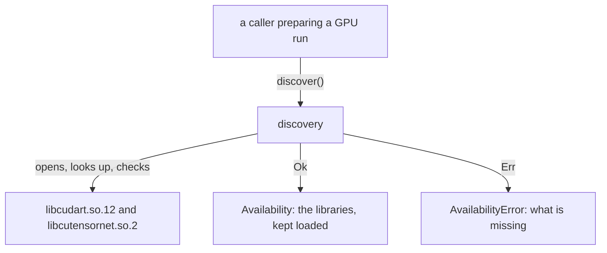
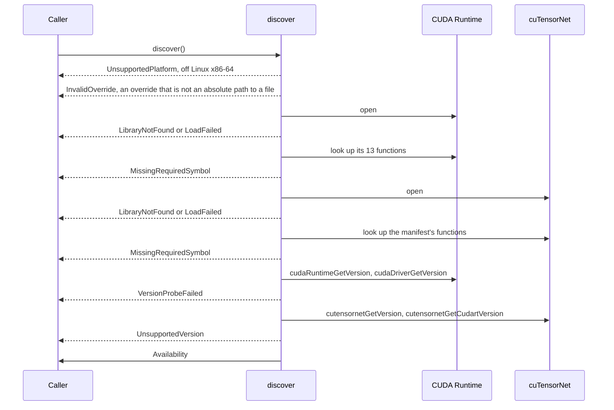

# Loading cuTensorNet at run time

The `qdk_cutensornet` crate lets the QDK's MPS (matrix product state)
simulator run on an NVIDIA GPU, through NVIDIA's cuTensorNet library, without
making NVIDIA software part of the QDK's build.

**The problem.** cuTensorNet is a tensor-network library that runs on the
CUDA Runtime, NVIDIA's library for driving a GPU. Both are shared libraries
(`libcutensornet.so.2`, `libcudart.so.12`) that most QDK users do not have.
Linking them, as Rust code normally links a C library, would make every QDK
build and every process that loads the QDK need them, and fail to start
without them.

**How it is solved.** Nothing is linked. When a GPU run is asked for,
[`discover`](src/lib.rs) finds and opens the two libraries installed on the
host, looks up by name each C function of a table per library (each such
exported name is a _symbol_), and checks the versions the libraries report
against the audited ones. It returns an [`Availability`](src/lib.rs), which
keeps the libraries loaded, or an [`AvailabilityError`](src/error.rs) that
says what is missing, so the caller can tell the user or run on the CPU.

**Why this approach.**

- **Optional by construction.** Building the QDK, loading it and simulating
  on the CPU need no GPU, no CUDA, no NVIDIA header or library and no linker
  setting. Off Linux x86-64, the crate still builds, and `discover` reports
  the platform as unsupported.
- **Failing early, with the cause.** A missing library, a missing
  dependency of one, a missing function, or a cuTensorNet or CUDA Runtime
  version other than the audited one is found before any GPU work, and
  reported with the path, the function or the version at fault.
- **One audited surface.** The cuTensorNet functions the MPS engine may call
  are listed once, in
  [`scripts/cutensornet-symbols.txt`](scripts/cutensornet-symbols.txt); the
  C declarations come from bindgen's output for NVIDIA's header. Each
  function is one row of its library's table, naming its field, its
  function-pointer type and its symbol once: the type is checked against
  the symbol's declaration when the crate compiles, and the tests check the
  rows against the list.
- **Explicit, no global state.** Nothing happens until `discover` is called;
  the result is a value the caller holds, not a process-wide singleton, so
  tests and threads choose what they share.

**Evidence.** The crate's [unit tests](src/tests) drive each way discovery
fails, on any Unix host and without NVIDIA's libraries: missing and refused
libraries, missing functions, failed version probes, refused versions, and
bad override variables. On a host with the audited libraries,
[`tests/availability.rs`](tests/availability.rs) discovers them.

## The model



- [`discover`](src/lib.rs) does the whole check once. It selects no device,
  allocates nothing and runs no GPU work.
- [`Availability`](src/lib.rs) holds the loaded libraries and the table of
  each library's functions, typed function pointers ready to call; the MPS
  engine, added in a later change, calls cuTensorNet through them. It is
  `Send` and `Sync`, and its [`AvailabilityReport`](src/lib.rs) says what
  was loaded, from where.
- [`AvailabilityError`](src/error.rs) has one variant per way discovery
  fails, each with the variable, path, library, function or version at fault.

Copied from [`tests/availability.rs`](tests/availability.rs), which runs on a
host with the libraries installed:

```rust
// Load both libraries, look up their functions and check their versions.
let availability = discover().expect("the audited libraries are installed");

// What was loaded, from where; `availability` keeps it loaded.
let report = availability.report();
assert_eq!(report.cutensornet_version, 21_300);
assert_eq!(report.cutensornet_cuda_runtime_version, 12_090);
assert_eq!(report.cuda_runtime_version, 12_090);
println!("{report:#?}");
```

## The steps of discovery

Each step either succeeds or returns its error; a failed discovery closes
the libraries it opened. Looking a function up stores its address; it does
not call it.



A library is opened with `RTLD_NOW | RTLD_LOCAL`, the flags of the system
loader (`dlopen`). A library whose own dependencies are missing fails to
open in any mode; `RTLD_NOW` also binds, when the library is opened, every
symbol it imports from them, so that one they lack fails discovery rather
than a later call; `RTLD_LOCAL` keeps the library's symbols out of the rest
of the process.

### Where the libraries are looked for

| Library      | Override variable         | Default paths, in order                                                                     |
| ------------ | ------------------------- | ------------------------------------------------------------------------------------------- |
| cuTensorNet  | `QDK_CUTENSORNET_LIBRARY` | `/usr/lib/x86_64-linux-gnu/libcuquantum/12/libcutensornet.so.2`, then `libcutensornet.so.2` |
| CUDA Runtime | `QDK_CUDART_LIBRARY`      | `/usr/local/cuda-12.9/targets/x86_64-linux/lib/libcudart.so.12`, then `libcudart.so.12`     |

An override must be an absolute path to a file, or to a symlink to one.
When set, it is the only path tried, so a wrong setting fails instead of
loading another installation. A default absolute path that does not exist is
skipped; a bare file name is searched for by the system loader on its usual
search path, and skipped when the loader finds no file of that name. A
library that is found but fails to load, for instance because a library it
needs is missing, fails discovery.

### Versions

Discovery accepts exactly the versions the bindings were audited against:
cuTensorNet 2.13.0 (reported as `21300`), the CUDA Runtime 12.9 (`12090`), and
a cuTensorNet built against the CUDA Runtime 12.9. A newer release is not
assumed compatible. The CUDA driver's version is reported for diagnostics
only.

## The bindings

_Bindings_ are the Rust declarations of the C functions, types and constants;
they must match the C library's ABI (application binary interface: the sizes
and layouts of its types, and its calling convention) exactly.

- [`src/bindings/v2_13.rs`](src/bindings/v2_13.rs) declares cuTensorNet 2.13's
  functions of the manifest and the types they use. It is the output of
  bindgen, run on NVIDIA's header by
  [`scripts/generate-bindings.sh`](scripts/generate-bindings.sh) for an
  earlier, wider manifest, then trimmed by a script to the items that the
  current manifest's functions reach, unchanged and in order; it is not
  edited by hand. Regenerating it from the current manifest must reproduce
  it, apart from its header, which says how it was made.
- [`src/bindings/cudart_12.rs`](src/bindings/cudart_12.rs) declares the
  CUDA Runtime 12 functions the crate uses; it is written by hand from the
  CUDA 12.9 header.
- [`src/bindings/mod.rs`](src/bindings/mod.rs) asserts, at compile time, the
  layout of `cuDoubleComplex`, which a cuTensorNet function takes by value.
- [`src/library/symbols.rs`](src/library/symbols.rs) holds both function
  tables, a row `required field: Type = symbol` (or `optional`) per
  function. Each row makes the
  field, its lookup by the symbol's name, and a compile-time check that the
  type is the symbol's declaration in the bindings, so no field can be
  looked up by another function's name. The cuTensorNet rows are the
  manifest's rows, which the tests check.

### Updating the bindings

To bind another cuTensorNet function:

1. Add its row to
   [`scripts/cutensornet-symbols.txt`](scripts/cutensornet-symbols.txt), and,
   if it needs a type that no listed function's declaration reaches, the
   type to the script's `TYPE_PATTERN`.
2. Regenerate the bindings, on Linux x86-64 with bindgen 0.72.1, clang 14 and
   the CUDA 12.9 headers (no GPU needed), from the NVIDIA cuQuantum archive
   below. The script checks the archive's and the header's hashes, and that
   the generated functions are exactly the manifest's:

   ```bash
   source/cutensornet/scripts/generate-bindings.sh \
     /path/to/cuquantum-linux-x86_64-26.06.0.17_cuda12-archive.tar.xz \
     source/cutensornet/src/bindings/v2_13.rs
   ```

3. Add its function-pointer type to its family's file in
   `src/library/symbols/`, and its row to the cuTensorNet table in
   `src/library/symbols.rs`. The crate does not compile until the type is the
   declaration's, and its tests fail until the table's rows are the
   manifest's.

A newer cuTensorNet or CUDA release is a new audit: new bindings from its
header, the assertions of `src/bindings/mod.rs` checked against it, and the
accepted versions changed in [`src/version.rs`](src/version.rs).

### Where the bindings come from

- NVIDIA cuQuantum 26.06.0 for CUDA 12:
  `cuquantum-linux-x86_64-26.06.0.17_cuda12-archive.tar.xz`, SHA-256
  `4c37aa346fab9023d985e79667b047e13a0c0f9b9fea7dfca453979b331c8f77`, listed
  in NVIDIA's `redistrib_26.06.0.json`;
- its `cutensornet.h`, SHA-256
  `f70f31595c3c7b44682a7e4bdcd468504615983a4ec628f519cf18f0036a4687`;
- bindgen 0.72.1 and Ubuntu clang 14.0.0-1ubuntu1.1.

NVIDIA's headers, archives and libraries are not stored in this repository;
their terms are those of the NVIDIA cuQuantum SDK license distributed with
the archive.
