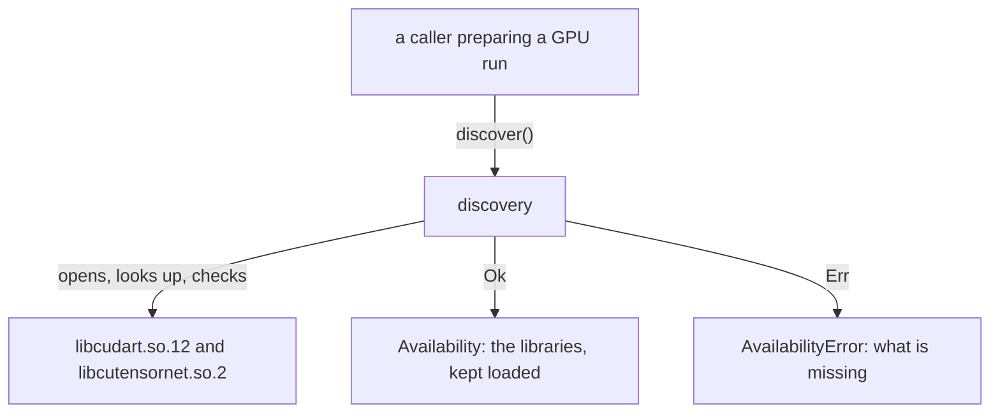

# cuTensorNet for the QDK: the MPS engine, the discovery and loading of its libraries, and the GPU setup check

The `qdk_cutensornet` crate is for running the QDK's tensor-network
simulations, the MPS (matrix product state) simulator first, on an NVIDIA GPU
with NVIDIA's cuTensorNet library. The MPS engine and its rules are
[`canonical_mps`'s](../canonical_mps/README.md); this crate adds a
cuTensorNet algebra for that engine, without making NVIDIA software part of
the QDK. It solves four problems:

- The instances a GPU is for, such as chemistry at a large bond dimension,
  are slow on the CPU. So their site tensors should stay, and be factored, in
  the GPU's memory.
- Most QDK users have neither cuTensorNet nor the CUDA Runtime it runs on
  (NVIDIA's library for driving a GPU). So the QDK must build, load and
  simulate on the CPU without them.
- When a GPU run is asked for, its caller needs to know what is missing,
  to tell the user or to run on the CPU instead.
- A user setting the GPU up, often new to CUDA, needs to be told what is
  missing and what to fix. The driver, the device and the two libraries all
  lie outside the QDK.

The crate never links cuTensorNet or the CUDA Runtime. It opens and checks
them at run time ([discovery](#the-discovery-and-loading-of-the-libraries)).
Discovery returns the loaded libraries, for an engine to open on, or why
they cannot be used: every fault it found, or, off Linux x86-64, that the
platform is unsupported. The GPU setup check reuses discovery, adds a
device read and a trial run, and says what to fix.

Today the crate holds:

- **[The MPS engine](#the-mps-engine):**
  [`CudaMpsEngine`](src/engine.rs), `canonical_mps`'s canonical-form MPS
  engine on [`CudaAlgebra`](src/engine/cuda_algebra.rs), its
  `SiteAlgebra` on cuTensorNet's tensor API.
- **What passes between the engine and the algebra:**
  [`DeviceTensor`](src/engine/cuda_algebra/device_tensor.rs), one site in
  the GPU's memory, which only the algebra that made it accepts.
- **Failures:** [`CudaAlgebraError`](src/engine/cuda_algebra_error.rs),
  why a call of the algebra failed, which the engine wraps as
  `CanonicalMpsError::Algebra`.
- **[The discovery and loading of the libraries](#the-discovery-and-loading-of-the-libraries):**
  [`discover`](src/discovery.rs), which opens and checks the libraries;
  [`discover_with`](src/discovery.rs), the same given the
  [`PackagedLibraries`](src/libraries/packaged_libraries.rs) a package
  manager installed; and [`Availability`](src/discovery.rs), which keeps
  them loaded.
- **Reports and faults:** [`AvailabilityReport`](src/discovery/report.rs),
  with a [`LibraryReport`](src/libraries/report.rs) per library and the
  [`Version`](src/libraries/report.rs)s it reports; and
  [`AvailabilityError`](src/discovery/error.rs), with the
  [`LibraryFault`](src/libraries/report.rs)s it lists.
- **[The GPU setup check](#the-gpu-setup-check):**
  [`GpuSetup::check`](src/gpu_setup.rs) tells a user setting the GPU up
  what to fix. It runs discovery, reads the CUDA devices and makes one
  trial run.

A simulator calls `discover()`, then opens the engine with
`CudaMpsEngine::try_from(&availability)` (Linux x86-64), as the example on
[`CudaMpsEngine`](src/engine.rs) shows. It opens the engine in each run's
first step and drops it at the run's end. A user setting the GPU up calls
`GpuSetup::check`.

## The MPS engine

**The problem.** `canonical_mps`'s engine makes synchronous calls that
hand its algebra site tensors. cuTensorNet's calls run asynchronously on
the GPU, on tensors it knows by descriptors, in memory its caller lends.

**How it is solved.** [`CudaMpsEngine`](src/engine.rs) is
`CanonicalMpsEngine<CudaAlgebra>`:
[`canonical_mps`'s engine](../canonical_mps/README.md#the-engine) on this
crate's algebra, which meets
[the backend contract](../canonical_mps/README.md#the-backend-contract).
The algebra runs on one CUDA device, a GPU as CUDA numbers them: device
0 ([`settings.rs`](src/engine/cuda_algebra/settings.rs)). A process
selects another with `CUDA_VISIBLE_DEVICES`. The algebra bridges the two
models:

- Each `SiteAlgebra` method selects the algebra's device, queues its
  native calls on the algebra's CUDA stream (a queue of work the device
  runs in order), and waits for them, so it returns with the device idle.
- It describes each tensor of a call to cuTensorNet, and lends each call
  the workspace memory it asks for, from scratch it keeps and grows.
- It keeps each contraction cuTensorNet has prepared (its path found) for
  its shape, as a run's moves of the centre repeat their shapes.
- What a call creates is released when it returns, once the device is
  done with it. A failed call that cannot wait for the device poisons the
  algebra.

[`docs/engine.md`](docs/engine.md) defines the algebra's terms, and gives
the phases each method runs, how and why, their native calls, when each
guarantee holds, and the numerics; each file's header gives the details.

**Why this approach: sites stay on the GPU.** The GPU engine is for the
large instances the CPU engine is slow on, such as chemistry: it is faster
at large bonds, slower on small circuits. Only an upload or a read copies
a site between the host and the GPU.

### What a caller can rely on

- Without device 0, the opening (`CudaAlgebra::new`,
  `CudaMpsEngine::try_from`) fails with `CudaAlgebraError::NoDevice`, and
  releases what it made.
- Each method returns with the device idle and its inputs unchanged, as
  [the contract](../canonical_mps/README.md#the-operations) asks, so the
  engine may use a tensor at once.
- Each method refuses, before it makes any native object, another
  engine's tensor and arguments it cannot serve: a tensor shorter than
  the call reads, an upload or a duplicate of no element, and extents
  whose product overflows.
- A failed method frees its outputs once the device is idle. If it
  cannot wait for the device, the algebra is poisoned: every later method
  returns `CudaAlgebraError::Poisoned`.
- Dropping a tensor or the algebra attempts every release: one CUDA
  refuses is leaked and logged as a warning.

[When each guarantee holds](docs/engine.md#when-each-guarantee-holds)
gives the order of the checks and what a failure or a drop releases.

## The discovery and loading of the libraries

[`src/discovery.rs`](src/discovery.rs) finds, opens and checks the libraries
a GPU run needs. Each library's module in [`src/libraries/`](src/libraries)
says what the crate needs of it. A caller runs discovery before it opens
an engine, which opens on its result. The GPU setup check runs it too.

**How it is solved.** When a GPU run is asked for,
[`discover`](src/discovery.rs) opens the shared libraries it needs. Today
they are the CUDA Runtime, `libcudart.so.12`, and cuTensorNet,
`libcutensornet.so.2`. It looks up by name each C function the crate uses
(its _symbol_), and checks the versions the libraries report. It returns
an `Availability`, which keeps them loaded, or an `AvailabilityError` that
says what is missing.

**Why this approach.**

- **Optional by construction.** The QDK builds, loads and simulates on the
  CPU with no GPU, no NVIDIA header or library and no linker setting. Off
  Linux x86-64 the crate still builds, and `discover` reports the platform
  as unsupported.
- **Failing early, with every cause.** Discovery finds a missing library,
  dependency or function, or a version other than the audited one, before
  any GPU work. It reports every fault of every library at once, so an
  installation is fixed in one pass.
- **One audited surface.** The functions the crate may call are the rows
  of one table per library. Each row is checked against NVIDIA's header
  when the crate compiles ([The bindings](docs/loading.md#the-bindings)).
- **Open to more libraries.** Each library is one module. Adding one
  changes no public type. The report holds an entry per library, and a
  package manager's files are matched to each library by its file name.
- **Explicit, no global state.** Nothing happens until `discover` is
  called. Its result is a value the caller holds, so tests and threads
  choose what they share.

### The model



- [`discover`](src/discovery.rs) selects no device, allocates no GPU memory
  and runs no GPU work.
- [`discover_with`](src/discovery.rs) is `discover` also given
  [`PackagedLibraries`](src/libraries/packaged_libraries.rs). These are the
  library files a package manager installed where no default path reaches,
  such as NVIDIA's wheels in a Python environment, and the command that
  installs them, which the setup check advises. `discover` gives none.
- [`Availability`](src/discovery.rs) holds each library's functions as typed
  function pointers, which the algebra calls. It is `Send` and `Sync`, so
  one discovery serves every thread. An engine, its algebra and its states
  stay on the thread that created them.
- Its [`AvailabilityReport`](src/discovery/report.rs) has a
  [`LibraryReport`](src/libraries/report.rs) per library, in the order they
  are opened: its name, the path it was opened from, the
  [`Version`](src/libraries/report.rs)s it reports, its faults, and the
  other copies of it visible beside the one loaded. Its
  [`LibrarySource`](src/libraries/report.rs) says where the copy tried was
  found: its override, a packaged file, a default path or the system
  loader's search.
- [`AvailabilityError`](src/discovery/error.rs) is `UnsupportedPlatform` off
  Linux x86-64, or else `Unusable` with the report, whose
  [`LibraryFault`](src/libraries/report.rs)s name the variable, path,
  function or version at fault.

Copied from [`tests/availability.rs`](tests/availability.rs), which runs on a
host with the libraries installed:

```rust
// Load both libraries, look up their functions and check their versions.
let availability = discover().expect("the audited libraries are installed");

// What was loaded, from where; `availability` keeps it loaded.
let report = availability.report();
let cutensornet = report.library("cuTensorNet").expect("cuTensorNet is used");
assert_eq!(cutensornet.version("cuTensorNet"), Some(21_300));
assert_eq!(
    cutensornet.version("cuTensorNet's CUDA Runtime"),
    Some(12_090)
);
let cuda_runtime = report
    .library("CUDA Runtime")
    .expect("the CUDA Runtime is used");
assert_eq!(cuda_runtime.version("CUDA Runtime"), Some(12_090));
println!("{report:#?}");
```

[`docs/loading.md`](docs/loading.md) shows how discovery turns each library
into an `Availability`, the steps it takes and the faults each one finds,
and how the bindings are made and checked.

### Where the libraries are looked for

The QDK does not ship the libraries. The user installs them from NVIDIA:
with its apt packages, whose paths are the defaults below, or with its pip
wheels. The caller gives the wheels' files as
[`PackagedLibraries`](src/libraries/packaged_libraries.rs), or an override
names one. Each library's module sets its variable, its packaged file name
and its default paths
([`cuda_runtime.rs`](src/libraries/cuda_runtime.rs),
[`cutensornet.rs`](src/libraries/cutensornet.rs)).

| Library      | Override variable         | Packaged file         | Default paths, in order                                                                     |
| ------------ | ------------------------- | --------------------- | ------------------------------------------------------------------------------------------- |
| cuTensorNet  | `QDK_CUTENSORNET_LIBRARY` | `libcutensornet.so.2` | `/usr/lib/x86_64-linux-gnu/libcuquantum/12/libcutensornet.so.2`, then `libcutensornet.so.2` |
| CUDA Runtime | `QDK_CUDART_LIBRARY`      | `libcudart.so.12`     | `/usr/local/cuda-12.9/targets/x86_64-linux/lib/libcudart.so.12`, then `libcudart.so.12`     |

An override must be an absolute path to a file, or to a symlink to one. It
is then the only path tried, so a wrong setting fails instead of loading
another installation. Without an override, its packaged file, if any, is
tried first, then the default paths in order.
[The steps of discovery](docs/loading.md#the-steps-of-discovery) say when a
path is skipped and when it fails discovery.

### Versions

Discovery accepts exactly the versions the bindings were audited against:

- cuTensorNet 2.13.0, reported as `21300`;
- the CUDA Runtime 12.9, reported as `12090`;
- a cuTensorNet built against the CUDA Runtime 12.9.

A newer release is not assumed compatible. Discovery reports the CUDA
driver's version without checking it.
[The GPU setup check](#the-gpu-setup-check) finds a missing NVIDIA driver,
or one older than CUDA 12's floor.

A [`LibraryReport`](src/libraries/report.rs) names each version by its
component. The CUDA Runtime's report has `CUDA Runtime` and `CUDA driver`.
cuTensorNet's has `cuTensorNet` and `cuTensorNet's CUDA Runtime`.

## The GPU setup check

A user setting the GPU up runs [`GpuSetup::check`](src/gpu_setup.rs), which
never fails. The [`GpuSetup`](src/gpu_setup.rs) it returns lists what each
step found, warns of other copies of a library, and says what to fix. Its
`is_ready`, `advice` and `warnings` give each part alone, and its `Display`
the whole report.

- **Steps in the order each depends on the last:** the libraries, the
  host, the devices, then a trial run. Only the first problem met is
  advised, since a later one is often its consequence: with a driver too
  old for the CUDA Runtime, the process sees no device.
- **What a GPU run would load:** the check runs discovery as a run does,
  given the caller's `PackagedLibraries`. So its answer holds for the
  process that runs it.
- **Each library brings its own checks:** its setup guide says what it
  needs of the host, and the oldest driver and lowest compute capability
  (NVIDIA's version of a GPU's architecture) it runs on.
- **A result checked, not only a run:** the trial run makes cuTensorNet
  compute on the device and checks the probability it reads. So libraries
  that compute wrong results are found before the user's first run.

[`docs/gpu_setup.md`](docs/gpu_setup.md) defines the check's terms, and
gives each step, how and why.

## Tests

The [engine's tests](src/engine/tests.rs) run in CI, without a GPU. Most
run on [fake libraries](src/engine/native_calls/fake_libraries.rs). A fake
is a test double with a working but simpler implementation. This one
computes each call's result on the CPU, and enforces cuTensorNet's call
order and its rules on streams and copies. Two sets of tests use it:

- the [native calls' tests](src/engine/native_calls/tests.rs) pin the
  fake's rules;
- the [CUDA algebra's tests](src/engine/cuda_algebra/tests.rs) run
  `canonical_mps`'s
  [conformance kit](../canonical_mps/README.md#conformance-the-kit-and-the-engines-circuits)
  on the fake, and check the algebra's
  release of every native object, its scratch, its failures and its
  refusals.

[`tests/cuda_mps_engine_on_the_gpu.rs`](tests/cuda_mps_engine_on_the_gpu.rs)
runs the kit and `canonical_mps`'s engine circuits on a GPU, with the real
libraries. It, and the native calls' cases that also run on a GPU, need
one, so they run only when asked for (`--ignored`).

Discovery's unit tests, each in a `tests.rs` beside its module (for
instance [the libraries'](src/libraries/tests.rs)), drive each way it
fails, without NVIDIA's libraries, each fault reported with the others;
those that need a library open or glibc's messages run on Linux with glibc
only.

[The GPU setup check's tests](src/gpu_setup/tests.rs) build each problem
it finds from chosen device reports and the fake libraries, so they need no
GPU, and [check the advice for each](src/gpu_setup/tests/advice.rs). Most
run on Unix hosts only.

[`tests/availability.rs`](tests/availability.rs) discovers the audited
libraries where they are installed. On a host with a CUDA device, it also
finds the setup ready.

## Platforms

The crate checks its requirements when it runs. The table also lists where
it has run. Anything else is expected to work, but not verified.

| Requirement   | Checked by                                                                                                                                                                                                                             | Verified on                                                                                      |
| ------------- | -------------------------------------------------------------------------------------------------------------------------------------------------------------------------------------------------------------------------------------- | ------------------------------------------------------------------------------------------------ |
| Linux x86-64  | `discover`: `UnsupportedPlatform` elsewhere                                                                                                                                                                                            | Ubuntu 22.04 on an NVIDIA A100 host                                                              |
| The libraries | `discover`: the exact versions of [Versions](#versions)                                                                                                                                                                                | from NVIDIA's apt packages, at the default paths, and from its pip wheels, through the overrides |
| A CUDA driver | [the GPU setup check](#the-gpu-setup-check), against the CUDA Runtime's floor ([`cuda_runtime.rs`](src/libraries/cuda_runtime.rs)). `discover` only reports its version                                                                | NVIDIA's driver 580.178.04, from Ubuntu's packages                                               |
| An NVIDIA GPU | `CudaAlgebra::new`: `CudaAlgebraError::NoDevice` without one; [the GPU setup check](#the-gpu-setup-check): the engine's device at cuTensorNet's minimum compute capability ([`cutensornet.rs`](src/libraries/cutensornet.rs)) or later | an A100 80GB, compute capability 8.0, Ampere (below)                                             |

- **On an A100 80GB:** `CudaAlgebra` passes `canonical_mps`'s
  conformance kit, and the native calls' cases that also run on a GPU
  pass. `CudaMpsEngine` passes `canonical_mps`'s engine conformance
  circuits, and reads a capped circuit as `CpuMpsEngine` does. The native
  calls' cases, the kit and the capped circuit pass NVIDIA's
  `compute-sanitizer` memcheck, with its leak check, and synccheck.
  [`tests/availability.rs`](tests/availability.rs)'s setup check finds
  the setup ready.
- **Expected, not verified:** other x86-64 Linux distributions, with the
  libraries from NVIDIA's pip wheels or at a path an override gives (the
  default paths are those of NVIDIA's apt packages). Also the wheels'
  files given through `PackagedLibraries`, which no test here loads from
  the real wheels. Also other NVIDIA GPUs at
  [cuTensorNet's minimum compute capability](src/libraries/cutensornet.rs)
  or later: Turing (7.5), Ampere's others (8.6, 8.7), Ada Lovelace (8.9),
  Hopper (9.0) and Blackwell (10.x, 12.x).
- **Not supported:** other architectures (ARM included), other systems,
  and other releases of the libraries, CUDA 13 among them. Each needs its
  bindings generated and audited.

The bindings generator has requirements of its own (Ubuntu 22.04's
libclang), which
[`scripts/generate_bindings.py`](scripts/generate_bindings.py) states.
