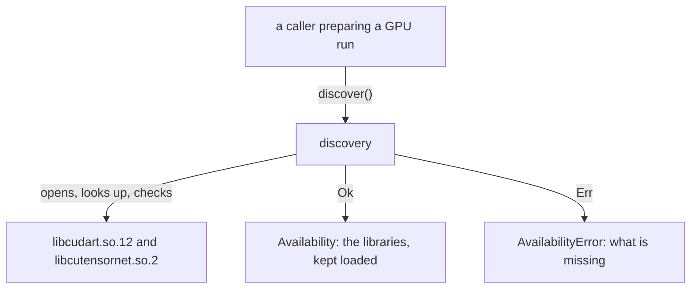

# cuTensorNet for the QDK: the discovery and loading of its libraries

The `qdk_cutensornet` crate was designed to solve the problem of running
the QDK's tensor-network simulations, the MPS (matrix product state)
simulator first, on an NVIDIA GPU, with NVIDIA's cuTensorNet library,
without making NVIDIA software part of the QDK. This first part finds and
loads the libraries; the MPS engine, which calls them, comes in a later
change. The problem includes:

- most QDK users have neither cuTensorNet nor the CUDA Runtime it runs on
  (NVIDIA's library for driving a GPU), so the QDK must build, load and
  simulate on the CPU without them;
- and when a GPU run is asked for, its caller needs to know what is
  missing, to tell the user or to run on the CPU instead.

The crate never links cuTensorNet or the CUDA Runtime: it opens them at run
time and checks them
([discovery](#the-discovery-and-loading-of-the-libraries)), which returns
the loaded libraries, or why they cannot be used: every fault it found, or,
off Linux x86-64, that the platform is unsupported.

Today the crate holds:

- **[The discovery and loading of the libraries](#the-discovery-and-loading-of-the-libraries):**
  [`discover`](src/discovery.rs), which opens and checks the libraries,
  and [`Availability`](src/discovery.rs), which keeps them loaded.
- **Reports and faults:** [`AvailabilityReport`](src/discovery/report.rs),
  with a [`LibraryReport`](src/libraries/report.rs) per library and the
  [`Version`](src/libraries/report.rs)s it reports; and
  [`AvailabilityError`](src/discovery/error.rs), with the
  [`LibraryFault`](src/libraries/report.rs)s it lists.

## The discovery and loading of the libraries

[`src/discovery.rs`](src/discovery.rs) finds, opens and checks the libraries
a GPU run needs; each library's module in [`src/libraries/`](src/libraries)
says what the crate needs of it.

**How it is solved.** When a GPU run is asked for,
[`discover`](src/discovery.rs) opens the shared libraries it needs (today
the CUDA Runtime, `libcudart.so.12`, and cuTensorNet,
`libcutensornet.so.2`), looks up by name each C function the crate uses
(its _symbol_), cuTensorNet's tensor decompositions and contraction
networks among them, and checks the
versions the libraries report. It returns an `Availability`, which keeps
them loaded, or an `AvailabilityError` that says what is missing.

**Why this approach.**

- **Optional by construction.** The QDK builds, loads and simulates on the
  CPU with no GPU, no NVIDIA header or library and no linker setting. Off
  Linux x86-64 the crate still builds, and `discover` reports the platform
  as unsupported.
- **Failing early, with every cause.** A missing library, dependency or
  function, or a version other than the audited one, is found before any
  GPU work and reported with the path, function or version at fault, for
  every library at once, so an installation is fixed in one pass.
- **One audited surface.** The functions the crate may call are the rows
  of one table per library, each checked against NVIDIA's header when the
  crate compiles ([The bindings](docs/loading.md#the-bindings)).
- **Open to more libraries.** Each library is one module; adding one changes
  no public type, as the report is a list with an entry per library.
- **Explicit, no global state.** Nothing happens until `discover` is called,
  and its result is a value the caller holds, so tests and threads choose
  what they share.

### The model



- [`discover`](src/discovery.rs) selects no device, allocates no GPU memory
  and runs no GPU work.
- [`Availability`](src/discovery.rs) holds each library's functions as typed
  function pointers, ready to call. It is `Send` and `Sync`, so one
  discovery serves every thread.
- Its [`AvailabilityReport`](src/discovery/report.rs) has a
  [`LibraryReport`](src/libraries/report.rs) per library, in the order they
  are opened: its name, the path it was opened from, the
  [`Version`](src/libraries/report.rs)s it reports, and its faults.
- [`AvailabilityError`](src/discovery/error.rs) is `UnsupportedPlatform` off
  Linux x86-64, or else `Unusable` with the report, whose
  [`LibraryFault`](src/libraries/report.rs)s name the variable, path,
  function or version at fault.

Copied from [`tests/availability.rs`](tests/availability.rs), which runs on a
host with the libraries installed:

```rust
// Load both libraries, look up their functions and check their versions.
let availability = discover().expect("the audited libraries are installed");

// What was loaded, from where; `availability` keeps it loaded.
let report = availability.report();
let cutensornet = report.library("cuTensorNet").expect("cuTensorNet is used");
assert_eq!(cutensornet.version("cuTensorNet"), Some(21_300));
assert_eq!(
    cutensornet.version("cuTensorNet's CUDA Runtime"),
    Some(12_090)
);
let cuda_runtime = report
    .library("CUDA Runtime")
    .expect("the CUDA Runtime is used");
assert_eq!(cuda_runtime.version("CUDA Runtime"), Some(12_090));
println!("{report:#?}");
```

[`docs/loading.md`](docs/loading.md) shows how discovery turns each library
into an `Availability`, the steps it takes and the faults each one finds,
and how the bindings are made and checked.

### Where the libraries are looked for

| Library      | Override variable         | Default paths, in order                                                                     |
| ------------ | ------------------------- | ------------------------------------------------------------------------------------------- |
| cuTensorNet  | `QDK_CUTENSORNET_LIBRARY` | `/usr/lib/x86_64-linux-gnu/libcuquantum/12/libcutensornet.so.2`, then `libcutensornet.so.2` |
| CUDA Runtime | `QDK_CUDART_LIBRARY`      | `/usr/local/cuda-12.9/targets/x86_64-linux/lib/libcudart.so.12`, then `libcudart.so.12`     |

An override must be an absolute path to a file, or to a symlink to one, and
is then the only path tried, so a wrong setting fails instead of loading
another installation. A default path is skipped when there is no file
there; a bare file name is searched for on the system loader's usual path,
and skipped when the loader reports no file of that name (glibc reports so
too when its search found only files of that name it could not use, such as
another machine's). A library that is found but fails to load, for instance
for a missing dependency, fails discovery.

### Versions

Discovery accepts exactly the versions the bindings were audited against:
cuTensorNet 2.13.0 (reported as `21300`), the CUDA Runtime 12.9 (`12090`), and
a cuTensorNet built against the CUDA Runtime 12.9. A newer release is not
assumed compatible. The CUDA driver's version is reported for diagnostics
only. A [`LibraryReport`](src/libraries/report.rs) names each version by its
component: `CUDA Runtime` and `CUDA driver` in the CUDA Runtime's,
`cuTensorNet` and `cuTensorNet's CUDA Runtime` in cuTensorNet's.

## Tests

The [unit tests](src/tests) drive each way discovery fails without
NVIDIA's libraries: on any Unix host, refused libraries, missing
functions, failed version probes, refused versions, and bad override
variables, each reported with the others; on Linux with glibc, the tests
that need a library open or glibc's messages: a library found nowhere, an
opened library at fault reported with its path, and what discovery
concludes from each library's faults.
[`tests/availability.rs`](tests/availability.rs) discovers the audited
libraries where they are installed.

## Platforms

What the crate requires is checked when it runs; where it has run is listed
apart. Anything else is expected to work, but not verified.

| Requirement   | Checked by                                              | Verified on                                                                                      |
| ------------- | ------------------------------------------------------- | ------------------------------------------------------------------------------------------------ |
| Linux x86-64  | `discover`: `UnsupportedPlatform` elsewhere             | Ubuntu 22.04 on an NVIDIA A100 host                                                              |
| The libraries | `discover`: the exact versions of [Versions](#versions) | from NVIDIA's apt packages, at the default paths, and from its pip wheels, through the overrides |
| A CUDA driver | not checked: its version is reported only               | NVIDIA's driver 580.178.04, from Ubuntu's packages                                               |

- **Expected, not verified:** other x86-64 Linux distributions, with the
  libraries from NVIDIA's pip wheels or at a path an override gives (the
  default paths are those of NVIDIA's apt packages).
- **Not supported:** other architectures (ARM included), other systems,
  and other releases of the libraries, CUDA 13 among them: each needs its
  bindings generated and audited.

The bindings generator has requirements of its own (Ubuntu 22.04's
libclang), which
[`scripts/generate_bindings.py`](scripts/generate_bindings.py) states.
