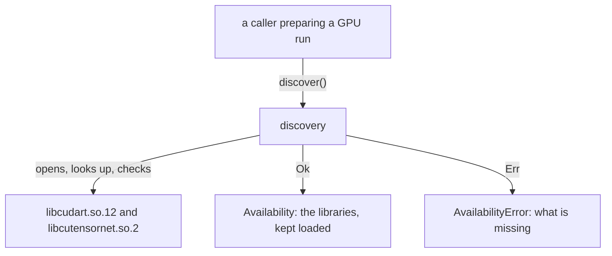
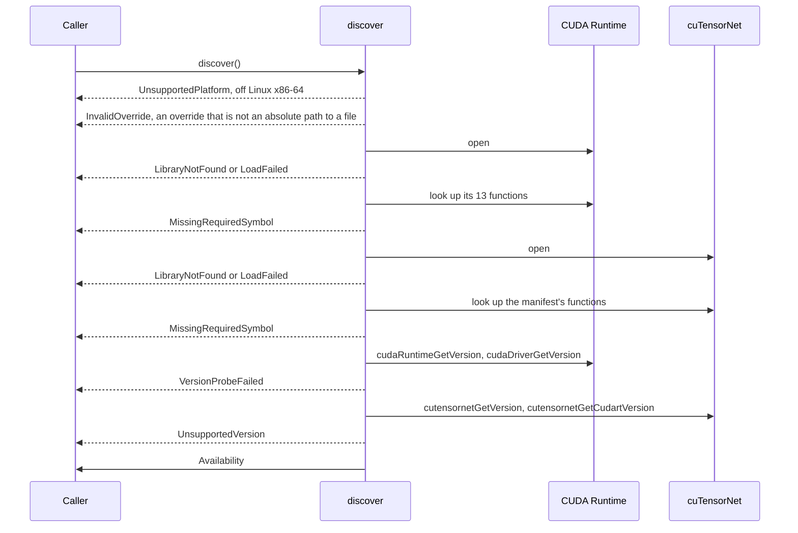
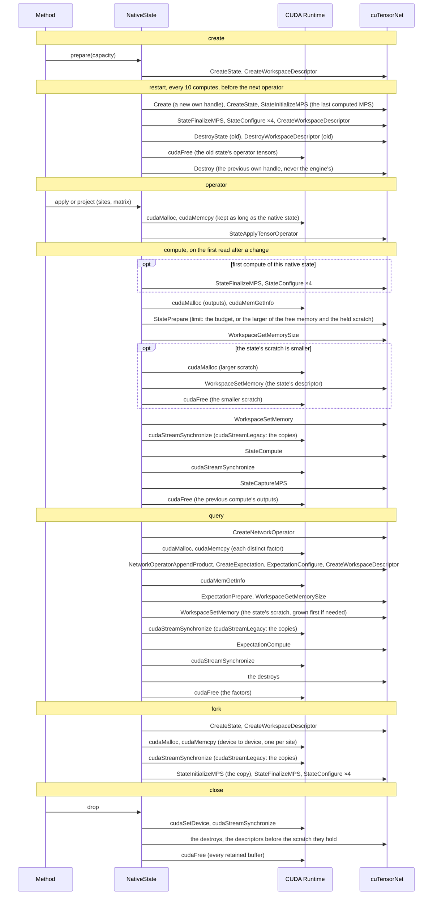

# Loading cuTensorNet at run time

The `qdk_cutensornet` crate lets the QDK's MPS (matrix product state)
simulator run on an NVIDIA GPU, through NVIDIA's cuTensorNet library, without
making NVIDIA software part of the QDK's build.

**The problem.** cuTensorNet is a tensor-network library that runs on the
CUDA Runtime, NVIDIA's library for driving a GPU. Both are shared libraries
(`libcutensornet.so.2`, `libcudart.so.12`) that most QDK users do not have.
Linking them, as Rust code normally links a C library, would make every QDK
build and every process that loads the QDK need them, and fail to start
without them.

**How it is solved.** Nothing is linked. When a GPU run is asked for,
[`discover`](src/lib.rs) finds and opens the two libraries installed on the
host, looks up by name each C function of a table per library (each such
exported name is a _symbol_), and checks the versions the libraries report
against the audited ones. It returns an [`Availability`](src/lib.rs), which
keeps the libraries loaded, or an [`AvailabilityError`](src/error.rs) that
says what is missing, so the caller can tell the user or run on the CPU. [`Availability::mps_engine`](src/lib.rs)
then opens the engine, a `tensornet::MpsEngine` on the loaded libraries
([The MPS engine](#the-mps-engine)).

**Why this approach.**

- **Optional by construction.** Building the QDK, loading it and simulating
  on the CPU need no GPU, no CUDA, no NVIDIA header or library and no linker
  setting. Off Linux x86-64, the crate still builds, and `discover` reports
  the platform as unsupported.
- **Failing early, with the cause.** A missing library, a missing
  dependency of one, a missing function, or a cuTensorNet or CUDA Runtime
  version other than the audited one is found before any GPU work, and
  reported with the path, the function or the version at fault.
- **One audited surface.** The cuTensorNet functions the MPS engine may call
  are listed once, in
  [`scripts/cutensornet-symbols.txt`](scripts/cutensornet-symbols.txt); the
  C declarations come from bindgen's output for NVIDIA's header. Each
  function is one row of its library's table, naming its field, its
  function-pointer type and its symbol once: the type is checked against
  the symbol's declaration when the crate compiles, and the tests check the
  rows against the list.
- **Explicit, no global state.** Nothing happens until `discover` is called;
  the result is a value the caller holds, not a process-wide singleton, so
  tests and threads choose what they share.

**Evidence.** The crate's [unit tests](src/tests) drive each way discovery
fails, on any Unix host and without NVIDIA's libraries: missing and refused
libraries, missing functions, failed version probes, refused versions, and
bad override variables. On a host with the audited libraries,
[`tests/availability.rs`](tests/availability.rs) discovers them.

## The model



- [`discover`](src/lib.rs) does the whole check once. It selects no device,
  allocates nothing and runs no GPU work.
- [`Availability`](src/lib.rs) holds the loaded libraries and the table of
  each library's functions, typed function pointers ready to call; the MPS
  engine calls cuTensorNet through them. It is
  `Send` and `Sync`, and its [`AvailabilityReport`](src/lib.rs) says what
  was loaded, from where.
- [`AvailabilityError`](src/error.rs) has one variant per way discovery
  fails, each with the variable, path, library, function or version at fault.

Copied from [`tests/availability.rs`](tests/availability.rs), which runs on a
host with the libraries installed:

```rust
// Load both libraries, look up their functions and check their versions.
let availability = discover().expect("the audited libraries are installed");

// What was loaded, from where; `availability` keeps it loaded.
let report = availability.report();
assert_eq!(report.cutensornet_version, 21_300);
assert_eq!(report.cutensornet_cuda_runtime_version, 12_090);
assert_eq!(report.cuda_runtime_version, 12_090);
println!("{report:#?}");
```

## The steps of discovery

Each step either succeeds or returns its error; a failed discovery closes
the libraries it opened. Looking a function up stores its address; it does
not call it.



A library is opened with `RTLD_NOW | RTLD_LOCAL`, the flags of the system
loader (`dlopen`). A library whose own dependencies are missing fails to
open in any mode; `RTLD_NOW` also binds, when the library is opened, every
symbol it imports from them, so that one they lack fails discovery rather
than a later call; `RTLD_LOCAL` keeps the library's symbols out of the rest
of the process.

### Where the libraries are looked for

| Library      | Override variable         | Default paths, in order                                                                     |
| ------------ | ------------------------- | ------------------------------------------------------------------------------------------- |
| cuTensorNet  | `QDK_CUTENSORNET_LIBRARY` | `/usr/lib/x86_64-linux-gnu/libcuquantum/12/libcutensornet.so.2`, then `libcutensornet.so.2` |
| CUDA Runtime | `QDK_CUDART_LIBRARY`      | `/usr/local/cuda-12.9/targets/x86_64-linux/lib/libcudart.so.12`, then `libcudart.so.12`     |

An override must be an absolute path to a file, or to a symlink to one.
When set, it is the only path tried, so a wrong setting fails instead of
loading another installation. A default absolute path that does not exist is
skipped; a bare file name is searched for by the system loader on its usual
search path, and skipped when the loader finds no file of that name. A
library that is found but fails to load, for instance because a library it
needs is missing, fails discovery.

### Versions

Discovery accepts exactly the versions the bindings were audited against:
cuTensorNet 2.13.0 (reported as `21300`), the CUDA Runtime 12.9 (`12090`), and
a cuTensorNet built against the CUDA Runtime 12.9. A newer release is not
assumed compatible. The CUDA driver's version is reported for diagnostics
only.

## The bindings

_Bindings_ are the Rust declarations of the C functions, types and constants;
they must match the C library's ABI (application binary interface: the sizes
and layouts of its types, and its calling convention) exactly.

- [`src/bindings/v2_13.rs`](src/bindings/v2_13.rs) declares cuTensorNet 2.13's
  functions of the manifest and the types they use. It is the output of
  bindgen, run on NVIDIA's header by
  [`scripts/generate-bindings.sh`](scripts/generate-bindings.sh) for an
  earlier, wider manifest, then trimmed by a script to the items that the
  current manifest's functions reach, unchanged and in order; it is not
  edited by hand. Regenerating it from the current manifest must reproduce
  it, apart from its header, which says how it was made.
- [`src/bindings/cudart_12.rs`](src/bindings/cudart_12.rs) declares the
  CUDA Runtime 12 functions the crate uses; it is written by hand from the
  CUDA 12.9 header.
- [`src/bindings/mod.rs`](src/bindings/mod.rs) asserts, at compile time, the
  layout of `cuDoubleComplex`, which a cuTensorNet function takes by value.
- [`src/library/symbols.rs`](src/library/symbols.rs) holds both function
  tables, a row `required field: Type = symbol` (or `optional`) per
  function. Each row makes the
  field, its lookup by the symbol's name, and a compile-time check that the
  type is the symbol's declaration in the bindings, so no field can be
  looked up by another function's name. The cuTensorNet rows are the
  manifest's rows, which the tests check.

### Updating the bindings

To bind another cuTensorNet function:

1. Add its row to
   [`scripts/cutensornet-symbols.txt`](scripts/cutensornet-symbols.txt), and,
   if it needs a type that no listed function's declaration reaches, the
   type to the script's `TYPE_PATTERN`.
2. Regenerate the bindings, on Linux x86-64 with bindgen 0.72.1, clang 14 and
   the CUDA 12.9 headers (no GPU needed), from the NVIDIA cuQuantum archive
   below. The script checks the archive's and the header's hashes, and that
   the generated functions are exactly the manifest's:

   ```bash
   source/cutensornet/scripts/generate-bindings.sh \
     /path/to/cuquantum-linux-x86_64-26.06.0.17_cuda12-archive.tar.xz \
     source/cutensornet/src/bindings/v2_13.rs
   ```

3. Add its function-pointer type to its family's file in
   `src/library/symbols/`, and its row to the cuTensorNet table in
   `src/library/symbols.rs`. The crate does not compile until the type is the
   declaration's, and its tests fail until the table's rows are the
   manifest's.

A newer cuTensorNet or CUDA release is a new audit: new bindings from its
header, the assertions of `src/bindings/mod.rs` checked against it, and the
accepted versions changed in [`src/version.rs`](src/version.rs).

### Where the bindings come from

- NVIDIA cuQuantum 26.06.0 for CUDA 12:
  `cuquantum-linux-x86_64-26.06.0.17_cuda12-archive.tar.xz`, SHA-256
  `4c37aa346fab9023d985e79667b047e13a0c0f9b9fea7dfca453979b331c8f77`, listed
  in NVIDIA's `redistrib_26.06.0.json`;
- its `cutensornet.h`, SHA-256
  `f70f31595c3c7b44682a7e4bdcd468504615983a4ec628f519cf18f0036a4687`;
- bindgen 0.72.1 and Ubuntu clang 14.0.0-1ubuntu1.1.

NVIDIA's headers, archives and libraries are not stored in this repository;
their terms are those of the NVIDIA cuQuantum SDK license distributed with
the archive.

## The MPS engine

`CuTensorNetEngine` lets a simulation method that runs matrix product states
(MPS) run them on an NVIDIA GPU. The method is written once against
`tensornet::MpsEngine` (apply matrices on one or two sites; read
probabilities, samples, Pauli expectations, the chain and the retained
weight; project; fork), and this engine implements the trait with
cuTensorNet's State/MPS API, so the same method runs on the GPU, on another
engine, or on `tensornet`'s exact reference in tests, unchanged. The engine
knows no simulator: no circuit, shot or instruction, only states, operators
and reads. It refuses a call that breaks the contract with
`tensornet::checks`, as every engine does, so a caller's fault is reported
the same everywhere.

The problem it solves is that cuTensorNet does not hold an MPS the way a
method reads one. A native state is a network (an initial MPS and the
operators applied to it) that the library factorizes into an MPS only when
asked, from |0…0⟩ with every operator unless told otherwise; it has no state
copy; and its scratch memory is its caller's to allocate. The engine keeps
one native state per MPS, computes it only when a read needs it, captures
each compute as the start of the next, copies a computed MPS for a fork, and
holds one scratch buffer per state.

The evidence is H₂, the benchmark the engine is sized for: a
hydrogen-molecule phase-estimation program of 29 qubits, about 48,000 gates
and 1,404 measurements a shot (a user's program, kept out of the
repository). This engine, before its port to
the current contract, ran H₂ on an A100 (cuTensorNet 2.13.0, CUDA Runtime
12.9, 16 processes under CUDA MPS) at 14.7 shots an hour, with the
settings it fixes ([`src/engine/policy.rs`](src/engine/policy.rs)). The changes since (the fork's
copy, the scratch held per state, the discarded-weight cutoff, the
probability a projection returns, the shared sampler) have run only against the host tests'
double of cuTensorNet, and the A100 must run them again.

H₂ shaped three of the engine's choices:

- **Capture after each compute.** Without it, a method that reads after
  each of a shot's `M` measurements over `G` gates pays `O(M·G)` (H₂: 1,404
  reads over 48,000 gates); with it, `O(G)`.
- **A restart every 10 computes** on a cuTensorNet handle of its own. The
  scratch cuTensorNet recommends grows by about 16 MiB with each compute on
  a long-lived handle: H₂'s first shot on the A100 asked for 42 GB at its
  1,252nd measurement and failed. With the restart it stayed flat at
  193 MiB over 300 steps of H₂'s pattern, for about 1% of the time.
- **GESVD and the simple-update gauge.** GESVDP failed H₂ with
  `CUTENSORNET_STATUS_INTERNAL_ERROR` at its 39th measurement and ran about
  twice as slowly until then; the free gauge ran a shot 47% more slowly.

| File                                                                                      | Responsibility                                                                                    |
| ----------------------------------------------------------------------------------------- | ------------------------------------------------------------------------------------------------- |
| [`src/engine.rs`](src/engine.rs)                                                          | `CuTensorNetEngine`, `CuTensorNetState`, the `MpsEngine` implementation, the `NativeCalls` seam.  |
| [`src/engine/state.rs`](src/engine/state.rs)                                              | `NativeState`: one native state, compute on demand, reads, projections, forks, restarts, scratch. |
| [`src/engine/policy.rs`](src/engine/policy.rs)                                            | The fixed settings: device, cutoff, SVD algorithm and gauge, workspace limit, restart period.     |
| [`src/engine/state_calls.rs`](src/engine/state_calls.rs)                                  | `StateCalls` (State/MPS calls), `NativeCapacity` (the extents asked for), realized-chain checks.  |
| [`src/engine/session.rs`](src/engine/session.rs)                                          | `SessionCalls` and `DeviceSession`: the device's stream and cuTensorNet handle.                   |
| [`src/engine/memory_calls.rs`](src/engine/memory_calls.rs), [`ffi.rs`](src/engine/ffi.rs) | Device memory and workspace calls; the C-compatible complex element.                              |
| [`src/engine/error.rs`](src/engine/error.rs)                                              | `EngineError`: a `tensornet::Refusal`, or the engine's own failure.                               |
| [`src/engine/double.rs`](src/engine/double.rs)                                            | Host tests only: a CPU double of the native API that enforces its call order.                     |
| [`src/tests/engine.rs`](src/tests/engine.rs)                                              | Host tests of the engine's behaviour on the double.                                               |

cuTensorNet's MPS finalization needs at least two sites
([`cutensornetStateFinalizeMPS`](https://docs.nvidia.com/cuda/cuquantum/latest/cutensornet/api/functions.html#cutensornetstatefinalizemps):
"As of cuTensorNet v2.7.0, this API does not support MPS simulation when the
number of state modes is equal to 1"), while a lone qubit is a valid
`MpsShape`. The engine therefore pads a one-qubit capacity with an idle second
site, which the contract's checks refuse as out of range, so it stays |0⟩ and
changes no probability, expectation or norm, and `shape` reports the lone
site alone.

### Native call order

Every method first calls `cudaSetDevice` with the engine's device. Each method then runs one or more of
the phases below:

| `MpsEngine` method                  | Phases                                                                                                   |
| ----------------------------------- | -------------------------------------------------------------------------------------------------------- |
| `prepare`                           | create                                                                                                   |
| `apply`                             | restart, every 10 computes; operator                                                                     |
| `project`                           | query, unless P(One) of the site was just read; restart, every 10 computes; operator (a diagonal × 1/√p) |
| `probability_of_one`, `expectation` | compute, if the state changed; query                                                                     |
| `conditional_probability_of_one`    | compute, if the state changed; two queries (the condition, and the condition with the site's One)        |
| `sample`                            | a conditional probability per distinct prefix of values drawn (`tensornet::sampling`)                    |
| `fork`                              | compute, if the state changed; create; copy the computed MPS; start the new state from the copy          |
| `shape`                             | compute, if the state changed; the extents `cutensornetStateCompute` reported                            |
| `retained_weight`                   | compute, if the state changed; query, of the identity, whose squared norm is returned                    |
| `Drop`                              | close                                                                                                    |



The calls are cuTensorNet's `cutensornet…` and the CUDA Runtime's
`cuda…` functions; NVIDIA documents each on its
[functions page](https://docs.nvidia.com/cuda/cuquantum/latest/cutensornet/api/functions.html#tensor-network-state-api),
for example
[`cutensornetStateCompute`](https://docs.nvidia.com/cuda/cuquantum/latest/cutensornet/api/functions.html#cutensornetstatecompute),
and [`cutensornetStateCaptureMPS`](https://docs.nvidia.com/cuda/cuquantum/latest/cutensornet/api/functions.html#cutensornetstatecapturemps).
`ExpectationCompute` writes to host memory, and NVIDIA documents that it
synchronizes the stream only "in the current release", a
"restriction [that] may be released in the future"; the exact version
policy admits only 2.13.0, so admitting another version means checking that
again (see [Versions](#versions)).

The engine's work runs on a non-blocking stream of its own, which does not
wait for CUDA's legacy default stream, where `cudaMemcpy` runs; and a copy
from pageable host memory returns once its source is staged, a copy between
device buffers may return at once, before either reaches the device. So the
engine synchronizes the legacy stream before each compute and each
expectation, which read what the copies wrote, and once after a fork's
copies, so that its parent may free the tensors they read.

### Numerics

Every read divides by the squared norm `ExpectationCompute` returns beside its
value. With $P^{(b)}_q$ the projector of site $q$ on value $b$:

$$\langle O\rangle = \frac{\langle\psi\rvert O \lvert\psi\rangle}{\langle\psi\vert\psi\rangle}, \qquad p_q(1) = \frac{\langle\psi\rvert P^{(1)}_q \lvert\psi\rangle}{\langle\psi\vert\psi\rangle}.$$

A conditional probability, with $\Pi = \prod_{(k, b) \in \text{given}} P^{(b)}_k$,
is two expectations on the state, with no copy of it:

$$p_q(1 \mid \text{given}) = \frac{\langle \Pi\, P^{(1)}_q \rangle}{\langle \Pi \rangle},$$

refused when $\langle \Pi \rangle$ is zero or less, as rounding may leave it,
or NaN. A projection on value $b$ keeps the norm,
$\lvert\psi\rangle \mapsto P^{(b)}_q \lvert\psi\rangle / \sqrt{p_q(b)}$, and
returns $p_q(b)$: the P(One) just read for the site, when no operator was
applied since, or one more expectation; it is refused, the state unchanged,
when $p_q(b)$ is zero or less, or NaN.

The engine pins `SvdNormalizationNone`, so a truncation discards weight and
never rescales what it keeps: the retained weight is
$w = \langle\psi\vert\psi\rangle \le 1$, the product of what each truncation
kept. A split keeps at most the capacity's bond, and drops the smallest
singular values whose squares sum to at most $10^{-14}$ of the cut's
(`CUTENSORNET_STATE_CONFIG_MPS_SVD_DISCARDED_WEIGHT_CUTOFF`): the same rule
and value as the CPU engine's. The
cutoff is relative to the cut's own weight, so it cuts no deeper as $w$
falls. The bond asked for at cut $c$, between sites $c$ and $c+1$ of $n$, is
the capacity's bond there, $\chi^{\text{capacity}}_c$, lowered to what the cut
can carry (`NativeCapacity::new`):

$$\chi_c = \min\left(\chi^{\text{capacity}}_c,\ 2^{c+1},\ 2^{\,n-c-1}\right).$$

`sample` draws through `tensornet::sampling::sample_by_conditionals`, the
sampler every engine shares, from this engine's conditional probabilities:
a shot's value of a site is One when the next uniform of the seed's stream
is below P(One) given the shot's earlier values, each distinct prefix of
values costing two expectations. cuTensorNet's own sampler, which the
engine used before (one native call for every shot), is not used: no case
of the engine samples yet.

### Memory

Operator tensors stay allocated as long as the native state they were
applied to, as `cutensornetStateApplyTensorOperator` requires, and a restart
frees them. A compute's outputs are freed once the next compute has been
captured, since the captured MPS is read from them until then; a read's
buffers when it returns. Each state holds one scratch buffer, attached to
every workspace descriptor it uses, and grows it when a call needs more,
attaching the larger buffer before freeing the smaller, so no descriptor ever
holds freed memory. At rest a state holds one buffer, its largest call's;
while it grows, the old and the new, so a growth must fit in the free memory
alone, and a call may take the larger of the free memory and the held
scratch. A fork's
tensors are its own copies, so its parent may change, restart or be dropped.
A native failure while a state is changed or computed leaves it unusable
(`EngineError::Poisoned`); a failed read frees its buffers and native objects
and leaves the state usable.

### Releasing a state

Dropping a `CuTensorNetState` releases its device memory and native objects
(the close in the diagram above), which is all `tensornet`'s contract asks
of a state: "Dropping it releases it". A failed release is not reported: a
drop has no caller to report to, and there is no `close` that returns the
failure, since no case has needed one. Debug builds write it to stderr,
naming what failed to release. In practice a failed `cudaFree` means a
broken device, so the engine's next call fails too, and that call's error
is reported (a simulation method fails the shot that made it). Leaks are
checked on the A100 with `compute-sanitizer --leak-check full`.

Planned: when the engine runs as an executor of the executor protocol, the
protocol's end of shots (`end_shots`) and end of run (`finish`, planned for
the device and GPU cases) are where states are released and a failed
release is reported.

### Tests

The engine's tests ([`src/tests/engine.rs`](src/tests/engine.rs)) run on
every host, against a CPU double of the native API
([`src/engine/double.rs`](src/engine/double.rs)) that computes each
state as a state vector truncated to the bonds and the discarded-weight
cutoff, and fails a test when the engine calls cuTensorNet out of order: a
compute not prepared since the last operator, a read of a state not computed
since, a computed MPS read after its buffers were freed, a compute or an
expectation without the scratch it asked for or before the copies are done,
a capture or a free before the stream is done, scratch freed while a
descriptor holds it, an
object used with a handle other than its own, a handle destroyed while an
object of it lives. They check the engine's answers, refusals, projections,
forks, restarts, scratch and cleanup. None of it has run on a GPU: that
needs an A100 and the real libraries.
