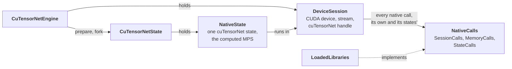
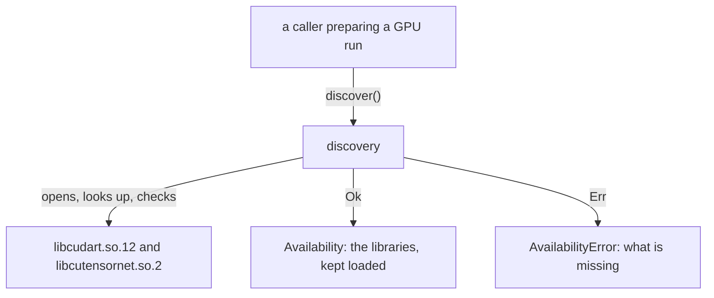

# cuTensorNet for the QDK: the MPS engine, the discovery and loading of its libraries, and the setup check

The `qdk_cutensornet` crate lets a QDK simulator that runs matrix product
states (MPS) run them on an NVIDIA GPU, unchanged, through NVIDIA's
cuTensorNet library. It has three parts:

- **[The MPS engine](#the-mps-engine):**
  [`CuTensorNetEngine`](src/engine.rs) implements `tensornet::MpsEngine` on
  cuTensorNet.
- **[The discovery and loading of the libraries](#the-discovery-and-loading-of-the-libraries):**
  cuTensorNet and the CUDA Runtime are opened at run time, never linked, so
  the QDK builds, loads and simulates on the CPU without NVIDIA software;
  what is missing is reported, so the caller can tell the user or run on
  the CPU.
- **[The setup check](#the-setup-check):** for a user setting the GPU up,
  [`diagnose`](src/diagnosis.rs) runs the same discovery, reads the devices,
  runs one gate, and says what to fix.

**Evidence.** The [engine's tests](src/tests/engine.rs) run in CI on
[fake libraries](src/engine/native_calls/fake_libraries.rs) that enforce
cuTensorNet's call order on the CPU; on an A100, the engine passes
`tensornet`'s conformance kit, so an MPS simulation method reads the same
answers as on the CPU. The [unit tests](src/tests) drive each way discovery
fails without NVIDIA's libraries, and
[`tests/availability.rs`](tests/availability.rs) discovers the audited
libraries where they are installed and, on a host with a CUDA device,
[the setup check](#the-setup-check) finds no problem.

## The MPS engine

[`CuTensorNetEngine`](src/engine.rs) implements `tensornet`'s
[`MpsEngine`](../tensornet/src/engine.rs) on cuTensorNet's State/MPS API.
What the trait requires is in [`tensornet`'s README](../tensornet/README.md)
and the trait's rustdoc; this section says how this engine meets it, and
why; [`docs/engine.md`](docs/engine.md) gives the native calls of each
phase and the numerics, and each file's header the details.

Two kinds of method meet here: an _MPS simulation method_ is the algorithm
that runs a program's gates, measurements and shots on an MPS, and it calls
the _`MpsEngine` methods_ (`apply`, `project`, `probability_of_one`, …).


### The engine's parts

The engine's work is split by lifetime: what lives as long as the engine,
what lives as long as one state, and the native calls both make.



- [`CuTensorNetEngine`](src/engine.rs), the `MpsEngine` of one CUDA device,
  checks each call against the contract (`tensornet::checks`), then selects
  the device and hands the call to the state's native state.
- [`CuTensorNetState`](src/engine.rs) is one MPS, as the trait sees it. The
  trait reads a state through a shared reference, but a read may compute it,
  so the state holds its native state in a `RefCell`, borrowed for one call.
- [`DeviceSession`](src/engine/device_session.rs): the stream is the queue
  the device runs the engine's work in, in order, and the handle is
  cuTensorNet's context, on which each native object is created. The engine
  and its native states share it, so it closes after the last of them.
- [`NativeState`](src/engine/native_state.rs) computes its cuTensorNet
  state into an MPS only when a read needs it ([Phases](#phases)).
- [`NativeCalls`](src/engine/native_calls.rs) is every call the engine makes
  to the CUDA Runtime and cuTensorNet, by kind: the session's, device
  memory's and the states'. The engine calls nothing else, so it also runs
  in the [host tests](src/tests/engine.rs), which have no GPU. On a GPU, the
  [`LoadedLibraries`](src/libraries.rs) that discovery loaded answer them:
  `CuTensorNetEngine::new` takes them from an `Availability`.

The settings the engine fixes, with how each was chosen, are in
[`src/engine/policy.rs`](src/engine/policy.rs);
[`src/engine.rs`](src/engine.rs) maps its files.

### Phases

cuTensorNet holds each state as a network, a start MPS plus the operators
applied to it, and turns it into an MPS only on request. So the engine's work
on a state falls into seven phases, which each `MpsEngine` method combines
([the table below](#how-each-mpsengine-method-is-implemented)):

- **create**: a native state for a capacity, with its workspace descriptor.
- **restart**: every few computes ([`policy.rs`](src/engine/policy.rs)),
  before the next operator, a new native state on a handle of its own starts
  from the last computed MPS, and the old one is released.
- **operator**: the matrix, copied to the device, is added to the network;
  cuTensorNet applies it at the next compute.
- **compute**: on the first read after an operator, cuTensorNet turns the
  network into an MPS, with scratch from the state's one buffer, grown when
  a call asks for more; the engine captures the result as the new start, so
  the next compute applies only the operators applied since.
- **query**: one native expectation of a sum of products of one-site
  factors, its objects released before it returns.
- **fork**: a new native state, started from a device copy of the computed
  MPS.
- **close**: the state's native objects and device memory are released, each
  descriptor before the scratch it holds.

### How each `MpsEngine` method is implemented

This engine's implementation of each `MpsEngine` method first checks the call
against the contract (`tensornet::checks`), so a refused call makes no native
call; then it selects the engine's device (`cudaSetDevice`), since CUDA's
current device is per thread, and runs the phases its row names.

| `MpsEngine` method               | Phases                                                                                 | How                                                                                                                                                                                                        | Why                                                                                                                                                                                              |
| -------------------------------- | -------------------------------------------------------------------------------------- | ---------------------------------------------------------------------------------------------------------------------------------------------------------------------------------------------------------- | ------------------------------------------------------------------------------------------------------------------------------------------------------------------------------------------------ |
| `prepare`                        | create                                                                                 | each bond of the capacity lowered to what its cut can carry ([Numerics](docs/engine.md#numerics)), a lone qubit padded with an idle second site                                                            | cuTensorNet's MPS needs at least two sites                                                                                                                                                       |
| `apply`                          | restart, when due; operator                                                            | its phases alone                                                                                                                                                                                           | the scratch a long-lived handle asks for grows with each compute, past the A100's memory within a long shot; a restart keeps it flat (the cause is unknown; [`policy.rs`](src/engine/policy.rs)) |
| `project`                        | compute and query, unless the site's P(One) was just read; restart, when due; operator | the operator is the projector times $1/\sqrt{p}$, with $p$ the probability of the value projected on; returns $p$, and is refused, the state unchanged, when $p$ is zero or less, as rounding may leave it | the projection keeps the norm; reusing the read makes a measurement cost one query, not two                                                                                                      |
| `probability_of_one`             | compute; query                                                                         | the One projector's expectation, over the squared norm the same query reports, clamped to [0, 1]; remembered for a `project` of the site                                                                   | with the capture, a shot's reads after each of its $M$ measurements over $G$ gates cost $O(G)$, not $O(M G)$                                                                                     |
| `expectation`                    | compute; query                                                                         | all the Pauli terms in one query, over the squared norm it reports                                                                                                                                         | one query however many terms, not one per term; with the capture, $O(G)$ per read                                                                                                                |
| `conditional_probability_of_one` | compute; two queries, one with no condition                                            | the condition, and the condition with the site's One; refused when the condition's is zero or less                                                                                                         | no copy of the state ([Numerics](docs/engine.md#numerics))                                                                                                                                       |
| `sample`                         | compute; two queries per distinct prefix of values drawn, one for the first site       | `tensornet::sampling`'s shared sampler, over this engine's conditional probabilities                                                                                                                       | every engine draws alike; cuTensorNet's own sampler (one native call per shot) waits for a case that samples                                                                                     |
| `fork`                           | compute; fork                                                                          | the computed MPS's tensors copied device to device, with no host round trip, as the new state's start                                                                                                      | replaying the operators would truncate along another path, and read another state                                                                                                                |
| `shape`                          | compute                                                                                | the extents the compute reported                                                                                                                                                                           | a truncation may keep less than the capacity, so the bonds are known only after a compute                                                                                                        |
| `retained_weight`                | compute; query                                                                         | a query of the identity on the first site; its squared norm is returned                                                                                                                                    | the engine never renormalizes, so the norm is what the truncations kept ([Numerics](docs/engine.md#numerics))                                                                                    |
| `Drop` of a state                | close                                                                                  | a failed release is not reported; leaks can be checked with `compute-sanitizer`                                                                                                                            | `Drop` cannot return an error; a broken device makes the engine's next call fail and report it ([`src/engine.rs`](src/engine.rs))                                                                |

## The discovery and loading of the libraries

[`src/discovery.rs`](src/discovery.rs), the crate's entry point, finds, opens
and checks the libraries a GPU run needs; each library's module in
[`src/libraries/`](src/libraries) says what the crate needs of it.

**The problem.** cuTensorNet runs on the CUDA Runtime, NVIDIA's library for
driving a GPU. Both are shared libraries (`libcutensornet.so.2`,
`libcudart.so.12`) that most QDK users do not have; linking them would make
every QDK build, and every process that loads the QDK, fail without them.

**How it is solved.** Nothing is linked. When a GPU run is asked for,
[`discover`](src/discovery.rs) opens the two libraries, looks up by name
each C function the crate uses (its _symbol_), and checks the versions the
libraries report. It returns an [`Availability`](src/discovery.rs), which
keeps them loaded and which [`CuTensorNetEngine::new`](src/engine.rs)
takes, or an [`AvailabilityError`](src/discovery/error.rs) that says what is
missing.

**Why this approach.**

- **Optional by construction.** The QDK builds, loads and simulates on the
  CPU with no GPU, no NVIDIA header or library and no linker setting. Off
  Linux x86-64 the crate still builds, and `discover` reports the platform
  as unsupported.
- **Failing early, with every cause.** A missing library, dependency or
  function, or a version other than the audited one, is found before any
  GPU work and reported with the path, function or version at fault, for
  every library at once, so an installation is fixed in one pass.
- **One audited surface.** The functions the engine may call are the rows
  of one table per library, each checked against NVIDIA's header when the
  crate compiles ([The bindings](docs/loading.md#the-bindings)).
- **Open to more libraries.** Each library is one module; adding one adds a
  field to [`PackagedLibraries`](src/libraries.rs), for its path in a Python
  package, and changes no other public type, as the report is a list with an
  entry per library.
- **Explicit, no global state.** Nothing happens until `discover` is called,
  and its result is a value the caller holds, so tests and threads choose
  what they share.

### The model



- [`discover`](src/discovery.rs) selects no device, allocates nothing and
  runs no GPU work.
- [`discover_with`](src/discovery.rs) is `discover` also given the
  [`PackagedLibraries`](src/libraries.rs): the paths where Python packages
  (NVIDIA's wheels) installed the libraries, which only the QDK's Python
  package can find. `discover` gives none.
- [`Availability`](src/discovery.rs) holds each library's functions as typed
  function pointers, which the engine calls. It is `Send` and `Sync`, so one
  discovery serves every thread; an engine and its states stay on the
  thread that created them.
- Its [`AvailabilityReport`](src/discovery/report.rs) has a
  [`LibraryReport`](src/libraries/report.rs) per library, in the order they
  are opened: its name, the path it was opened from, the
  [`Version`](src/libraries/report.rs)s it reports, its faults, the other
  copies of it visible beside the one loaded, and whether its override was
  loaded.
- [`AvailabilityError`](src/discovery/error.rs) is `UnsupportedPlatform` off
  Linux x86-64, or else `Unusable` with the report, whose
  [`LibraryFault`](src/libraries/report.rs)s name the variable, path,
  function or version at fault.

Copied from [`tests/availability.rs`](tests/availability.rs), which runs on a
host with the libraries installed:

```rust
// Load both libraries, look up their functions and check their versions.
let availability = discover().expect("the audited libraries are installed");

// What was loaded, from where; `availability` keeps it loaded.
let report = availability.report();
let cutensornet = report.library("cuTensorNet").expect("cuTensorNet is used");
assert_eq!(cutensornet.version("cuTensorNet"), Some(21_300));
assert_eq!(cutensornet.version("cuTensorNet's CUDA Runtime"), Some(12_090));
let cuda_runtime = report.library("CUDA Runtime").expect("the CUDA Runtime is used");
assert_eq!(cuda_runtime.version("CUDA Runtime"), Some(12_090));
println!("{report:#?}");
```

[`docs/loading.md`](docs/loading.md) shows how discovery turns each library
into an `Availability`, the steps it takes and the faults each one finds,
and how the bindings are made and checked.

### Where the libraries are looked for

| Library      | Override variable         | Packaged path                     | Default paths, in order                                                                     |
| ------------ | ------------------------- | --------------------------------- | ------------------------------------------------------------------------------------------- |
| cuTensorNet  | `QDK_CUTENSORNET_LIBRARY` | `PackagedLibraries::cutensornet`  | `/usr/lib/x86_64-linux-gnu/libcuquantum/12/libcutensornet.so.2`, then `libcutensornet.so.2` |
| CUDA Runtime | `QDK_CUDART_LIBRARY`      | `PackagedLibraries::cuda_runtime` | `/usr/local/cuda-12.9/targets/x86_64-linux/lib/libcudart.so.12`, then `libcudart.so.12`     |

An override must be an absolute path to a file, or to a symlink to one, and
is then the only path tried, so a wrong setting fails instead of loading
another installation. Without one, the packaged path, when `discover_with`
is given one, is tried before the default paths. A packaged or default path
is skipped when there is no file there; a bare file name is searched for on
the system loader's usual path. A library that is found but fails to load,
for instance for a missing dependency, fails discovery.

### Versions

Discovery accepts exactly the versions the bindings were audited against:
cuTensorNet 2.13.0 (reported as `21300`), the CUDA Runtime 12.9 (`12090`), and
a cuTensorNet built against the CUDA Runtime 12.9. A newer release is not
assumed compatible. The CUDA driver's version is reported for diagnostics
only. A [`LibraryReport`](src/libraries/report.rs) names each version by its
component: `CUDA Runtime` and `CUDA driver` in the CUDA Runtime's,
`cuTensorNet` and `cuTensorNet's CUDA Runtime` in cuTensorNet's.

## The setup check

[`diagnose`](src/diagnosis.rs) is what a user runs while setting the GPU up,
often without knowing CUDA. It never fails: its
[`Diagnosis`](src/diagnosis.rs) lists what each step below found, warns of
other copies of a library, and says what to fix for the first problem met,
looked for in the order of the steps. A caller shows it on request, and its
text with the error of a GPU run that cannot start.

The check reports the GPUs in CUDA's terms, which a user who does not know
CUDA meets first here:

- **CUDA device**: a GPU, as CUDA numbers the ones a process sees, from 0.
  The engine runs on device 0; on a host with several GPUs,
  `CUDA_VISIBLE_DEVICES` sets which one that is.
- **compute capability**: NVIDIA's version of a GPU's architecture,
  major.minor, such as 8.0 for an A100; it says which GPUs a library
  supports.

| Step                                                                                       | How                                                                                                                                                                                                                 | Why                                                                                                                                                                             |
| ------------------------------------------------------------------------------------------ | ------------------------------------------------------------------------------------------------------------------------------------------------------------------------------------------------------------------- | ------------------------------------------------------------------------------------------------------------------------------------------------------------------------------- |
| **The libraries** ([`discovery.rs`](src/discovery.rs), [`libraries.rs`](src/libraries.rs)) | `discover_with`, given the caller's `PackagedLibraries`; each library's report also lists the other copies of it at its override, packaged path and default paths                                                   | the check loads what a GPU run would load; another copy leaves the setup ready but is warned of, as it may be of another version, or hold a dependency the loaded copy picks up |
| **The host** ([`libraries/cuda_runtime.rs`](src/libraries/cuda_runtime.rs))                | each library reads its own report for a problem of the host: today the CUDA Runtime's, a driver that supports no CUDA 12                                                                                            | what a library needs of the host is the library's to say, so a library bound later brings its own check                                                                         |
| **The devices** ([`devices.rs`](src/devices.rs))                                           | each device's compute capability and memory, read through the loaded CUDA Runtime; a problem when they cannot be read, when there is none, or when device 0 is below [`MINIMUM_COMPUTE_CAPABILITY`](src/devices.rs) | NVIDIA supports cuTensorNet from that capability on, and the engine runs on device 0; a device's free memory bounds the max bond dimension a run can reach                      |
| **The engine** ([`diagnosis.rs`](src/diagnosis.rs))                                        | an MPS engine on device 0 prepares a state of one qubit, applies a Hadamard and reads its P(One)                                                                                                                    | the smallest run that touches the device, so a device the engine cannot use is found here, not in the user's first run                                                          |

The setup check's rules are pinned, with no GPU, in
[`src/tests/diagnosis.rs`](src/tests/diagnosis.rs),
[`src/tests/devices.rs`](src/tests/devices.rs) and
[`src/tests/libraries.rs`](src/tests/libraries.rs).

## Platforms

What the crate requires is checked when it runs; where it has run is listed
apart. Anything else is expected to work, but not verified.

| Requirement   | Checked by                                                                                                                                                                                 | Verified on                                                                                      |
| ------------- | ------------------------------------------------------------------------------------------------------------------------------------------------------------------------------------------ | ------------------------------------------------------------------------------------------------ |
| Linux x86-64  | `discover`: `UnsupportedPlatform` elsewhere                                                                                                                                                | Ubuntu 22.04 on an NVIDIA A100 host                                                              |
| The libraries | `discover`: the exact versions of [Versions](#versions)                                                                                                                                    | from NVIDIA's apt packages, at the default paths, and from its pip wheels, through the overrides |
| A CUDA driver | [the setup check](#the-setup-check): one for CUDA 12; `discover` only reports its version                                                                                                  | NVIDIA's driver 580.178.04, from Ubuntu's packages                                               |
| An NVIDIA GPU | `CuTensorNetEngine::new`: `EngineError::NoDevice` without one; [the setup check](#the-setup-check): device 0 of compute capability [`MINIMUM_COMPUTE_CAPABILITY`](src/devices.rs) or later | an A100 80GB (compute capability 8.0), where the engine passes `tensornet`'s conformance kit     |

- **Expected, not verified:** other x86-64 Linux distributions, with the
  libraries from NVIDIA's pip wheels or at a path an override gives (the
  default paths are those of NVIDIA's apt packages).
- **Not supported:** other architectures (ARM included), other systems,
  and other releases of the libraries, CUDA 13 among them: each needs its
  bindings generated and audited.

The bindings generator has requirements of its own (Ubuntu 22.04's
libclang), which
[`scripts/generate_bindings.py`](scripts/generate_bindings.py) states.
