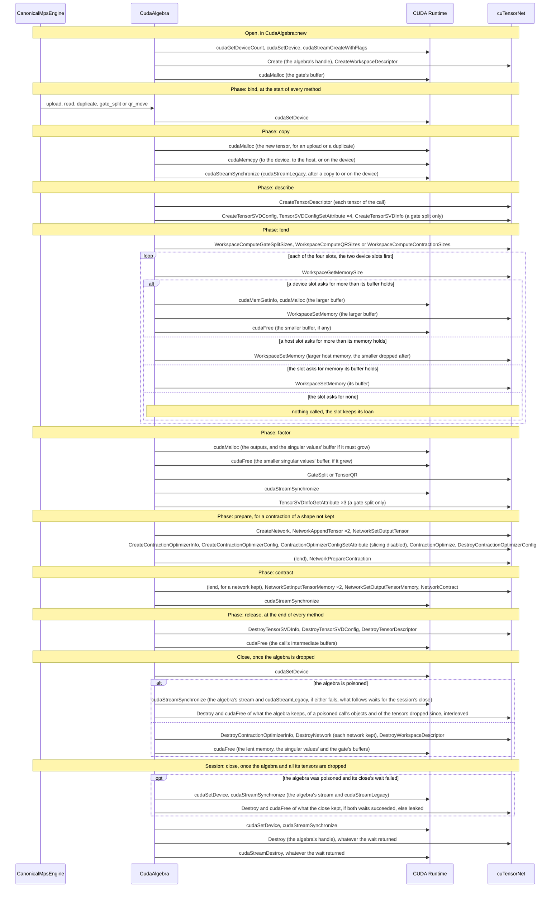

# The CUDA algebra: phases, native calls and numerics

The details behind the README's
[MPS engine](../README.md#the-mps-engine): the algebra's terms; the
phases each `SiteAlgebra` method of the CUDA algebra runs, how and why;
when each guarantee holds; the native calls of each phase, in order; what
follows a failure; and the numerics of its gate split and move of the
centre.

## The algebra's terms

The algebra keeps these to bridge the engine's synchronous calls and
cuTensorNet's asynchronous ones:

- **CUDA device:** one GPU, as CUDA numbers them. The algebra runs on
  device 0 ([`settings.rs`](../src/engine/cuda_algebra/settings.rs)).
- **CUDA stream:** a queue of work for a device. A call queued on it
  returns at once, and the device runs the queue in order. The host waits
  for the queue (synchronizes it) only when it needs a result. This is
  what makes cuTensorNet's calls asynchronous.
- **Device session:** the algebra's device, stream and cuTensorNet handle
  ([`DeviceSession`](../src/engine/cuda_algebra/device_session.rs)). The
  algebra queues its work on the session's stream. The handle is the
  library's context, on which each native object is created. The algebra
  shares the session with its tensors, so it closes after the last of
  them.
- **Device tensor:** one site, a device buffer of complex doubles in the
  contract's layout
  ([`DeviceTensor`](../src/engine/cuda_algebra/device_tensor.rs)). It keeps
  the session alive, so it may outlive the algebra. Only the algebra that
  made it accepts it.
- **Workspace:** the memory cuTensorNet asks its caller to lend a call, in
  four slots: device or host, scratch or cache. The algebra keeps one
  workspace descriptor and one buffer per slot, its
  [scratch](../src/engine/cuda_algebra/scratch.rs), grown to the largest
  call's and never shrunk.
- **Prepared contraction network:** cuTensorNet's object for contracting
  two tensors, its path found by cuTensorNet and prepared once, then
  reused with new buffers. The algebra keeps one per shape, meaning the
  inputs' extents and the tensors' labels
  ([`contraction.rs`](../src/engine/cuda_algebra/contraction.rs)). Once it
  holds the bound in [`settings.rs`](../src/engine/cuda_algebra/settings.rs),
  it releases them all and starts over.
- **Call scope:** what one method creates (descriptors, SVD settings,
  intermediate buffers, its outputs), released in one place when it
  returns ([`call_scope.rs`](../src/engine/cuda_algebra/call_scope.rs)).
- **Poison:** a failed method that cannot wait for the device cannot tell
  when the device is done with its buffers. The algebra is then poisoned:
  every later method returns `CudaAlgebraError::Poisoned`
  ([`algebra_session.rs`](../src/engine/cuda_algebra/algebra_session.rs)).

The settings the algebra fixes, and how each was chosen, are in
[`settings.rs`](../src/engine/cuda_algebra/settings.rs).
[`cuda_algebra.rs`](../src/engine/cuda_algebra.rs) maps its files.

## The phases

Each `SiteAlgebra` method of the algebra runs some of these phases,
bind first ([the table below](#how-each-sitealgebra-method-is-implemented)).
[Native calls of each phase](#native-calls-of-each-phase) lists each
phase's native calls, in order.

- **bind**: the algebra's device selected, as CUDA's current device is
  per thread.
- **copy**: values copied to the device, to the host or on the device,
  then waited for. The copies run on CUDA's legacy default stream, which
  the algebra's stream does not wait for.
- **describe**: a descriptor per tensor of the call (its extents and mode
  labels). A gate split also gets its SVD's settings and a record of its
  truncation.
- **lend**: cuTensorNet sizes the call's workspace. The algebra lends
  each slot the call asks memory for from its scratch, grown if needed. A
  device buffer never grows beyond the device's free memory. A host
  growth the allocator refuses fails the call
  (`CudaAlgebraError::HostAllocationFailed`).
- **factor**: one `GateSplit` or one `TensorQR`, waited for.
- **prepare**: for a contraction of a shape not kept yet, a network made,
  its path found, its workspace sized and lent (as in **lend**), and the
  network prepared, then kept for that shape.
- **contract**: a kept network's workspace sized and lent (as in
  **lend**), then one pairwise contraction on it, waited for.
- **release**: the call scope's descriptors, settings and intermediate
  buffers released.

## How each `SiteAlgebra` method is implemented

The algebra's implementation of each `SiteAlgebra` method runs the phases
its row names. Of its arguments, it checks only the tensors it reads
([`device_tensor.rs`](../src/engine/cuda_algebra/device_tensor.rs)).

| `SiteAlgebra` method | Phases                                                                                                 | How                                                                                                                                                                                                | Why                                                                                                                                                                                              |
| -------------------- | ------------------------------------------------------------------------------------------------------ | -------------------------------------------------------------------------------------------------------------------------------------------------------------------------------------------------- | ------------------------------------------------------------------------------------------------------------------------------------------------------------------------------------------------ |
| `upload`             | bind; copy                                                                                             | a new device buffer, the host values copied into it                                                                                                                                                | the sites live on the device, where they are factored                                                                                                                                            |
| `read`               | bind; copy                                                                                             | the first `len` elements copied to a host vector; refused when the tensor holds fewer                                                                                                              | the engine contracts on the host the sites a read needs; the check keeps the device from reading memory the tensor does not own                                                                  |
| `duplicate`          | bind; copy                                                                                             | a new device buffer, the first `len` elements copied into it on the device; refused as `read` is                                                                                                   | a fork's sites change apart from its parent's, with no round trip through the host                                                                                                               |
| `gate_split`         | bind; describe; copy (the gate); lend; factor; release                                                 | one `GateSplit`, its report checked ([`gate_split.rs`](../src/engine/cuda_algebra/gate_split.rs), [Numerics](#numerics))                                                                           | one native call contracts the gate and splits the pair; a reported bond or discarded weight outside the contract's bounds is `CudaAlgebraError::InvalidNativeResult`, never passed to the engine |
| `qr_move`            | bind; copy, prepare and contract (a one-site gate); describe; lend; factor; prepare; contract; release | the gate, if any, contracted into the site the centre leaves; one `TensorQR` of that site; its small factor contracted into the other site ([`qr_move.rs`](../src/engine/cuda_algebra/qr_move.rs)) | a QR moves the centre exactly; a network costs a path search and a preparation, so each shape's is made once, as a run's moves repeat their shapes                                               |

Dropping a tensor or the algebra releases what it holds, outside the
`SiteAlgebra` methods. A `Drop` cannot return an error;
[At a drop](#when-each-guarantee-holds) says what a failed release does.

- **a tensor:** bind, then `cudaFree`
  ([`device_tensor.rs`](../src/engine/cuda_algebra/device_tensor.rs)). A
  poisoned algebra keeps the buffer instead
  ([below](#when-a-method-or-a-release-fails)). If the bind fails, the
  buffer is leaked, since only its device can free it.
- **the algebra:** bind, then the networks, the workspace descriptor, the
  lent memory and the gate's and singular values' buffers released
  ([`cuda_algebra.rs`](../src/engine/cuda_algebra.rs)).

## When each guarantee holds

A caller can rely on each from the step named, whatever the method.

- **At the opening** (`CudaAlgebra::new`, `CudaMpsEngine::try_from`):
  - a host without device 0 gets `CudaAlgebraError::NoDevice`, before any
    device is selected;
  - a failed opening releases what it made.
- **At each method:**
  - a poisoned algebra returns `CudaAlgebraError::Poisoned`, before any
    other check;
  - another engine's tensor is refused before the device is selected;
  - a tensor shorter than the call reads, an upload or a duplicate of no
    element, and extents whose product overflows are refused before any
    native object is made;
  - the inputs are left unchanged, as
    [the contract](../../canonical_mps/README.md#the-operations) asks
    ([`call_scope.rs`](../src/engine/cuda_algebra/call_scope.rs)), and the
    method returns with the device idle, so the engine may use a tensor
    at once.
- **When a method fails** (the consequences are
  [below](#when-a-method-or-a-release-fails)):
  - its outputs are freed once the device is idle;
  - if it cannot wait for the device, the algebra is poisoned;
  - a failed release leaks its object and poisons nothing, and the method
    returns the first such failure.
- **At a drop:**
  - every release is attempted; one CUDA refuses is leaked, never
    retried, and logged as a warning;
  - if the device cannot be selected, no buffer or algebra object is
    freed, so none is freed on another device;
  - the session's close still destroys its handle and stream.

## Native calls of each phase

Each band of the diagram is one phase, or the algebra's opening or
closing, with its native calls in order.

cuTensorNet's calls are shown without their `cutensornet` prefix. NVIDIA
documents each on its
[functions page](https://docs.nvidia.com/cuda/cuquantum/latest/cutensornet/api/functions.html),
for example
[`cutensornetGateSplit`](https://docs.nvidia.com/cuda/cuquantum/latest/cutensornet/api/functions.html#cutensornetgatesplit).

### When a method or a release fails

When a method fails, its release phase first waits for the device
(`cudaStreamSynchronize`, and on the legacy stream too if the method
copied), since the failed work may still write the call's buffers. It
then frees the outputs too.

If that wait fails, the algebra is poisoned: every later method returns
`CudaAlgebraError::Poisoned`. The call's objects and buffers, the tensors
dropped since and the algebra's own memory are then freed only after a
successful wait for the device (its stream and its copies). That wait is
tried at the algebra's close, then at the session's; if neither succeeds,
they are leaked. The session's close then destroys the handle and the
stream, whatever its own wait returned: CUDA releases a stream's
resources only once the device has completed its work
([`cudaStreamDestroy`](https://docs.nvidia.com/cuda/cuda-runtime-api/cuda_runtime_api/group__CUDART__STREAM.html#group__cudart__stream_1ga920234e40db739baab4f2459e4f68282)).

A release that fails with the device idle leaks its object, never
retried; every other release is still made. In a method (a call's
descriptor, or a kept network when the cache starts again), it fails only
that method, and poisons nothing. A library may refuse to destroy a
handle while an object of it lives. There, any leaked object, by a failed
release or a poisoned algebra, leaks the handle too. The session's close
logs the refusal as a warning, as every `Drop` logs a failed release.

## Numerics

Every tensor holds complex doubles (`CUDA_C_64F`), its first mode fastest,
as [the contract's layout](../../canonical_mps/README.md#the-layout) says, and every call computes in double
precision (`CUTENSORNET_COMPUTE_64F`).

**A gate split** is one `GateSplit`, with cuTensorNet's reduced algorithm,
into $U$ and $V$ allocated at the largest bond $k$ the split may keep.
[`gate_split.rs`](../src/engine/cuda_algebra/gate_split.rs) gives the
algorithm, the tensors' extents and $k$. The SVD's settings, each a
`CUTENSORNET_TENSOR_SVD_…` value of cuTensorNet's SVD configuration:

- `ALGO_GESVD`, cuSOLVER's `gesvd`, chosen in
  [`settings.rs`](../src/engine/cuda_algebra/settings.rs);
- `NORMALIZATION_L2`: the kept singular values are divided by their L2
  norm, as the contract asks;
- `PARTITION_US` or `PARTITION_SV`: they are absorbed into $U$ when the
  centre is on the left, into $V$ when it is on the right;
- `CONFIG_DISCARDED_WEIGHT_CUTOFF`, the call's cutoff: the smallest
  singular values whose squares sum to at most that share of all the
  squares are dropped.

cuTensorNet packs $U$ and $V$ at the kept bond, and reports that bond,
the full extent and the discarded weight $w$. The algebra checks the
report, then returns the bond and the retained fraction $1 - w$. It
accepts:

- a bond between 1 and $k$, and at most the full extent;
- $w$ in $[0, 1)$, or below 0 by at most the tolerance in
  [`settings.rs`](../src/engine/cuda_algebra/settings.rs), read as 0 (a
  retained fraction of exactly 1).

Any other report is `CudaAlgebraError::InvalidNativeResult`. The
tolerance takes in cuTensorNet's rounding: a split that discards nothing
may report $w$ just below 0. The upper end is strict: the split keeps at
least the largest singular value, so a true $w$ is at most $1 - 1/n$ for
$n$ values.

**A move of the centre** is exact. The site the centre leaves, gated
first if the call says so, is factored by one `TensorQR`. Its small
factor is contracted into the other site, the new centre.
[`qr_move.rs`](../src/engine/cuda_algebra/qr_move.rs) gives the tensors'
extents. The gate and the product with the small factor are pairwise
contractions. Each contraction network is prepared once per shape (its
inputs' extents and the three tensors' mode labels) and kept, up to the
bound of [`settings.rs`](../src/engine/cuda_algebra/settings.rs). Beyond it,
all are released and the cache starts again.

The gates arrive row-major, as the contract gives them. The algebra
reorders each into a descriptor's layout, first mode fastest, before
copying it to the device
([`gate_split.rs`](../src/engine/cuda_algebra/gate_split.rs),
[`qr_move.rs`](../src/engine/cuda_algebra/qr_move.rs)).
