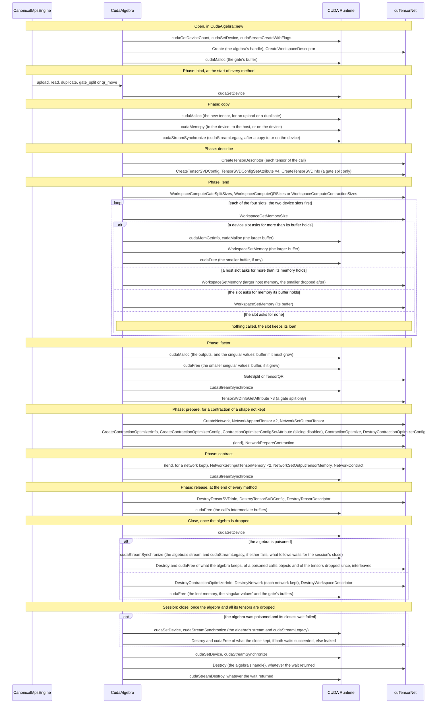

# The CUDA algebra: native calls and numerics

The details behind [the CUDA algebra](../README.md#the-mps-engine) of the
crate's README: the native calls each of its
[phases](../README.md#the-algebras-phases) makes, in order, and how its
gate split and move of the centre lay out and truncate their tensors.

## Native calls of each phase

Each band of the diagram is one phase, or the algebra's opening or
closing, with its native calls in order. A method runs the phases its row
of [the README's table](../README.md#how-each-sitealgebra-method-is-implemented)
names.

cuTensorNet's calls are shown without their `cutensornet` prefix; NVIDIA
documents each on its
[functions page](https://docs.nvidia.com/cuda/cuquantum/latest/cutensornet/api/functions.html),
for example
[`cutensornetGateSplit`](https://docs.nvidia.com/cuda/cuquantum/latest/cutensornet/api/functions.html#cutensornetgatesplit).
A method given a tensor another algebra made refuses it before the bind,
with no native call. A tensor's `Drop` binds the device and frees its
buffer (`cudaFree`), unless the algebra is poisoned (below), which keeps
the buffer, or the bind fails, which leaks it, since its free needs that
device.

When a method fails, the release phase first waits for the device
(`cudaStreamSynchronize`, and on the legacy stream too if the method
copied), since the failed work may still write the call's buffers, and
frees the outputs as well. If that wait fails, the algebra is poisoned:
every later method returns `CudaAlgebraError::Poisoned`, and the call's objects
and buffers, the tensors dropped since and the algebra's own memory are
freed only after a successful wait for the device (its stream and its
copies), at the algebra's close or else at the session's; if neither
succeeds, they are leaked. The session's close then destroys the handle
and the stream whatever its own wait returned; CUDA releases a stream's
resources only once the device has completed its work
([`cudaStreamDestroy`](https://docs.nvidia.com/cuda/cuda-runtime-api/cuda_runtime_api/group__CUDART__STREAM.html#group__cudart__stream_1ga920234e40db739baab4f2459e4f68282)).

## Numerics

Every tensor holds complex doubles (`CUDA_C_64F`), its first mode fastest,
as `SiteAlgebra`'s layout says, and every call computes in double
precision (`CUTENSORNET_COMPUTE_64F`). A pair of sites is $A$, of extents
$[l, 2, m]$, and $B$, of extents $[m, 2, r]$.

**A gate split** is one `GateSplit`, with cuTensorNet's reduced algorithm
(it factors $A$ and $B$ by QR and splits only the small core), into $U$ of
extents $[l, 2, k]$ and $V$ of extents $[k, 2, r]$, allocated at

$$k = \min(e,\ 2l,\ 2r,\ 4m),$$

with $e$ the call's `max_extent`: the gated pair $\theta$ is a
$2l \times 2r$ matrix of rank at most $4m$, and the reduced algorithm
accepts no larger $k$. The SVD's settings, each a
`CUTENSORNET_TENSOR_SVD_…` value of cuTensorNet's SVD configuration:

- `ALGO_GESVD`, cuSOLVER's `gesvd`
  ([`policy.rs`](../src/engine/cuda_algebra/policy.rs) says why);
- `NORMALIZATION_L2`: the kept singular values are divided by their L2
  norm, as the contract asks;
- `PARTITION_US` or `PARTITION_SV`: they are absorbed into $U$ when the
  centre is on the left, into $V$ when it is on the right;
- `CONFIG_DISCARDED_WEIGHT_CUTOFF`, the call's cutoff: the smallest
  singular values whose squares sum to at most that share of all the
  squares are dropped.

cuTensorNet packs $U$ and $V$ at the kept bond, which it reports with the
full extent and the discarded weight $w$. The algebra returns the bond and
the retained fraction $1 - w$, after checking the report: a bond between
1 and $k$, and at most the full extent, and $w$ in $[0, 1)$ or below 0 by
at most the tolerance in [`policy.rs`](../src/engine/cuda_algebra/policy.rs),
read as 0, a retained fraction of exactly 1; any other report is
`CudaAlgebraError::InvalidNativeResult`. The tolerance takes in cuTensorNet's
rounding: it reports $w$ rounded, so a split that discards nothing may
report it just below 0. The upper end is strict: the split keeps at least
the largest singular value, so a true $w$ is at most $1 - 1/n$ for $n$
values.

**A move of the centre** is exact. To the right, $A$, with the one-site
gate applied to its qubit if there is one, is factored by one `TensorQR`
as $A = Q R$, with $Q$ of extents $[l, 2, k]$ and $R$ of extents $[k, m]$,
$k = \min(m, 2l)$; $Q$ is the new left site, and the contraction $R B$ the
new centre. To the left, $B$ is factored with $Q$ of extents $[k, 2, r]$,
$k = \min(m, 2r)$, and $A R$ is the new centre. The gate and the product
with $R$ are pairwise contractions; each contraction network is prepared
once per shape (its inputs' extents and the three tensors' mode labels)
and kept, up to the bound of
[`policy.rs`](../src/engine/cuda_algebra/policy.rs), beyond which all are
released and the cache starts again.

The gates arrive row-major, as the contract gives them; the algebra
reorders each into a descriptor's layout, its first mode fastest, before
copying it to the device ([`gate_split.rs`](../src/engine/cuda_algebra/gate_split.rs),
[`qr_move.rs`](../src/engine/cuda_algebra/qr_move.rs)).
