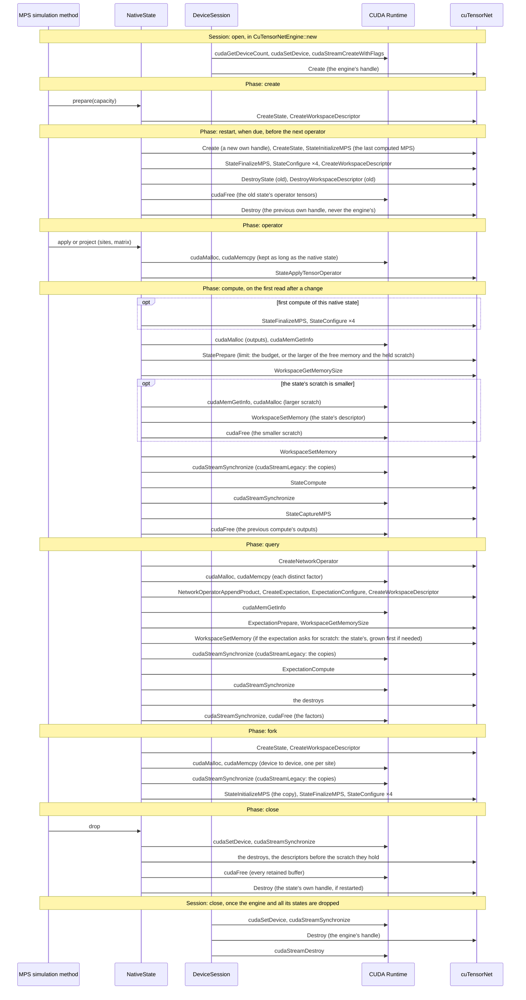

# The MPS engine: native calls and numerics

The details behind [the MPS engine](../README.md#the-mps-engine) of the
crate's README: the native calls each of its [phases](../README.md#phases)
makes, in order, and the numerics of its reads.

## Native calls of each phase

Each band of the diagram is one phase, or the session's opening or closing,
with its native calls in order.

cuTensorNet's calls are shown without their `cutensornet` prefix; NVIDIA
documents each on its
[functions page](https://docs.nvidia.com/cuda/cuquantum/latest/cutensornet/api/functions.html#tensor-network-state-api),
for example
[`cutensornetStateCompute`](https://docs.nvidia.com/cuda/cuquantum/latest/cutensornet/api/functions.html#cutensornetstatecompute).
`ExpectationCompute` writes to host memory, and NVIDIA documents that it
synchronizes the stream only "in the current release", a "restriction
[that] may be released in the future": admitting a version other than 2.13.0
([Versions](../README.md#versions)) means checking that again.

## Numerics

Every read divides by the squared norm `ExpectationCompute` returns beside its
value. With $P^{(b)}_q$ the projector of site $q$ on value $b$:

$$\langle O\rangle = \frac{\langle\psi\rvert O \lvert\psi\rangle}{\langle\psi\vert\psi\rangle}, \qquad p_q(1) = \frac{\langle\psi\rvert P^{(1)}_q \lvert\psi\rangle}{\langle\psi\vert\psi\rangle}.$$

A conditional probability, with $\Pi = \prod_{(k, b) \in \text{given}} P^{(b)}_k$,
is two queries on the state:

$$p_q(1 \mid \text{given}) = \frac{\langle \Pi\, P^{(1)}_q \rangle}{\langle \Pi \rangle}.$$

A projection on value $b$ keeps the norm,
$\lvert\psi\rangle \mapsto P^{(b)}_q \lvert\psi\rangle / \sqrt{p_q(b)}$. The
engine pins `SvdNormalizationNone`, so a truncation never rescales what it
keeps: the retained weight is $w = \langle\psi\vert\psi\rangle \le 1$. The
bond asked for at cut $c$, between sites $c$ and $c+1$ of $n$, is the
capacity's bond there, $\chi^{\text{capacity}}_c$, lowered to what the cut
can carry (`NativeCapacity::new`); a split also drops the smallest singular
values under the cutoff of [`src/engine/policy.rs`](../src/engine/policy.rs):

$$\chi_c = \min\left(\chi^{\text{capacity}}_c,\ 2^{c+1},\ 2^{\,n-c-1}\right).$$
