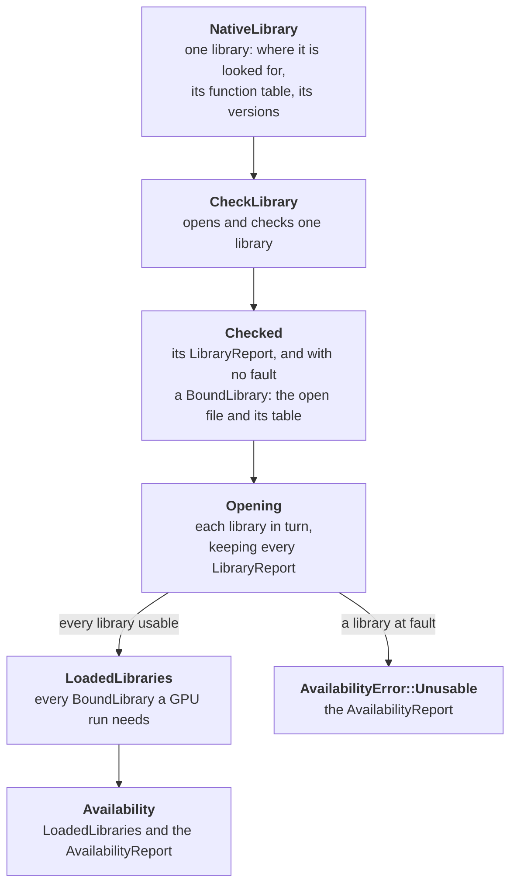
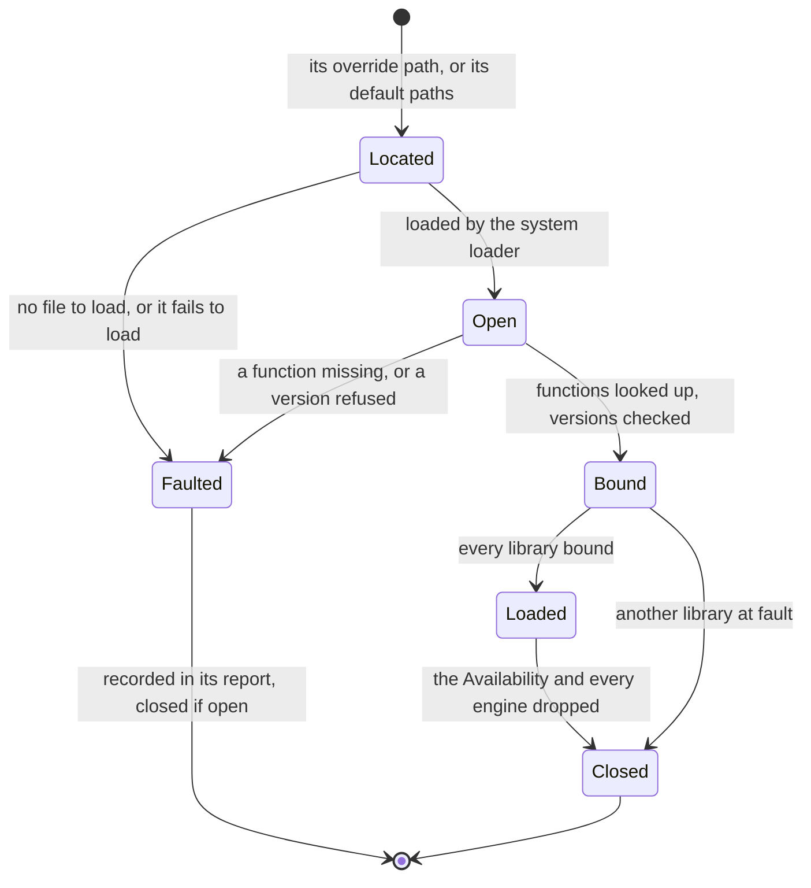
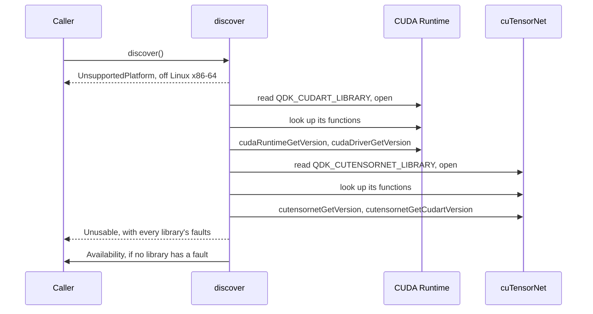

# The loading of the libraries: from a library to an `Availability`, the steps of discovery, and the bindings

The details behind [the discovery and loading of the libraries](../README.md#the-discovery-and-loading-of-the-libraries)
of the crate's README: how discovery turns each library into an
`Availability`, the steps it takes and the faults each finds, and how the
bindings are made and checked.

## From a library to an `Availability`

Discovery is the same for every library, and knows none of them: each
library says what the crate needs of it, and one list says which libraries
a GPU run needs.

- [`NativeLibrary`](../src/libraries.rs) is implemented once per library, in
  its module ([`cutensornet.rs`](../src/libraries/cutensornet.rs),
  [`cuda_runtime.rs`](../src/libraries/cuda_runtime.rs)): its name, override
  variable and default paths, its [`FunctionTable`](../src/libraries/loader.rs),
  and how its versions are read and which are accepted.
- [`CheckLibrary`](../src/libraries.rs) is a trait so that what discovery
  concludes from the checks is tested without library files.
- [`LoadedLibraries`](../src/libraries.rs) is the one list of the libraries a
  GPU run needs, in the order they are opened. It opens every library before
  it requires any, so the report lists every fault of every library.

A library's life, from discovery to the last engine that uses it:

The `Availability` and the engines share a loaded library, so it closes
after the last of them, cuTensorNet before the CUDA Runtime it runs on.

## The steps of discovery

The CUDA Runtime, then cuTensorNet, goes through the steps below, each
library whatever the other's faults, and each fault is recorded in the
library's report:

- reading its override variable and opening it: `InvalidOverride`,
  `NotFound` or `LoadFailed`, which end that library's checks;
- looking up its functions: `MissingRequiredSymbol`, one per missing
  function;
- its versions: `VersionProbeFailed` or `UnsupportedVersion`, one per
  version. They are read even when other functions are missing, as a wrong
  version is the usual cause.

With any fault, discovery closes the libraries it opened and returns
`Unusable`. Looking a function up stores its address; it does not call it.

A library is opened with the system loader's (`dlopen`) `RTLD_NOW`, which
binds every symbol it imports when it opens, so a missing one fails
discovery rather than a later call, and `RTLD_LOCAL`, which keeps its
symbols out of the rest of the process.

## The bindings

_Bindings_ are the Rust declarations of the C functions, types and
constants. One that does not match the library's ABI (the sizes and layouts
of its types, and its calling convention) is undefined behaviour when
called, not a compile error, so the bindings are generated, never written by
hand, and checked when the crate compiles:

- **Generated from pinned inputs**, so anyone can reproduce them:
  [`scripts/generate_bindings.py`](../scripts/generate_bindings.py) runs bindgen
  on each library's header and keeps its whole API (every name with the
  library's prefix, and the types they reach).
  [`scripts/generate_bindings.toml`](../scripts/generate_bindings.toml) pins the
  tools and NVIDIA's archives, and a library's `bindings.toml`, as
  [cuTensorNet's](../src/libraries/cutensornet/bindings.toml), says what its
  bindings are made of; the script binds every library that has one.
- **In a `generated/` folder beside the library they declare**, as
  [`cutensornet/generated/v2_13.rs`](../src/libraries/cutensornet/generated/v2_13.rs),
  holding only the script's output, never edited by hand;
  [`.gitattributes`](../.gitattributes) marks it as generated, so GitHub hides
  it in a pull request's diff. cuTensorNet's bindings import the CUDA
  Runtime's stream type, so a stream passes from one to the other unchanged.
- **Checked when the crate compiles:** each row of a library's function
  table is checked against its symbol's declaration, so no field can be
  looked up by another function's name; each accepted version against the
  one its header declares; and
  [`layout.rs`](../src/libraries/cutensornet/layout.rs) checks the layout of
  `cuDoubleComplex`, which a cuTensorNet function takes by value.

To bind another function of a bound release, add its row, and its
function-pointer type, to its library's module: the bindings already declare
it. To bind another library, follow the top of
[`src/libraries.rs`](../src/libraries.rs); to bind a new release, the top of
[`scripts/generate_bindings.py`](../scripts/generate_bindings.py), which says
how to run it and audit the release.

NVIDIA's headers, archives and libraries are not stored in this repository;
their terms are those of the licenses distributed with NVIDIA's archives.
