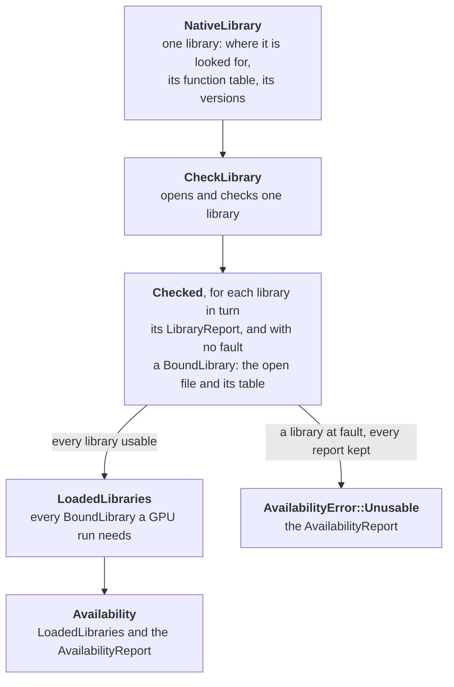
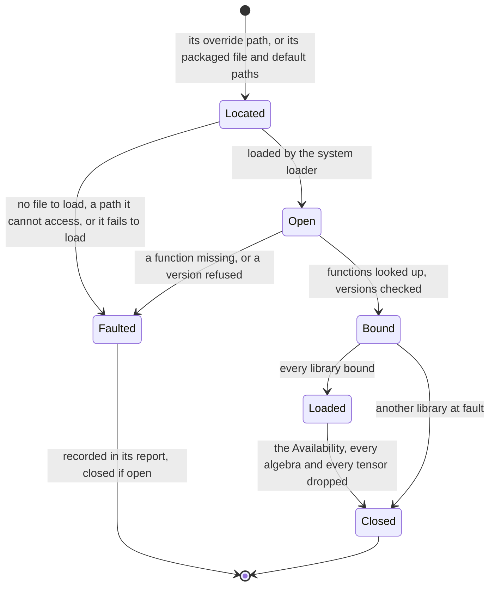
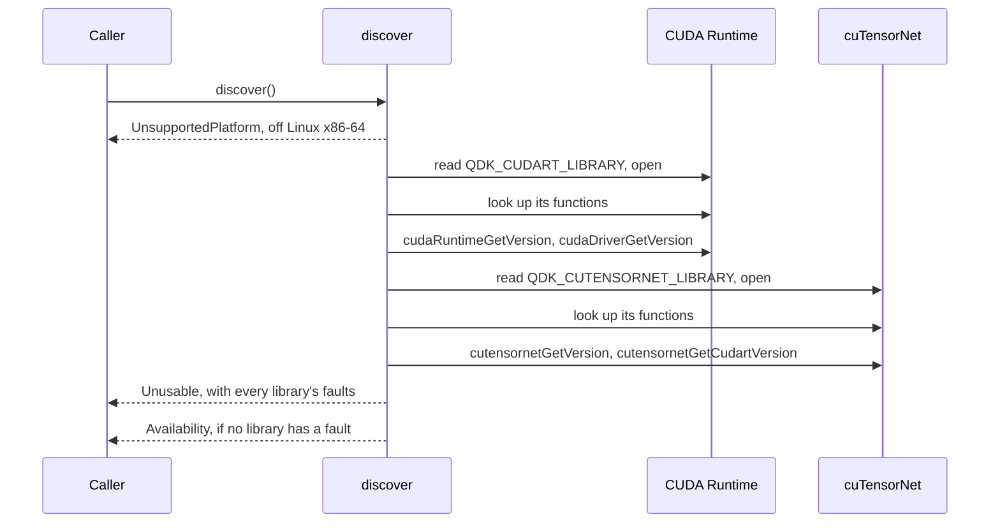

# The discovery and loading of the libraries

The details behind the crate's [README section](../README.md#the-discovery-and-loading-of-the-libraries):
how discovery turns each library into an `Availability`, the steps it takes
and the faults each finds, and how the bindings are made and checked.

## From a library to an `Availability`

Discovery is the same for every library, and knows none of them. Each
library says what the crate needs of it, and one list says which libraries
a GPU run needs.

- [`NativeLibrary`](../src/libraries.rs) is implemented once per library, in
  its module ([`cutensornet.rs`](../src/libraries/cutensornet.rs),
  [`cuda_runtime.rs`](../src/libraries/cuda_runtime.rs)). It gives the
  library's name, override variable, file name (which picks its file among
  the packaged ones) and default paths, its
  [`FunctionTable`](../src/libraries/function_table.rs), and how its
  versions are read and which are accepted. Beside it, the module
  implements [`LibrarySetupGuide`](../src/libraries/setup_guide.rs). It
  says what the GPU setup check shows of the library and advises, and the
  oldest driver and device the library runs on. Discovery keeps each
  library's guide, in the order opened, for the check.
- [`CheckLibrary`](../src/libraries.rs) is a trait so that what discovery
  concludes from the checks is tested without library files.
- [`LoadedLibraries`](../src/libraries.rs) is the one list of the libraries a
  GPU run needs, in the order they are opened. It opens every library before
  it requires any.

A library's life, from discovery to the last algebra or tensor that uses it:

The `Availability`, the CUDA algebras and their tensors share a loaded
library. It closes after the last of them, cuTensorNet before the CUDA
Runtime it runs on.

## The steps of discovery

The CUDA Runtime, then cuTensorNet, goes through the steps below. Each
library goes through them whatever the other's faults. Each fault is
recorded in the library's report:

1. Reading its override variable and opening it, or else its packaged
   file or default paths: `InvalidOverride`, `NotFound`,
   `InaccessiblePath` or `LoadFailed`, which end that library's checks.
   Without an override, the first
   [`PackagedLibraries`](../src/libraries/packaged_libraries.rs) file with
   the library's file name, if any, is tried before the default paths, in
   order:
   - An absolute path is skipped when nothing exists there, including when
     part of it is a file rather than a directory.
   - It fails discovery when the process cannot access it, for instance
     behind a directory it lacks the permission to search, or at a symlink
     loop. It fails too when what is there is not a library, such as a
     directory.
   - A bare file name is searched for on the system loader's usual path.
     It is skipped when the loader reports no file of that name
     ([`loader.rs`](../src/libraries/loader.rs) says when glibc does).
   - A library that is found but fails to load, for instance for a
     missing dependency, fails discovery.
   - Once it is open, its report records the other copies of it at those
     paths, for the GPU setup check's warnings.
2. Looking up its functions: `MissingRequiredSymbol`, one per missing
   function. Looking a function up stores its address; it does not call
   it.
3. Reading its versions: `VersionProbeFailed` or `UnsupportedVersion`, one
   per version. Each version is read even when other functions are
   missing, another version's included, as a wrong version is the usual
   cause.

With any fault, discovery closes the libraries it opened and returns
`Unusable`.

A library is opened with two flags of the system loader (`dlopen`):

- `RTLD_NOW` binds every symbol the library imports when it opens, so a
  missing one fails discovery rather than a later call.
- `RTLD_LOCAL` keeps its symbols out of the rest of the process.

## The bindings

_Bindings_ are the Rust declarations of the C functions, types and
constants. A binding that does not match the library's ABI (the sizes and
layouts of its types, and its calling convention) is undefined behaviour
when called, not a compile error. So the bindings are generated, never
written by hand, and the crate is checked against them:

- **Generated from pinned inputs**, so anyone can reproduce them.
  [`scripts/generate_bindings.py`](../scripts/generate_bindings.py) runs
  bindgen on each library's header and keeps its whole API: every name with
  the library's prefix, and the types they reach.
  [`scripts/generate_bindings.toml`](../scripts/generate_bindings.toml) pins
  the tools and NVIDIA's archives. A library's `bindings.toml`, as
  [cuTensorNet's](../src/libraries/cutensornet/bindings.toml), says what its
  bindings are made of. The script binds every library that has one.
- **In a `generated/` folder beside the library they declare**, as
  [`cutensornet/generated/v2_13.rs`](../src/libraries/cutensornet/generated/v2_13.rs).
  The folder holds only the script's output, never edited by hand.
  [`.gitattributes`](../.gitattributes) marks it as generated, so GitHub
  hides it in a pull request's diff. cuTensorNet's bindings import the CUDA
  Runtime's stream type, so a stream passes from one to the other unchanged.
- **Checked when the crate compiles.** Each row of a library's function
  table is checked against its symbol's declaration, so each function
  pointer has its symbol's type. Each accepted version is checked against
  the one its header declares. A row's field is named for its symbol, which
  is what is looked up. So no field can hold another function, and a table
  that holds a function twice does not compile.

To bind another function of a bound release, add its row to its library's
module: the bindings already declare it. The row is its symbol, with its
function-pointer type declared under that name in the file of its family.
To bind another library, follow the top of
[`src/libraries.rs`](../src/libraries.rs). To bind a new release, follow the
top of [`scripts/generate_bindings.py`](../scripts/generate_bindings.py),
which says how to run it and audit the release.

NVIDIA's headers, archives and libraries are not stored in this repository.
Their terms are those of the licenses distributed with NVIDIA's archives.
