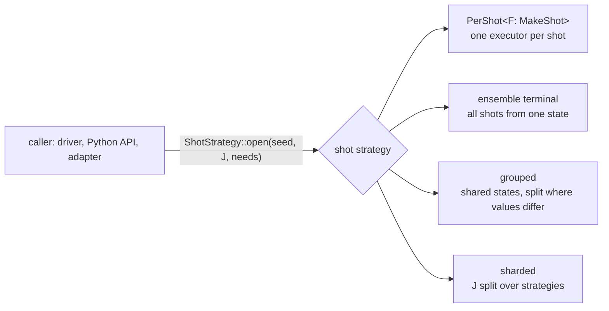

# `executor_protocol`

How a caller hands quantum work to an executor and reads its reply, the same
way whatever runs the work.

## What this crate does

It defines the protocol every component of an execution stack speaks, and
nothing that runs work. A simulator, an adapter that runs a program's
classical part, or a link to a remote device each implement it; the crates
that hold them depend on this one.

- A **message kind** (`Message`) fixes what a call means and which events its
  reply carries. Level L3 is a `Batch`: a list of instructions run in order on
  one shot, whose state carries over from the batches before it. Its events
  are `Outcome`s, a value under the tag the batch gave the readout.
- An **executor** (`Executor<M>`) accepts one message kind. A _terminal_ runs
  the message; an _adapter_ keeps its meaning and passes the work on to the
  executor it wraps, possibly in another instruction set. A chain of adapters
  is again an executor of the same kind, so a driver written once runs on
  every chain.
- A **call** returns at once, with a reply (`Completion`) or a typed refusal
  (`Rejected`). A refusal means that nothing started, so the caller may
  correct the message and send it again; each refusal has a retry class.
  A run that starts and cannot finish ends its reply with `Status::Failed`.
- **Replies** are polled for their events, never block, and wake their
  caller when they can make progress. `Immediate` is the reply of an executor
  that ran the work inside the call; a `completer` makes the two ends of a
  reply whose events come from elsewhere (a worker thread), and `relay` passes
  an inner reply's events up through one. A driver takes a whole reply with
  `wait` (blocking) or `wait_async` (a `Future`), or its events as they come
  with `Completion::poll_events` or `async_events` (a `Stream`, the reason
  the crate depends on `futures-core`).
- Level L2 is a **session**: a `Submission` runs one batch on each shot of a
  set of shots (`ShotSet`), each shot's state carrying over. Its events are
  `ShotOutcome`s. A **shot strategy** (`ShotStrategy`) opens a session on the
  shots J with a seed and the caller's `Needs`, which are checked at once
  against what it offers; an unmet need names the component. The strategy
  decides how the shots run (see [Shot strategies](#shot-strategies)).
  `PerShot` wraps a maker of one shot's L3 executor (`MakeShot`) and opens
  a `PerShotSession`: one executor per shot, reachable between calls.
  `SubmissionWrapper` runs an L3 driver on one shot `j` of a session. An L3
  driver drives one shot (its batches depend on that shot's outcomes), so a
  run of n shots opens one session per shot on `ShotSet::one(j)`, with the
  run's seed: one shot's state is held at a time, and shot `j` gives the
  outcomes it gives in a session on all n shots. A session that fails
  part-way through a submission is failed for good (`Lifecycle`).
- **Seeds**: shot `j` of a session opened with `seed` draws from seeds fixed
  by `seed`, `j` and the component that draws (`ShotContext`, `shot_seed`,
  `ComponentId`), so a shot's outcomes do not depend on how J is split or on
  which other components draw. The crate gives seeds, not generators, so it
  depends on no random-number crate.
- An executor **describes** what it offers (`Describe`, `Capabilities`), so a
  stack can be checked before it runs, and **closes** (`Close`) with a report
  that folds with the reports of the components it wraps (`Fold`); a session
  reports its submissions, and each shot's log probability where it is known
  (`SessionReport`, `LogP`).
- **Codes** (`reason_code`, `need_code`, `value_code`, `retry_code`) give the
  fixed numbers by which a refusal, a need and a value cross a link.

## Shot strategies

A caller that runs shots (a driver, the Python API, an adapter for another
stack) needs a session to submit batches to, nothing more. How the shots of
J share work is a choice with different costs and guarantees, so each choice
is one implementation of `ShotStrategy`, and a new one is added without
changing the callers:



| Strategy                         | How the shots of J run                                                  | Replayable              | Status                           |
| -------------------------------- | ----------------------------------------------------------------------- | ----------------------- | -------------------------------- |
| `PerShot<F>`                     | each on its own L3 executor, made by `F: MakeShot`; nothing shared      | yes                     | here                             |
| an ensemble terminal (MPS batch) | together, from one state and one seed; Base programs only (no feedback) | no                      | the MPS method                   |
| grouped                          | on shared states, which split where the shots' values differ            | yes                     | when a measurement shows it pays |
| sharded                          | J split over several strategies (devices, threads), replies merged      | as the inner strategies | when several devices are used    |

_Replayable_ means each shot's outcomes depend only on the seed and its own
index, not on the other shots of J; a caller that needs it says so in its
`Needs`, and a strategy that cannot offer it refuses at `open`.

Every strategy keeps one contract: the needs are checked at `open`, before
anything is allocated; each shot's state carries over between submissions;
the session is closed once, with a report that folds. An adapter that wraps a
strategy (a lowering, a noise source, exclusive use of a device) is again a
strategy, so a stack is built by wrapping.

The method keeps the protocol's name for the step, `open(seed, shots,
needs)`; the trait is named for what distinguishes its implementations.

**Why `PerShot` is a type, not a blanket implementation.** A blanket
`impl<F: MakeShot<I>> ShotStrategy<I> for F` would let a caller pass a maker
directly, but it would make per-shot the only strategy a maker can have.
Rust then refuses, as overlapping implementations (E0119):

- a terminal that is a maker for programs with feedback and its own ensemble
  strategy for Base programs;
- one adapter (noise, say) that wraps either a maker or a strategy;
- a strategy shared through `Arc`, since another crate may make `Arc<_>` a
  maker.

With `PerShot`, each of these compiles, and the caller writes
`PerShot(maker)`.

## Example

The region ISA in `qdk_simulators::execution` is an L3 instruction set:

```text
driver ──Batch<PreparedAdaptiveProgram>──► RuntimeAdapter ──Batch<RegionInstruction>──► SimulatorTerminal
       ◄── Outcome per output record ─────                 ◄── Outcome per measurement ──
```

`RuntimeAdapter` runs a program's branches and loops itself, and sends the
terminal the regions, measurements and resets it reaches.

Per-shot sessions of a legacy simulator are opened by
`PerShot(SimulatorShots::new(…))`, over the maker of one shot's
`SimulatorTerminal`:

```text
driver ──Submission<RegionInstruction>──► PerShotSession ──Batch<RegionInstruction>──► SimulatorTerminal (one per shot)
       ◄── ShotOutcome per measurement ──                      ◄── Outcome per measurement ──
```
