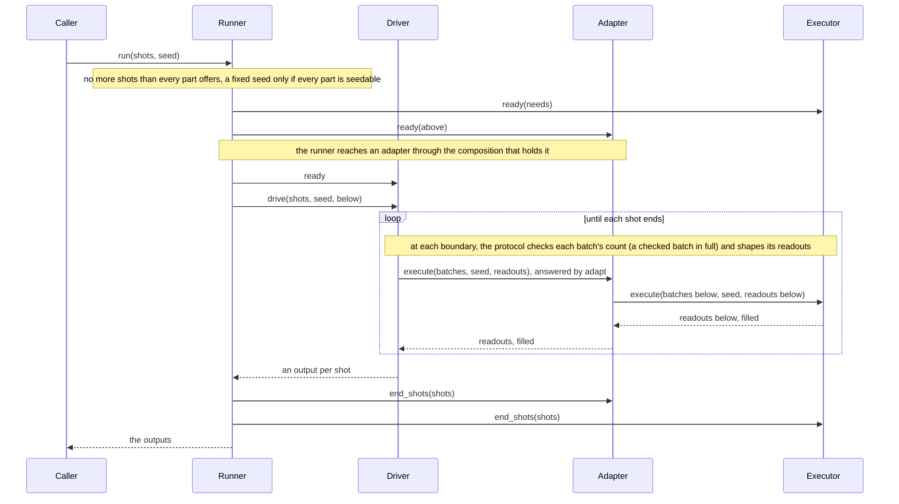

# The executor protocol

The executor protocol, the QDK crate `executor_protocol`, was designed to
solve the problem of combining tools that act between a quantum program and
the machine that runs it, such as noise models, error correction, profilers
and debuggers, each written on its own. Without a shared protocol, the
problem includes:

- glue code for every pair of tools, since each depends on the next one's
  types;
- the same checks in every tool (does the next one take these
  instructions, these qubits, these shots?), and mismatches found only
  when a shot reaches them;
- a model of instructions, shots and results of each tool's own, for every
  developer to learn;
- tools written for one stack and not reused in another, each copy
  maintained apart;
- a cost at every hand-off, converting each instruction to the next tool's
  types, paid again on every shot;
- a new tool or feature that changes the tools around it.

In addition to these, adaptive programs require a back-and-forth: a shot's
next instructions depend on its readouts, so instructions go down and
readouts come back while the shot runs.

The protocol solves these by composing the tools as parts of a chain: a
driver on top, such as a program's interpreter; any number of adapters
below it, such as a noise model, a code's lowering and decoding, or a
debugger; and an executor at the bottom, such as a simulator or a device.
A part calls the part below it with `execute`: batches of instructions,
each on a set of shots, answered with each shot's readouts. So a driver
sends each shot's instructions up to its next branch, reads the readouts,
and sends the next, as an adaptive program needs. A part depends on the
protocol alone, never on another part: the rest of the chain below it is
one executor to it, and the protocol carries each call across each
boundary, with its checks and the shaping of its readouts, so that a part
writes only its own logic. Its roles, batches and readouts are abstractions
shared by every part, so a developer learns one model for every tool.
Since `>>` joins any parts that fit, a part is reused in every chain it
fits and maintained in one place. It adds little cost: a chain's calls are
direct, and one `execute` carries many instructions on many shots. And it
is extensible, so that more can be built on it: a new part joins a chain
without changing any other, and the protocol grows by adding methods with
defaults, so that parts written before keep working.

Today the protocol holds:

- **The roles:** driving, adapting and executing, two traits each, with
  what a part of that role is responsible for at each time: a setup trait,
  [`DriverSetup`](src/roles/driver_setup.rs),
  [`AdapterSetup`](src/roles/adapter_setup.rs) or
  [`ExecutorSetup`](src/roles/executor_setup.rs), for when `>>` composes
  the chain; and a run-time trait, [`Drive`](src/roles/drive.rs),
  [`Adapt`](src/roles/adapt.rs) or [`Execute`](src/roles/execute.rs), for
  each run.
- **The composable parts:** [`Driver`, `Adapter` and
  `Executor`](src/composition.rs), which wrap a part in the role it plays,
  so that `>>` can join it. Any implementation of a role gets composition,
  and the guarantees below, for free, with no code of its own.
- **Composition with `>>`** ([`Compose`](src/composition.rs)):
  (`Driver >> Adapter`) is a `Driver`; (`Adapter >> Adapter`) is an
  `Adapter`; (`Adapter >> Executor`) is an `Executor`, each a composition
  ([`Composed`](src/composition/composed.rs)); and (`Driver >> Executor`)
  is a [`Runner`](src/composition/runner.rs), which runs shots. So reusable parts mix
  and match: a stack of adapters, or a noise model over a simulator, is a
  composition, ready to join others as one part would.
- **Instruction sets:** each part declares the instructions it sends or
  accepts as an [`InstructionSet`](src/instruction_set.rs). Each
  instruction's declaration, an
  [`InstructionDef`](src/instruction_set/instruction_def.rs), names the blocks it acts on
  ([`BlockType`](src/instruction_set/block_type.rs): qubits, or a code's
  blocks), its [`Parameter`](src/instruction_set/parameter.rs)s, its
  readouts and what it does ([`Meaning`](src/instruction_set/meaning.rs)).
  An [`Instruction`](src/instruction_set/instruction.rs) gives its
  [`Opcode`](src/instruction_set/opcode.rs), its blocks and its
  [`Argument`](src/instruction_set/instruction/argument.rs)s; a `>>`
  binds a sender to its receiver's opcodes
  ([`OpcodeMap`](src/instruction_set/opcode_map.rs)).
- **Needs and offers:** the driver states what its shots need of the
  chain, as [`Needs`](src/needs.rs), such as their qubits and
  shots; the executor, what it can serve, as an
  [`Offer`](src/offer.rs), such as its most qubits, whether a
  run may fix its seed and whether a shot replays. An adapter passes needs
  below and gives an offer above.
- **What crosses a boundary:** each call down the chain, `execute`, sends
  [`Batch`](src/batch.rs)es of instructions, each on a
  [`ShotSet`](src/batch/shot_set.rs) of `ShotId`s, with the run's
  [`Seed`](src/seed.rs), and gets back
  [`BatchReadouts`](src/batch/batch_readouts.rs): a row per shot of
  [`ReadoutValue`](src/batch/batch_readouts/readout_value.rs)s, with the
  [`ShotConditions`](src/batch/batch_readouts/shot_conditions.rs) raised on it.
  [`Readouts`](src/batch/batch_readouts/readouts.rs) keeps them from one call to
  the next.
- **Refusals and failures:** a refusal says that nothing ran, so the call
  may be corrected and sent again
  ([`ExecuteRefusal`](src/roles/execute.rs),
  [`RunRefusal`](src/composition/runner/run_error.rs)); a
  [`Failure`](src/roles/failure.rs) names the
  shot whose work broke. They pass up the chain as
  [`ExecuteError`](src/roles/execute.rs),
  [`DriveError`](src/roles/drive.rs) and then
  [`RunError`](src/composition/runner/run_error.rs).
- **Guarantees at composition:** each `>>` checks that the instructions the
  part above sends fit those the part below accepts
  ([`FitFaults`](src/instruction_set/fit.rs)). The `>>` that makes a
  runner also checks that, at every boundary, the needs that reach it fit
  the offer there ([`AdmissionFaults`](src/composition/admission.rs)). A chain that
  fails either check is refused with every fault at once
  ([`CompositionFaults`](src/composition/composition_faults.rs)): a fit's
  by the names of its instruction sets, the admission's by part
  ([`PartId`](src/composition/part_id.rs)), before any shot runs.
- **Guarantees at run time:** the `Runner` carries each call down the
  chain, checking each batch (its count always, its instructions when its
  sender marks it checked) and shaping its readouts. It ends each run's
  shots on every part. A part's panic becomes a failure of the run (on
  every platform but wasm32, where a panic aborts). With a fixed seed, and
  parts that draw on the protocol's seeds, a run gives the same outputs
  each time; and where the chain's shots replay, a shot run again alone,
  as a debugger does, gives back its readouts.

Users write the parts: any type that implements a role, written new or
wrapping an existing interpreter, noise model or simulator.
[Writing a part](docs/writing-a-part.md) shows how, and
[`examples/compose_and_run.rs`](examples/compose_and_run.rs) writes a small
part of each role.

**Why this approach.**

- **Decoupled, open-closed parts.** One driver runs on every chain whose
  instructions and offers fit it, and a new part is a new type that
  implements a role, which joins a chain without changing any other part or
  any type of the protocol. The protocol is open the same way: streaming a
  run's outputs as they come is planned as a backward-compatible,
  incremental extension that only adds methods and types, those of the
  roles with a default, so a part written today keeps working unchanged.
- **Low cost per instruction.** A chain's type is built from its parts'
  types, so each call down it is a direct call; one `execute` carries many
  instructions on many shots, sharing its cost; the readouts' memory is
  reused from call to call; and a batch is checked in full only when its
  sender asks, so a chain of parts that keep the protocol's rules pays for
  no check it does not need. [`examples/bench`](examples/bench/main.rs)
  times the protocol against a driver that calls its executor directly.

## Terms

These words name a chain's parts, its contracts and what crosses its
boundaries; the rest of this README, and the pages of [`docs/`](docs), use
them as defined here.

- **Role**: what a part does in a chain: drive, adapt or execute. Each role
  is two traits: a setup trait and a run-time trait.
- **Part**: a chain's unit, as a link is a chain's: a value of a type that
  implements one role.
- **Chain**: parts from a driver on top, through any number of adapters, to
  an executor at the bottom, joined by `>>`; joining them gives a
  [`Runner`](src/composition/runner.rs).
- **Composition**: joining parts with `>>`, the only way to make a chain.
  A driver joined with an executor is a chain, a
  [`Runner`](src/composition/runner.rs); any other join, such as
  (`Adapter >> Adapter`) or (`Adapter >> Executor`), falls short of one
  and gives a [`Composed`](src/composition/composed.rs). A composed part
  plays the role of its ends and joins others as one part would, while
  its parts keep their own positions and boundaries in the chain.
- **Boundary**: where two consecutive parts of a chain meet; the part
  above calls the part below across it.
- **Shot**: one execution of the program, named by a
  [`ShotId`](src/batch/shot_set/shot_id.rs). A [`ShotSet`](src/batch/shot_set.rs) holds shots
  in the caller's order, never empty and none twice.
- **Run**: one call of `Runner::run` or `Runner::run_async`, on a shot
  set.
- **Instruction set** ([`InstructionSet`](src/instruction_set.rs)): a
  named list of the instructions a part sends or accepts, each declared
  with its mnemonic, the blocks it acts on (qubits, or blocks of an
  error-correcting code), its parameters and its readouts.
- **Batch** ([`Batch`](src/batch.rs)): instructions to run, in order, on
  each shot of a shot set.
- **`execute`**: one call across a boundary, with any number of batches,
  the run's seed, and the caller's readouts: one
  [`BatchReadouts`](src/batch/batch_readouts.rs) per batch, a row per shot.
- **Sender** and **receiver**: the two sides of an `execute`: the part
  above, which sends the batches, and the part below, which runs them and
  fills their readouts. The protocol stands between them on each call
  across the boundary: it checks the batches and shapes their readouts, so
  that neither side has to.
- **Checked batch**: a batch its sender marked [`checked`](src/batch.rs),
  which each boundary checks in full before it runs. An unchecked batch,
  the default, runs as sent, with only its count of instructions checked.
- **Needs** ([`Needs`](src/needs.rs)) and **offer**
  ([`Offer`](src/offer.rs)): what the driver's
  shots need of the chain, such as their qubits, and what a part can ever
  serve, such as its most qubits, shots per run and instructions per
  batch. An offer also says whether a run may fix its seed (_seedable_: a
  quantum computer's measurements are not), and whether a shot run again
  alone, as a debugger does, gives its readouts back (_replayable_: a
  sampler that draws a run's shots from one random stream, in one call,
  is not).
- **Fit**: the check, by each `>>`, that every instruction the part above
  sends is accepted below, with the same blocks, parameters and readouts.
- **Admission**: the check, by the `>>` that makes a runner, that at every
  boundary the needs that reach it fit the offer there.

## Composing and running a chain

Users wrap each part in its role's type and join the parts with `>>`, top
to bottom. A chain then has two times, each calling one of each part's
two traits:

- **Setup**, once, when `>>` composes the chain: each `>>` checks the fit
  of the boundary it makes and, where it fits, binds the part above to the
  opcodes of the part below (`bind`); the one that joins a driver with an executor
  also checks the admission, and gives a [`Runner`](src/composition/runner.rs), or
  every fault of the chain. Setup only decides, from what the parts
  declare; what prepares a part to run belongs to each run.
- **Each run**, each time [`Runner::run`](src/composition/runner.rs) runs a
  [`ShotSet`](src/batch/shot_set.rs) with a seed: the run checks its shots and
  its seed against the parts' offers, gets each part `ready` for the
  needs the admission checked, or is refused by the first that cannot
  take a run now, lets the driver send its batches down the chain (`drive`, then
  each `adapt`, then `execute`), and, once it ends, ends its shots on
  every part. It gives the driver's outputs, one per shot by `Drive`'s
  rule, or a [`RunError`](src/composition/runner/run_error.rs).

A run's calls:



How each join's role follows from its two ends, what a run asks of each
part, what is checked where and when, and how a run fails are in
[Composing and running a chain](docs/composing-and-running.md).

## An example

Three toy parts, one of each role: a driver that tosses a coin and copies
it onto a second qubit, an adapter that adds bit-flip noise, and an
executor whose qubits are classical bits. Copied from
[`examples/compose_and_run.rs`](examples/compose_and_run.rs), which also
writes the three parts and the helpers `SEED` and `text`; its tests run it.
`BitFlip::new(0.2)` undoes each `x` with probability 0.2:

```rust
/// The three parts, composed: `coin`, under 20% bit-flip noise, on `bits`
/// (a [`Bits`], or a borrow of one, to read what it counted after a run).
///
/// After each run, the runner ends every shot of the run on every part, so
/// the parts free its state and a rerun with the same seed starts it
/// afresh; the driver need not end them.
fn coin_runner<E: Execute>(coin: CoinCopy, bits: E) -> Runner<Composed<CoinCopy, BitFlip>, E> {
    // Each part is wrapped in the role it plays (`Driver`, `Adapter`,
    // `Executor`), which `>>` needs to pick the join. `>>` joins the driver
    // and the adapter into one driver, a `Composed`. Each `>>` checks that
    // what is sent across it fits what is accepted; the last one, onto the
    // executor, also checks that the executor offers what the driver
    // needs, and gives the runner or every fault of the chain.
    let runner = Driver::new(coin) >> Adapter::new(BitFlip::new(0.2)) >> Executor::new(bits);
    runner.expect("the parts compose: they all send and accept CoinGates")
}

fn main() {
    let mut runner = coin_runner(CoinCopy::new(), Bits::new());

    let shots = ShotSet::ids(0..12);
    let values = runner.run(&shots, SEED).expect("the chain runs 12 shots");
    println!("shot  coin  copy");
    for (id, shot) in shots.iter().zip(&values) {
        println!("{id:>4}  {:>4}  {:>4}", text(shot[0]), text(shot[1]));
    }
    println!("A copy unlike its coin: the noise flipped it.");

    // The runner ended every shot of the first run, so shots 4 and 5 start
    // afresh, and the seed gives them the same values.
    let again = runner
        .run(&ShotSet::ids([4, 5]), SEED)
        .expect("the chain runs 2 shots");
    let same = again == [values[4].clone(), values[5].clone()];
    println!("\nShots 4 and 5, run again alone: the same values, noise included? {same}");

    // While a part of the chain is developed, the driver may send every
    // batch checked: each boundary checks it before it runs, at a cost.
    let checked = coin_runner(CoinCopy::new().checked(), Bits::new())
        .run(&shots, SEED)
        .expect("the chain runs 12 checked shots");
    let same = checked == values;
    println!("\nThe 12 shots again, every batch checked: the same values? {same}");

    let refused = runner
        .run(&ShotSet::ids(0..2000), SEED)
        .expect_err("Bits runs at most 1000 shots");
    println!("\n2000 shots: {refused}");
}
```

Run it with `cargo run -p executor_protocol --example compose_and_run`.

## Further reading

The pages of [`docs/`](docs) give the protocol's rules, for those who
write a part or compose a chain; the rustdoc of each item gives its
mechanics and edge cases.

- [Writing a part](docs/writing-a-part.md): each role's methods, phase by
  phase, an executor in full, the rules a part keeps, and how a part draws
  from the run's seed or says it cannot replay a shot.
- [Batches and readouts](docs/batches-and-readouts.md): what a batch
  holds, and how its readouts are shaped, filled and kept.
- [Instruction sets and their fit](docs/instruction-sets.md): what a set
  declares, how it is built, and when two sets fit.
- [Needs, offers and the admission](docs/admission.md): what a part needs
  and offers, replay included, how an adapter adapts both, and what a
  refusal names.
- [Composing and running a chain](docs/composing-and-running.md): the
  joins of `>>`, a run's steps, seeds, where and when each check runs, and
  failures and panics.

## Remote executors

A part that stands for a composed executor in another process, or that
reaches a device over a network, is an executor like any other, since a
boundary joins two parts in one process. Such a part reads what the
executor it stands for accepts and offers
([`Executor::accepts` and `offers`](src/composition/executor.rs)),
carries an `execute`'s `Seed` as bits
([`Seed::to_bits` and `from_bits`](src/seed.rs)), and asks a refusal
whether the same `execute` may be sent again later
([`ExecuteRefusal::retry_class`](src/roles/execute.rs)), as it may be
when the receiver is not ready for it now (`ExecuteRefusal::NotReady`).

## Planned extensions

Streaming: today a run gives its outputs when it ends. The planned
extension gives each shot's outputs as the shot ends. Each role gains an
`_each` form of its method, whose default gives every result once the call
ends, and the runner gains `run_each`. A part that keeps the default runs
unchanged; a part that overrides it streams.

## Tests

The crate's tests are in [`src/tests/`](src/tests), filed by the module
whose behaviour they check, in a tree that follows [`src/`](src). They run
chains of small parts written for them, in
[`src/tests/fake_parts/`](src/tests/fake_parts). Where the brackets of `>>`
could change a result (the readouts, the faults, the admission's verdict),
the tests compare a chain's bracketings. Both examples run as tests:
[`examples/compose_and_run.rs`](examples/compose_and_run.rs), and
[`examples/bench`](examples/bench/main.rs), which times the protocol's cost
against a driver that calls its executor directly.

```text
cargo test -p executor_protocol
cargo run --release -p executor_protocol --example bench
```

## Platforms

| Platform             | Status                                                                                                                                          |
| -------------------- | ----------------------------------------------------------------------------------------------------------------------------------------------- |
| Linux aarch64        | the tests and the examples run                                                                                                                  |
| wasm32 (WebAssembly) | the library builds; `Runner::run`, which blocks, is not built there, so a caller awaits `Runner::run_async`; a panic aborts, and none is caught |

- **Expected, not verified:** the other platforms the QDK builds for,
  Linux x86-64 among them: the crate uses only the standard library and
  two dependencies, `pin-project-lite` and `smallvec`, and its
  platform-specific code is the wasm32 case above, a drawn seed without a
  clock on wasm32 ([`Runner::run_async`](src/composition/runner.rs)), and two size
  checks made on 64-bit targets only.
