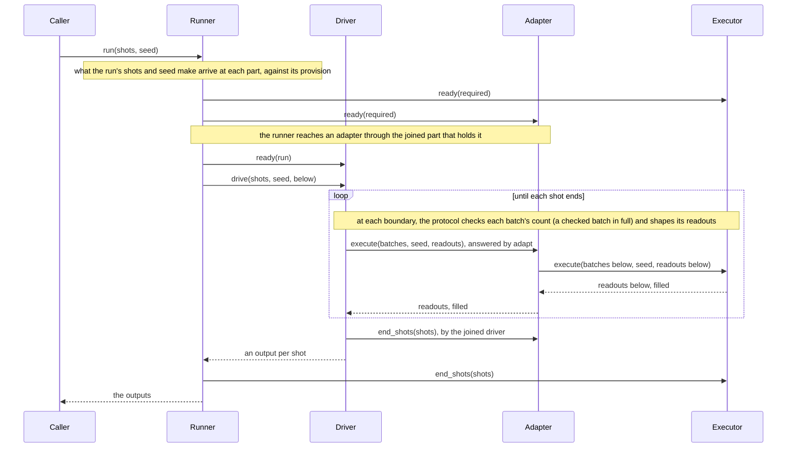

# The executor protocol

The executor protocol, the QDK crate `executor_protocol`, was designed to
solve the problem of combining tools that act between a quantum program and
the machine that runs it, such as noise models, error correction, profilers
and debuggers, each written on its own. Without a shared protocol, the
problem includes:

- glue code for every pair of tools, since each depends on the next one's
  types;
- the same checks in every tool (does the next one take these
  instructions, these qubits, these shots?), and mismatches found only
  when a shot reaches them;
- a model of instructions, shots and results of each tool's own, for every
  developer to learn;
- tools written for one stack and not reused in another, each copy
  maintained apart;
- a cost at every hand-off, converting each instruction to the next tool's
  types, paid again on every shot;
- a new tool or feature that changes the tools around it.

In addition to these, adaptive programs require a back-and-forth: a shot's
next instructions depend on its readouts, so instructions go down and
readouts come back while the shot runs.

The protocol solves these by composing the tools as parts of a chain: a
driver on top, such as a program's interpreter; any number of adapters
below it, such as a noise model, a code's lowering and decoding, or a
debugger; and an executor at the bottom, such as a simulator or a device.
A part calls the part below it with `execute`: batches of instructions,
each on a set of shots, answered with each shot's readouts. So a driver
sends each shot's instructions up to its next branch, reads the readouts,
and sends the next, as an adaptive program needs. A part depends on the
protocol alone, never on another part: the rest of the chain below it is
one executor to it, and the protocol carries each call across each
boundary, with its checks and the shaping of its readouts, so that a part
writes only its own logic. Its roles, batches and readouts are abstractions
shared by every part, so a developer learns one model for every tool.
Since any parts that fit can be joined, a part is reused in every chain
it fits and maintained in one place. It adds little cost: a chain's calls are
direct, and one `execute` carries many instructions on many shots. And it
is extensible, so that more can be built on it: a new part joins a chain
without changing any other, and the protocol grows by adding methods with
defaults, so that parts written before keep working.

Today the protocol holds:

- **The roles:** driving, adapting and executing, one trait each,
  [`Driver`](src/roles/driver.rs), [`Adapter`](src/roles/adapter.rs) and
  [`Executor`](src/roles/executor.rs), with what a part of that role is
  responsible for at each time: its declarations, which the joins read
  when they join the parts, and which must not change after; and its run
  methods, for each run.
- **The joins:** [`DriverJoins`](src/composition/driver_joins.rs) and
  [`AdapterJoins`](src/composition/adapter_joins.rs), which every driver
  and every adapter has, join a part with the part below it:
  `driver.through(adapter)` is a driver; `adapter.through(adapter)` is an
  adapter; `adapter.on(executor)` is an executor; and
  `driver.on(executor)` is a [`Runner`](src/composition/runner.rs), which
  runs shots. So reusable parts mix and match: a stack of adapters, or a
  noise model over a simulator, is a joined part, ready to join others as
  one part would. Any driver or adapter gets its joins, and every part the
  guarantees below, for free, with no code of its own; the
  [prelude](src/prelude.rs) brings the roles and the joins into scope.
- **Capabilities:** what flows down a chain with the instructions is one
  type, [`Capabilities`](src/capabilities.rs):
  [`Resources`](src/capabilities/resources.rs), such as qubits and shots,
  and [`Features`](src/capabilities/features.rs), such as whether a run
  may fix its seed and whether a shot replays. By default a part states
  none, and composes with any part on them. A part that states some gives
  its fixed limits on what arrives at it (`provides`), and what it
  requires of the part below given what arrives (`requires`): what it
  passes below unchanged is checked at every part below that limits it.
- **Instruction sets:** each role states the instructions it sends
  (`sends`) or accepts (`accepts`) as an
  [`InstructionSet`](src/instruction_set.rs). Each
  instruction's declaration, an
  [`InstructionDef`](src/instruction_set/instruction_def.rs), names the blocks it acts on
  ([`BlockType`](src/instruction_set/block_type.rs): qubits, or a code's
  blocks), its [`Parameter`](src/instruction_set/parameter.rs)s, its
  readouts and what it does ([`Meaning`](src/instruction_set/meaning.rs)).
  An [`Instruction`](src/instruction_set/instruction.rs) gives its
  [`Opcode`](src/instruction_set/opcode.rs), its blocks and its
  [`Argument`](src/instruction_set/instruction/argument.rs)s; each join
  binds a sender to its receiver's opcodes
  ([`OpcodeMap`](src/instruction_set/opcode_map.rs)).
- **What crosses a boundary:** each call down the chain, `execute`, sends
  [`Batch`](src/batch.rs)es of instructions, each on a
  [`ShotSet`](src/batch/shot_set.rs) of `ShotId`s, with the run's
  [`Seed`](src/seed.rs), and gets back
  [`BatchReadouts`](src/batch/batch_readouts.rs): a row per shot of
  [`ReadoutValue`](src/batch/batch_readouts/readout_value.rs)s, with the
  [`ShotConditions`](src/batch/batch_readouts/shot_conditions.rs) raised on it.
  [`Readouts`](src/batch/batch_readouts/readouts.rs) keeps them from one call to
  the next.
- **Refusals and failures:** a refusal says that nothing ran, so the call
  may be corrected and sent again
  ([`ExecuteRefusal`](src/roles/executor.rs),
  [`RunRefusal`](src/composition/runner/run_error.rs)); a
  [`Failure`](src/roles/failure.rs) names the
  shot whose work broke. They pass up the chain as
  [`ExecuteError`](src/roles/executor.rs),
  [`DriveError`](src/roles/driver.rs) and then
  [`RunError`](src/composition/runner/run_error.rs).
- **Guarantees at composition:** the `on` that makes a runner checks that
  each part accepts the instructions the part above sends, and that what
  arrives at each part, from the driver's requirement down, fits what it
  provides; both are one relation,
  [`BoundaryCompatible`](src/boundary_compatible.rs). A chain that fails
  is refused with every fault the `on` can see at once
  ([`CompositionFaults`](src/composition/composition_faults.rs)), each
  naming the requiring part and the part that falls short
  ([`PartId`](src/part_id.rs)), before any shot runs; inside a part of the
  user's, which the `on` cannot see into, the checks run on each run, as
  the table in [Composing and running a chain](#composing-and-running-a-chain)
  says.
- **Guarantees at run time:** the `Runner` checks what each run's shots
  and seed make arrive at each part against what it provides (a joined
  part inside a part of the user's checks its own parts at `ready`), and
  carries each call down the chain, checking each batch (its count
  always, its instructions when its sender marks it checked) and shaping
  its readouts. It ends each run's
  shots on every part. A part's panic in `drive`, `adapt` or `execute`
  becomes a failure of the run (on every platform but wasm32, where a
  panic aborts); one in a part's `ready`, in the protocol's end of the
  shots, or in a part's future dropped with the run's before it is ready
  is raised again from the run, as
  [`Runner::run_async`](src/composition/runner.rs) says. With a fixed
  seed, and parts that draw on the protocol's seeds, a run gives the
  same outputs each time; and where the chain's shots replay, a shot run
  again alone, as a debugger does, gives back its readouts.

Users write the parts: any type that implements a role, written new or
wrapping an existing interpreter, noise model or simulator.
[Writing a part](docs/writing-a-part.md) shows how, and
[`examples/compose_and_run.rs`](examples/compose_and_run.rs) writes a small
part of each role.

**Why this approach.**

- **Decoupled, open-closed parts.** One driver runs on every chain that
  provides what it requires, and a new part is a new type that
  implements a role, which joins a chain without changing any other part or
  any type of the protocol. The protocol is open the same way: streaming a
  run's outputs as they come is planned as a backward-compatible,
  incremental extension that only adds methods and types, those of the
  roles with a default, so a part written today keeps working unchanged.
- **Low cost per instruction.** A chain's type is built from its parts'
  types, so each call down it is a direct call; one `execute` carries many
  instructions on many shots, sharing its cost; the readouts' memory is
  reused from call to call; and a batch is checked in full only when its
  sender asks, so a chain of parts that keep the protocol's rules pays for
  no check it does not need. [`examples/bench`](examples/bench/main.rs)
  times the protocol against a driver that calls its executor directly.

## Terms

These words name a chain's parts, its contracts and what crosses its
boundaries; the rest of this README, and the pages of [`docs/`](docs), use
them as defined here.

- **Role**: what a part does in a chain: drive, adapt or execute. Each role
  is one trait: its declarations, which the joins read, and its run
  methods, which each run calls.
- **Part**: a chain's unit, as a link is a chain's: a value of a type that
  implements one role.
- **Chain**: parts from a driver on top, through any number of adapters, to
  an executor at the bottom, joined by `through` and `on`; joining them
  gives a
  [`Runner`](src/composition/runner.rs).
- **Composition**: joining parts with `through` and `on`, the only way to
  make a chain. A driver joined `on` an executor is a chain, a
  [`Runner`](src/composition/runner.rs); any other join, such as
  `adapter.through(adapter)` or `adapter.on(executor)`, falls short of one
  and gives a joined part, whose type cannot be named. A joined part plays
  the role of its ends and joins others as one part would, while its parts
  keep their own positions and boundaries in the chain.
- **Boundary**: where two consecutive parts of a chain meet; the part
  above calls the part below across it.
- **Shot**: one execution of the program, named by a
  [`ShotId`](src/batch/shot_set/shot_id.rs). A [`ShotSet`](src/batch/shot_set.rs) holds shots
  in the caller's order, never empty and none twice.
- **Run**: one call of `Runner::run` or `Runner::run_async`, on a shot
  set.
- **Capabilities** ([`Capabilities`](src/capabilities.rs)): what a part
  requires of the part below it, given what arrives at it (its
  **requirement**), or its fixed limits on what arrives at it (its
  **provision**): resources, such as qubits, shots per run and
  instructions per batch, and features: whether
  the shots use readout parities, whether a run may fix its seed
  (_seeded runs_: a quantum computer's measurements cannot be seeded), and
  whether a shot run again alone, as a debugger does, gives its readouts
  back (_replay_: a sampler that draws a run's shots from one random
  stream, in one call, does not).
- **What arrives** at a part: the requirement of the part above it, given
  what arrived there; at the part below the driver, the driver's
  requirement for the run. It must fit the part's provision. A part that
  states nothing requires what arrives and limits nothing, so a
  requirement passes it unchanged.
- **Instruction set** ([`InstructionSet`](src/instruction_set.rs)): a
  named list of the instructions a part sends or accepts, each declared
  with its mnemonic, the blocks it acts on (qubits, or blocks of an
  error-correcting code), its parameters and its readouts.
- **Batch** ([`Batch`](src/batch.rs)): instructions to run, in order, on
  each shot of a shot set.
- **`execute`**: one call across a boundary, with any number of batches,
  the run's seed, and the caller's readouts: one
  [`BatchReadouts`](src/batch/batch_readouts.rs) per batch, a row per shot.
- **Sender** and **receiver**: the two sides of an `execute`: the part
  above, which sends the batches, and the part below, which runs them and
  fills their readouts. The protocol stands between them on each call
  across the boundary: it checks the batches and shapes their readouts, so
  that neither side has to.
- **Checked batch**: a batch its sender marked [`checked`](src/batch.rs),
  which each boundary checks in full before it runs. An unchecked batch,
  the default, runs as sent, with only its count of instructions checked.
- **Fit**: the check that what the part above states is met by what the
  part below states
  ([`BoundaryCompatible::fits`](src/boundary_compatible.rs)): every
  instruction sent is accepted, with the same blocks, parameters and
  readouts; and what arrives at a part requires no resource beyond what
  it provides, and no feature it says it lacks.

## Composing and running a chain

Users join the parts top to bottom, `through` each adapter and `on` the
executor. A chain then has two times, each calling its own methods of
each part's trait:

- **Setup**, once, when the parts are joined: each join fits the boundary it
  makes and, where it fits, binds the part above to the opcodes of the part
  below (`bind`); the `on` that joins a driver with an executor checks
  what arrives at each part it can see, and gives a
  [`Runner`](src/composition/runner.rs), or every fault it found (a part
  of the user's is checked on each run, as the table below says). Setup
  only decides, from what the parts declare; what prepares a part to run
  belongs to each run.
- **Each run**, each time [`Runner::run`](src/composition/runner.rs) runs a
  [`ShotSet`](src/batch/shot_set.rs) with a seed: the run checks what its
  shots and its seed make arrive at each part against what it provides,
  gets each part `ready` for what arrives at it, or is refused by the
  first that cannot take a run now, lets the driver send its batches down
  the chain (`drive`, then each `adapt`, then `execute`), and, once it
  ends, ends its shots on every part. It gives the driver's outputs, one per shot by `Driver::drive`'s rule, or a
  [`RunError`](src/composition/runner/run_error.rs).

A run's calls:



Each contract is checked as early as what it reads is known:

| Contract                                                                                                                                             | Checked                                              |
| ---------------------------------------------------------------------------------------------------------------------------------------------------- | ---------------------------------------------------- |
| A part's role; a joined part's type cannot be named                                                                                                  | by the compiler                                      |
| The instructions each part sends against those the part below accepts, and what arrives at each part against its provision; every fault of the chain | by the `on` that makes a runner, when it joins       |
| The same, inside a joined part held by a part of the user's, which the `on` cannot see into                                                          | by the joined part's `ready`, which refuses each run |
| What a run's shots and seed make arrive at each part, against its provision                                                                          | at the run's start, before any part is asked         |
| A batch's count of instructions; a checked batch's blocks, parity and readouts                                                                       | at each boundary, on each call                       |

How each join's role follows from its two ends, what a run asks of each
part, what is checked where and when, and how a run fails are in
[Composing and running a chain](docs/composing-and-running.md).

## An example

Three toy parts, one of each role: a driver that tosses a coin and copies
it onto a second qubit, an adapter that adds bit-flip noise, and an
executor whose qubits are classical bits. Copied from
[`examples/compose_and_run.rs`](examples/compose_and_run.rs), which also
writes the three parts and the helpers `SEED` and `text`; its tests run it.
`BitFlip::new(0.2)` undoes each `x` with probability 0.2:

```rust
/// The three parts, joined: `coin`, under 20% bit-flip noise, on `bits`
/// (a [`Bits`], or a borrow of one, to read what it counted after a run).
///
/// After each run, the protocol ends every shot of the run on every part, so
/// the parts free its state and a rerun with the same seed starts it
/// afresh; the driver need not end them.
fn coin_runner<E: Executor>(
    coin: CoinCopy,
    bits: E,
) -> Runner<impl Driver<Output = Vec<ReadoutValue>>, E> {
    // `through` joins the driver and the adapter into one driver, and `on`
    // joins that driver and the executor into the runner. The `on` that
    // makes the runner checks that each part accepts the instructions the
    // part above sends, and that the bits provide what arrives at them: the
    // coin's 2 qubits, passed below by the noise, which states nothing. It
    // gives the runner or every fault of the chain.
    let runner = coin.through(BitFlip::new(0.2)).on(bits);
    runner.expect("the parts compose: the bits provide what the coin requires")
}

fn main() {
    let mut runner = coin_runner(CoinCopy::new(), Bits::new());

    let shots = ShotSet::ids(0..12);
    let values = runner.run(&shots, SEED).expect("the chain runs 12 shots");
    println!("shot  coin  copy");
    for (id, shot) in shots.iter().zip(&values) {
        println!("{id:>4}  {:>4}  {:>4}", text(shot[0]), text(shot[1]));
    }
    println!("A copy unlike its coin: the noise flipped it.");

    // The runner ended every shot of the first run, so shots 4 and 5 start
    // afresh, and the seed gives them the same values.
    let again = runner
        .run(&ShotSet::ids([4, 5]), SEED)
        .expect("the chain runs 2 shots");
    let same = again == [values[4].clone(), values[5].clone()];
    println!("\nShots 4 and 5, run again alone: the same values, noise included? {same}");

    // While a part of the chain is developed, the driver may send every
    // batch checked: each boundary checks it before it runs, at a cost.
    let checked = coin_runner(CoinCopy::new().checked(), Bits::new())
        .run(&shots, SEED)
        .expect("the chain runs 12 checked shots");
    let same = checked == values;
    println!("\nThe 12 shots again, every batch checked: the same values? {same}");

    let refused = runner
        .run(&ShotSet::ids(0..2000), SEED)
        .expect_err("Bits runs at most 1000 shots");
    println!("\n2000 shots: {refused}");
}
```

Run it with `cargo run -p executor_protocol --example compose_and_run`.

## Further reading

The pages of [`docs/`](docs) give the protocol's rules, for those who
write a part or compose a chain; the rustdoc of each item gives its
mechanics and edge cases.

- [Writing a part](docs/writing-a-part.md): each role's methods, phase by
  phase, an executor in full, the rules a part keeps, and how a part draws
  from the run's seed or says it cannot replay a shot.
- [Batches and readouts](docs/batches-and-readouts.md): what a batch
  holds, and how its readouts are shaped, filled and kept.
- [Instruction sets and their fit](docs/instruction-sets.md): what a set
  declares, how it is built, and when two sets fit.
- [Capabilities and their fit](docs/capabilities.md): what a part
  requires and provides, replay included, what arrives at each part, and
  where each statement is checked.
- [Composing and running a chain](docs/composing-and-running.md): the joins and
  the role each gives, a run's steps, seeds, where and when each check runs, and
  failures and panics.

## Planned extensions

Streaming: today a run gives its outputs when it ends. The planned
extension gives each shot's outputs as the shot ends. Each role gains an
`_each` form of its method, whose default gives every result once the call
ends, and the runner gains `run_each`. A part that keeps the default runs
unchanged; a part that overrides it streams.

## Tests

The crate's tests are in [`src/tests/`](src/tests), filed by the module
whose behaviour they check, in a tree that follows [`src/`](src). They run
chains of small parts written for them, in
[`src/tests/fake_parts/`](src/tests/fake_parts). Where the bracketing of the
joins could change a result (the readouts, the faults, the parts they
name), the tests compare a chain's bracketings. Both examples run as tests:
[`examples/compose_and_run.rs`](examples/compose_and_run.rs), and
[`examples/bench`](examples/bench/main.rs), which times the protocol's cost
against a driver that calls its executor directly.

```text
cargo test -p executor_protocol
cargo run --release -p executor_protocol --example bench
```

## Platforms

| Platform             | Status                                                                                                                                          |
| -------------------- | ----------------------------------------------------------------------------------------------------------------------------------------------- |
| Linux aarch64        | the tests and the examples run                                                                                                                  |
| wasm32 (WebAssembly) | the library builds; `Runner::run`, which blocks, is not built there, so a caller awaits `Runner::run_async`; a panic aborts, and none is caught |

- **Expected, not verified:** the other platforms the QDK builds for,
  Linux x86-64 among them: the crate uses only the standard library and
  two dependencies, `pin-project-lite` and `smallvec`, and its
  platform-specific code is the wasm32 case above, a drawn seed without a
  clock on wasm32 ([`Runner::run_async`](src/composition/runner.rs)), and two size
  checks made on 64-bit targets only.
