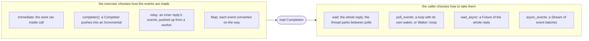
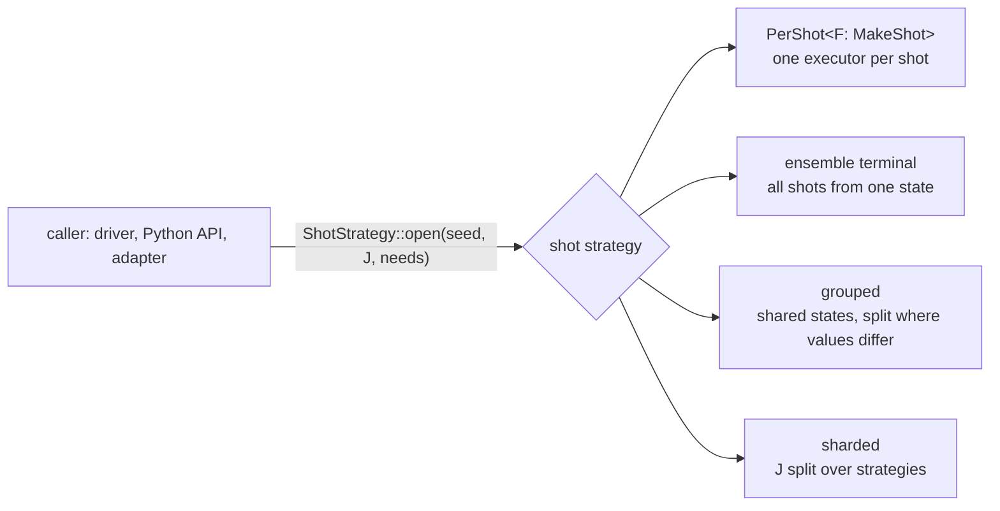

# `executor_protocol`

How a caller hands quantum work to an executor and reads its reply, the same
way whatever runs the work.

## What this crate does

It defines the protocol every component of an execution stack speaks, and
nothing that runs work. A simulator, an adapter that runs a program's
classical part, or a link to a remote device each implement it; the crates
that hold them depend on this one.

- A **message kind** (`Message`) fixes what a call means and which events its
  reply carries. Level L3 is a `Batch`: a list of instructions run in order on
  one shot, whose state carries over from the batches before it. Its events
  are `Outcome`s, a value under the tag the batch gave the readout.
- An **executor** (`Executor<M>`) accepts one message kind. A _terminal_ runs
  the message; an _adapter_ keeps its meaning and passes the work on to the
  executor it wraps, possibly in another instruction set. A chain of adapters
  is again an executor of the same kind, so a driver written once runs on
  every chain.
- A **call** returns at once, with a reply (`Completion`) or a typed refusal
  (`Rejected`). A refusal means that nothing started, so the caller may
  correct the message and send it again; each refusal has a retry class.
  A run that starts and cannot finish ends its reply with `Status::Failed`.
- **Replies** are polled for their events, never block, and wake their
  caller when they can make progress. `Immediate` is the reply of an executor
  that ran the work inside the call; a `completer` makes the two ends of a
  reply whose events come from elsewhere (a worker thread), and `relay` passes
  an inner reply's events up through one. A driver takes a whole reply with
  `wait` (blocking) or `wait_async` (a `Future`), or its events as they come
  with `Completion::poll_events` or `async_events` (a `Stream`, the reason
  the crate depends on `futures-core`).
- Level L2 is a **session**: a `Submission` runs one batch on each shot of a
  set of shots (`ShotSet`), each shot's state carrying over. Its events are
  `ShotOutcome`s. A **shot strategy** (`ShotStrategy`) opens a session on the
  shots J with a seed and the caller's `Needs`, which are checked at once
  against what it offers; an unmet need names the component. The strategy
  decides how the shots run (see [Shot strategies](#shot-strategies)).
  `PerShot` wraps a maker of one shot's L3 executor (`MakeShot`) and opens
  a `PerShotSession`: one executor per shot, reachable between calls.
  `SubmissionWrapper` runs an L3 driver on one shot `j` of a session. An L3
  driver drives one shot (its batches depend on that shot's outcomes), so a
  run of n shots opens one session per shot on `ShotSet::one(j)`, with the
  run's seed: one shot's state is held at a time, and shot `j` gives the
  outcomes it gives in a session on all n shots. A session that fails
  part-way through a submission is failed for good (`Lifecycle`).
- **Seeds**: shot `j` of a session opened with `seed` draws from seeds fixed
  by `seed`, `j` and the component that draws (`ShotContext`, `shot_seed`,
  `ComponentId`), so a shot's outcomes do not depend on how J is split or on
  which other components draw. The crate gives seeds, not generators, so it
  depends on no random-number crate.
- An executor **describes** what it offers (`Describe`, `Capabilities`), so a
  stack can be checked before it runs, and **closes** (`Close`) with a report
  that folds with the reports of the components it wraps (`Fold`); a session
  reports its submissions, and each shot's log probability where it is known
  (`SessionReport`, `LogP`).
- **Codes** (`reason_code`, `need_code`, `value_code`, `retry_code`) give the
  fixed numbers by which a refusal, a need and a value cross a link.

## Replies: one `Completion`, four ways to take it

**The concrete case.** `OnAThread`, a test double in `src/tests/wake.rs`
(lines 187–206), runs each call on a thread of its own. `call` returns at
once with an `Incremental` reply; the thread pushes one outcome per
instruction through the reply's `Completer`, then ends the reply:

```rust
struct OnAThread;

impl Executor<Batch<bool>> for OnAThread {
    type Response = Incremental<Outcome>;

    fn call(&mut self, batch: &[bool]) -> Result<Self::Response, Rejected> {
        let (completer, reply) = completer();
        let batch = batch.to_vec();
        thread::spawn(move || {
            for (tag, one) in (0..).zip(batch) {
                completer.push(Outcome {
                    tag,
                    value: one.into(),
                });
            }
            completer.done();
        });
        Ok(reply)
    }
}
```

The test `one_reply_is_taken_four_ways` (same file, lines 211–258) calls
it four times and takes the reply four ways: blocking, polling, as a
`Future` and as a `Stream`. Each way gets the same events, and the
executor does not change:

```rust
fn one_reply_is_taken_four_ways() {
    let batch = [true, false, true];
    let expected: Vec<Outcome> = (0..)
        .zip(batch)
        .map(|(tag, one)| Outcome {
            tag,
            value: one.into(),
        })
        .collect();
    let call = || OnAThread.call(&batch).expect("accepted");

    // Blocking: `wait` parks the thread until the reply ends.
    let mut blocked = Vec::new();
    assert_eq!(wait(call(), &mut blocked), Ok(()));

    // Polling: the caller does its own work between polls.
    let (mut reply, mut polled) = (call(), Vec::new());
    let end = loop {
        match reply.poll_events(&mut polled, Waker::noop()) {
            Status::Pending => thread::yield_now(), // the caller's own work
            end => break end,
        }
    };
    assert_eq!(end, Status::Done);

    // Async, the whole reply: a `Future`.
    let (awaited, end) = block_on(wait_async(call()));
    assert_eq!(end, Ok(()));

    // Async, the events as they come: a `Stream` of event batches.
    let mut events = async_events(call());
    let mut streamed = Vec::new();
    let end = block_on(poll_fn(|context| {
        loop {
            match Pin::new(&mut events).poll_next(context) {
                Poll::Ready(Some(Ok(mut batch))) => streamed.append(&mut batch),
                Poll::Ready(Some(Err(reason))) => return Poll::Ready(Err(reason)),
                Poll::Ready(None) => return Poll::Ready(Ok(())),
                Poll::Pending => return Poll::Pending,
            }
        }
    }));
    assert_eq!(end, Ok(()));

    for events in [blocked, polled, awaited, streamed] {
        assert_eq!(events, expected);
    }
}
```

`block_on` is the test file's small executor of one future (lines
102–118); an async runtime plays that part with its own wakers.

**The general idea.** A reply is one trait with one method
(`src/completion.rs`, doc comments left out):

```rust
pub trait Completion {
    type Item;

    fn poll_events(&mut self, out: &mut Vec<Self::Item>, waker: &Waker) -> Status;
}
```

`poll_events` moves the events available now to the end of `out` and
never blocks. After a poll that returns `Status::Pending`, the reply keeps
that poll's waker and wakes it once a new poll could deliver more events
or end the reply. The executor knows when its events are ready, the caller
knows when it wants them, and the waker joins the two. So the executor and
its caller choose independently:



The table of callers is in `Completion`'s documentation. Only `wait`
blocks a thread, and only the caller chooses it. `wait_async` and
`async_events` (`src/asynchronous.rs`) are thin wrappers that poll the
reply with the task's waker; `async_events` is why the crate depends on
`futures-core`, for the `Stream` trait. A driver written against
`Completion` runs over every executor, and an adapter that passes a reply
up (`relay`, `Map`) does not need to know how its caller will take it.

The choice stays the caller's only while no executor below waits inside
its own `call`. `RuntimeAdapter` (`qdk_simulators`,
`src/execution/runtime.rs`) does: its walk needs each measurement before
it goes on, so it calls `wait` on its terminal's reply inside `call` and
returns an `Immediate`. An async caller over it still holds its thread for
the whole call. That is fine for a shot, which is sequential: H₂'s program
has 1,404 measurements and 713 branches on them, each batch needs the
results before it, and nothing in the call could run while the terminal
works (`RuntimeAdapter::call`'s documentation). `SimulatorTerminal`, its terminal today, replies
`Immediate`, so that `wait` never parks; a reply that drives the walk when polled would remove the
wait when a terminal replies `Pending`, with no change to callers.

## Capabilities and needs

A component says what it offers (`Describe::capabilities`), and a caller
says what it needs when it opens a session (`Needs`). The shot strategy
checks one against the other before anything is allocated. `PerShot` does
it with its maker's capabilities:

```text
caller ── open(seed, J, needs) ──► PerShot(maker)
                                    capabilities = maker.capabilities()
                                    capabilities.admit(maker's type name, J, needs)
                                    ├─ every need met ──► Ok(PerShotSession)
                                    └─ the first unmet ──► Rejected::Unmet { component, need, needed, offered }
```

Each need is a number, compared with what is offered: met when
needed ≤ offered, with a yes-or-no as 1 or 0. So a `false` need is always
met, and a `true` need is met only by a `true` capability. `Unmet` names
the component, so the caller knows which one to change.

| Property        | Offered (`Capabilities`), default        | Needed (`Needs`), default | Checked                                                     |
| --------------- | ---------------------------------------- | ------------------------- | ----------------------------------------------------------- |
| `qubits`        | `Option<u32>`, `None`: no limit          | `Option<u32>`, `None`     | `admit`, 1st: when both are stated                          |
| `feedback`      | `bool`, `true`                           | `bool`, `false`           | `admit`, 2nd                                                |
| `resets`        | `bool`, `true`                           | `bool`, `false`           | `admit`, 3rd                                                |
| `replayable`    | `bool`, `true`                           | `bool`, `false`           | `admit`, 4th                                                |
| `probabilities` | `bool`, `false`                          | `bool`, `false`           | `admit`, 5th                                                |
| `states`        | `Option<u64>`, `None`: no limit          | \|J\|, implied            | `admit`, 6th: when a limit is stated                        |
| `rngs`          | `ComponentRngs`, the terminal's id alone | –                         | when a stack is built: `Capabilities::drawing` (`RngInUse`) |

The defaults keep an executor's meaning when a field is added:

- `resets` defaults to `true`: an executor that cannot prepare a qubit
  again during a shot says so.
- `probabilities` defaults to `false`: only an executor that computes each
  shot's log probability says so (a simulator), not hardware, nor a
  sampler that returns values only.
- `rngs` lists the ids of the components that draw random numbers at or
  below a component. A component that draws is refused when it is built
  over one that already draws with its id, so each draws from a seed of
  its own (see [Seeds](#seeds-not-generators)).

`Needs::default()` states nothing but the one state per shot that every
session implies, so every strategy that can hold the shots accepts it, and
`open(strategy, seed, shots)` opens with it. A caller states a need only
when it wants it checked. From `needs_are_checked_at_open_and_probabilities_reported_at_close`
(`src/tests/sessions.rs`, lines 312–328):

```rust
let shots = ShotSet::range(1..=2).expect("shots");
let per_shot = PerShot(TestDoubleShots::default());
let unmet = |needs: &Needs| match per_shot.open(1, &shots, needs) {
    Err(Rejected::Unmet(Unmet {
        component, need, ..
    })) => Some((component, need)),
    _ => None,
};
let name = std::any::type_name::<TestDoubleShots>().to_owned();
assert_eq!(
    unmet(&Needs::default().with_qubits(Some(5))),
    Some((name.clone(), Need::Qubits))
);
assert_eq!(
    unmet(&Needs::default().with_probabilities(true)),
    Some((name, Need::Probabilities))
);
```

Both structs are `#[non_exhaustive]` and built from their default and
`with_` methods, so a new capability is a new field whose default keeps
every existing executor and caller as they were: a field in
`Capabilities`, a field in `Needs`, a `Need` variant with its wire code
(`need_code`), and its check in `Capabilities::admit`.

## The instruction set is a type

An L3 executor's instructions are its message's instruction type. An
`Executor<Batch<RegionInstruction>>` accepts regions and nothing else,
and an adapter that sends its terminal instructions of another type does
not compile. So `Capabilities` has no instruction-set field, and nothing
checks one at run time: there would be nothing to check it against. This
departs from LAYERING.md §2.1 (the prototype's design document; see
[below](#where-this-crate-departs-from-layeringmd)), which sketches
`Capabilities { isa: Arc<Isa>, … }`, and from §2.7, which derives
`resets` from the ISA (`Capabilities::of(isa)`). Here `resets` is a field.

An instruction set chosen at run time is needed once one crosses a link:
a remote device, or Qodec, declares its instructions as a value. It is
added without breaking anyone:

1. A field `isa: Option<Arc<Isa>>` in `Capabilities`, `None` in
   `Capabilities::default()`, so today's executors keep their meaning
   (`#[non_exhaustive]` makes the new field non-breaking).
2. A constructor from the value, `Capabilities::from_isa(isa)` (the
   prototype's `Capabilities::of`), which also sets `resets` from whether
   the ISA has an instruction that prepares a qubit.
3. Its check. By §2.7's rule, a run-time ISA is a capability and a need:
   it depends on the component, some components lack it, and a caller
   depends on it for a whole session. §2.7's table checks it when the stack
   is built (the chain), as `Capabilities::drawing` checks RNG ids; a
   caller that states the instructions it will send at `open` adds a field
   in `Needs` and its check in `admit`.

## Shot strategies

A caller that runs shots (a driver, the Python API, an adapter for another
stack) needs a session to submit batches to, nothing more. How the shots of
J share work is a choice with different costs and guarantees, so each choice
is one implementation of `ShotStrategy`, and a new one is added without
changing the callers:



| Strategy                         | How the shots of J run                                                  | Replayable              | Status                           |
| -------------------------------- | ----------------------------------------------------------------------- | ----------------------- | -------------------------------- |
| `PerShot<F>`                     | each on its own L3 executor, made by `F: MakeShot`; nothing shared      | yes                     | here                             |
| an ensemble terminal (MPS batch) | together, from one state and one seed; Base programs only (no feedback) | no                      | the MPS method                   |
| grouped                          | on shared states, which split where the shots' values differ            | yes                     | when a measurement shows it pays |
| sharded                          | J split over several strategies (devices, threads), replies merged      | as the inner strategies | when several devices are used    |

_Replayable_ means each shot's outcomes depend only on the seed and its own
index, not on the other shots of J; a caller that needs it says so in its
`Needs`, and a strategy that cannot offer it refuses at `open`.

Every strategy keeps one contract: the needs are checked at `open`, before
anything is allocated; each shot's state carries over between submissions;
the session is closed once, with a report that folds. An adapter that wraps a
strategy (a lowering, a noise source, exclusive use of a device) is again a
strategy, so a stack is built by wrapping.

The method keeps the protocol's name for the step, `open(seed, shots,
needs)`; the trait is named for what distinguishes its implementations.

**Why `PerShot` is a type, not a blanket implementation.** A blanket
`impl<F: MakeShot<I>> ShotStrategy<I> for F` would let a caller pass a maker
directly, but it would make per-shot the only strategy a maker can have.
Rust then refuses, as overlapping implementations (E0119):

- a terminal that is a maker for programs with feedback and its own ensemble
  strategy for Base programs;
- one adapter (noise, say) that wraps either a maker or a strategy;
- a strategy shared through `Arc`, since another crate may make `Arc<_>` a
  maker.

With `PerShot`, each of these compiles, and the caller writes
`PerShot(maker)`.

## Seeds, not generators

Shot `j` of a session opened with seed `s` draws, in component `c` (a
32-bit `ComponentId`; the terminal's is 0), from the seed

```text
shot_seed(s, j)    = SM(SM(s) ⊕ j)
rng_seed(s, j, c)  = SM(SM(s) ⊕ (c · 2³² + j)),   so rng_seed(s, j, 0) = shot_seed(s, j)
```

where `SM` is one step of `SplitMix64` (`shot_seed`,
`ShotContext::rng_seed`). Each step, and the XOR with a constant, is a
bijection of `u64`, and `c · 2³² + j` is one-to-one over 32-bit shots and
ids, so:

- no two shots of a session share a seed, nor two (shot, component)
  pairs;
- a seed depends only on `(s, j, c)`, so a shot's outcomes do not depend
  on how J is split into sessions, nor on which other components draw.

`a_shots_outcomes_do_not_depend_on_how_the_shots_are_split`
(`src/tests/sessions.rs`) checks the split. That other components do not
shift a shot's draws follows from the formula, and
`each_component_of_a_shot_has_its_own_seed` (`src/tests/shots.rs`) checks
that their seeds differ; no test here runs two components that draw.
`src/tests/shots.rs` also pins known answers.

`ShotContext` gives seeds, not generators. A method that returned a
`StdRng` would make this crate depend on `rand`, and the crate depends on
`std` and `futures-core` only, so that every part of qdk can use it.
`rand` with its default features brings `getrandom`, which needs a
backend chosen for each target: the wasm check of `qdk_simulators` fails
in it today without one. And `rand` does not promise to keep `StdRng`'s
algorithm across versions, so a shot's draws would change with `rand`'s
version, where its seeds do not. Nothing is lost. The prototype's `ShotContext::rng(c)` is
`StdRng::seed_from_u64(self.rng_seed(c))`, and a component that wants a
generator writes that line itself. A legacy simulator takes a 32-bit seed,
so `SimulatorShots` (`qdk_simulators`,
`src/execution/terminal.rs`) folds the shot's seed:

```rust
fn make(&self, ctx: &ShotContext) -> SimulatorTerminal<S> {
    let seed = ctx.rng_seed(ComponentId::TERMINAL);
    #[expect(
        clippy::cast_possible_truncation,
        reason = "the legacy simulators take a 32-bit seed: both halves are folded in"
    )]
    let seed = (seed ^ (seed >> 32)) as u32;
    SimulatorTerminal::new(self.qubits, self.results, seed, self.noise.clone())
}
```

Two shots of a session may then share a 32-bit seed, with probability
about n²/2³³ for n shots (`SimulatorShots`' documentation). These seeds
are not those that qdk's `run` or `run_qir` give each shot for the same
user seed: each of those has a formula of its own.

## Where this crate departs from LAYERING.md

LAYERING.md, the design document of the protocol's prototype (a
separate repository), describes the protocol's model; this crate is its
current form. The model is the same. These names and choices
differ:

| LAYERING.md                                             | Here                                              | Why                                                             |
| ------------------------------------------------------- | ------------------------------------------------- | --------------------------------------------------------------- |
| `Capabilities { isa: Arc<Isa>, … }`, `Capabilities::of` | no ISA field: the message's instruction type      | [The instruction set is a type](#the-instruction-set-is-a-type) |
| `resets` derived from the ISA                           | a field, `true` by default                        | the same                                                        |
| `ShotContext::rng(c)`, a `StdRng`                       | `ShotContext::rng_seed(c)`, a `u64`               | [Seeds, not generators](#seeds-not-generators)                  |
| `Open`, implemented by every maker                      | `ShotStrategy<I>`, and `PerShot(maker)`           | [Shot strategies](#shot-strategies)                             |
| `SubmissionUnwrapper`                                   | `PerShotSession`                                  | it is the per-shot strategy's session                           |
| `SubmissionWrapper`, on shot 1 of J = {1}               | `SubmissionWrapper`, on any shot `j` of a session | a run of n shots opens one session per shot                     |
| `Watch`, `Watched<C>`                                   | `LifecycleHandle`, `SessionBound<C>`              | both tie a reply to its session's `Lifecycle`                   |

## Example

The region ISA in `qdk_simulators::execution` is an L3 instruction set:

```text
driver ──Batch<PreparedAdaptiveProgram>──► RuntimeAdapter ──Batch<RegionInstruction>──► SimulatorTerminal
       ◄── Outcome per output record ─────                 ◄── Outcome per measurement ──
```

`RuntimeAdapter` runs a program's branches and loops itself, and sends the
terminal the regions, measurements and resets it reaches.

Per-shot sessions of a legacy simulator are opened by
`PerShot(SimulatorShots::new(…))`, over the maker of one shot's
`SimulatorTerminal`:

```text
driver ──Submission<RegionInstruction>──► PerShotSession ──Batch<RegionInstruction>──► SimulatorTerminal (one per shot)
       ◄── ShotOutcome per measurement ──                      ◄── Outcome per measurement ──
```
