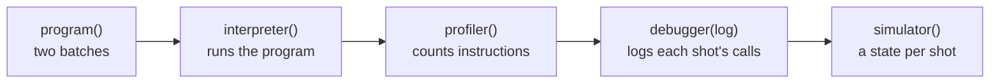
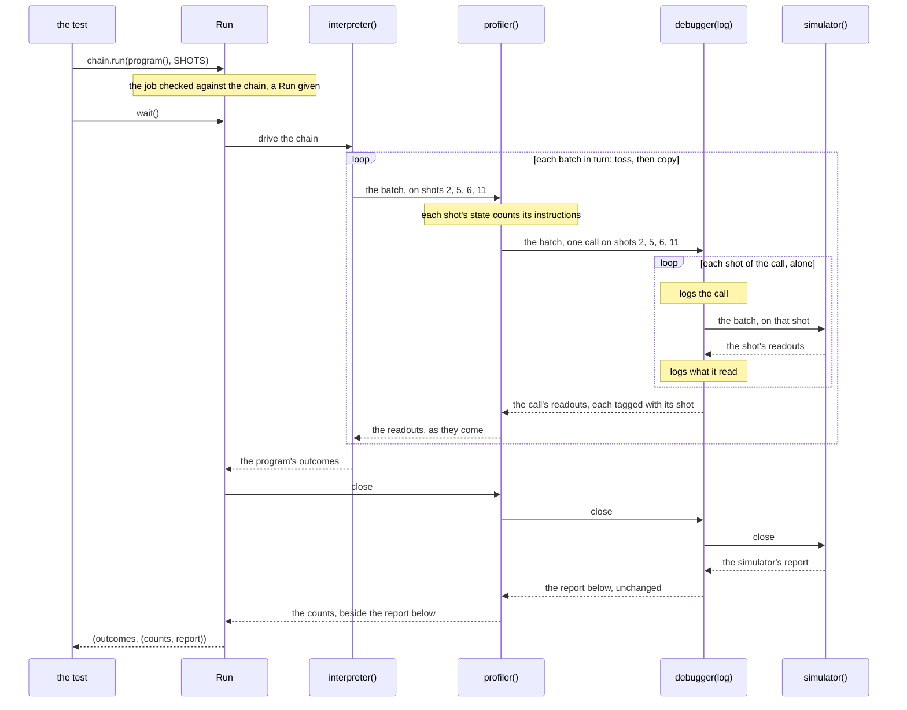

# `executor_protocol`

qdk runs quantum programs on several simulators, and places components between
a program and the simulator that runs it: a
[runtime](docs/glossary.md#a-chain-and-its-parts) that walks an adaptive
program and feeds measurements back, a noise model that inserts faults, an
error-correcting code that lowers logical instructions to physical ones, a probe
that counts resources. Without a shared contract, each such chain needs its own
glue, and each decides anew how shots draw their randomness, how a failure is
reported and how a caller waits. This crate is that contract. A chain has a
**driver** at the top, which runs the program and makes the calls for the
shots of the job, and an **executor** at the end, which runs the
instructions: a simulator, or (planned) a quantum device behind its service.
Called with a message, an executor answers with a reply. Each component in
between is an **adapter**: given the executor downstream of it, it gives an
executor upstream of it, with the same contract. So every link of a running
chain is the same call and reply. Chains are composed from parts, checked
before they run, and driven the same way by any caller: one that blocks, one
that polls between its own work, or async tasks, in the same process or,
through the planned lower layers, across a network.

The executors themselves live in other crates. This one holds the contract,
and currently offers facilities for: making an executor or an adapter from an
implementer's own logic, keeping for it the rules every part follows
(admitting and refusing calls, failing and closing, seeding, the replies),
with one state for all its shots or, by one option, one per shot;
composition, which renumbers calls into the instruction set downstream where
the two number their instructions otherwise; and the reply machinery that
every chain reuses. More will be added, each listed with the case that needs
it in [Planned features](docs/planned.md): facilities for an adapter whose
logic refuses a call, states what it offers and needs beyond its instruction
sets and seeds, or reads the replies below without holding its thread.

Some concrete problems it addresses, as examples:

- **Adaptive programs, shot by shot.** A program whose measurements decide what
  runs next (an iterative phase estimation, for example) takes a different
  path in each shot. Each shot keeps its own state, and a caller reads a
  batch's outcomes before it sends the next batch
  ([example](tests/per_shot_executor.rs)).
- **The same outcomes however the shots are split.** Each shot draws, in each
  component of the chain that draws, from a seed derived from the run's seed,
  the shot's id (its `ShotId`) and the component's id; the run's seed is the
  one the last executor is built with, and an adapter that draws is given it
  when the chain is built, or the chain is refused
  ([Seeds](docs/executors.md#seeds-not-generators)). On an
  executor that keeps each shot's state apart
  ([replayable](docs/executors.md#how-an-executor-holds-its-shots)), a shot
  run alone gives what it gives among others, so the shots can be split
  across runs, in parallel.
- **Components added without changing the simulator.** A noise model, a code's
  lowering and decoding, a profiler or a debugger is an adapter: it makes, from
  the executor downstream of it, an executor upstream of it, with the same
  contract: a [profiler and a debugger](tests/observers.rs), a
  [repetition code and a noise logic](tests/static_isa.rs), and a
  [code given as data](tests/runtime_isa.rs). A
  resource probe is planned, with no milestone yet: an adapter
  that counts what a run uses, for example the resource estimator's counts
  (`source/resource_estimator`) of a program run before and after a noise
  model.
- **Failing before running.** A component describes what it offers, and a
  program declares what it needs. A chain whose parts do not fit is refused
  when it is built, and a job whose program needs what the chain lacks is
  refused before any call; each refusal names the component, and every fault
  of the parts built together, or of the job, is
  [reported at once](docs/composition.md#what-is-checked-and-when), but for
  a job's shots named twice: only the least is reported. A part
  composed with the executor first is built on its own, and reports its
  faults before what is upstream of it
  ([Composing a run](docs/composition.md#composing-a-run)).
  Found during a run, a mismatch would cost the work done so far, or give
  outcomes that silently mean something else.
- **Any caller.**
  [One reply](docs/replies.md#replies-one-reply-four-ways-to-take-it)
  serves a blocking caller, a caller that does its own work between polls,
  and async tasks, which await the whole reply or take its events as a
  stream; a caller can keep several calls in flight. A binding for
  another language (Python, or even Fortran through a C interface) needs only
  the blocking `wait` or a poll loop.
- **Remote executors and callers (planned, no milestone yet).** A device behind
  a cloud service, or a simulator on another machine that a runner here drives,
  is reached through two more layers: one runs each batch at most once,
  and one carries it over a link that may lose, repeat or reorder messages.
  Every refusal already says whether the work may have run, so that a resend
  can be made safe.

## The model: a chain and its run

A user writes three steps: the chain,
[checked when it is built](docs/composition.md#composing-a-run);
`chain.run(program, shots)`, which
[checks the job](docs/composition.md#a-chain-and-its-job) against the chain
before any call and gives a **run**; and `run.wait()`, or `.await`, which
gives the program's outcomes and the chain's report. In the
[example](#an-example) below, the first two lines build the chain, and the
third gives it the job and waits for the run:

```rust
let chain = interpreter() >> profiler() >> debugger(log.clone()) >> simulator();
let chain = chain.expect("the observers fit");
let (outcomes, (counts, _)) = chain.run(program(), SHOTS).expect(THE_JOB_FITS).wait();
```

A chain's parts, and its run (the [Glossary](docs/glossary.md) defines
these terms and the others of these pages):

- A **driver** heads the chain: `interpreter()`
  [runs the programs given to the chain](docs/composition.md#a-chain-and-its-job),
  a static program's batches each sent to every shot of the job, in order.
- An **executor**: `call` gives a reply, or refuses the call, and then
  [nothing ran](docs/rejections.md#what-a-rejection-says), unless the
  refusal says its verdict was lost: one of class `Resend`, such as
  `Rejected::NoReply`, means the work may have run
  ([Rejections](docs/rejections.md#a-lost-verdict-planned-layers-l1-and-l0)).
  One is made with `executor_fn`, from what it
  promises, a state and a logic
  ([Executors](docs/executors.md#making-an-executor-executor_fn)).
- An **adapter**: given the executor below it, it gives one above it with
  the same contract, so that a profiler over a device, once closed,
  [refuses every call](docs/adapters.md#refusals-and-failures) as the
  device alone does. One is made with `adapter_fn`, from a state and a
  logic ([Adapters](docs/adapters.md)).
- A **run**:
  [nothing runs until it is waited for or awaited](docs/composition.md#composing-a-run);
  then it drives the chain, closes it once its program ends, and gives the
  program's outcomes and the chain's report.

`>>` joins any parts made with the facilities, your own logic included
([Composition](docs/composition.md#composing-a-run) gives the rest).

### What a part chooses: its axes

A part that `executor_fn` or `adapter_fn` makes keeps the rules every part
keeps; what its implementer chooses is its logic and a few independent
choices, its **axes**, each set by an argument or a method (How, by what
the logic calls), named alike where both facilities have it
([Glossary](docs/glossary.md#a-parts-axes)); a driver has none spelled as
methods yet:

| Axis    | Chooses                                                                            | `executor_fn`                                              | `adapter_fn`                                                |
| ------- | ---------------------------------------------------------------------------------- | ---------------------------------------------------------- | ----------------------------------------------------------- |
| What    | what it does with a call                                                           | the logic                                                  | the logic                                                   |
| Promise | what it offers and admits, checked when built (offers) and at each call (`.check`) | `promise`; `.check(f)`                                     | `.accepts(set)`, `.sends(set)`, `.drawing(id)`; `.check(f)` |
| Shots   | whose state the logic sees                                                         | `.shots(OnePerShot)`; grouped and sharded planned          | `.shots(OnePerShot)`                                        |
| Where   | which thread runs the logic                                                        | `.run_on(OwnThread)` or a closure; another machine planned | planned                                                     |
| How     | how it takes the reply of what is below                                            | nothing is below                                           | its logic's `below.send(..)` or `below.run(..)`             |
| Reports | what it says when it closes                                                        | `.log_probability(f)`, `.state_report(f)`                  | `.state_report(f)`; `.log_probability(f)` planned           |

`.check(f)` refuses a call before the state is made and the logic runs, in
[an executor](docs/executors.md#making-an-executor-executor_fn) and
[an adapter](docs/adapters.md#refusals-and-failures) alike. The seed is not
an axis, since no part offers it: it
is the run's seed, from which every part that draws draws. Today the last
executor, made by `executor_fn`, is given it with `.seed(s)` when it is
built, and an adapter that draws
[reads it when the chain is built](docs/executors.md#seeds-not-generators);
the run is planned to take it with the job
([Planned features](docs/planned.md)).

On an executor, `.shots` and `.run_on` each put a wrapper on the part made
so far, so
[their order says where the shots run](docs/executors.md#where-an-executor-runs-run_on):
`.run_on(OwnThread).shots(OnePerShot)` runs each shot on a thread of its own,
the other order every shot on one thread. For a run that does not fail, of a
logic that keeps its state in the shot's state, whose `make_state` makes the
same state whatever thread it runs on, and whose `state_report` and
`log_probability` read only the shot's state and what they captured when built,
both orders give the same outcomes and report. [Executors](docs/executors.md)
and [Adapters](docs/adapters.md) detail each axis, with its tests.

## An example

In this example, from the [observer guide tests](tests/observers.rs), a
profiler and a debugger, each written with
`adapter_fn`, sit between the interpreter and a toy simulator of classical
bits and seeded coins; the job runs a two-batch program on shots 2, 5, 6
and 11:

```rust
let log = DebugLog::default();
let chain = interpreter() >> profiler() >> debugger(log.clone()) >> simulator();
let chain = chain.expect("the observers fit");
let (outcomes, (counts, _)) = chain.run(program(), SHOTS).expect(THE_JOB_FITS).wait();
outcomes.expect("the stacked run succeeds");
assert_eq!(counts, the_runs_counts());
```

The chain, from the program down to the simulator:



`chain.run` [checks the job](docs/composition.md#a-chain-and-its-job)
against the chain and gives a `Run`, the same type a driver composed with
an executor gives, which
[runs nothing until it is waited for](docs/composition.md#composing-a-run).
The interpreter
[sends each batch in turn](docs/composition.md#a-chain-and-its-job), as one
call on the four shots, the next once the one before has replied. The
[profiler](docs/guides.md#observers-a-profiler-and-a-debugger) counts each
shot's instructions and sends the batch on, the shots' equal calls as one.
The debugger waits for each shot's readouts, so it sends each shot's call
alone, and logs the call with what it read. The outcomes come back up the
same chain, tagged with their shot. Once the program ends, the run
[closes the chain, once](docs/executors.md#an-executors-whole-life): its
report is the profiler's counts, folded over the shots, beside the report
below it; the debugger reports nothing and fills a log the caller keeps a
handle on. The diagram leaves out the order in which the debugger sends a
call's shots, and when, within a call, the readouts pass up:



Stacked, each observer sees what it sees alone, neither changes the
outcomes, and the chain grouped any way gives the same run
([Observers](docs/guides.md#observers-a-profiler-and-a-debugger)). The
profiler is a counting function and three lines
([`tests/observers/profiler.rs`](tests/observers/profiler.rs)):

```rust
adapter_fn(|_| Ok(Counts::default()), profile)
    .state_report(|counts: &Counts| counts.clone())
    .shots(OnePerShot)
```

## What is checked, and when

Each component describes its **`Capabilities`**, and a program declares its
**`Needs`**. When the chain is built, each adapter is checked against what is
downstream of it (the instructions it sends, the random-number id it draws
with, its own faults), and every fault of the adapters built together comes
back together, the most upstream first; a part composed with
the executor first is built on its own, before what is upstream of it
([Composing a run](docs/composition.md#composing-a-run)).
When a job is given to the chain, its shots, its program's needs and the
program itself are
[checked before any call](docs/composition.md#a-chain-and-its-job). In the
example, building checks that the
toy describes the instruction set the observers pass on, and `chain.run`
checks that the toy runs every instruction of the program on the program's
two qubits.
[What is checked, and when](docs/composition.md#what-is-checked-and-when)
lists every check, from compile time to each call.

## Replies

An accepted call returns a **`Reply`**, through which the caller reads events
and learns whether the work succeeded or failed. Every refusal has a **retry
class**: `Never` and `Later` say that nothing ran, and `Resend` says that no
verdict came over a link, so the work may have run
([Rejections and retries](docs/rejections.md)). The executor chooses where
the work runs: inside `call` (it returns an `ImmediateReply`) or elsewhere
(it returns an `IncrementalReply`, which its `ReplySender` fills). The caller
chooses how to take the reply, whatever the executor chose:

| Caller style              | API                             | Behavior                                                     |
| ------------------------- | ------------------------------- | ------------------------------------------------------------ |
| Blocking                  | `wait(reply, &mut out)`         | Parks the caller's thread between polls until the reply ends |
| Caller-controlled polling | `reply.poll_events(out, waker)` | Takes available events without blocking                      |
| Async result              | `wait_async(reply).await`       | Awaits the whole reply without blocking the task's thread    |
| Async stream              | `async_events(reply)`           | Yields batches of events as they become available            |

An `IncrementalReply` wakes its waiting caller at most once per sleep,
however many events arrive, and the caller's next poll takes them all
([Replies](docs/replies.md)). Known issue, open: in a batch whose shots each
run on a thread of their own, each shot's reply may wake the caller, so a
batch of n shots costs its caller O(n²) polls of shots
([Performance](docs/performance.md#shots-on-placements-of-their-own)).

## One message, and levels

There is one message, an `InstructionBatch`: instructions run in order on
each shot of a set, after the batches before them. One shot is a set of one:
an executor that holds one shot's state is called with that shot alone and
refuses another (`ShotNotHeld`). The planned layers L1 and L0 carry this
message for executors that run remotely, and add at-most-once execution and
delivery over a link only to a chain that reaches over one.

A **level** is how abstract the instructions are: logical or physical. An
adapter that lowers logical instructions to physical ones goes down a level but
sends the same message: another component does not imply another message.
[Levels, roles and laws](docs/internals/composition.md#levels-roles-and-laws)
gives the roles, and the laws that make the parts interchangeable.

## What implementers get

- **Machinery written once.** The rules of a component's shots' states
  (`executor_fn`, `adapter_fn`, `OnePerShot`), of its failures and close
  (`ExecutorLifecycle`), replies (`ReplySender`, `relay`, `wait`,
  `wait_async`, `async_events`), seed derivation and the capability checks
  live here. A simulator, a code or an observer writes its state and the
  logic that runs a batch on it, and inherits the rest, and a
  [conformance kit](docs/composition.md#conformance-checks) checks that an
  implementation keeps the contract.
- **Efficiency by construction.** A waiting caller sleeps instead of spinning;
  an async task leaves its thread to other tasks; a reply hands its caller
  each event as soon as the executor that made the reply pushes it. An
  adapter whose logic waits below (`Below::run`) holds its call, and the
  caller's thread, until that logic returns
  ([Replies](docs/replies.md), [Performance](docs/performance.md)).
- **Extensibility.** A new simulator or adapter plugs in without changing the
  callers or the other components. An adapter is written once and works with
  every simulator that runs the instructions it sends: the compiler checks an
  instruction type, and building the chain a described set
  ([Instruction sets](docs/instruction-sets.md)).

## Guides, by task

The guide tests are executable examples written against the public API, on a
toy with classical bits and seeded fair coins, one task each: running a
program, bridging a backend written before, writing an executor and
placing it on a thread, an observer, a code over a static or a run-time
set, and holding work from another thread.
[Guide walkthroughs](docs/guides.md#building-on-the-protocol-the-guide-tests)
lists them, with the order to read them in.

## Detailed documentation

The tests that pin the promises of the pages below and of the API docs are
listed beside each promise in the detailed rules, in `docs/internals/`.

| Document                                                                   | Contents                                                                                                                                                                                                                        |
| -------------------------------------------------------------------------- | ------------------------------------------------------------------------------------------------------------------------------------------------------------------------------------------------------------------------------- |
| [Composition](docs/composition.md)                                         | Putting parts together: composing a run with `>>`, a chain and its job, what is checked and when, the conformance checks, chains for several users                                                                              |
| [Composition: the detailed rules](docs/internals/composition.md)           | For maintainers: what the crate does, levels, roles and laws, how adapters compose, the rules of composition with every boundary of calls by opcode and its cost, the executor form, a job's rules, the known limits            |
| [Adapters](docs/adapters.md)                                               | Writing an adapter: choosing a way, `adapter_fn` and what its logic may do, a state per shot, seeds, reports, `owning_adapter_fn`, an adapter written by hand, refusals and failures                                            |
| [Adapters: the detailed rules](docs/internals/adapters.md)                 | For maintainers: the order of a run's readouts, failures in detail, drops over a placed executor, the merging of a state per shot's sends, the conformance kit, the owning way below, what a state depends on                   |
| [Executors](docs/executors.md)                                             | Writing an executor: capabilities and needs, `executor_fn`, how it holds its shots and where it runs, an executor's life, an executor written by hand, seeds                                                                    |
| [Executors: the detailed rules](docs/internals/executors.md)               | For maintainers: adding a capability, the rules of `executor_fn`, a state per shot and a placed executor, the order of `.shots` and `.run_on`, close and failure, the ensemble executor, the seeds' derivation                  |
| [Instruction sets](docs/instruction-sets.md)                               | Describing and matching instructions: a static set, a run-time set, what an instruction does, compatibility, the three checks, and how applications use them                                                                    |
| [Instruction sets: the detailed rules](docs/internals/instruction-sets.md) | For maintainers: calls and replies that allocate nothing, when two actions are the same, compatibility in full with renumbering and its costs, the three checks with their errors and the conformance check of calls            |
| [Replies](docs/replies.md)                                                 | Taking and making replies: the execution models, one `Reply` and four ways to take it, `ImmediateReply` and `IncrementalReply`, how a reply ends, the waking model, readout tags                                                |
| [Replies: the detailed rules](docs/internals/replies.md)                   | For maintainers: the order of a reply's events, the two replies and their ends in detail, the waking cycle step by step, `wait`'s park, several calls in flight, async tasks, the tests' runtimes, readout tags' tests and cost |
| [Rejections and retries](docs/rejections.md)                               | What a rejection says, retry classes, and the planned at-most-once resend over a link                                                                                                                                           |
| [Guide walkthroughs](docs/guides.md)                                       | The guide tests explained, with sequence diagrams of the repetition code's call and of the debugger's step                                                                                                                      |
| [Performance](docs/performance.md)                                         | What the protocol adds to an executor's own work, by batch size; shots on placements of their own                                                                                                                               |
| [Planned features](docs/planned.md)                                        | What will be added, each with a case that needs it and what to do until then                                                                                                                                                    |
| [Glossary](docs/glossary.md)                                               | The terms of these pages, each in a sentence or two, with the section that details it                                                                                                                                           |
