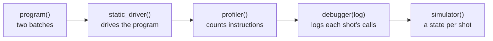

# The executor protocol

The QDK runs quantum programs on several simulators, through a chain of
components from the program to the simulator that runs it: a runtime that
walks an adaptive program and feeds measurements back, a noise model that
inserts faults, an error-correcting code that lowers logical instructions to
physical ones, a probe that counts resources. Without a shared contract, each
such component needs its own glue, and each decides anew how shots draw their
randomness, how a failure is reported and how a caller waits.

This crate, `executor_protocol`, is that contract: a chain is a driver that
drives the program given to it, any adapters that transform or observe its
calls on the way down and their outcomes on the way up, and an executor that
runs the instructions. They are composed with `>>`, and the chain is checked
when it is built and each job (a program and its shots) before any call;
every link of a running chain is the same call and reply.

## TL;DR

Make your component composable by following the
[six steps of Getting started](docs/getting-started.md), taking only those
your task needs
([which ones, and what you write](docs/getting-started.md#which-steps-for-your-part)).
The protocol and its facilities give you the rest
([what you get for free](docs/getting-started.md#what-you-get-for-free)): checks before any
shot runs; a state and a seed per shot, and a thread of its own, as
options of `executor_fn`; and shot conditions and reports carried up the
chain.

## What it solves

Concrete problems the protocol addresses, as examples:

- **Adaptive programs, shot by shot.** A program whose measurements decide what
  runs next (an iterative phase estimation, for example) takes a different
  path in each shot. Each shot keeps its own state, and the driver reads a
  batch's outcomes before it sends the next batch, to the shots that take
  that path ([example](tests/driver.rs)).
- **The same outcomes however the shots are split.** Each shot draws its
  randomness from the run's seed and its own id
  ([Seeds](docs/executors.md#seeds-not-generators)), so, on an executor that
  keeps shots apart
  ([replayable](docs/executors.md#how-an-executor-holds-its-shots)), a shot
  gives the same outcomes alone or among others, and the shots can be split
  across runs, in parallel.
- **Components added without changing the rest.** A noise model, a code's
  lowering and decoding, a profiler or a debugger is an adapter, composed
  between the driver and the executor without changing the simulator, the
  program or the other components (open to extension, closed to
  modification): a [profiler and a debugger](tests/observers.rs), a
  [repetition code and a noise logic](tests/static_isa.rs), and a
  [code given as data](tests/runtime_isa.rs).
- **Each rule written once.** The checks before any shot runs, and a state
  and a seed per shot and a thread of its own, as options of
  `executor_fn`, are kept by the facilities, so a component written with
  them is only its own logic, with no glue repeated across components
  (DRY)
  ([what you get for free](docs/getting-started.md#what-you-get-for-free)).
- **Failing before running.** A component describes what it offers
  (`Capabilities`), and a program declares what it needs (`Needs`), with
  what its driver's way of sending adds. A
  chain whose parts do not fit is refused
  when it is built, and a job whose program needs what the chain lacks is
  refused before any call. A chain's refusal names each component at fault,
  and a job's names the fault of its shots, each unmet need and each fault
  the driver finds in its program
  ([what is checked and when](docs/composition.md#what-is-checked-and-when)).
- **Any caller.**
  [One reply](docs/replies.md#replies-one-reply-four-ways-to-take-it)
  serves a blocking caller, a caller that does its own work between polls,
  and async tasks, which await the whole reply or take its events as a
  stream; a caller can keep several calls in flight. A binding for
  another language (Python, or even Fortran through a C interface) needs only
  the blocking `wait` or a poll loop.
- **Remote executors and callers (planned, no milestone yet).** A device behind
  a cloud service, or a simulator on another machine that a runner here drives,
  is reached through two more layers: one runs each batch at most once,
  and one carries it over a link that may lose, repeat or reorder messages.
  Every refusal already says whether the work may have run, so that a resend
  can be made safe.

## The protocol

The protocol is what every part of a chain keeps, whoever wrote it. It lives
in `src/`, outside `src/facilities/`, and
[The protocol](docs/protocol.md) draws it at work, step by step. The
[Glossary](docs/glossary.md) defines the terms these pages use.

**A chain and its run.** A **chain** is a driver
([`src/driver.rs`](src/driver.rs)), at the top, any adapters
([`src/adapter.rs`](src/adapter.rs)) and an executor
([`src/executor.rs`](src/executor.rs)), at the end, which runs the
instructions: for instance, a simulator, or (planned) a quantum device
behind its service. An adapter, given the executor below it, gives an
executor above it, with the same contract. The parts are composed with `>>`
([`src/compose.rs`](src/compose.rs)) and the chain is
[checked when it is built](docs/composition.md#composing-a-run). A **run**
([`src/compose/run.rs`](src/compose/run.rs)) is a chain given a job, a
program and its shots. A user writes three steps:

1. the chain;
2. `chain.run(program, shots)`, which
   [checks the job](docs/composition.md#a-chain-and-its-job) against the chain
   before any call and gives a **run**;
3. `run.wait()`, or `.await`, in which the driver drives the program on the
   chain; the run closes the chain once the driver is done, and gives the
   program's output (for a `StaticProgram`, its outcomes, or the error that
   ended it) and the chain's
   report. Nothing runs before.

In the [example](#an-example) below, the second and third lines build the
chain (step 1), and the fifth does steps 2 and 3 in one expression. A
program is data ([`src/program.rs`](src/program.rs)): its instructions,
what it gives when it is done (its output) and what it needs. The driver
drives it: it sends the calls and reads their outcomes, and, for a program
with a branch on a readout, chooses its next calls, and the shots they go
to, from those outcomes. So every chain is `driver >> adapters >> executor`,
given a program.

**Composition** (`>>`) works the same at every link: a driver with adapters
below it is still the chain's prefix, which composes the same way (planned:
that it is itself a driver); adapters composed act as one adapter wherever
`>>` or `compose` takes one (planned: that they implement the trait
`Adapter`); and an adapter with the executor below it is an executor. So a
chain can be built in parts and grouped any way, with the same run
(composition is associative).

**One message.** Every link of a running chain carries the same message, an
`InstructionBatch` ([`src/instruction_batch.rs`](src/instruction_batch.rs)):
instructions run in order on each shot of a set
([`src/shot_set.rs`](src/shot_set.rs)), after the batches before them. The
instructions are a type of the caller's own, or calls by opcode described
by an instruction set
([`src/instruction_set.rs`](src/instruction_set.rs)). One shot is a set of
one, so a caller of one shot and a caller of many send the same message. A
**level** is how abstract the instructions are: an adapter that lowers
logical instructions to physical ones goes down a level, and sends the same
message ([One message, and levels](docs/protocol.md#one-message-and-levels)).

**A reply, or a refusal.** A call is refused, and nothing ran, or accepted:
it then returns a **`Reply`** ([`src/reply.rs`](src/reply.rs)), through
which the caller takes the events as they come, then learns whether the work
ended done, failed or cancelled. Every refusal
([`src/rejected.rs`](src/rejected.rs)) has a **retry class**: `Never` and
`Later` say that nothing ran, and `Resend` says that no verdict came over a
link, so the work may have run. The executor chooses where the work runs;
the caller chooses how to take the reply: blocking (`wait`,
[`src/reply/blocking.rs`](src/reply/blocking.rs)), polling between its own
work, or as an async future or stream (`wait_async`, `async_events`,
[`src/reply/asynchronous.rs`](src/reply/asynchronous.rs)). A waiting caller
sleeps until its reply wakes it. Known issue, open: in a batch whose shots
each run on a thread of their own, each shot's reply may wake the caller, so
a batch of n shots costs its caller O(n²) polls of shots
([Performance](docs/performance.md#shots-on-placements-of-their-own)).

**Outcomes and conditions.** Each event is a `ShotOutcome`
([`src/shot_outcome.rs`](src/shot_outcome.rs)): its shot, its tag, its value
(`Zero`, `One`, or `Missing`, with the reason, such as a lost qubit), and
the shot's conditions so far
([`src/shot_conditions.rs`](src/shot_conditions.rs)): rejected,
inconsistent or unresolved, what a component found on the shot without
ending it.

**What a part offers, and a program needs.** A part describes what it offers
(`Capabilities`, [`src/capabilities.rs`](src/capabilities.rs)), and a
program what it needs (`Needs`, [`src/needs.rs`](src/needs.rs)); its driver
adds what its way of sending needs, and the chain checks the two combined.
Each shot
draws from seeds fixed by the run's seed, its id and the component that draws
([`src/seeds.rs`](src/seeds.rs)).

What the protocol checks itself, so that a part's logic need not:

- a chain whose parts do not fit is refused when it is built, and a job its
  chain cannot run is refused before any call;
- a run closes its chain once, after the driver's last call, and a call on
  a shot the job did not name is refused before the executor sees it.

What every part keeps, so that the parts around it can rely on it. The
[facilities](#the-facilities) keep these rules for you, and the
[conformance kit](docs/getting-started.md#6-check-your-parts) checks a part written by hand for those
marked (kit):

- a refusal for the call's own fault leaves an executor usable (kit), and a
  failure is final where state carries over from one call to the next
  (kit);
- a shot's conditions pass up with its outcomes, and a missing value does
  not end the run;
- on a replayable executor, a shot gives the same outcomes alone or among
  others (kit).

[Getting started](docs/getting-started.md) shows how to write each part, and the
options that set its [axes](docs/glossary.md#a-parts-axes).

## An example

In this example, from the [observer guide tests](tests/observers.rs), a
profiler and a debugger sit between the driver and a toy simulator of classical
bits and seeded coins:

```rust
let log = DebugLog::default();
let chain = static_driver() >> profiler() >> debugger(log.clone()) >> simulator();
let chain = chain.expect("the observers fit");
// SHOTS is [2, 5, 6, 11]: the job's shots, not a plain range.
let (outcomes, (counts, _)) = chain.run(program(), SHOTS).expect(THE_JOB_FITS).wait();
outcomes.expect("the stacked run succeeds");
assert_eq!(counts, the_runs_counts());
```

Each part is shown in [Getting started](docs/getting-started.md): `program()` in
[step 2](docs/getting-started.md#a-program-of-fixed-batches), `simulator()` in
[step 3](docs/getting-started.md#3-write-your-executor), `profiler()` in
[step 4](docs/getting-started.md#4-add-adapters). The debugger, `debugger(log)`,
which fills the `DebugLog` the test keeps, is in
[`tests/observers/debugger.rs`](tests/observers/debugger.rs); the shots
`SHOTS`, the message `THE_JOB_FITS` and the expected counts
`the_runs_counts()` are helpers of [`tests/observers.rs`](tests/observers.rs)
([Observers](docs/guides.md#observers-a-profiler-and-a-debugger)).

The chain, from the program down to the simulator:



The driver
[sends each batch in turn](docs/composition.md#a-chain-and-its-job), as one
call on the job's shots. The
[profiler](docs/guides.md#observers-a-profiler-and-a-debugger) counts each
shot's instructions and sends the batch on, the shots' equal calls as one;
the debugger sends each shot's call alone, and logs it with what it read.
Once the driver ends, the run
[closes the chain, once](docs/executors.md#an-executors-whole-life): its
report is the profiler's counts, folded over the shots, beside the report
below it; the debugger fills a log the caller keeps a handle on. The
diagram leaves out the order in which the debugger sends a call's shots,
and when, within a call, the readouts pass up:


Stacked, each observer sees what it sees alone, neither changes the
outcomes, and the chain grouped any way gives the same run
([Observers](docs/guides.md#observers-a-profiler-and-a-debugger)). The
profiler is a counting function and a three-line body
([Add adapters](docs/getting-started.md#4-add-adapters)).

## The facilities

The executors themselves live in other crates. The facilities are the
crate's own parts that keep the protocol's rules for an implementer, so
that it writes only its own logic: admitting and refusing calls, failing
and closing, seeding, the shots' conditions, the replies. They live in
[`src/facilities/`](src/facilities/), and
[Facilities](docs/facilities.md) details each, with when to write the part
by hand instead.

**Make a part from your logic.**

- `executor_fn` ([`src/facilities/executor_fn.rs`](src/facilities/executor_fn.rs))
  makes an executor from a state and a logic that runs a call's
  instructions on it: a simulator, a device, a bridge to an existing tool.
  It describes its promise (lowered to one shot without `.shots(..)`, with
  `log_probability` only given `.log_probability(f)`), refuses a new shot
  past the shots it promises to hold, fails for good on its logic's error,
  keeps a state per shot with `.shots(OnePerShot)`, and, given the run's
  seed with `.seed(s)`, seeds each shot's state from it and the shot.
  `.run_on(placement)`
  ([`src/facilities/placed_executor.rs`](src/facilities/placed_executor.rs))
  runs it where a placement says: on a thread of its own, or each shot on
  its own.
- `adapter_fn` and `owning_adapter_fn`
  ([`src/facilities/adapter_fn.rs`](src/facilities/adapter_fn.rs)) make an
  adapter from a state and a logic that reaches the executor below: a
  profiler, a debugger, a code's lowering and decoding. It passes up what
  the executor below offers, apart from the instruction sets it accepts and
  sends (`.accepts`, `.sends`) and less `log_probability` when its states
  draw (and `replayable` too with one state), and the report of the
  executor below; it merges the shots' conditions raised below, as it
  reads them during a call, with those its logic raises, with no code in
  its logic; with a state per shot, the shots' equal calls below go as
  one, but for those a shot kept before its run, which go alone at that
  run.
- `static_driver()`
  ([`src/facilities/static_driver.rs`](src/facilities/static_driver.rs)) gives a
  chain's prefix holding the static driver, `StaticDriver`, which runs a
  `StaticProgram`
  ([`src/facilities/static_program.rs`](src/facilities/static_program.rs)), a
  program of fixed batches.

**Keep a rule for a part you write by hand.**

- `ExecutorLifecycle`
  ([`src/facilities/executor_lifecycle.rs`](src/facilities/executor_lifecycle.rs))
  keeps the rules of failure and close, for an executor whose shots share
  one state, such as an ensemble simulator.
- The replies ([`src/facilities/replies.rs`](src/facilities/replies.rs)):
  `ImmediateReply` for work done inside `call`, `reply_channel()` for work
  done elsewhere, whose `ReplySender` fills the `IncrementalReply` the
  executor returns, `relay` and `MappedReply` to pass an inner reply up. An
  `IncrementalReply` wakes its waiting caller at most once per sleep, however
  many events arrive, and the caller's next poll takes them all.
- `check_unique_tags`
  ([`src/facilities/readout_tags.rs`](src/facilities/readout_tags.rs))
  refuses a batch that repeats a readout tag.

## Detailed documentation

The tests that pin the promises of the pages below and of the API docs are
listed beside each promise in the detailed rules, in
[`docs/internals/`](docs/internals/); the last section of each of those
pages names the user pages whose other pins it lists.

- [Getting started](docs/getting-started.md): From nothing to a checked
  chain, in up to six steps: which steps and what to write for each task,
  what you get for free, the conformance checks and what each needs, the
  interfaces for a part written by hand.
- [The protocol](docs/protocol.md): The protocol at work, in sequence
  diagrams: its parts and their files, a chain built and its job checked, a
  run, a driver of a program with a branch, refusals and failures, shots and
  seeds, outcomes and conditions, levels, what is planned.
- [Facilities](docs/facilities.md): The crate's parts that keep the protocol
  for your logic: what each serves and guarantees, its files, and when to
  write the part by hand; a thread per shot, an adapter's call per shot, the
  static driver, how a reply wakes each caller.
- [Composition](docs/composition.md): Putting parts together: composing a
  run with `>>`, a chain and its job, what is checked and when, the
  conformance checks, chains for several users.
- [Adapters](docs/adapters.md): Writing an adapter: choosing a way,
  `adapter_fn` and what its logic may do, a state per shot, seeds, reports,
  `owning_adapter_fn`, an adapter written by hand, refusals and failures,
  the shot conditions it takes in and keeps.
- [Executors](docs/executors.md): Writing an executor: capabilities and
  needs, `executor_fn`, how it holds its shots and where it runs, an
  executor's life, an executor written by hand, seeds.
- [Instruction sets](docs/instruction-sets.md): Describing and matching
  instructions: a static set, a run-time set, what an instruction does,
  compatibility, the three checks, and how applications use them.
- [Replies](docs/replies.md): Taking and making replies: the execution
  models, one `Reply` and four ways to take it, `ImmediateReply` and
  `IncrementalReply`, how a reply ends, the waking model, readout tags, shot
  conditions.
- [Rejections and retries](docs/rejections.md): What a rejection says, retry
  classes, and the planned at-most-once resend over a link.
- [Guide walkthroughs](docs/guides.md): The guide tests explained, with
  sequence diagrams of the repetition code's call and of the debugger's
  step.
- [Performance](docs/performance.md): What the protocol adds to an
  executor's own work, by batch size; shots on placements of their own; what
  shot conditions cost.
- [Planned features](docs/planned.md): What will be added, each with a case
  that needs it and what to do until then.
- [Glossary](docs/glossary.md): The terms of these pages, each in a sentence
  or two, with the section that details it.
- For maintainers, the detailed rules of
  [composition](docs/internals/composition.md),
  [adapters](docs/internals/adapters.md),
  [executors](docs/internals/executors.md), [instruction
  sets](docs/internals/instruction-sets.md) and
  [replies](docs/internals/replies.md), each with the tests that pin its
  promises; and [design cases](docs/internals/design-cases.md), the case
  that needs each abstraction.
