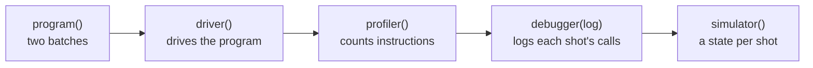
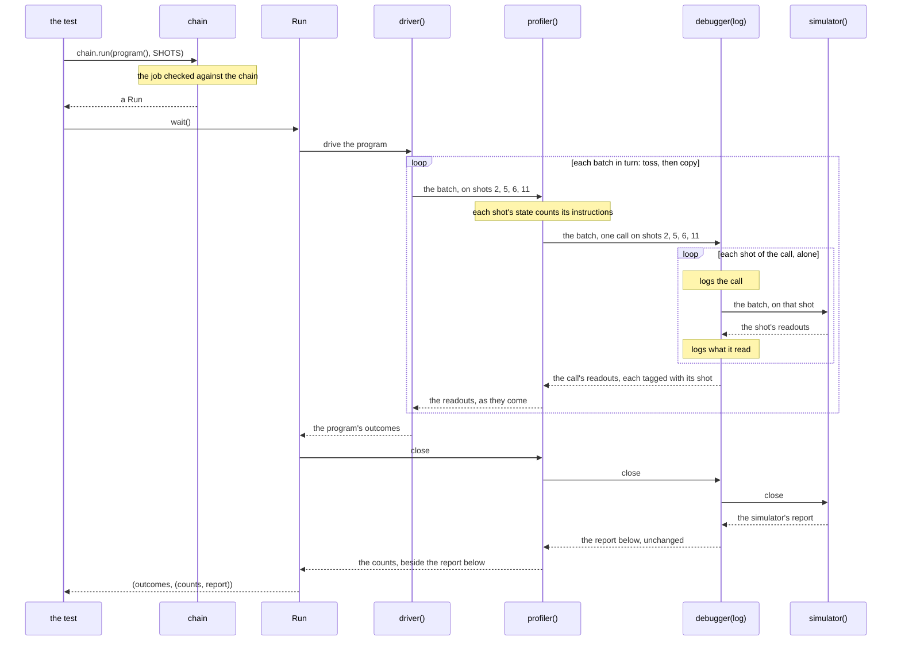

# `executor_protocol`

The QDK runs quantum programs on several simulators, and places components
between a program and the simulator that runs it: a
[runtime](docs/glossary.md#a-chain-and-its-parts) that walks an adaptive
program and feeds measurements back, a noise model that inserts faults, an
error-correcting code that lowers logical instructions to physical ones, a probe
that counts resources. Without a shared contract, each such component needs its
own glue, and each decides anew how shots draw their randomness, how a failure is
reported and how a caller waits.

This crate is that contract:

- A **driver**, at the top of a chain, drives the program given to the chain:
  a program is data (its instructions, what it gives and what it needs), and
  the driver makes its calls for the shots of the job.
- An **executor**, at the end, runs the instructions: for instance, a simulator,
  or (planned) a quantum device behind its service. Called with a message, it
  answers with a reply.
- Each component in between is an **adapter**: given the executor downstream of
  it, it gives an executor upstream of it, with the same contract. So every link
  of a running chain is the same call and reply.
- **Composition** (`>>`) works the same at every link: a driver with adapters
  below it is still the chain's prefix, which composes the same way (planned: that
  it is itself a driver); adapters composed act as one adapter wherever `>>` or
  `compose` takes one (planned: that they implement the trait `Adapter`); and an
  adapter with the executor below it is an executor. So a chain can be built in
  parts and grouped any way, with the same run (composition is associative).

Chains are checked before they run, and driven the same way by any caller: one
that blocks, one that polls between its own work, or async tasks, in the same
process or, through the planned lower layers, across a network.

Some concrete problems it addresses, as examples:

- **Adaptive programs, shot by shot.** A program whose measurements decide what
  runs next (an iterative phase estimation, for example) takes a different
  path in each shot. Each shot keeps its own state, and the driver reads a
  batch's outcomes before it sends the next batch, to the shots that take
  that path ([example](tests/driver.rs)).
- **The same outcomes however the shots are split.** Each shot draws its
  randomness from the run's seed and its own id
  ([Seeds](docs/executors.md#seeds-not-generators)), so, on an executor that
  keeps shots apart
  ([replayable](docs/executors.md#how-an-executor-holds-its-shots)), a shot
  gives the same outcomes alone or among others, and the shots can be split
  across runs, in parallel.
- **Components added without changing the simulator.** A noise model, a code's
  lowering and decoding, a profiler or a debugger is an adapter: a
  [profiler and a debugger](tests/observers.rs), a
  [repetition code and a noise logic](tests/static_isa.rs), and a
  [code given as data](tests/runtime_isa.rs).
- **Failing before running.** A component describes what it offers
  (`Capabilities`), and a program declares what it needs (`Needs`), with
  what its driver's way of sending adds. A
  chain whose parts do not fit is refused
  when it is built, and a job whose program needs what the chain lacks is
  refused before any call. A chain's refusal names each component at fault,
  and a job's names the fault of its shots, each unmet need and each fault
  the driver finds in its program
  ([what is checked and when](docs/composition.md#what-is-checked-and-when)).
- **Any caller.**
  [One reply](docs/replies.md#replies-one-reply-four-ways-to-take-it)
  serves a blocking caller, a caller that does its own work between polls,
  and async tasks, which await the whole reply or take its events as a
  stream; a caller can keep several calls in flight. A binding for
  another language (Python, or even Fortran through a C interface) needs only
  the blocking `wait` or a poll loop.
- **Remote executors and callers (planned, no milestone yet).** A device behind
  a cloud service, or a simulator on another machine that a runner here drives,
  is reached through two more layers: one runs each batch at most once,
  and one carries it over a link that may lose, repeat or reorder messages.
  Every refusal already says whether the work may have run, so that a resend
  can be made safe.

To run a chain, or write a part of one, start at
[Getting started](#getting-started). The [Glossary](docs/glossary.md) defines
the terms these pages use.

## The protocol

The protocol is what every part of a chain keeps, whoever wrote it. It lives
in `src/`, outside `src/facilities/`, and
[The protocol](docs/protocol.md) draws it at work, step by step.

**A chain and its run.** A **chain** is a driver
([`src/driver.rs`](src/driver.rs)), any adapters
([`src/adapter.rs`](src/adapter.rs)) and an executor
([`src/executor.rs`](src/executor.rs)), composed with `>>`
([`src/compose.rs`](src/compose.rs)) and
[checked when it is built](docs/composition.md#composing-a-run). A **run**
([`src/compose/run.rs`](src/compose/run.rs)) is a chain given a job, a
program and its shots. A user writes three steps:

1. the chain;
2. `chain.run(program, shots)`, which
   [checks the job](docs/composition.md#a-chain-and-its-job) against the chain
   before any call and gives a **run**;
3. `run.wait()`, or `.await`, in which the driver drives the program on the
   chain; the run closes the chain once the driver is done, and gives the
   program's output (for a `StaticProgram`, its outcomes) and the chain's
   report. Nothing runs before.

In the [example](#an-example) below, the second and third lines build the
chain (step 1), and the fifth does steps 2 and 3 in one expression. A
program is data ([`src/program.rs`](src/program.rs)): its instructions,
what it gives when it is done (its output) and what it needs. The driver
drives it: it sends the calls and reads their outcomes, and, for a program
with a branch on a readout, chooses its next calls, and the shots they go
to, from those outcomes. So every chain is `driver >> adapters >> executor`,
given a program.

**One message.** Every link of a running chain carries the same message, an
`InstructionBatch` ([`src/instruction_batch.rs`](src/instruction_batch.rs)):
instructions run in order on each shot of a set
([`src/shot_set.rs`](src/shot_set.rs)), after the batches before them. The
instructions are a type of the caller's own, or calls by opcode described
by an instruction set
([`src/instruction_set.rs`](src/instruction_set.rs)). One shot is a set of
one, so a caller of one shot and a caller of many send the same message. A
**level** is how abstract the instructions are: an adapter that lowers
logical instructions to physical ones goes down a level, and sends the same
message ([One message, and levels](docs/protocol.md#one-message-and-levels)).

**A reply, or a refusal.** A call is refused, and nothing ran, or accepted:
it then returns a **`Reply`** ([`src/reply.rs`](src/reply.rs)), through
which the caller takes the events as they come, then learns whether the work
ended done, failed or cancelled. Every refusal
([`src/rejected.rs`](src/rejected.rs)) has a **retry class**: `Never` and
`Later` say that nothing ran, and `Resend` says that no verdict came over a
link, so the work may have run. The executor chooses where the work runs;
the caller chooses how to take the reply: blocking (`wait`,
[`src/reply/blocking.rs`](src/reply/blocking.rs)), polling between its own
work, or as an async future or stream (`wait_async`, `async_events`,
[`src/reply/asynchronous.rs`](src/reply/asynchronous.rs)). A waiting caller
sleeps until its reply wakes it. Known issue, open: in a batch whose shots
each run on a thread of their own, each shot's reply may wake the caller, so
a batch of n shots costs its caller O(n²) polls of shots
([Performance](docs/performance.md#shots-on-placements-of-their-own)).

**Outcomes and conditions.** Each event is a `ShotOutcome`
([`src/shot_outcome.rs`](src/shot_outcome.rs)): its shot, its tag, its value
(`Zero`, `One`, or `Missing`, with the reason, such as a lost qubit), and
the shot's conditions so far
([`src/shot_conditions.rs`](src/shot_conditions.rs)): rejected,
inconsistent or unresolved, what a component found on the shot without
ending it.

**What a part offers, and a program needs.** A part describes what it offers
(`Capabilities`, [`src/capabilities.rs`](src/capabilities.rs)), and a
program what it needs (`Needs`, [`src/needs.rs`](src/needs.rs)); its driver
adds what its way of sending needs, and the chain checks the two combined.
Each shot
draws from seeds fixed by the run's seed, its id and the component that draws
([`src/seeds.rs`](src/seeds.rs)).

What the protocol checks itself, so that a part's logic need not:

- a chain whose parts do not fit is refused when it is built, and a job its
  chain cannot run is refused before any call;
- a run closes its chain once, after the driver's last call, and a call on
  a shot the job did not name is refused before the executor sees it.

What every part keeps, so that the parts around it can rely on it. The
[facilities](#the-facilities) keep these rules for you, and the
[conformance kit](#checking-a-part) checks a part written by hand for those
marked (kit):

- a refusal for the call's own fault leaves an executor usable (kit), and a
  failure is final where state carries over from one call to the next
  (kit);
- a shot's conditions pass up with its outcomes, and a missing value does
  not end the run;
- on a replayable executor, a shot gives the same outcomes alone or among
  others (kit).

[Getting started](#getting-started) shows how to write each part, and the
options that set its [axes](docs/glossary.md#a-parts-axes).

## An example

In this example, from the [observer guide tests](tests/observers.rs), a
profiler and a debugger sit between the driver and a toy simulator of classical
bits and seeded coins:

```rust
let log = DebugLog::default();
let chain = driver() >> profiler() >> debugger(log.clone()) >> simulator();
let chain = chain.expect("the observers fit");
// SHOTS is [2, 5, 6, 11]: the job's shots, not a plain range.
let (outcomes, (counts, _)) = chain.run(program(), SHOTS).expect(THE_JOB_FITS).wait();
outcomes.expect("the stacked run succeeds");
assert_eq!(counts, the_runs_counts());
```

The chain, from the program down to the simulator:



The driver
[sends each batch in turn](docs/composition.md#a-chain-and-its-job), as one
call on the job's shots. The
[profiler](docs/guides.md#observers-a-profiler-and-a-debugger) counts each
shot's instructions and sends the batch on, the shots' equal calls as one;
the debugger sends each shot's call alone, and logs it with what it read.
Once the driver ends, the run
[closes the chain, once](docs/executors.md#an-executors-whole-life): its
report is the profiler's counts, folded over the shots, beside the report
below it; the debugger fills a log the caller keeps a handle on. The
diagram leaves out the order in which the debugger sends a call's shots,
and when, within a call, the readouts pass up:



Stacked, each observer sees what it sees alone, neither changes the
outcomes, and the chain grouped any way gives the same run
([Observers](docs/guides.md#observers-a-profiler-and-a-debugger)). The
profiler is a counting function and a three-line body
([Writing an adapter](#writing-an-adapter)).

## The facilities

The executors themselves live in other crates. The facilities are the
crate's own parts that keep the protocol's rules for an implementer, so
that it writes only its own logic: admitting and refusing calls, failing
and closing, seeding, the shots' conditions, the replies. They live in
[`src/facilities/`](src/facilities/), and
[Facilities](docs/facilities.md) details each, with when to write the part
by hand instead.

**Make a part from your logic.**

- `executor_fn` ([`src/facilities/executor_fn.rs`](src/facilities/executor_fn.rs))
  makes an executor from a state and a logic that runs a call's
  instructions on it: a simulator, a device, a bridge to an existing tool.
  It describes its promise (lowered to one shot without `.shots(..)`, with
  `log_probability` only given `.log_probability(f)`), refuses a new shot
  past the shots it promises to hold, fails for good on its logic's error,
  keeps a state per shot with `.shots(OnePerShot)`, and, given the run's
  seed with `.seed(s)`, seeds each shot's state from it and the shot.
  `.run_on(placement)`
  ([`src/facilities/placed_executor.rs`](src/facilities/placed_executor.rs))
  runs it where a placement says: on a thread of its own, or each shot on
  its own.
- `adapter_fn` and `owning_adapter_fn`
  ([`src/facilities/adapter_fn.rs`](src/facilities/adapter_fn.rs)) make an
  adapter from a state and a logic that reaches the executor below: a
  profiler, a debugger, a code's lowering and decoding. It passes up what
  the executor below offers, apart from the instruction sets it accepts and
  sends (`.accepts`, `.sends`) and less `log_probability` when its states
  draw (and `replayable` too with one state), and the report of the
  executor below; it merges the shots' conditions raised below, as it
  reads them during a call, with those its logic raises, with no code in
  its logic; with a state per shot, the shots' equal calls below go as
  one, but for those a shot kept before its run, which go alone at that
  run.
- `driver()` ([`src/facilities/builtin_driver.rs`](src/facilities/builtin_driver.rs))
  gives a chain's prefix holding the crate's driver, `BuiltinDriver`, which
  runs a `StaticProgram`
  ([`src/facilities/static_program.rs`](src/facilities/static_program.rs)),
  a program of fixed batches.

**Keep a rule for a part you write by hand.**

- `ExecutorLifecycle`
  ([`src/facilities/executor_lifecycle.rs`](src/facilities/executor_lifecycle.rs))
  keeps the rules of failure and close, for an executor whose shots share
  one state, such as an ensemble simulator.
- The replies ([`src/facilities/replies.rs`](src/facilities/replies.rs)):
  `ImmediateReply` for work done inside `call`, `reply_channel()` for work
  done elsewhere, whose `ReplySender` fills the `IncrementalReply` the
  executor returns, `relay` and `MappedReply` to pass an inner reply up. An
  `IncrementalReply` wakes its waiting caller at most once per sleep, however
  many events arrive, and the caller's next poll takes them all.
- `check_unique_tags`
  ([`src/facilities/readout_tags.rs`](src/facilities/readout_tags.rs))
  refuses a batch that repeats a readout tag.

## Getting started

[The facilities](#the-facilities) make an executor or an adapter from your
own logic; the traits are there for a part written by hand.

What to write, by task, and where it is explained:

| To                                                                                      | Write                                                                              | Section                                                                                                                                                                                |
| --------------------------------------------------------------------------------------- | ---------------------------------------------------------------------------------- | -------------------------------------------------------------------------------------------------------------------------------------------------------------------------------------- |
| run a program of fixed batches (`StaticProgram`)                                        | `driver() >> … >> executor`, `chain.run(program, shots)`                           | [Running a chain](#running-a-chain)                                                                                                                                                    |
| run a program that branches on its readouts, or your own runtime (QIR, a circuit form)  | a program, `Program`, and its driver, `Driver<P>`, `runtime.into_chain()`          | [Writing a driver](#writing-a-driver)                                                                                                                                                  |
| plug in a device, or a simulator with a state per shot                                  | an executor: `executor_fn`                                                         | [Writing an executor](#writing-an-executor)                                                                                                                                            |
| plug in a simulator whose shots share one state (an ensemble, such as an MPS simulator) | an executor written by hand, on `ExecutorLifecycle`                                | [An executor written by hand](docs/executors.md#an-executor-written-by-hand-executorlifecycle)                                                                                         |
| compose your own executor type with `>>`, in either grouping                            | its `>>` for each type that may be on its left, through `Compose<_, WithExecutor>` | [An executor written by hand](docs/executors.md#an-executor-written-by-hand-executorlifecycle); guide: [`tests/executor_by_hand.rs`](tests/executor_by_hand.rs)                        |
| plug in a backend written before the protocol                                           | an executor around it, a bridge, with `executor_fn`                                | [Running an existing backend](docs/guides.md#running-an-existing-backend)                                                                                                              |
| run an executor's logic on a thread of its own                                          | `.run_on(placement)`                                                               | [Where an executor runs](docs/executors.md#where-an-executor-runs-run_on)                                                                                                              |
| add a noise model, a code (static or run-time ISA) or an observer                       | an adapter: `adapter_fn`, `owning_adapter_fn`, or by hand                          | [Writing an adapter](#writing-an-adapter); guides: [a static ISA](docs/guides.md#a-static-isa-a-repetition-code), [a run-time ISA](docs/guides.md#a-run-time-isa-a-code-given-as-data) |
| hold work and complete it from another thread                                           | an executor returning an `IncrementalReply`, filled later by its `ReplySender`     | [A debugger](docs/guides.md#a-debugger-holding-and-completing-work)                                                                                                                    |
| check that a part keeps the rules                                                       | the `conformance` checks, in your tests                                            | [Checking a part](#checking-a-part)                                                                                                                                                    |
| write a part by hand                                                                    | the traits                                                                         | [The interfaces](#the-interfaces-for-a-part-written-by-hand)                                                                                                                           |

The excerpts below are from the
[guide tests](docs/guides.md#building-on-the-protocol-the-guide-tests), on
a toy of classical bits and seeded fair coins. The names an excerpt uses
but does not define (`toy_set()`, `batches()`, `the_toys_promise()`,
`check_calls`, `Counts`, `Op`, `toy_simulator`, `on_shot_0`, …) are
helpers of the test file the excerpt links.

### Running a chain

`driver()` runs a `StaticProgram`: what the program needs of the chain
(`Needs`), and its batches, run in turn on every shot. The guide's
program is its two batches on two qubits of the toy's set
([`tests/observers.rs`](tests/observers.rs)):

```rust
/// The program each run runs on every shot: its [`batches`], on two
/// qubits, of the toy's set.
fn program() -> StaticProgram<InstructionCall> {
    program_of(batches())
}

/// A program of `batches`, on two qubits, of the toy's set.
fn program_of(batches: Vec<Vec<InstructionCall>>) -> StaticProgram<InstructionCall> {
    let needs = Needs::default()
        .with_qubits(2)
        .with_instruction_set(Some(Arc::new(toy_set())));
    StaticProgram::new(needs, batches)
}
```

The chain, `driver() >> simulator()` with no adapter between, is built,
given `program()` on the job's shots, then waited for:

```rust
let chain = (driver() >> simulator()).expect("nothing between to refuse");
let (outcomes, report) = chain.run(program(), SHOTS).expect(THE_JOB_FITS).wait();
```

Building a chain gives a `Chain`, or every fault of the parts built
together (`BuildFaults`), and `chain.run` a `Run`, or every fault of the
job (`JobFaults`), both
[before any call](docs/composition.md#what-is-checked-and-when); a chain
runs one job ([A chain and its job](docs/composition.md#a-chain-and-its-job)).

### Writing a driver

A program that branches on its readouts, or a program form such as QIR or
a circuit, is run by a driver of its form. The program is data: it
implements `Program`, its instructions, its output and what its content
needs. The driver implements `Driver<P>` for it
([the interfaces](#the-interfaces-for-a-part-written-by-hand)): what its
way of sending adds to the program's needs (`needs`), the faults it finds
in the program before any call (`check`), and `drive`, in which it runs
the program, making its calls on the one executor it is given: the
adapters and the executor below look to it like that single executor.
The chain checks the program's needs and the driver's combined, so a
driver cannot drop the program's. A driver is written once and runs any
program of its form; a chain runs one job (running many jobs on one chain
is [planned](docs/planned.md)). This program branches on a readout: a
batch on every shot, then another on the shots whose readout is 1
([`tests/driver/if_one.rs`](tests/driver/if_one.rs)):

```rust
pub struct IfOne {
    /// What its instructions need: its qubits, and anything else.
    pub needs: Needs,
    /// The batch every shot runs.
    pub first: Vec<Op>,
    /// The readout of `first` the branch reads.
    pub tag: u32,
    /// The batch the shots whose readout `tag` is 1 run next.
    pub then: Vec<Op>,
}

impl Program for IfOne {
    type Instruction = Op;
    /// The readouts of both batches, or why a call was refused or failed.
    type Output = Result<Vec<ShotOutcome>, String>;

    fn needs(&self) -> Needs {
        self.needs.clone()
    }
}
```

Its driver sends the first batch to every shot, reads each shot's
readout, and sends the second batch to the shots that read 1. Those
continue where the first batch left them, so the driver adds
`resumable_shots` to the program's needs:

```rust
pub struct IfOneDriver;

impl Driver<IfOne> for IfOneDriver {
    /// `then` continues the shots `first` ran, so the executor keeps each
    /// shot's state between calls, whatever the program states.
    fn needs(&self, _: &IfOne) -> Needs {
        Needs::default().with_resumable_shots(true)
    }

    async fn drive<E>(
        &self,
        program: IfOne,
        executor: &mut E,
        shots: &ShotSet,
    ) -> Result<Vec<ShotOutcome>, String>
    where
        E: Executor<InstructionBatch<Op>>,
    {
        let first = InstructionBatchRef {
            shots,
            instructions: &program.first,
        };
        let reply = executor.call(first).map_err(|r| r.to_string())?;
        let (mut outcomes, end) = wait_async(reply).await;
        end?;
        let read_one = |j| {
            (outcomes.iter()).any(|o| o.shot == j && o.tag == program.tag && o.value == Value::One)
        };
        let Some(ones) = shots.subset(read_one) else {
            return Ok(outcomes);
        };
        let then = InstructionBatchRef {
            shots: &ones,
            instructions: &program.then,
        };
        let reply = executor.call(then).map_err(|r| r.to_string())?;
        let (then_read, end) = wait_async(reply).await;
        outcomes.extend(then_read);
        end.map(|()| outcomes)
    }
}
```

A program tosses a coin, then, on the shots that read 1, tosses a second
coin and reads the first again; it states its qubits
([`tests/driver.rs`](tests/driver.rs)):

```rust
fn toss_again_on_one() -> IfOne {
    IfOne {
        needs: Needs::default().with_qubits(2),
        first: vec![Op::Coin(0), Op::Measure { qubit: 0, tag: 0 }],
        tag: 0,
        then: vec![Op::Coin(1), Op::Measure { qubit: 0, tag: 1 }],
    }
}
```

The driver heads the chain, `driver >> adapters >> executor`, here with
no adapter, and the chain runs the program on eight shots of the toy's
simulator:

```rust
let shots = ShotSet::range(0..=7).expect("not empty");
let chain = (IfOneDriver.into_chain() >> toy_simulator(3)).expect("nothing between to refuse");
let (outcomes, _) = chain
    .run(toss_again_on_one(), shots)
    .expect("the toy has the qubits and resumable shots")
    .wait();
```

On an executor that does not keep a shot between calls, the job is
refused before any call, for the need the driver adds (`resumable_shots`),
which the program does not state.

The caller's entry point is the chain:
`runtime.into_chain() >> adapters >> executor` (with the trait `DriverExt`
in scope), then `chain.run(program, shots)`. A driver of several program
types names one of them, `DriverExt::<P>::into_chain(runtime)`, only so
that the call resolves; the chain runs any program the driver drives in the
instructions the chain sends (the compiler checks it). The crate's driver,
`BuiltinDriver`, runs a `StaticProgram`, and `driver()` makes it a chain's
prefix. A driver with adapters below it is still a
`ChainPrefix`, which composes the same way, but not yet a `Driver<P>`
itself ([planned](docs/planned.md)).

### Writing an executor

`executor_fn(promise, make_state, logic)` makes an executor from what it
promises, how a shot's state is made, and the logic that runs a call on it
([Executors](docs/executors.md#making-an-executor-executor_fn)). The
simulator of the [example](#an-example)
([`tests/observers.rs`](tests/observers.rs)) runs the toy with a state per
shot, and records what each shot receives, for the test's checks;
`toy_ops()` maps each opcode of the toy's set to the toy's `Op`:

```rust
fn simulator_recording(
    received: Received,
) -> OnePerShotExecutor<
    InstructionCall,
    Shot,
    impl MakeState<Shot>,
    impl ExecutorLogic<InstructionCall, Shot>,
> {
    let ops = toy_ops();
    let start = |context: ShotContext| Ok((context.shot(), ToyState::start(context)?));
    let logic = move |(shot, toy): &mut Shot,
                      input: &CallInput<'_, InstructionCall>,
                      outcomes: &mut Outcomes<'_>| {
        received.record(*shot, input.instructions());
        for call in input.instructions() {
            toy.apply(ops[call.opcode](call), outcomes);
        }
        Ok(())
    };
    let check: fn(&CallInput<'_, InstructionCall>) -> Result<(), Rejected> = check_calls;
    executor_fn(the_toys_promise(), start, logic)
        .check(check)
        .seed(SEED)
        .shots(OnePerShot)
}
```

A function that makes a part for `>>` returns the type the facility gives,
its closures named by role, as here
([Naming a made part's type](docs/executors.md#naming-a-made-parts-type)).
Its arguments and options, for instructions `I` and a state `S`:

| Argument or option    | Type                                                                        | When it acts                                                                                                                                                                                                                                                                                                                                               |
| --------------------- | --------------------------------------------------------------------------- | ---------------------------------------------------------------------------------------------------------------------------------------------------------------------------------------------------------------------------------------------------------------------------------------------------------------------------------------------------------- |
| `promise`             | [`Capabilities`](docs/executors.md#capabilities-and-needs)                  | when the chain is built and the job given; at each call, a new shot past the shots it promises to hold at once (`max_shots`) is refused ([`ShotNotHeld`](docs/rejections.md#the-reasons-and-what-produces-them)). `Capabilities::default()` offers nothing it does not state: state each capability the executor offers (`.with_resumable_shots(true)`, …) |
| `make_state`          | `FnMut(ShotContext) -> Result<S, Rejected>`                                 | at the first call (with `.shots(OnePerShot)`, each shot's); `Err` refuses the call                                                                                                                                                                                                                                                                         |
| `logic`               | `FnMut(&mut S, &CallInput<'_, I>, &mut Outcomes<'_>) -> Result<(), String>` | at each call; `Err` fails it, and every later call is refused                                                                                                                                                                                                                                                                                              |
| `.check(f)`           | `FnMut(&CallInput<'_, I>) -> Result<(), Rejected>`                          | at each call, before the state is made and the logic runs; `Err` refuses the call                                                                                                                                                                                                                                                                          |
| `.seed(s)`            | `u64`                                                                       | when the chain is built, for the adapters that draw above it ([Seeds](docs/adapters.md#seeds-drawingid)), and when each shot's state is made, which draws from `ShotContext::seed()`; without it, an adapter that draws above it is refused (`BuildError::NoRunSeed`), and a state that draws panics                                                       |
| `.state_report(f)`    | `FnMut(&S) -> Q`, `Q:` [`Fold`](#the-interfaces-for-a-part-written-by-hand) | at close, once per state, into the report's `states`                                                                                                                                                                                                                                                                                                       |
| `.log_probability(f)` | `FnMut(&S) -> f64`                                                          | at close, once per state, into `log_p`; the only way to promise `log_probability`                                                                                                                                                                                                                                                                          |
| `.shots(OnePerShot)`  | -                                                                           | a state per shot, kept for its later calls; without it, one state, for one shot                                                                                                                                                                                                                                                                            |
| `.run_on(placement)`  | `T: ExecutorPlacement` (`OwnThread`, or a closure)                          | where the logic runs: `.run_on(OwnThread).shots(OnePerShot)`, a thread per shot; the other order, one thread for every shot ([Where an executor runs](docs/executors.md#where-an-executor-runs-run_on))                                                                                                                                                    |

Under `.run_on(..)` alone or `.shots(..).run_on(..)`, the refusals of the
`promise`, `make_state` and `.check` rows come on the executor's thread,
after `call` accepted the call: each fails the call's reply, and the
executor refuses every later call. The options, here as on an adapter,
are methods of what the facility gives, so the compiler puts them before
`.shots` and `.run_on`. Closed, the executor reports an
`ExecutorReport { calls, log_p, states }`.

### Writing an adapter

`adapter_fn(make_state, logic)` makes an adapter from how its state is made
and the logic that serves each call, given its way below (a `Below`,
explained after the table)
([Adapters](docs/adapters.md#a-state-and-a-logic-adapter_fn)). The profiler
of the [example](#an-example)
([`tests/observers/profiler.rs`](tests/observers/profiler.rs)) counts each
shot's instructions and sends the call below as it is:

```rust
fn profile(
    counts: &mut Counts,
    input: &CallInput<'_, InstructionCall>,
    below: &mut Below<'_, InstructionCall>,
    _: &mut Outcomes<'_>,
) -> Result<(), AdapterError> {
    for call in input.instructions() {
        *counts.entry(call.opcode).or_default() += 1;
    }
    below.send(input.instructions())
}
```

```rust
pub fn profiler() -> OnePerShotAdapter<
    InstructionCall,
    InstructionCall,
    Counts,
    impl MakeState<Counts>,
    impl AdapterLogic<InstructionCall, InstructionCall, Counts>,
    NoCheck<InstructionCall>,
    impl FnMut(&Counts) -> Counts,
> {
    adapter_fn(|_| Ok(Counts::default()), profile)
        .state_report(|counts: &Counts| counts.clone())
        .shots(OnePerShot)
}
```

Its type is the facility's, as the executor's is; given no check, its
check is `NoCheck<I>`, named because the report's parameter comes after
it. Its arguments and options, for instructions `I` accepted, `O` sent and
a state `S`:

| Argument or option   | Type                                                                                                 | When it acts                                                                                                                                                                                                                                                                                                                  |
| -------------------- | ---------------------------------------------------------------------------------------------------- | ----------------------------------------------------------------------------------------------------------------------------------------------------------------------------------------------------------------------------------------------------------------------------------------------------------------------------- |
| `make_state`         | `FnMut(ShotContext) -> Result<S, Rejected>`                                                          | at the first call, from its first shot, one state for every shot (with `.shots(OnePerShot)`, each shot's, at its first call); `Err` refuses the call                                                                                                                                                                          |
| `logic`              | `FnMut(&mut S, &CallInput<'_, I>, &mut Below<'_, O>, &mut Outcomes<'_>) -> Result<(), AdapterError>` | at each call; `Err` fails it, and every later call is refused; but a first call below that is refused, a send or a run, refuses the call with its refusal instead, whatever the logic returns, and fails nothing, unless it is for an earlier failure below ([Refusals and failures](docs/adapters.md#refusals-and-failures)) |
| `.accepts(set)`      | `impl Into<Arc<InstructionSet>>`                                                                     | when the chain is built: the set offered upstream; the calls are not checked against it ([planned](docs/planned.md); meanwhile, a `.check` that runs `InstructionSet::check_batch`)                                                                                                                                           |
| `.sends(set)`        | `impl Into<Arc<InstructionSet>>`                                                                     | when the chain is built: checked against the set below, calls renumbered into it                                                                                                                                                                                                                                              |
| `.check(f)`          | `FnMut(&CallInput<'_, I>) -> Result<(), Rejected>`                                                   | as an executor's                                                                                                                                                                                                                                                                                                              |
| `.drawing(id)`       | `RngId`                                                                                              | when the chain is built: the id its states draw with ([Seeds](docs/adapters.md#seeds-drawingid)); with one state, the shots of a call share its draws (to draw per shot, `.shots(OnePerShot)`)                                                                                                                                |
| `.state_report(f)`   | `FnMut(&S) -> Q`, `Q:` [`Fold`](#the-interfaces-for-a-part-written-by-hand)                          | at close: its report, beside the report below                                                                                                                                                                                                                                                                                 |
| `.shots(OnePerShot)` | `O: Clone + PartialEq`                                                                               | a state per shot; the shots' equal k-th sends go below as one call, but for a shot's kept sends, which go alone at its `run`                                                                                                                                                                                                  |

The logic reaches below in one of two ways:

- `below.send(&[O]) -> Result<(), AdapterError>` is one call below, whose reply
  passes up as it comes (with a state per shot, kept and merged as the
  `.shots` row says);
- `below.run(&[O]) -> Result<Vec<ShotOutcome>, AdapterError>` holds the thread
  until the readouts are in, and gives them by shot; they pass up only as
  the logic writes them.

An `AdapterError` holds why the call cannot go on, a message. It is made
from a `String` or a `&str`: the logic returns `Err("…".into())`, and `?`
on a `Result` whose error is a `String` passes it up.

A state that keeps its way below for its whole life, such as a code's
runtime, is made with `owning_adapter_fn`
([A state that owns its way below](docs/adapters.md#a-state-that-owns-its-way-below-owning_adapter_fn)).
An adapter written by hand (`Adapter` and `Apply`) maps the whole executor
below once: it can change what the chain offers beyond its instruction
sets, as a code offers a logical qubit per block of qubits below
(`Adapter::build`;
[An adapter written by hand](docs/adapters.md#an-adapter-written-by-hand)).

### Checking a part

The rules the compiler cannot check are checks in `conformance`, which an
implementer runs on its parts in its own tests, with the `conformance`
feature (from the module's rustdoc, `src/conformance.rs`):

```toml
[dev-dependencies.executor_protocol]
path = "../executor_protocol"
features = ["conformance"]
```

Each check panics, naming the rule broken, when the part does not keep it;
an adapter is checked composed with an executor
([`tests/runtime_isa.rs`](tests/runtime_isa.rs)). The check that a refusal
for the call's own fault leaves an executor usable, run on the existing-tool
guide's profiling executor, made with `executor_fn`, which counts the
instructions its shots run; its check refuses the first batch, as it reads
two qubits under one tag
([`tests/existing_tool.rs`](tests/existing_tool.rs)):

```rust
let read = |qubit| Op::Measure { qubit, tag: 0 };
conformance::accepts_calls_after_a_refusal::<InstructionBatch<Op>, _>(
    &mut profiling_executor(0),
    on_shot_0(&[read(0), read(1)]),
    on_shot_0(&[read(0)]),
);
```

[Conformance checks](docs/composition.md#conformance-checks) lists them.

### The interfaces, for a part written by hand

These traits, and the data they exchange: a facility implements the traits for
the parts it makes, a part written by hand implements them itself, a program,
data, implements `Program`, and a driver of programs of form `P`,
`Driver<P>`. Condensed from `src/`: doc comments and
attributes trimmed but for `#[non_exhaustive]`, a default's body shown as
`{ ... }`, short items on one line:

```rust
pub trait Program {
    type Instruction: Instruction;
    type Output;
    fn needs(&self) -> Needs { ... }
}
pub trait Driver<P: Program> {
    fn needs(&self, program: &P) -> Needs { ... }
    fn check(&self, program: &P) -> Vec<Rejected> { ... }
    fn drive<E>(
        &self,
        program: P,
        executor: &mut E,
        shots: &ShotSet,
    ) -> impl Future<Output = P::Output>
    where
        E: Executor<InstructionBatch<P::Instruction>>;
}
pub trait Executor<M: Message> {
    type Reply: Reply<Item = M::Event>;
    fn call(&mut self, message: M::Ref<'_>) -> Result<Self::Reply, Rejected>;
}
pub trait Describe { fn capabilities(&self) -> Capabilities; }
pub trait Close {
    type Report: Fold;
    fn close(&mut self) -> Self::Report;
}
pub trait Fold: Default { fn fold(&mut self, other: Self); }
pub trait Reply {
    type Item;
    fn poll_events(&mut self, out: &mut Vec<Self::Item>, waker: &Waker) -> ReplyStatus;
}
#[non_exhaustive]
pub enum ReplyStatus { Pending, Done, Failed(String), Cancelled }
pub struct InstructionBatchRef<'a, I> { pub shots: &'a ShotSet, pub instructions: &'a [I] }
#[non_exhaustive]
pub struct ShotOutcome {
    pub shot: ShotId,
    pub tag: u32,
    pub value: Value,
    pub conditions: ShotConditions,
}
pub trait Adapter {
    type Accepts: Instruction;
    type Sends: Instruction;
    fn sends(&self) -> Option<Arc<InstructionSet>> { ... }
    fn accepts(&self) -> Option<Arc<InstructionSet>> { ... }
    fn draws(&self) -> Option<RngId> { ... }
    fn build(self, boundary: &mut AdapterBoundary<'_>) -> Self where Self: Sized { ... }
}
pub trait Apply<E>: Adapter {
    type Output: Executor<InstructionBatch<Self::Accepts>> + Close;
    fn apply(self, downstream: E) -> Self::Output;
}
```

- An executor is an `Executor<InstructionBatch<I>>`, a `Describe` and a
  `Close`: a call is an `InstructionBatchRef`
  ([one message](#the-protocol)), each event a `ShotOutcome`,
  made with `ShotOutcome::new`, which gives it no condition, and
  `.with_conditions(..)` for its shot's conditions
  ([Shot conditions](docs/replies.md#shot-conditions)). `ExecutorLifecycle`
  keeps for it the rules of failure and close
  ([An executor written by hand](docs/executors.md#an-executor-written-by-hand-executorlifecycle)),
  and its reply can be the crate's `ImmediateReply` or `IncrementalReply`
  ([The facilities](#the-facilities)).
- An instruction type `I` is `InstructionCall`, numbered by the set its
  sender states ([Instruction sets](docs/instruction-sets.md)), or a type
  of your own marked `impl TypedInstruction for Op {}`; `Instruction` is
  sealed.
- `()`, integers, ordered maps (`BTreeMap`) and pairs of reports `Fold`
  already. A fold's default is empty, and any order or grouping of the
  reports gives the same total, up to rounding for sums in floating point
  (`LogP`'s may differ in their last bits when regrouped):
  `conformance::default_is_empty` and
  `conformance::folds_in_any_order` check a report of your own.
- An adapter's defaults are for one that passes its calls down as they are
  ([Choosing a way](docs/adapters.md#choosing-a-way)).

## Detailed documentation

The tests that pin the promises of the pages below and of the API docs are
listed beside each promise in the detailed rules, in `docs/internals/`;
the last section of each of those pages names the user pages whose other
pins it lists.

| Document                                                                   | Contents                                                                                                                                                                                                                                       |
| -------------------------------------------------------------------------- | ---------------------------------------------------------------------------------------------------------------------------------------------------------------------------------------------------------------------------------------------- |
| [The protocol](docs/protocol.md)                                           | The protocol at work, in sequence diagrams: its parts and their files, a chain built and its job checked, a run, a driver of a program with a branch, refusals and failures, shots and seeds, outcomes and conditions, levels, what is planned |
| [Facilities](docs/facilities.md)                                           | The crate's parts that keep the protocol for your logic: what each serves and guarantees, its files, and when to write the part by hand; a thread per shot, an adapter's call per shot, the driver, how a reply wakes each caller              |
| [Composition](docs/composition.md)                                         | Putting parts together: composing a run with `>>`, a chain and its job, what is checked and when, the conformance checks, chains for several users                                                                                             |
| [Composition: the detailed rules](docs/internals/composition.md)           | For maintainers: what the crate does, levels, roles and laws, how adapters compose, the rules of composition with every boundary of calls by opcode and its cost, the executor form, a job's rules, the known limits                           |
| [Adapters](docs/adapters.md)                                               | Writing an adapter: choosing a way, `adapter_fn` and what its logic may do, a state per shot, seeds, reports, `owning_adapter_fn`, an adapter written by hand, refusals and failures, the shot conditions it takes in and keeps                |
| [Adapters: the detailed rules](docs/internals/adapters.md)                 | For maintainers: the order of a run's readouts, failures in detail, drops over a placed executor, the merging of a state per shot's sends, the conformance kit, the owning way below, what a state depends on                                  |
| [Executors](docs/executors.md)                                             | Writing an executor: capabilities and needs, `executor_fn`, how it holds its shots and where it runs, an executor's life, an executor written by hand, seeds                                                                                   |
| [Executors: the detailed rules](docs/internals/executors.md)               | For maintainers: adding a capability, the rules of `executor_fn`, a state per shot and a placed executor, the order of `.shots` and `.run_on`, close and failure, the ensemble executor, the seeds' derivation                                 |
| [Instruction sets](docs/instruction-sets.md)                               | Describing and matching instructions: a static set, a run-time set, what an instruction does, compatibility, the three checks, and how applications use them                                                                                   |
| [Instruction sets: the detailed rules](docs/internals/instruction-sets.md) | For maintainers: calls and replies that allocate nothing, when two actions are the same, compatibility in full with renumbering and its costs, the three checks with their errors and the conformance check of calls                           |
| [Replies](docs/replies.md)                                                 | Taking and making replies: the execution models, one `Reply` and four ways to take it, `ImmediateReply` and `IncrementalReply`, how a reply ends, the waking model, readout tags, shot conditions                                              |
| [Replies: the detailed rules](docs/internals/replies.md)                   | For maintainers: the order of a reply's events, both replies and their ends in detail, the waking cycle step by step, `wait`'s park, several calls in flight, async tasks, the tests' runtimes, readout tags, shot conditions                  |
| [Rejections and retries](docs/rejections.md)                               | What a rejection says, retry classes, and the planned at-most-once resend over a link                                                                                                                                                          |
| [Guide walkthroughs](docs/guides.md)                                       | The guide tests explained, with sequence diagrams of the repetition code's call and of the debugger's step                                                                                                                                     |
| [Performance](docs/performance.md)                                         | What the protocol adds to an executor's own work, by batch size; shots on placements of their own; what shot conditions cost                                                                                                                   |
| [Planned features](docs/planned.md)                                        | What will be added, each with a case that needs it and what to do until then                                                                                                                                                                   |
| [Glossary](docs/glossary.md)                                               | The terms of these pages, each in a sentence or two, with the section that details it                                                                                                                                                          |
