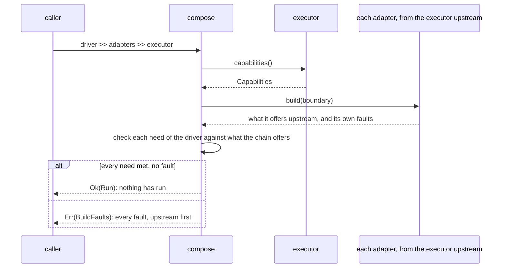
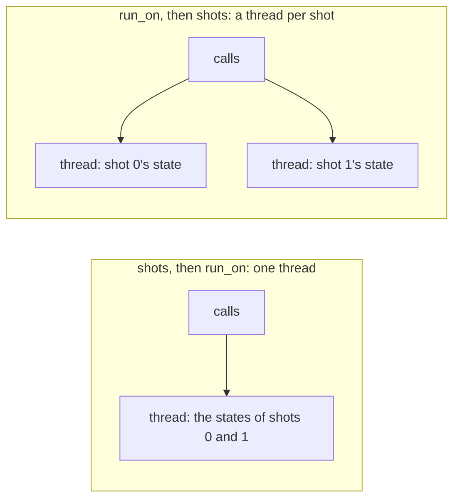
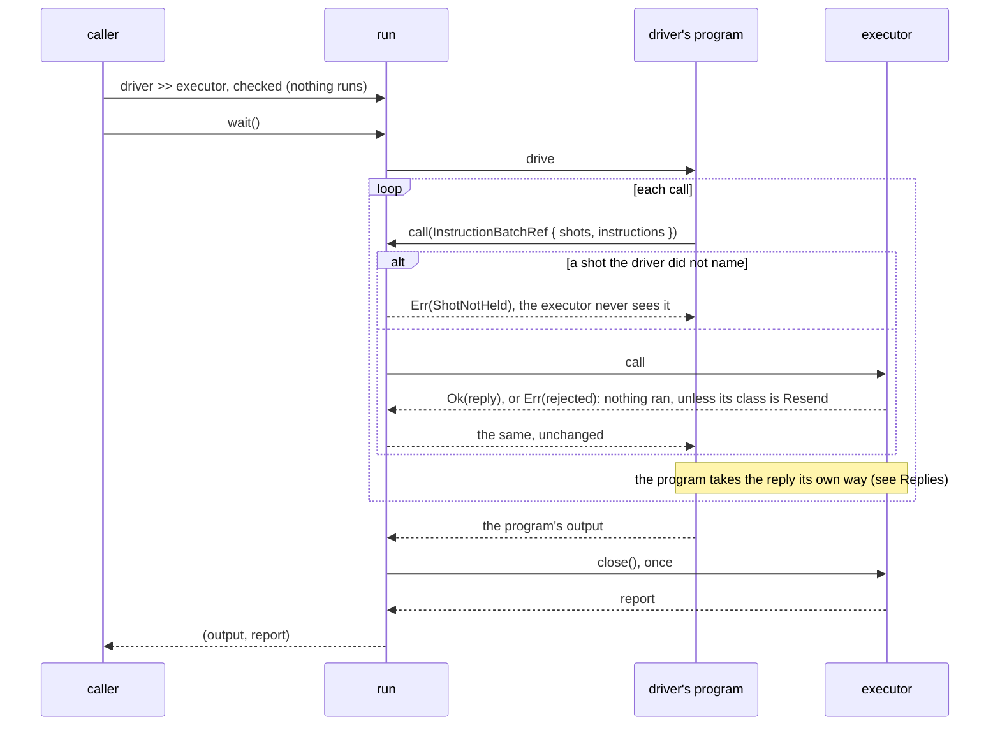

# Executors, capabilities and seeds

[Protocol overview](../README.md).

An implementer writes its own logic, the physics or a device's calls, and
the crate makes it an executor that keeps the protocol's rules. This page
gives what an executor offers and a driver needs, the facility that makes
an executor (`executor_fn`), how it holds its shots' states (`.shots`),
where it runs (`.run_on`), an executor's life, an executor written by hand
(`ExecutorLifecycle`), and how shots are seeded.

## Capabilities and needs

A component says what it offers (`Describe::capabilities`), and a driver
says what it needs (`Drive::needs`, a `Needs`). When a driver is composed
with an executor, `compose` builds the chain from the executor upstream,
then checks each need against what the chain offers, before anything runs:



Each need is a number, compared with what is offered: a need is met when
$\text{needed} \le \text{offered}$, with $\text{true} = 1$ and
$\text{false} = 0$. So a `false` need is always met, and a `true` need is
met only by a `true` capability. `UnmetNeed` names
the component, so the caller knows which one to change, and for
instructions lists each needed instruction that does not fit
(`mismatches`).

| Property                           | Offered (`Capabilities`), default                    | Needed (`Needs`), default             | Checked                                                                                                                         |
| ---------------------------------- | ---------------------------------------------------- | ------------------------------------- | ------------------------------------------------------------------------------------------------------------------------------- |
| `qubits`                           | `Option<u32>`, `None`: no limit                      | `Option<u32>`, `None`                 | `admit`, 1st: when both are stated                                                                                              |
| `feedback`                         | `bool`, `true`                                       | `bool`, `false`                       | `admit`, 2nd                                                                                                                    |
| `resets`                           | `bool`, `true`                                       | `bool`, `false`                       | `admit`, 3rd                                                                                                                    |
| `replayable`                       | `bool`, `true`                                       | `bool`, `false`                       | `admit`, 4th                                                                                                                    |
| `probabilities`                    | `bool`, `false`                                      | `bool`, `false`                       | `admit`, 5th                                                                                                                    |
| `instruction_set` / `instructions` | `Option<Arc<InstructionSet>>`, `None`: not described | `Option<Arc<InstructionSet>>`, `None` | `admit`, 6th: when needed; each needed instruction must [fit](instruction-sets.md#compatibility), so `None` offered refuses any |
| `states`                           | `Option<u64>`, `None`: no limit                      | the driver's shots, implied           | `admit`, 7th: when a limit is stated                                                                                            |
| `rng_ids`                          | `RngIds`, the last executor's id alone               | –                                     | when a chain is built: `Capabilities::drawing` (`RngInUse`)                                                                     |

The defaults keep an executor's meaning when a field is added:

- `resets` defaults to `true`: an executor that cannot prepare a qubit
  again during a shot says so.
- `probabilities` defaults to `false`: only an executor that computes each
  shot's log probability says so (a simulator), not hardware, nor a
  sampler that returns values only.
- `rng_ids` lists the ids of the components that draw random numbers at or
  downstream of a component. A component that draws is refused when it is built
  against one that already draws with its id, so each draws from a seed of
  its own (see [Seeds](#seeds-not-generators)).

`compose` reports every need the chain lacks, each a `BuildError::Unmet`
(`every_need_of_a_driver_that_the_chain_lacks_is_reported`,
`src/tests/compose.rs`). A caller that holds an executor checks its needs
itself with `Capabilities::admit`, which refuses the first need unmet, in
the order of the table (`Rejected::Unmet`).

`Needs::default()` states nothing but the one state per shot that every
run implies, so every executor that can hold the driver's shots accepts a
typed driver with nothing to check. A driver of `InstructionCall`s must
state its set, which numbers its calls
([Instruction sets](internals/instruction-sets.md#compatibility-the-rules)):
`compose` refuses one that does not, as its need of instructions unmet;
`Capabilities::admit` does not yet, a known gap, since it does not know the
caller's instruction type. A driver states a need only when it wants it
checked. From `every_need_of_a_driver_that_the_chain_lacks_is_reported`:

```rust
let mut program = Program::flip_and_toss(bits_set());
program.needs = program.needs.with_qubits(3).with_probabilities(true);
let Err(faults) =
    Driver::new(program, shots(&[0])) >> TestDoubleExecutor::with_model(Bits::default(), 7)
else {
    panic!("three qubits and probabilities on two bits must be refused");
};
let needs: Vec<Option<Need>> = faults
    .0
    .iter()
    .map(|fault| match &fault.error {
        BuildError::Unmet(unmet) => Some(unmet.need),
        _ => None,
    })
    .collect();
assert_eq!(needs, [Some(Need::Qubits), Some(Need::Probabilities)]);
```

A property the table lacks is added to the protocol in five steps
([Adding a capability](internals/executors.md#adding-a-capability)). Two
are planned, with no milestone yet:

- `recovers`: a call that fails does not fail the executor, and the same
  call sent again runs;
- `event_probabilities`: each outcome carries its probability as it comes,
  where today each shot's log probability comes in the report, at `close`.

## Making an executor: `executor_fn`

`executor_fn(promise, make_state, logic)` makes an executor (`ExecutorFn`)
from the implementer's logic alone:

- `promise` is what the executor offers (`Capabilities`), described as
  given (`describes_the_promise_as_given`).
- `make_state` makes the state a shot's calls run on (a simulator's
  qubits) from the shot's context (`ShotContext`), at the first call that
  needs it. Its `Err` refuses the call, and a later call tries again
  (`a_state_that_cannot_be_made_refuses_the_call`).
- `logic` runs a call's instructions on the state, and pushes each readout
  to `Outcomes`. Its `Err` fails the call: the outcomes pushed before it
  are handed over, the reply ends with its reason, and the executor
  refuses every later call (`a_failed_logic_keeps_the_outcomes_before_it`).

The closures need no type annotations, and a plain function is passed by
name (`closures_need_no_type_annotations`,
`plain_functions_are_passed_by_name`). Methods shape the executor further:

- `.check(check)` refuses the calls `check` refuses, before the state is
  made and the logic runs, such as a call on a qubit beyond the device's
  (`the_check_refuses_a_call_before_the_state_is_made_and_the_logic_runs`).
- `.log_probability(read)` reads a state's log probability when the
  executor closes, into its report. It is the only way to promise
  `probabilities`
  (`probabilities_are_promised_only_with_a_log_probability`).
- `.state_report(report)` reads what a state tracked across its calls (a
  peak, a count) when the executor closes, folded into the executor's
  report (`a_state_reports_what_it_tracked_across_its_calls`).
- `.seed(seed)` gives the executor the run's seed: shot `j`'s state is
  made from `ShotContext::new(seed, j)`
  (`a_state_given_the_runs_seed_draws_from_its_shots_seed`). Without it,
  a state that draws panics, which serves a logic that draws nothing
  (`without_the_runs_seed_a_state_has_none_to_draw_from`).
- `.shots(strategy)` and `.run_on(placement)`, in the next two sections.

Without a shot strategy, the executor holds one state, for one shot, so a
driver of more shots is refused when composed
(`without_a_shot_strategy_the_promise_is_lowered_to_one_state`). A panic
inside `call` reaches the caller, and the executor refuses every later
call (`after_a_panic_inside_call_it_refuses_every_later_call`). Its `drop`
never panics (`dropped_it_frees_its_state_raising_no_panic_of_its_drop`).
What changes the promise, and the rules of panics, drops, reports and the
seed at their edges, are in
[Making an executor: the rules](internals/executors.md#making-an-executor-the-rules).

An executor of a simulator with a bounded state per shot; its implementer
writes only its state, its logic and how to read its log probability.
From `bond_limited_executor` (`tests/per_shot_executor/bond_limited.rs`):

```rust
let promise = Capabilities::default()
    .with_qubits(QUBITS)
    .with_states(STATES);
executor_fn(
    promise,
    move |context: ShotContext| {
        if busy.take_if(|&mut j| j == context.shot()).is_some() {
            return Err(Rejected::Unavailable("the device is busy".into()));
        }
        Ok(BondLimitedState::new(context.seed()))
    },
    run_bond_limited,
)
.check(check)
.log_probability(|state| state.log_p)
```

Its logic, `run_bond_limited`, is given the shot's state, the call's
instructions and the reply's outcomes:

```rust
pub fn run_bond_limited(
    state: &mut BondLimitedState,
    input: &ProgramInput<'_, Op>,
    outcomes: &mut Outcomes<'_>,
) -> Result<(), String> {
```

It runs the instructions on the toy's bits, whose `apply` pushes each
readout under the tag its instruction names (`tests/toy/simulator.rs`):

```rust
Op::Measure { qubit, tag } => {
    outcomes.push(Outcome::new(tag, self.bits[qubit as usize].into()));
}
```

## How an executor holds its shots

How the shots of a run share work is a choice with different costs and
guarantees, so each choice is an executor of its own, and its callers do
not change. A choice that holds the states of an `executor_fn`'s logic is
a shot strategy (`ShotStrategy`), given to `.shots(strategy)`:

| How the shots run                                            | Made by                                             | Replayable        | Status                                                                                              |
| ------------------------------------------------------------ | --------------------------------------------------- | ----------------- | --------------------------------------------------------------------------------------------------- |
| each in its own state, made at the shot's first call         | `.seed(seed).shots(OnePerShot)`                     | as promised       | here                                                                                                |
| together, from one state shared by its shots (an ensemble)   | an executor written by hand, on `ExecutorLifecycle` | as promised       | in other crates; here as a test double (`SharedState`, `src/tests.rs`)                              |
| on shared states, split where their values differ (grouped)  | a shot strategy                                     | yes               | planned, with no milestone yet: many shots of one program on a simulator whose shots rarely diverge |
| split over several executors, their replies merged (sharded) | a shot strategy                                     | as the inner ones | planned, with no milestone yet: a run spread over the cores, or over devices                        |

_Replayable_ means each shot's outcomes depend only on the seed and the
shot's id (`ShotId`), not on the other shots of the run; a driver that
needs it says so in its `Needs`, `compose` refuses an executor that does
not offer it, and the conformance check
`gives_each_shot_alone_what_it_gives_among_others` checks an executor that
does, such as the executor above given `.shots(OnePerShot)`
(`each_shot_alone_gives_what_it_gives_among_others`,
`tests/per_shot_executor.rs`).

`.shots(OnePerShot)` makes a `OnePerShotExecutor`. Each shot's state is
made at the shot's first call, from the run's seed and the shot, and kept
for the shot's later calls until the executor closes
(`a_shots_state_is_made_at_its_first_call_from_the_runs_seed_and_the_shot`).
A call runs the logic on each of its shots, in the batch's order
(`a_batch_runs_on_each_of_its_shots_in_its_order`). Its refusals and
failures, and what it continues of the executor it is given, are in
[A state per shot: the rules](internals/executors.md#a-state-per-shot-the-rules).

The seed is the run's, given with `.seed(seed)` before the strategy, and
each shot's state draws from it through its `ShotContext`; an adapter
that draws upstream draws from the same seed under an id of its own
([Seeds, not generators](#seeds-not-generators)). A run of eight shots on
the executor above, from
`a_program_with_feedback_runs_its_next_batch_on_the_shots_it_chose`
(`tests/per_shot_executor.rs`):

```rust
let shots = ShotSet::range(0..=7).expect("not empty");
let executor = bond_limited_executor(None).seed(3).shots(OnePerShot);
let (outcomes, _) = (Driver::new(TossAgainOnOne, shots) >> executor)
    .expect("the executor has feedback, probabilities and 8 states")
    .wait();
```

## Where an executor runs: `run_on`

By default an executor that `executor_fn` makes runs inside `call`, on the
caller's thread. `.run_on(placement)` places it (`PlacedExecutor`): its
calls are queued and run, in order, in the jobs it hands its placement
(`PlacementJob`)
(`a_placement_is_handed_one_job_which_runs_every_call_queued_in_order`).
A call returns at once when the placement schedules the job to run
elsewhere (`OwnThread`, a thread pool); one that runs the job inline
(`|job: PlacementJob| job()`) runs the call's work before it returns
(`on_a_placement_that_runs_its_job_inline_a_call_returns_with_its_work_done`).
The placements:

- `OwnThread`, a thread of the executor's own, for an executor that must
  run on one thread (a device's driver). The executor and its state must
  be `Send`, since the executor is moved to that thread
  (`on_its_own_thread_an_executor_runs_every_call_on_one_thread_not_the_callers`).
- A closure that runs each job where it chooses, such as a thread pool.
- Planned, with no milestone yet: `Remote(link)`, which serves the far end
  of a link; placing any other executor that is `Send` (one written by
  hand, an adapter's executor or a chain); and placing a state that is not
  `Send` (an engine's GPU context). Until then, a chain runs on a thread of
  its own (`a_chain_of_observers_runs_on_another_thread`).

A placed executor's reply is an `IncrementalReply`, which an asynchronous
task can await
(`an_async_task_awaits_the_reply_of_an_executor_on_its_own_thread`). A
refusal or a failure on the executor's thread fails the call's reply, and
the executor refuses every later call
(`a_call_its_executor_refuses_on_its_thread_fails_its_reply`,
`after_a_failed_call_it_refuses_every_later_call`). Its `close` waits for
the calls queued, then gives the report
(`closing_waits_for_the_calls_queued_then_gives_the_placed_executors_report`).
Dropped without `close`, it cancels the calls not yet started
(`dropped_it_cancels_the_calls_not_yet_started`), and does not wait for
its states to be freed: call `close` to free what they hold (a device, GPU
memory) before building another executor on it. Panics, jobs dropped
unrun, and where the executor it places is closed and dropped, are in
[A placed executor: the rules](internals/executors.md#a-placed-executor-the-rules).

The order of `.shots` and `.run_on` says where the shots run:

- `.shots(OnePerShot).run_on(OwnThread)` runs every shot on the one thread
  (`placed_after_one_per_shot_every_shot_runs_on_the_one_thread`).
- `.run_on(OwnThread).shots(OnePerShot)` runs each shot on a thread of its
  own, so the shots of a batch run in parallel
  (`placed_before_one_per_shot_each_shot_runs_on_a_thread_of_its_own`).

The two orders, from
`both_orders_of_the_wrappers_give_the_same_outcomes_and_report`
(`src/tests/executor_fn/one_per_shot/placed.rs`):

```rust
let mut on_one_thread = recording(&threads).shots(OnePerShot).run_on(OwnThread);
let mut per_shot = recording(&threads).run_on(OwnThread).shots(OnePerShot);
```



For a run that does not fail, of a logic that keeps its state in the shot's
state, whose `make_state` makes the same state whatever thread it runs on, and
whose `state_report` and `log_probability` read only the shot's state and what
they captured when built, both orders give the same outcomes and report
(`a_run_gives_the_same_outcomes_and_report_wherever_the_shots_states_run`). A
thread per shot pays only for shots that share nothing and whose calls cost
much more than a thread hop, about 9 µs on one core (measured on an earlier
prototype of the protocol, not yet on this crate). Where the orders differ (a
failure, a drop, a logic's own state, the report), and what splitting a run
costs, is in
[The order of `.shots` and `.run_on`](internals/executors.md#the-order-of-shots-and-run_on).

## An executor's whole life

A run owns its executor: it passes the driver's calls on, and closes the
executor once, after the driver's last call. The arrows read as in
[Replies](replies.md#reading-the-sequence-diagrams):



The run closes the executor once, after the driver's last call, also when
a call failed
(`a_run_closes_its_executor_once_after_the_drivers_last_call`,
`a_run_closes_its_executor_once_after_a_call_failed`). A call after close
is refused with `Rejected::Closed` (the conformance check
`rejects_calls_once_closed`). A run dropped before its program ends does
not close its executor (`Run`'s doc, which no test pins), an open question
that goes with the planned cancellation
([An executor's close](internals/executors.md#an-executors-close)).

An executor whose state carries over from one call to the next refuses
every call after a failed one, with `Rejected::EarlierFailure`, which
names the failure (the conformance check `refuses_calls_after_a_failure`).
How the failure is kept, across wrappers and calls in flight, is in
[An executor fails](internals/executors.md#an-executor-fails).

## An executor written by hand: `ExecutorLifecycle`

An executor that holds one state shared by its shots (an ensemble, such as
a simulator in another crate that samples every shot at once) implements
`Executor` itself, with `Describe` and `Close`, and keeps the rules of
failure and close with `ExecutorLifecycle`:

- `admit`, at each call, refuses once closed or failed
  (`a_closed_executor_refuses_every_call`,
  `a_failed_executor_refuses_every_later_call`);
- `fail` records a failure learnt inside `call`
  (`a_counter_refuses_calls_after_its_device_stops`);
- `bind` binds a reply that may fail after `call` returned, so that its
  failure is recorded when it is polled
  (`a_bound_reply_that_fails_fails_the_executor`);
- `close` refuses every later call (`a_closed_executor_refuses_every_call`).

The crate's ensemble double, `SharedState` (`src/tests.rs`), is built on
it, and so are the executors that `executor_fn` makes. An ensemble's
reply, and the double's conformance checks, are in
[An executor written by hand: the rules](internals/executors.md#an-executor-written-by-hand-the-rules)
and [An ensemble executor](internals/executors.md#an-ensemble-executor).

## Seeds, not generators

Each shot draws from a seed of its own, fixed by the run's seed `s`, the
shot `j` and the id of the component that draws (`ComponentId`; the last
executor's is 0). No two shots of a run share a seed, nor two components
of a shot (`a_runs_shots_never_share_a_seed`,
`each_component_of_a_shot_has_its_own_seed`). A seed depends only on
`(s, j, c)`, not on the other shots of the run or on which other
components draw.

The run's seed reaches each component that draws:

- an executor is built with it (`.seed(s)`), and gives shot `j`'s state
  `ShotContext::new(s, j)`;
- an adapter that draws is given it when it is built against what is
  downstream of it, bound to the id it draws with
  (`AdapterBoundary::drawing_seeds`), and draws for shot `j` from
  `AdapterSeeds::shot(j)`.

So one seed fixes the whole chain's draws
(`a_chain_with_a_drawing_adapter_replays_from_its_one_seed`). An adapter
that draws with no run's seed below is refused when composed
(`an_adapter_drawing_with_no_run_seed_below_is_refused`).

`ShotContext` gives seeds, not generators: a component that wants a
generator writes `StdRng::seed_from_u64(ctx.rng_seed(c))` itself. These
seeds are not those that qdk's `run` or `run_qir` give each shot for the
same user seed. The formula, what it does not separate, and why the crate
gives no generator, are in
[Seeds: the derivation](internals/executors.md#seeds-the-derivation).

The detailed rules, for maintainers of the crate, are in
[Executors: the detailed rules](internals/executors.md).
