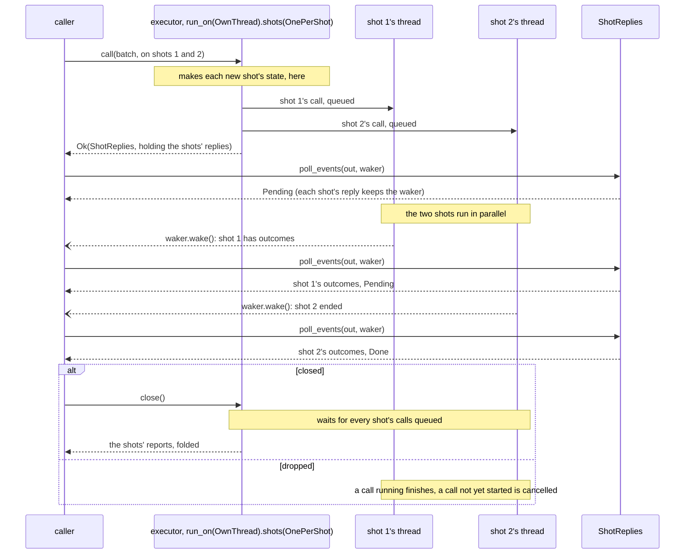
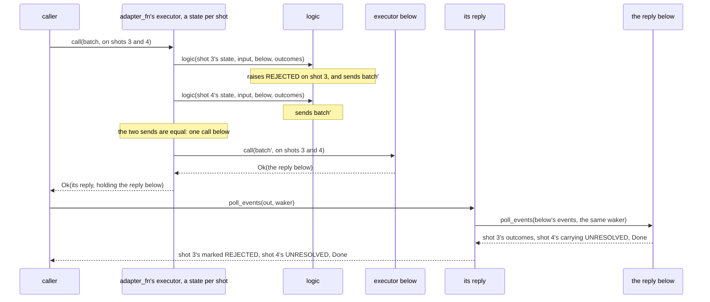
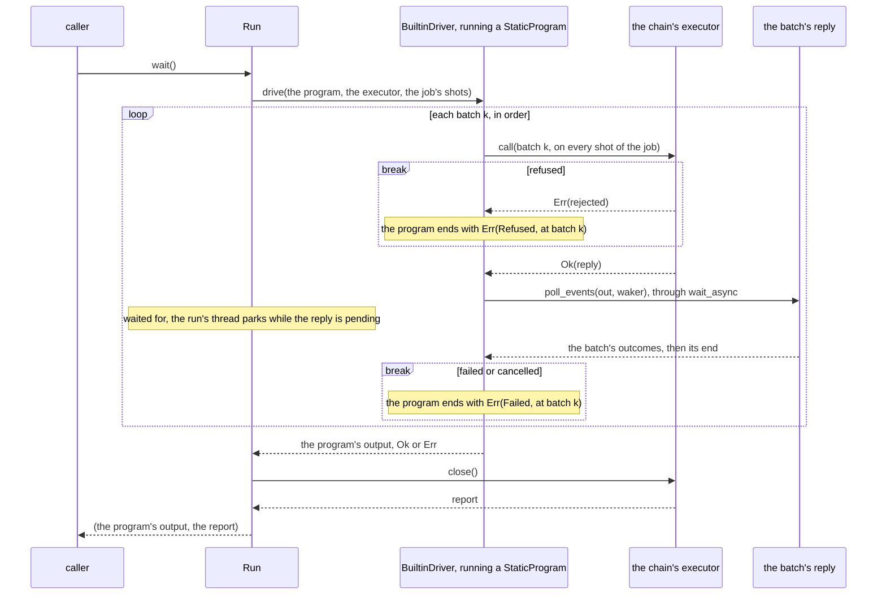
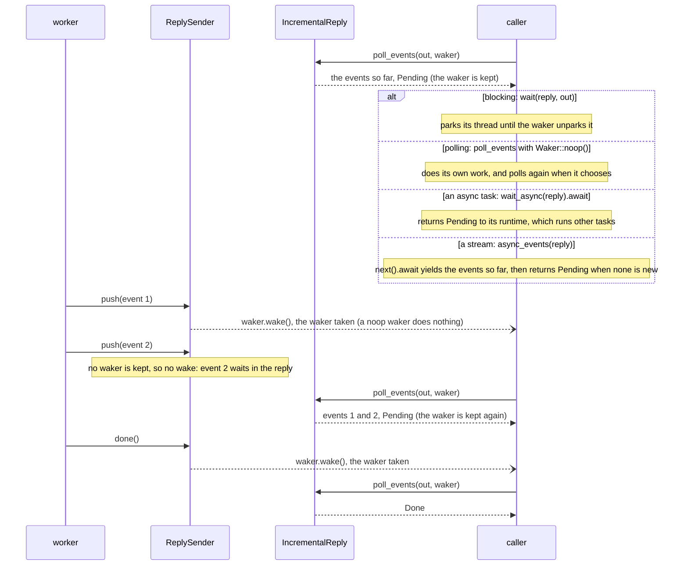

# Facilities

[Protocol overview](../README.md).

The [protocol](protocol.md) states what every part of a chain keeps; the
facilities are the crate's own parts that keep it, so that an implementer
writes only its own logic: a simulator's physics, a device's calls, a
code's lowering and decoding, a profiler's counts. They live in
[`src/facilities/`](../src/facilities/), whose module documentation
([`src/facilities.rs`](../src/facilities.rs)) lists them in two groups,
which this page follows: those that make a part from your logic, and those
that keep a rule of the protocol for a part you write by hand. Two of the
second group are described here with `executor_fn`: `.run_on`, since only
an `executor_fn` is placed today, and `shot_states.rs`, which keeps the
rules of an `executor_fn` with a state per shot (its `ShotStates` is
internal to the crate). This page says what each serves, what it
guarantees, where it lives, and when to write the part by hand
instead; the topic pages it links hold the how-to.

| Facility                                                                 | The need it serves                                                                          | Files, in `src/facilities/`                                                                                                                                                                |
| ------------------------------------------------------------------------ | ------------------------------------------------------------------------------------------- | ------------------------------------------------------------------------------------------------------------------------------------------------------------------------------------------ |
| [`executor_fn`](#an-executor-from-a-logic-executor_fn)                   | an executor from a state and a logic: a simulator, a device, a bridge to an existing tool   | [`executor_fn.rs`](../src/facilities/executor_fn.rs), [`executor_fn/`](../src/facilities/executor_fn/), [`shot_states.rs`](../src/facilities/shot_states.rs)                               |
| [`.run_on(placement)`](#an-executor-on-threads-of-its-own-run_on)        | an executor run on a thread of its own, or a thread per shot                                | [`executor_placement.rs`](../src/facilities/executor_placement.rs), [`placed_executor.rs`](../src/facilities/placed_executor.rs), [`placed_executor/`](../src/facilities/placed_executor/) |
| [`adapter_fn`, `owning_adapter_fn`](#an-adapter-from-a-logic-adapter_fn) | an adapter from a state and a logic: a profiler, a debugger, a code's lowering and decoding | [`adapter_fn.rs`](../src/facilities/adapter_fn.rs), [`adapter_fn/`](../src/facilities/adapter_fn/)                                                                                         |
| [`driver()`, `StaticProgram`](#the-crates-driver-and-a-static-program)   | a chain's driver, for a program of fixed batches                                            | [`builtin_driver.rs`](../src/facilities/builtin_driver.rs), [`static_program.rs`](../src/facilities/static_program.rs)                                                                     |
| [`ExecutorLifecycle`](#an-executors-life-executorlifecycle)              | the rules of failure and close, for an executor written by hand, such as an ensemble        | [`executor_lifecycle.rs`](../src/facilities/executor_lifecycle.rs), [`executor_lifecycle/`](../src/facilities/executor_lifecycle/)                                                         |
| [the replies](#replies-and-how-they-wake-their-caller)                   | an executor's reply: whole inside the call, pushed from elsewhere, relayed, or converted    | [`replies.rs`](../src/facilities/replies.rs)                                                                                                                                               |
| [`check_unique_tags`](#readout-tags-check_unique_tags)                   | the rule that a tag names one readout of each shot within a batch                           | [`readout_tags.rs`](../src/facilities/readout_tags.rs)                                                                                                                                     |

`panics.rs` and `teardown.rs` are the facilities' own machinery and offer
nothing to a user. The [conformance kit](#the-conformance-kit), which
checks a part in its implementer's tests, is a module of its own, beside
the facilities.

## Make a part from your logic

### An executor from a logic: `executor_fn`

`executor_fn(promise, make_state, logic)` makes an executor from what it
offers, how a shot's state is made, and the logic that runs a call's
instructions on that state and writes the readouts. The executor keeps
the protocol's rules for its logic:

- it describes what its promise offers, with three changes: one shot at
  most without `.shots(..)`, `log_probability` exactly when it is given
  `.log_probability(f)`, and the run's seed it is given with `.seed(s)`;
  and it refuses a call outside it: a new shot past the shots it holds at
  once, and, with one state, a shot other than the one it holds;
- its check (`.check`) refuses a call before any state is made; an `Err`
  of its logic fails the call, hands over the outcomes written before it,
  and the executor refuses every later call; once closed, it refuses every
  call;
- each shot's state is made from the shot's context (`ShotContext`), so it
  draws from the run's seed (`.seed(s)`) and its shot alone;
- a condition its logic raises on a shot (`Outcomes::raise_conditions`)
  marks every outcome the logic writes for that shot in the call;
- closed, it gives one report, folded over its states.

`.shots(OnePerShot)` keeps a state per shot, made at the shot's first call
and kept for its later calls: what an executor that offers
`resumable_shots` or `replayable` needs. The options, with when each acts,
are in [Making an executor](executors.md#making-an-executor-executor_fn)
and [How an executor holds its shots](executors.md#how-an-executor-holds-its-shots).

**Write it by hand** when the shots share one state, as an ensemble
simulator that samples every shot at once does: implement `Executor`,
`Describe` and `Close`, and keep the rules with
[`ExecutorLifecycle`](#an-executors-life-executorlifecycle).

### An executor on threads of its own: `.run_on`

`.run_on(placement)` runs an `executor_fn`'s calls where its
`ExecutorPlacement` says: `OwnThread`, a thread of its own, for a device's
driver that must stay on one thread, or a closure that runs each job
where it chooses, such as a thread pool. Its calls are queued and run in
order, and its reply, which an async task can await, is an
`IncrementalReply`, or, with each shot placed, the shots' replies gathered
(`ShotReplies<IncrementalReply<_>>`). `.shots(OnePerShot).run_on(OwnThread)`
runs every shot on the one thread; `.run_on(OwnThread).shots(OnePerShot)`
runs each shot on a thread of its own, so the shots of a batch run in
parallel.

Below, the second order, on a batch of two shots. Each shot's state is
made on the caller's thread at the shot's first call, then served on the
shot's thread. The reply gathers the shots' replies (`ShotReplies`), and
each poll passes the caller's waker to each shot's reply still pending, so
whichever shot has news wakes the caller. It is one possible execution:
shot 2 may end first, and both may end before the first poll:

- **`close` waits for every shot's calls**, then gives the report.
  Dropped without `close`, the executor cancels its calls not yet started,
  whose replies end `Cancelled`, and lets a call running finish.
- **A failed shot outranks a cancelled one**: the call's reply then ends
  `Failed`, whatever the order the shots end in.
- **Placed whole** (`.run_on(..)` alone, or after `.shots(..)`), the
  executor makes its own refusals (its promise's, its state closure's, its
  check's) on its own thread, after `call` accepted the call, and such a
  refusal fails the call and the executor
  ([a design question](rejections.md#what-a-rejection-says)); once closed
  or failed, it still refuses at `call`.
- **Known issue**: each shot's reply may wake the caller, so a batch of n
  shots costs its caller O(n²) polls of shots
  ([Performance](performance.md#shots-on-placements-of-their-own)).

The placements, their costs, and the rules of a placed executor are in
[Where an executor runs](executors.md#where-an-executor-runs-run_on).

### An adapter from a logic: `adapter_fn`

`adapter_fn(make_state, logic)` makes an adapter from how its state is
made and the logic that serves each call. The logic reaches the executor
below through a `Below`: `below.send(..)` makes a call below whose reply
passes up as it comes, and `below.run(..)` hands the readouts to the logic,
which writes what it gives up. The adapter keeps the protocol's rules for
its logic:

- it offers upstream what the executor below offers, apart from the
  instruction sets it accepts and sends (`.accepts`, `.sends`), checked
  against the executor below when the chain is built, and what drawing
  takes away (below);
- its check (`.check`), or the refusal of its first call below, refuses
  the call, and the adapter serves the next one, unless that refusal is
  for an earlier failure below; an `Err` of its logic fails the call and
  the adapter;
- with a `.state_report`, its report sits beside the report from below;
- drawing (`.drawing(id)`), it draws from the run's seed under an id of its
  own, and then offers no `log_probability`, nor, with one state,
  `replayable`;
- each shot's conditions need no code in the logic: the adapter merges, by
  union, those its logic raises and those it reads from below before its
  call ends, and marks with them every outcome it gives the shot; a
  condition a send's reply gives after its call returned passes up on that
  reply's outcomes, but the adapter does not take it in, a known issue
  ([Shot conditions](replies.md#shot-conditions)).

With `.shots(OnePerShot)` it keeps a state per shot: the logic serves each
shot of a call on that shot's state, and once every shot's logic ran, the
shots' equal sends go below as one call, but for the sends a shot kept
before its run, which go below alone, at that run. Below, a logic with a
state per shot that raises a condition on shot 3, over an executor that
raises one on shot 4 (as the [tests of shot
conditions](../src/tests/facilities/adapter_fn/conditions.rs) and of [a
state per shot](../src/tests/facilities/adapter_fn/one_per_shot.rs) run
it):

A logic with one state serves every shot of a call at once, and a
condition it raises marks every shot of the call. `Below`'s two ways, the
options, and the rules of refusals and failures are in
[Adapters](adapters.md#a-state-and-a-logic-adapter_fn); the conditions'
rules, in [Shot conditions](replies.md#shot-conditions).

**`owning_adapter_fn`** makes the same adapter from a state that keeps its
way below (a `BelowHandle`) for its whole life, such as a code's runtime
that owns its backend, so that the runtime becomes an adapter unchanged
([A state that owns its way below](adapters.md#a-state-that-owns-its-way-below-owning_adapter_fn)).

**Write it by hand** (`Adapter` and `Apply`) when the adapter changes what
the chain offers beyond its instruction sets, as a code that offers a
logical qubit per block of qubits below does
([An adapter written by hand](adapters.md#an-adapter-written-by-hand)). It
then keeps the rules itself, the shots' conditions included.

### The crate's driver and a static program

`driver()` gives the crate's driver, `BuiltinDriver`, as a chain's prefix
(`ChainPrefix`). It drives a `StaticProgram`, a program of fixed batches
stated as data, with the needs it states ([A run](protocol.md#a-run) draws
one). The driver adds `resumable_shots` to them for a program with a call
in a batch before its last, since its later batches continue its shots;
the chain checks the two combined when the job is given to it
([Needs, combined](composition.md#needs-combined)). It sends each batch to
every shot of the job in one call, in order, awaits the reply, and stops
at the first batch that is refused or does not end `Done`:

The error names the batch and what stopped it
(`StaticProgramError::{Refused, Failed}`, a cancelled batch being
`Failed`). Awaited, the run leaves its thread to other tasks while a
reply is pending.

**Write a driver by hand** for a program in another form, such as a
circuit that a runtime interprets, or a program that chooses its next
batch, and the shots it goes to, from the outcomes
([Writing a driver](../README.md#writing-a-driver)).

## Keep a rule for a part

### An executor's life: `ExecutorLifecycle`

An executor written by hand keeps the rules of failure and close with an
`ExecutorLifecycle`: `admit`, at each call, refuses once closed or failed;
`fail` records a failure learnt inside `call`; `bind` binds a reply that
may fail after `call` returned (a `LifecycleBoundReply`), so that its
failure is recorded when it is polled; `close` refuses every later call.
The earliest failed call is the executor's failure. The executors that
`executor_fn` makes are built on it
([An executor written by hand](executors.md#an-executor-written-by-hand-executorlifecycle)).

### Replies, and how they wake their caller

An executor returns one of the crate's replies, or wraps one:
`ImmediateReply` for work done inside `call`; `reply_channel()` for work
done elsewhere, whose `ReplySender` pushes into the `IncrementalReply` the
executor returns; `relay`, for a worker that passes an inner reply up; and
`MappedReply`, which converts each event on its way up
([One call](replies.md#one-call)).

The caller chooses how to take any of them, and the executor does not
know which it serves. An `IncrementalReply` keeps the waker of a poll that
returns `Pending`; the first push or end after it takes that waker and
wakes it, once; the next poll takes every event pushed since. Below, the
four ways to take one: they differ only in what the caller does on
`Pending`. It is one possible execution: the caller may poll between the
two pushes, and take one event at a time:

So a caller is woken at most once per sleep, whatever the number of
events, and gets every event in order, one or many at a poll. What each
way of taking a reply gives is in
[Execution models](replies.md#execution-models), and the cycle step by
step in [The waking model](replies.md#the-waking-model).

### Readout tags: `check_unique_tags`

Within a batch, a tag names one readout of each shot, since readouts may
arrive in any order. `check_unique_tags` refuses a batch that repeats a
tag, at the instruction that repeats it, for an executor written by hand
([Readout tags](replies.md#readout-tags)).

## The conformance kit

The rules the compiler cannot check are checks in `conformance`, behind
the `conformance` feature, which an implementer runs on its parts in its
own tests: those of a call, a reply, close and fold, instruction sets and
readout tags, the capabilities `replayable` and `resumable_shots`, a
shot's conditions across calls, and that a new executor starts its shots
as made, whatever an earlier one left. Each panics, naming the rule
broken, and a check on each shot names every shot that breaks it; an
adapter is checked composed with an executor. The checks are listed in
[Conformance checks](composition.md#conformance-checks), and how to enable
them in [Checking a part](../README.md#checking-a-part). They live in
[`src/conformance.rs`](../src/conformance.rs) and
[`src/conformance/`](../src/conformance/).
