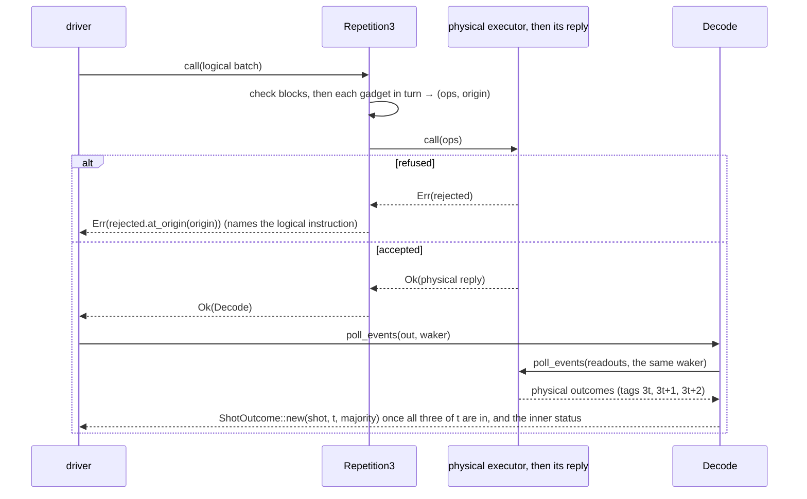
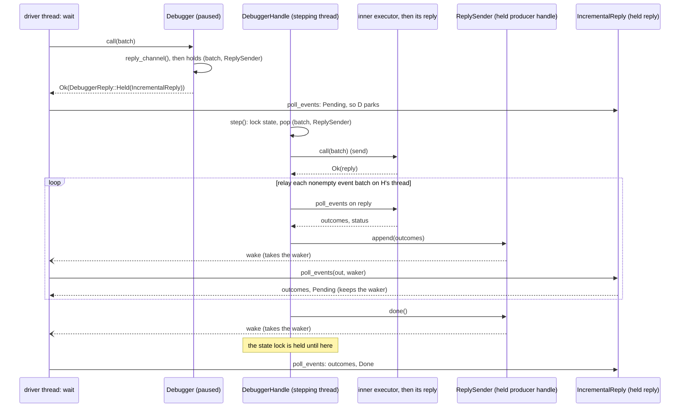

# Guide walkthroughs

[Protocol overview](../README.md).

## Building on the protocol: the guide tests

Seven small programs in `tests/`, written against the public API only, show
how to run a program on the protocol and how to build on it, one task each.
Each opens with what it teaches; they run on a toy
(`tests/toy/simulator.rs`: classical bits and fair coins drawn from the
shot's seed). Read them in this order:

| Task                                              | Test file                    | What it builds                                                                                                           | Section                                                                            |
| ------------------------------------------------- | ---------------------------- | ------------------------------------------------------------------------------------------------------------------------ | ---------------------------------------------------------------------------------- |
| run a program on a simulator                      | `tests/simulator.rs`         | a program run on the toy simulator: a job given to a chain, checked, then waited for                                     | [Running a program](#running-a-program)                                            |
| bridge a backend written before the protocol      | `tests/existing_tool.rs`     | a bridge for a backend written before the protocol, and a profiler                                                       | [An existing backend and a profiler](#an-existing-backend-and-a-profiler)          |
| write an executor, and place it on a thread       | `tests/per_shot_executor.rs` | an executor with a state per shot: its logic alone, made an executor by `executor_fn`, driven by a program with feedback | [Making an executor](executors.md#making-an-executor-executor_fn)                  |
| write an adapter that observes a chain            | `tests/observers.rs`         | a profiler that counts each shot's calls, and a debugger that logs them, between the interpreter and the toy             | [Observers: a profiler and a debugger](#observers-a-profiler-and-a-debugger)       |
| write an adapter that changes the instruction set | `tests/static_isa.rs`        | a repetition code: logical instructions down as gadgets, majorities back up; as a logic, by hand, and as a runtime       | [A static ISA: a repetition code](#a-static-isa-a-repetition-code)                 |
| write an adapter between sets known at run time   | `tests/runtime_isa.rs`       | an example adapter running a repetition code given as data, as Qodec gives it                                            | [A run-time ISA: a code given as data](#a-run-time-isa-a-code-given-as-data)       |
| hold work and complete it from another thread     | `tests/debugger.rs`          | a debugger that records each batch and outcome, and pauses and steps                                                     | [A debugger: holding and completing work](#a-debugger-holding-and-completing-work) |

[Adapters](adapters.md) details what an adapter's writer relies on, and
[Executors](executors.md) what an executor's writer relies on, its
placement on a thread of its own included
([Where an executor runs](executors.md#where-an-executor-runs-run_on)).

## Running a program

[`tests/simulator.rs`](../tests/simulator.rs) is what a user of a simulator
writes. Its program, `FlipACoin` (a `Drive`), flips a coin on qubit 0 of each
shot and reads it; with the shots it runs, it is a job, given to the chain of
the crate's interpreter composed with the toy simulator built with its seed.
Waited for, the run gives the program's output, one outcome per shot, and the
executor's report, here of the one batch sent:

```rust
let (program, shots, seed) = (FlipACoin { qubits: 1 }, shots(), 7);
let run = compose(interpreter(), toy_simulator(seed))?.run(program, shots)?;
let (output, report) = run.wait();
```

What a user relies on, each shown by a test of
[`tests/simulator.rs`](../tests/simulator.rs):

- Only the executor draws here, so a run is reproduced by the executor's seed:
  an executor built with the same seed gives the same outcomes, and one built
  with another seed gives others.
- A shot draws the same outcomes whichever shots run beside it: the even shots
  and the odd shots, run apart, read the coins they read together.
- A program that needs more qubits than the simulator has is refused when its
  job is given to the chain (`chain.run`), with the need it does not meet.
- A refused batch runs nothing: after a batch refused for its last instruction,
  each shot reads the coin it read before. The toy names the first instruction
  it does not accept.

The guide also runs the [conformance kit](composition.md#conformance-checks) on
the toy, as an implementer's tests can: its tests of the toy check that it takes
calls after a refusal, refuses them once closed, reports once, gives each shot
alone what it gives among the others, and continues a shot from one call to the
next. [The README's example](../README.md#an-example) puts the toy in a longer
chain, with a profiler and a debugger between the interpreter and the toy, and
gives the program as the chain's job.

## An existing backend and a profiler

A tool built before the protocol has components of its own: backends that run
batches, and profilers that count what runs.
[`tests/existing_tool.rs`](../tests/existing_tool.rs) writes one of each on the
protocol. QEP, a tool outside this repository that runs QIR programs on backends
of its own and was written before the protocol, is one such tool: its backends
and profilers can be written this way, as the guide shows.

What the protocol adds, each shown by a test of
[`tests/existing_tool.rs`](../tests/existing_tool.rs):

- A lost qubit is read as `Value::Error(ErrorKind::Loss)`, and the batch goes
  on.
- The profiler's random bits replay from the run's seed, and its counts are a
  report folded over shots.
- A program of more than one batch, which continues its shots from one batch to
  the next, runs on the profiler and on the bridge: each promises resumable
  shots, and the profiler replayable ones too.
- Within a batch, a tag names one readout of each shot ([readout
  tags](replies.md#readout-tags)).

### Running an existing backend

A backend written before the protocol, or for another interface, names its
instructions in its own way, by string or by its own ids, and answers in its own
form. To run it on the protocol unchanged, put an executor around it, a bridge,
that takes `InstructionCall`s of a described set and translates each call. A
bridge is an executor, not a new protocol layer: there is no `Bridge` trait. The
guide's bridge is written with `executor_fn`, so it holds only the translation,
and the facility keeps the protocol's rules. The translation is per instruction,
so build it once, when the bridge is built: `InstructionSet::table` asks for the
backend's name of each mnemonic, and refuses the set, with every mnemonic the
backend does not name, when one is missing. A call is then translated by its
opcode, with no lookup by name. From `backend_bridge` in
`tests/existing_tool/bridge.rs`:

```rust
let names = set.table(|mnemonic| {
    let pair = naming.iter().find(|(ours, _)| *ours == mnemonic);
    pair.map(|&(_, theirs)| theirs)
})?;
```

and, for each call of a batch that the set checked, and that repeats no
tag:

```rust
.map(|call| NamedInstruction {
    name: names[call.opcode],
    qubits: (call.operands.iter())
        .filter_map(|operand| match *operand {
            Operand::Block(q) => Some(q),
            _ => None,
        })
        .collect(),
})
```

The rest is the backend's own: its operands, here the qubits without the tags,
since the backend returns its results in order; and its results, which the
bridge reports under the batch's tags in order. The backend's `Err` does not say
whether work started, so the reply ends `Failed` with no outcome, as it does
when the results do not match the tags in number. Either failure leaves the
backend in a state its caller's program never made, so the bridge's logic
returns it as an `Err`, and `executor_fn` fails the bridge, which refuses its
later calls with `EarlierFailure`. A batch it refuses, with a call outside its
set or a repeated tag, ran nothing, so the bridge takes the corrected batch. It
admits a batch on its lifecycle before it checks the batch, so that once closed,
or after a failure, it says so whatever the batch.

Use it for a backend that exists already, one that names its instructions by
string or by id; for a backend of ids, the table holds its id of each opcode
instead. An executor written for the protocol takes its instruction type
directly, as the toy does. The guide's bridge holds one shot's state, the
backend, and describes the set it runs, so a job of one shot runs on it. It
promises that it continues its shot from one call to the next, since the backend
keeps its state, and nothing else (`Capabilities::default()` with resumable
shots, which `executor_fn` lowers to one shot): an existing backend does not say
how many qubits it has, so no qubit count is checked over the bridge, and a
program that needs more fails at run time, by the backend's error. It drops its
backend when it closes, so nothing reads the backend after a run; a port of an
existing tool would give the backend back when it closes (in its report, say).

## Observers: a profiler and a debugger

An observer is an adapter that watches the calls of a chain: the profiler sends
each call down as it is, and the debugger sends each shot's call down alone, so
that it can read what it logs; each passes up what comes back, except where the
debugger's list below says otherwise. It states no instruction set, and passes
on the one below; over an executor that describes none, the chain is refused
when it is built (`NoInstructionSetDownstream`), since what it sends could not
be checked. [`tests/observers.rs`](../tests/observers.rs) writes two, each with
`adapter_fn` and a state per shot, in a function of its own, and composes them
with `>>` between the crate's interpreter and a simulator, the toy taking its
instructions as calls. From its test of the two observers stacked, where
`THE_JOB_FITS` states the run's precondition: its shots are distinct, and the
toy meets the program's needs:

```rust
let chain = interpreter() >> profiler() >> debugger(log.clone()) >> simulator();
let chain = chain.expect("the observers fit");
let (outcomes, (counts, _)) = chain.run(program(), SHOTS).expect(THE_JOB_FITS).wait();
```

- **The profiler** counts the calls each shot sends below, by opcode, and sends
  them down as they are (`Below::send`). The run's report gives its counts,
  folded over the shots, beside the report below. They are exact for a run whose
  calls all succeed below; for the shots of a call refused or failed below, they
  are unspecified until it is decided whether a profile counts what was sent or
  what ran: today, whether such a call is counted depends on its place in the
  shot. It changes no outcome, and the simulator reports what it reports alone:
  equal sends of the shots of a call go below as one call.
- **The debugger** logs each shot's calls with what each read, so it waits for
  the readouts below (`Below::run`) and passes them up. A call is logged before
  it runs, and what it read after: a call that failed below is logged with its
  reason and fails the run, and, in a log given to one debugger alone, is the
  shot's last; a call that panics below is logged with no outcome. The user
  keeps a handle on its log, gives the debugger a clone, as of an `Arc`, and
  reads the log after the run. A log records one chain's run, as a chain runs
  one job: give each chain a `DebugLog` of its own, since one log given to two
  chains adds their calls to each shot's, with nothing to tell the runs apart.
  Two debuggers in one chain may share a log, to log the calls above and below
  an adapter in one place: each call holds its own result. It reports nothing,
  so the run's report is the one below. Waiting for one shot's readouts sends
  that shot's call down alone: below the debugger, a call is made per shot and
  batch, the shots of a call one by one, in the call's order. Six things follow:
  - It is transparent over an executor that offers `replayable`, whose shots'
    outcomes do not depend on which shots share it (planned: `.needs(..)` on
    adapters, to require it when the chain is built).
  - A refusal below of one shot, after an earlier shot of the call ran, fails
    the run, where alone the run is refused.
  - A call the check below refuses whole refuses the run, and is logged with its
    reason in the call's first shot alone: the refusal ends the call before the
    other shots send it.
  - A call cancelled below ends failed, and fails the debugger, which refuses
    every later call, where alone the call ends cancelled.
  - A reply below that is not whole, one that reads a tag of a shot twice or a
    shot it was not given, fails the call and the debugger, where alone its
    readouts pass up as they came: `Below::run` checks what it waits for, and
    the log holds why.
  - Each call blocks the thread that called the debugger until its readouts come
    below, as any adapter that waits on `Below::run`, a reactor, does; to keep
    the caller free, run the chain on a thread of its own (planned: `run_on` on
    adapters, to place it as an executor is placed).
- **An observer is transparent**: each shot's readouts pass up in the order the
  reply below gives them, when that reply is whole (one that is not fails the
  call under the debugger, as above). That order is the one the shot read them
  in when the executor below keeps it, as the simulator does, and not always
  when it is an `adapter_fn`
  ([Adapters](internals/adapters.md#the-order-of-a-runs-readouts)); the debugger
  logs them in that order; a batch the simulator's check refuses whole is
  refused alike under each observer, and so is a program that reads a tag twice,
  when it is given to the chain.
- **Grouping does not matter**: the two stacked give the same run and log
  grouped in each of the five ways `>>` allows, and each sees what it sees
  alone.
- **A chain of observers may move to another thread** to run, and the user's log
  handle reads what its shots ran there.

Each function returns the type its last option gives, `.shots(OnePerShot)`,
since `>>` takes an adapter by its type: its state and logic closures named
by their role (`MakeState`, `AdapterLogic`). The profiler's also names the
check it was given none of, `NoCheck`, and its report closure by the bound
`state_report` puts on it, `impl FnMut(&Counts) -> Counts`; Clippy finds
that type complex, and no role trait names a report yet. The debugger
takes its log handle by value, so its closures borrow nothing and its
chain may move to another thread. The pausing debugger of
[`tests/debugger.rs`](../tests/debugger.rs) is written by hand, since it
holds calls; this one holds none.

## A static ISA: a repetition code

A code, such as one Qodec describes, lowers a logical instruction set onto a
physical one, and decodes the physical readouts into logical outcomes on the way
up. In [`tests/static_isa.rs`](../tests/static_isa.rs) the code is a three-qubit
repetition code, and the logical instructions are a type of their own, `Logical`
(`static_isa/logical.rs`); each goes down as its gadget
(`static_isa/repetition3.rs`):

```rust
pub fn gadget(instruction: Logical) -> Vec<Op> {
    let q = 3 * instruction.block();
    match instruction {
        Logical::X(_) => vec![Op::X(q), Op::X(q + 1), Op::X(q + 2)],
        Logical::Coin(_) => vec![Op::Coin(q), Op::Cx(q, q + 1), Op::Cx(q, q + 2)],
        Logical::MeasureZ { tag, .. } => (0..3)
            .map(|i| Op::Measure {
                qubit: q + i,
                tag: 3 * tag + i,
            })
            .collect(),
    }
}
```

`Repetition3<E>` is an `Executor<InstructionBatch<Logical>>` upstream of
an `E: Executor<InstructionBatch<Op>>`, on the same shots:



A refusal on a block it does not have comes before anything goes down. `Decode`
delivers each logical outcome when the third readout of its logical tag arrives,
as the majority of the three. Composed with an executor,
`RepetitionCode::default() >> toy_simulator(seed)` is an executor of logical
shots: `RepetitionCode` (`static_isa/repetition_code.rs`), the code as an
adapter, maps the simulator once (`Apply`), putting one `Repetition3` upstream
of it, so the code draws nothing and each logical shot draws from its physical
shot's seeds. The guide gives `RepetitionCode` a `>>` with the toy simulator,
which a crate may do for its own adapter in a few lines;
`compose(code, executor)` is the same without it. The code draws nothing, so
each shot's log probability is the one the executor downstream reports, as the
run-time guide's code checks.

The guide writes the same code twice more, with the facilities of
[Adapters](adapters.md): as a logic (`static_isa/repetition_fn.rs`, made an
adapter by `adapter_fn`), whose chain reads what the code's own adapter reads,
with one state or a state per shot; and as a runtime that owns its backend for
each shot's life, shaped as a Qodec runtime is (`static_isa/code_runtime.rs`,
made an adapter by `owning_adapter_fn` with `.shots(OnePerShot)`), whose chain
reads what the code as a logic reads. Given one state for several shots by
mistake, that runtime fails its first call that reads, since the run below gives
every shot's reads where it expects one shot's.

The general rule:

- **The instructions are a type**
  ([instruction-set approaches](instruction-sets.md#instruction-sets-types-and-descriptions)):
  composing a driver of logical batches upstream of a physical executor is
  a compile error, which no test pins, and the compiler checks each
  instruction's shape. The next guide runs a
  repetition code whose sets are known only at run time.
- **The type still has a description**: the toy describes its set, and `compose`
  checks that it runs every instruction the gadgets send, when it puts the code
  upstream of the toy's shots. It states the logical set, not the physical one,
  so a program that needs an instruction the code lacks is refused when given to
  the chain.
  The type and its description are written apart; a test keeps them together,
  matching each variant to an instruction of the description.
- **A lowering keeps the message kind and changes the instruction set**; it
  is an adapter, and the reply of the executor it makes wraps the inner
  reply (`Decode`, as `MappedReply` does), mapping its events and passing
  the caller's waker down.
- **An instruction refusal keeps its meaning across the lowering**: nothing ran,
  and the index names the caller's instruction.

## A run-time ISA: a code given as data

[`tests/runtime_isa.rs`](../tests/runtime_isa.rs) runs a code known only at run
time, as Qodec gives it: part of the repetition code of the Python runtime's
fixture (`repetition3.qodec.yaml`), upstream of the toy. It is example code,
evidence that the protocol meets the needs of a code's adapter, not an adapter
for use; a loader of Qodec files would replace its data.

The code is plain data (`runtime_isa/code.rs`): the logical
[instruction set](instruction-sets.md#a-run-time-set-a-description) it
accepts, the set its gadgets call, the qubits of a block, and each logical
instruction's gadget, whose calls name their operands as slots of the
logical call (a qubit of its block, a circuit readout) and whose logical
readouts are parities of circuit readouts. `runtime_isa/repetition3.rs`
transcribes three of the fixture's instructions, `prepare_z`, `x` and
`m`, their Stim circuits (`R 0 1 2`) written as one call per qubit:

```rust
let gadgets = [
    ("prepare_z", gadget("R", Vec::new())),
    ("__quantum__qis__x__body", gadget("X", Vec::new())),
    // The logical readout is the first qubit's, as the fixture reads it.
    ("__quantum__qis__m__body", gadget("M", vec![vec![0]])),
];
```

Both sets declare what each instruction does, as Qodec does, so the
gadgets' Stim instructions (`R`, `M`, `X`) are matched to the device's
(`reset`, `measure`, `x`) by action
([`opcodes_in`](instruction-sets.md#compatibility)). The device
(`runtime_isa/device.rs`) is the toy with the instructions the code calls,
running each call by its opcode through an `OpcodeTable`. The code runs on
it as an adapter, composed upstream of the device with `compose`, in three
types:

- `Encoding`, the adapter: when the chain is composed, it is built once
  against the device (`Adapter::build`). It checks the code there,
  reporting each fault with those `compose` finds itself; offers a logical
  qubit per block; takes the device's numbering
  (`AdapterBoundary::adopt_downstream_numbering`); and resolves each gadget into
  the device's opcodes, so that a gadget goes down with no name looked up,
  in the device's numbering, not copied again to renumber it.
- `Encoded<E>`, each shot: it checks a logical batch, then sends its
  gadgets down as one physical batch, with fresh tags for the circuit
  readouts.
- `Decoded<R>`, each reply: it turns circuit readouts into logical ones.

`benches/instruction_calls.rs` measures what adopting the numbering saves
(its `emitting` table): an adapter that sends a call of its own for each
call it receives costs about 16 ns per call when it adopts the numbering,
against 18 when its batches are copied (batches of 10 000, one core).

What the guide shows, each rule pinned by a test:

- **A logical call goes down as its gadget**: block `b` is qubits `3b` to
  `3b + 2`, and each circuit readout gets a fresh tag. Its test sees what goes
  down through an observer below the code: its helper `recorded` composes an
  `adapter_fn` that logs each batch before it sends it down, between `Encoding`
  and the device (`compose(Encoding::new(code), recorder)`, then
  `compose(chain, device(8))`), so an observer of the calls a code sends, such
  as a profiler of them (shown with this recorder), composes below the code as
  it does over a simulator.
- **The code offers a block per three qubits**, and is refused on fewer than
  three, or on a device that does not say how many it has.
- **Readouts come back up as the code reads them**: a logical readout is the
  parity of its circuit readouts, and one without a value leaves it without one,
  and a reply that ends before every bit came up fails.
- **Every fault of the parts built together is reported when they are composed,
  at once**: what the gadgets call that the device lacks, as `compose` checks
  it, then the code's own faults, in the order `Encoding::build` states; a code
  with a fault is never resolved, whatever is downstream. An instruction the
  gadgets call whose action the code does not declare is refused too, since what
  it does cannot be checked. A part composed with the executor first is built on
  its own, before what is upstream of it, so its faults come back without those
  ([Composing a run](composition.md#composing-a-run)).
- **The code describes the logical set**, so the chain upstream of it is checked
  against what it accepts, and a program runs on it only when the code has
  every instruction it needs. The code passes the device's resets on, and the
  instructions matched guarantee a reset: a program that resets is refused when
  given to a chain whose code has no reset, its reset named.
- **A program in another order is served, and a fast one builds its calls by
  name.** A program whose set declares the logical instructions in another
  order runs on the code, and each of its batches is copied into the code's
  numbering; a call at an opcode the program's set lacks is refused, or an
  earlier call of the batch that the code's set refuses, if there is one. A
  program that cannot afford the copy builds its calls by name with the set the
  code describes, and states that set as its needs, so its calls are in the
  code's numbering, run as it means them, and pass as they are
  ([Compatibility](internals/instruction-sets.md#compatibility-the-rules)):

  ```rust
  let set = code
      .capabilities()
      .instruction_set
      .expect("the code describes the logical set");
  let run = compose(interpreter(), code)
      .expect("nothing between to refuse")
      .run(PrepareFlipAndRead(set), ShotSet::one(0))
      .expect("the code accepts its own set");
  ```

- **A refusal names the logical call**: a call outside the logical set or on a
  block the code does not have is refused before anything goes down, and a
  physical refusal is reported at the logical call whose gadget holds it.
- **The device and the code keep the rules of a described set and of readout
  tags**, as the conformance kit checks them (the code checks its logical tags
  itself, since it sends fresh tags down), and closing the code closes the
  device.
- **The code draws nothing**: each shot's log probability is the one the
  executor downstream states, passed on in its report.

What the example leaves out (ancillas, parameters, gadgets on several
blocks, checks of the gadgets, Pauli frames, feed-forward, gadgets that move
a block, decoding beyond parity) is listed in
[What a Qodec loader needs](instruction-sets.md#how-applications-use-it).

## A debugger: holding and completing work

The last guide, [`tests/debugger.rs`](../tests/debugger.rs), records work
and outcomes and lets another thread step a paused executor. The
[composition walkthrough](internals/composition.md#adapters-compose) shows its
implementation and transparency tests; the sequence below traces how a
step completes the held reply (the arrows read as in
[Replies](replies.md#reading-the-sequence-diagrams)).

### A paused debugger: the step completes the reply

The debugger of the guide tests (`tests/debugger/debugger.rs`) holds a batch
while paused: `call` makes a `reply_channel()`, keeps the batch with its
`ReplySender`, and returns the `IncrementalReply` at once. A step, on another
thread, sends the batch on and `relay`s the executor's reply into that
`ReplySender`, which wakes the driver. The step holds the debugger's state lock
until the reply ends, so a `call` made during a step waits for it.

In a chain, the debugger is composed as an adapter, `Debuggers`, which puts one
on the executor and keeps its handle: `debuggers.handle()` steps the debugger
from any thread while a run waits on its own.


