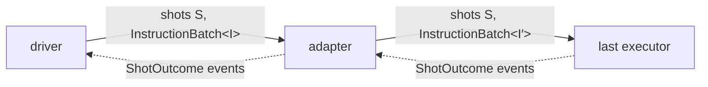

# Composition: the detailed rules

[Protocol overview](../../README.md).

This page is for maintainers of the crate, and for those who need a rule at its
edge: the protocol's rules that the other pages build on; levels, roles and the
three laws; how adapters compose; the parts of a run and the rules of
composition in full, with every boundary of calls by opcode and what a boundary
costs; the executor form and composing by hand; the rules of a job given to a
chain; the known limits of what is built, with the planned features that lift
them; and, last, the tests of the promises of [Composition](../composition.md),
of the planned features, of rejections and of the API docs of `AdapterExecutor`
that the sections do not cite. A user putting parts together needs none of it to
start, and starts at [Composition](../composition.md).

## What this crate does

This crate defines the execution protocol and provides the facilities that
make an implementer's own logic an executor or an adapter, and the reply
machinery. Executors that perform quantum operations, such as simulators or
remote-device clients, are implemented in other crates. The parts of a
chain, the job and the run are introduced in the README
([The model](../../README.md#the-model-a-chain-and-its-run)); this
section states the protocol's rules that the other pages build on.

- A **message kind** (`Message`) fixes what a call means and which events its
  reply carries. There is one: an `InstructionBatch`, a list of instructions
  run in order on each shot of a set of shots (`ShotSet`), each shot's state
  carrying over from the batches before it. Its events are `ShotOutcome`s, a
  value under the shot and the tag the batch gave the readout, marked with
  the shot's conditions so far
  ([Shot conditions](../replies.md#shot-conditions)). One shot is a
  set of one: an executor that holds one shot's state is called with that
  shot alone, and refuses another (`Rejected::ShotNotHeld`).
- An **executor** (`Executor<M>`) accepts one message kind; an **adapter**
  (`Adapter`) makes, once, from the executor downstream, an executor
  (`Apply`) that sits upstream of it, so adapters composed with an executor
  give an executor again, and a driver written once runs on every chain.
- A **chain** is built by `compose`, or `>>`: each adapter is built once
  against what is downstream of it, every fault of the parts built
  together reported together before anything runs (`BuildFaults`); a part composed
  with the executor first is built on its own, before what is upstream of
  it ([The rules of composition](#the-rules-of-composition)). Its head
  (`ChainHead`: a driver, `driver()` for the crate's, with the adapters
  composed below it so far) composed with the executor, the chain is a
  `Chain`, which
  checks each job given to it, `chain.run(program, shots)`, before any
  call (`JobFaults`), and gives its `Run`. A run owns the chain: when it is
  waited for or awaited, it
  runs its program and closes the executor once the program ends
  ([Composing a run](../composition.md#composing-a-run),
  [A chain and its job](../composition.md#a-chain-and-its-job)).
- A **call** returns a reply (`Reply`) or a typed refusal (`Rejected`).
  It may run work synchronously before returning; polling the reply never
  blocks. An executor's refusal means that nothing started, so the caller
  may correct the message and send it again; each refusal has a retry class.
  A refusal of class `Resend` (such as `Rejected::NoReply`) is different:
  no verdict arrived over a link, so work may have run
  ([Rejections and retries](../rejections.md)). A call that starts and cannot
  finish ends its reply with `ReplyStatus::Failed`. An executor whose state
  carries over from one call to the next then refuses its later calls
  (`Rejected::EarlierFailure`), at the latest once its caller sees the
  failure ([Executors](executors.md#an-executor-fails)).
- **Replies** are polled for their events, never block, and wake their
  caller when they can make progress. `ImmediateReply` is the reply of an
  executor that ran the work inside the call; `reply_channel()` makes the two
  ends of a reply whose events come from elsewhere (a worker thread), and
  `relay` passes an inner reply's events up through one. A caller takes a whole
  reply with `wait` (blocking) or `wait_async` (a `Future`), or its events as
  they come with `Reply::poll_events` or `async_events` (a `Stream`, the reason
  the crate depends on `futures-core`).
- **Facilities** make an implementer's own logic a part that keeps the
  protocol's rules. `executor_fn(promise, make_state, logic)` makes an
  executor from a promise, what makes a state and the logic run on it;
  `.seed(seed)` gives its states the run's seed, `.shots(OnePerShot)` one
  state per shot, made at the shot's first call, and `.run_on(OwnThread)`
  runs its calls on a thread of its own ([Executors](../executors.md)).
  `adapter_fn(make_state, logic)` makes an adapter from what makes a state
  and a logic that sends its calls below, and
  `owning_adapter_fn(make_state, logic)` one whose state keeps its way
  below for its whole life ([Adapters](../adapters.md)). An executor written
  by hand keeps the rules of failure and close with `ExecutorLifecycle`.
- **Seeds**: shot `j` draws, in each component that draws, from a seed fixed
  by the run's seed, `j` and the component's id (`ShotContext`,
  `shot_seed`, `ComponentId`): the run's seed is the one the last executor
  is built with, which gives it to its states, and an adapter that draws is
  given it when the chain is built
  ([Seeds](../executors.md#seeds-not-generators)). Seed derivation does not
  depend on how the shots are split into calls or on which other
  components draw. Outcome invariance under splitting is offered by
  replayable executors; an adapter that
  changes instructions may still change outcomes. The crate gives seeds,
  not generators, so it depends on no random-number crate.
- An executor **describes** what it offers (`Describe`, `Capabilities`), so a
  chain can be checked before it runs, and **closes** (`Close`) with a report
  that folds with the reports of the components it wraps (`Fold`). Folding
  adds one report into another: the empty report adds nothing, and the
  order and grouping of the reports folded do not change the total, so the
  reports of shots run apart fold, shot by shot, into what one executor
  that ran them all reports: its log probabilities, and its states' reports
  where they count per shot; `calls` adds up across the executors
  (`the_reports_of_a_split_fold_into_the_report_of_one_executor`,
  `src/tests/executor.rs`). An executor reports its calls, and each shot's
  log probability where it is known (`ExecutorReport`, `LogP`). The rules
  that the compiler cannot check are
  [conformance checks](../composition.md#conformance-checks).
- **Codes** (`reason_code`, `need_code`, `value_code`, `retry_code`,
  `conditions_code`) give the fixed numbers by which a refusal, its retry
  class, a need, a value and a shot's conditions cross a link. Once an end
  is deployed, a code keeps its meaning: a new meaning gets a new code,
  never one used before, and each code is written out, never derived from
  an enum's order or a type's representation (`reason_codes_are_fixed`,
  `need_codes_are_fixed_and_decode_back`,
  `retry_codes_are_fixed_and_decode_back`,
  `value_codes_are_fixed_and_decode_back`,
  `conditions_codes_are_fixed_and_decode_back`, `src/tests/codes.rs`). A
  decoder (`need_of`, `retry_of`, `value_of`, `conditions_of`) returns
  `None` for a code it does not know (`an_unknown_code_decodes_to_nothing`,
  `a_conditions_code_with_an_unknown_bit_decodes_to_nothing`).

## Levels, roles and laws

A chain is a driver, any number of adapters, and an executor, joined by
`>>`. Every element speaks one message, `InstructionBatch<I>`: a caller of
one shot calls with a set of one, the same message as a caller of many, so
there is no layer for a caller to choose or to cross. The message type is
what the compiler checks at every arrow:



Each shot keeps its id through every element; an adapter may change the
instructions (I to I′). The diagram leaves out one step: calls numbered
otherwise than the set downstream are copied into its numbering on their
way down ([Composing a run](../composition.md#composing-a-run)). The
outcomes come back up through the same elements, each naming its shot: an
adapter receives the outcomes of what is downstream of it, as a caller does,
and gives its own upstream (the code of `tests/runtime_isa/code.rs` decodes
them). An adapter may act on them before it replies: a code's decoder runs a
syndrome below with `below.run(..)`, reads it, and sends the correction it
chose from it (`a_logic_sends_below_a_call_it_chose_from_what_its_run_read`,
in `src/tests/adapter/adapter_fn.rs`).

Requests (layer L1: a batch named by an id, so it runs at most once) and
frames (layer L0: which a link may lose, repeat or reorder) are planned,
with no milestone yet, as what a remote executor does inside its link: a
device behind a cloud service, or a simulator on another machine that a
runner here drives. Its caller sends the same message. Their ids and
rejections exist here (`CallId`, `Rejected::IdReused`), and so do the codes
that carry rejections on a link (`reason_code` and the others). When those
layers exist, a wrapper over its unwrapper is to give the outcomes of what
it wraps, and an adapter the same outcomes above or below the layer; laws 2
and 3 of the table below are this crate's own, not those equalities.

A **level** is how abstract the instructions are: logical or physical. An
adapter may change it: `Repetition3` (`tests/static_isa/repetition3.rs`)
takes `InstructionBatch<Logical>` down to the toy's physical
`InstructionBatch<Op>`, a level down, on the same shots.

A component has one of three roles, and the last executor is the executor
at the end of the chain:

| Role              | Is                                                                                                                                                                                                                                                                                                                                                                                                                                                                                                  | Here                                                                                                                                                                                       |
| ----------------- | --------------------------------------------------------------------------------------------------------------------------------------------------------------------------------------------------------------------------------------------------------------------------------------------------------------------------------------------------------------------------------------------------------------------------------------------------------------------------------------------------- | ------------------------------------------------------------------------------------------------------------------------------------------------------------------------------------------ |
| **driver**        | not an executor: a `Driver<P>`, the chain's top, which runs any program of its form given to the chain: it names the shots, sends instructions and reads the outcomes. An adaptive program is a program `DefaultDriver` lets drive, not a driver                                                                                                                                                                                                                                                    | `DefaultDriver` (`driver()`); `InTurn`, a driver written by hand, in `src/tests/compose.rs`; `FlipALogicalCoin` in `tests/static_isa.rs` is an adaptive program `DefaultDriver` lets drive |
| **adapter**       | not an executor: a map from an executor to an executor. It maps the executor downstream of it, once, to the executor upstream, which calls it on the shots it is called on, possibly with another instruction type                                                                                                                                                                                                                                                                                  | `RepetitionCode` puts a `Repetition3` upstream, which sends `Op` for `Logical` (a lowering); `Debuggers` a `Debugger`, which sends what it accepts (a probe)                               |
| **executor**      | an `Executor<M>`: it runs each shot named; offering `resumable_shots`, it promises that a later call continues a shot from the state its earlier calls left                                                                                                                                                                                                                                                                                                                                         | the guide's `toy_simulator`, made with `executor_fn` and `OnePerShot`; adapters composed with an executor                                                                                  |
| **last executor** | not a type: the executor at the end of a chain, which calls nothing. Its capabilities (`Describe`) and its report (`Close`) originate there, and every adapter passes them on: the capabilities changed where it changes them, the report as it is, unless the adapter is given a `state_report`, which adds its own report beside the one below, its own first (`an_adapter_given_no_state_report_adds_no_pair_to_the_report`, `a_one_state_adapters_report_is_its_state_beside_the_report_below`) | the guide's `toy_simulator`                                                                                                                                                                |

Three laws make the parts interchangeable; the second holds on a replayable
executor only. The first two are equalities between two builds, so their
tests compare the two; the third's tests check the shots each call below
is on, and what each shot draws there:

| #   | Law                                                                                                                                                                                                                                                                                                                                                                                                                                                                                                                                                                                                                                                                                                                                                                                                                                                                                                                                                                                                                                                                                                                                                                                                                                                                                                                                                                                                                                                                                                                                                                                                                                                                                                                                                                                                                                                                                                                                                                                                                                                                                                                                           | Checked by                                                                                                                                                                                                                                                         |
| --- | --------------------------------------------------------------------------------------------------------------------------------------------------------------------------------------------------------------------------------------------------------------------------------------------------------------------------------------------------------------------------------------------------------------------------------------------------------------------------------------------------------------------------------------------------------------------------------------------------------------------------------------------------------------------------------------------------------------------------------------------------------------------------------------------------------------------------------------------------------------------------------------------------------------------------------------------------------------------------------------------------------------------------------------------------------------------------------------------------------------------------------------------------------------------------------------------------------------------------------------------------------------------------------------------------------------------------------------------------------------------------------------------------------------------------------------------------------------------------------------------------------------------------------------------------------------------------------------------------------------------------------------------------------------------------------------------------------------------------------------------------------------------------------------------------------------------------------------------------------------------------------------------------------------------------------------------------------------------------------------------------------------------------------------------------------------------------------------------------------------------------------------------- | ------------------------------------------------------------------------------------------------------------------------------------------------------------------------------------------------------------------------------------------------------------------ |
| 1   | **The grouping does not matter**: `>>` is associative, so a driver with adapters below it is still a chain's head (`ChainHead`; planned: that it is itself a `Driver<P>`), adapters composed (`ComposedAdapters`) compose as one adapter wherever `>>` or `compose` takes one (planned: that they implement the trait `Adapter`), and adapters composed with an executor are an executor. A probe that changes nothing, such as the pausing debugger (`tests/debugger.rs`), is not told apart from the executor alone by its outcomes, seeds or capabilities. An adapter is told apart, for example, when it changes the instructions (a lowering: `each_logical_instruction_goes_down_as_its_gadget`, `tests/static_isa.rs`), refuses a call the executor would run (`.check`: `the_check_refuses_a_call_before_the_state_is_made_and_the_logic_runs`), adds a `state_report` (`a_one_state_adapters_report_is_its_state_beside_the_report_below`), splits a call by shot, as the logging debugger (`tests/observers/debugger.rs`) does, which a refusal below of a later shot then tells apart (`under_the_debugger_a_shot_refused_after_another_ran_fails_the_run`, `tests/observers.rs`), or waits for the readouts below (`Below::run`), with one state too, which a cancel below or a reply below that is not whole then tells apart: the call and the adapter fail, where alone the call ends cancelled or its readouts pass up (`a_run_whose_reply_is_cancelled_fails_the_call_and_the_adapter_whatever_the_logic_returns`, `a_run_that_reads_a_tag_of_a_shot_twice_fails_the_call_and_the_adapter`, `a_run_answered_for_a_shot_it_did_not_run_fails_the_call_and_the_adapter`, `src/tests/adapter/adapter_fn.rs`; under the debugger: `under_the_debugger_a_call_cancelled_below_fails_the_call_and_the_debugger`, `under_the_debugger_a_reply_that_reads_a_tag_twice_fails_the_run`, `under_the_debugger_a_reply_that_reads_a_shot_not_given_fails_the_run`, `tests/observers.rs`). A known issue besides: the report's log probabilities miss the draws of an adapter that draws ([Reports](../adapters.md#reports-state_reportf)) | `composition_is_associative`, `the_grouping_of_a_drivers_chain_does_not_matter`, `the_grouping_of_a_jobs_chain_does_not_matter` (`src/tests/compose.rs`); `the_debugger_changes_no_outcome_and_no_seed`, `the_debugger_offers_what_it_wraps` (`tests/debugger.rs`) |
| 2   | **A shot alone**: on a replayable executor, a shot run alone gives what it gives among others, so a set of one shot is that shot's executor                                                                                                                                                                                                                                                                                                                                                                                                                                                                                                                                                                                                                                                                                                                                                                                                                                                                                                                                                                                                                                                                                                                                                                                                                                                                                                                                                                                                                                                                                                                                                                                                                                                                                                                                                                                                                                                                                                                                                                                                   | `a_shot_run_alone_gives_what_it_gives_among_others` (`src/tests/compose/run.rs`); for any replayable executor, the conformance check `gives_each_shot_alone_what_it_gives_among_others`                                                                            |
| 3   | **Shots keep their ids**: an adapter upstream of an executor calls it on the shots it is called on, so shot `j` of the chain is shot `j` of the last executor                                                                                                                                                                                                                                                                                                                                                                                                                                                                                                                                                                                                                                                                                                                                                                                                                                                                                                                                                                                                                                                                                                                                                                                                                                                                                                                                                                                                                                                                                                                                                                                                                                                                                                                                                                                                                                                                                                                                                                                 | `an_adapter_written_by_hand_is_applied_once_to_the_whole_executor` (`src/tests/compose/adapters.rs`); `a_logical_run_draws_each_shots_coins_from_its_physical_seed` (`tests/static_isa.rs`)                                                                        |

Law 2, from `a_shot_run_alone_gives_what_it_gives_among_others`
(`src/tests/compose/run.rs`): a run of four shots on a simulator with a
state per shot, then a run of each shot alone, built with the same seed:

```rust
let run = |ids: &[ShotId]| {
    let bits = Bits::default();
    let simulator = executor_fn(
        bits.capabilities(),
        move |context: ShotContext| Ok(bits.state(&context).expect("bits are always made")),
        run_bits,
    )
    .seed(11)
    .shots(OnePerShot);
    let program = Program::flip_and_toss(bits_set());
    let (outcomes, _) = (driver() >> simulator)
        .expect("no adapter, no fault")
        .run(program, shots(ids))
        .expect("the simulator runs the bits' set")
        .wait();
    outcomes
};
```

Each shot's outcomes among the others are those of the shot alone
(`among_others` is the run of all four, and `values` lists each outcome's
shot, tag and value, in order); the order across shots carries no meaning
([The order of a reply's events](replies.md#the-order-of-a-replys-events)),
so the test compares shot by shot:

```rust
for j in ids {
    let its_own: Vec<ShotOutcome> = (among_others.iter())
        .filter(|o| o.shot == j)
        .copied()
        .collect();
    assert_eq!(values(&run(&[j])), values(&its_own), "shot {j}");
}
```

## Adapters compose

The executor an adapter makes wraps the executor downstream of it, so these
executors nest, and by law 1 a chain of them is again one executor: a
driver written once runs on every chain. The `Debugger` that
`Debuggers` makes (`tests/debugger/debugger.rs`) sends what it accepts (a
probe): it records each batch on its way down and each outcome on
its way up, and while paused it holds the batch and returns a reply that a
step completes later (doc comments left out):

```rust
impl<E: Executor<InstructionBatch<Op>>> Executor<InstructionBatch<Op>> for Debugger<E> {
    type Reply = DebuggerReply<E::Reply>;

    fn call(&mut self, batch: InstructionBatchRef<'_, Op>) -> Result<Self::Reply, Rejected> {
        let mut state = lock(&self.state);
        if state.paused {
            let (sender, reply) = reply_channel();
            let instructions = batch.instructions.to_vec();
            state
                .held
                .push_back((batch.shots.clone(), instructions, sender));
            return Ok(DebuggerReply::Held(reply));
        }
        send(&mut state.inner, batch, &self.log).map(DebuggerReply::Passed)
    }
}
```

The step, from any thread, sends the held batch on and passes the reply
into the held `ReplySender` with `relay`, which wakes the caller
(`a_caller_thread_waits_while_another_thread_steps`). The debugger draws
nothing and changes no instruction, so between a caller and an executor it
changes no outcome and no seed
(`the_debugger_changes_no_outcome_and_no_seed`):

```rust
let without = coin_then_feedback(&mut toy_simulator(seed), j);
let (mut with, _) = debugger(toy_simulator(seed));
assert_eq!(
    coin_then_feedback(&mut with, j),
    without,
    "seed {seed}, shot {j}"
);
```

The general rule:

- **Adapters compose.** The executor each adapter makes is
  generic over the executor it wraps
  (`Debugger<E: Executor<InstructionBatch<Op>>>`), so the compiler checks that
  it wraps the message kind and instruction type it sends, and its reply nests
  the inner reply or makes one of its own: the debugger's,
  `DebuggerReply<E::Reply>`, nests it (`Passed`, a `Recorded<E::Reply>`) or,
  while paused, is one of its own (`Held`, an `IncrementalReply`).
- **An adapter costs one executor.** Composed with an executor, it maps
  it once, when the chain is built, and the executor it makes calls the
  executor downstream on the shots it is called on (law 3;
  `an_adapter_written_by_hand_is_applied_once_to_the_whole_executor`).
- **An adapter adds a component, so it says what it offers.** Built
  against the executor downstream (`Adapter::build`), it passes that
  executor's capabilities on, changed where it changes them
  (`RepetitionCode` divides the qubits by three; the debugger changes
  nothing), and the executor it makes closes what it wraps (`Close`), so
  it rejects calls once closed as the downstream executor does:
  `closing_the_code_closes_what_it_wraps`
  (`tests/static_isa.rs`) and `closing_the_debugger_closes_what_it_wraps`
  (`tests/debugger.rs`) check it with `conformance::rejects_calls_once_closed`.

## The parts of a run

The parts of a run, as
[Composing a run](../composition.md#composing-a-run) puts them together:

- The **executor**, the right side of `compose` or `>>`, is any executor
  of the run's batches that describes what it offers and closes with a
  report: the last executor, built with its seed (the guide's
  `toy_simulator(seed)`, made with `executor_fn`, `.seed(seed)` and
  `.shots(OnePerShot)`), or adapters composed with it. A chain's head
  with no adapter runs on any executor, an ensemble (one state shared by its
  shots) included (`a_job_composes_with_any_executor`), its job's needs
  checked when the job is given to the chain, as for any; adapters map an
  ensemble whole,
  as they map any executor, so one that passes every call through changes
  nothing (`a_passing_adapter_over_an_ensemble_changes_nothing`).
- An **adapter** maps the executor downstream of it to the executor
  upstream, and describes what it gives (`Adapter`): what it accepts and
  sends, the random number id it draws with, and the capabilities it
  changes. It is made by `adapter_fn(make_state, logic)` from a state and
  a logic, by `owning_adapter_fn` for a state that keeps its way below, or
  by hand (`Apply`); [Adapters](../adapters.md) is about writing one, its
  refusals and failures, its seeds and its report, with the repetition
  code as a runtime that owns its backend
  (`tests/static_isa/code_runtime.rs`,
  [A state that owns its way below](../adapters.md#a-state-that-owns-its-way-below-owning_adapter_fn)).
- A **driver** (`Driver<P>`) heads the chain, and runs any program of
  form `P` given to it. While the chain is built it sits in its head
  (`ChainHead`), with the adapters composed below it so far: `driver()` is
  the crate's driver (`DefaultDriver`) at a head with no adapter, and
  `ChainHead::new(driver)` puts any driver there: a driver written by hand,
  as a runtime is, makes its calls on the one executor it is given, the
  adapters below it with the executor
  (`a_driver_written_by_hand_calls_through_the_adapters_below_it`,
  `a_drivers_default_needs_ask_no_resumable_shots`). A head with adapters
  is a `ChainHead` still, not a `Driver<P>` (planned). Composed with the
  executor, a head makes a `Chain`, which runs the job given to it
  ([A chain and its job](../composition.md#a-chain-and-its-job)), an
  adaptive program (`AdaptiveProgram`) included
  (`an_adaptive_program_given_to_a_chain_runs_as_it_runs_driving_the_executor_itself`).
  The run's seed is the one the last executor is built with
  ([Seeds](../executors.md#seeds-not-generators)).
- A **run** is what a chain given a job gives, and it owns the chain: its
  driver only calls the executor. Composing, or giving a job,
  runs nothing
  (`a_run_runs_nothing_until_it_is_waited_for`); `run.wait()`, or
  `run.await` for an asynchronous caller, runs its program, closes the
  executor once the program ends, and only once
  (`a_run_closes_its_executor_once_after_the_programs_last_call`;
  [An executor's whole life](../executors.md#an-executors-whole-life); a run
  dropped or unwound before then does not,
  [Known limits](#a-run-closes-its-executor-only-when-its-program-ends)),
  and gives the program's output and
  the executor's report
  (`a_run_gives_the_programs_output_and_the_executors_report`). A call on a
  shot the job did not name is refused before the executor sees it
  (`a_call_on_a_shot_outside_the_jobs_is_refused_before_the_executor_sees_it`).
  A program may take replies with `wait` inside its run: the run's own
  parking loses none of its wakes
  (`a_run_waited_for_keeps_the_wakes_that_come_while_its_program_waits`).

## The rules of composition

- **Left is upstream, and the grouping does not matter.**
  `(driver() >> a) >> executor` and `driver() >> (a >> executor)?` build
  chains with the same run, and so does every other grouping of
  `driver() >> a >> b >> executor`; `driver() >> a` is a `ChainHead` again,
  by its type (a binding of that type in
  `the_grouping_of_a_drivers_chain_does_not_matter`), and not yet a
  `Driver<P>` (planned; a compile error, which no test pins)
  (`adapters_composed_put_the_left_upstream_of_the_right`,
  `composition_is_associative`,
  `the_grouping_of_a_jobs_chain_does_not_matter`,
  `the_grouping_of_a_drivers_chain_does_not_matter`, `src/tests/compose.rs`;
  `a_noise_model_written_by_hand_draws_from_its_own_seeds_in_either_grouping`,
  `tests/simulator.rs`). Adapters grouped
  either way among themselves, before they reach the executor, report the
  same build faults, in the same order
  (`a_chain_reports_the_same_faults_whatever_the_grouping`,
  `a_drivers_chain_reports_the_same_faults_whatever_the_grouping`). A part
  composed with the executor first is built on its own: `compose` gives it
  as a `Result`, unwrapped before it is composed further, so
  `compose(a, compose(b, executor)?)` returns the faults of `b` before `a`
  is built
  (`a_part_composed_with_the_executor_first_reports_its_faults_before_upstream_is_built`).
- **An adapter written by hand is applied once, to the whole executor**,
  when the chain is built, and its executor is called with each batch on
  all its shots
  (`an_adapter_written_by_hand_is_applied_once_to_the_whole_executor`).
  An adapter that draws nothing shifts no draw of the executor downstream:
  built with the same seed, the executor draws in each shot what it draws
  alone (`a_logical_run_draws_each_shots_coins_from_its_physical_seed`,
  `tests/static_isa.rs`, a code). The outcomes still change when the
  adapter changes the instructions, as a code does; a probe that draws
  nothing and sends what it accepts, such as a logger, leaves every outcome
  as the executor alone gives it, for the same seed and shots
  (`a_run_draws_what_its_executor_alone_draws`).
- **The chain is built once, every fault reported at once** (except a part
  composed with the executor first, built on its own as the first rule
  says). Until it reaches an executor, `compose` holds what it is given.
  Then it builds the chain from that executor upstream: each adapter is
  built against what is downstream of it (`Adapter::build`, given an
  `AdapterBoundary`). The set it
  sends is matched in the set downstream, once; the id it draws with is
  checked against the ids drawn downstream; and the adapter reports its
  own faults, of a type it defines (`AdapterBoundary::fault`, for example a code
  whose block needs more qubits than downstream holds). What an adapter
  offers upstream is what downstream offers, the qubit count included,
  with the set it accepts and the ids it draws with, unless its `build`
  changes it (`AdapterBoundary::offered_upstream`: a code offers a qubit per
  block; `an_adapter_keeps_the_capabilities_it_does_not_change`); an
  adapter that changes the set still passes `resets` on, since the
  instructions matched guarantee a reset where sets are described
  ([instruction sets](instruction-sets.md#compatibility-the-rules):
  `a_program_resetting_upstream_of_a_code_without_a_reset_is_refused_when_given_to_the_chain`).
  The faults come back together, the most upstream adapter's first,
  each named (`BuildFaults`):

  ```rust
  let sends_h = bits_set().with("h", [Block]);
  let noise =
      map_executor::<InstructionCall, _>(|below| below).drawing(ComponentId::LAST_EXECUTOR);
  let Err(faults) = compose(
      compose(Relabel::new(sends_h, false), noise),
      TestDoubleExecutor::with_model(Bits::default(), 7),
  ) else {
      panic!("both adapters are faulty");
  };
  ```

  That is `a_chain_reports_every_fault_at_once_upstream_first`, where
  `map_executor` is a test's adapter written by hand (`Apply`) that
  draws with the id it is given;
  `adapters_drawing_with_the_same_id_are_refused` checks the ids, and
  `an_adapters_own_faults_are_reported_with_the_chains` an adapter's own
  faults, each a `BuildError::Adapter` its builder can downcast. The
  executor composed describes what the adapters derive
  (`an_executor_composed_describes_what_its_adapters_derive`).

- **A job's needs are checked when it is given to the chain**, not when
  the chain is built, against what the chain offers, so that nothing runs
  that would be refused: every need its program lacks is reported
  (`every_need_of_a_program_that_the_chain_lacks_is_reported`), each a
  `Rejected::Unmet` among the job's `JobFaults`
  ([A chain and its job: the rules](#a-chain-and-its-job-the-rules)).
- **Where an adapter's calls meet the executor downstream, the boundary is
  decided once, when the chain is built.** Typed instructions are checked by
  the compiler, and the downstream shot is given to the adapter as it is, at
  no cost. Downstream of an adapter of `InstructionCall`s, calls numbered as
  the downstream set numbers them pass as they are
  (`calls_in_the_downstream_numbering_reach_the_shot_as_they_are`), and calls in
  another numbering are copied into it on their way down
  (`calls_in_another_numbering_are_renumbered_on_their_way_down`). An adapter
  avoids the copy by sending in the downstream numbering, taken when it is built
  (`AdapterBoundary::adopt_downstream_numbering`, as the run-time guide's
  `Encoding` does: `an_adapter_that_can_send_in_the_downstream_numbering_does`).
  The driver's boundary is renumbered the same way, decided when a job is given
  to the chain (`a_job_whose_calls_a_decoder_does_not_accept_is_refused`): a
  program whose set numbers the instructions otherwise has each batch copied
  into the chain's numbering
  (`a_program_in_another_order_runs_its_own_instructions_through_the_chain`),
  and a program that cannot afford the copy builds its calls by name with the
  set the chain describes (`InstructionSet::call`), so they pass as they are
  (`a_batch_in_the_executors_numbering_reaches_it_as_it_is`; on the run-time
  guide's code, `a_program_builds_its_calls_by_name_with_the_codes_set`).
- **Entities that are compatible compose into a valid one, whatever the order of
  their instruction sets.** Composition is part of the protocol, and makes this
  guarantee: the calls of each adapter are checked against the set downstream,
  in any order, and renumbered into it where it numbers them otherwise; what is
  not compatible is refused when composed. An adapter sends the set it states
  (`Adapter::sends`), or else, when it sends instructions of the kind it is
  called with, the set it accepts, as it is called with it: an
  adapter that accepts a coin, a flip and a read, upstream of bits that also
  reset, numbered before the flip, has its flip flip the bit
  (`an_adapter_that_states_no_sends_sends_what_it_accepts`), and is refused
  upstream of bits that lack one of its instructions
  (`an_adapter_accepting_what_the_downstream_set_lacks_is_refused_when_built`).
- **Every boundary of calls by opcode is checked, or the chain is refused**,
  in each of these cases:

| Case                                                                                                                                                                          | Verdict                                                                                                                                    | Shown by                                                                                                                                                    |
| ----------------------------------------------------------------------------------------------------------------------------------------------------------------------------- | ------------------------------------------------------------------------------------------------------------------------------------------ | ----------------------------------------------------------------------------------------------------------------------------------------------------------- |
| sets of one name, at the driver's boundary                                                                                                                                    | accepted when the job is given to the chain: matched by mnemonic, no action needed                                                         | `a_job_and_an_executor_sharing_a_set_without_actions_are_composed`                                                                                          |
| sets of one name, at an adapter's boundary                                                                                                                                    | composed: matched by mnemonic, no action needed                                                                                            | `an_adapter_sending_the_set_downstream_without_actions_is_composed`                                                                                         |
| at the driver's boundary, between sets of other names, an instruction both sets have under its mnemonic, with the same operands, that either leaves without a declared action | refused (`InstructionMismatch::UndeclaredAction`), when the job is given to the chain                                                      | `an_instruction_whose_action_the_programs_set_leaves_undeclared_is_refused`                                                                                 |
| at an adapter's boundary, the same                                                                                                                                            | refused (`InstructionMismatch::UndeclaredAction`), every boundary's at once                                                                | `an_instruction_whose_action_the_downstream_set_leaves_undeclared_is_refused`, `every_undeclared_action_of_a_chain_is_reported_at_once`                     |
| a program of `InstructionCall`s that states no set, so its opcodes are just numbers                                                                                           | refused, its need of an instruction set unmet (`Rejected::Unmet`), when the job is given to the chain                                      | `a_jobs_program_of_calls_by_opcode_stating_no_set_is_named_in_its_refusal`                                                                                  |
| an adapter that passes such calls through, stating no set, over an executor that describes none                                                                               | refused (`BuildError::NoInstructionSetDownstream`)                                                                                         | `a_passing_adapter_of_calls_by_opcode_over_no_set_is_refused`                                                                                               |
| the same adapter over a set                                                                                                                                                   | composed: it accepts the set downstream as it is, and the calls upstream of it are checked against that set                                | `a_passing_adapter_of_calls_by_opcode_stating_no_set_accepts_the_set_downstream`                                                                            |
| an adapter that makes such calls from instructions of another type and states no set it sends, whatever it accepts and whatever is downstream                                 | refused (`BuildError::UnstatedSends`)                                                                                                      | `an_adapter_that_makes_calls_by_opcode_and_states_no_set_is_refused`, `an_adapter_that_makes_calls_by_opcode_and_states_only_the_set_it_accepts_is_refused` |
| an adapter that states the set it sends                                                                                                                                       | composed, that set checked against the set downstream                                                                                      | `an_adapter_that_makes_calls_by_opcode_and_states_the_set_it_sends_is_composed`                                                                             |
| a typed boundary over no set                                                                                                                                                  | composed: the compiler checks that both sides run the same type                                                                            | `a_typed_chain_that_describes_no_set_is_composed`                                                                                                           |
| a typed adapter that states the set it accepts, and sends it as it is, over no set                                                                                            | refused (`BuildError::NoInstructionSetDownstream`): a set sent is checked, so it needs one downstream                                      | `a_typed_adapter_stating_the_set_it_accepts_over_no_set_is_refused`                                                                                         |
| an adapter that decodes calls by opcode into typed instructions, stating only the set it accepts, over no set                                                                 | composed, and the calls upstream of it checked against the set it accepts when the job is given to the chain (`Rejected::Unmet` otherwise) | `a_decoder_of_calls_by_opcode_over_no_set_is_composed`, `a_job_whose_calls_a_decoder_does_not_accept_is_refused`                                            |
| the same decoder stating no set                                                                                                                                               | composed: it accepts the set downstream as it is, and the calls upstream of it are checked against that set                                | `a_decoder_stating_no_set_accepts_the_set_downstream`                                                                                                       |

So a chain that composes is verified, provided that an adapter of calls by
opcode that states no set sends the calls it is called with, as
`Adapter::sends` asks, or decodes them in the downstream numbering, as
`Adapter::accepts` asks: no check sees calls it makes of its own, or reads
in another numbering.

## What a boundary costs

What a boundary of `InstructionCall`s costs, from
`benches/instruction_calls.rs` (its `composed` table, on one machine): calls
that pass cost at most about 1 ns per batch, the branch that lets them
pass, so about 1 ns on a batch of one instruction and nothing measurable
per call on batches of 10 000; calls copied cost about 2 ns more per call
(1.28 times the bare cost on batches of 10 000). Batching amortises the
first. An adapter that sends a call of its own for each call, as a lowering
does, saves the copy by adopting the downstream numbering (its `emitting`
table, three runs on one core): on batches of 10 000, about 16 ns per call
adopted against 18 copied, 0.85 to 0.93 times; on batches of one call, the
cost per batch hides the difference. A boundary of typed instructions costs
nothing: the executor downstream is called with the batch as it is.

## The executor form, and composing by hand

Two other ways serve callers that need them:

- **The executor form.** A caller that pushes calls itself, such as an FFI
  runner or a Python binding, holds an executor instead of a run:
  adapters composed with an executor (`compose(adapters, executor)`) are an
  executor, built and checked as a run's chain is, and the caller checks
  its own needs against what it describes with `Capabilities::admit`
  (`Rejected::Unmet`, naming the component). It then calls the executor,
  and closes it for its report.
- **By hand.** Adapters nest without `compose` (a `Repetition3`
  around an executor); `compose` adds the checks, the boundaries and the
  run's seed for the adapters that draw.

## A chain and its job: the rules

An adaptive program (`AdaptiveProgram`), given to a chain, runs as it runs
driving the chain's executor itself
(`an_adaptive_program_given_to_a_chain_runs_as_it_runs_driving_the_executor_itself`),
and a static program as the same program written as an `AdaptiveProgram`
(`a_chain_runs_a_job_as_its_program_written_as_an_adaptive_program_runs`). The
rules of a job given to a chain
([A chain and its job](../composition.md#a-chain-and-its-job)):

- **The job is checked when given, before any call** (`JobFaults`), every
  fault together: its shots must be a set
  (`a_job_of_no_shots_is_refused`,
  `a_job_that_names_a_shot_twice_is_refused`), no more than the executor
  holds at once
  (`a_job_of_more_shots_than_the_executor_holds_is_refused`); the
  program's needs must be met by what the chain offers, each unmet need
  reported in the order `Capabilities::admit` checks them, naming the
  chain's executor
  (`a_jobs_unmet_needs_are_each_reported_in_order_naming_the_chains_executor`,
  `a_static_programs_needs_are_checked_when_given_to_a_chain`); and the
  driver must find no fault in the program, such as a call outside its
  set (`a_call_outside_the_programs_set_is_refused`). The shots' fault
  comes first, then each unmet need, then the program's
  (`a_jobs_shot_faults_are_reported_with_its_programs_needs_and_calls`).
  Known issue: of shots named twice, only the least is reported
  (`a_job_that_names_several_shots_twice_reports_the_least`).
- **A job calls only its own shots**: a call on another is refused before
  the executor sees it (`a_job_that_calls_a_shot_not_its_own_is_refused`).
- **A program's numbering is its own**: calls by opcode reach the executor
  renumbered where the program's set numbers its instructions otherwise
  (`a_job_is_renumbered_into_the_chains_set_by_its_programs_numbering`).
- **The run gives the outcomes with the chain's report**, waited for or
  awaited alike (`a_jobs_run_gives_its_outcomes_with_the_executors_report`,
  `a_job_awaited_gives_what_it_gives_waited_for`); an awaited run has
  limits of its own ([Known limits](#an-awaited-run)). A `StaticProgram`
  stops at the first batch the chain refuses or that fails, and sends no
  later one
  (`a_static_program_stops_at_the_first_batch_the_chain_refuses`,
  `a_static_program_stops_at_the_first_batch_that_fails`).
- **A chain runs one job**: the run takes the executor and closes it once
  its program ends
  ([An executor's whole life](../executors.md#an-executors-whole-life)); a
  chain dropped without a job, or whose job is refused, does not
  ([Known limits](#a-run-closes-its-executor-only-when-its-program-ends)).
  A function that builds the chain builds it again for the next job; on an
  executor that offers replayable shots, a shot then runs again with the
  outcomes it gave
  (`a_replayable_chain_built_again_runs_a_shot_again_with_the_same_outcomes`).
  A chain that runs many jobs is planned, with no milestone yet, for a
  service that runs many jobs or a sweep of one program over parameters.

## Known limits

The limits of what is built today, each with the tests that pin it,
where one does. Where a planned feature lifts one, it is named here, and
[Planned features](../planned.md) gives it with the case that needs it.

### Which parts the operator joins

`>>` is implemented for the crate's types (`ChainHead`,
`ComposedAdapters`, `NoAdapter`, `AdapterFn`, `OnePerShotAdapter`, and the
test-only `ComposedJob`), with
an adapter or an executor the facility makes (`ExecutorFn`,
`OnePerShotExecutor`, `OnePerShotPlacedExecutor`, `PlacedExecutor`,
`AdapterFnExecutor`, `OnePerShotAdapterExecutor`, `AdapterExecutor`) on
its right, so that a chain groups either way
(`the_grouping_of_a_chain_of_the_facilitys_components_written_with_shr_does_not_matter`,
`the_grouping_of_a_chain_mixing_adapters_written_by_hand_and_by_the_facility_does_not_matter`,
`src/tests/compose.rs`; for a job,
`a_job_and_an_adapter_fn_compose_in_either_grouping`,
`a_job_and_a_per_shot_adapter_fn_compose_in_either_grouping`,
`two_adapter_fns_compose_in_either_grouping`,
`src/tests/compose/run.rs`): one impl for any adapter
and one for any executor would overlap, since a type could be both, and
`>>` cannot infer which rule applies as `compose` does. So a function
that makes a part for `>>` returns the facility's type, its closures
named by role, not a bare `impl Adapter`: `profiler()`
(`tests/observers/profiler.rs`) returns a `OnePerShotAdapter<..>` and
composes (`the_profilers_report_counts_each_instruction_over_the_shots`,
`tests/observers.rs`); a bare `impl Adapter` is a compile error, which no
test pins (`compose`'s rustdoc says why).

Another crate composes with `compose`, or gives its own types `>>`, which
takes more for an executor than for an adapter. An adapter written by
hand already follows a chain's head with `>>`
(`a_logical_run_draws_each_shots_coins_from_its_physical_seed`,
`tests/static_isa.rs`, writes
`driver() >> RepetitionCode::default()`), and
gets `>>` with an executor on its right in a few lines, one impl per
executor type, as `tests/static_isa/repetition_code.rs` does for
`RepetitionCode` with the toy simulator. With an adapter on its right, it
composes by `compose(hand, adapter)`: an impl of `>>` for any adapter there
would name the rule `WithAdapter`, which the crate does not export yet
([planned](../planned.md)). An executor written by hand gets
`>>` from a left-hand type only where its crate implements it: one impl
for each of the four public ones (`ChainHead`,
`ComposedAdapters`, `AdapterFn`, `OnePerShotAdapter`), as
`src/compose.rs` does for the executors the facilities make; the impl
there for `NoAdapter` is the crate's own, since that type is private to
it, and so is the one for the crate's test-only `ComposedJob`. An
executor of another crate written so is composed with `>>` after each of
the four, grouped either way
(`an_executor_written_by_hand_is_composed_with_shr_after_each_public_left_type`,
`tests/executor_by_hand.rs`). A macro
that writes these impls is planned, with no milestone yet, for when a
second crate gives its adapters `>>`, such as a crate of codes or of
noise models.

### A run closes its executor only when its program ends

A run whose future is dropped before then (a timeout, a `select!`), or
whose program, or an executor's `call`, panics, does not close it
(`Run`'s doc); nor does a `Chain` dropped without running a job, or whose
job is refused (`Chain`'s doc). No test pins either limit; an executor
holding a device then releases it only in its own `Drop`, if it has one.
Both go with the planned cancellation: whether a run closes its executor
on drop (which would run on unwinding too) or is stopped through the run
is not decided yet.

### An awaited run

`run.await` boxes the run's future, which is not `Send`
(`an_awaited_runs_future_is_not_send`), so it is awaited on the task that
holds it, and needs a program and an executor that are `'static`;
`run.wait()` runs on any thread the run moves to
(`a_debugger_composed_into_a_chain_hands_out_its_handle`), which needs its
program and executor to be `Send` (a run that is not `Send` is waited for
where it is made).

### A chain is a type

A chain is a type, fixed when it is compiled; a chain chosen at run time
needs one type for any chain. Type-erased chains are planned, with no
milestone yet, for a chain composed from Python at run time, a C API
wrapping the protocol, or a transpiler chosen by a string. When built,
they live in this crate, since any binding needs them: a boxed executor
with a boxed reply (`Box<dyn Reply<Item = ShotOutcome>>`), `Executor` for
`Box<E>` forwarding to `E`, and a fixed report type; one box per call, to
be measured. Meanwhile, a binding holds an `enum` of the chains on its
menu, and refuses a chain off the menu with a message that names this
item.

### The run's seed is given to the last executor

The seed is the run's, not a part's, but today the last executor is given
it with `.seed(s)` when it is built
(`a_state_given_the_runs_seed_draws_from_its_shots_seed`), and an adapter
that draws reads it when the chain is built
(`an_adapter_reads_when_built_the_runs_seed_the_last_executor_is_given`),
so a run with another seed builds the chain again, the seed passed again
to the last executor's constructor. The run's seed, given with the job, is
planned, with no milestone yet, for a user who runs one chain under
several seeds, such as a code's tests over many seeds: the run would take
it with the job, so that one chain serves many seeds.

### What an adapter's logic cannot do yet

Three facilities for an adapter's logic are planned, with no milestone
yet; until then:

- **Refusing a call from the logic**, with a refusal its error carries
  (`AdapterError::refusal(..)`), for a code's adapter that refuses a
  call on a block that does not fit what it was built against, or what
  its state holds, or a code's layer whose runtime refuses a call that
  ran nothing. `.check(f)` refuses before the state is made and the
  logic runs
  (`the_check_refuses_a_call_before_the_state_is_made_and_the_logic_runs`),
  so it sees neither, and the logic's error fails the call and the adapter
  rather than refusing the call (`a_logic_that_fails_fails_the_adapter`).
- **Stating what the adapter offers and needs** (`.offers(..)`,
  `.needs(..)`, on the Promise axis:
  [Glossary](../glossary.md#a-parts-axes)), for a decoder that needs
  resumable shots below, a code that offers a qubit per block of three, or
  a one-state logic that copies one shot's outcome into another, which
  clears `replayable`. An `adapter_fn` offers what is below it and
  nothing more (`it_offers_what_the_executor_below_offers`,
  `it_offers_nothing_the_executor_below_does_not`), but for its instruction
  sets and its seeds ([Adapters](../adapters.md#seeds-drawingid)): should
  its states draw, it still passes resumable shots up, but offers no log
  probability, nor, with one state, replayable shots. With one state, it
  passes replayable and resumable shots up, where it does, on the
  assumption that its logic keeps the shots apart, which it cannot check.
  Passing up stays the default, so the options add to it with no break.
- **Reading the replies below without holding the thread**, for an async
  caller over a code's adapter whose device answers later.
  `below.run(..)` gives the readouts it waits for, so it parks the thread
  that called the adapter until the reply below ends, and an async caller
  upstream holds its thread for the whole call
  ([Replies](../replies.md#replies-one-reply-four-ways-to-take-it));
  `below.send(..)` passes the reply up as it comes, but reads nothing.
  Running the chain on a thread of its own keeps the caller free
  (`a_chain_of_observers_runs_on_another_thread`).

An adapter that sends a refused call again, when its refusal's class
allows it (`RetryClass::Later`), is planned, with no milestone yet, for a
device that refuses with `Later` while it cannot hold the states. Until
then, the caller sends again, as the refusal's class says
([Rejections](../rejections.md)); over a link, a resend belongs to layer
L1 (planned), which runs each id at most once. An `adapter_fn` cannot
write it: after a refusal below, the call's calls below stop
(`a_send_after_a_refused_one_does_not_go_down`, in
`src/tests/adapter/adapter_fn.rs`).

### Checking calls against a promised set

Checking each call against the instruction set a part promises is planned
for the facilities, with no milestone yet, so that `.check` holds only a
part's other rules. Today a part that refuses calls outside its set runs
`InstructionSet::check_batch` in its `.check`, as the bridge to an
existing tool does, beside its readout tags
(`tests/existing_tool/bridge.rs`); a chain of a code's adapter over two
devices, all made with the facilities, would re-check in every `.check`
the set each part promised.

### A failure fails the whole executor

A shot that fails alone, its executor going on with the other shots, is
planned, designed with the adapters, for a long sampling run that keeps
its other shots after one shot's device fails; until then a failure fails
the whole executor ([An executor fails](executors.md#an-executor-fails)).

### No state queries

State queries are not shots, so no message carries them: a query such as
the energy of a variational circuit, an expectation value of a Pauli sum,
is planned, with no milestone yet, as a trait on executors that hold a
state.

## The tests of the user pages' promises

Each promise of [Composition](../composition.md), [Planned
features](../planned.md), [Rejections and retries](../rejections.md) and the API
docs of `AdapterExecutor` and of `conformance` that the sections above do not
pin, in each page's order, with the tests that pin it.

From [Composition](../composition.md):

| Promise                                                                                                  | Tests                                                                                                                                                                                                                            |
| -------------------------------------------------------------------------------------------------------- | -------------------------------------------------------------------------------------------------------------------------------------------------------------------------------------------------------------------------------- |
| A run turned into a future runs nothing until it is polled                                               | `a_run_turned_into_a_future_runs_nothing_until_polled` (`src/tests/compose/run.rs`)                                                                                                                                              |
| The crate's driver sends a `StaticProgram`'s batches each to every shot of the job in one call, in order | `a_static_program_gives_every_shots_outcomes_batch_after_batch` (`src/tests/program/static_program.rs`), `below_the_debugger_each_shots_batch_is_a_call_of_its_own` (`tests/observers.rs`; its run alone makes a call per batch) |
| A set of shots names at least one shot, and each shot once                                               | `a_shot_set_names_at_least_one_shot`, `a_shot_set_names_each_shot_once` (`src/tests/shot.rs`)                                                                                                                                    |
| Observers stacked in one chain each see what they see alone                                              | `stacked_observers_each_see_what_they_see_alone` (`tests/observers.rs`)                                                                                                                                                          |
| Through two adapters, a job's needs are checked against what the upstream one offers, in either order    | `a_chain_of_two_adapters_offers_what_the_upstream_one_offers_over_the_downstream_one` (`src/tests/compose/adapters.rs`)                                                                                                          |

From [Planned features](../planned.md):

| Promise                                                                                                                                                    | Tests                                                                                                                     |
| ---------------------------------------------------------------------------------------------------------------------------------------------------------- | ------------------------------------------------------------------------------------------------------------------------- |
| A call on a qubit that a static program does not state is found at its batch only by the executor's check, and the outcomes of earlier batches are dropped | `a_qubit_a_static_program_does_not_state_is_found_only_by_the_check_at_its_batch` (`src/tests/program/static_program.rs`) |

From [Rejections and retries](../rejections.md):

| Promise                                                                                                                                        | Tests                                                                                                                                                                                                                        |
| ---------------------------------------------------------------------------------------------------------------------------------------------- | ---------------------------------------------------------------------------------------------------------------------------------------------------------------------------------------------------------------------------- |
| Each reason has its retry class                                                                                                                | `every_known_reason_has_its_retry_class` (`src/tests/rejected.rs`)                                                                                                                                                           |
| An `Unrecognized` reason keeps the far end's class and text                                                                                    | `an_unrecognized_reason_keeps_the_far_ends_class_and_text` (`src/tests/rejected.rs`)                                                                                                                                         |
| A job of more shots than the executor holds at once is refused with `Unmet(Shots)` when it is given to the chain, and by `Capabilities::admit` | `a_job_of_more_shots_than_the_executor_holds_is_refused` (`src/tests/compose/chain.rs`), `more_shots_than_held_at_once_are_unmet_even_with_the_default_needs`, `one_shot_is_unmet_where_none_is_held` (`src/tests/needs.rs`) |
| A busy device refuses with `Unavailable`, and the same message runs when sent again                                                            | `a_busy_device_refuses_the_call_and_prepares_the_state_at_the_next` (`tests/per_shot_executor.rs`)                                                                                                                           |
| A state that cannot be made yet refuses the call downstream of an adapter too                                                                  | `a_state_that_cannot_be_made_refuses_the_call_through_an_adapter` (`src/tests/compose/adapters.rs`)                                                                                                                          |

From the API docs of `AdapterExecutor`, the executor `compose` makes of an
adapter written by hand, in `src/tests/compose/adapters.rs` unless named
elsewhere:

| Promise                                                                                                                                                                  | Tests                                                                                             |
| ------------------------------------------------------------------------------------------------------------------------------------------------------------------------ | ------------------------------------------------------------------------------------------------- |
| Dropped over the crate's executors, it raises no panic of the drops of their states                                                                                      | `dropping_frees_each_state_below_an_adapter_written_by_hand_raising_no_panic_of_their_drops`      |
| A function that makes the chain's executor returns it by this name                                                                                                       | `a_function_returns_an_adapter_written_by_hand_over_an_executor_for_shr` (`src/tests/compose.rs`) |
| When the close of the executor the adapter gave panics, as with the first panic of the drops of the states below, the panic reaches the closer once every state is freed | `closing_frees_each_state_below_an_adapter_written_by_hand_then_raises_the_first_drops_panic`     |
| A later close does not close that executor again                                                                                                                         | `a_close_of_an_adapters_executor_that_panicked_is_not_run_again`                                  |

From the API docs of `conformance`, in `src/tests/conformance.rs`:

| Promise                                                                             | Tests                                                                                                                                                                                     |
| ----------------------------------------------------------------------------------- | ----------------------------------------------------------------------------------------------------------------------------------------------------------------------------------------- |
| Each check panics, naming the rule broken, when the implementation does not keep it | each check's `_catches_` tests, such as `accepts_calls_after_a_refusal_catches_a_failure_at_a_refusal` and `reports_once_catches_totals_reported_twice`, which expect the panic's message |
