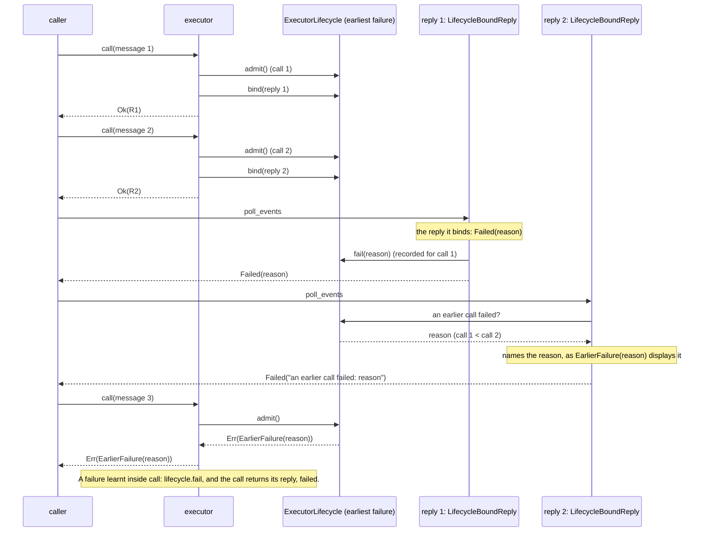
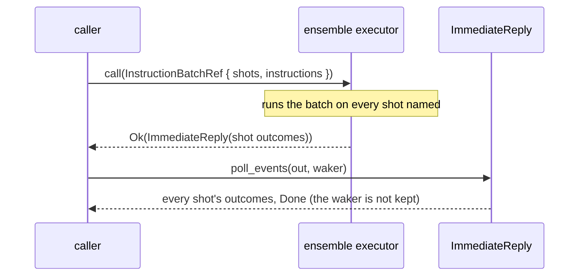

# Executors: the detailed rules

[Protocol overview](../../README.md).

This page is for maintainers of the crate, and for those who need a rule at its
edge: how a capability is added; the rules of `executor_fn`, its panics, drops
and reports; those of a state per shot and of a placed executor, and how the
order of `.shots` and `.run_on` changes them; how an executor's close and
failure are kept; an executor written by hand and an ensemble; how seeds are
derived; and, last, the tests of the promises of [Executors](../executors.md),
of the glossary, of two guides and of the executors' API docs that the sections
do not cite. A user writing an executor needs none of it to start, and starts at
[Executors](../executors.md).

## Adding a capability

A property proposed for the protocol is first placed as one of four:

- a **law** if every component must keep it, as laws 1 and 3 of
  [Levels, roles and laws](composition.md#levels-roles-and-laws);
- a **type or trait bound** if the chain's types already know it and a
  component that lacks it is worth a compile error, as an executor
  accepts only the instructions of its type
  (`Executor<InstructionBatch<I>>`);
- a **capability and a need** if it depends on the component or on how it
  is configured, some components lack it, and a driver relies on it for a
  whole run: the table of
  [Capabilities and needs](../executors.md#capabilities-and-needs);
- a **field of the message** (`InstructionBatch`) if it changes from call
  to call.

`Capabilities` and `Needs` are `#[non_exhaustive]` and built from their
default and `with_` methods, so a new capability is a new field whose
default keeps every existing executor and caller as they were; `Need` is
`#[non_exhaustive]` too, so a new variant breaks no match outside this
crate. Adding a capability takes five steps:

1. A field in `Capabilities`, whose default is what an executor that says
   nothing of it offers (as `log_probability` defaults to `false`).
2. A field in `Needs`, whose default states nothing (`false`, `None`), so
   no existing driver or program changes.
3. A `Need` variant, its check in `Capabilities::admit`, and its code in
   `need_code` and `need_of`: a new code, never one used before
   (Codes, in [What this crate does](composition.md#what-this-crate-does)).
4. Each adapter passes the new field on, maps it, or clears it. What an
   adapter offers upstream starts as what downstream offers, so an
   adapter that does not touch the field passes it on unchanged
   (`an_adapter_keeps_the_capabilities_it_does_not_change`,
   `src/tests/compose/adapters.rs`), and so promises it, whether or not
   it can keep it. An adapter that cannot keep the promise clears it in
   its `build` (`AdapterBoundary::offered_upstream`), as a sampler that
   returns values only clears `log_probability`
   (`an_adapter_turning_log_probability_off_offers_none`,
   `src/tests/compose/adapters.rs`); where no adapter of a kind can keep
   it, `compose` clears it before the adapter is built, as it clears
   `log_probability` upstream of an adapter that draws
   (`an_adapter_that_draws_reads_no_log_probability_in_its_offer_when_built`,
   `src/tests/adapter/boundary.rs`;
   `a_program_needing_log_probability_is_refused_upstream_of_an_adapter_that_draws`,
   `src/tests/compose/adapters.rs`). So adding the field means going through
   each existing adapter, the guides' included.
5. The tests: a program with the need, given to a chain over an executor
   that offers it and over one that does not (`Rejected::Unmet`, naming
   the chain's executor); through an adapter; the refusal at the call, if
   a call can need it without the program stating it; and across a link,
   once the link is built (planned).

Two capabilities are planned, with no milestone yet, each added by these
steps:

| Capability (planned)  | What it offers                                                                                                  | Who could offer it                                                                                                        | A case that would need it                                                                                                                                      |
| --------------------- | --------------------------------------------------------------------------------------------------------------- | ------------------------------------------------------------------------------------------------------------------------- | -------------------------------------------------------------------------------------------------------------------------------------------------------------- |
| `recovers`            | a call that fails does not fail the executor: its shots' states are restored, and the same call sent again runs | an executor that keeps a copy of each shot's state before each call, or a replayable one that runs its shots' calls again | a long run on a device whose calls fail now and then (a GPU out of memory), which would rather send a failed call again than lose the shots that ran before it |
| `event_probabilities` | each outcome carries its probability, as it comes                                                               | a simulator that computes probabilities                                                                                   | a caller that reads each outcome's probability as the outcomes stream, before the run ends; today each shot's log probability comes in the report, at `close`  |

## Making an executor: the rules

`executor_fn(promise, make_state, logic)` makes an executor (`ExecutorFn`)
from the implementer's logic alone:

- `promise` is what the executor offers (`Describe`), changed in two ways
  only. It offers `log_probability` exactly when `.log_probability` (below)
  gives it how to read a state's, whatever `promise` says
  (`log_probability_is_promised_only_when_a_function_gives_it`); and without
  a shot strategy, it lowers `max_shots` to at most one (below). The rest is
  offered as given, under `OnePerShot` too
  (`describes_the_promise_as_given`), and wherever it is
  placed (`a_placed_executor_promises_what_the_executor_it_places_does`).
- `make_state` makes the state a shot's calls run on, the executor's
  working state (a simulator's qubits), from the context (`ShotContext`)
  of the shot it is made for, lazily, at the first call that needs it. An
  `executor_fn`'s state always belongs to one shot: the one-state form
  makes one, for a single shot, and `OnePerShot` one per shot (below).
  Its `Err` refuses the call, which then runs nothing and leaves no state
  made, and a later call tries again, for its own shots (any shot, while the
  one-state form holds none): for example `Rejected::Unavailable` when its
  device is busy (`a_state_that_cannot_be_made_refuses_the_call`,
  `a_state_refused_at_a_first_call_is_made_at_the_next_for_its_shot`).
- `logic` runs a call's instructions on the state (`CallInput`), and
  pushes each readout to `Outcomes`, each named by the shot it ran on
  (`each_outcome_is_named_by_the_shot_it_ran_on`). Its `Err` fails the
  call: the outcomes pushed before it are handed over, then the reply ends
  with its reason (`a_failed_logic_keeps_the_outcomes_before_it`, in
  `src/tests/facilities/executor_fn.rs`), and
  the
  executor refuses every later call, since the state is then part-way
  through a batch (the conformance check `refuses_calls_after_a_failure`).

The closures need no type annotations
(`closures_need_no_type_annotations`), and a plain function is passed by
name (`plain_functions_are_passed_by_name`). Three methods shape the
executor further:

- `.check(check)` states what the executor admits, beside what `promise`
  offers (the Promise axis: [Glossary](../glossary.md#a-parts-axes)): it
  refuses the calls `check` refuses, before the state is made and the
  logic runs: what the logic cannot run whatever the state, such as a
  qubit beyond the device's, or a repeated readout tag
  (`the_check_refuses_a_call_before_the_state_is_made_and_the_logic_runs`,
  in `src/tests/facilities/executor_fn.rs`). Planned: the facility checking each
  call against the instruction set `promise` states, so that `.check`
  holds only the executor's other rules
  ([Planned features](../planned.md)).
- `.log_probability(read)`, the
  [report closure](../glossary.md#making-and-placing-an-executor), reads a
  state's log probability, once, when the executor closes, into its report
  (`ExecutorReport::log_p`). It is the only way to promise `log_probability`
  (`log_probability_is_promised_only_when_a_function_gives_it`,
  `closing_reports_the_log_probability_of_the_state_it_made`).
- `.state_report(report)`, the other report closure, reads what a state
  tracked across its calls (a peak, a count), once, when the executor
  closes; each state's report is folded into the executor's report
  (`ExecutorReport::states`)
  (`a_state_reports_what_it_tracked_across_its_calls`,
  `closing_reports_each_state_once_as_its_calls_left_it`). Neither report
  closure runs on a state made for a failed call
  (`the_report_closures_never_read_a_state_made_for_a_failed_call`;
  [An executor fails](#an-executor-fails)).

The three are given in any order: each keeps the others given before it
(`its_options_given_in_any_order_make_the_same_executor`).

A panic inside `call` (the check's, `make_state`'s or the logic's)
reaches the caller and fails the executor, as a `Mutex` is poisoned:
every later call is refused (`the executor panicked during the call`), in
every form, placed or given a state per shot
(`after_a_panic_inside_call_it_refuses_every_later_call`, in each form's
tests). `drop` never panics: a state's drop that panics is absorbed, after
the panic hook reported it
(`dropped_it_frees_its_state_raising_no_panic_of_its_drop`, in
`src/tests/facilities/executor_fn.rs`), and so is
the drop of what its closures capture, each closure in a catch of its
own, during an unwind too
(`dropped_it_frees_what_its_closures_capture_raising_no_panic_of_their_drops`,
`dropped_as_a_panic_unwinds_it_frees_what_its_closures_capture_raising_none`,
in `src/tests/facilities/executor_fn.rs`; per shot,
`dropped_it_frees_what_each_closure_captures_raising_no_panic_of_their_drops`,
in `src/tests/facilities/executor_fn/one_per_shot.rs`).
`close` raises the state's drop panic once the state is freed
(`close_frees_its_state_then_raises_its_drops_panic`), as it raises a
report closure's
(`a_report_closures_panic_reaches_the_closer_though_the_states_drop_panics_too`).
In every form, placed or not, a panic of the `Default` of the type that
`.state_report`'s closure returns (the implementer's code, which `close`
calls to start the states' report) in a `close` run outside an unwind
reaches the closer once every call accepted has ended and every state is
freed; a later `close` then reports none of those states (it calls that
`Default` again, which may panic again)
(`a_close_whose_reports_default_panics_ends_every_call_queued_first`,
`a_close_whose_reports_default_panics_frees_every_state_first`,
`a_close_after_its_reports_default_panicked_reports_nothing`, in
`src/tests/facilities/executor_fn.rs`).

Without a shot strategy, the executor holds one state, for one shot: it
lowers its promise to at most one shot, so that a job of more shots is
refused when given to the chain
(`without_a_shot_strategy_the_promise_is_lowered_to_one_shot`); it
refuses a call on another shot
(`a_call_on_a_shot_other_than_the_one_it_holds_is_refused`), and a first
call on two shots, which makes no state
(`a_first_call_on_two_shots_is_refused_and_makes_no_state`), after its
check, as under `OnePerShot`
(`the_check_refuses_a_call_before_its_shots_are_checked`).

`.seed(seed)` gives the executor the run's seed when it is built, in
every form: shot
`j`'s state is made from `ShotContext::last_executor(seed, j)`, so that it draws
from its shot's seed
(`a_state_given_the_runs_seed_draws_from_its_shots_seed`), the same
values whatever the other shots of the run and whatever the shot form
(`a_shot_draws_the_same_values_in_every_shot_form`). A later `.seed`
replaces the one before, for the states made after it
(`a_later_seed_replaces_the_one_given_before`), and the methods that
shape the logic keep it
(`the_seed_is_kept_by_the_methods_that_shape_the_logic`). Without it, no
run's seed reaches the states, so a state that draws panics
(`without_the_runs_seed_a_state_has_none_to_draw_from`), and an adapter
that draws upstream of it is refused when built (`BuildError::NoRunSeed`;
[Seeds, not generators](../executors.md#seeds-not-generators)), even when
the executor's promise is the description of one given a seed
(`an_executor_given_no_seed_gives_none_whatever_its_promise_carries`):
that serves logic that draws nothing, such as a device's or an existing
tool's. The tests of
these rules are in `src/tests/facilities/executor_fn.rs`. The seed is the run's,
not the executor's, so a run with another seed builds the executor again;
the run is planned to take the seed with the job
([Planned features](../planned.md)).

## A state per shot: the rules

`.shots(OnePerShot)` makes a `OnePerShotExecutor`, whose rules are
pinned in `src/tests/facilities/executor_fn/one_per_shot.rs`:

- Shot `j`'s state is made at the shot's first call, from
  `ShotContext::last_executor(seed, j)`, so that it draws the same values
  whatever the other shots of the run
  (`a_shots_state_is_made_at_its_first_call_from_the_runs_seed_and_the_shot`),
  and kept for the shot's later calls until the executor closes
  (`a_later_call_continues_each_shot_from_its_state`).
- A call runs the logic on each of its shots in the batch's order,
  inside `call` (`a_batch_runs_on_each_of_its_shots_in_its_order`).
- It describes its promise as given (`describes_the_promise_as_given`). A
  call that would hold
  more shots than the promise's `max_shots` is refused, with the first shot
  it has no room for
  (`a_call_beyond_the_promised_max_shots_is_refused_with_the_first_shot_it_has_no_room_for`).
- A state that cannot be made refuses the whole call: no shot runs, and
  the states made for the call are dropped
  (`a_state_that_cannot_be_made_refuses_the_whole_call_with_its_refusal`,
  `the_states_made_for_a_refused_call_are_not_kept`).
- A logic that fails on a shot fails the call: the outcomes pushed before
  it are handed over, the later shots of the batch do not run, and the
  executor refuses every later call
  (`a_failed_logic_keeps_the_outcomes_before_it`,
  `after_a_shots_failure_the_later_shots_of_its_batch_do_not_run`).
- It continues the executor it is given: the state it holds, its calls and
  its refusals (`a_shot_strategy_continues_the_executor_it_is_given`,
  `given_a_state_per_shot_after_close_it_still_refuses`,
  `given_a_state_per_shot_after_a_failure_it_still_refuses`).

## A placed executor: the rules

By default an executor that `executor_fn` makes runs inside `call`, on the
caller's thread. `.run_on(placement)` places it (`PlacedExecutor`): its
calls are queued and run, in order, in the jobs it hands its placement
(`PlacementJob`); a call returns at once when the placement schedules the
job to run elsewhere
(`a_placement_is_handed_one_job_which_runs_every_call_queued_in_order`),
and after its work when the placement runs the job inline
(`|job: PlacementJob| job()`:
`on_a_placement_that_runs_its_job_inline_a_call_returns_with_its_work_done`). The placement is `OwnThread`, a
thread of the executor's own, for an executor that must run on one thread
(a device's driver)
(`on_its_own_thread_an_executor_runs_every_call_on_one_thread_not_the_callers`),
provided it and its state are `Send`, since the executor is moved to that
thread (the compiler refuses one that is not, which no test pins), or a
closure that runs each job where it chooses, such as a thread pool
(`a_placement_is_handed_one_job_which_runs_every_call_queued_in_order`).
A placement that serves the far end of a link, `Remote(link)`, is planned,
with no milestone yet: the compiler's error for a value that is not a
placement names it (`ExecutorPlacement`'s diagnostic, which no test pins).
Two more placements are planned, with no milestone yet, as a prototype of
this crate did them:

- Placing any other executor that is `Send`, one written by hand, an
  adapter's executor or a chain: only the executors `executor_fn` makes
  have `.run_on`. It would serve a device's driver written by hand that
  must run on one thread. Until then, a chain runs on a thread of its own
  (`a_chain_of_observers_runs_on_another_thread`).
- Placing a state bound to the thread that made it, which is not `Send`,
  such as an engine's GPU context or a state built on `Rc`: under
  `.run_on(OwnThread)`, the state closure would run on that thread, so
  that the state never leaves it. Today the compiler refuses it, which no
  test pins.

The rules, pinned in `src/tests/facilities/placed_executor.rs`:

- Its reply is an `IncrementalReply`, whose events come as the executor
  hands them over on its thread. A placed executor and its replies move to
  other threads (`a_placed_executor_and_its_replies_move_to_other_threads`),
  and an asynchronous task awaits its reply
  (`an_async_task_awaits_the_reply_of_an_executor_on_its_own_thread`).
- A refusal on the executor's thread fails the call's reply
  (`a_call_its_executor_refuses_on_its_thread_fails_its_reply`), and
  every later call is refused
  (`after_a_refusal_on_its_thread_it_refuses_every_later_call`). After a
  failure, the calls queued behind it fail without running
  (`a_call_queued_behind_a_failed_one_fails_without_running`), and every
  later call is refused (`after_a_failed_call_it_refuses_every_later_call`),
  also by a caller that the failed reply woke
  (`a_caller_woken_by_a_failed_reply_finds_the_executor_failed`). Design
  question, open: a refusal of class `Later` on the executor's thread
  fails the executor too
  ([Rejections and retries](../rejections.md#what-a-rejection-says)).
- A panic stays in its job: it fails its call and the executor
  (`a_panic_on_the_executors_thread_is_a_failure`), and does not
  reach the placement's thread, which may serve other executors
  (`a_panic_on_the_executors_thread_does_not_reach_its_placement`). It
  stops the placement: the calls queued behind it fail as never run
  (`the call never ran: its placement stopped`), and `close` does not wait
  for them (`a_panic_stops_the_calls_queued_behind_it`).
- A placement runs or drops each job it is handed. A job dropped unrun
  stops the placement too: the calls it held fail as never run
  (`a_job_its_placement_drops_fails_the_calls_it_held`), and every later
  call is refused, naming why they failed
  (`after_its_placement_drops_a_job_it_refuses_every_later_call`). A job
  kept unrun holds the calls, their replies and `close`; and since `close`
  blocks its thread until a job ran the close, a placement must not defer
  a job to run later on the thread that closes (a one-thread runtime's
  spawn, under the task that closes), or `close` waits for ever; a job run
  inline has run before `close` waits (`ExecutorPlacement`'s doc, which no
  test pins).
- `close` waits for the calls queued, then closes the executor it places
  and returns its report
  (`closing_waits_for_the_calls_queued_then_gives_the_placed_executors_report`),
  also before any call
  (`closing_before_any_call_gives_the_placed_executors_report`). Once its
  first call started the placement, the executor it places is closed in a
  job on its placement, as its calls ran: under `OwnThread`, on their one
  thread, so that an executor bound to a thread is closed there
  (`once_called_closing_closes_the_executor_it_places_on_its_thread`).
  Before any call, it is closed on the caller's thread
  (`before_any_call_closing_closes_the_executor_it_places_on_the_callers_thread`).
  The report is that of the executor it places, so it counts only the
  calls that reached it, not those that failed before
  (`its_report_counts_only_the_calls_that_reached_the_executor_it_places`);
  it is empty once the placement stopped, after a panic or a job dropped
  unrun (`a_panic_stops_the_calls_queued_behind_it`,
  `a_job_its_placement_drops_fails_the_calls_it_held`).
- Dropped without `close`, it cancels the calls queued and not yet
  started: none of them runs, and each one's reply ends
  `ReplyStatus::Cancelled`
  (`dropped_it_cancels_the_calls_not_yet_started`), as dropping tokio's
  `JoinSet` cancels the work not yet started; a call already running
  finishes, and its reply ends as it would have
  (`dropped_it_lets_the_call_running_finish`). Then a last job drops the
  executor it places on its placement, where its calls ran
  (`dropped_it_drops_the_executor_it_places_on_its_placement`; dropped
  before its first call, it drops that executor where it is), so that
  its states are freed after the call running, not after every call
  queued (`dropped_it_frees_its_states_after_the_call_running_without_close`).
  `drop` does not wait for that last job: call `close`, which waits, to
  free what the states hold (a device, GPU memory) before building another
  executor on it. Known issue, open: once its placement stopped, no job
  runs any more, so the executor it places is dropped with the last of the
  placed executor and its jobs, usually on the thread that drops it, not
  where its calls ran
  (`once_stopped_it_drops_the_executor_it_places_where_it_is_dropped`);
  `close` frees it before it returns
  (`once_stopped_its_close_frees_the_states_of_the_executor_it_places`).
- `drop` never panics, during an unwind too, where a panic would abort
  the process: a caller's waker or an instruction's drop that panics as a
  call is cancelled, a state's drop that panics as the executor it places
  is freed, and the drop of what the placement captures, are absorbed,
  after the panic hook reported them
  (`dropped_it_raises_no_panic_of_a_callers_waker`,
  `dropped_it_raises_no_panic_of_an_instructions_drop`,
  `once_stopped_its_drop_frees_the_states_raising_no_panic_of_their_drops`,
  `before_its_first_call_its_drop_frees_what_its_placement_captures_raising_no_panic_of_its_drop`,
  `once_started_its_drop_frees_what_its_placement_captures_raising_no_panic_of_its_drop`;
  per shot, with what the closures capture
  (`src/tests/facilities/executor_fn/one_per_shot/placed.rs`:
  `dropped_it_frees_what_its_closures_and_placement_capture_raising_no_panic_of_their_drops`)).
  `close` raises such a state's drop panic in its caller instead, once
  the states are freed, but not a capture's
  (`once_stopped_its_close_raises_the_first_panic_of_a_states_drop`,
  `once_stopped_its_close_frees_what_the_closures_capture_raising_no_panic_of_their_drops`;
  placed whole (`src/tests/facilities/executor_fn/one_per_shot/placed.rs`:
  `placed_whole_close_frees_every_state_then_raises_the_first_drops_panic`)),
  as it does a report closure's panic made on its placement
  (`a_panic_making_the_report_at_close_reaches_the_closer`).

## The order of `.shots` and `.run_on`

The order of `.shots` and `.run_on` says where the shots run.
`.shots(OnePerShot).run_on(OwnThread)` runs every shot on the one
thread (`placed_after_one_per_shot_every_shot_runs_on_the_one_thread`,
`src/tests/facilities/placed_executor.rs`), and `.run_on(OwnThread).shots(OnePerShot)`
each shot on a thread of its own, so the shots of a batch run in parallel
(`placed_before_one_per_shot_each_shot_runs_on_a_thread_of_its_own`, in
`src/tests/facilities/executor_fn/one_per_shot/placed.rs`). That pays only for
shots that share nothing and whose calls cost much more than a thread hop, about
9 µs per hop (each shot's call is one) on one core and 15–20 µs on three
(measured on an earlier prototype of the protocol; not measured on this
crate yet), and never for a grouped executor (planned), whose shots share
work that each part would repeat. Split k ways, a run repeats the work its
shots share and divides the rest,
$T_k \approx T_{\mathrm{shared}} + T_{\mathrm{split}}/k$:
on that prototype, 256 shots that shared nothing ran 4.6 times faster on
12 cores, and an ensemble split per core at best 1.8 times (on 6), since
each part repeated the gates its shots shared; a sharded executor
(planned) meets the same bound. Work inside an executor, such as a
GPU's kernels running each gate on many cores, is the executor's own, and
the protocol does not see it. With a thread per shot
(`.run_on(OwnThread).shots(OnePerShot)`), each shot's state is made on the
caller's thread, from the run's seed and the shot, then moved to its
placement
(`each_shots_state_is_made_on_the_callers_thread_from_the_runs_seed_and_the_shot`).
For a run that does not fail, of a logic that keeps its state in the shot's
state, whose `make_state` makes the same state whatever thread it runs on, and
whose `state_report` and `log_probability` read only the shot's state and what
they captured when built, both orders give the same outcomes and report, the
ones a run gives on the caller's thread
(`a_run_gives_the_same_outcomes_and_report_wherever_the_shots_states_run`,
`tests/per_shot_executor.rs`). The two orders, as
`both_orders_of_the_wrappers_give_the_same_outcomes_and_report`
(`src/tests/facilities/executor_fn/one_per_shot/placed.rs`) builds them, are
shown in
[Where an executor runs](../executors.md#where-an-executor-runs-run_on).

The orders may differ otherwise:

- A logic that fails on a shot fails the call. In both orders the
  failure is recorded as it happens on the shot's thread, whether or not
  its reply was polled, and every later call is refused, whatever shots it
  names; with a thread per shot, before its check, before any state is
  made and before any shot runs
  (`after_a_shots_failure_a_call_is_refused_before_its_check_and_states`,
  `after_a_shots_failure_a_call_is_refused_before_any_shot_runs`,
  `after_a_shots_failure_a_call_on_other_shots_is_refused`,
  `a_failure_recorded_by_its_reply_refuses_a_later_call_on_other_shots`, all in
  `src/tests/facilities/executor_fn/one_per_shot/placed.rs`). The batch's other
  shots may have run. A call accepted before the failure, and queued on the
  failed shot behind the failing call, does not run there: its reply
  fails, and its other shots may run
  (`a_call_queued_behind_a_shots_failure_fails_while_its_other_shots_run`).
  A call being started as the failure happens can miss it: it is refused
  still when the failed shot comes first in its batch and the failure is
  recorded before that shot is given the call
  (`a_failure_before_its_shot_gets_the_call_refuses_it_if_first`);
  otherwise it is accepted, the shots before the failed one may run, and
  its reply fails
  (`a_failure_before_its_shot_gets_the_call_fails_its_reply_if_later`).
- Dropped, each shot cancels its calls not yet started, as a placed
  executor does, so a call's reply ends `ReplyStatus::Cancelled` once a
  shot of it was cancelled (`dropped_it_cancels_the_calls_not_yet_started`,
  in `src/tests/facilities/executor_fn/one_per_shot/placed.rs`),
  unless a shot of it failed: a failure outranks a cancellation, whatever
  the shots' order (`a_failed_shot_outranks_a_cancelled_one`); and a
  cancelled call fails no later call
  (`a_cancelled_call_fails_no_later_call`, all three in
  `src/tests/facilities/executor_fn/one_per_shot/placed.rs`).
- A logic that keeps state of its own (a counter it captures) keeps one
  copy per shot with a thread per shot, one for every shot on one thread
  (`placed_before_one_per_shot_each_shot_runs_a_copy_of_the_logic_of_its_own`,
  `placed_after_one_per_shot_every_shot_runs_the_one_logic`).
- With a thread per shot, the report counts every call it accepted
  (`its_report_counts_every_call_it_accepted_those_failed_behind_a_failure_included`,
  `src/tests/facilities/executor_fn/one_per_shot/placed.rs`);
  on one thread, only the calls that reached the executor it places
  (`its_report_counts_only_the_calls_that_reached_the_executor_it_places`,
  `src/tests/facilities/placed_executor.rs`).
- A refusal of the executor's own (its check's, its state closure's, or for
  want of room) arrives, placed whole, on the executor's thread, after `call`
  accepted the call: it fails the call's reply, and every later call is refused
  (`a_call_its_executor_refuses_on_its_thread_fails_its_reply`,
  `after_a_refusal_on_its_thread_it_refuses_every_later_call`, in
  `src/tests/facilities/placed_executor.rs`, which place an executor with no shot
  strategy, and refuse for want of room; the check's and the state closure's
  refusals take the same path, unpinned).
  With a thread per shot, `call` refuses it, and the executor stays usable
  (`the_check_refuses_a_call_before_any_state_is_made`,
  `a_refused_call_leaves_it_usable`, in
  `src/tests/facilities/executor_fn/one_per_shot/placed.rs`).

In parallel, the outcomes of a batch's shots interleave
(`an_executor_hands_over_each_shots_events_as_they_come`), each shot's in
the order it gives them, not sorted by tag
(`a_shots_late_outcomes_keep_the_order_of_its_reads_not_of_their_tags`,
both in `src/tests/facilities/shot_states.rs`). Known issue, open: each shot's
reply wakes the caller, at most once per sleep, as the shot's events come and
when it
ends; the caller polls the reply once per wake, and each poll polls every
shot still pending, so a batch of n shots, woken once per shot that ends,
costs O(n²) polls of shots
([Performance](../performance.md#shots-on-placements-of-their-own)).

## An executor's close

The run closes the executor once, whether its program called it
(`a_run_closes_its_executor_once_after_the_programs_last_call`), never
called it (`a_run_whose_program_never_calls_still_closes_its_executor`)
or saw a call fail (`a_run_closes_its_executor_once_after_a_call_failed`),
and through adapters it closes the last executor of its chain once
(`a_run_through_an_adapter_closes_the_last_executor_once_after_the_programs_last_call`;
all in `src/tests/compose/run.rs`). A run dropped before its program ends,
or unwound by a panic, does not close its executor (`Run`'s doc, which no
test pins; an open question that goes with the planned cancellation). A
call after close is refused (`Rejected::Closed`, the conformance check
`rejects_calls_once_closed`).

## An executor fails

An executor whose state carries over from one call to the next can keep the
earliest failure of its calls on a lifecycle (`ExecutorLifecycle`; the
`Executor` contract lists the other ways). A failure it learns of inside
`call`, it records with `fail`. A reply that may fail after `call` returned,
it binds to the lifecycle (`ExecutorLifecycle::bind`), and the bound reply
(`LifecycleBoundReply`) records its own failure when it is polled. A caller
with several calls in flight may have had later calls admitted before that
poll: their replies end at their next poll, without more events, and the
next `call` is refused (tests `a_bound_reply_that_fails_fails_the_executor`
and `a_bound_reply_ends_at_an_earlier_calls_failure`, in
`src/tests/facilities/executor_lifecycle.rs`). A poll that runs as the failure
is recorded may still leave its reply pending and hand over that poll's own
events; the next poll ends it (a known issue, noted at
`LifecycleBoundReply`'s source;
`a_reply_left_pending_as_an_earlier_failure_is_recorded_ends_at_its_next_poll`).
The executors that `executor_fn` makes keep the same rules for the shots' states
they hold. Until the failure is recorded as the executor's, a later call's reply
ends as its own work does: placed per shot, a call on other shots ends done
while the failing call's reply is not polled, though the executor already
refuses a new call (refusing one ends no call already in flight), and one queued
behind the failing shot hands over its other shots' events before it fails
(`a_call_on_other_shots_ends_done_while_the_failing_reply_is_unpolled`,
`a_call_queued_behind_a_shots_failure_fails_while_its_other_shots_run`,
in `src/tests/facilities/executor_fn/one_per_shot/placed.rs`).

A wrapper never forgets a refusal: an executor that `executor_fn` makes,
closed or failed, then placed (`run_on`) or given a state per shot
(`shots`), in either order, refuses the next call inside `call`, as a
wrapper ([Glossary](../glossary.md#a-parts-axes)) continues what it wraps,
failures included, as iterator adapters and Tower's `Buffer` do (tests
`placed_after_a_failure_it_refuses_at_call`,
`given_a_state_per_shot_then_placed_after_a_failure_it_refuses_at_call`,
`given_a_state_per_shot_a_placed_executor_keeps_its_own_refusal`). A
failed executor keeps the states made before the failed call until it
closes, and `close` reports them (tests
`a_failed_executor_still_reports_its_state`, in
`src/tests/facilities/executor_fn.rs`, and
`a_failed_executor_still_reports_the_states_made_before_the_failed_call`, in
`src/tests/facilities/executor_fn/one_per_shot.rs`). And a failed call reports
no shot of it: `close` reports no state made for the failed call, whether its
shot ran or not, nor runs a report closure on one, so every order of the
wrappers reports the same states, as `futures`' `try_join_all` drops the others'
results (tests `a_failed_call_reports_no_state_made_for_it_in_every_order` and
`the_report_closures_never_read_a_state_made_for_a_failed_call`), unless a
placed state's placement stopped (its logic panicked, or its job was
dropped unrun), which leaves that state out (test
`a_state_whose_logic_panicked_is_left_out_of_the_report`, in
`src/tests/facilities/executor_fn/one_per_shot/placed.rs`).

## An executor written by hand: the rules

An executor that holds one state shared by its shots (an ensemble, such
as a simulator in another crate that samples every shot at once)
implements `Executor` itself, with `Describe` and `Close`, and keeps the
rules of failure and close with `ExecutorLifecycle`: `admit` at each call
refuses once closed (`a_closed_executor_refuses_every_call`) or failed
(`a_failed_executor_refuses_every_later_call`), `fail` records a failure,
`bind` binds a reply that may fail later, and `close` refuses every later
call. The crate's ensemble double, `SharedState` (`src/tests.rs`), is
built on it and passes the conformance checks
(`a_shared_state_executor_refuses_calls_after_its_device_stops`,
`a_shared_state_executor_refuses_calls_once_closed`,
`a_shared_state_executor_reports_once`, in
`src/tests/facilities/executor_lifecycle.rs`). The executors that `executor_fn`
makes keep their rules on it too.

## An ensemble executor

An ensemble executor runs the shots of a batch together, from one state
shared by its shots, and does the work inside `call`. One poll ends the
batch, and the waker is not kept. An ensemble executor that ran elsewhere
(a GPU) would return an `IncrementalReply` and push from there, with no
change to its callers.

## Seeds: the derivation

Shot `j` draws, in component `c` (a 32-bit `RngId`; the last
executor's is 0) built with seed `s`, from the seed

$$
\mathrm{shot\_seed}(s,j)=\mathrm{SM}\big(\mathrm{SM}(s)\oplus j\big),\qquad
\mathrm{rng\_seed}(s,j,c)=\mathrm{SM}\big(\mathrm{SM}(s)\oplus(2^{32}c+j)\big)
$$

so $\mathrm{rng\_seed}(s,j,0)=\mathrm{shot\_seed}(s,j)$, where `SM` is one step
of `SplitMix64` (`shot_seed`, `ShotContext::rng_seed`). Each step, and the XOR
with a constant, is a bijection of `u64`, and $2^{32}c+j$ is one-to-one over
32-bit shots and ids, so, for one `s`:

- no two shots of a run share a seed, nor two (shot, component) pairs
  (`a_runs_shots_never_share_a_seed`,
  `each_component_of_a_shot_has_its_own_seed`);
- a seed depends only on `(s, j, c)`, not on the other shots of the run
  or on which other components draw.

Each component that draws is given the run's `s`. An executor is built
with it (`.seed(s)`, `ExecutorFn::seed`) and gives shot `j`'s state
`ShotContext::last_executor(s, j)`
(`a_shots_state_is_made_at_its_first_call_from_the_runs_seed_and_the_shot`).
An adapter that draws is given the same `s` when it is built against what
is downstream of it, bound to the id it draws with
(`AdapterBoundary::drawing_seeds`), and draws for shot `j` from
`AdapterSeeds::shot(j)`
(`an_adapter_reads_when_built_the_runs_seed_the_last_executor_is_given`,
`src/tests/adapter/boundary.rs`). So one seed fixes the whole chain's
draws (`a_chain_with_a_drawing_adapter_replays_from_its_one_seed`). Where
no run's seed reaches an adapter that draws (an executor written by hand
cannot state one yet, planned), it is refused when composed
(`BuildError::NoRunSeed`,
`an_adapter_drawing_with_no_run_seed_below_is_refused`).

Seed separation prevents a component from consuming another component's
generator draws. That a shot's outcomes do not depend on the other
shots of the run additionally requires an executor that does not share
state between shots (replayable), such as one under `OnePerShot`. An
adapter that changes instructions can still change outcomes.

`a_shot_run_alone_gives_what_it_gives_among_others`
(`src/tests/compose/run.rs`) checks it on a run, and the conformance check
`gives_each_shot_alone_what_it_gives_among_others` on each executor that
promises it. That other components do not shift a shot's draws follows
from the formula, and `each_component_of_a_shot_has_its_own_seed`
(`src/tests/seeds.rs`) checks that their seeds differ. One test runs an
adapter that draws upstream of an executor that draws, and checks that
the executor's outcomes are unchanged
(`a_drawing_adapter_leaves_the_last_executors_draws_as_they_are`,
`src/tests/compose/adapters.rs`), and one runs two adapters that draw
from the one seed, each under its own id
(`two_drawing_adapters_seed_from_the_one_seed_each_with_its_own_id`,
`src/tests/facilities/adapter_fn/one_per_shot.rs`); but each keeps a
generator of its own, so these tests could not see a shift, and no test
checks that one component's draws do not shift another's.
`src/tests/seeds.rs` also pins known answers.

`ShotContext` gives seeds, not generators. A method that returned a
`StdRng` would make this crate depend on `rand`, and the crate depends on
`std` and `futures-core` only, so that every part of qdk can use it.
`rand` with its default features brings `getrandom`, which needs a
backend chosen for each target, so a wasm build of every crate that uses
this one would have to choose one. And `rand` does not promise to keep
`StdRng`'s algorithm across versions, so a shot's draws would change with
`rand`'s version, where its seeds do not. Nothing is lost: a component
that wants a generator writes `StdRng::seed_from_u64(ctx.seed())`
itself. These seeds are not those that qdk's `run` or `run_qir` give each
shot for the same user seed: each of those has a formula of its own.

## The tests of the user pages' promises

Each promise of [Executors](../executors.md), the [Glossary](../glossary.md) and
the [guide walkthroughs](../guides.md) of a simulator and of an existing
backend, and of the API docs of the executor types and of `Fold`, that the
sections above do not pin, in each page's order, with the tests that pin it.

From [Executors](../executors.md):

| Promise                                                                                                                                                                | Tests                                                                                                                                                                                                                                                                               |
| ---------------------------------------------------------------------------------------------------------------------------------------------------------------------- | ----------------------------------------------------------------------------------------------------------------------------------------------------------------------------------------------------------------------------------------------------------------------------------- |
| The default offers nothing an executor does not state: no limit of qubits or shots, and no resumable shots, replayable shots, resets or log probability                | `default_capabilities_state_no_limit_and_offer_nothing_unstated` (`src/tests/capabilities.rs`)                                                                                                                                                                                      |
| An executor that does not state a capability is refused a job that needs it, naming the need                                                                           | `an_executor_that_states_no_resumable_shots_is_refused_a_job_that_continues_a_shot` (`src/tests/capabilities.rs`)                                                                                                                                                                   |
| A `true` need is met only by its own `true` capability: each offered alone meets its own need and no other                                                             | `a_yes_or_no_need_is_met_by_its_own_capability_alone` (`src/tests/needs.rs`)                                                                                                                                                                                                        |
| The crate's driver adds `resumable_shots` to a `StaticProgram`'s needs when it has calls before its last batch, and none when its calls are all in its last batch      | `a_typed_call_before_a_static_programs_last_batch_needs_resumable_shots`, `a_static_program_of_one_batch_runs_on_an_executor_without_resumable_shots` (`src/tests/facilities/static_program.rs`)                                                                                    |
| The conformance check across calls fails an executor that forgets a shot's conditions at a call                                                                        | `keeps_each_shots_conditions_from_one_call_to_the_next_catches_conditions_forgotten_at_a_call` (`src/tests/conformance.rs`)                                                                                                                                                         |
| An executor made by `executor_fn`, dropped unclosed, frees its state before its closures, as `close` does, and so does its shot form                                   | `dropped_it_frees_its_state_before_its_closures` (`src/tests/facilities/executor_fn.rs`), `dropped_it_frees_its_states_before_its_closures` (`src/tests/facilities/executor_fn/one_per_shot.rs`)                                                                                    |
| The per-shot executor guide's executor, given `.shots(OnePerShot)`, gives each shot alone what it gives among the others                                               | `each_shot_alone_gives_what_it_gives_among_others` (`tests/per_shot_executor.rs`; tests of the same name pin it for `executor_fn`'s state per shot in `src/tests/facilities/executor_fn/one_per_shot.rs`, and placed, in `src/tests/facilities/executor_fn/one_per_shot/placed.rs`) |
| A program with feedback runs its next batch on the shots it chose, on the state their first batch left                                                                 | `a_program_with_feedback_runs_its_next_batch_on_the_shots_it_chose` (`tests/per_shot_executor.rs`)                                                                                                                                                                                  |
| `ExecutorLifecycle::fail` records a failure learnt inside `call`, so the next call is refused                                                                          | `a_counter_refuses_calls_after_its_device_stops` (`src/tests/facilities/executor_lifecycle.rs`)                                                                                                                                                                                     |
| An executor written by hand in another crate, given `>>` by its crate on each of the four public left-hand types, is composed with `>>` after each, grouped either way | `an_executor_written_by_hand_is_composed_with_shr_after_each_public_left_type` (`tests/executor_by_hand.rs`)                                                                                                                                                                        |

From the [Glossary](../glossary.md#a-parts-axes), a wrapper never forgets a
refusal, in either order of `.shots(OnePerShot)` and `.run_on(..)` ([An executor
fails](#an-executor-fails) cites the others):

| Promise                                                                       | Tests                                                                                                                                                                                                |
| ----------------------------------------------------------------------------- | ---------------------------------------------------------------------------------------------------------------------------------------------------------------------------------------------------- |
| Given a state per shot then placed, a closed executor refuses at call         | `given_a_state_per_shot_then_placed_after_close_it_refuses_at_call` (`src/tests/facilities/executor_fn/one_per_shot.rs`)                                                                             |
| Placed then given a state per shot, a failed or closed executor still refuses | `placed_then_given_a_state_per_shot_after_a_failure_it_still_refuses`, `placed_then_given_a_state_per_shot_after_close_it_still_refuses` (`src/tests/facilities/executor_fn/one_per_shot/placed.rs`) |

From the guide [Running a program](../guides.md#running-a-program), in
`tests/simulator.rs`:

| Promise                                                                                                                                                                                                                 | Tests                                                                                                                                                                                                                  |
| ----------------------------------------------------------------------------------------------------------------------------------------------------------------------------------------------------------------------- | ---------------------------------------------------------------------------------------------------------------------------------------------------------------------------------------------------------------------- |
| A program given to a chain on the toy simulator and waited for gives the program's output, one outcome per shot, and the executor's report                                                                              | `a_program_runs_on_an_executor_when_given_to_its_chain_and_waited_for`                                                                                                                                                 |
| An executor built with the same seed gives the same outcomes, and one built with another seed gives others                                                                                                              | `an_executor_built_with_the_same_seed_gives_the_same_outcomes`, `an_executor_built_with_another_seed_gives_other_outcomes`                                                                                             |
| A shot draws the same outcomes whichever shots run beside it                                                                                                                                                            | `a_shots_outcomes_do_not_depend_on_the_shots_run_beside_it`                                                                                                                                                            |
| A program that needs more qubits than the simulator has is refused when given to the chain, with the need it does not meet                                                                                              | `a_program_needing_more_than_the_executor_offers_is_refused_when_given_to_the_chain`                                                                                                                                   |
| A refused batch changes no shot                                                                                                                                                                                         | `a_refused_batch_changes_no_shot`                                                                                                                                                                                      |
| The toy names the first instruction it does not accept                                                                                                                                                                  | `a_batch_out_of_the_toys_range_is_refused_at_its_first_bad_instruction`                                                                                                                                                |
| The toy keeps the conformance kit's rules: it takes calls after a refusal, refuses them once closed, reports once, gives each shot alone what it gives among the others, and continues a shot from one call to the next | `the_toy_accepts_calls_after_a_refusal`, `the_toy_rejects_calls_once_closed`, `the_toy_reports_once`, `the_toy_gives_each_shot_alone_what_it_gives_among_others`, `the_toy_continues_a_shot_from_one_call_to_the_next` |

From the guide [An existing backend and a
profiler](../guides.md#an-existing-backend-and-a-profiler), in
`tests/existing_tool.rs`:

| Promise                                                                                                            | Tests                                                                                                                                       |
| ------------------------------------------------------------------------------------------------------------------ | ------------------------------------------------------------------------------------------------------------------------------------------- |
| A lost qubit is read as `Value::Error(ReadoutFailure::Loss)`, and the batch goes on                                | `a_lost_qubit_is_read_as_a_loss_and_the_batch_goes_on`                                                                                      |
| The profiler's random bits replay from the run's seed                                                              | `a_profiles_draws_replay_from_the_runs_seed`                                                                                                |
| The profiler's counts are a report folded over shots                                                               | `a_profile_of_many_shots_is_the_sum_of_their_counts`                                                                                        |
| The bridge is refused when built, with every mnemonic the backend does not name                                    | `the_bridge_is_refused_at_build_with_each_instruction_the_backend_does_not_name`                                                            |
| The bridge reports the backend's results under the batch's tags, in order                                          | `the_bridge_gives_each_result_the_tag_of_its_readout`                                                                                       |
| The reply ends `Failed` with no outcome when the backend errs, or when its results do not match the tags in number | `the_bridge_fails_the_reply_with_no_events_when_the_backend_errs`, `the_bridge_fails_the_reply_with_no_events_on_a_wrong_number_of_results` |
| After either failure, the bridge refuses its later calls with `EarlierFailure`                                     | `the_bridge_refuses_calls_after_the_backend_errs`, `the_bridge_refuses_calls_after_a_wrong_number_of_results`                               |
| After a refusal, the bridge takes the corrected batch                                                              | `the_bridge_accepts_calls_after_a_refusal`                                                                                                  |
| Once closed, or after a failure, the bridge says so whatever the batch                                             | `a_closed_bridge_says_closed_whatever_the_batch`, `a_failed_bridge_names_its_failure_whatever_the_batch`                                    |
| A program of one shot runs its calls on the bridge                                                                 | `a_program_runs_its_calls_on_the_bridge`                                                                                                    |

From the API docs of the executor types:

| Promise                                                                                                                                                                                                                                                                                                                       | Tests                                                                                                                                                                                                                                                                                                                                                                              |
| ----------------------------------------------------------------------------------------------------------------------------------------------------------------------------------------------------------------------------------------------------------------------------------------------------------------------------- | ---------------------------------------------------------------------------------------------------------------------------------------------------------------------------------------------------------------------------------------------------------------------------------------------------------------------------------------------------------------------------------- |
| `ExecutorFn::check` frees the check it replaces, raising no panic of its drop                                                                                                                                                                                                                                                 | `a_replaced_closure_is_freed_raising_no_panic_of_its_drop` (`src/tests/facilities/executor_fn.rs`)                                                                                                                                                                                                                                                                                 |
| At close, the drop of a state while the panic of a report closure or of `Q::default` unwinds leaves its panic to the panic hook, with one state or a state per shot                                                                                                                                                           | `a_reports_default_panic_wins_over_its_states_drops` (`src/tests/facilities/executor_fn.rs`)                                                                                                                                                                                                                                                                                       |
| Dropped, an executor with a state per shot absorbs the panic of each state's drop                                                                                                                                                                                                                                             | `dropped_it_frees_every_state_raising_no_panic_of_their_drops` (`src/tests/facilities/executor_fn/one_per_shot.rs`)                                                                                                                                                                                                                                                                |
| Placed per shot and dropped unclosed, it frees a state held from before it was placed before its closures, and each shot's state, on its placement, before the shot's copies of the closures                                                                                                                                  | `dropped_it_frees_a_state_held_from_before_it_was_placed_before_its_closures`, `dropped_each_shot_frees_its_state_before_its_copies_of_the_closures` (`src/tests/facilities/executor_fn/one_per_shot/placed.rs`)                                                                                                                                                                   |
| Placed per shot and dropped unclosed, it frees its own closures (the state closure, the check, and the closures it copies for each shot) on the dropping thread without waiting for the shots' states, so they may be freed before a shot's state                                                                             | `dropped_it_frees_its_own_closures_without_waiting_for_its_shots_states` (`src/tests/facilities/executor_fn/one_per_shot/placed.rs`)                                                                                                                                                                                                                                               |
| Placed per shot and holding a state from before, a `Clone` of the logic or of the placement that panics as that state's shot is placed frees the state, or the placement, raising the copy's own panic; a report closure's copy is made there as in `call` (next row)                                                         | `a_logic_copy_that_panics_as_its_shots_are_placed_frees_the_state_held_from_before_raising_its_own_panic`, `a_placement_copy_that_panics_as_its_shots_are_placed_frees_the_state_held_from_before_raising_its_own_panic`, `a_logic_copy_that_panics_as_its_shots_are_placed_frees_the_placement_raising_its_own_panic` (`src/tests/facilities/executor_fn/one_per_shot/placed.rs`) |
| Placed per shot, a `Clone` of the logic that panics as a new shot's copies are made reaches the caller before the shot's state is made; one of a report closure (`state_report`'s, copied after the logic and `log_probability`'s closure) frees the copies made before it, each in a catch of its own, raising its own panic | `a_shots_copy_of_the_logic_that_panics_reaches_the_caller_before_its_state_is_made`, `a_shots_copy_that_panics_frees_the_copies_made_before_it_raising_its_own_panic` (`src/tests/facilities/executor_fn/one_per_shot/placed.rs`)                                                                                                                                                  |
| Placed per shot, a state closure that panics or refuses as a new shot's state is made frees the shot's copies of the closures, each in a catch of its own, raising the closure's own panic, or the refusal and none of the copies' panics                                                                                     | `a_state_closure_that_panics_frees_the_shots_copies_raising_its_own_panic`, `a_state_closures_refusal_frees_the_shots_copies_raising_no_panic_of_their_drops` (`src/tests/facilities/executor_fn/one_per_shot/placed.rs`)                                                                                                                                                          |
| Placed per shot, a copy of the placement that panics as a new shot's copies are made frees the shot's state, raising its own panic                                                                                                                                                                                            | `a_shots_copy_of_the_placement_that_panics_frees_its_state_raising_its_own_panic` (`src/tests/facilities/executor_fn/one_per_shot/placed.rs`)                                                                                                                                                                                                                                      |
| Placed per shot, a call that is refused, or fails as it is handed to a shot, frees the states made for it whose placement never started, then raises the first drop's panic on the caller's thread                                                                                                                            | `a_refused_call_frees_every_state_made_for_it_then_raises_the_first_drops_panic`, `a_call_whose_shot_fails_frees_the_states_of_its_unstarted_shots_then_raises_the_first_drops_panic` (`src/tests/facilities/executor_fn/one_per_shot/placed.rs`)                                                                                                                                  |
| After a shot's failure and such a drop's panic, later calls are refused with the failed logic's reason                                                                                                                                                                                                                        | `after_a_shots_failure_and_an_unstarted_states_drop_panic_later_calls_get_the_logics_reason` (`src/tests/facilities/executor_fn/one_per_shot/placed.rs`)                                                                                                                                                                                                                           |
| Placed per shot, `close` frees the copies of the closures and the placement of a shot whose placement stopped or whose state it leaves out, raising no panic of their drops, and raises a stopped shot's state's drop's panic though its placement's drop panics too                                                          | `once_stopped_close_frees_the_shots_copies_of_the_closures_raising_no_panic_of_their_drops`, `close_frees_the_copies_and_placement_of_a_shot_left_out_raising_no_panic_of_their_drops`, `once_stopped_close_raises_the_states_drop_panic_though_its_placements_drop_panics_too` (`src/tests/facilities/executor_fn/one_per_shot/placed.rs`)                                        |
| The copies and placement of a shot that `close` reports are freed raising no panic of their drops                                                                                                                                                                                                                             | `a_reported_shots_copies_and_placement_are_freed_raising_no_panic_of_their_drops` (`src/tests/facilities/executor_fn/one_per_shot/placed.rs`)                                                                                                                                                                                                                                      |
| Placed per shot, `close` frees the state of a shot whose placement stopped on the closer's thread, raising its drop's panic before it returns, though the placement's job may still be ending                                                                                                                                 | `close_frees_a_stopped_placements_state_before_it_returns_though_its_job_is_still_ending` (`src/tests/facilities/executor_fn/one_per_shot/placed.rs`)                                                                                                                                                                                                                              |
| `PlacedExecutor`'s drop absorbs the panic of a caller's waker, or of an instruction's drop, as it cancels a call, and the calls after it are cancelled still                                                                                                                                                                  | `a_waker_that_panics_as_drop_cancels_its_call_leaves_the_others_cancelled`, `an_instructions_drop_that_panics_as_drop_cancels_its_call_leaves_the_others_cancelled` (`src/tests/facilities/placed_executor.rs`)                                                                                                                                                                    |
| A state's drop that panics as a job dropped unrun, a stopping job or a job ending after `drop` frees the placed executor stays off the placement's thread                                                                                                                                                                     | `a_states_drop_that_panics_as_a_job_dropped_unrun_frees_it_stays_off_the_placements_thread`, `a_states_drop_that_panics_as_a_stopping_job_frees_it_stays_off_the_placements_thread`, `a_states_drop_that_panics_as_a_job_ending_after_drop_frees_it_stays_off_the_placements_thread` (`src/tests/facilities/placed_executor.rs`)                                                   |
| A placed executor's own drop that panics as a job dropped unrun frees it stays off the placement's thread: the job's release absorbs it, whatever the executor                                                                                                                                                                | `an_executors_drop_that_panics_as_a_job_dropped_unrun_frees_it_stays_off_the_placements_thread` (`src/tests/facilities/placed_executor.rs`)                                                                                                                                                                                                                                        |
| A placed executor's `close` waits for the calls queued, those whose replies were dropped included                                                                                                                                                                                                                             | `closing_waits_for_the_calls_whose_replies_were_dropped` (`src/tests/facilities/placed_executor.rs`)                                                                                                                                                                                                                                                                               |

From the API docs of `Fold`, in `src/tests/executor/report.rs` (a pair's default
and its order are pinned in [Adapters: the detailed rules](adapters.md)):

| Promise                                                                        | Tests                                                                              |
| ------------------------------------------------------------------------------ | ---------------------------------------------------------------------------------- |
| Integers fold by adding, and the default, zero, adds nothing, in any order     | `integers_fold_by_adding`, `zero_adds_nothing`, `integers_fold_in_any_order`       |
| Ordered maps fold value by value, and the empty map adds nothing, in any order | `maps_fold_value_by_value`, `the_empty_map_adds_nothing`, `maps_fold_in_any_order` |
| An integer's fold that overflows panics, as `+` does in a debug build          | `an_integers_fold_that_overflows_panics`                                           |
| Pairs fold part by part                                                        | `pairs_fold_part_by_part`                                                          |
