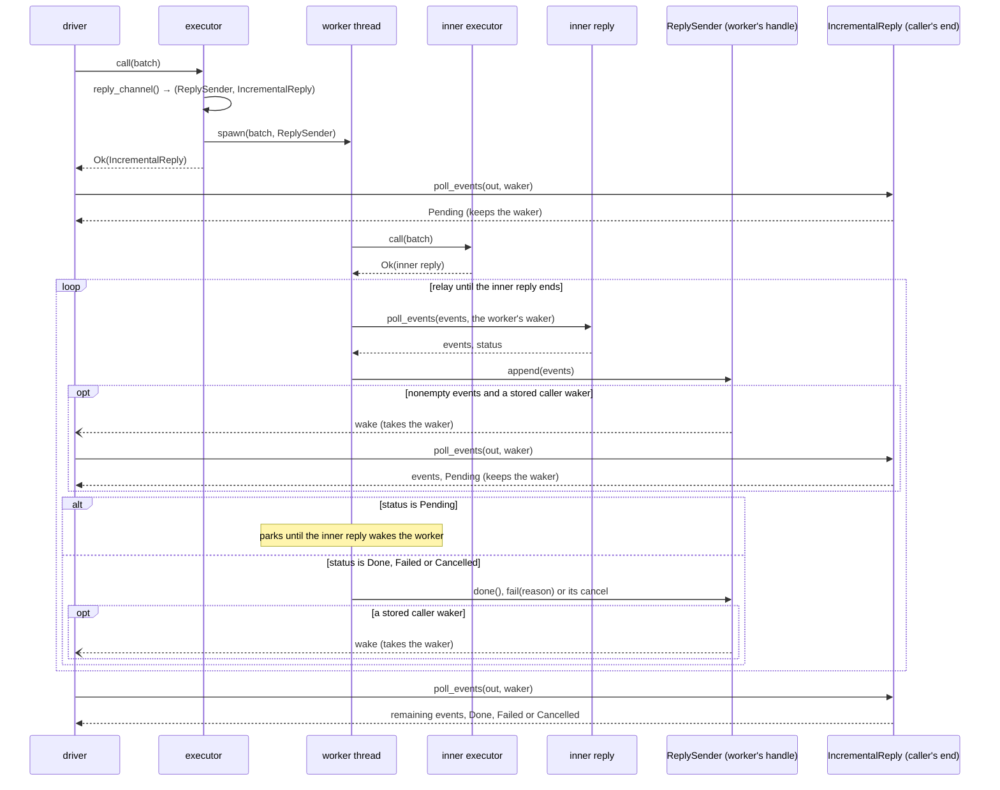
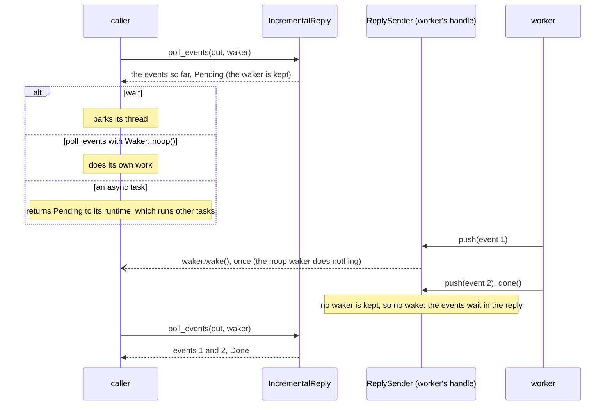
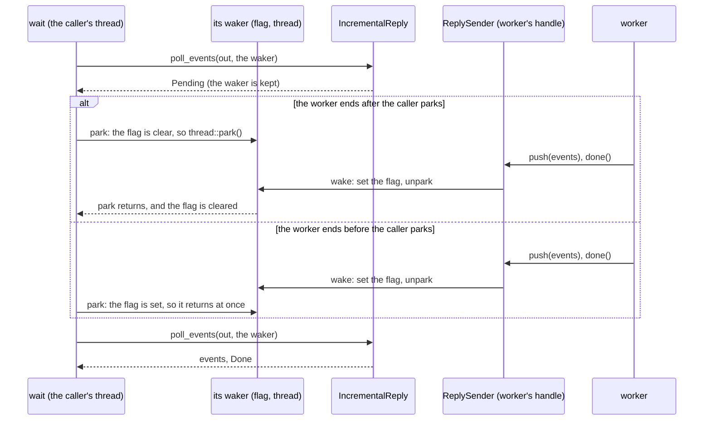
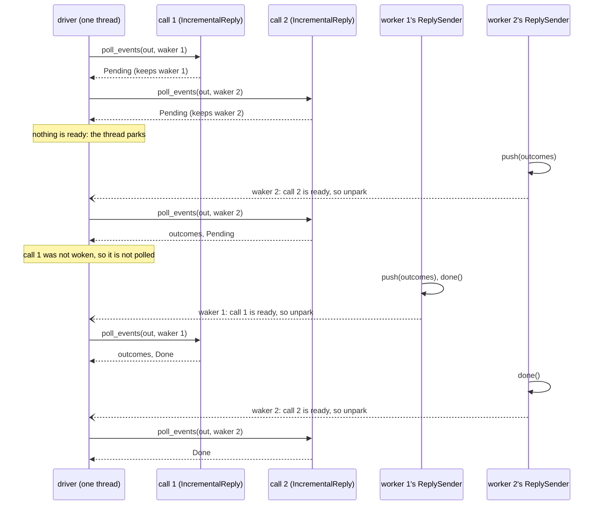
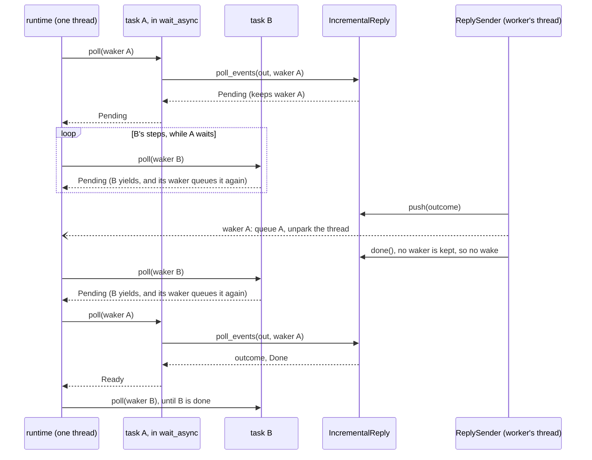

# Replies: the detailed rules

[Protocol overview](../../README.md).

This page is for maintainers of the crate, and for those who need a rule
at its edge: the order of a reply's events for each kind of executor; how
the two replies of one call differ, and how they end when a side is
dropped or cancelled; a worker relaying an inner reply; the waking cycle
step by step, how each way of taking a reply sleeps, why `wait` loses no
wake, several calls in flight and async tasks, with the tests' runtimes;
and the rules and tests of readout tags, with what the check costs. A
user taking or making replies needs none of it to start, and starts at
[Replies](../replies.md).

## The order of a reply's events

`poll_events` moves the events available now to the end of `out`
([Replies](../replies.md#replies-one-reply-four-ways-to-take-it)). The
events of one shot come in the order its executor gives them, not sorted
by tag. The executors `executor_fn` makes, with one
state or a state per shot, placed or not, give them in the order the shot
gives them (its measurement order)
(`a_shots_outcomes_keep_the_order_of_its_reads_not_of_their_tags`,
`a_shots_late_outcomes_keep_the_order_of_its_reads_not_of_their_tags`,
`src/tests/shot_states.rs`;
`outcomes_keep_the_order_the_logic_pushes_them_in`,
`src/tests/executor_fn.rs`; placed,
`each_event_reaches_the_caller_as_the_executor_it_places_hands_it_over`,
`src/tests/placement.rs`). An adapter may give them in another order:
an `adapter_fn` whose logic sends, then runs, gives the run's readouts
before the send's
(`an_observer_that_runs_passes_up_each_shots_readouts_in_the_replys_order`,
`src/tests/adapter/adapter_fn.rs`;
[Adapters](adapters.md#the-order-of-a-runs-readouts)). So a consumer
matches each readout by its tag
([Readout tags](../replies.md#readout-tags)), not by its place in the
reply. The order across shots carries no meaning,
since the outcomes of shots run in parallel interleave
(`an_executor_hands_over_each_shots_events_as_they_come`,
`src/tests/shot_states.rs`). So a driver that compares the outcomes of two
builds compares them shot by shot, as the test of law 2 does
([Levels, roles and laws](composition.md#levels-roles-and-laws)).

## One call: the rules

The two replies of [One call](../replies.md#one-call), side by side:

| Reply              | Where the work runs           | When `call` returns                                 | Polls until final status                           | Wakes the caller                                             |
| ------------------ | ----------------------------- | --------------------------------------------------- | -------------------------------------------------- | ------------------------------------------------------------ |
| `ImmediateReply`   | inside `call`                 | every event and the final status are available      | one                                                | never: nothing to wait for                                   |
| `IncrementalReply` | elsewhere, by a `ReplySender` | events or the final status may already be available | depends on event arrival and when the caller polls | at most once per stored waker, on a nonempty push or the end |

The events, the end and the caller's waker share one lock, so a push and a
"nothing yet, wake me" cannot cross. A `ReplySender` dropped before it ends
(its thread panicked) ends the reply with `Failed`, so the caller is not
left waiting (test `a_dropped_reply_sender_fails_its_reply`). The other way
round, a caller that drops its reply does not stop the work: the
`ReplySender` still pushes and ends it, and nobody takes the events (test
`a_dropped_reply_leaves_its_reply_sender_free_to_push_and_end`). Dropping
a placed executor cancels its calls not yet started: their replies end
`ReplyStatus::Cancelled`, and the call running finishes (tests
`dropped_it_cancels_the_calls_not_yet_started` and
`dropped_it_lets_the_call_running_finish`, `src/tests/placement.rs`). A
call on several shots, each on an executor of its own, ends `Failed` when
a shot failed and another was cancelled, whatever the shots' order: a
failure is news the caller must report, where a cancellation only says
that a shot never ran (test `a_failed_shot_outranks_a_cancelled_one`,
`src/tests/executor_fn/one_per_shot/placed.rs`). The end is a variant, not
a reason of `Failed`, because any executor could fail with the same text
and the compiler cannot check a match on a string; tokio
(`JoinError::is_cancelled`), Java (`CancellationException`) and Python
(`CancelledError`) type it too. `wait`, `wait_async` and `async_events`
give it as an error whose reason says the call was cancelled; a driver
that tells it from a failure polls the reply (test
`wait_gives_a_cancelled_reply_as_an_error`, `src/tests/reply.rs`).
Cancellation at an executor's `close` is planned, with no milestone yet,
for a caller that stops a run before its batches end: a user who
interrupts a long run from Python, or a driver that stops sampling once
its estimate is precise enough.

## A worker relays an inner reply: the sequence

An executor whose work runs on a worker thread can pass the reply of an
inner executor up with `relay`: it polls the inner reply with the worker's
own waker, appends each poll's events into the `ReplySender` at once, and
parks between polls; it ends the `ReplySender` as the inner reply ends:
done, failed or cancelled (test `relay_passes_a_cancellation_up`). Such an
executor is a pattern, not a type of this
crate. Test `relay_and_wait_pass_events_across_threads`
(`src/tests/reply.rs`) runs the `relay` → `wait` half, with a feeder in
place of the inner executor; the debugger's step
([guides](../guides.md#a-paused-debugger-the-step-completes-the-reply))
runs the whole shape.

## The waking cycle, step by step

The cycle of [The waking model](../replies.md#the-waking-model), as
each side sees it:

| Step          | The executor (`ReplySender`)                     | The caller (`IncrementalReply`, through `wait` or a task) |
| ------------- | ------------------------------------------------ | --------------------------------------------------------- |
| 1. poll       | –                                                | takes the events held; `Pending`: leaves its waker        |
| 2. sleep      | runs; its pushes go into the reply               | parked, or its task suspended                             |
| 3. wake       | the first push (or the end) wakes the waker kept | –                                                         |
| 4. poll again | later pushes wake no one, until the next poll    | takes every event pushed since its last poll              |

**Why the caller polls, rather than being called back.** With a callback,
the executor would call a function of the caller with each event: the
caller would no longer choose when it takes the events, and a function
to be called from another thread must be `Send + 'static`. A waker is a
callback that carries no data: it says only that a poll would make
progress, and the events stay in the reply until the caller takes them.
Like a Rust `Stream`, a reply is pulled, and `async_events` makes it one,
each item the events one poll found; unlike a future or a promise (C++'s
`std::future`, Java's `Future`, a JavaScript promise), which settle once
with one value, it hands over many events, then one end, `Done` or
`Failed`, and the events before a failure stand.

## Only the sleep differs between the ways of taking a reply

Every way of taking a reply runs the cycle of
[The waking model](../replies.md#the-waking-model). They differ only in
step 2, what the caller does on `Pending`, and so in what its waker does
at step 3:

| The caller                                         | On `Pending` (step 2)                                             | Its waker, when woken (step 3)                 | What blocks                                        |
| -------------------------------------------------- | ----------------------------------------------------------------- | ---------------------------------------------- | -------------------------------------------------- |
| `wait`                                             | parks its thread                                                  | sets a flag and unparks the thread             | the caller's thread, which chose to wait           |
| `poll_events` with `Waker::noop()`                 | does its own work, and polls again when it chooses                | nothing                                        | nothing                                            |
| `poll_events` on several replies, a waker for each | parks, if no reply was woken                                      | marks its reply ready, and unparks the driver  | the driver's thread, only while none is ready      |
| `wait_async`, `async_events`                       | its task returns `Pending` to the runtime, which runs other tasks | the runtime queues the task to be polled again | nothing: the thread runs the runtime's other tasks |

The executor's side is the same in every row: the `ReplySender` pushes and,
if a waker is kept, wakes it. It does not know which row its caller is in.

The noop row is the one caller that polls in a loop: it gives up being
woken, so it polls when its own work allows. That is its choice, as
parking is `wait`'s: neither is imposed by the reply.

## `wait` parks, and a wake before the park is not lost

`wait` polls with its thread's waker, which holds a flag and the thread.
On `Pending`, it parks while the flag is clear; the waker sets the flag,
then unparks. The flag is needed because the park token alone is not
enough: a poll that itself parks (a channel receive, a lock) can use the
token up (tests `wait_parks_until_woken_instead_of_spinning`,
`a_wake_during_the_poll_is_not_lost` and
`a_wake_from_another_thread_before_the_park_is_not_lost`,
`src/tests/reply.rs`).

Parking saves the waiting thread's CPU, and may add latency to each call
on a virtual machine, whose sleeping vCPU takes time to wake. Measured on
an earlier prototype of the protocol, not on this crate (two cores, WSL2):
with a thread per shot, the waiting thread's CPU time fell from 70–150 ms
when `wait` spun to 10 ms, while one call waited on a worker thread took
6–63 µs, against 9–23 µs spinning. Open, to be measured on bare metal:
whether `wait` should spin briefly before it parks.

## Several calls in flight

A driver keeps several replies, gives each its own waker, and sleeps until
one of them wakes it. Each waker records its call as ready and unparks the
driver, which polls only the calls that were woken. This is what an async
runtime does with many futures (test
`a_driver_keeps_several_calls_in_flight_and_sleeps_until_one_wakes_it`,
`src/tests/reply.rs`).

## An async task leaves its thread to other tasks

Two tasks share one thread under a one-thread runtime (`run_tasks`, in the
tests): task A awaits a call with `wait_async`, task B has work of its own
and yields after each step. A's `Pending` returns the thread to the
runtime, which runs B. The worker's push wakes A's waker, which queues A,
and the runtime polls A again the next time it picks a task (in the run
drawn, between two of B's steps). The thread parks only when no task is
queued (test
`an_async_task_awaiting_a_call_leaves_its_thread_to_other_tasks`,
`src/tests/reply/asynchronous.rs`).

## The tests drive futures with `block_on`

A `Future` or a `Stream` does nothing until something polls it, and gives
it a waker: an async runtime (Tokio, for one). The crate depends on no
runtime, so its tests bring two small ones:

- `block_on` (`src/tests.rs`) runs one future. It polls the future with a
  waker that unparks the test's thread, and parks the thread on `Pending`.
  With one task there is nothing else to run, so it parks, as `wait` does.
  `one_reply_is_taken_four_ways` uses it to show that the `Future` and the
  `Stream` hand over the same events as `wait` and `poll_events`, not that
  they leave the thread free.
- `run_tasks` (`src/tests.rs`) runs several tasks
  on one thread, and parks only when no task is ready.
  `an_async_task_awaiting_a_call_leaves_its_thread_to_other_tasks` uses it
  to show that a task awaiting a call leaves its thread to the others
  ([above](#an-async-task-leaves-its-thread-to-other-tasks)).

## The tests of the waking cycle

The tests of the cycle are in `src/tests/reply.rs`:

- `a_reply_sender_wakes_its_caller_once_per_pending_poll`;
- `a_poll_with_a_new_waker_replaces_the_old_one`;
- `a_poll_hands_over_every_event_pushed_since_the_last_one`;
- `an_empty_extend_or_append_does_not_wake`;
- `ending_a_reply_wakes_its_caller`;
- `a_reply_ended_before_its_first_poll_hands_over_everything_then`.

`wait_parks_until_woken_instead_of_spinning` (`src/tests/reply.rs`) shows
step 2: a parked thread does not spin. For an executor whose shots'
replies end after `call` returns (on threads of their own, say), in
`src/tests/shot_states.rs`,
`an_executor_hands_over_each_shots_events_as_they_come` shows a shot's
events handed over before the batch ends, while another shot still runs;
and `wait_on_an_executor_polls_at_most_twice_per_shot`, whose shots run on
threads of their own, shows that such an executor wakes its caller only
when a shot has something for it.
[`wait` parks](#wait-parks-and-a-wake-before-the-park-is-not-lost) draws `wait`
parking and being woken.

## Readout tags: the rules

`check_unique_tags` refuses a batch that repeats a tag with
`Rejected::Instruction` at the readout that repeats it
([Readout tags](../replies.md#readout-tags)). With several repeats, it
refuses the first, in the batch's order, as `Rejected::Instruction`
promises for each reason: a check made at each call stops at its first
fault. An executor that checks for
several reasons in turn, such as its set and then its tags, refuses at the
first fault of the first check that finds one.

The rule is pinned by the tests of `src/tests/outcome.rs`
(`a_readout_that_repeats_a_tag_is_refused_at_its_index`,
`a_tag_repeated_after_other_readouts_is_refused`,
`the_first_repeat_in_the_batchs_order_is_refused`,
`distinct_tags_are_accepted`,
`a_batch_of_at_most_one_readout_is_accepted`,
`an_instruction_that_repeats_a_tag_among_its_own_readouts_is_refused`,
`the_refusal_names_the_contract_and_the_planned_readout_register`), and
by two conformance checks. Both take `a_again`, another instruction than
`a` that reads under `a`'s tag, so that the rule shows to be about a
repeated tag, not a repeated instruction; and, where the executor has
another qubit than `a`'s, `a_again` reads it, so that the rule shows not
to be about a repeated qubit either. The checks know nothing of qubits,
so they cannot check that last need.
`refuses_a_tag_repeated_within_a_batch`, with two instructions `a` and `b`
that each read under a tag of its own, asks that a tag used again in a
later batch is accepted, and that each of `[a, b, a]`, `[b, a, a]`,
`[a, a, b]`, `[a, b, b, a]`, `[b, a, a, b]`, `[a, a_again]` and
`[a, b, a_again]` is refused at the first instruction that repeats a tag:
a repeat of the first tag, of the one just before, in the middle, the
first of two repeats, whichever its tag, and a repeat by another
instruction. And `refuses_a_repeated_tag_at_the_index_of_its_instruction`,
for a set that also has an instruction `silent` that makes no readout,
asks that `[silent, a, silent, a]` and `[silent, a, silent, a_again]` are
refused at the instruction's index (3), not the readout's (1), nor its
index counted from the first readout (2). Each check first asks that its
instructions make the readouts it relies on, and that `a_again` is not
`a`. A case that
neither check sends: an instruction that repeats a tag among its own
readouts, which their instructions, of one readout each, cannot make.
Both run on the toy and the
static code (`the_toy_and_the_code_refuse_a_tag_repeated_within_a_batch`),
on the described toy and the run-time code
(`the_device_and_the_code_refuse_a_tag_repeated_within_a_batch`), and on
the profiler and an existing backend through the bridge
(`each_executor_refuses_a_tag_repeated_within_a_batch`).

**What it costs.** One sort of the batch's readouts by tag: about 2 ns for
a batch of one readout (no allocation), and 1.5 to 13 ns per readout for
ten thousand, by how scrambled the tags are
(`cargo bench -p executor_protocol --bench readout_tags`). A runtime that
sends a batch at each measurement pays the first.
