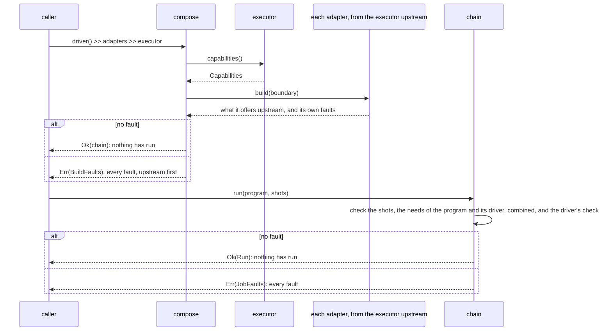
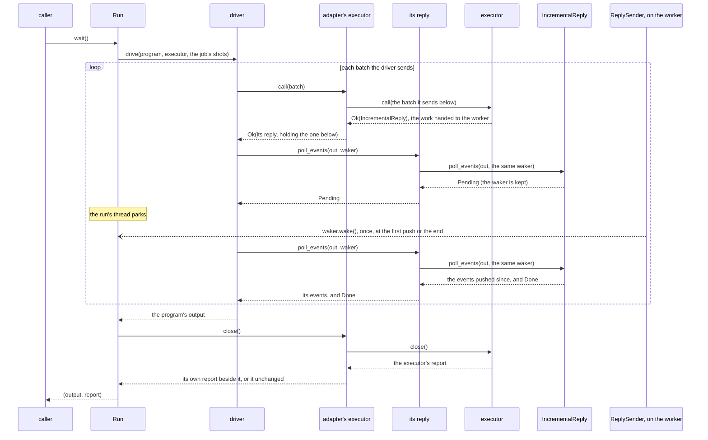
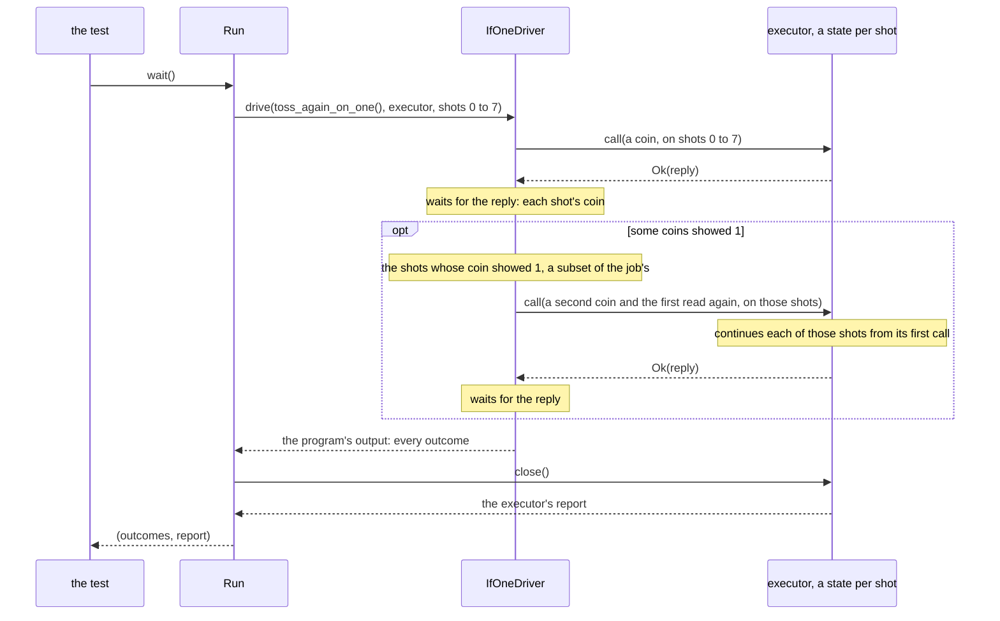
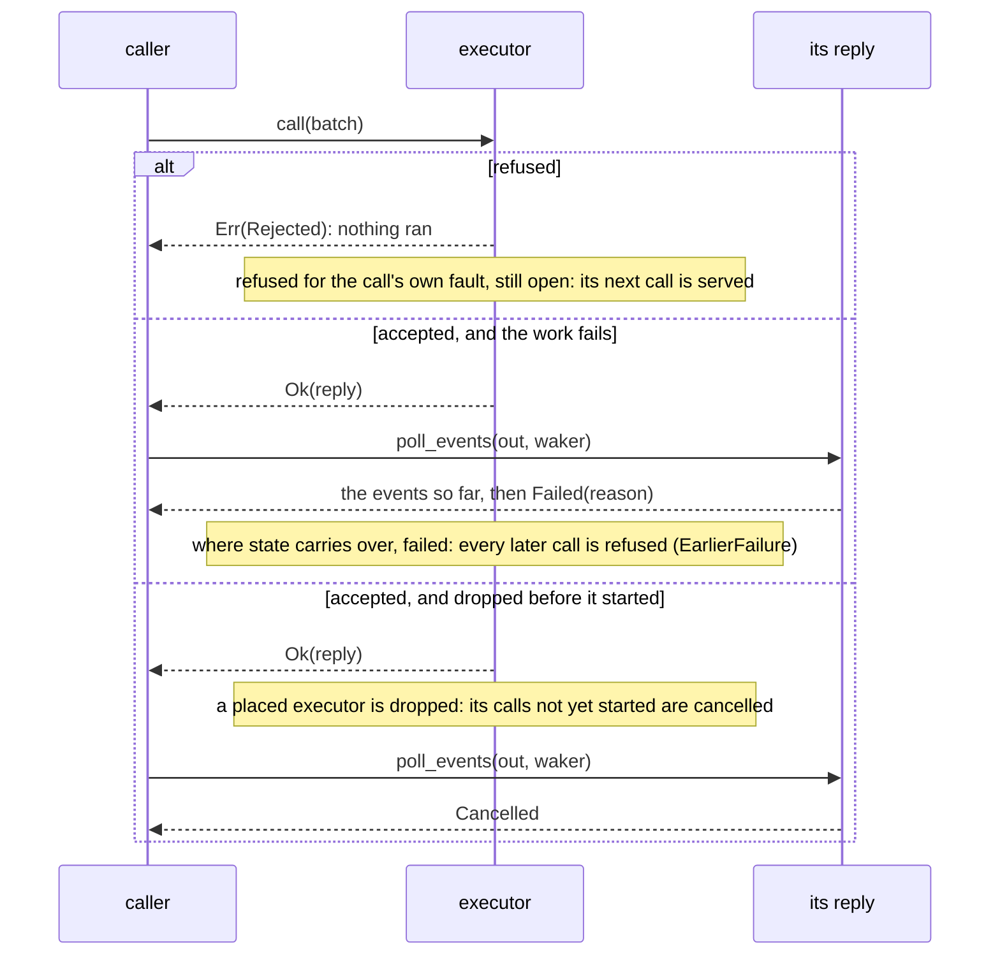
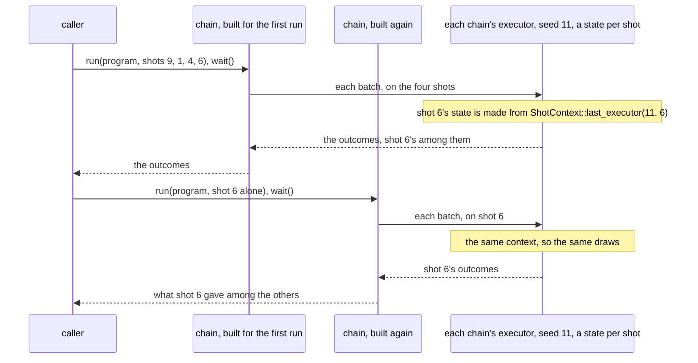
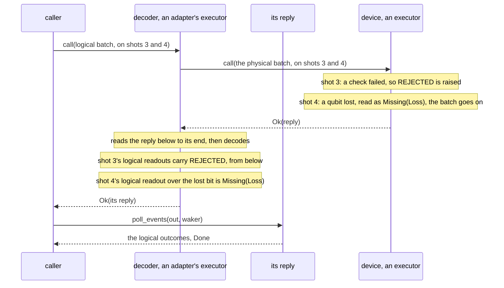

# The protocol

[Protocol overview](../README.md).

The protocol is what the parts of a chain share, whoever wrote them: the
traits a driver, an adapter and an executor implement, the one message they
exchange, the reply that carries its events up, the refusals, the outcomes
and the conditions they carry, the seeds, what a part offers and a program
needs, and how parts compose into a chain and a run. It lives in `src/`,
outside `src/facilities/`. Some of its rules the protocol checks itself: a
chain and its job are checked before any call, and a run closes its chain
once and refuses a call on a shot its job did not name. Every part keeps
the others: the facilities, the crate's own parts, keep them for an
implementer's logic ([Facilities](facilities.md)), and the
[conformance kit](../README.md#checking-a-part) checks a part written by
hand for most of them.

This page draws the protocol at work, step by step, from the crate's tests;
the how-to of each part is in the topic page each section links. Its
diagrams read as those of [Replies](replies.md#reading-the-sequence-diagrams)
do: a solid arrow is a call, a dashed arrow what it returns, an open arrow
(`--)`) a wake.

## The parts, and where they are

| Part                                                                                                                                                                                                                                                                                         | Files                                                                                                                                                                                |
| -------------------------------------------------------------------------------------------------------------------------------------------------------------------------------------------------------------------------------------------------------------------------------------------- | ------------------------------------------------------------------------------------------------------------------------------------------------------------------------------------ |
| a **driver** (`Driver
`) heads a chain and drives any program of its form, adding to its needs what its way of sending needs; while the chain is built, the driver and the adapters composed below it so far are its prefix (`ChainPrefix`), not itself a `Driver` ([planned](planned.md)) | [`driver.rs`](../src/driver.rs), [`driver/chain_prefix.rs`](../src/driver/chain_prefix.rs)                                                                                           |
| a **program** (`Program`) is data: its instructions, its output and what its content needs; its driver drives it                                                                                                                                                                             | [`program.rs`](../src/program.rs)                                                                                                                                                    |
| an **executor** (`Executor<M>`) runs the calls, describes what it offers (`Describe`) and reports once closed (`Close`, `Fold`)                                                                                                                                                              | [`executor.rs`](../src/executor.rs), [`executor/report.rs`](../src/executor/report.rs), [`capabilities.rs`](../src/capabilities.rs)                                                  |
| an **adapter** (`Adapter`, `Apply`) maps the executor below it, once, to the executor above it                                                                                                                                                                                               | [`adapter.rs`](../src/adapter.rs), [`adapter/boundary.rs`](../src/adapter/boundary.rs)                                                                                               |
| the **message** (`Message`, `InstructionBatch`) and its shots (`ShotSet`)                                                                                                                                                                                                                    | [`message.rs`](../src/message.rs), [`instruction_batch.rs`](../src/instruction_batch.rs), [`shot_set.rs`](../src/shot_set.rs)                                                        |
| the **instructions**, typed (`TypedInstruction`) or by opcode (`InstructionCall`), and their description (`InstructionSet`)                                                                                                                                                                  | [`instruction_set.rs`](../src/instruction_set.rs), [`instruction_set/`](../src/instruction_set/) (`action.rs`, `call.rs`, `instruction.rs`, `renumbered.rs`)                         |
| the **reply** (`Reply`, `ReplyStatus`), and the ways to take one (`wait`, `wait_async`, `async_events`)                                                                                                                                                                                      | [`reply.rs`](../src/reply.rs), [`reply/blocking.rs`](../src/reply/blocking.rs), [`reply/asynchronous.rs`](../src/reply/asynchronous.rs), [`reply/parker.rs`](../src/reply/parker.rs) |
| the **outcomes** (`ShotOutcome`, `Value`, `ReadoutFailure`) and the shot's **conditions** (`ShotConditions`)                                                                                                                                                                                 | [`shot_outcome.rs`](../src/shot_outcome.rs), [`shot_conditions.rs`](../src/shot_conditions.rs)                                                                                       |
| the **refusals** (`Rejected`, `RetryClass`), and the codes that will carry them over a link                                                                                                                                                                                                  | [`rejected.rs`](../src/rejected.rs), [`wire_codes.rs`](../src/wire_codes.rs)                                                                                                         |
| what a part **offers** (`Capabilities`) and a program **needs** (`Needs`)                                                                                                                                                                                                                    | [`capabilities.rs`](../src/capabilities.rs), [`needs.rs`](../src/needs.rs)                                                                                                           |
| the **seeds** (`ShotContext`, `RngId`, `shot_seed`)                                                                                                                                                                                                                                          | [`seeds.rs`](../src/seeds.rs)                                                                                                                                                        |
| **composition** (`compose`, `>>`), the **chain** (`Chain`), its faults (`BuildFaults`, `JobFaults`) and the **run** (`Run`)                                                                                                                                                                  | [`compose.rs`](../src/compose.rs), [`compose/`](../src/compose/) (`adapters.rs`, `build_faults.rs`, `chain.rs`, `operator.rs`, `run.rs`)                                             |

[`lib.rs`](../src/lib.rs) states the protocol in its crate documentation and
re-exports every public item.

## A chain is built, then its job is checked

A component says what it offers (`Describe::capabilities`). A job's needs (a
`Needs`) are those its program states (`Program::needs`), combined with those
its driver's way of sending adds (`Driver::needs`). `compose`, or `>>`, builds
the chain from the executor upstream, each adapter once against what is below
it; when a job is given to the chain, its shots, each need, combined, and the
driver's check of the program are checked against what the chain offers. The
driver drives the program only once the run is waited for:

A part composed with the executor first is built on its own, so its faults
come back before what is upstream of it is built. What each step checks,
and the rest of what is checked at compile time and at each call, is in
[What is checked, and when](composition.md#what-is-checked-and-when); how
a need compares with what is offered, in
[Capabilities and needs](executors.md#capabilities-and-needs).

## A run

A **run** is a chain given a job: a program and its shots. It runs nothing
until it is waited for (`Run::wait`) or awaited; its driver then drives the
program on the chain, and the run closes the chain once the driver is done,
and gives the program's output and the chain's report. A user writes three steps:

1. the chain;
2. `chain.run(program, shots)`, which checks the job and gives the run;
3. `run.wait()`, or `.await`.

The run owns the chain, and restricts its driver's calls to the job's shots: a
call on another shot is refused (`Rejected::ShotNotHeld`) before the
executor sees it. A chain runs one job: a function that builds the chain
builds it again for the next one.

Below, one batch of a run passes through an adapter to an executor whose
work runs on a worker thread. The adapter's executor calls the executor
below, and its reply holds the reply below and passes the caller's waker
down at each poll, as the reply of an `adapter_fn` does, so
the worker's push wakes the run's thread directly. Once the
driver is done, the run closes the adapter's executor, which closes the one
below and gives its report up, beside its own if it keeps one. It is one
possible execution: the events may already be in at the first poll, more
than one poll may take them, and a reply may end `Failed` or `Cancelled`
instead of `Done`. It leaves out two steps: each call passes through the
run's filter of the job's shots (`HeldShots`) between the driver and the
adapter's executor, and an `adapter_fn` polls a send's reply below with a
no-op waker inside the call, at the send and as the logic returns:

The chain of the README's [example](../README.md#an-example) has this
shape, through two adapters, with its replies made inside the calls: its
simulator runs each call before it returns, and its debugger waits for the
reply below inside its own call. The walk of a lowering through one
adapter, and its decoding on the way up, is in
[A static ISA](guides.md#a-static-isa-a-repetition-code). How a job is
checked and run, and the run's rules, are in
[A chain and its job](composition.md#a-chain-and-its-job).

## A driver drives a program with a branch on a readout

A program is data; its driver sends its calls and reads their outcomes,
and for a program with a branch on a readout, chooses the next calls, and
the shots they go to, from those outcomes. `IfOneDriver`, the driver of
the README's [Writing a driver](../README.md#writing-a-driver)
([`tests/driver/if_one.rs`](../tests/driver/if_one.rs)), drives
`toss_again_on_one()`, which tosses a coin on every shot of the job, then,
on the shots whose coin showed 1, tosses a second coin and reads the first
again, on an executor that keeps each shot's state from one call to the
next (`resumable_shots`, which the driver adds to the program's needs).
The run's filter of the job's shots (`HeldShots`), between the driver and
the executor, is not drawn:

A call changes no shot it does not name, and a call on a shot that is not
the job's is refused before the executor sees it. A driver of a program
with a branch may also drive one shot at a time: a shot called alone on a
replayable executor gives what it gives among others
([Chains for several users](composition.md#chains-for-several-users)).

## A refusal, a failure, a cancelled call

A call is refused, or accepted and then ends: done, failed or cancelled. A
refusal (`Rejected`) comes from `call`; the other ends are the reply's
(`ReplyStatus`). Each tells the caller something different about whether
the work ran:

- **A refusal says nothing ran**, unless its retry class says otherwise:
  `Never` (do not send it unchanged: change the message, send it to another
  executor, after `Closed` or `EarlierFailure`, or change what is asked,
  after `Unmet`), `Later` (send it again later) and `Resend`
  (no verdict came over a link, so the work may have run; nothing in the
  crate produces one yet). A caller matches the class, not the reason, so
  it handles a reason it does not know
  ([Rejections and retries](rejections.md)).
- **A failure is final** for an executor whose state carries over from one
  call to the next: its shots are left part-way, so every later call is
  refused (`Rejected::EarlierFailure`), and the events before the failure
  stand ([An executor's whole life](executors.md#an-executors-whole-life)).
- **A cancelled call was dropped unfinished**: today, only a placed
  executor dropped before a call started cancels it. A call on several
  shots ends `Failed` when one shot failed and another was cancelled,
  since a failure is news the caller must report
  ([One call](replies.md#one-call)).
- **A closed executor refuses every call** (`Rejected::Closed`).

## Shots, seeds, and runs split

A shot keeps its id through every part of a chain, and its state carries
over from one batch to the next. Each shot `j` of a run draws from seeds
that depend only on the run's seed, `j` and the component that draws
(`ShotContext`, `RngId`): two shots of a run never share a seed, and the
other shots of a call, the process or the executor that runs the shot
change nothing. So a replayable executor gives a shot the same outcomes
however the shots are split across calls or runs, as long as the shot gets
the same instructions. Today the run's seed is given to the last executor
when it is built (`.seed(s)`), and a chain runs one job, so a second run
builds the chain again (from
[`src/tests/compose/run.rs`](../src/tests/compose/run.rs)):

An adapter that draws, such as a noise model, draws under an id of its own,
so adding it shifts no other component's draws, and a chain is refused
where two components draw with one id. The seeds' derivation is in
[Seeds, not generators](executors.md#seeds-not-generators); an adapter's,
in [Seeds](adapters.md#seeds-drawingid). A run's seed given with the job,
so that one chain serves many seeds, is [planned](planned.md).

## Outcomes, missing values and conditions go up

Each readout of a shot comes up as a `ShotOutcome`: its shot, the tag the
batch gave the readout, its `Value`, and the shot's conditions so far. A
value is `Zero`, `One`, or `Missing` with a `ReadoutFailure` (`Loss`, a
lost qubit, or `Other`): a missing value does not end the run, and the
shot's other readouts stand. A shot's conditions (`ShotConditions`:
rejected, inconsistent, unresolved) are what a component found on the shot
without ending it; they belong to the shot, not to a readout, so a caller
takes a shot's conditions as the union of those its outcomes carry.

Below, a decoder over a device, as the code guides and the tests of shot
conditions build them ([`tests/runtime_isa.rs`](../tests/runtime_isa.rs),
[`tests/existing_tool.rs`](../tests/existing_tool.rs),
[`src/tests/facilities/adapter_fn/conditions.rs`](../src/tests/facilities/adapter_fn/conditions.rs)):
the device loses a qubit of shot 4 and finds a check of shot 3 failed; the
decoder reads below, then writes each shot's logical readouts:

The conditions found below and the decoder's own are merged by union.
`adapter_fn` does it for its logic, with no code
([Facilities](facilities.md#an-adapter-from-a-logic-adapter_fn)); an
adapter written by hand merges them itself. How a decoder decides a logical
value over a missing one is its own rule: the guide's code gives the
logical readout no value either, rather than a guess. An executor that
offers `resumable_shots` keeps each shot's conditions from one call to the
next (the conformance kit checks those an earlier outcome of the shot
carried). The rules in full are in
[Shot conditions](replies.md#shot-conditions), and how each readout is
named in [Readout tags](replies.md#readout-tags).

## One message, and levels

There is one message, an `InstructionBatch`: instructions run in order on
each shot of a set, after the batches before them. One shot is a set of
one: an executor that holds one shot's state is called with that shot
alone and refuses another (`Rejected::ShotNotHeld`), as one with a state
per shot refuses a new shot past the shots it promises to hold at once
(`max_shots`) ([The reasons](rejections.md#the-reasons-and-what-produces-them)).
So there is no layer for a caller to choose: a caller of one shot and a
caller of many send the same message.

A **level** is how abstract the instructions are: logical or physical. An
adapter that lowers logical instructions to physical ones goes down a
level but sends the same message, on the same shots: a code that takes
`InstructionBatch<Logical>` down to `InstructionBatch<Op>`, whose reply
decodes the physical readouts into logical ones on the way up, is drawn in
[A static ISA](guides.md#a-static-isa-a-repetition-code). Another component
does not imply another message. The roles of the parts, and the laws that
make them interchangeable, are in
[Levels, roles and laws](internals/composition.md#levels-roles-and-laws).

## Planned: a remote executor

An executor on another machine, a device behind a cloud service or a
simulator that a runner here drives, is planned, with no milestone yet. Two
layers inside it would carry the same message over a link: L1, requests
named by an id so that each runs at most once, and L0, frames that a link
may lose, repeat or reorder. Its caller sends the same message as to any
executor, so its chain is written as the others are. The ids and the
reasons such layers would produce exist already (`CallId`,
`Rejected::{IdReused, Malformed, NoReply}`), as do the codes that carry a
refusal over a link (`reason_code` and the others), so that their meaning
holds when the layers are built. How a resend is made safe is in
[A lost verdict](rejections.md#a-lost-verdict-planned-layers-l1-and-l0).

## Choices behind the replies

- **A reply is polled, not called back.** The caller chooses when it takes
  the events, and the waker says only that a poll would make progress
  ([The waking cycle](internals/replies.md#the-waking-cycle-step-by-step)).
- **A poll takes a `&Waker`, not a `Context`, and a reply needs no `Pin`**,
  so a caller with no async runtime polls it with a waker of its own, as a
  caller with several calls in flight does
  ([Several calls in flight](internals/replies.md#several-calls-in-flight));
  a reply keeps the latest poll's waker, which replaces the others.
- **A reply's type names the reply below it**: an adapter's executor
  returns the reply below, or a reply type of its own that holds it
  (`AdapterFnReply<B>`, `MappedReply<R, U>`), so the compiler sees
  the whole nest, and no reply is boxed as a `dyn Reply` on the way up.
  Type-erased chains, which would box one, are planned
  ([A chain is a type](internals/composition.md#a-chain-is-a-type)).
- **A poll appends to the caller's buffer**: `poll_events` moves the
  events to the end of `out`, keeping what the caller held; the crate's
  `IncrementalReply` swaps buffers when the caller's is empty, so that no
  event is copied.
- **A reply's order across shots carries no meaning**: the events of one
  shot come in its executor's order, and shots run in parallel interleave,
  so a consumer matches each readout by its shot and tag
  ([The order of a reply's events](internals/replies.md#the-order-of-a-replys-events)).
