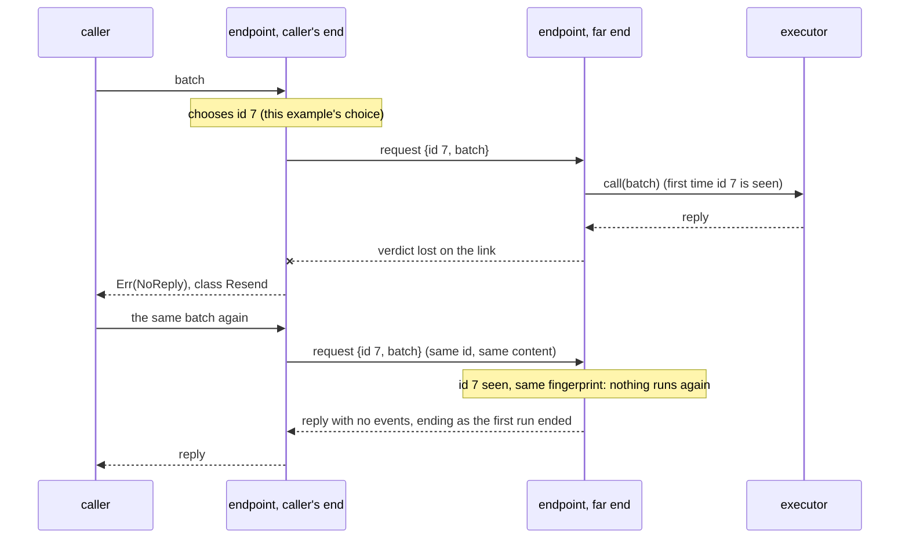

# Rejections and retries

[Protocol overview](../README.md).

## What a rejection says

`Executor::call` returns a reply or a `Rejected`. A rejection answers the
question a caller that retries must ask first: **may the work have run?**
Its retry class (`Rejected::retry`) says, and it is the only thing that
says:

| `RetryClass` | Work may have run? | What the caller does                                                                                                                              |
| ------------ | ------------------ | ------------------------------------------------------------------------------------------------------------------------------------------------- |
| `Never`      | no                 | do not send it unchanged: change the message, send it to another executor (after `Closed` or `EarlierFailure`), or change what is asked (`Unmet`) |
| `Later`      | no                 | send it again later: the executor cannot take it now, and the message is not wrong                                                                |
| `Resend`     | **maybe**          | no verdict came: resend the same content, which goes under the same id                                                                            |

So a rejection means that no work started, unless its class is `Resend`.
A run that started and could not finish is not a rejection: its reply ends
with `ReplyStatus::Failed`.

Design question, open: an executor placed with `run_on` refuses on its own
thread, so a refusal there fails the call's reply and the executor, which then
refuses every later call with `EarlierFailure`
([Executors](executors.md#where-an-executor-runs-run_on)), even a refusal of
class `Later`. One comes from a busy device under
`.shots(OnePerShot).run_on(placement)`, whose states are made on the executor's
thread. Whether such a refusal should leave the executor open is not decided.

Each reason has its class ([`src/rejected.rs`](../src/rejected.rs)):

```rust
pub fn retry(&self) -> RetryClass {
    match self {
        Rejected::Unavailable(_) => RetryClass::Later,
        Rejected::NoReply(_) => RetryClass::Resend,
        Rejected::Unrecognized { retry, .. } => *retry,
        Rejected::NoShots
        | Rejected::ShotNotHeld(_)
        | Rejected::RepeatedShot(_)
        | Rejected::IdReused(_)
        | Rejected::Instruction { .. }
        | Rejected::Closed
        | Rejected::EarlierFailure(_)
        | Rejected::Malformed(_)
        | Rejected::Unmet(_) => RetryClass::Never,
    }
}
```

A caller that acts on "may have run" matches the class, not a reason, so it also
handles a reason it does not know: a reason from a newer far end will come as
`Unrecognized`, with the class the far end gave it, from a decoder of reasons
that is planned ([below](#a-reason-this-end-does-not-know-planned-decoder)).

## The reasons, and what produces them

| Reason                           | Class         | Produced by                                                                                                                        |
| -------------------------------- | ------------- | ---------------------------------------------------------------------------------------------------------------------------------- |
| `NoShots`, `RepeatedShot`        | `Never`       | `ShotSet::new`, and `ShotSet::range` (`NoShots` only), when the caller builds the shots                                            |
| `ShotNotHeld`                    | `Never`       | an executor, for a shot it does not hold (`executor_fn`, `OnePerShot` beyond its `max_shots`); a run, for a shot outside its job's |
| `Instruction { at, reason }`     | `Never`       | an executor, for an instruction it does not accept, such as one outside its set or repeating a readout's tag within its batch      |
| `Unmet`                          | `Never`       | `Capabilities::admit`, for a need beyond what a component offers; `Chain::run`, for each, among a job's `JobFaults`                |
| `Closed`, `EarlierFailure`       | `Never`       | an executor after `close`; one whose state carries over, after a failure (`ExecutorLifecycle`, `executor_fn`)                      |
| `Unavailable`                    | `Later`       | an executor that cannot take the work now, such as an `executor_fn` whose state cannot be made yet                                 |
| `IdReused`                       | `Never`       | planned: layer L1, for an id resent with other content                                                                             |
| `Malformed`                      | `Never`       | planned: layer L0, for a frame that does not decode, or a sequence number resent with other bytes                                  |
| `NoReply`                        | `Resend`      | planned: the caller's end of a link, when no verdict came                                                                          |
| `Unrecognized { retry, reason }` | the far end's | planned: a decoder of reason codes, for a code this end does not know                                                              |

### A limit, or a shortage now: `Unmet` or `Unavailable`

A device that holds at most two shots at once declares it
(`Capabilities::with_max_shots(2)`). A job of three shots is beyond that
limit whenever it is given to a chain of it: `Unmet(Shots)`, refused before
anything runs; `Capabilities::admit` refuses it too, for a caller that checks by
hand. The caller splits the shots into runs one after the other. Within the
limit, the memory may still be in use now (another run holds it): the executor
refuses with `Unavailable`, class `Later`. Nothing ran, and the same message
runs when sent again, downstream of an adapter too.

Nothing in this crate produces the planned four yet; they are defined so
that their reason codes (`reason_code`) keep their meaning when layers L1
and L0 are built, with no milestone yet, for an executor across a network:
a device behind a cloud service, or a simulator on another machine that a
runner here drives.

## A lost verdict (planned: layers L1 and L0)

Over a link, a request or its verdict can be lost. The caller's end then
cannot tell whether the far end ran the work, so it reports `NoReply`
(class `Resend`). Resending is safe only if the far end runs the same work
at most once. Two planned layers make it so, each with its own id:

- **L0, a link, carrying frames.** Each frame carries a sequence number. When
  no reply frame comes, the caller's end of the link resends the frame under
  the same number. The far end keeps each number's verdict: a number seen
  again with the same bytes gets its stored reply, not a second run; with
  other bytes it is `Malformed`. After a verdict that refuses, a resend
  takes a new number, so one number gets one verdict.
- **L1, an endpoint, called with requests.** Each request carries a
  `CallId`. Who chooses it, the caller or the caller's end of the endpoint,
  is decided with the link layers. The far end of the endpoint remembers
  each id with a fingerprint of the batch (its shots and instructions). The
  same id with the same content does not run again, and gets the first
  reply rather than an "already processed" error, since the caller needs
  what the run produced. The two layers split that reply: L0 replays the
  events, which a link may lose (a frame resent under its number gets its
  stored reply, events included), and L1 replays how the run ended: the
  repeat's reply carries no events and ends as the first run ended,
  `Failed` with its reason included. The same id with other content is
  `IdReused`. A rejected request does not use up its id, so a resend after
  `Later` keeps it too.

L1 covers what L0 cannot: a link that gave up and reported `NoReply` to
the caller, and, if the caller chooses the ids, a caller that restarts and
resends its requests. The work does not run twice, but where L0 does not
replay the first run's events, the repeat's reply gives only how that run
ended. That is the rule, as in an earlier prototype of these layers: the
far end keeps how each id's run ended, not the run's events, since keeping
them would cost a table of events per id; the link layers are planned, so
it is a rule which no test pins yet. The id is not new: SIP absorbs
repeated requests by their transaction id (RFC 3261 §17), ONC RPC servers
(NFS) keep a duplicate request cache keyed by the `xid` of RFC 5531, and
FIX recognizes resent orders by the caller's `ClOrdID`.

An example, as that prototype did it: the caller's end of the endpoint
chooses the id, and gives the same work, resent, the same id. The resend
reaches the far end of the endpoint (L0 did not replay it), which runs
nothing and answers with how the first run ended; the first run's events,
lost with its verdict, do not reach the caller.



Where an adapter sits, at the caller's end of a link or at the far end,
would change the cost, not the outcomes: a validator at the caller's end
refuses a bad batch before it is sent, and a lowering at the far end sends
the shorter logical batch over the link; an earlier prototype of these
layers put a lowering in each place and got the same outcomes, shot by
shot.

## A reason this end does not know (planned decoder)

Ends of a link may be deployed at different versions, and a newer far end
may send a reason code this end does not know. The class crosses the link
before the reason (`retry_code`), so this end will decode such a rejection as
`Unrecognized { retry, reason }`: the far end's class and text, which is
all a caller needs to decide whether to resend. A relay sends it on as it
came (reason code 255). That is why "may have run" is the class `Resend`,
not the reason `NoReply`: an `Unrecognized` rejection whose class is
`Resend` may have run too. An `Unmet` rejection whose need code this end
does not know will decode the same way, as `Unrecognized` with the far
end's class and text (`need_of` returns `None` for that code). A retry
class or a value code this end does not know has no class to fall back
on, so the frame will be malformed. Both rules are part of the planned
decoder.

A known reason sent with a class that contradicts it (`Closed` as `Later`)
will be a malformed frame: a class is believed only for a reason this end
cannot check. The codes, and the decoders of classes, needs and values, are
in `src/wire_codes.rs`; the decoder of reasons is not written yet.
