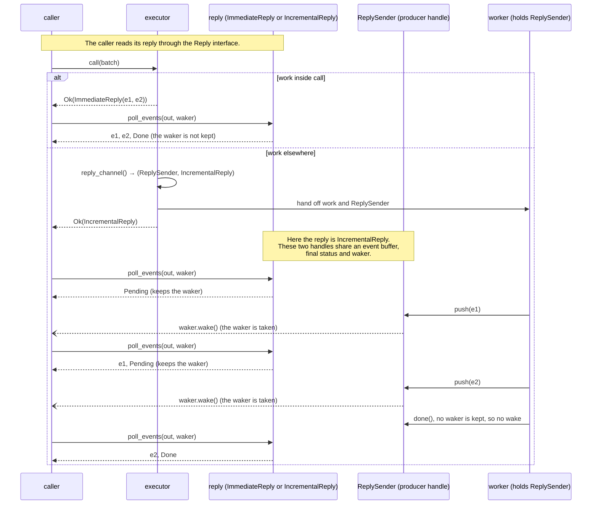

# Replies

[Protocol overview](../README.md).

A call returns a reply: the events of its batch, as they come, then
its end. This page shows how a caller takes a reply, how an executor
makes one, how a waiting caller is woken, and how readouts are named.

## Execution models

One executor serves every way of calling it: the executor chooses how its
reply's events are made, and the caller chooses how it takes them. Each model
below is a call a caller makes, and a test runs it, in the [tests of
replies](../src/tests/reply.rs) and of [async
replies](../src/tests/reply/asynchronous.rs).

| Model                                                   | The caller calls                                                                                       |
| ------------------------------------------------------- | ------------------------------------------------------------------------------------------------------ |
| synchronous: the whole reply, the thread parked         | `wait(reply, &mut out)`                                                                                |
| polling: the events so far, other work between polls    | `reply.poll_events(&mut out, waker)`, with its own waker or `Waker::noop()`                            |
| async: the whole reply, as a `Future`                   | `wait_async(reply).await`                                                                              |
| stream: the events as they come, as a `Stream`          | `async_events(reply)`, then `next().await` on each batch of events                                     |
| several calls in flight                                 | `poll_events` on each reply, each with its own waker; or several tasks, each awaiting one              |
| work elsewhere: the reply filled in from another thread | the executor calls `reply_channel()` and returns the `IncrementalReply`; the work `push`es or `relay`s |

### Reading the sequence diagrams

Sequence diagrams here, in its
[detailed rules](internals/replies.md), in [Executors](executors.md), in
[Rejections and retries](rejections.md#a-lost-verdict-planned-layers-l1-and-l0)
and in the [guide walkthroughs](guides.md), show the calls behind these
models. A solid arrow is a call; a dashed arrow is what it returns; an open
arrow (`--)`) is a wake. `waker` is the caller's `Waker`, given to each
`poll_events`. For incremental replies, the worker pushes through its
`ReplySender`, which writes the shared reply state; the caller polls
`IncrementalReply`, which reads it. A push or end wakes the caller only if a
waker is stored, and takes that waker. A later `Pending` poll registers one
again.

## Replies: one `Reply`, four ways to take it

**The concrete case.** `OnAThread`, a test double in
`src/tests/reply.rs`, runs each call on a thread of its own. `call`
returns at once with an `IncrementalReply`; the thread pushes, for each
shot of the batch, one outcome per instruction, through the reply's
`ReplySender`, then ends the reply:

```rust
struct OnAThread;

impl Executor<InstructionBatch<bool>> for OnAThread {
    type Reply = IncrementalReply<ShotOutcome>;

    fn call(&mut self, batch: InstructionBatchRef<'_, bool>) -> Result<Self::Reply, Rejected> {
        let (sender, reply) = reply_channel();
        let shots = batch.shots.clone();
        let instructions = batch.instructions.to_vec();
        thread::spawn(move || {
            for &shot in &shots {
                for (tag, &one) in (0..).zip(&instructions) {
                    sender.push(ShotOutcome::new(shot, tag, one.into()));
                }
            }
            sender.done();
        });
        Ok(reply)
    }
}
```

A [test of replies](../src/tests/reply.rs) calls it four times and takes the
reply four ways: blocking (`wait`), polling (`poll_events`), as a `Future`
(`wait_async`) and as a `Stream` (`async_events`). The `Future` and the `Stream`
are driven by `block_on`, the tests' one-task runtime ([The tests drive futures
with `block_on`](internals/replies.md#the-tests-drive-futures-with-block_on)).
Each way gets the same events, and the executor does not change:

```rust
for events in [blocked, polled, awaited, streamed] {
    assert_eq!(events, expected);
}
```

**The general idea.** A reply is one trait with one method
(`src/reply.rs`, doc comments left out):

```rust
pub trait Reply {
    type Item;

    fn poll_events(&mut self, out: &mut Vec<Self::Item>, waker: &Waker) -> ReplyStatus;
}
```

`poll_events` moves the events available now to the end of `out` and never
blocks. The events of one shot come in the order its executor gives them, not
sorted by tag. An adapter may give them in another order, and the outcomes of
shots run in parallel interleave. So a consumer matches each readout by its shot
and tag ([Readout tags](#readout-tags)), not by its place in the reply. The
order for each kind of executor and adapter is in [The order of a reply's
events](internals/replies.md#the-order-of-a-replys-events).

After a poll that returns `ReplyStatus::Pending`, the reply keeps
that poll's waker and wakes it once a new poll could deliver more events
or end the reply. The executor knows when its events are ready, the caller
knows when it wants them, and the waker joins the two. So the executor and
its caller choose independently:


The table of callers is in `Reply`'s documentation. Of the ways to
take a reply, only `wait` blocks the caller's thread, and only the caller
chooses it (`relay` parks too, but on the worker's thread, not the
caller's). `wait_async` and `async_events`
(`src/reply/asynchronous.rs`) are thin wrappers that poll the
reply with the task's waker; `async_events` is why the crate depends on
`futures-core`, for the `Stream` trait. A caller written against
`Reply` runs with every executor, and an executor that passes a reply
up (with `relay` or `MappedReply`) does not need to know how its caller will
take it.

The choice stays the caller's only while no executor downstream waits inside
its own `call`. The executor an adapter makes, when its work needs each of
its inner reply's outcomes before it goes on (a program's walk, say), may
call `wait` inside its `call` and return an `ImmediateReply`; an async caller
upstream of it then holds its thread for the whole call.

**How finely events come is the executor's choice.** An executor that runs the
batch inside `call` hands over every outcome at the first poll; one whose work
runs on a worker pushes each outcome as it is made; an executor whose shots run
on placements of their own (`.run_on(OwnThread).shots(OnePerShot)`) hands over
each shot's outcomes as soon as that shot has them (`ShotReplies`). A caller
gets the events as finely as the executor it calls hands them over, whichever
way it takes them, and several calls in flight are several replies, each woken
on its own ([several calls in
flight](internals/replies.md#several-calls-in-flight)). An adapter whose logic
waits below (`Below::run`) hands over nothing before that logic returns, not
even what its sends below already read.

### One call

An executor that runs the batch inside `call` can return the crate's
`ImmediateReply`: its first poll hands over every event and the final status
(`Done` or `Failed`), so it never keeps the waker and `wait` never parks. The
toy executor of the guide tests (`toy_simulator`, in `tests/toy/simulator.rs`)
is one. An executor whose work runs elsewhere makes the two ends of a reply with
`reply_channel()` and returns the `IncrementalReply` at once; the `ReplySender`
pushes each event as it is made and wakes the caller. If the work ends before
the first poll, that poll hands over every event with `Done`, as
`ImmediateReply`'s does.

Both replies implement `Reply`, as do the replies composition wraps them in,
so the caller reads them the same way:



The rules of a reply's end:

- A `ReplySender` dropped before it ends the reply (its thread panicked) ends it
  with `Failed`, so the caller is not left waiting.
- A caller that drops its reply does not stop the work: the `ReplySender` still
  pushes and ends it, and nobody takes the events.
- Dropping a placed executor cancels its calls not yet started: their replies
  end `ReplyStatus::Cancelled`. `wait`, `wait_async` and `async_events` give a
  cancelled reply as an error, and a caller that tells it from a failure polls
  the reply.

Cancellation at an executor's `close` is planned, with no milestone yet,
for a caller that stops a run before its batches end: a user who
interrupts a long run from Python, or a driver that stops sampling once
its estimate is precise enough. How the two replies compare, a call
running when its executor is dropped, and a shot that failed beside one
cancelled are in
[One call: the rules](internals/replies.md#one-call-the-rules).

### A worker relays an inner reply

An executor whose work runs on a worker thread can pass the reply of an inner
executor up with `relay`, which ends the caller's reply as the inner reply ends:
done, failed or cancelled. Such an executor is a pattern, not a type of this
crate; the debugger's step
([guides](guides.md#a-paused-debugger-the-step-completes-the-reply)) is one. Its
sequence is drawn in [A worker relays an inner reply: the
sequence](internals/replies.md#a-worker-relays-an-inner-reply-the-sequence).

## The waking model

`poll_events` never blocks: it takes what the reply holds and returns. A
**`Waker` is a notification handle that the caller supplies** when it
polls. Waking it asks the caller to poll again; it does not deliver events
or poll the reply itself. A caller that gives a waker does not poll in a
loop, and an `IncrementalReply` does not wake it for each event. The caller
takes an `IncrementalReply` in a cycle of four steps:

1. **Poll.** The caller calls `poll_events` with its waker. The reply moves
   every event it holds into `out`, and returns `Done`, `Failed` or
   `Cancelled` if it has ended. Otherwise it returns `Pending` and keeps the
   waker. A newer poll's waker replaces an older one.
2. **Sleep.** On `Pending` the caller stops: `wait` parks its thread; an
   async task returns `Pending` to its runtime, which runs other tasks on
   the thread. Nothing runs on the caller's behalf, so no CPU is used.
3. **Wake.** The executor pushes an event, or ends the reply. That push
   takes the kept waker and wakes it, once. Pushes that follow wake no
   one: there is no waker left until the caller polls again, and their
   events wait in the reply.
4. **Poll again.** The woken caller polls without blocking and takes
   every event pushed since its last poll, one or many. It goes back to
   step 2 if the reply is still `Pending`.

So when an executor reports results one by one into an `IncrementalReply`,
the caller is woken at most once per sleep, not once per result. A caller
that keeps up polls after each push and takes one result at a time. A
caller that is slower than the executor takes several results at once.
Either way it receives every result, in order. A push that comes before a
poll is never lost: the reply holds it, and the poll takes it. A reply that
gathers other replies wakes its caller as they do: for instance, the reply
of a batch whose shots each run on a thread of their own
(`.run_on(OwnThread).shots(OnePerShot)`) holds an `IncrementalReply`
per shot, each of which wakes the caller, at most once per sleep, as its
shot's events come and when the shot ends, so the caller may be woken once
per shot in one sleep, a known issue
([Performance](performance.md#shots-on-placements-of-their-own)).

How each way of taking a reply sleeps, why `wait` loses no wake, a caller
with several calls in flight, an async task that leaves its thread to
others, and the tests of the cycle are in
[The waking cycle, step by step](internals/replies.md#the-waking-cycle-step-by-step)
and the sections after it.

## Readout tags

**The contract.** An outcome names its readout by a tag
(`ShotOutcome::new(shot, tag, value)`, `tests/runtime_isa.rs`), because
readouts may arrive in any order: a decoder delivers a logical readout when
its last physical readout arrives, and an executor whose shots run on
threads of their own delivers
each shot's when the shot has them. So, within a batch, a tag names one
readout of each shot: two readouts of a shot under one tag could not be told
apart. A later batch may use a tag again, for another readout, as a program
that measures in a loop does.

**What is checked.** An executor that reports its readouts by tag calls
`check_unique_tags` on every batch, before it runs anything. It takes each
readout as its instruction's index and its tag, and refuses a batch that
repeats a tag with `Rejected::Instruction` at the readout that repeats it,
naming the earlier one, or saying that the instruction repeats the tag
among its own readouts. The guides' toy (`tests/toy/simulator.rs`)
lists its readouts so:

```rust
pub fn readouts(batch: &[Op]) -> impl Iterator<Item = (usize, u32)> {
    batch
        .iter()
        .enumerate()
        .filter_map(|(at, op)| Some((at, op.tag()?)))
}
```

and calls `check_unique_tags(readouts(batch))?` with its other checks. An
adapter that maps each of its tags to distinct tags downstream (the static
guide's repetition code: logical tag `t` becomes physical tags `3t`, `3t + 1`,
`3t + 2`) needs no check of its own: the downstream executor refuses the repeat,
and the adapter maps the index back to its own instruction. An adapter that
sends fresh tags down checks its own tags, as the code of the [run-time
instruction set guide](../tests/runtime_isa.rs) does.

The rule is pinned by the conformance check
`refuses_a_tag_repeated_within_a_batch` ([Conformance
checks](composition.md#conformance-checks)) and by the tests listed, with the
other conformance check and what the check costs, in [Readout tags: the
rules](internals/replies.md#readout-tags-the-rules).

**Planned, with no milestone yet: a readout register.** Programs name
readouts by slots they reuse: a runtime's result slot is written by a
measurement and read later, and a later write wins; QIR's result ids are
reused when a measurement is in a loop. While each batch holds at most one
readout, as when a runtime sends a batch at each measurement, no tag
repeats. A batch that does repeat one is refused, and its reason says that
this program is the first case for a readout register: an adapter that
gives each readout of a batch a fresh tag, keeps a slot's later value, and
answers reads of a slot from what it holds. It will be added with its first
real case (a runtime whose result slots repeat within a batch, or one that
defers measurements so that a batch holds several readouts). Meanwhile, an
adapter can keep such a register by hand.

## Shot conditions

**The contract.** An outcome carries its shot's conditions so far
(`ShotOutcome::conditions`, a `ShotConditions`): any of three that a
component may find on a shot without ending it. The shot was flagged for
rejection (`ShotConditions::REJECTED`: a check it was asked to pass failed,
such as a post-selection; the caller chooses what to do with it, and one
that post-selects drops the shot), its checks were inconsistent
(`ShotConditions::INCONSISTENT`), or a value it depends on could not be
determined (`ShotConditions::UNRESOLVED`). `ShotConditions::NONE` holds
none, and `|` gives the union of two sets, as in
`ShotConditions::REJECTED | ShotConditions::INCONSISTENT`. A condition
belongs to the shot, not to a readout: once raised it stays raised, and the
shot's outcomes in later calls carry it too, so a caller takes a shot's
conditions as the union of those its outcomes carry, and tests them with
`ShotConditions::contains`, which holds only when they include every
condition of the set it is given. Conditions cost no event of their own:
they ride on the outcomes, in a byte that leaves an outcome as small as it
was without them. A condition raised in a call that gives the shot no
outcome reaches no caller in that call. The conformance kit checks the
rule across calls, for the conditions that an earlier outcome of the shot
carried (`keeps_each_shots_conditions_from_one_call_to_the_next`),
and its checks of a shot alone, of shots a call does not name, and of a
fresh executor compare conditions as they compare values, so that a
condition raised on one shot marks no other's outcomes, and a fresh
executor's shots start without the conditions an earlier executor left.
Its checks that read readouts wait for each reply into a buffer that
already holds an outcome of each shot the call names, so that they see a
reply that marks what its caller held
([Conformance checks](composition.md#conformance-checks)).

**In an `executor_fn`.** Its logic raises conditions on one outcome
(`Outcome::with_conditions`, `ShotOutcome::with_conditions`, which give
the outcome those conditions in place of its own), or on its shots with
`Outcomes::raise_conditions`, which adds them to every outcome the logic
writes for those shots in the call, those written before as well as
after, and to no other shot's. A call its logic fails hands over the
outcomes the logic wrote before its `Err` with those conditions too, as
one state or a state per shot. An `executor_fn` keeps nothing across
calls: a terminal whose shots' conditions outlast a call keeps them in its
state, and raises them again in each call. For example, a code's runtime
with a state per shot that rejects its shot, then writes a readout for it,
whose caller finds the rejection on the readout (an excerpt of the
[tests of shot conditions](../src/tests/conditions.rs)):

```rust
let mut runtime = executor_fn(
    Capabilities::default(),
    |context: ShotContext| Ok::<_, Rejected>(context.shot()),
    |shot: &mut ShotId, _: &CallInput<'_, Step>, outcomes: &mut Outcomes<'_>| {
        outcomes.raise_conditions(ShotConditions::REJECTED);
        outcomes.extend([ShotOutcome::new(*shot, 0, Value::One)]);
        Ok(())
    },
)
.shots(OnePerShot);
let outcomes = outcomes_of(&mut runtime, &[1], &[]);
assert_eq!(marked(&outcomes), [(1, 0, ShotConditions::REJECTED)]);
```

There, `outcomes_of` waits for the reply of a call on the shots given, and
`marked` lists each outcome as its shot, its tag and its conditions.

**Through an `adapter_fn`.** It keeps each shot's conditions so far, with
no code in its logic, and marks with them, as each call ends, every
outcome it gives a shot of the call, in that call and in later calls on
the shot: a condition the logic writes on one outcome marks the shot's
others in the call too. It takes in the conditions its logic raises, and
those carried by the outcomes the logic writes, its runs read, and its
sends read during the call, while their reply is still pending too,
merged by union, a shot's own with those from
below, whatever the order of the call's shots. A run's are taken in even
when it fails or is cancelled, from what it read before, a run that
reads a tag of a shot twice too, but only on the shots it was given: a
readout of another shot may belong to another call.
A send's, read during the call, are taken in on whatever shot each names,
given to the send or not, as a send's reply passes up as it comes,
unchecked; a readout of a shot the call was not given, which only a
faulty executor below gives, passes up with the conditions it carries
from below alone. So a decoder that writes its readouts anew from those
it ran below passes up the conditions found below it. The outcomes its
sends give the call's shots carry the shot's conditions as the call that
sent them ended, whenever and however they end, merged by union with the
conditions they carry from below, and its reply marks its own outcomes
alone, leaving those its caller held as they were. A logic's
`Outcomes::raise_conditions` raises on its own shot alone when it has a
state per shot, and on every shot of the call when it has one state for
all. A refused call raises nothing, as nothing went down; a call that
fails or is cancelled, by its logic, a run, a send, or a call below
refused once another went down, still marks every outcome its reply hands
over with the conditions it took in. The adapter passes the kit's check
across calls, with one state, decoding or sending, and with a state per
shot, over an executor below whose replies end within their call; and
over one whose replies end after it, when that executor meets the
requirement below, apart from the known issue below. The
[tests of shot conditions](../src/tests/conditions.rs) pin these rules,
each listed with the rule it pins in
[Shot conditions: the rules](internals/replies.md#shot-conditions-the-rules).
An adapter written by hand carries them by itself, merging those from
below with its own; the kit checks that it keeps, from one call to the
next, the conditions that an earlier outcome of each shot carried.

**A requirement: an executor that offers `resumable_shots` keeps each
shot's conditions from one call to the next**, so that the shot's outcomes
in a later call carry every condition raised on the shot in earlier calls,
whether or not the call that raised it gave the shot an outcome. Neither
its type, nor the build of a chain, nor the job given to a chain checks it
([What is checked, and when](composition.md#what-is-checked-and-when)).
The conformance kit's check across calls checks it at run time, on an
executor that offers `resumable_shots`, for the conditions that an earlier
outcome of the shot carried: it sees outcomes alone, so a condition
raised in a call that gave the shot no outcome is beyond it
([Conformance checks](composition.md#conformance-checks)). An executor
that breaks it is faulty, and it is easy to break: an `executor_fn` keeps
no condition across calls by itself (above), yet offers `resumable_shots`
whenever the capabilities it is given do, so it meets the requirement
only when its logic keeps its shots' conditions in its state and raises
them again in each call. Over an executor that
breaks it, an adapter can lose a condition that a send gave after its
call returned, as a send to an executor on another thread often does (a
placed executor returns from its call once its work is scheduled): the
send's outcomes pass up to the caller with the conditions they carry, but
the adapter never sees them, and the executor gives the shot's later
outcomes without them. A pass-through adapter over an `executor_fn`
placed on another thread (`.shots(OnePerShot).run_on(OwnThread)`, or a
thread per shot) often loses it, how often depending on timing. Over an
executor that meets the requirement, the shot's outcomes that a later call
sends for carry the condition again from below, as a send's outcomes pass
up with the conditions they carry from below, whenever they end. So do the
outcomes the logic writes for the shot in a later call that reads an
outcome of the shot from below before it ends, as a decoder's run does,
whether the logic writes them before or after the read, and in every call
after it: the adapter takes the condition in from that outcome, keeps it,
and marks with it, as each call ends, what the logic wrote in the call.
Those it writes in the calls before lack it (the known issue below).

**Known issue, open, pending a decision: the guides' hand-written
adapters do not carry them yet.** The decoders of the guides
(`tests/static_isa/repetition3.rs`, `tests/runtime_isa/code.rs`) write
their readouts anew with no condition, so a condition raised below them
reaches no caller. Whether they should carry them by hand, or with a
facility the crate would offer, is open.

**Known issue, open: in every call before one that reads from below an
outcome of the shot that carries it, the outcomes a logic writes for the
shot lack a condition that a send gave after its call returned.** The
adapter takes a condition in only from an outcome it reads before its call
ends (above): a send's outcomes that come after their call returned pass
up to the caller with the conditions they carry, but the adapter never
sees them. So, even over an executor that meets the requirement above, the
outcomes the logic writes for the shot lack it, for instance, in a later
call that neither sends nor runs the shot below, in one whose run reads
nothing for the shot, or in one whose sends for the shot give their
outcomes after it returned, as a send to a placed executor often does
(above), when no call since the send has read an outcome of the shot
that carries it. No known case writes a shot's outcomes in such a call: a
decoder writes them in a call whose run reads the shot, and keeps the
condition there (above). A caller that takes the union of a shot's
outcomes still sees it, in the outcomes of that send; the kit's check
across calls, and its check of a shot alone, which compares what a shot
gives over several calls alone and among others, can then pass or fail
from run to run on the same chain, as the send's reply ends within its
call or after it. Keeping them would need the reply to hand them back to
the adapter, and would hold only for a caller that reads a reply before
its next call.

**What they cost.** An outcome is no larger. While no condition is raised,
a chain built with its code aligned ran no more than about 8 % slower than
one without conditions, apart from two cells; built without alignment,
some cells on batches of one instruction ran up to 16 % slower than the
same chain before conditions with `push` inlined (up to about 23 % slower
than the crate as it shipped), partly by layout and partly, in an adapter,
by its read of the outcomes as each call ends, not separated. Once any
shot it served has a condition, an adapter looks up the conditions of its
call's shots in each call, and marks the outcomes of the flagged ones, and
holds about 14 bytes per flagged shot until it is dropped, since nothing
tells it that a shot has ended (known issue, open)
([Performance](performance.md#shot-conditions)).

Over a link (planned), a shot's conditions travel as one code of three
bits (`conditions_code`, `conditions_of`), pinned by the
[tests of codes](../src/tests/codes.rs).

The detailed rules, for maintainers of the crate, are in
[Replies: the detailed rules](internals/replies.md).
