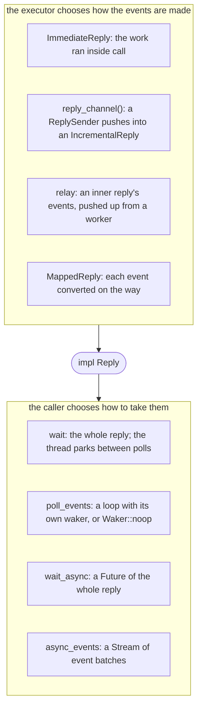
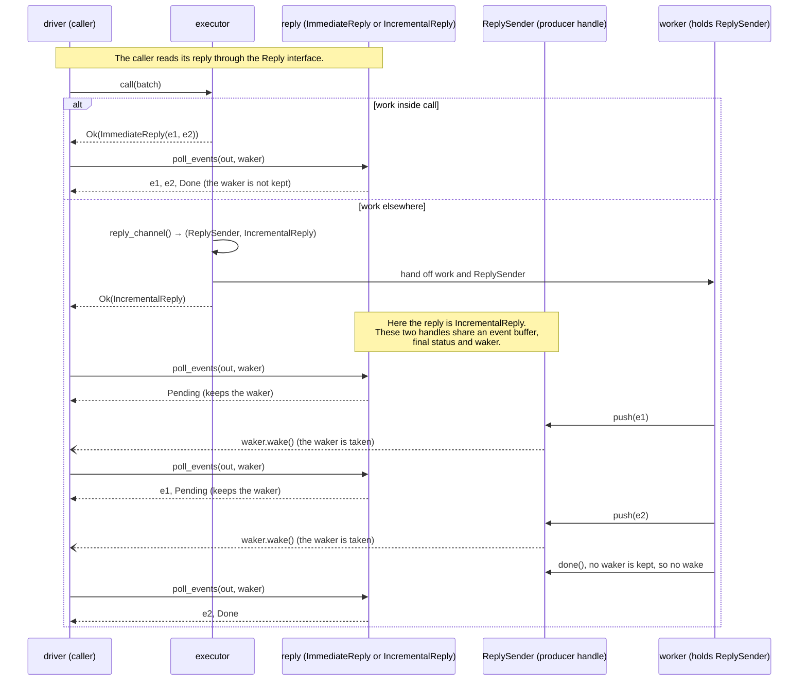

# Replies

[Protocol overview](../README.md).

A call returns a reply: the events of its batch, as they come, then
its end. This page shows how a driver takes a reply, how an executor
makes one, how a waiting caller is woken, and how readouts are named.

## Execution models

One executor serves every way of driving it: the executor chooses how its
reply's events are made, and the driver chooses how it takes them. Each
model below is a call a driver makes, and a test runs it. The tests are in
`src/tests/reply.rs` and `src/tests/reply/asynchronous.rs`.

| Model                                                   | The driver calls                                                                                       | Shown by                                                                                                                                 |
| ------------------------------------------------------- | ------------------------------------------------------------------------------------------------------ | ---------------------------------------------------------------------------------------------------------------------------------------- |
| synchronous: the whole reply, the thread parked         | `wait(reply, &mut out)`                                                                                | `one_reply_is_taken_four_ways`, `wait_parks_until_woken_instead_of_spinning`, `a_wake_from_another_thread_before_the_park_is_not_lost`   |
| polling: the events so far, other work between polls    | `reply.poll_events(&mut out, waker)`, with its own waker or `Waker::noop()`                            | `one_reply_is_taken_four_ways`, `a_driver_with_a_noop_waker_does_its_own_work_between_polls`                                             |
| async: the whole reply, as a `Future`                   | `wait_async(reply).await`                                                                              | `one_reply_is_taken_four_ways`, `wait_async_is_a_future_of_the_whole_reply`                                                              |
| stream: the events as they come, as a `Stream`          | `async_events(reply)`, then `next().await` on each batch of events                                     | `one_reply_is_taken_four_ways`, `async_events_gives_each_batch_of_events_as_it_comes`                                                    |
| several calls in flight                                 | `poll_events` on each reply, each with its own waker; or several tasks, each awaiting one              | `a_driver_keeps_several_calls_in_flight_and_sleeps_until_one_wakes_it`, `an_async_task_awaiting_a_call_leaves_its_thread_to_other_tasks` |
| work elsewhere: the reply filled in from another thread | the executor calls `reply_channel()` and returns the `IncrementalReply`; the work `push`es or `relay`s | `relay_and_wait_pass_events_across_threads`, `one_reply_is_taken_four_ways`                                                              |

### Reading the sequence diagrams

Sequence diagrams here, in its
[detailed rules](internals/replies.md), in [Executors](executors.md), in
[Rejections and retries](rejections.md#a-lost-verdict-planned-layers-l1-and-l0)
and in the [guide walkthroughs](guides.md), show the calls behind these
models. A solid arrow is a call; a dashed arrow is what it returns; an open
arrow (`--)`) is a wake. `waker` is the caller's `Waker`, given to each
`poll_events`. For incremental replies, the worker pushes through its
`ReplySender`, which writes the shared reply state; the caller polls
`IncrementalReply`, which reads it. A push or end wakes the caller only if a
waker is stored, and takes that waker. A later `Pending` poll registers one
again.

## Replies: one `Reply`, four ways to take it

**The concrete case.** `OnAThread`, a test double in
`src/tests/reply.rs`, runs each call on a thread of its own. `call`
returns at once with an `IncrementalReply`; the thread pushes, for each
shot of the batch, one outcome per instruction, through the reply's
`ReplySender`, then ends the reply:

```rust
struct OnAThread;

impl Executor<InstructionBatch<bool>> for OnAThread {
    type Reply = IncrementalReply<ShotOutcome>;

    fn call(&mut self, batch: InstructionBatchRef<'_, bool>) -> Result<Self::Reply, Rejected> {
        let (sender, reply) = reply_channel();
        let shots = batch.shots.clone();
        let instructions = batch.instructions.to_vec();
        thread::spawn(move || {
            for &shot in &shots {
                for (tag, &one) in (0..).zip(&instructions) {
                    sender.push(ShotOutcome::new(shot, tag, one.into()));
                }
            }
            sender.done();
        });
        Ok(reply)
    }
}
```

The test [`one_reply_is_taken_four_ways`](../src/tests/reply.rs) calls it
four times and takes the reply four ways: blocking (`wait`), polling
(`poll_events`), as a `Future` (`wait_async`) and as a `Stream`
(`async_events`). The `Future` and the `Stream` are driven by `block_on`,
the tests' one-task runtime
([The tests drive futures with `block_on`](internals/replies.md#the-tests-drive-futures-with-block_on)).
Each way gets the same events, and the executor does not change:

```rust
for events in [blocked, polled, awaited, streamed] {
    assert_eq!(events, expected);
}
```

**The general idea.** A reply is one trait with one method
(`src/reply.rs`, doc comments left out):

```rust
pub trait Reply {
    type Item;

    fn poll_events(&mut self, out: &mut Vec<Self::Item>, waker: &Waker) -> ReplyStatus;
}
```

`poll_events` moves the events available now to the end of `out` and
never blocks. The events of one shot come in the order its executor gives
them, not sorted by tag
(`outcomes_keep_the_order_the_logic_pushes_them_in`,
`src/tests/executor_fn.rs`). An adapter may give them in another order,
and the outcomes of shots run in parallel interleave
(`an_executor_hands_over_each_shots_events_as_they_come`,
`src/tests/shot_states.rs`). So a consumer matches each readout by its
shot and tag ([Readout tags](#readout-tags)), not by its place in the
reply. The order for each kind of executor and adapter is in
[The order of a reply's events](internals/replies.md#the-order-of-a-replys-events).

After a poll that returns `ReplyStatus::Pending`, the reply keeps
that poll's waker and wakes it once a new poll could deliver more events
or end the reply. The executor knows when its events are ready, the caller
knows when it wants them, and the waker joins the two. So the executor and
its caller choose independently:



The table of callers is in `Reply`'s documentation. Of the ways to
take a reply, only `wait` blocks the caller's thread, and only the caller
chooses it (`relay` parks too, but on the worker's thread, not the
caller's). `wait_async` and `async_events`
(`src/reply/asynchronous.rs`) are thin wrappers that poll the
reply with the task's waker; `async_events` is why the crate depends on
`futures-core`, for the `Stream` trait. A driver written against
`Reply` runs with every executor, and an executor that passes a reply
up (with `relay` or `MappedReply`) does not need to know how its caller will
take it.

The choice stays the caller's only while no executor downstream waits inside
its own `call`. The executor an adapter makes, when its work needs each of
its inner reply's outcomes before it goes on (a program's walk, say), may
call `wait` inside its `call` and return an `ImmediateReply`; an async caller
upstream of it then holds its thread for the whole call.

**How finely events come is the executor's choice.** An executor that runs
the batch inside `call` hands over every outcome at the first poll; one
whose work runs on a worker pushes each outcome as it is made; an
executor whose shots run on placements of their own
(`.run_on(OwnThread).shots(OnePerShot)`) hands over each shot's
outcomes as soon as that shot has them (`ShotReplies`). A driver gets the events
as finely as the executor it calls hands them over, whichever way it takes
them, and several calls in flight are several replies, each woken on its own
([several calls in flight](internals/replies.md#several-calls-in-flight)).
An adapter whose logic waits below (`Below::run`) hands over nothing before
that logic returns, not even what its sends below already read
(`a_call_returns_only_once_its_logic_returns_though_a_send_below_already_read`,
`src/tests/adapter/adapter_fn.rs`).

### One call

An executor that runs the batch inside `call` returns an `ImmediateReply`: its
first poll hands over every event and the final status (`Done` or `Failed`),
so it never keeps the waker and `wait` never parks. The toy executor of the
guide tests (`toy_simulator`, in `tests/toy/simulator.rs`) is one. An executor
whose work runs elsewhere makes the two ends of a reply with `reply_channel()`
and returns the `IncrementalReply` at once; the `ReplySender` pushes each event
as it is made and wakes the caller. If the work ends before the first poll,
that poll hands over every event with `Done`, as `ImmediateReply`'s does (test
`a_reply_ended_before_its_first_poll_hands_over_everything_then`,
`src/tests/reply.rs`).

Both replies implement `Reply`, so the caller reads them the same way:



The rules of a reply's end, each with its tests in `src/tests/reply.rs`
unless named otherwise:

- A `ReplySender` dropped before it ends the reply (its thread panicked)
  ends it with `Failed`, so the caller is not left waiting
  (`a_dropped_reply_sender_fails_its_reply`).
- A caller that drops its reply does not stop the work: the
  `ReplySender` still pushes and ends it, and nobody takes the events
  (`a_dropped_reply_leaves_its_reply_sender_free_to_push_and_end`).
- Dropping a placed executor cancels its calls not yet started: their
  replies end `ReplyStatus::Cancelled`
  (`dropped_it_cancels_the_calls_not_yet_started`,
  `src/tests/placement.rs`). `wait`, `wait_async` and `async_events`
  give a cancelled reply as an error, and a driver that tells it from a
  failure polls the reply (`wait_gives_a_cancelled_reply_as_an_error`).

Cancellation at an executor's `close` is planned, with no milestone yet,
for a caller that stops a run before its batches end: a user who
interrupts a long run from Python, or a driver that stops sampling once
its estimate is precise enough. How the two replies compare, a call
running when its executor is dropped, and a shot that failed beside one
cancelled are in
[One call: the rules](internals/replies.md#one-call-the-rules).

### A worker relays an inner reply

An executor whose work runs on a worker thread can pass the reply of an
inner executor up with `relay`, which ends the caller's reply as the inner
reply ends: done, failed or cancelled
(`relay_and_wait_pass_events_across_threads`,
`relay_passes_a_cancellation_up`, `src/tests/reply.rs`). Such an executor
is a pattern, not a type of this crate; the debugger's step
([guides](guides.md#a-paused-debugger-the-step-completes-the-reply)) is
one. Its sequence is drawn in
[A worker relays an inner reply: the sequence](internals/replies.md#a-worker-relays-an-inner-reply-the-sequence).

## The waking model

`poll_events` never blocks: it takes what the reply holds and returns. A
**`Waker` is a notification handle that the caller supplies** when it
polls. Waking it asks the caller to poll again; it does not deliver events
or poll the reply itself. A caller that gives a waker does not poll in a
loop, and an `IncrementalReply` does not wake it for each event. The caller
takes an `IncrementalReply` in a cycle of four steps:

1. **Poll.** The caller calls `poll_events` with its waker. The reply moves
   every event it holds into `out`, and returns `Done`, `Failed` or
   `Cancelled` if it has ended. Otherwise it returns `Pending` and keeps the
   waker. A newer poll's waker replaces an older one.
2. **Sleep.** On `Pending` the caller stops: `wait` parks its thread; an
   async task returns `Pending` to its runtime, which runs other tasks on
   the thread. Nothing runs on the caller's behalf, so no CPU is used.
3. **Wake.** The executor pushes an event, or ends the reply. That push
   takes the kept waker and wakes it, once. Pushes that follow wake no
   one: there is no waker left until the caller polls again, and their
   events wait in the reply.
4. **Poll again.** The woken caller polls without blocking and takes
   every event pushed since its last poll, one or many. It goes back to
   step 2 if the reply is still `Pending`.

So when an executor reports results one by one into an `IncrementalReply`,
the caller is woken at most once per sleep, not once per result. A caller
that keeps up polls after each push and takes one result at a time. A
caller that is slower than the executor takes several results at once.
Either way it receives every result, in order. A push that comes before a
poll is never lost: the reply holds it, and the poll takes it. A reply that
gathers other replies wakes its caller as they do: for instance, the reply
of a batch whose shots each run on a thread of their own
(`.run_on(OwnThread).shots(OnePerShot)`) holds an `IncrementalReply`
per shot, each of which wakes the caller, at most once per sleep, as its
shot's events come and when the shot ends, so the caller may be woken once
per shot in one sleep, a known issue
([Performance](performance.md#shots-on-placements-of-their-own)).

How each way of taking a reply sleeps, why `wait` loses no wake, a driver
with several calls in flight, an async task that leaves its thread to
others, and the tests of the cycle are in
[The waking cycle, step by step](internals/replies.md#the-waking-cycle-step-by-step)
and the sections after it.

## Readout tags

**The contract.** An outcome names its readout by a tag
(`ShotOutcome::new(shot, tag, value)`, `tests/runtime_isa.rs`), because
readouts may arrive in any order: a decoder delivers a logical readout when
its last physical readout arrives, and an executor whose shots run on
threads of their own delivers
each shot's when the shot has them. So, within a batch, a tag names one
readout of each shot: two readouts of a shot under one tag could not be told
apart. A later batch may use a tag again, for another readout, as a program
that measures in a loop does.

**What is checked.** An executor that reports its readouts by tag calls
`check_unique_tags` on every batch, before it runs anything. It takes each
readout as its instruction's index and its tag, and refuses a batch that
repeats a tag with `Rejected::Instruction` at the readout that repeats it,
naming the earlier one, or saying that the instruction repeats the tag
among its own readouts. The guides' toy (`tests/toy/simulator.rs`)
lists its readouts so:

```rust
pub fn readouts(batch: &[Op]) -> impl Iterator<Item = (usize, u32)> {
    batch
        .iter()
        .enumerate()
        .filter_map(|(at, op)| Some((at, op.tag()?)))
}
```

and calls `check_unique_tags(readouts(batch))?` with its other checks. An
adapter that maps each of its tags to distinct tags downstream (the static
guide's repetition code: logical tag `t` becomes physical tags `3t`,
`3t + 1`, `3t + 2`) needs no check of its own: the downstream executor
refuses the repeat, and the adapter maps the index back to its own
instruction. An adapter that sends fresh tags down checks its own tags, as
the run-time guide's code does
(`the_device_and_the_code_refuse_a_tag_repeated_within_a_batch`).

The rule is pinned by the tests of `src/tests/outcome.rs`, among them
`a_readout_that_repeats_a_tag_is_refused_at_its_index` and
`distinct_tags_are_accepted`, and by the conformance check
`refuses_a_tag_repeated_within_a_batch`
([Conformance checks](composition.md#conformance-checks)). Every test,
the other conformance check and what the check costs are in
[Readout tags: the rules](internals/replies.md#readout-tags-the-rules).

**Planned, with no milestone yet: a readout register.** Programs name
readouts by slots they reuse: a runtime's result slot is written by a
measurement and read later, and a later write wins; QIR's result ids are
reused when a measurement is in a loop. While each batch holds at most one
readout, as when a runtime sends a batch at each measurement, no tag
repeats. A batch that does repeat one is refused, and its reason says that
this program is the first case for a readout register: an adapter that
gives each readout of a batch a fresh tag, keeps a slot's later value, and
answers reads of a slot from what it holds. It will be added with its first
real case (a runtime whose result slots repeat within a batch, or one that
defers measurements so that a batch holds several readouts). Meanwhile, an
adapter can keep such a register by hand.

The detailed rules, for maintainers of the crate, are in
[Replies: the detailed rules](internals/replies.md).
