# Open questions QD1–QD5

The design questions that the Qodec layer raises, each written out: what
the protocol and the demo do today (context), one case of the demo's
chains where it shows (problem), the ways out (solutions), and what to do
and when (suggestion). The evidence is in
[findings.md](findings.md#findings) and the README's
[Measurements](../README.md#measurements). Where an ignored test pins a
finding, it is cited here with the test that passes today.

Paths are the demo's (`src/…`, `tests/…`, `examples/…`), the protocol's
(`executor_protocol`) and the Qodec runtime's (`qodec_runtime`), each
crate in `source/`. Questions numbered Q, such as Q65, are in the README's
[open questions](../README.md#open-questions).

In the diagrams, a solid arrow is a call and a dashed arrow its reply.

- [QD1: calling below more than once in a call](#qd1-calling-below-more-than-once-in-a-call)
- [QD2: shots that need different calls below](#qd2-shots-that-need-different-calls-below)
- [QD3: a shot's calls in order, with several in flight](#qd3-a-shots-calls-in-order-with-several-in-flight)
- [QD4: what a layer states when the chain is built](#qd4-what-a-layer-states-when-the-chain-is-built)
- [QD5: a status, a condition and a failure from below](#qd5-a-status-a-condition-and-a-failure-from-below)

## QD1: calling below more than once in a call

**Context.** The Qodec runtime calls its backend inside its own call and
waits for each result (`Backend::execute_batch`,
`qodec_runtime/src/backend.rs:22`; the flush that makes the call,
`qodec_runtime/src/layer_runtime.rs:846`). That is mode (c) of QD1. The
layer's way below, `Lower`, runs a batch that reads through
`BelowHandle::run` (`src/qodec_layer.rs:453`), which waits "parking the
thread that called the adapter until the reply below ends" (the
protocol's `src/facilities/adapter_fn/below.rs:189`). The two other modes are (a) a
resumable runtime and (b) an `async` one. The runtime's decoder already
steps (`Step`, `resume_decode`, `qodec_runtime/src/decoder.rs:59`), but
its flush does not.

**Problem.** Repetition3 on 4 shots, over bits that answer a reply below
only when the run yields to its caller, or after 50 ms
(`tests/answers_later.rs`). Each shot reads twice. A caller that awaits
the run, as an async task does, has its thread held through each of the
8 reads, and each answers only at its timeout:

```rust
fn awaited_over_a_qodec_layer_the_run_holds_its_thread_through_each_read_below() {
    let gate = repetition3_over_bits_answered_on_yield(repetition3_program);
    assert_eq!(
        gate.replies(),
        2 * SHOTS.len() + 1,
        "precondition: the 8 reads and the merged prepare went below"
    );
    assert_eq!(gate.timed_out(), 2 * SHOTS.len(), "each read waited");
}
```

The ignored test that pins the finding asks for none:

```rust
fn awaited_over_a_qodec_layer_no_reply_below_waits_on_the_thread_that_polls_the_run() {
    let gate = repetition3_over_bits_answered_on_yield(repetition3_program);
    assert_eq!(gate.timed_out(), 0);
}
```

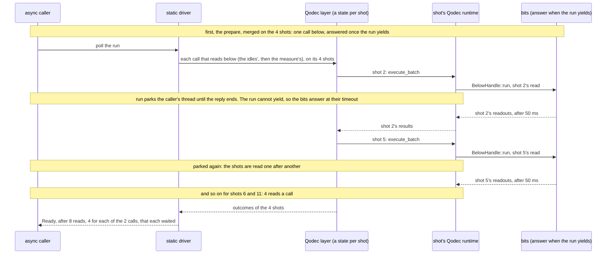

On a device with a 10 ms latency (`examples/latency.rs`, way `layer`),
c4c6 on 4 shots holds the polling thread for the whole run, in one poll,
and takes 2.9–3.0 s, 4 times one shot's time.

Two related questions are part of this one: Q65 (what the blocking costs
an async caller, and what to build to recover the wall time) and Q69 (a
way for an adapter to map the reply below as it passes up, without
`run`'s held thread). Merging the shots' reads into one call (Q67) is
[QD2](#qd2-shots-that-need-different-calls-below).

**Solutions.**

(c) kept, and an async caller runs the chain on a thread of its own,
built there, since a chain with a Qodec layer is not `Send`
(`a_qodec_chain_built_and_run_on_a_thread_of_its_own_gives_the_same_run`):

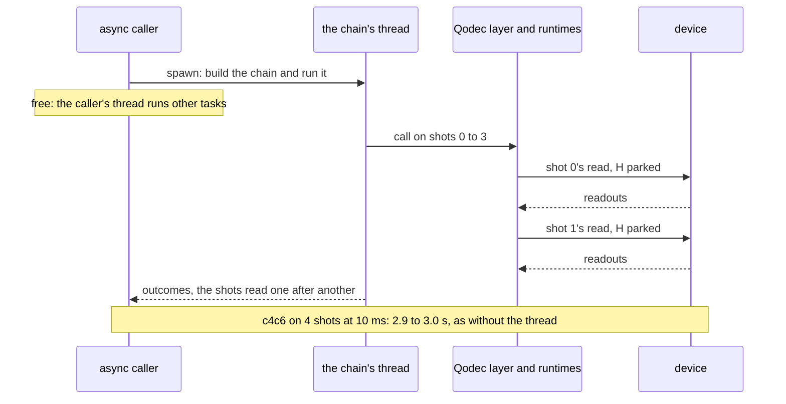

(a) or (b), the shots served one after another: the runtime's flush made
resumable or `async`, and either the layer written by hand (`Adapter` and
`Apply`, the protocol's `docs/adapters.md`, "An adapter written by hand")
or the protocol's owning adapter extended to a logic that can wait
without blocking. The run then yields at each read:

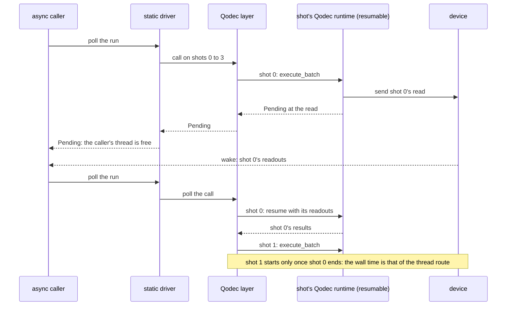

(a) or (b), the shots served together: as above, and the facility polls
every shot's suspended logic, not one shot to its end, so that the
shots' reads are in flight at once. A thread per shot, each with its own
runtime, does the same without changing the runtime:

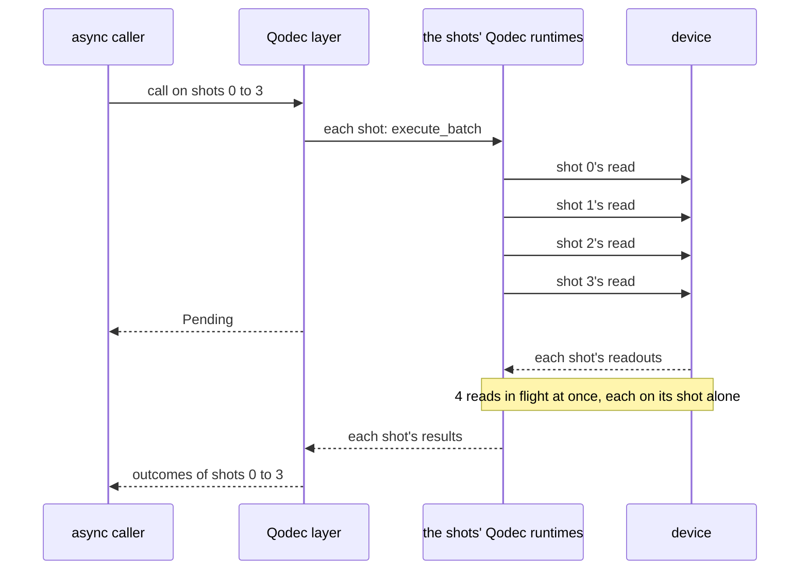

| Option                         | What changes                                                                                                                               | Cost / risk                                                                                                                    | c4c6, 4 shots, 10 ms latency                                     | Source                                   | Prior art                                                                        |
| ------------------------------ | ------------------------------------------------------------------------------------------------------------------------------------------ | ------------------------------------------------------------------------------------------------------------------------------ | ---------------------------------------------------------------- | ---------------------------------------- | -------------------------------------------------------------------------------- |
| (c), the thread route          | nothing; documented                                                                                                                        | a thread per run for an async caller; no wall time gained                                                                      | 2.9–3.0 s, the caller's thread free                              | measured, way `thread`                   | the Qodec prototype ran the runtime unchanged, in this mode                      |
| (a) or (b), one shot at a time | the runtime's flush (Qodec's); a hand-written layer, or an owning adapter whose logic can wait without blocking (the protocol's; Q65, Q69) | a runtime change; written by hand: the executor below shared as `Rc<RefCell<E>>`, `E: 'static`, the batch copied into the body | the thread free, at the thread route's wall time                 | _inference_, from way `thread`           | the runtime's decoder (`Step`); the Qodec prototype's sketch for one instruction |
| (a) or (b), shots together     | as above, and a facility that polls every shot's logic                                                                                     | as above; with calls in flight, a shot's order needs [QD3](#qd3-a-shots-calls-in-order-with-several-in-flight)'s queue         | 0.71–0.76 s, 276 device calls, each read still on its shot alone | measured, way `shots` (a chain per shot) | a placed executor's shots on threads of their own (the protocol's `run_on`)      |
| a thread per shot              | the facility runs each shot's logic on a thread of its own                                                                                 | a thread per shot; the layer is not `Send`, so each shot's runtime is made on its thread                                       | as the row above                                                 | measured, way `shots`                    | way `shots`                                                                      |

None of these merges the shots' reads into fewer calls: the bound of
69 calls that way `bare` makes, in 0.71–0.76 s, is
[QD2](#qd2-shots-that-need-different-calls-below)'s.

**Suggestion.** Keep (c) now, with the thread route documented and pinned
(`a_qodec_chain_built_and_run_on_a_thread_of_its_own_gives_the_same_run`).
Later, serve the shots together, since freeing the thread alone gains no
wall time. Decided already: the Qodec runtime is used as it is, Qodec
being a client of the protocol, so (a) or (b) is a change Qodec makes to
its flush. To decide: which of (a) and (b) to ask of Qodec, and whether
serving the shots together (Q65) comes before, with or after merging
their reads in lockstep (Q67), and with it a hook for the reply below
(Q69).

## QD2: shots that need different calls below

**Context.** A call is one list of instructions on a set of shots (the
protocol's `README.md`, "One message, and levels"). The layer keeps a
runtime per shot (`.shots(OnePerShot)`), and the adapter facility merges
the shots' equal sends into one call but runs a batch that reads on its
shot alone (`Below::run`, the protocol's `src/facilities/adapter_fn/below.rs:207`;
`src/qodec_layer.rs:10`).

**Problem.** c4c6 on 4 shots, over coins. Its bottom batches differ from
shot to shot in the bits that its measurement-based preparation feeds
forward (`X_if`, `Z_if`), which are its ancillas' readouts, random even
on a noiseless device (`examples/lockstep.rs`). And every bottom batch
reads, so each goes below on its shot alone: 69 device calls a shot,
276 in all (`tests/calls_below.rs`):

```rust
    assert_eq!(batches.len(), 4 * 69, "the stack sends 69 batches a shot");
    assert!(
        batches.iter().all(|batch| reads(batch)),
        "every bottom batch of c4c6 reads"
    );
```

```rust
    assert_eq!(calls, Calls(276));
```

This question's ignored test,
`below_a_qodec_layer_a_calls_shots_are_read_at_once`
(`tests/answers_later.rs`), asks for a call's shots read at once: on
repetition3, whose batches that read are equal on every shot, the
merging of Q67. Serving the shots without blocking
([QD1](#qd1-calling-below-more-than-once-in-a-call)) does not give it
alone.

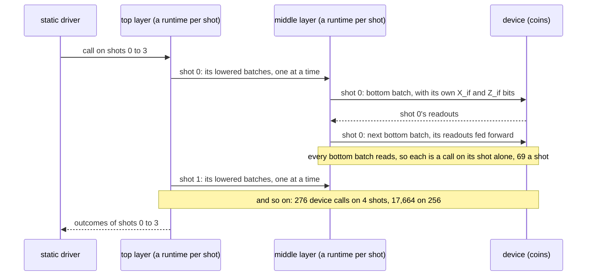

c422 and repetition3 send every shot the same 3 batches: the first,
which reads nothing, goes below once on all the shots, and each later
one, which reads, on its shot alone, so 9 calls on 4 shots
(`below_a_layer_only_an_upper_call_whose_lowering_reads_nothing_goes_below_on_its_shots_at_once`,
`below_repetition3_no_upper_call_sends_a_batch_beside_a_read`), and
`1 + 2N` on `N` shots (`examples/lockstep.rs`).

Merging the shots' batches that read is Q67.

**Solutions.**

(a) today, a runtime per shot, the shots' equal sends merged (the
diagram above).

(a) in lockstep: the shots' logic stops at each read (as in
[QD1](#qd1-calling-below-more-than-once-in-a-call), the shots served
together), and the facility sends one call per distinct batch of the
step:

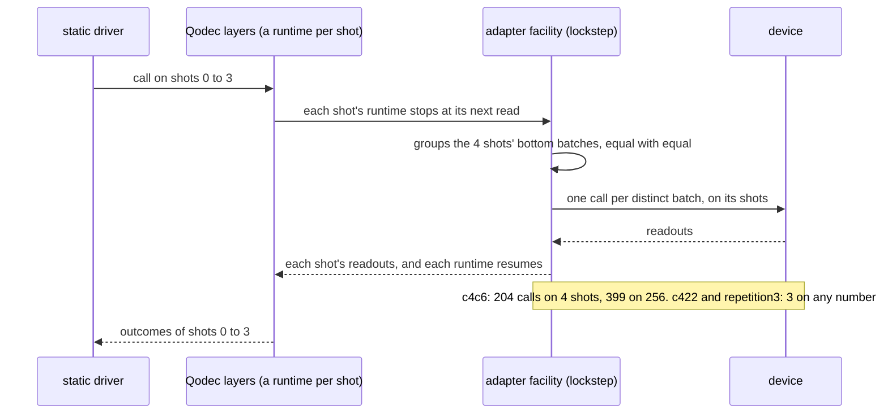

(b) merged by shape: the fed-forward bits become arguments that name an
earlier readout, each shot's own, which the device resolves, so a step's
batches are equal on every shot:

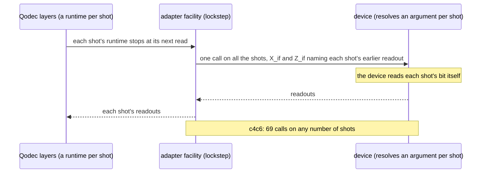

(c) no adapter: the runtime's whole stack and the device are one
executor, a state per shot:

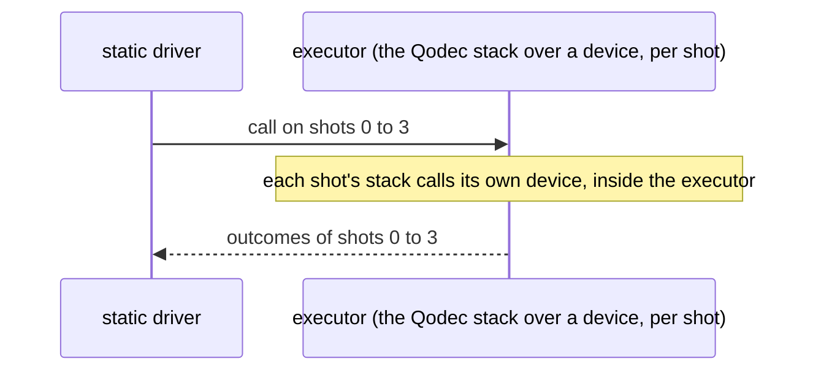

| Option              | What changes                                                                    | Cost / risk                                                                        | Device calls, c4c6 over coins                   | Source                                      | Prior art                                                                 |
| ------------------- | ------------------------------------------------------------------------------- | ---------------------------------------------------------------------------------- | ----------------------------------------------- | ------------------------------------------- | ------------------------------------------------------------------------- |
| (a) today           | nothing                                                                         | a read is a round trip a shot                                                      | 276 on 4 shots, 17,664 on 256                   | measured (`lockstep.rs`, tests)             | —                                                                         |
| (a) in lockstep     | a facility whose shots' logic stops at a read (QD1 (a), (b) or a thread a shot) | QD1's change first                                                                 | 204 on 4 shots, 399 on 256                      | counted by `lockstep.rs` for an ideal merge | the Qodec prototype, for one feed-forward: one call per value of the bit  |
| (b) merged by shape | instructions with an argument per shot, and devices that resolve it             | feed-forward moves into the instruction sets, and only such devices take the chain | 69 on any number of shots                       | counted by `lockstep.rs` for an ideal merge | none                                                                      |
| (c) no adapter      | none in the protocol                                                            | Qodec composes with no other layer (noise, a profiler, a debugger)                 | the device is inside the executor: not compared | _inference_                                 | the Qodec runtime's own stack, as `on_the_stack` runs it (`src/stack.rs`) |

The calls are counted by `examples/lockstep.rs` ([lockstep
merging](../README.md#measurements)). On a device bound by its latency,
a lockstep merge whose step's distinct batches go below together makes
69 round trips one after another on any number of shots, against 69 a
shot today.

**Suggestion.** (a) now. Lockstep merging (Q67) later, once the shots can
be served together (QD1), and with it the question of a hook for the
reply below (Q69). (b) only when a device takes an argument per shot,
since it changes what an instruction is. Not decided: whether lockstep
is built after this PR, and before or after serving the shots together
(Q65).

## QD3: a shot's calls in order, with several in flight

**Context.** The protocol runs a batch's instructions "after the batches
before them" (the protocol's `README.md`, "One message, and levels"),
and a caller may keep several calls in flight (its `docs/replies.md`,
"Several calls in flight"). Below the layer, the facility keeps a shot's
calls in order: a shot's sends go below before its run (the protocol's
`src/facilities/adapter_fn/below.rs:207`). Above it, the layer keeps them in order
only because it serves a whole call within `call` (QD1, mode (c)).

**Problem.** c4c6 on 4 shots, over coins that answer later, driven by a
program that makes all its calls before it awaits any, and awaits the
last first (`AllCallsFirst`, `tests/answers_later.rs`). Each shot still
runs the stack's bottom batches, in order:

```rust
    let expected = (stack.backends.iter())
        .map(|(shot, coins)| (*shot, coins.sent().to_vec()))
        .collect();
    assert_eq!(
        sorted(outcomes),
        sorted(stack.outcomes),
        "precondition: the run gives the stack's outcomes"
    );
    assert_eq!(sent, Sent(expected));
```

(`a_program_holding_all_its_calls_runs_the_stacks_batches_in_order`,
and `over_a_backend_that_answers_later_each_shot_runs_the_stacks_batches_in_order`.)
Nothing fails today. The order holds because call 1 is served before
`call` returns:

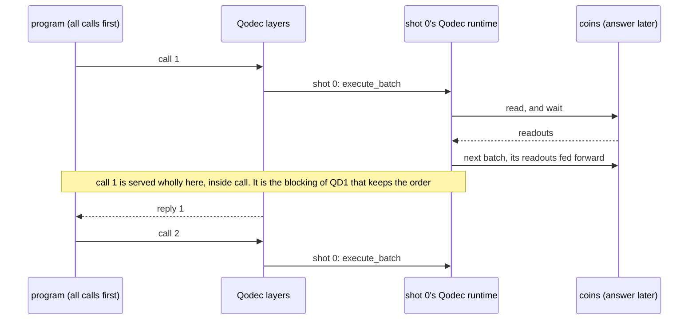

With the shots served together (QD1 (a), (b), or a thread per shot),
call 1 returns at its first read, and call 2 can reach shot 0's runtime
while call 1's feed-forward is still pending (_inference_; the Qodec
prototype found it so under (b)):

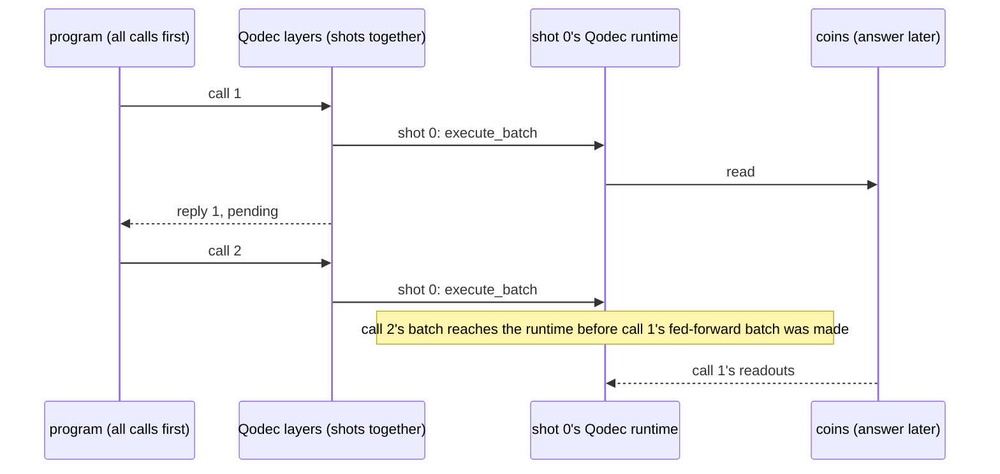

**Solutions.**

(a) a queue per shot: the shot's state holds a later call until the
earlier call's work on that shot ends:

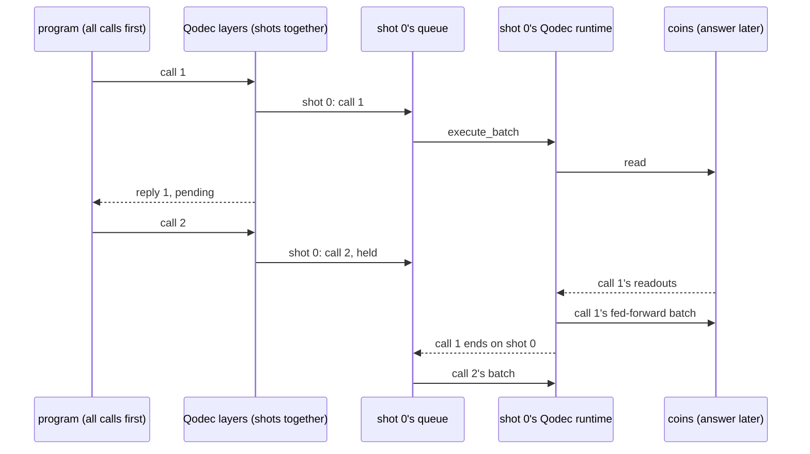

(b) keep mode (c): no queue, since no call starts before the last ended
(the problem's first diagram).

Refusing a second call on a shot while one is in flight is not an
option: the protocol lets a caller keep several in flight.

| Option                 | What changes                                     | Cost / risk                                   | On the case                                     | Source                       | Prior art                                                                                                                |
| ---------------------- | ------------------------------------------------ | --------------------------------------------- | ----------------------------------------------- | ---------------------------- | ------------------------------------------------------------------------------------------------------------------------ |
| (a) a queue per shot   | the facility's per-shot state, with QD1's change | built and tested with QD1 (a), (b) or threads | the two order tests pass, shots served together | _inference_                  | a placed executor queues its calls and runs them in order (the protocol's `docs/executors.md`, "Where an executor runs") |
| (b) mode (c), no queue | nothing                                          | QD1's cost                                    | the two order tests pass                        | the tests above (pass today) | the Qodec prototype: unreachable under (c)                                                                               |

**Suggestion.** No queue now: under (c) none is needed, and the two
tests above pin the order. Build the queue with whatever serves the
shots together (QD1), keeping both tests as its acceptance tests.
Nothing to decide apart from QD1.

## QD4: what a layer states when the chain is built

**Context.** The layer is made by `owning_adapter_fn`, which, its
instruction sets apart, offers upstream what is below and needs nothing
of it; options to state both are planned (`.offers(..)`, `.needs(..)`,
the protocol's `src/facilities/adapter_fn.rs:66`). An adapter written by
hand can already state both when built (`AdapterBoundary::offered_upstream`
and `fault`, the protocol's `src/adapter/boundary.rs:124` and `:135`).
Meanwhile the layer refuses, at each call, a call on a block beyond what
fits below (`QodecLayer::within`, `src/qodec_layer.rs:195`): sound, but
not complete, since it goes by the blocks' numbers where the runtime
counts the blocks held at once.

**Problem.** Repetition3 over noisy bits with 5 qubits, which hold one
block (a block needs 5 qubits, two need 8). A job on blocks 0 and 1 that
states 2 qubits is accepted (`tests/qubits.rs`,
`a_job_needing_more_blocks_than_fit_below_is_accepted`); run, the same
program fails below, mid-run
(`unbounded_blocks_beyond_the_qubits_below_fail_below`, which states no
qubits). The ignored test
`a_job_needing_more_blocks_than_fit_below_is_refused_when_given` asks
for the job to be refused when given:

```rust
    let Err(faults) = chain.run(program, shot_set(&SHOTS)) else {
        panic!("a job on 2 blocks stating 2 qubits is refused over 5 qubits");
    };
    assert!(
        matches!(&faults.0[..], [Rejected::Unmet(unmet)] if unmet.needed == 2 && unmet.offered == 1),
        "{faults}"
    );
```

and the other, `a_layer_over_an_executor_without_resumable_shots_does_not_build`,
for a layer over an executor that states it offers no resumable shots not to
build (today it builds,
`a_layer_over_an_executor_without_resumable_shots_builds`):

```rust
    assert!((static_driver() >> layer.adapter() >> without_resumable_shots()).is_err());
```

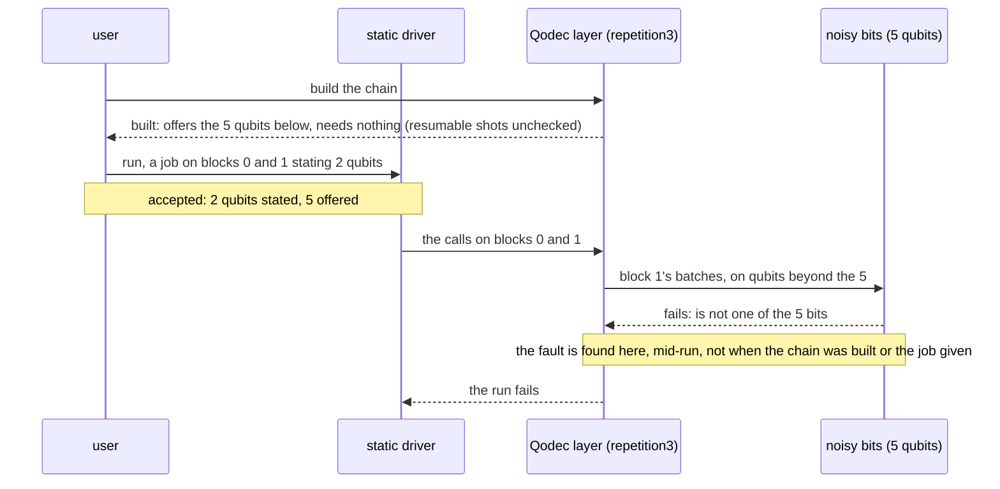

**Solutions.**

(a) `.offers(..)` and `.needs(..)` on the adapter facility (planned): the
layer offers upstream the qubits of its own set whose blocks fit below,
and needs resumable shots:

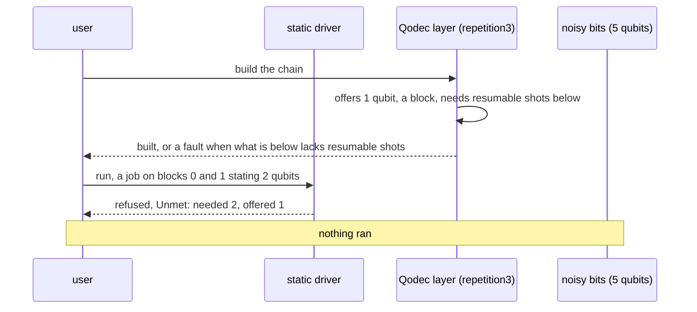

(b) the Qodec prototype's: clear the offer (no bound upstream) and need
resumable shots, refusing no job for its blocks, and leaving the blocks to
`within` or to the device:

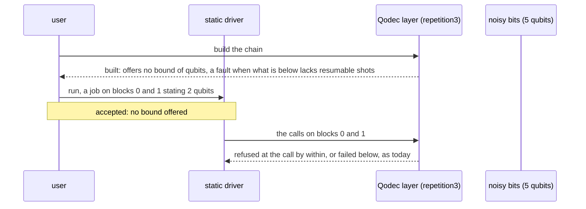

(c) a need derived from the program (the blocks it holds at once, which
only the runtime counts), checked when the job is given: it needs a way
for an instruction to name its qubits (deriving a static program's
qubits from its calls is planned, the protocol's
`docs/planned.md`) and the runtime's count of the
program's blocks.

| Option                                    | What changes                                                         | Cost / risk                                                                                                                                         | On the case                                                                                   | Source                                                                     | Prior art                                                                                         |
| ----------------------------------------- | -------------------------------------------------------------------- | --------------------------------------------------------------------------------------------------------------------------------------------------- | --------------------------------------------------------------------------------------------- | -------------------------------------------------------------------------- | ------------------------------------------------------------------------------------------------- |
| today: `within`, per call                 | nothing                                                              | faults found mid-run; a lone block 1 refused though it fits                                                                                         | accepted, then fails below; builds over no resumable shots                                    | `a_job_needing_more_blocks_than_fit_below_is_accepted` and the tests above | —                                                                                                 |
| (a) `.offers(..)`, `.needs(..)`           | two builder options of the adapter facility (planned)                | sound, not complete, as `within`; an executor below that does not state it offers no resumable shots is taken to offer it (`Capabilities::default`) | refused when given, `Unmet` 2 against 1; the resumable shots chain refused at build           | _inference_; the two ignored tests are its acceptance tests                | an adapter written by hand states its offer (the protocol's `RepetitionCode`, `docs/adapters.md`) |
| (b) clear the offer, need resumable shots | as (a), the offer `None`                                             | no job refused for its blocks                                                                                                                       | accepted, then refused at the call or fails below; the resumable shots chain refused at build | _inference_                                                                | the Qodec prototype's `build`, which faults when what is below lacks resumable shots              |
| (c) a need derived from the program       | a way for an instruction to name its qubits, and the runtime's count | complete; needs the meaning of `qubits` settled first                                                                                               | refused when given, and a lone block 1 accepted                                               | _inference_                                                                | none                                                                                              |

**Suggestion.** `within` now (built). (a) after this PR, its two ignored
tests as acceptance tests, once what `qubits` means is settled (the
numbers used, or how many are held at once). The executor of the
resumable shots test already states it offers none
(`with_resumable_shots(false)`, the protocol's `src/capabilities.rs:206`),
so only `.needs(..)` is missing there. (c) only if a case needs a lone high block accepted. To decide:
whether the layer offers a bound (a) or clears it (b).

## QD5: a status, a condition and a failure from below

**Status.** The status side is decided and built: solution (b) below.
The protocol's `ShotOutcome` and `Outcome` carry `ShotConditions`, and
its adapter facility merges them as (b) states. The layer marks each
result's outcomes with its runtime's status (`serve`, `src/qodec_layer.rs`),
and the acceptance test, `c4c6_top_statuses_equal_the_qodec_stacks`,
passes ([The chain gives the stack's
statuses](findings.md#the-chain-gives-the-stacks-statuses)). The rest of
this section is the question as it was raised, before the conditions;
the failure side stays open.

**Context.** A Qodec result carries a `Status` of three flags
(`rejected`, `inconsistent`, `unresolved`), sticky and merged by OR. In
the runtime's own stack a layer merges the status of each result below
into its own (`self.status |= r.status()`,
`qodec_runtime/src/layer_runtime.rs:869`). A `ShotOutcome` held a shot, a
tag and a value only, so the layer passed up no status: its way below
writes each result with a clear status, as it still does
(`Status::default()` in `Lower`, `src/qodec_layer.rs:476`), and each
layer's own statuses went in its report, read at close (a `Statuses`
type, now removed). Failures already pass up: an error of the runtime fails the call and
the adapter, and a device that fails mid-run fails the run, naming its
reason (`tests/device_failures.rs`,
`a_device_failing_mid_run_fails_the_run_naming_its_reason`).

**Problem.** c4c6, two stacked layers on 4 shots. On each shot the
middle runtime cannot resolve the shot during the idles, a call that
gives the driver no readout, and raises `unresolved`; every later result of
the middle carries it, those of the top's `measure_z_all` included,
since a status is sticky
(`c4c6_middle_raises_unresolved_in_the_idles_and_every_later_result_carries_it`).
The stack's top result (tag 1) carries it; the chain's did not. The
test that was ignored until (b), in `tests/stacked_codes.rs`, now with a
precondition that the stack's top gives `unresolved` at each shot's tag 1:

```rust
fn c4c6_top_statuses_equal_the_qodec_stacks() {
    let (chain, stack) = top_statuses();
    // …
    assert_eq!(chain, stack);
}
```

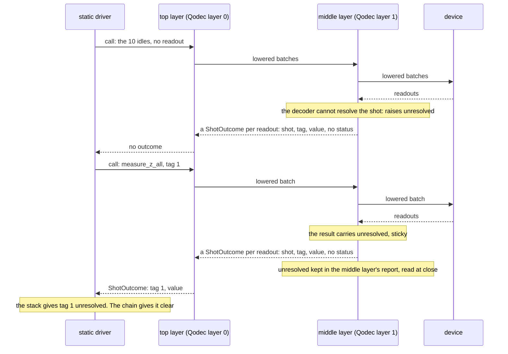

The status was not lost: it was in the middle layer's report, but at
close, too late for the layer above, which merges it during the run. Its cost
was measured in an experiment outside this crate, c4c6 under bit flips
on 1,000,000 shots: at p = 0.01 the chain's top gives 234 silent errors
(a wrong value with a clear status) per million against the stack's 1,
and rejects 0.50 of the shots against the stack's 0.62. Another
experiment outside this crate, on c4c6 over coins, found that the top
layer's report and the middle layer's, merged by OR at close, give each
shot the stack's status (its results' statuses merged by OR).

Two related questions are part of the failure side: an adapter's logic
can fail a call but not refuse it (`FRICTION` at `src/qodec_layer.rs:353`),
so an error of the runtime that ran nothing fails the adapter; and a
send cancelled below fails the adapter (Q68).

**Solutions.**

(a) before: the status stops at the layer that raised it, in its report
(the diagram above).

(b) a field on each outcome: `ShotOutcome` and `Outcome` carry
conditions. A layer writes its runtime's status on the outcomes it
writes, and the adapter facility merges, by OR, the conditions read below
into the shot's, sticky, and marks with them each outcome it writes for
the shot, in that call and the later ones, so that the layer above
writes no code for the status from below:

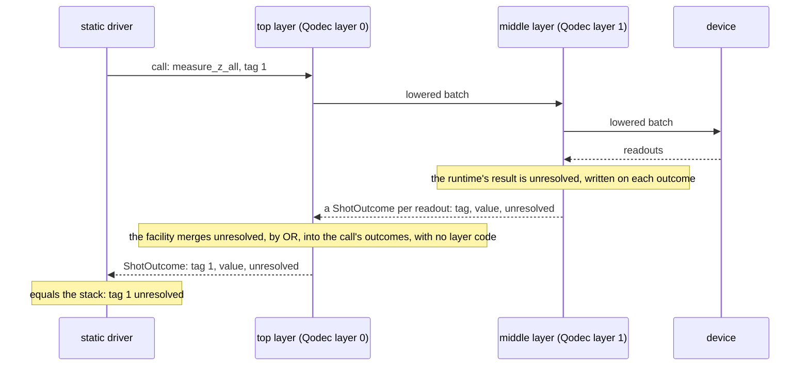

(c) an item beside the outcomes: a reply's items are outcomes or a
shot's conditions. The top layer stops the automatic forwarding, since
in the stack its runtime decides when the status below reaches its
results, and hands the conditions to its runtime:

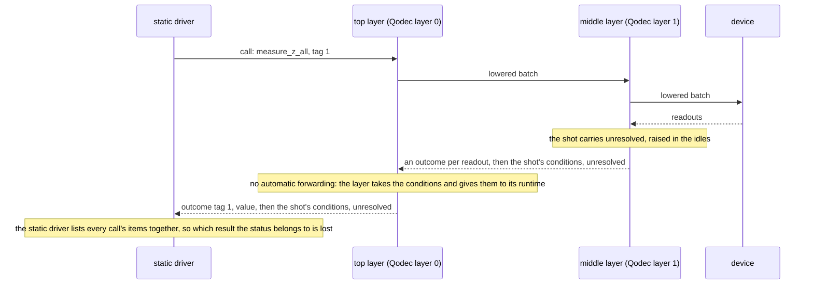

|                                        | (a) before                                             | (b) a field on each outcome                                                                                                                                 | (c) an item beside the outcomes                                                         |
| -------------------------------------- | ------------------------------------------------------ | ----------------------------------------------------------------------------------------------------------------------------------------------------------- | --------------------------------------------------------------------------------------- |
| c4c6's top statuses equal the stack's  | no                                                     | yes, as is                                                                                                                                                  | yes, with an opt-out of the forwarding, and a driver that keeps each call's items apart |
| Code in a code layer                   | 13 lines (`Statuses`, then the README table)           | 2 lines (built: 1, README table)                                                                                                                            | 6 lines, plus the opt-out                                                               |
| A condition in a call with no readouts | in the report, on the shot's next result of that layer | reaches no caller in that call; marks the shot's outcomes in later calls of the same adapter, as the stack's sticky status reaches the shot's later results | reaches the caller                                                                      |
| Which result a status belongs to       | each result, in order, at close                        | each result of the call carries it, and each later one of the shot (sticky), the stack's own rule                                                           | per reply, lost past the static driver                                                  |
| Breaks the protocol's users            | no                                                     | the literals of `ShotOutcome` and `Outcome`                                                                                                                 | every reply that is a list of `ShotOutcome`                                             |
| Source                                 | the tests above                                        | measured on an experiment branch; built, the tests above                                                                                                    | measured on an experiment branch                                                        |

**Decision.** (b), built in the protocol and used by this layer: a
status on each outcome, merged by OR and sticky per shot, so that each
result of a call carries the conditions the shot has raised so far,
which is the stack's own rule (`self.status |= r.status()`,
`qodec_runtime/src/layer_runtime.rs:869`, and each result written with
`self.status | d.status`, `:198`). A condition raised in a call with no
readouts reaches no caller in that call, as in the Qodec stack; it marks
the shot's outcomes in later calls of the same adapter, as c4c6's
`unresolved`, raised in the idles, reaches the stack's tag 1.
`c4c6_top_statuses_equal_the_qodec_stacks` is its acceptance test, and
passes. The failure side needs no new carrier; whether a logic can refuse a call,
and Q68, stay open apart from this question.
