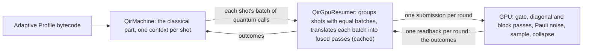

# A GPU resumer for `QirMachine` (prototype)

> **Prototype, not for merging.** This example exists to support the review of
> `QirMachine`; nothing here is a proposed change to the QDK.

`QirGpuResumer` ([`gpu_resumer.rs`](gpu_resumer.rs),
[`kernels.wgsl`](kernels.wgsl)) is a [`QirResumer`](../../src/qir/resumer.rs)
that keeps every shot's state vector on a GPU through wgpu. The
[`QirMachine`](../../src/qir/machine.rs) runs each shot's classical part and
hands the resumer batches of quantum calls; the resumer runs them on the GPU
and returns the measurement outcomes. It stands in for the current GPU
simulator ([`gpu_full_state_simulator`](../../src/gpu_full_state_simulator/)),
to test two claims.

**1. It makes the GPU's copy of the classical part unnecessary.** The current
simulator interprets the Adaptive Profile bytecode inside its WGSL shader, a
second implementation of what `QirMachine` does. Measured on `main`'s files:

| Current simulator's file                                                                          | Lines | Serving the bytecode interpreter                                                                                        | Adaptive op preparation          |
| ------------------------------------------------------------------------------------------------- | ----- | ----------------------------------------------------------------------------------------------------------------------- | -------------------------------- |
| [`gpu_statevector_shaders.wgsl`](../../src/gpu_full_state_simulator/gpu_statevector_shaders.wgsl) | 3,717 | 1,338: opcodes and constants 152, interpreter structs 102, utility functions 153, the `interpret_classical` kernel 931  | 204 (`prepare_op_adaptive_impl`) |
| [`gpu_context.rs`](../../src/gpu_full_state_simulator/gpu_context.rs)                             | 1,112 | 514: the adaptive `impl GpuContext` (program upload, the shot loop), `add_noise_to_adaptive_ops`, `program_region_size` |                                  |
| [`gpu_resources.rs`](../../src/gpu_full_state_simulator/gpu_resources.rs)                         | 975   | 202: the adaptive bind group layout and buffer uploads                                                                  |                                  |
| [`shader_types.rs`](../../src/gpu_full_state_simulator/shader_types.rs)                           | 1,181 | 101: `CallStackFrame`, `InterpreterState`, `build_op_pool`                                                              |                                  |

So about 1,540 of the shader's 3,717 lines and about 820 lines of Rust serve
the bytecode path. The spike deletes none of them: it shows what a rebuild on
`QirMachine` would remove. The Rust lines would be replaced in part by the
resumer's host code. The resumer itself (about 3,500 lines) holds only quantum
work, plus switches that turn each optimization off for measurement.

**2. It is faster.** The workload is n qubits, 8 rounds of Rx on every qubit, a
CZ chain, `MResetZ` on qubit 0 and a conditional X, then `ResetAll`. Each time
is the best of 3 after a warm-up, in seconds per run; the current simulator's
times exclude its first run, which compiles its shader (12–16 s here). Since
the final `ResetAll` is never observed, the resumer skips it; the "kept"
ratio runs it, as the current simulator does, and is the conservative one.

| Qubits × shots       | Current, noiseless (s) | Resumer (s) | Ratio, reset dropped / kept | Current, p = 10⁻³ (s) | Resumer (s) | Ratio, dropped / kept |
| -------------------- | ---------------------- | ----------- | --------------------------- | --------------------- | ----------- | --------------------- |
| 12 × 1024            | 0.706                  | 0.0867      | 8.1× / 7.1×                 | 0.659                 | 0.090       | 7.4× / 5.2×           |
| 16 × 256             | 2.23                   | 0.251       | 8.9× / 6.4×                 | 2.184                 | 0.387       | 5.6× / 4.1×           |
| 20 × 16              | 3.25                   | 0.313       | 10.4× / 7.5×                | 3.232                 | 0.466       | 6.9× / 4.8×           |
| 20 × 1               | 1.44                   | 0.0340      | 42× / 34×                   | 1.374                 | 0.037       | 36.6× / 22.6×         |
| 22 × 4               | 3.60                   | 0.311       | 11.6× / 8.0×                | 3.393                 | 0.487       | 7.0× / 5.3×           |
| rep. code d=7 × 1024 | 0.453                  | 0.281       | 1.6× / 1.3×                 | 0.439                 | 0.484       | 0.9× / 0.9×           |
| rep. code d=9 × 256  | 1.210                  | 1.587       | 0.8× / 0.8×                 | 1.218                 | 2.596       | 0.5× / 0.5×           |

Noise p is depolarizing on every gate, move and measurement. The noiseless
bench rows come from one session and the other cells from another; the drift
between sessions on this GPU is about 15%. Over p = 10⁻⁴ to 10⁻² the noisy ratio
(reset dropped) is 5.0–7.4×, and 28.7–36.6× at 20 × 1. Against the CPU
resumer ([`simulator_resumer.rs`](../qir_resumers/simulator_resumer.rs), one
thread) the noiseless ratios are 91–230×.

**Where it is slower: repetition codes** (d data qubits, d−1 ancillas, 8
rounds of syndrome extraction with a decoder that applies X corrections).
Each syndrome bit a branch reads ends a batch, so a d = 9 code takes 65 GPU
round trips per chunk; the current simulator branches inside its shader, with
no round trip. Under noise, shots with different syndromes also form more
groups, each with its own passes. Letting `QirMachine` hand such a branch to
the resumer as a conditional call would remove the round trips (an API change,
below).

## How it works



What gives the speed:

- **Shot lockstep:** every shot of a chunk lives in one buffer, and one pass
  serves all shots of a group (one shot per chunk is up to 101× slower).
- **Gate fusion:** diagonal gates into one pass, gates on the low 10 qubits
  into one workgroup-memory block, high-qubit gates into gather blocks (one
  pass per gate is 2.3–3.4× slower).
- **Sampling on the GPU:** measurements are drawn from a per-shot generator on
  the GPU, so a round costs one readback whatever its measurements.
- **Dropping unobservable final work:** a round that writes no results is held
  until the next resume, and dropped when every shot ends right after it (the
  closing `ResetAll`; 1.15–1.45× at these sizes).

`QirMachine` costs about 5% of a run (4.75 ms of 86.7 ms at 12 × 1024).

## How to run it

**Prerequisites:** a GPU that wgpu can use; Rust as for the QDK. The program
files and the comparison with the current simulator need the `qdk` Python
package built from this tree (`python build.py --qdk --no-check --no-test`,
then install the wheel from `target/wheels`).

Build, from the repository root:

```sh
cargo build --release -p qdk_simulators --example qir_gpu_resumer --features conformance
BIN=target/release/examples/qir_gpu_resumer
export GALLIUM_DRIVER=d3d12  # only on WSL with Mesa's d3d12 driver (Platform, below)
```

**Correctness** (seconds each, except `tests`, whose CPU reference takes
about 6 minutes):

```sh
$BIN conformance            # ... PASS
$BIN corpus                 # corpus: 244 cases run, 241 passed, 0 failed, 3 skipped
mkdir -p target/programs
python3 source/simulators/examples/qir_gpu_resumer/dump_programs.py target/programs
$BIN tests,target/programs/programs.json   # 11 lines ending ": ok", then PASS
P=target/programs/programs.json+target/programs/programs_noise.json
$BIN noisy,$P,p1e-2,bench_12:256,rep_5:256     # NOISY bench_12 p1e-2 all: 256 shots, ...: ok (each line), PASS
$BIN noisy,$P,corr,corr_branch:4000            # correlated noise
$BIN noisy,$P,p1e-9,readout_branch:20000       # readout noise
$BIN noisy,$P,tx,rep_3:2000                    # forced faults: tx, hy, mzx, cxzz, cxxy
$BIN state,5:3:205,12:4:300                    # STATE ...: ok (each line), PASS
```

`corpus` runs the `run_shot` compatibility corpus at 2,000 shots against the
CPU resumer; the 3 skipped cases use qubit loss. `noisy` compares against the
CPU resumer under the same noise; a line ends `ok` when z ≤ 5. These sizes are
reduced; the evidence below used, under `p1e-2`, `bench_12:1024`,
`rep_5:1024`, `rep_7:300`, `rep_9:64` and `TeleportedTNoiseReporting:256`
(its CPU reference takes about 5 minutes), and `state` at 5 to 22 qubits.

**Benchmark.** Each configuration is `<qubits>:<shots>:<strategy>[:<p>]`, or
a program name in place of `<qubits>`; strategy `all` is the default
resumer, `notail` keeps the final `ResetAll`, `cpu` runs the CPU resumer.

```sh
$BIN bench,$P,12:1024:all,12:1024:notail,12:1024:all:1e-3,rep_7:1024:all
# BENCH n=12 shots=1024 strategy=all p=0e0: first ... s, best ... s, ...
python3 source/simulators/examples/qir_gpu_resumer/bench_current.py bench,12,8,1024,4,1e-3
# CURRENT bench n=12 rounds=8 shots=1024 p=0.001 times=... best_after_warmup=...s
```

`bench_current.py` takes `bench|rep,<n>,<rounds>,<shots>,<runs>,<p>`. The
table above used the sizes shown, 8 rounds, and 4 runs for the current
simulator.

**Platform.** The numbers were measured on a Qualcomm Adreno X1-85 in WSL,
through wgpu's GL backend on Mesa's d3d12 Gallium driver, with f32
amplitudes. That setup needs `GALLIUM_DRIVER=d3d12` for every command, and
`QDK_GPU_ALLOW_GL=1 QDK_GPU_STRIP_DX12=1` for `bench_current.py`. The
commands above were last run there on cores shared with other work, at the
reduced sizes shown. On a discrete GPU, or another backend, the ratios may
differ.

**Changes to the current simulator on this branch** (marked `SPIKE:`), all
included in its numbers above:

- `gpu_context.rs`: the compiled shader was never marked clean, so every run
  recompiled it; it now is, which makes repeated runs faster. On a GL adapter
  buffers are capped at 128 MiB.
- `gpu_resources.rs`: `QDK_GPU_ALLOW_GL` accepts a GL adapter, with GL's
  binding limits; `QDK_GPU_STRIP_DX12` strips the shader's DX12-only sections
  there. Both files and the shader also gained debug switches (`QDK_GPU_TRACE`,
  `QDK_GPU_TRACE_STOP`, `QDK_GPU_DUMP_WGSL`), off by default.

## Correctness evidence

- The `QirResumer` conformance kit passes on the default strategy, with
  failing shots, and with one pass per gate and one shot per chunk.
- The `run_shot` corpus: its 238 noiseless cases at 2,000 shots agree with
  what their tests expect and with the CPU resumer (largest z 2.62); with
  noise support, 241 of its 244 cases pass and the 3 with qubit loss are
  refused.
- The adaptive GPU tests' 9 programs agree with what their tests expect, and
  with the CPU, as do the bench programs at 4 and 12 qubits.
- The state vector after random batches of every gate kind, at 5 to 22 qubits
  and for 6 strategies, matches an f64 reference: 1 − fidelity about 10⁻¹²,
  largest amplitude difference about 5·10⁻⁷, threshold 10⁻⁵ (`state` mode).
- Under noise, every configuration agrees with the CPU resumer (largest z
  3.12): depolarizing p = 10⁻² on the bench at 12 qubits, repetition codes
  d = 5, 7, 9 and `TeleportedTNoiseReporting`; correlated noise; readout noise;
  and five kinds of fault forced with probability 1 (`tx`: X after every T;
  `hy`, `mzx`, `cxzz`, `cxxy` alike) on 8 programs each.

## What is missing for production

Estimates, not built:

| Item                                                                         | Estimate             |
| ---------------------------------------------------------------------------- | -------------------- |
| Qubit loss (loss noise, `PeekLoss`): refused today                           | 2–3 days             |
| Idle noise: refused today                                                    | about 1 day          |
| Heavily divergent shots: each group of equal batches costs its passes        | 1–2 weeks            |
| States over 128 MiB (more than 24 qubits)                                    | about 1 week         |
| Python integration (`run_qir` on the resumer)                                | 2–3 days             |
| Conditional calls from `QirMachine` (opt-in), for the repetition codes above | 2–4 days, API change |
| Other backends (Vulkan, DX12, Metal) and devices                             | not estimated        |
