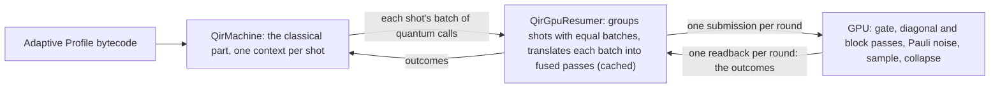

# A GPU resumer for `QirMachine` (prototype)

> **Prototype, not for merging.** This example exists to support the review of
> `QirMachine`; nothing here is a proposed change to the QDK.

`QirGpuResumer` ([`gpu_resumer.rs`](gpu_resumer.rs),
[`kernels.wgsl`](kernels.wgsl)) is a [`QirResumer`](../../src/qir/resumer.rs)
that keeps every shot's state vector on a GPU through wgpu. The
[`QirMachine`](../../src/qir/machine.rs) runs each shot's classical part and
hands the resumer batches of quantum calls; the resumer runs them on the GPU
and returns the measurement outcomes. It stands in for the current GPU
simulator ([`gpu_full_state_simulator`](../../src/gpu_full_state_simulator/)),
to test two claims.

**1. It removes the GPU's second implementation of the classical part.** The
current simulator interprets the Adaptive Profile bytecode inside its WGSL
shader: a second implementation of what `QirMachine` does, which must track
it. Measured on `main`'s files:

| Current simulator's file                                                                          | Lines | Serving the bytecode interpreter                                                                                        | Adaptive op preparation          |
| ------------------------------------------------------------------------------------------------- | ----- | ----------------------------------------------------------------------------------------------------------------------- | -------------------------------- |
| [`gpu_statevector_shaders.wgsl`](../../src/gpu_full_state_simulator/gpu_statevector_shaders.wgsl) | 3,717 | 1,338: opcodes and constants 152, interpreter structs 102, utility functions 153, the `interpret_classical` kernel 931  | 204 (`prepare_op_adaptive_impl`) |
| [`gpu_context.rs`](../../src/gpu_full_state_simulator/gpu_context.rs)                             | 1,112 | 514: the adaptive `impl GpuContext` (program upload, the shot loop), `add_noise_to_adaptive_ops`, `program_region_size` |                                  |
| [`gpu_resources.rs`](../../src/gpu_full_state_simulator/gpu_resources.rs)                         | 975   | 202: the adaptive bind group layout and buffer uploads                                                                  |                                  |
| [`shader_types.rs`](../../src/gpu_full_state_simulator/shader_types.rs)                           | 1,181 | 101: `CallStackFrame`, `InterpreterState`, `build_op_pool`                                                              |                                  |

The 1,338 interpreter lines are the duplicate: a rebuild on `QirMachine`
removes them. The other bytecode lines (op preparation, and about 820 lines of
Rust that upload the program and drive the shot loop) are replaced by the
resumer's host code, which does the same jobs for `QirMachine`'s batches. The
shader's other 2,175 lines (gates, noise, sampling, and the paths other than
the adaptive one) hold the quantum kernels, which the resumer's own 839 lines
of WGSL stand in for here; a rebuild keeps one set.

This is not a reduction in lines. The resumer is 3,526 lines (Rust 2,687,
WGSL 839); about 510 of the Rust lines are measurement scaffolding (the
`Strategy` switches that turn each optimization off, `Stats`, the `profile`
and `state_after` modes), and the rest includes work the current simulator's
adaptive path does not do (it runs one operation per round): fusing gates
into passes and blocks, and grouping shots with equal batches. The resumer
also lacks features the current simulator has (missing for production,
below). The gain is one implementation of the classical semantics instead of
two.

**2. It is faster on the bench program, and slower on larger repetition
codes.** The bench program is n qubits, 8 rounds of Rx on every qubit, a CZ
chain, `MResetZ` on qubit 0 and a conditional X, then `ResetAll`. The
repetition codes have d data qubits and d−1 ancillas, and 8 rounds of
syndrome extraction with a decoder that applies X corrections.

Both simulators run the same compiled program, with the same shots, seed and
noise, timed alike in one process by the `compare` mode (how to run it,
below):

- **Scope:** each time is one call that runs every shot and returns its
  results (the current simulator's own result arrays, the resumer's output
  records), after the program is loaded; it excludes compilation (Q# to QIR to
  bytecode) and each simulator's shader compilation (the current simulator
  compiles in its first run, which takes 11.5–14.4 s; the resumer compiles in
  about 3 s when it is created).
- **Runs:** a warm-up run each, then 5 runs each, interleaved, the order
  rotating. Each time is the best of the 5. On the bench rows the median is
  within 3% of the best; the repetition-code rows vary more, so their median
  ratios are given too.
- **Reset:** the final `ResetAll` is never observed, so the default resumer
  skips it; "kept" runs it, as the current simulator does, and is the
  conservative ratio.
- **Noise:** depolarizing p on every gate and move. Not on measurements: with
  noise on `MResetZ`, every shot of the current simulator fails (error
  code 2), so it cannot be compared there (findings, below).
- **Agreement:** in each configuration, both simulators' outcome
  distributions agree (z ≤ 5).

All rows were measured in one session:

| Qubits × shots       | Current (s) | Resumer, reset kept (s) | Ratio, kept / dropped | Current, p = 10⁻³ (s) | Resumer, kept (s) | Ratio, kept / dropped |
| -------------------- | ----------- | ----------------------- | --------------------- | --------------------- | ----------------- | --------------------- |
| 12 × 1024            | 0.518       | 0.0725                  | 7.1× / 8.8×           | 0.524                 | 0.102             | 5.1× / 6.0×           |
| 16 × 256             | 1.92        | 0.295                   | 6.5× / 8.6×           | 1.94                  | 0.436             | 4.4× / 5.4×           |
| 20 × 16              | 2.85        | 0.376                   | 7.6× / 9.9×           | 2.86                  | 0.544             | 5.2× / 6.3×           |
| 22 × 4               | 3.09        | 0.395                   | 7.8× / 10.6×          | 3.10                  | 0.570             | 5.4× / 6.6×           |
| rep. code d=7 × 1024 | 0.242       | 0.248                   | 0.98× / 0.98×         | 0.263                 | 0.295             | 0.89× / 0.89×         |
| rep. code d=9 × 256  | 0.549       | 1.22                    | 0.45× / 0.45×         | 0.532                 | 1.49              | 0.36× / 0.36×         |

On the bench program the resumer is 6.5–7.8× faster noiseless and 4.4–5.4×
under noise, keeping the reset (8.6–10.6× and 5.4–6.6× dropping it). At the
median, the repetition codes' kept ratios are 1.01× and 0.95× at d = 7, and
0.51× and 0.40× at d = 9 (the current simulator's d = 9 times vary most,
0.53–0.67 s). Against the CPU resumer
([`simulator_resumer.rs`](../qir_resumers/simulator_resumer.rs), one thread,
which runs the reset) the resumer is 73× faster at 12 × 1024 and 164× at
22 × 4 with the reset kept, and 111× and 229× with it dropped.

**Where it is slower: repetition codes.** It breaks even at d = 7 and is 2.2×
(noiseless) to 2.8× (noisy) slower at d = 9. Smaller codes favour it: at
p = 10⁻², 1024 shots, it is 6.1× faster at d = 3 and 4.5× at d = 5 (reset
kept). Each syndrome bit a branch reads ends a round of the resumer, so d = 9
takes 65 rounds per chunk of 128 shots, about 3.7 passes each, and the run
costs about 2.6 ms per pass over a 17-qubit chunk here; under noise, shots
with different syndromes also form more groups, each with its own passes.
The current simulator runs one host round per quantum operation (below), 274
per batch of 128 shots at d = 9, at about 1 ms each. Letting `QirMachine`
hand such a branch to the resumer as a conditional call would cut the
resumer's rounds (an API change, below); why its passes cost more per round
at this size was not investigated.

**Few shots.** With one shot the ratio is larger, and it measures fixed
latency, not simulation: 36× at 20 × 1 (25× under noise) and 26× at 12 × 1
(17×), reset kept, best of 5 (35× and 25×, 21× and 16× at the median). The
current simulator runs one host round per quantum operation: it submits its
classical, prepare and execute kernels, then reads back how many shots have
ended. The 20-qubit bench program takes 342 such rounds (about 3.3 ms each on
this platform, 1.15 s in all); the resumer takes one readback per round of
measurements, 8 here.

**Platform, and what it costs the current simulator.** Every number above
was measured on one GPU, a Qualcomm Adreno X1-85 in WSL (Windows Subsystem
for Linux), through wgpu's GL backend on Mesa's d3d12 Gallium driver, with
f32 amplitudes, on cores shared with other work. That is not the current
simulator's native backend (DX12, Vulkan or Metal), and it pays there:

- its DX12-only shader sections are stripped (`QDK_GPU_STRIP_DX12`);
- a buffer is capped at 128 MiB instead of up to 1 GiB, so at d = 9
  (17 qubits) it runs 256 shots as two batches of 128 (the resumer, which
  holds at most 128 MiB per chunk on any backend, runs two chunks too);
- its host round per quantum operation pays GL's synchronization latency,
  which a native backend may cut.

None of these was measured on a native backend; on a discrete GPU, or another
backend, the ratios may differ either way.

## How it works



What gives the speed (measured with the `bench` mode's strategies, reset
dropped):

- **Shot lockstep:** every shot of a chunk lives in one buffer, and one pass
  serves all shots of a group (one shot per chunk, `single`, is 85× slower at
  12 × 1024 and 7.8× at 16 × 256).
- **Gate fusion:** diagonal gates into one pass, gates on the low 10 qubits
  into one workgroup-memory block, high-qubit gates into gather blocks (one
  pass per gate, `perpass`, is 2.8–4.4× slower at 12 to 22 qubits).
- **Sampling on the GPU:** measurements are drawn from a per-shot generator on
  the GPU, so a round costs one readback whatever its measurements.
- **Dropping unobservable final work:** a round that writes no results is held
  until the next resume, and dropped when every shot ends right after it (the
  closing `ResetAll`; 1.17–1.36× on the bench program at the table's sizes).

`QirMachine` takes about 2 ms of a 64 ms run at 12 × 1024 (3%).

## How to run it

**Prerequisites:** a GPU that wgpu can use; Rust as for the QDK. The program
files need the `qdk` Python package built from this tree
(`python build.py --qdk --no-check --no-test`, then install the wheel from
`target/wheels`).

Build, from the repository root:

```sh
cargo build --release -p qdk_simulators --example qir_gpu_resumer --features conformance
BIN=target/release/examples/qir_gpu_resumer
export GALLIUM_DRIVER=d3d12  # only on WSL with Mesa's d3d12 driver (Platform, above)
export QDK_GPU_ALLOW_GL=1 QDK_GPU_STRIP_DX12=1  # only for the current simulator on a GL adapter
```

**Correctness** (seconds each, except `tests`, whose CPU reference takes
about 6 minutes):

```sh
$BIN conformance            # ... PASS
$BIN corpus                 # corpus: 244 cases run, 241 passed, 0 failed, 3 skipped
mkdir -p target/programs
python3 source/simulators/examples/qir_gpu_resumer/dump_programs.py target/programs
$BIN tests,target/programs/programs.json   # 11 lines ending ": ok", then PASS
P=target/programs/programs.json+target/programs/programs_noise.json
$BIN noisy,$P,p1e-2,bench_12:256,rep_5:256     # NOISY bench_12 p1e-2 all: 256 shots, ...: ok (each line), PASS
$BIN noisy,$P,corr,corr_branch:4000            # correlated noise
$BIN noisy,$P,p1e-9,readout_branch:20000       # readout noise
$BIN noisy,$P,tx,rep_3:2000                    # forced faults: tx, hy, mzx, cxzz, cxxy
$BIN state,5:3:205,12:4:300                    # STATE ...: ok (each line), PASS
```

`corpus` runs the `run_shot` compatibility corpus at 2,000 shots against the
CPU resumer; the 3 skipped cases use qubit loss. `noisy` compares against the
CPU resumer under the same noise; a line ends `ok` when z ≤ 5. These sizes are
reduced; the evidence below used, under `p1e-2`, `bench_12:1024`,
`rep_5:1024`, `rep_7:300`, `rep_9:64` and `TeleportedTNoiseReporting:256`
(its CPU reference takes about 5 minutes), and `state` at 5 to 22 qubits.

**Comparison with the current simulator.** Each configuration is
`<qubits>:<shots>[:<p>[:gates]]`, or a program name (`rep_7`, `rep_9`) in
place of `<qubits>`; `gates` puts the noise on gates and moves only, and
without it the noise is also on measurements. The table above is this
command, about 7 minutes:

```sh
$BIN compare,$P,12:1024:0,12:1024:1e-3:gates,16:256:0,16:256:1e-3:gates,20:16:0,20:16:1e-3:gates,22:4:0,22:4:1e-3:gates,20:1:0,20:1:1e-3:gates,12:1:0,12:1:1e-3:gates,rep_7:1024:0,rep_7:1024:1e-3:gates,rep_9:256:0,rep_9:256:1e-3:gates
# COMPARE bench_12 shots=1024 p=0e0 on every gate, move and measurement: current best ... s, median ..., worst ... (warm-up ...); resumer ...; resumer+reset ...
# RATIO bench_12 shots=1024 p=0e0 ...: reset kept ...x best, ...x median; reset dropped ...x best, ...x median
# OUTCOMES bench_12 ...: current vs resumer: tvd ..., z ...: ok (and vs resumer+reset)
# ... then PASS
$BIN compare,$P,rep_3:1024:1e-2:gates,rep_5:1024:1e-2:gates,bench_12:1024:1e-2:gates
$BIN compare,$P,rep_3:256:1e-2   # FAILS rep_3 ...: current: failed shots by error code: {2: 256}
```

The bench program outputs one bit, so its `OUTCOMES` lines say little; the
second command checks agreement where the outcomes vary (z 1.80, 1.42 and
0.45 at 1024 shots).

**Benchmark of the resumer alone.** Each configuration is
`<qubits>:<shots>:<strategy>[:<p>]`, or a program name in place of
`<qubits>`; strategy `all` is the default resumer, `notail` keeps the final
`ResetAll`, `cpu` runs the CPU resumer, and the others turn off one
optimization each ([`gpu_resumer.rs`](gpu_resumer.rs), `Strategy::named`).

```sh
$BIN bench,$P,12:1024:all,12:1024:cpu,22:4:all,22:4:cpu
$BIN bench,$P,12:1024:notail,12:1024:cpu,22:4:notail,22:4:cpu
$BIN bench,$P,12:1024:all,12:1024:single,12:1024:perpass,16:256:all,16:256:single,16:256:perpass,22:4:all,22:4:perpass
# BENCH n=12 shots=1024 strategy=all p=0e0: first ... s, best ... s, ...; best: machine ... ms, ...
```

**The current simulator from Python.**
[`bench_current.py`](bench_current.py) times `GpuSimulator.run_shots` as a
Python user calls it, so its time also holds the conversion of each shot's
results to Python. Its best times agree with the `compare` mode's within
0.03 s on the bench program at 12 × 1024 and 20 × 1, and are 0.15 s longer
on the d = 9 code at 256 shots. It takes
`bench|rep,<n>,<rounds>,<shots>,<runs>,<p>[,gates]`:

```sh
python3 source/simulators/examples/qir_gpu_resumer/bench_current.py bench,12,8,1024,6,1e-3,gates
# CURRENT bench n=12 rounds=8 shots=1024 p=0.001 gates times=... best_after_warmup=...s
python3 source/simulators/examples/qir_gpu_resumer/bench_current.py rep,3,8,256,2,1e-2
# FAILED shots by error code: {2: 256}
```

It sets the noise after the program: `GpuSimulator.set_program` forgets a
noise configuration set before it (findings, below).

## Findings on the current simulator

These are in `main`'s code, not in this branch's changes; neither is covered
by a test there.

- **Noise set before the program is dropped.** `set_program` switches the
  context to its adaptive mode by replacing it (`GpuContext::swith_to_adaptive`
  in `gpu_context.rs`), which keeps the noise tables but clears the noise
  configuration, so the shots run noiseless.
- **Noise on measurements fails every shot.** With depolarizing noise on
  `MResetZ`, every shot of the adaptive path ends with error code 2, from Rust
  and from Python; noise on gates alone runs.
  `qdk_simulators::run_adaptive_shots_sync`, which `run_qir(type="gpu")` uses,
  sets noise then program on an adaptive context, so it should fail alike (not
  run). Seen on the GL backend only.

**Changes to the current simulator on this branch** (marked `SPIKE:`), all
included in its numbers above:

- `gpu_context.rs`: the compiled shader was never marked clean, so every run
  recompiled it, which takes most of the first run's 11.5–14.4 s; it now is.
  On a GL adapter buffers are capped at 128 MiB.
- `gpu_resources.rs`: `QDK_GPU_ALLOW_GL` accepts a GL adapter, with GL's
  binding limits; `QDK_GPU_STRIP_DX12` strips the shader's DX12-only sections
  there. Both files and the shader also gained debug switches (`QDK_GPU_TRACE`,
  `QDK_GPU_TRACE_STOP`, `QDK_GPU_DUMP_WGSL`), off by default.

## Correctness evidence

- The `QirResumer` conformance kit passes on the default strategy, with
  failing shots, and with one pass per gate and one shot per chunk.
- The `run_shot` corpus: its 238 noiseless cases at 2,000 shots agree with
  what their tests expect and with the CPU resumer (largest z 2.62); with
  noise support, 241 of its 244 cases pass and the 3 with qubit loss are
  refused.
- The adaptive GPU tests' 9 programs agree with what their tests expect, and
  with the CPU, as do the bench programs at 4 and 12 qubits.
- The state vector after random batches of every gate kind, at 5 to 22 qubits
  and for 6 strategies, matches an f64 reference: 1 − fidelity about 10⁻¹²,
  largest amplitude difference about 5·10⁻⁷, threshold 10⁻⁵ (`state` mode).
- Under noise, every configuration agrees with the CPU resumer (largest z
  3.12): depolarizing p = 10⁻² on the bench at 12 qubits, repetition codes
  d = 5, 7, 9 and `TeleportedTNoiseReporting`; correlated noise; readout noise;
  and five kinds of fault forced with probability 1 (`tx`: X after every T;
  `hy`, `mzx`, `cxzz`, `cxxy` alike) on 8 programs each.
- Against the current simulator, under gate noise p = 10⁻²: the repetition
  codes d = 3 and 5 and the bench at 12 qubits agree (z ≤ 1.8, 1024 shots).

## What is missing for production

Estimates, not built:

| Item                                                                         | Estimate             |
| ---------------------------------------------------------------------------- | -------------------- |
| Qubit loss (loss noise, `PeekLoss`): refused today                           | 2–3 days             |
| Idle noise: refused today                                                    | about 1 day          |
| Heavily divergent shots: each group of equal batches costs its passes        | 1–2 weeks            |
| States over 128 MiB (more than 24 qubits)                                    | about 1 week         |
| Python integration (`run_qir` on the resumer)                                | 2–3 days             |
| Conditional calls from `QirMachine` (opt-in), for the repetition codes above | 2–4 days, API change |
| Other backends (Vulkan, DX12, Metal) and devices                             | not estimated        |
