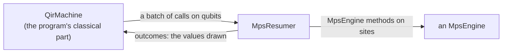
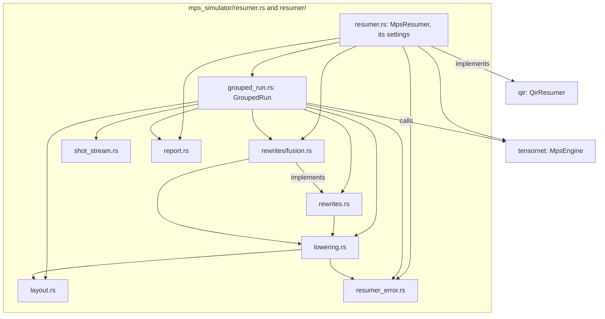

# The MPS simulator of QIR programs

The [`mps_simulator`](../mps_simulator.rs) module of `qdk_simulators` lets
the QDK simulate the QIR programs it compiles on matrix product states
(MPS), which hold many more qubits than a state vector when a program
entangles them little, as chemistry programs such as H₂'s phase
estimation do. Its [`MpsResumer`](resumer.rs) implements
`qir`'s [`QirResumer`](../qir/resumer.rs) once over `tensornet`'s
[`MpsEngine`](../../../tensornet/src/engine.rs), so it runs on any engine
(for instance `tensornet`'s exact reference, or one over cuTensorNet,
NVIDIA's tensor network library, on a GPU),
and a new engine needs no change here. What the two traits require is in
[`qir`'s README](../qir/README.md),
[`tensornet`'s README](../../../tensornet/README.md#the-contract) and their
rustdoc; this page says how this simulator implements `QirResumer` over
`MpsEngine`, and why. The details are in the code, each file's header
first, and in [the design notes](design.md).

The module's tests, in
[`src/tests/mps_simulator/`](../tests/mps_simulator/), check the rules of
each [phase](#how-it-runs-a-program) on `tensornet`'s exact reference
engine, or a spy over it, in every `cargo test`.

## Terms

The two traits speak different terms, `qir`'s of qubits, calls and shots,
`tensornet`'s of sites, matrices and states; this page uses both:

- **MPS simulation method**: the algorithm that runs a program's gates,
  measurements and shots on an MPS. This module is the MPS simulation
  method of `qdk_simulators`.
- **`MpsEngine` method**: an operation the trait declares and engines
  implement (`apply`, `project`, `probability_of_one`, …). The MPS
  simulation method calls them.
- **run**: one call of the resumer's `run` (`QirResumer::run`) on some
  shots of a program, which gives every shot's records or the first
  failing shot.
- **machine**, **context** and **batch** (`qir`'s): the machine runs a
  program's classical part, one context per shot, and stops a context at
  each batch of its quantum calls, and at its end with the shot's records.
- **outcome**, **records** and **trap** (`qir`'s, in
  [its model](../qir/README.md#the-model)): an outcome is the value a
  measurement answers the machine with; a shot's records are what it
  outputs when its context ends; a trap is why the machine stopped a shot
  before its end, a fault of its program.
- **site**: a place on the engine's chain: an MPS is a chain of tensors,
  one per site.
- **bond**: the link between two neighbouring sites. Its dimension is the
  number of terms the state keeps across it; it grows with the
  entanglement between the qubits on its two sides, and the memory and
  time of a run grow with it. The **max bond dimension χ** caps it: a user
  raises χ for a more accurate run, or lowers it for a faster one.
- **truncation**: what an engine that truncates does after a gate: across
  each bond it keeps at most the χ largest Schmidt values (its singular
  values, the weights of its terms), and may drop small ones below a
  cutoff of its own. A shot's **retained weight** is the share of its
  state's squared norm that the truncations kept, 1 when they dropped
  nothing; the report warns when it falls low, and the user then raises χ.
- **report**: what a resumer's last run read of its states
  ([`MpsRunReport`](resumer/report.rs)): the largest bond, the max bond
  dimension it ran at, and the least retained weight, with a warning when
  the weight fell low.
- **capacity**: the chain a state is prepared within, one site per qubit
  and bonds of at most χ.
- **operator**: a unitary matrix on one or two sites, which the engine
  applies.
- **stream**: a shot's own sequence of random numbers, each a
  **uniform**: a number spread evenly over [0, 1).
- **draw**: a shot's value at a measurement or reset, One when a uniform
  from the shot's own stream is below P(One), the state's probability
  that the site reads One.
- **group**: the shots of a run that drew the same values so far, which
  share one context and one state.
- **fork**: an exact copy of a state, which the engine makes
  (`MpsEngine::fork`).
- **run of operators**: the operators of a batch between two of its
  draws, or between a draw and the batch's start or end, which a rewrite
  takes as one; one run of the resumer goes through many.

Between the program's calls on qubits and the engine's operators on
sites, the resumer works as a small compiler, in three stages of the
phases below:

- **layout**: which site holds each of the program's qubits, chosen at
  the start of each run from the program alone, before any shot, and read
  by lowering, so that every later phase works on its sites; on a chain a
  layout is an order, the **qubit order**.
- **lowering** (the phase **lower**): the translation of each call of a
  batch into steps on sites, through the layout: a gate becomes an
  operator, a measurement or a reset a draw.
- **rewrite**: a change of a batch's operators, after lowering, into
  cheaper ones that give the same state; **gate fusion** is today's.

## What this simulator bridges

The machine hands over each shot's quantum calls in the program's terms,
and wants each measurement's value back; the engine is called through
`MpsEngine` methods on sites, and answers with probabilities:



| The machine gives (`qir`)               | The engine takes (`tensornet`)                | [Phases](#how-it-runs-a-program) |
| --------------------------------------- | --------------------------------------------- | -------------------------------- |
| a program of n qubits                   | a capacity                                    | start; prepare                   |
| a gate by its name and angle, on qubits | an operator on sites                          | layout; lower; rewrite; apply    |
| a measurement or a reset, on a qubit    | P(One) of a site, and a projection on a value | layout; lower; draw; settle      |
| shots, each with a state of its own     | states, and forks of a state                  | split                            |

## Its files

`MpsResumer`, in [`resumer.rs`](resumer.rs), and everything it uses, in
[`resumer/`](resumer/), form one module; each file's header says what it
holds. An arrow points from a file to a file it uses, and every one
points down or across.



Each phase of [the next section](#how-it-runs-a-program) is a function or
a call of the same name in
[`grouped_run.rs`](resumer/grouped_run.rs), unless its row names another
file.

## How it runs a program

`QirResumer::run`, the one method of the trait, runs its shots in groups.
Its first two phases, start and layout, run once, before any shot; then
the run has one group of every shot. Each group goes through the other
phases until its context ends, and a split adds a group that waits its
turn.

| Phase         | Function                                                                                    | How                                                                                                                                                                                                                                                                                                                                                                                                                                                                                             | Why                                                                                                                                                                                                                                                                                                                                                          |
| ------------- | ------------------------------------------------------------------------------------------- | ----------------------------------------------------------------------------------------------------------------------------------------------------------------------------------------------------------------------------------------------------------------------------------------------------------------------------------------------------------------------------------------------------------------------------------------------------------------------------------------------- | ------------------------------------------------------------------------------------------------------------------------------------------------------------------------------------------------------------------------------------------------------------------------------------------------------------------------------------------------------------ |
| **start**     | `GroupedRun::start`                                                                         | once per run of one shot or more, before any shot runs: the capacity, `MpsShape::qubit_chain` of the program's qubits and χ (`with_max_bond_dimension`, [`DEFAULT_MAX_BOND_DIMENSION`](resumer.rs) by default); qubits and a χ that make no chain fail the run's first shot                                                                                                                                                                                                                     | the `MpsEngine` trait takes only a capacity, within which an engine that truncates keeps its bonds; its cutoff is its own setting                                                                                                                                                                                                                            |
| **layout**    | `QubitOrder::for_program` ([`layout.rs`](resumer/layout.rs)), called by `GroupedRun::start` | at the start of each run, from the program alone, before any shot runs: a local search for the qubit order places qubits that share two-qubit gates close on the chain, weighing the gates whose qubits the program names                                                                                                                                                                                                                                                                       | an MPS is a chain: an engine applies a gate on distant sites at more cost (through swaps, for instance), and each bond depends on which qubits fall on each side of it. Every order holds the same state (to rounding, and within the truncation error of an engine that truncates), so on an exact engine no record depends on it, and no caller sees sites |
| **resume**    | `QirMachine::resume`, called by `run_group`                                                 | the machine runs the group's context to its next batch, or to its end with the shot's records, given the outcomes of the batch before                                                                                                                                                                                                                                                                                                                                                           | the machine runs the program's classical part and stops at each batch, so the values drawn reach the program before it goes on                                                                                                                                                                                                                               |
| **lower**     | `lower` ([`lowering.rs`](resumer/lowering.rs))                                              | each gate becomes its matrix at its angle, as the engine takes it, on the sites the layout gives its qubits, in its operand order, and each measurement and reset a draw on a site; `move` changes no state (a noisy simulator may charge it with idle noise or loss, [planned](#planned)), so it is no operator. Correlated noise, readout noise and loss checks fail the shot that reaches them ([`resumer_error.rs`](resumer/resumer_error.rs)), as does a two-qubit gate on one qubit twice | the engine knows no gate names and no qubits, only matrices and sites. Noise and loss on matrix product states are [planned](#planned); refused at the call, a program whose noise is on a path no shot takes runs. No matrix on two distinct sites applies a gate on one qubit twice, and the machine does not check it                                     |
| **rewrite**   | `Rewrite::rewrite`, called by `rewrite_runs` ([`rewrites.rs`](resumer/rewrites.rs))         | each run of operators is given to the rewrite, which keeps [its contract](resumer/rewrites.rs). Today's rewrite is gate fusion ([`rewrites/fusion.rs`](resumer/rewrites/fusion.rs)): `GateFusion::Pairs`, the default, multiplies each run of operators into operators on one or two sites; `GateFusion::Unfused` keeps one operator per gate                                                                                                                                                   | an engine's time goes to its operators, so fewer, larger ones may cost less ([the timings](resumer/rewrites/fusion.rs))                                                                                                                                                                                                                                      |
| **prepare**   | `prepare`                                                                                   | at the group's first operator or draw, the engine prepares a state of all zeros within the capacity; a program of no qubits prepares none                                                                                                                                                                                                                                                                                                                                                       | a shot with no quantum call costs no state                                                                                                                                                                                                                                                                                                                   |
| **apply**     | `apply`                                                                                     | the engine applies each operator to the group's one state                                                                                                                                                                                                                                                                                                                                                                                                                                       | one call serves every shot of the group                                                                                                                                                                                                                                                                                                                      |
| **read bond** | `read_bond`                                                                                 | where a run of operators ends, before a draw or a resume, the state's largest bond is read, and kept in the report ([`report.rs`](resumer/report.rs)) when it is the largest of the run so far                                                                                                                                                                                                                                                                                                  | the bond is what χ caps, and it is read before the draws, which may shrink it                                                                                                                                                                                                                                                                                |
| **draw**      | `draw`                                                                                      | the state's P(One) of the site is read once per group; each shot draws a uniform from its own `SplitMix64` stream, seeded from the resumer's seed and the shot's id (`shot_stream`, in [`shot_stream.rs`](resumer/shot_stream.rs)), and reads One when it is below P(One); a measurement's result is answered with the value of the part going on (`split` answers the waiting part's with its own)                                                                                             | `QirResumer`'s contract: a shot's records depend neither on the other shots nor on its place among them nor on earlier runs. A shot draws once per measurement and reset, whatever group it is in, so its records are those it gets alone                                                                                                                    |
| **split**     | `split`, with `value_going_on`                                                              | when the shots drew both values, the part with fewer shots goes on (Zero's on a tie), and the other waits on a stack, with a copy of the context and a fork of the state, made after P(One) is read; when the fork fails, the whole group fails, as the engine leaves its state unspecified, and when settling the fork (the projection, and a reset's X) fails, only the waiting part fails                                                                                                    | a fork is exact, so each part's state is the one a shot alone would hold, and a run costs what its distinct histories cost: one state for a program with no random draw, one per shot at most. As the larger part waits, a run of N shots holds at most ⌊log₂ N⌋ + 1 states at once, which bounds a GPU's memory whatever the program draws                  |
| **settle**    | `settle`                                                                                    | each part's state is projected on its value (`project`), then a reset that drew One applies X                                                                                                                                                                                                                                                                                                                                                                                                   | the engine has no measurement and no reset, only probabilities, projections and operators                                                                                                                                                                                                                                                                    |
| **end**       | `end`                                                                                       | the context ended: the state's retained weight is read, and kept in the report when the least of the run; the group's records are each of its shots'                                                                                                                                                                                                                                                                                                                                            | the retained weight measures what truncation cost (a bound on the error after one truncation, an estimate after several): the report warns when a shot lost more than `TRUNCATION_TOLERANCE`, so the user knows when to raise χ                                                                                                                              |

Two rules hold across the phases:

- **Failures** ([`grouped_run.rs`](resumer/grouped_run.rs),
  [`resumer_error.rs`](resumer/resumer_error.rs)): a shot fails with the
  shots that share its state when the failure is met, in any phase from
  resume to end but rewrite: its context traps, a call is refused, or the
  engine fails. So a failed fork fails the whole group, and a failure
  settling the fork fails only the part that was to wait (see split).
  Before any group runs, start fails the run's first shot when the qubits
  and χ make no chain. The run names the first failing shot in the order
  of the shots, as `QirResumer::run`'s contract requires whatever order
  they run in, and drops what could not change that name: a waiting group
  whose shots all come after it is dropped unrun, and a running group
  stops after the step whose split leaves it only shots that come after
  it, whether settling the fork failed or not; that step first settles
  the group's own value.
- **No waiting** ([`resumer.rs`](resumer.rs)): `run` runs every group when
  its future is first polled, so the future is ready at once. `MpsEngine`
  methods return when done, so this simulator has nothing to wait on;
  `QirResumer::run` is async for resumers that wait on a device.

The `MpsEngine` and `QirMachine` methods each phase calls, in order, are
in [the design notes](design.md#the-calls-of-each-phase).

## The model, and an example

The public types, each linked to the file that says how it works:

- [`MpsResumer`](resumer.rs): the resumer, its settings
  (`with_max_bond_dimension`, `with_gate_fusion`).
- [`GateFusion`](resumer/rewrites/fusion.rs): `Pairs` (the default) or
  `Unfused`.
- [`MpsRunReport`, `TruncationWarning`](resumer/report.rs): the
  [report](#terms) and its warning.
- [`MpsResumerError`](resumer/resumer_error.rs): why a shot failed, apart
  from a trap of its program.

A Bell pair, as the tests run it
([`src/tests/mps_simulator/resumer.rs`](../tests/mps_simulator/resumer.rs);
`bytecode` writes a program's bytecode in the Adaptive Profile (the QIR
profile of programs that branch on their measurements), which
`QirProgram::new` checks, `gate1`, `gate2`, `mz` and `ret` write one
instruction each, `OPID_*` names a gate, `expect_ready` polls a future
that is ready at once, and `results` gives the records of a shot that read
the bits given):

```rust
// The program: a Bell pair read into two results, written in the
// Adaptive Profile bytecode, then checked.
let bytecode = bytecode(
    2,
    &[&[gate1(OPID_H, 0), gate2(OPID_CX, 0, 1), mz(0), mz(1), ret()]],
);
let bell = QirProgram::new(bytecode).expect("the Bell pair's bytecode has no fault");
// The resumer, on the exact reference engine, its draws seeded with 7.
let mut resumer = MpsResumer::new(ExactReference::new(), 7);
// One machine runs the program's classical part; the resumer runs the
// quantum calls of its 32 shots, and never waits.
let shots = QirShotId::first(32);
let records =
    expect_ready(resumer.run(&QirMachine::new(&bell), &shots)).expect("the program runs");
assert!(
    records.contains(&results(&[0, 0])) && records.contains(&results(&[1, 1])),
    "32 shots draw both values"
);
// In every shot, the two readouts agree.
assert!(records.iter().all(|shot| shot[0] == shot[1]));
```

## Planned

Each item names a case that needs it:

- **Noise and loss on matrix product states:** the calls this simulator
  does not run yet, and a noise model given to the simulator (as the
  other simulators of this crate take one), which may also charge idle
  noise and loss on `move`; `MpsResumer` has no such setting yet. Its
  case: a logical Bell test on 56 qubits with Pauli noise and loss.
- **The sampled form:** a program whose classical part does not depend on
  its measurements, run once, its readout drawn for every shot with
  `MpsEngine::sample`. It is to be an entry point of its own, not
  `QirResumer::run`: one call of `sample` draws every shot from one seed,
  so a shot's values depend on the shots drawn with it, while `run`
  promises each shot the records it gets alone. Its case: sampling many
  shots of a Base Profile program (the QIR profile of programs that do not
  branch on their measurements) at the cost of one.
- **Routing in the resumer:** a fourth stage, between layout and
  lowering, that brings a gate's distant sites together by swaps of
  neighbouring sites and keeps where the swaps moved the qubits: the
  layout becomes each run's starting placement, and each group carries
  its own, since groups run other gates once they split. An engine such
  as cuTensorNet's applies an operator on distant sites more slowly
  than one on neighbouring sites. Its case: a program whose gates act on
  distant qubits, such as H₂'s phase estimation.
- **Queries** of the state (expectations of Pauli sums, the chain's cost).
  Its case: a chemistry user's energy estimate $\langle H \rangle$ read
  without shots.
- **Groups run in parallel** on CPU threads. Its case: a chemistry
  program on a polyene chain, whose 1,000 shots split into many histories.
- **A result per shot:** today a run is all or nothing: when one shot
  fails, `QirResumer::run` gives no records, so one failed shot of 100
  loses the other 99. Planned: each
  shot's own result, its records or its error, so that a caller keeps the
  shots that ended; a program's trap as the outcome of the shot that
  trapped, apart from the engine's failures and the resumer's refusals;
  and a shot that failed on the engine's failure (a fork its GPU had no
  memory for) run again alone, with no fork, which gives exactly the
  records it would have had, since a shot's records depend neither on the
  other shots nor on how they are grouped (as `run_qir` already retries a
  failed shot with a Qodec, `on_shot_failure="retry"`). This changes the
  contract of `QirResumer::run`. Its cases: a long GPU run, such as H₂'s phase
  estimation, whose hours of shots one transient out-of-memory loses, and
  programs some of whose shots trap.
