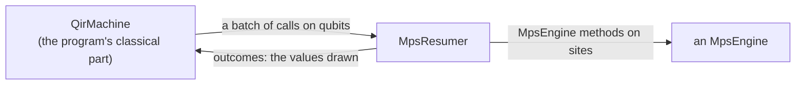

# The MPS simulator of QIR programs

The [`mps_simulator`](../mps_simulator.rs) module of `qdk_simulators` lets
the QDK simulate the QIR programs it compiles on matrix product states
(MPS), which hold many more qubits than a state vector when a program
entangles them little, as chemistry programs such as H₂'s phase
estimation (29 qubits) do. Its [`MpsResumer`](resumer.rs) implements
`qir`'s [`QirResumer`](../qir/resumer.rs) once over `tensornet`'s
[`MpsEngine`](../../../tensornet/src/engine.rs), so it runs on any engine
(for instance `tensornet`'s exact reference, or cuTensorNet's on a GPU),
and a new engine needs no change here. What the two traits require is in
[`qir`'s README](../qir/README.md),
[`tensornet`'s README](../../../tensornet/README.md#the-contract) and their
rustdoc; this page says how this simulator implements `QirResumer` over
`MpsEngine`, and why. The details are in the code, each file's header
first, and in [the design notes](design.md).

The module's tests, in
[`src/tests/mps_simulator/`](../tests/mps_simulator/), check the rules of
each [phase](#how-it-runs-a-program) on `tensornet`'s exact reference
engine, or a spy over it, in every `cargo test`.

## Terms

The two traits speak different terms, `qir`'s of qubits, calls and shots,
`tensornet`'s of sites, matrices and states; this page uses both:

- **MPS simulation method**: the algorithm that runs a program's gates,
  measurements and shots on an MPS. This module is the MPS simulation
  method of `qdk_simulators`.
- **`MpsEngine` method**: an operation the trait declares and engines
  implement (`apply`, `project`, `probability_of_one`, …). The MPS
  simulation method calls them.
- **machine**, **context** and **batch** (`qir`'s): the machine runs a
  program's classical part, one context per shot, and stops a context at
  each batch of its quantum calls, and at its end with the shot's records.
- **site**: a place on the engine's chain: an MPS is a chain of tensors,
  one per site. The **qubit order** says which site holds each of the
  program's qubits.
- **bond**: the link between two neighbouring sites. Its dimension is the
  number of terms the state keeps across it; it grows with the
  entanglement between the qubits on its two sides, and the memory and
  time of a run grow with it. The **max bond dimension χ** caps it: a user
  raises χ for a more accurate run, or lowers it for a faster one.
- **truncation**: what an engine that truncates does after a gate: across
  each bond it keeps at most the χ largest Schmidt values (its singular
  values, the weights of its terms), and may drop small ones below a
  cutoff of its own. A shot's **retained weight** is the share of its
  state's squared norm that the truncations kept, 1 when they dropped
  nothing; the report warns when it falls low, and the user then raises χ.
- **report**: what a resumer's last run read of its states
  ([`MpsRunReport`](report.rs)): the largest bond and the least retained
  weight, with a warning when the weight fell low.
- **capacity**: the chain a state is prepared within, one site per qubit
  and bonds of at most χ.
- **operator**: a unitary matrix on one or two sites, which the engine
  applies.
- **stream**: a shot's own sequence of random numbers, each a
  **uniform**: a number spread evenly over [0, 1).
- **draw**: a shot's value at a measurement or reset, One when a uniform
  from the shot's own stream is below the state's P(One).
- **group**: the shots of a run that drew the same values so far, which
  share one context and one state.

## What this simulator bridges

The machine hands over each shot's quantum calls in the program's terms,
and wants each measurement's value back; the engine is called through
`MpsEngine` methods on sites, and answers with probabilities:



| The machine gives (`qir`)               | The engine takes (`tensornet`)                | [Phases](#how-it-runs-a-program) |
| --------------------------------------- | --------------------------------------------- | -------------------------------- |
| a program of n qubits                   | a capacity                                    | start; prepare                   |
| a gate by its name and angle, on qubits | an operator on sites                          | lower; fuse; apply               |
| a measurement or a reset, on a qubit    | P(One) of a site, and a projection on a value | draw; settle                     |
| shots, each with a state of its own     | states, and forks of a state                  | split                            |

## How it runs a program

`QirResumer::run`, the one method of the trait, runs its shots in groups.
A run starts with one group of every shot. Each group goes through these
phases until its context ends, and a split adds a group that waits its
turn. Each phase is a function or a call of the same name, in
[`resumer/grouped_run.rs`](resumer/grouped_run.rs) unless its row names
another file.

| Phase         | Function                                                                                         | How                                                                                                                                                                                                                                                                                                                                                                                                | Why                                                                                                                                                                                                                                                                                                                                                          |
| ------------- | ------------------------------------------------------------------------------------------------ | -------------------------------------------------------------------------------------------------------------------------------------------------------------------------------------------------------------------------------------------------------------------------------------------------------------------------------------------------------------------------------------------------- | ------------------------------------------------------------------------------------------------------------------------------------------------------------------------------------------------------------------------------------------------------------------------------------------------------------------------------------------------------------ |
| **start**     | `GroupedRun::start`, with `QubitOrder::for_program` ([`qubit_order.rs`](resumer/qubit_order.rs)) | once per run, before any shot. The qubit order: a local search places qubits that share two-qubit gates close on the chain, weighing the gates whose qubits the program names. The capacity: `MpsShape::qubit_chain` of the program's qubits and χ (`with_max_bond_dimension`, [`DEFAULT_MAX_BOND_DIMENSION`](resumer.rs) by default); qubits and a χ that make no chain fail the run's first shot | an MPS is a chain: a gate on distant sites is routed through swaps, and each bond depends on which qubits fall on each side of it; every order holds the same state, so no record depends on it, and no caller sees sites. The `MpsEngine` trait takes only a capacity, within which an engine that truncates keeps its bonds; its cutoff is its own setting |
| **resume**    | `QirMachine::resume`, called by `run_group`                                                      | the machine runs the group's context to its next batch, or to its end with the shot's records, given the outcomes of the batch before                                                                                                                                                                                                                                                              | the machine runs the program's classical part and stops at each batch, so the values drawn reach the program before it goes on                                                                                                                                                                                                                               |
| **lower**     | `lower` ([`lowering.rs`](resumer/lowering.rs))                                                   | each gate becomes its matrix at its angle, in the engine's layout, on its qubits' sites in its operand order, and each measurement and reset a draw on a site; `move` is no operator. Correlated noise, readout noise and loss checks fail the shot that reaches them ([`resumer_error.rs`](resumer_error.rs)), as does a two-qubit gate on one qubit twice                                        | the engine knows no gate names and no qubits, only matrices and sites. Noise and loss on matrix product states are [planned](#planned); refused at the call, a program whose noise is on a path no shot takes runs. No matrix on two distinct sites applies a gate on one qubit twice, and the machine does not check it                                     |
| **fuse**      | `GateFusion::fuse` ([`fusion.rs`](fusion.rs))                                                    | `GateFusion::Pairs`, the default, multiplies each run of operators between two draws into operators on one or two sites; `GateFusion::Unfused` keeps one operator per gate                                                                                                                                                                                                                         | an engine's time goes to its operators (the timings are in `fusion.rs`); the product is the same, to rounding, and within the truncation error on an engine that truncates                                                                                                                                                                                   |
| **prepare**   | `prepare`                                                                                        | at the group's first operator or draw, the engine prepares a state of all zeros within the capacity; a program of no qubits prepares none                                                                                                                                                                                                                                                          | a shot with no quantum call costs no state                                                                                                                                                                                                                                                                                                                   |
| **apply**     | `apply`                                                                                          | the engine applies each operator to the group's one state                                                                                                                                                                                                                                                                                                                                          | one call serves every shot of the group                                                                                                                                                                                                                                                                                                                      |
| **read bond** | `read_bond`                                                                                      | where a run of operators ends, before a draw or a resume, the state's largest bond is read, and kept in the report ([`report.rs`](report.rs)) when the largest of the run                                                                                                                                                                                                                          | the bond is what χ caps, and it is read before the draws, which may shrink it                                                                                                                                                                                                                                                                                |
| **draw**      | `draw`                                                                                           | the state's P(One) of the site is read once per group; each shot draws a uniform from its own `SplitMix64` stream ([`splitmix64.rs`](resumer/splitmix64.rs)), seeded from the resumer's seed and the shot's id (`shot_stream`), and reads One when it is below P(One)                                                                                                                              | `QirResumer`'s contract: a shot's records depend neither on the other shots nor on its place among them nor on earlier runs. A shot draws once per measurement and reset, whatever group it is in, so its records are those it gets alone                                                                                                                    |
| **split**     | `split`, with `value_going_on`                                                                   | when the shots drew both values, the part with fewer shots goes on (Zero's on a tie), and the other waits on a stack, with a copy of the context and a fork of the state, made after P(One) is read; when the fork, or its projection, fails, only the waiting part fails                                                                                                                          | a fork is exact, so each part's state is the one a shot alone would hold, and a run costs what its distinct histories cost: one state for a program with no random draw, one per shot at most. As the larger part waits, a run of N shots holds at most ⌊log₂ N⌋ + 1 states at once, which bounds a GPU's memory whatever the program draws                  |
| **settle**    | `settle`                                                                                         | each part's state is projected on its value (`project`), then a reset that drew One applies X; a measurement's result is answered with the value                                                                                                                                                                                                                                                   | the engine has no measurement and no reset, only probabilities, projections and operators                                                                                                                                                                                                                                                                    |
| **end**       | `end`                                                                                            | the context ended: the state's retained weight is read, and kept in the report when the least of the run; the group's records are each of its shots'                                                                                                                                                                                                                                               | the retained weight bounds a truncated run's error: the report warns when a shot lost more than `TRUNCATION_TOLERANCE`, so the user knows when to raise χ                                                                                                                                                                                                    |

Two rules hold across the phases:

- **Failures** ([`grouped_run.rs`](resumer/grouped_run.rs),
  [`resumer_error.rs`](resumer_error.rs)): a shot fails with its group, in
  any phase but fuse: its context traps, a call is refused, or the engine
  fails. The run names the first failing shot in the order of the shots,
  as `QirResumer::run`'s contract requires whatever order they run in, and
  drops unrun the waiting groups whose shots all come after it, which
  could not change that name.
- **No waiting** ([`resumer.rs`](resumer.rs)): `run` runs every group when
  its future is first polled, so the future is ready at once. `MpsEngine`
  methods return when done, so this simulator has nothing to wait on;
  `QirResumer::run` is async for resumers that wait on a device.

The `MpsEngine` and `QirMachine` methods each phase calls, in order, are
in [the design notes](design.md#the-calls-of-each-phase).

## The model, and an example

The public types, each linked to the file that says how it works:

- [`MpsResumer`](resumer.rs): the resumer, its settings
  (`with_max_bond_dimension`, `with_gate_fusion`); its grouped run is in
  [`resumer/grouped_run.rs`](resumer/grouped_run.rs).
- [`GateFusion`](fusion.rs): `Pairs` (the default) or `Unfused`.
- [`MpsRunReport`, `TruncationWarning`](report.rs): the
  [report](#terms) and its warning.
- [`MpsResumerError`](resumer_error.rs): why a shot failed, apart from a trap of
  its program.

A Bell pair, as the tests run it
([`src/tests/mps_simulator/resumer.rs`](../tests/mps_simulator/resumer.rs);
`program` writes the bytecode, and `expect_ready` polls a future that is
ready at once):

```rust
// The program: a Bell pair read into two results, in the bytecode the
// tests write.
let bell = program(
    2,
    &[&[gate1(OPID_H, 0), gate2(OPID_CX, 0, 1), mz(0), mz(1), ret()]],
);
// The resumer, on the exact reference engine, its draws seeded with 7.
let mut resumer = MpsResumer::new(ExactReference::new(), 7);
// One machine runs the program's classical part; the resumer runs the
// quantum calls of its 32 shots, and never waits.
let shots = QirShotId::first(32);
let records =
    expect_ready(resumer.run(&QirMachine::new(&bell), &shots)).expect("the program runs");
// In every shot, the two readouts agree.
assert!(records.iter().all(|shot| shot[0] == shot[1]));
```

## Planned

Each item names a case that needs it:

- **Noise and loss on matrix product states:** the calls this simulator
  does not run yet, and a noise model set on a simulator, which has no
  counterpart here. Its case: a logical Bell test on 56 qubits with Pauli
  noise and loss.
- **The sampled form:** a program that does not continue after a batch
  run once, its readout drawn for every shot with `MpsEngine::sample`. Its
  case: sampling a Base Profile program's many shots at the cost of one.
- **Queries** of the state (expectations of Pauli sums, the chain's cost).
  Its case: a chemistry user's energy estimate $\langle H \rangle$ read
  without shots.
- **Groups run in parallel** on CPU threads. Its case: the polyene of the
  chemistry case, whose 1,000 shots split into many histories.
