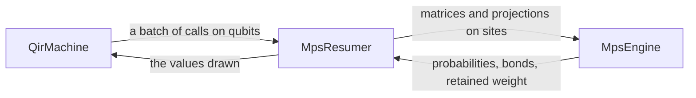

# The MPS simulation method for QIR programs

The [`mps_simulator`](../mps_simulator.rs) module of `qdk_simulators` holds the
MPS simulation method: it runs the QIR programs the QDK compiles on matrix
product states (MPS), which hold many more qubits than a state vector when a
program entangles them little, as chemistry programs such as H₂'s phase
estimation do.

**The problem** is to run the QDK's QIR programs on any MPS engine, present
or future, without changing `qir`'s machine or the engine. `qir`'s machine
runs a program's classical part. It hands each shot's quantum calls, on
qubits, to a [`QirResumer`](../qir/resumer.rs), and branches on the values
the resumer draws and hands back. An MPS engine
([`MpsEngine`](../../../tensornet/src/engine.rs)) holds states on a chain
of [sites](#concepts), applies matrices to them and answers probabilities.
The problem includes:

- placing the program's qubits on the engine's chain of sites;
- turning each call on those qubits, a gate by its name or a measurement,
  into matrices and draws on sites;
- running the shots, which branch on what they draw, without holding a
  state for each shot;
- and, with the shots sharing states, giving each shot the records it
  would get alone, whatever shots run beside it.

**How it is solved.** [`MpsResumer`](../mps_simulator.rs) implements
`QirResumer` once over `MpsEngine`. It places the program's qubits on the
engine's sites, turns each call into steps on sites, and runs the shots
that drew the same values as one [group](#concepts) on one state, forking
the state where their [draws](#concepts) differ. Each shot draws from its
own [RNG](#concepts).

The module holds:

- **the resumer:** [`MpsResumer`](../mps_simulator.rs), which runs a
  program's shots on an engine, with a max bond dimension χ (by default
  [`DEFAULT_MAX_BOND_DIMENSION`](../mps_simulator.rs)), a seed and a stop
  flag;
- **its report:** [`MpsRunReport`](mps_run_report.rs), what the last run cost,
  and its [`TruncationWarning`](mps_run_report/truncation_warning.rs) when
  a shot lost more than [`TRUNCATION_TOLERANCE`](mps_run_report.rs) of its
  weight, for the user to raise χ;
- **its failures:** [`MpsResumerError`](mps_resumer_error.rs), why the
  resumer failed a shot, apart from a trap of its program.

Each file's header gives the rules it implements.

**Why this approach.**

- **Decoupling.** The machine knows nothing of matrix product states, and
  the engine nothing of programs; this module holds everything that maps
  one onto the other.
- **One implementation.** The resumer is written once, and runs on any
  `MpsEngine`. A new engine needs no change here. It gets shots grouped by
  their draws, the qubit order, the stop flag and the truncation report.
  What it must keep is `tensornet`'s contract, which an engine's tests
  check against `tensornet`'s exact reference.
- **One state per group.** The shots that drew the same values share one
  state, forked only where their draws differ. A program whose draws never
  differ runs every shot on at most one state, and a run holds few states
  at once ([How it runs a program](#how-it-runs-a-program) gives the
  bound).
- **Reproducible shots.** A shot's records depend only on the program, the
  seed, its id and the settings, not on the shots run beside it. This holds
  exactly on an engine whose fork is an exact copy and whose operations are
  deterministic, such as `tensornet`'s exact reference. Otherwise it holds
  up to rounding ([`MpsResumer`'s doc](../mps_simulator.rs) says what may
  then differ).

What the two traits require is in [`qir`'s README](../qir/README.md) and
[`tensornet`'s README](../../../tensornet/README.md#the-contract).

## Concepts

The two traits speak different terms: `qir`'s of qubits, calls and shots,
`tensornet`'s of sites, matrices and states. This page uses both. A
**shot**, a **batch** of quantum calls and a shot's **records** are
`qir`'s, defined in [its model](../qir/README.md#the-model).

- **the MPS simulation method**: the simulation method a user picks to run
  a program's shots on matrix product states; `MpsResumer` implements it.
- **run**: one call of `QirResumer::run`, on a program and a list of shots;
  `MpsResumer::last_run` reports the latest.
- **site** and **bond**: an MPS is a chain of tensors, one per site; a bond
  links two neighbouring sites, and its dimension grows with the
  entanglement across it, and with it a run's memory and time.
- **max bond dimension χ**: the cap on every bond. A user raises χ for a
  more accurate run, or lowers it for a faster one.
- **retained weight**: the share of a state's squared norm that the
  engine's truncations kept to stay within χ; 1 when they dropped nothing.
- **qubit order**: which site holds each of the program's qubits.
- **draw**: a shot's value at a measurement or reset: One when a uniform
  number from the shot's own **RNG** (random number generator) is below
  the state's probability of One at that site.
- **group**: the shots of a run that drew the same values so far, which
  share one machine context and one state. Where a group's shots draw both
  values, it splits into two groups, one per value.
- **fork**: a copy of a state, which reads what the state reads (to
  rounding, as `MpsEngine::fork` promises), made where a group splits.

## The model

The resumer bridges `QirMachine`'s terms and `MpsEngine`'s. The diagram
shows what passes between them. The table shows which
[phase](design.md#the-phases-of-a-run) maps each.



| The machine gives                       | The engine takes                                | Phase               |
| --------------------------------------- | ----------------------------------------------- | ------------------- |
| a program of n qubits                   | a chain of n sites, bonds of at most χ          | start; prepare      |
| a gate by its name and angle, on qubits | a matrix on sites                               | qubit order; lower  |
| a measurement or a reset, on a qubit    | the probability of One at a site, a projection  | lower; draw; settle |
| shots, each with a state of its own     | one state per group, and a fork where it splits | split               |

## How it runs a program

- **Once per run**, from the program alone: the chain (one site per qubit,
  bonds of at most χ) and the qubit order.
- **Group by group**, batch by batch: the machine resumes the group's
  context, each call becomes steps on sites, the engine applies each gate
  once to the group's one state, and each shot draws against it.
- **Where a group's shots draw both values**, it splits: the fewer go on,
  and the others wait on a stack with a fork of the state. The last group
  to wait runs first. So a run of N shots holds at most ⌊log₂ N⌋ + 1
  states at once.
- **The report** keeps the largest bond dimension and the least retained
  weight, and warns when a shot lost more weight than
  [`TRUNCATION_TOLERANCE`](mps_run_report.rs). **A stop flag** ends a run
  once the batch under way ends.
- **A failure** fails the shots that share its state. The run names the
  first failing shot in the order of the shots, as `QirResumer::run`
  requires.

[The design notes](design.md#the-phases-of-a-run) give each phase: the
function that does it, how and why, its failures and its engine calls.

## An example

A Bell pair, as [the tests](tests.rs) run it. `bytecode`
writes a program's bytecode in the Adaptive Profile, which
`QirProgram::new` checks; `gate1`, `gate2`, `mz` and `ret` write one
instruction each; `expect_ready` polls a future that is ready at once;
and `results` gives the records of a shot that read the bits given.

```rust
// The program: a Bell pair read into two results, written in the
// Adaptive Profile bytecode, then checked.
let bytecode = bytecode(
    2,
    &[&[gate1(OPID_H, 0), gate2(OPID_CX, 0, 1), mz(0), mz(1), ret()]],
);
let bell = QirProgram::new(bytecode).expect("the Bell pair's bytecode has no fault");
// The resumer, on the exact reference engine, its draws seeded with 7.
let mut resumer = MpsResumer::new(ExactReference::new(), 7);
// One machine runs the program's classical part; the resumer runs the
// quantum calls of its 32 shots, and never waits.
let shots = QirShotId::first(32);
let records =
    expect_ready(resumer.run(&QirMachine::new(&bell), &shots)).expect("the program runs");
assert!(
    records.contains(&results(&[0, 0])) && records.contains(&results(&[1, 1])),
    "32 shots draw both values"
);
// In every shot, the two readouts agree.
assert!(records.iter().all(|shot| shot[0] == shot[1]));
```

## Tests

[The module's tests](tests.rs), and those beside each of its files, check the rules of each phase
through `QirResumer::run`, on an exact engine or on a spy over one that
records the engine's calls and fails them on demand; the qubit order's
search, which no run exposes, is checked by its own tests. All run in
every `cargo test`.

## Platforms

The module runs wherever `qdk_simulators` builds, on the engine its caller
gives.

| Engine                                                                                                               | Where it runs         | Verified on                                                                     |
| -------------------------------------------------------------------------------------------------------------------- | --------------------- | ------------------------------------------------------------------------------- |
| An engine on the host CPU, such as `tensornet`'s exact reference or `canonical_mps`'s `CpuMpsEngine`                 | Linux, macOS, Windows | CI, on `tensornet`'s exact reference                                            |
| An engine on an NVIDIA GPU, such as `cutensornet`'s [`CudaMpsEngine`](../../../cutensornet/README.md#the-mps-engine) | Linux x86-64          | an A100 80GB: H₂'s iterative phase estimation on `CudaMpsEngine`; CI has no GPU |

## Further reading

- [The design notes](design.md): each phase of a run, how a run fails,
  the engine calls, and what is deliberately not here.
- [`qir`'s README](../qir/README.md): the machine, its model and the
  `QirResumer` contract.
- [`tensornet`'s README](../../../tensornet/README.md#the-contract): the
  `MpsEngine` contract.
