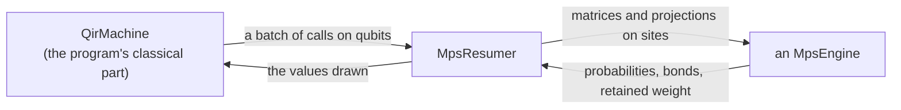

# The MPS simulation method for QIR programs

The [`mps_simulator`](../mps_simulator.rs) module of `qdk_simulators` holds the
MPS simulation method: it runs the QIR programs the QDK compiles on matrix
product states (MPS), which hold many more qubits than a state vector when a
program entangles them little, as chemistry programs such as H₂'s phase
estimation do.

**The problem.** `qir`'s machine runs a program's classical part and hands
each shot's quantum calls, on qubits, to a [`QirResumer`](../qir/resumer.rs);
an MPS engine ([`MpsEngine`](../../../tensornet/src/engine.rs)) holds states
and takes matrices on sites, with no gate names, no measurements and no
shots. A program's shots also branch on their measurements, so they share
a state only as long as they drew the same values.

**How it is solved.** [`MpsResumer`](../mps_simulator.rs) implements
`QirResumer` once over `MpsEngine`. It places the program's qubits on the
engine's sites, turns each call into steps on sites, and runs the shots
that drew the same values as one group on one state, forking the state
where their draws differ. Each shot draws from its own stream, so its
records are those it would get alone: exactly on an engine whose fork is an
exact copy, such as `tensornet`'s exact reference, and otherwise to
rounding (what may then differ is in
[`MpsResumer`'s doc](../mps_simulator.rs)).

**Why this approach.**

- **Decoupling.** The machine knows nothing of matrix product states, and
  the engine nothing of programs; this module holds everything that maps
  one onto the other.
- **One implementation.** The resumer is written once, and runs on any
  `MpsEngine`: a new engine needs no change here.
- **Paying only for distinct histories.** A run costs what its distinct
  histories cost: one state for a program with no random draw, one per
  shot at most.
- **Reproducible shots.** A shot's records depend only on the program, the
  seed, its id and the settings, not on the shots run beside it (beyond
  rounding, on some engines, as above).

What the two traits require is in [`qir`'s README](../qir/README.md) and
[`tensornet`'s README](../../../tensornet/README.md#the-contract).

## Terms

The two traits speak different terms, `qir`'s of qubits, calls and shots,
`tensornet`'s of sites, matrices and states; this page uses both. A
**shot**, a **batch** of quantum calls and a shot's **records** are
`qir`'s, defined in [its model](../qir/README.md#the-model).

- **the MPS simulation method**: the simulation method a user picks to run
  a program's shots on matrix product states; `MpsResumer` implements it.
- **site** and **bond**: an MPS is a chain of tensors, one per site; a bond
  links two neighbouring sites, and its dimension grows with the
  entanglement across it, and with it a run's memory and time.
- **max bond dimension χ**: the cap on every bond. A user raises χ for a
  more accurate run, or lowers it for a faster one.
- **retained weight**: the share of a state's squared norm that the
  engine's truncations kept to stay within χ; 1 when they dropped nothing.
- **qubit order**: which site holds each of the program's qubits.
- **draw**: a shot's value at a measurement or reset: One when a uniform
  number from the shot's own **stream** is below the state's probability
  of One at that site.
- **group**: the shots of a run that drew the same values so far, which
  share one machine context and one state.
- **fork**: a copy of a state, which reads what the state reads (to
  rounding, as `MpsEngine::fork` promises), made where a group's shots
  drew both values.

## The model

The machine hands over each batch of calls in the program's terms and
wants each measurement's value back; the engine is called on sites and
answers with probabilities. The resumer bridges the two:



| The machine gives                       | The engine takes                                | Phase               |
| --------------------------------------- | ----------------------------------------------- | ------------------- |
| a program of n qubits                   | a chain of n sites, bonds of at most χ          | start; prepare      |
| a gate by its name and angle, on qubits | a matrix on sites                               | qubit order; lower  |
| a measurement or a reset, on a qubit    | the probability of One at a site, a projection  | lower; draw; settle |
| shots, each with a state of its own     | one state per group, and a fork where it splits | split               |

## How it runs a program

`QirResumer::run` runs a program's shots through these phases, named as in
[the design notes](design.md#the-phases-of-a-group). Start and the qubit
order run once per run; the other phases run for each group, until its
shots' contexts end.

| Phase                                         | How                                                                                                                                                                                                                                                                                                                                                             | Why                                                                                                                                                                                                                                                                     |
| --------------------------------------------- | --------------------------------------------------------------------------------------------------------------------------------------------------------------------------------------------------------------------------------------------------------------------------------------------------------------------------------------------------------------- | ----------------------------------------------------------------------------------------------------------------------------------------------------------------------------------------------------------------------------------------------------------------------- |
| **start** and **qubit order**                 | Once per run, from the program alone, before any shot: the chain is set, one site per qubit with bonds of at most χ, and a χ that makes no chain fails the run's first shot; a local search places qubits that share two-qubit gates on nearby sites, and keeps the identity unless another order spans less.                                                   | An engine applies a gate on distant sites at more cost, and each bond depends on which qubits sit on its two sides. On an engine that does not truncate, every order holds the same state, to rounding; on one that truncates, the order can change it beyond rounding. |
| **prepare**                                   | At a group's first gate or draw, the engine prepares a state of all zeros on that chain.                                                                                                                                                                                                                                                                        | A shot with no quantum call costs no state.                                                                                                                                                                                                                             |
| **resume** and **lower**                      | The machine runs the group's context to its next batch, and each call becomes steps on sites, through the qubit order: a gate its matrix, a measurement or reset a draw, one in X or Y a draw between the gates that turn its basis into Z and back. A noise or loss call, or a gate on one qubit twice, fails the shot that reaches it.                        | The engine knows only matrices and sites. Noise on matrix product states is planned; refused at the call, noise on a path no shot takes fails nothing.                                                                                                                  |
| **apply**, **draw**, **split** and **settle** | The engine applies each gate once to the group's one state, and each shot of the group draws against it. When its shots drew both values, the part with fewer shots goes on (on a tie, the part that drew Zero), and the other waits with a fork of the state; each part's state is projected on its value.                                                     | A fork copies the state, so each shot records what it would alone (to rounding, on some engines). A run of N shots holds at most ⌊log₂ N⌋ + 1 states at once, which bounds a GPU's memory.                                                                              |
| **read bond** and **end**                     | The largest bond is read where a run of gates ends, and each shot's retained weight where its context ends; the run's report (`MpsResumer::last_run`) keeps the largest and the least, and warns on a low weight.                                                                                                                                               | The bond is what χ caps; the weight estimates the fidelity, so the user knows when to raise χ.                                                                                                                                                                          |
| **stop**                                      | A stop flag is read before a group first runs, before a group split off by a draw runs on, and after each resume that gives a batch or a trap, before the batch is lowered or the trap reported. Once set before a batch a shot has not started, the run fails, naming the first shot that had not ended; a run whose every shot has ended returns its records. | A user who interrupts a run of hours gets it back, its states freed. A Base Profile program is one batch, so once its gates start, all of them run before the flag is read again.                                                                                       |

A failure (a trap of the program, a refused call, or the engine's) fails
the shots that share the state it was met on, and the run names the
first failing shot in the order of the shots, as `QirResumer::run`
requires. `run` never waits: engine calls return when done, so its future
is ready at once.

Each phase's mechanics, its failures, and the engine calls it makes are in
[the design notes](design.md).

## An example

A Bell pair, as [the tests](../tests/mps_simulator.rs) run it. `bytecode`
writes a program's bytecode in the Adaptive Profile, which
`QirProgram::new` checks; `gate1`, `gate2`, `mz` and `ret` write one
instruction each; `expect_ready` polls a future that is ready at once;
and `results` gives the records of a shot that read the bits given.

```rust
// The program: a Bell pair read into two results, written in the
// Adaptive Profile bytecode, then checked.
let bytecode = bytecode(
    2,
    &[&[gate1(OPID_H, 0), gate2(OPID_CX, 0, 1), mz(0), mz(1), ret()]],
);
let bell = QirProgram::new(bytecode).expect("the Bell pair's bytecode has no fault");
// The resumer, on the exact reference engine, its draws seeded with 7.
let mut resumer = MpsResumer::new(ExactReference::new(), 7);
// One machine runs the program's classical part; the resumer runs the
// quantum calls of its 32 shots, and never waits.
let shots = QirShotId::first(32);
let records =
    expect_ready(resumer.run(&QirMachine::new(&bell), &shots)).expect("the program runs");
assert!(
    records.contains(&results(&[0, 0])) && records.contains(&results(&[1, 1])),
    "32 shots draw both values"
);
// In every shot, the two readouts agree.
assert!(records.iter().all(|shot| shot[0] == shot[1]));
```

## Which type for what

| Type                                                                         | A caller uses it to                                                                   |
| ---------------------------------------------------------------------------- | ------------------------------------------------------------------------------------- |
| [`MpsResumer`, `DEFAULT_MAX_BOND_DIMENSION`](../mps_simulator.rs)            | run a program's shots on an engine, with a max bond dimension, a seed and a stop flag |
| [`MpsRunReport`, `TruncationWarning`, `TRUNCATION_TOLERANCE`](run_report.rs) | learn what the last run cost, and whether its truncations lost enough to raise χ      |
| [`MpsResumerError`](error.rs)                                                | learn why the resumer failed a shot, apart from a trap of its program                 |

Each file's header gives the rules of its part.

## Planned

Each item names a case that needs it; [the design notes](design.md#planned)
give each in detail.

- **Noise and loss** on matrix product states, the calls refused today in
  [`lowering.rs`](lowering.rs), with a noise model setting. Its case: a
  logical Bell test on 56 qubits with Pauli noise and loss.
- **Queries** of the state, such as expectations of Pauli sums. Its case: a
  chemistry user's energy estimate ⟨H⟩, read without shots.
- **The sampled form**, a program whose classical part does not depend on
  its measurements run once, and every shot sampled from it. Its case:
  many shots of a Base Profile program at the cost of one.
- **The measurements that end a batch, drawn from one state**, without a
  fork per distinct value. Its case: a variational ansatz's final readout.
- **Groups run in parallel** on CPU threads. Its case: a polyene chain,
  whose 1,000 shots split into many histories.
- **A result per shot**, so one failed shot does not lose the others. Its
  case: a long GPU run that one transient out-of-memory error ends.
- **A resumer conformance kit**: the tests that hold for any `QirResumer`,
  run on every resumer. Its case: a device's resumer, which would be the
  second implementation of `QirResumer`.

## Tests

[The module's tests](../tests/mps_simulator/) check the rules of each phase
through `QirResumer::run`, on an exact engine or on a spy over one that
records the engine's calls and fails them on demand, in every
`cargo test`.

## Platforms

The module runs wherever `qdk_simulators` builds, on the engine its caller
gives.

| Engine                                                                                               | Where it runs         | Tests run here                            |
| ---------------------------------------------------------------------------------------------------- | --------------------- | ----------------------------------------- |
| An engine on the host CPU, such as `tensornet`'s exact reference or `canonical_mps`'s `CpuMpsEngine` | Linux, macOS, Windows | on `tensornet`'s exact reference          |
| An engine on an NVIDIA GPU, over cuTensorNet ([its loading](../../../cutensornet/README.md))         | Linux x86-64          | none: a GPU run is the engine's to verify |
