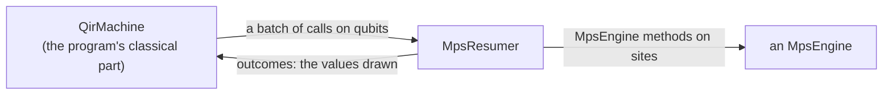
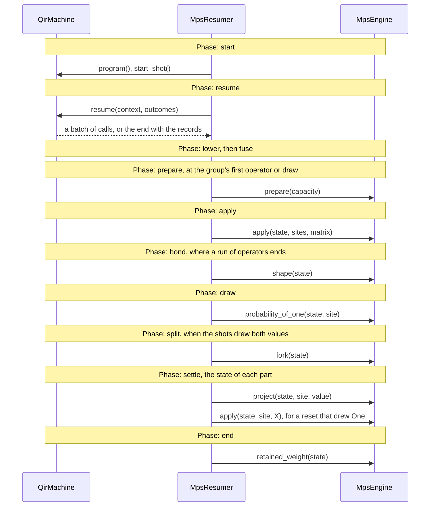

# The MPS simulator of QIR programs

The [`mps_simulator`](../mps_simulator.rs) module of `qdk_simulators` lets
the QDK simulate the QIR programs it compiles on matrix product states
(MPS), which hold many more qubits than a state vector when a program
entangles them little, as chemistry programs such as H₂'s phase
estimation (29 qubits) do. Its [`MpsResumer`](resumer.rs) implements
`qir`'s [`QirResumer`](../qir/resumer.rs) once over `tensornet`'s
[`MpsEngine`](../../../tensornet/src/engine.rs), so it runs on any engine
(for instance `tensornet`'s exact reference, or cuTensorNet's on a GPU),
and a new engine needs no change here. What the two traits require is in
[`qir`'s README](../qir/README.md),
[`tensornet`'s README](../../../tensornet/README.md#the-contract) and their
rustdoc; this page says how this simulator implements `QirResumer` over
`MpsEngine`, and why. The details are in the code, each file's header
first.

The module's tests, in
[`src/tests/mps_simulator/`](../tests/mps_simulator/), check each row of
[the concerns' table](#how-each-concern-of-qirresumerrun-is-met) on
`tensornet`'s exact reference engine, in every `cargo test`.

## Terms

The two traits speak different terms, `qir`'s of qubits, calls and shots,
`tensornet`'s of sites, matrices and states; this page uses both:

- **MPS simulation method**: the algorithm that runs a program's gates,
  measurements and shots on an MPS. This module is the MPS simulation
  method of `qdk_simulators`.
- **`MpsEngine` method**: an operation the trait declares and engines
  implement (`apply`, `project`, `probability_of_one`, …). The MPS
  simulation method calls them.
- **machine**, **context** and **batch** (`qir`'s): the machine runs a
  program's classical part, one context per shot, and stops a context at
  each batch of its quantum calls, and at its end with the shot's records.
- **site**: a place on the engine's chain. The **qubit order** says which
  site holds each of the program's qubits.
- **capacity**: the chain a state is prepared within, one site per qubit
  and bonds of at most the max bond dimension χ.
- **operator**: a unitary matrix on one or two sites, which the engine
  applies.
- **draw**: a shot's value at a measurement or reset, One when a uniform
  from the shot's own stream is below the state's P(One).
- **group**: the shots of a run that drew the same values so far, which
  share one context and one state.

## Phases

A run starts with one group of every shot; each group runs through these
phases, and a split adds a group that waits its turn:

- **start**: once per run, before any shot: the qubit order and the
  capacity, from the program.
- **resume**: the machine runs the group's context to its next batch, or
  to its end.
- **lower**: the batch's calls become operators and draws on sites.
- **fuse**: each run of operators between two draws is multiplied into
  fewer, larger ones, unless gate fusion is off.
- **prepare**: at the group's first operator or draw, a state of all zeros
  within the capacity.
- **apply**: an operator, on the group's state.
- **bond**: where a run of operators ends, before a draw or a resume, the
  state's largest bond is read, for the report.
- **draw**: the state's P(One) of the site is read once, and each shot of
  the group draws.
- **split**: when the shots drew both values, the part with fewer shots
  goes on (Zero's on a tie), and the other waits, with a fork of the state
  and a copy of the context.
- **settle**: each part's state is projected on its value, and a reset
  that drew One flips the site back to |0⟩.
- **end**: the context ended: the state's retained weight is read, and
  the group's records are each of its shots'.

## What this simulator bridges

The machine hands over each shot's quantum calls in the program's terms,
and wants each measurement's value back; the engine is called through
`MpsEngine` methods on sites, and answers with probabilities:



| The machine gives (`qir`)               | The engine takes (`tensornet`)                | [Phases](#phases)  |
| --------------------------------------- | --------------------------------------------- | ------------------ |
| a program of n qubits                   | a capacity                                    | start; prepare     |
| a gate by its name and angle, on qubits | an operator on sites                          | lower; fuse; apply |
| a measurement or a reset, on a qubit    | P(One) of a site, and a projection on a value | draw; settle       |
| shots, each with a state of its own     | states, and forks of a state                  | split              |

## How it runs a program

### How each concern of `QirResumer::run` is met

Each row is one thing a run must settle between the two traits, with the
file that holds its mechanics.

| Concern                                                                                           | Phases                         | How                                                                                                                                                                                                                                                                                          | Why                                                                                                                                                                                                                                                             |
| ------------------------------------------------------------------------------------------------- | ------------------------------ | -------------------------------------------------------------------------------------------------------------------------------------------------------------------------------------------------------------------------------------------------------------------------------------------- | --------------------------------------------------------------------------------------------------------------------------------------------------------------------------------------------------------------------------------------------------------------- |
| **Qubits on a chain** ([`order.rs`](resumer/order.rs))                                            | start; lower                   | a local search places qubits that share two-qubit gates close on the chain, weighing the gates whose qubits the program names before any run; each call reaches the engine on its qubits' sites                                                                                              | an MPS is a chain: a gate on distant sites is routed through swaps, and each bond depends on which qubits fall on each side of it; every order holds the same state, so no record depends on it, and no caller sees sites                                       |
| **Gates as matrices** ([`lowering.rs`](resumer/lowering.rs))                                      | lower                          | each gate is its matrix at its angle, in the engine's layout, on its qubits' sites in its operand order; `move` is no operator                                                                                                                                                               | the engine knows no gate names and no qubits, only matrices and sites                                                                                                                                                                                           |
| **Calls it does not run** ([`lowering.rs`](resumer/lowering.rs), [`error.rs`](error.rs))          | lower                          | correlated noise, readout noise and loss checks fail the shot that reaches them, as does a two-qubit gate on one qubit twice                                                                                                                                                                 | noise and loss on matrix product states are [planned](#planned); refused at the call, so a program whose noise is on a path no shot takes runs; no matrix on two distinct sites applies a gate on one qubit twice, and the machine does not check it            |
| **Fewer operators** ([`fusion.rs`](fusion.rs))                                                    | fuse; apply                    | `GateFusion::Pairs`, the default, multiplies each run of gates into operators on one or two sites; `GateFusion::Unfused` keeps one operator per gate                                                                                                                                         | an engine's time goes to its operators (the timings are in `fusion.rs`); the product is the same, to rounding, and within the truncation error on an engine that truncates                                                                                      |
| **The capacity** ([`resumer.rs`](resumer.rs))                                                     | start; prepare                 | `MpsShape::qubit_chain` of the program's qubits and χ (`with_max_bond_dimension`, [`DEFAULT_MAX_BOND_DIMENSION`](resumer.rs) by default); qubits and a χ that make no chain fail the run's first shot; a program of no qubits prepares no state                                              | the `MpsEngine` trait takes only a capacity, within which an engine that truncates keeps its bonds; the cutoff below which it drops singular values is its own setting; a group prepares its state at its first need, so a shot with no quantum call costs none |
| **Draws** ([`splitmix64.rs`](resumer/splitmix64.rs), `shot_stream` in [`resumer.rs`](resumer.rs)) | draw                           | P(One) is read once per group; each shot draws a uniform from its own `SplitMix64` stream, seeded from the resumer's seed and the shot's id                                                                                                                                                  | the contract: a shot's records depend neither on the other shots nor on its place among them nor on earlier runs; a shot draws once per measurement and reset, whatever group it is in                                                                          |
| **Shared states** ([`resumer.rs`](resumer.rs))                                                    | draw; split                    | shots that drew the same values share one state; a split forks it after P(One) is read, before either part settles                                                                                                                                                                           | a run costs what its distinct histories cost: one state for a program with no random draw, one per shot at most; a fork is exact, so each part's state is the one a shot alone would hold                                                                       |
| **Few states at once** ([`resumer.rs`](resumer.rs))                                               | split                          | the part with fewer shots goes on, and the other waits on a stack until the part that went on ends                                                                                                                                                                                           | the states held at once grow at most as the logarithm of the shots (the bound is in `resumer.rs`'s header), which bounds a GPU's memory whatever the program draws                                                                                              |
| **Measurements and resets** ([`resumer.rs`](resumer.rs))                                          | settle                         | the state is projected on the value drawn (`project`), then a reset that drew One applies X; a measurement's result is answered with the value                                                                                                                                               | the engine has no measurement and no reset, only probabilities, projections and operators                                                                                                                                                                       |
| **Failures** ([`resumer.rs`](resumer.rs), [`error.rs`](error.rs))                                 | every phase but fuse           | a shot fails with its group: its context traps, a call is refused, or the engine fails; a failed fork or projection at a split fails the waiting part only; the run names the first failing shot in the order of the shots, and drops unrun the waiting groups whose shots all come after it | the contract names the first failing shot whatever order the shots run in; the groups dropped could not change that name                                                                                                                                        |
| **The report** ([`report.rs`](report.rs))                                                         | bond; end                      | the last run's largest bond and least retained weight among the shots that ended (`last_run`), and a warning when a shot lost more than `TRUNCATION_TOLERANCE`                                                                                                                               | a max bond dimension makes a run an approximation, and the retained weight bounds its error, so the user knows when to raise χ; the bond is read before the draws, which may shrink it                                                                          |
| **No waiting** ([`resumer.rs`](resumer.rs))                                                       | every phase, at the first poll | `run` runs every group when its future is first polled, so the future is ready at once                                                                                                                                                                                                       | `MpsEngine` methods return when done, so this simulator has nothing to wait on; the contract is async for resumers that wait on a device                                                                                                                        |

### The `MpsEngine` methods of each phase

Each band of the diagram is one phase, with its calls in order; lower and
fuse call no `MpsEngine` method:



## The model, and an example

The public types, each linked to the file that says how it works:

- [`MpsResumer`](resumer.rs): the resumer, its settings
  (`with_max_bond_dimension`, `with_gate_fusion`) and the grouped run.
- [`GateFusion`](fusion.rs): `Pairs` (the default) or `Unfused`.
- [`MpsRunReport`, `TruncationWarning`](report.rs): the last run's
  largest bond and least retained weight, and the warning.
- [`MpsResumerError`](error.rs): why a shot failed, apart from a trap of
  its program.

A Bell pair, as the tests run it
([`src/tests/mps_simulator/resumer.rs`](../tests/mps_simulator/resumer.rs);
`program` writes the bytecode, and `expect_ready` polls a future that is
ready at once):

```rust
// The program: a Bell pair read into two results, in the bytecode the
// tests write.
let bell = program(
    2,
    &[&[gate1(OPID_H, 0), gate2(OPID_CX, 0, 1), mz(0), mz(1), ret()]],
);
// The resumer, on the exact reference engine, its draws seeded with 7.
let mut resumer = MpsResumer::new(ExactReference::new(), 7);
// One machine runs the program's classical part; the resumer runs the
// quantum calls of its 32 shots, and never waits.
let shots = QirShotId::first(32);
let records =
    expect_ready(resumer.run(&QirMachine::new(&bell), &shots)).expect("the program runs");
// In every shot, the two readouts agree.
assert!(records.iter().all(|shot| shot[0] == shot[1]));
```

## Planned

Each item names a case that needs it:

- **Noise and loss on matrix product states:** the calls this simulator
  does not run yet, and a noise model set on a simulator, which has no
  counterpart here. Its case: a logical Bell test on 56 qubits with Pauli
  noise and loss.
- **The sampled form:** a program that does not continue after a batch
  run once, its readout drawn for every shot with `MpsEngine::sample`. Its
  case: sampling a Base Profile program's many shots at the cost of one.
- **Queries** of the state (expectations of Pauli sums, the chain's cost).
  Its case: a chemistry user's energy estimate $\langle H \rangle$ read
  without shots.
- **Groups run in parallel** on CPU threads. Its case: the polyene of the
  chemistry case, whose 1,000 shots split into many histories.
