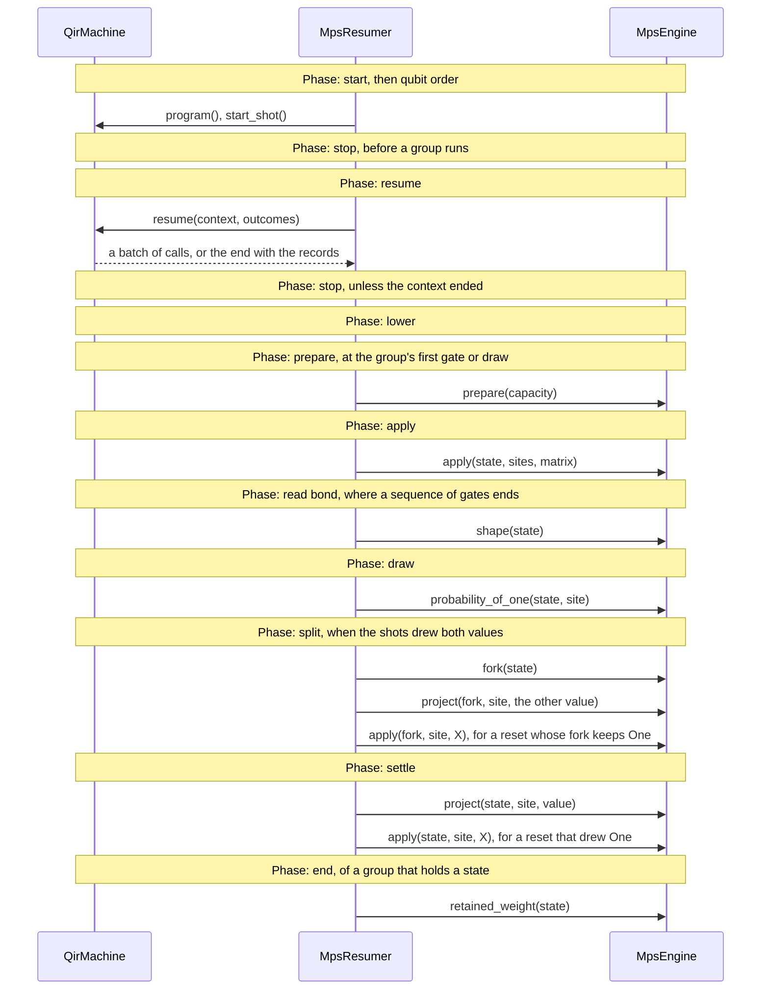

# The MPS simulation method: design notes

The [README](README.md) gives the ideas of a run. Each file's header gives
the rules it implements. This page gives what lies between: each phase of
a run, how and why; how a run fails; the methods of `QirMachine` and
`MpsEngine` each phase calls; and what is deliberately left out, each with
the case that would need it.

## The phases of a run

A run starts once, then runs each of its groups through the phases below
until the group's context ends. A split adds a group that waits its turn.
Each phase is done by the function or call named. The run's loop (start,
stop, resume) is in [`grouped_run.rs`](grouped_run.rs). The phases on a
group's state, from prepare to end, are in
[`grouped_run/site_steps.rs`](grouped_run/site_steps.rs). The other phases
name their file.

| Phase           | Done by                                                                                                      | How                                                                                                                                                                                                                                                                  | Why                                                                                                                                                                                                                                                                               |
| --------------- | ------------------------------------------------------------------------------------------------------------ | -------------------------------------------------------------------------------------------------------------------------------------------------------------------------------------------------------------------------------------------------------------------- | --------------------------------------------------------------------------------------------------------------------------------------------------------------------------------------------------------------------------------------------------------------------------------- |
| **start**       | `GroupedRun::start`, once per run of one shot or more                                                        | Sets the capacity, `MpsShape::qubit_chain` of the program's qubits and χ (`MpsResumer::with_max_bond_dimension`, [`DEFAULT_MAX_BOND_DIMENSION`](../mps_simulator.rs) by default). Makes one group of every shot. A χ that makes no chain fails the run's first shot. | Every state of a run has the same capacity, known from the program alone.                                                                                                                                                                                                         |
| **qubit order** | `QubitOrder::for_program`, in [`qubit_order.rs`](qubit_order.rs), by start                                   | Weighs the two-qubit gates whose qubits the program names, not those of a register, unknown before a shot. A local search places qubits that share gates on nearby sites, and keeps the identity unless another order spans less.                                    | An engine applies a gate on distant sites at more cost, and each bond depends on which qubits sit on its two sides. Up to rounding, every order holds the same state on an engine that does not truncate (the file's header). No caller sees sites.                               |
| **stop**        | `check_stop_flag`, by `run_group`                                                                            | Reads the stop flag where `MpsResumer::with_stop_flag` says. Read set, it fails the run. A context that ended keeps its records.                                                                                                                                     | A user who interrupts a run of hours gets it back once the batch under way ends, its states freed.                                                                                                                                                                                |
| **resume**      | `QirMachine::resume`, by `run_group`                                                                         | The machine runs the group's context to its next batch, or to its end with the shots' records, given the outcomes of the batch before.                                                                                                                               | The machine runs the program's classical part, once for the group's shots.                                                                                                                                                                                                        |
| **lower**       | `lower`, in [`lowering.rs`](lowering.rs)                                                                     | Each call of the batch becomes steps on sites, through the qubit order: a gate its matrix, a measurement or reset a draw, one in X or Y a draw between the gates that turn its basis into Z and back. `move` changes no state, so it is no step.                     | The engine knows no gate names and no measurement: only matrices, probabilities and projections. A noise or loss call, or a gate on one qubit twice, fails the shot that reaches it. So noise on a path no shot takes fails nothing ([not here](#what-is-deliberately-not-here)). |
| **prepare**     | `prepare`                                                                                                    | At the group's first gate or draw, the engine prepares a state of all zeros within the capacity. A program of no qubits prepares none.                                                                                                                               | A shot with no quantum call costs no state.                                                                                                                                                                                                                                       |
| **apply**       | `apply`                                                                                                      | The engine applies each gate to the group's one state, one call for the group.                                                                                                                                                                                       | A gate costs one engine call however many shots the group holds.                                                                                                                                                                                                                  |
| **read bond**   | `read_bond`                                                                                                  | Where a sequence of gates ends, before a draw or a resume, reads the state's largest bond dimension. The report ([`mps_run_report.rs`](mps_run_report.rs)) keeps the run's largest.                                                                                  | The bond is what χ caps. It is read before the draws, which may shrink it.                                                                                                                                                                                                        |
| **draw**        | `draw`                                                                                                       | Reads the state's probability of One at the site once per group. Each shot draws a uniform from its own RNG ([`shot_rng.rs`](shot_rng.rs)), and reads One when it is below that probability.                                                                         | A shot draws once per measurement and reset, whatever group it is in. So its records are those it gets alone (`MpsResumer`'s doc, in [`mps_simulator.rs`](../mps_simulator.rs), says to what precision).                                                                          |
| **split**       | `take_draws` then `split`, with `value_going_on` in [`grouped_run/shot_group.rs`](grouped_run/shot_group.rs) | When the shots drew both values, the group splits into two, one per value. The fewer go on (on a tie, those that drew Zero). The others wait on a stack, with a copy of the context and a fork of the state, made after the probability is read.                     | A fork copies the state, so each shot records what it would alone. As the larger group waits, each waiting group has at least as many shots as all the groups above it. So a run of N shots holds at most ⌊log₂ N⌋ + 1 states at once, which bounds a GPU's memory.               |
| **settle**      | `settle`                                                                                                     | Projects each group's state on its value. Then a reset that drew One applies X.                                                                                                                                                                                      | Each group goes on with the state its shots' draw left.                                                                                                                                                                                                                           |
| **end**         | `end`                                                                                                        | Once the context ended, reads the state's retained weight. The report keeps the run's least. The group's records are each of its shots'.                                                                                                                             | The weight estimates the fidelity, so the user knows when to raise χ. It is not a bound ([`mps_run_report.rs`](mps_run_report.rs) says when it bounds a readout).                                                                                                                 |

## How a run fails

A shot fails with the shots that share its state when the failure is met,
in any phase from resume to end: its context traps, a call is refused (by
the resumer or the engine), or the engine fails. None of those shots can
go on past the call. After the engine's own failure the state is
unspecified, so the group is dropped with it:

- a failed fork fails the whole group, before its shots split;
- a failure settling the fork (the projection, and a reset's X) fails only
  the group that was to wait, and drops the fork.

Before any group runs, start fails the run's first shot when the qubits
and χ make no chain. The run names the first failing shot in the order of
the shots, whatever order they run in, and drops what could not change
that name: a waiting group whose shots all come after it is dropped unrun,
and a running group stops after the step whose split leaves it only shots
that come after it. A stop flag read set fails the run with `Stopped`,
naming the first shot that had not ended.

## The calls of each phase

Each band of the diagram is a phase, with its calls in order. The qubit
order runs within start, so the two share a band. The qubit order, stop
and lower call no `MpsEngine` method:

## What is deliberately not here

Each item is left out until a case needs it; the case named is the one
that would.

- **Noise and loss on matrix product states:** the calls `MpsResumer`
  refuses (correlated noise, readout noise and a qubit's loss check), and a
  noise model given to it, as the other simulators of this crate take one,
  which may also charge idle noise and loss on `move`. Its case: a logical
  Bell test on 56 qubits with Pauli noise and loss.
- **Queries** of the state: expectations of Pauli sums, and the chain's
  cost. Its case: a chemistry user's energy estimate ⟨H⟩, read without
  shots.
- **The sampled form:** a program whose classical part does not depend on
  its measurements, run once, its readout drawn for every shot with
  `MpsEngine::sample`. Its case: many shots of a Base Profile program at
  the cost of one.
- **The measurements that end a batch, drawn from one state:** each shot
  draws against its group's one state
  (`MpsEngine::conditional_probability_of_one`), with no fork and no
  projection. Its case: a variational ansatz's final readout.
- **Groups run in parallel** on CPU threads. Its case: a polyene chain,
  whose 1,000 shots split into many groups.
- **Each shot's probability:** the log-probability of the records a shot
  drew. Its case: a verifier weighing the shots it reads by their
  likelihood.
- **A result per shot**, its records or its error, where `QirResumer::run`
  gives none when one shot fails. Its case: a long GPU run that one
  transient out-of-memory error ends.
- **A resumer conformance kit:** the tests that hold for any `QirResumer`
  (each shot's records at its place, the same to rounding whichever shots
  run beside it; the first failing shot named), written once in `qir` and
  run on every resumer. Its case: a device's resumer, which would be the
  second implementation of `QirResumer`. The rules of the seed and the
  stop flag are `MpsResumer`'s, not the contract's, and stay in this
  module's tests.
