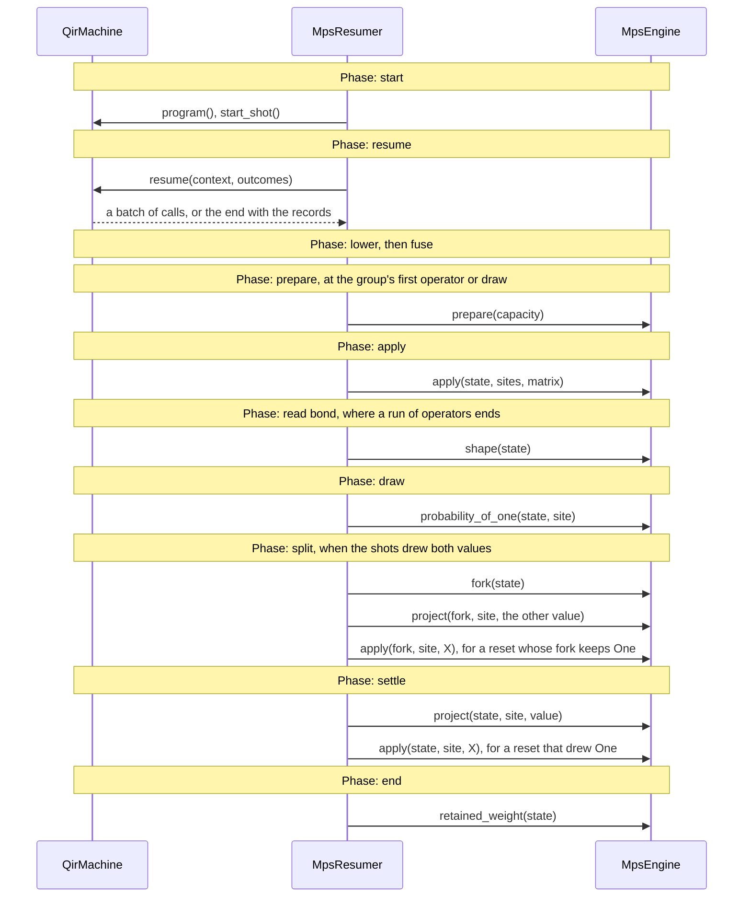

# The MPS simulator: design notes

The [README](README.md) gives the phases of a run, what each does and
why. Each file's header gives the rules of its part. This page adds what
neither holds: the methods of `QirMachine` and `MpsEngine` that each phase
calls, in order.

## The calls of each phase

Each band of the diagram is one phase, with its calls in order; lower and
fuse call no `MpsEngine` method:

