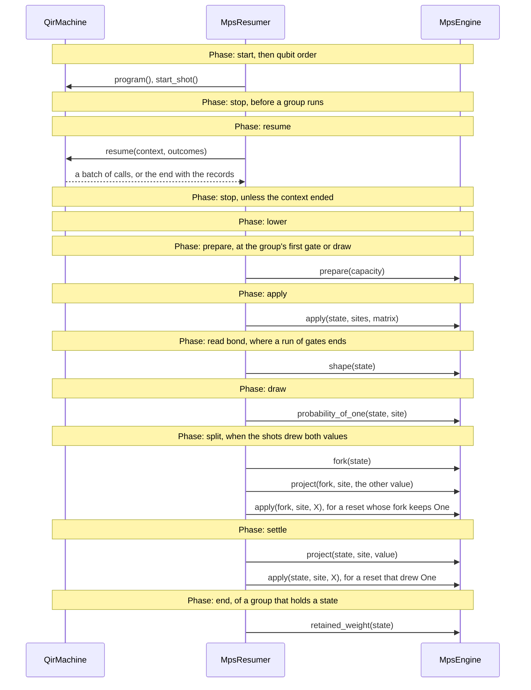

# The MPS simulation method: design notes

The [README](README.md) gives the phases of a run, what each does and why,
at a high level. Each file's header gives the rules it implements. This page
gives what lies between: each phase's steps in a group, how a run fails,
the methods of `QirMachine` and `MpsEngine` each phase calls, and the
planned items in detail.

## The phases of a group

A run starts once, then runs each of its groups through the phases below
until the group's context ends; a split adds a group that waits its turn.
Each phase names, in parentheses, the function or call that does it, in
[`grouped_run.rs`](grouped_run.rs) unless it names another file. The
[README](README.md#how-it-runs-a-program)'s rows group these phases under
the same names.

- **start** (`GroupedRun::start`), once per run of one shot or more: the
  capacity, `MpsShape::qubit_chain` of the program's qubits and χ
  (`MpsResumer::with_max_bond_dimension`, `DEFAULT_MAX_BOND_DIMENSION` by
  default), and one group of every shot. The engine contract takes only a
  capacity, within which an engine that truncates keeps its bonds (the
  cutoff: `MpsResumer`'s doc).
- **qubit order** (`QubitOrder::for_program`, in
  [`qubit_order.rs`](qubit_order.rs)), called by start: it weighs the
  two-qubit gates whose qubits the program names (not those of a
  register, unknown before a shot), and searches for an order of a smaller
  span. Every order holds the same state (to what precision: the file's
  header). No caller sees sites.
- **stop** (`check_stop_flag`, called by `run_group`): a stop flag
  (`MpsResumer::with_stop_flag`) is read before a group runs its steps
  (when it first runs, when a group split off by a draw runs on, and once
  each batch is lowered), and after each resume that gives a batch or a
  trap (before the batch is lowered, or the trap reported); read set, it
  fails the run; a context that ended keeps its records.
- **resume** (`QirMachine::resume`, called by `run_group`): the machine
  runs the group's context to its next batch, or to its end with the
  shot's records, given the outcomes of the batch before.
- **lower** (`lower`, in [`lowering.rs`](lowering.rs)): each call of the
  batch becomes a step on sites. `move` changes no state, so it is no step
  (a noisy simulator may charge it with idle noise or loss, planned).
- **prepare** (`prepare`): at the group's first gate or draw, the engine
  prepares a state of all zeros within the capacity; a program of no
  qubits prepares none.
- **apply** (`apply`): the engine applies each gate to the group's one
  state, one call for the group.
- **read bond** (`read_bond`): where a run of gates ends, before a draw or
  a resume, the state's largest bond is read, and kept in the report
  ([`run_report.rs`](run_report.rs)) when it is the largest of the run so
  far. It is read before the draws, which may shrink it.
- **draw** (`draw`): the state's probability of One at the site is read
  once per group; each shot draws a uniform from its own stream
  ([`shot_stream.rs`](shot_stream.rs)) and reads One when it is below that
  probability. A shot draws once per measurement and reset, whatever group
  it is in, so its records are those it gets alone (to what precision:
  `MpsResumer`'s doc, in [`mps_simulator.rs`](../mps_simulator.rs)).
- **split** (`split`, with `value_going_on`): when the shots drew both
  values, the group splits into two groups, one per value: the smaller
  goes on (on a tie, the one that drew Zero), and the other waits on a
  stack, with a copy of the context and a fork of the state, made after
  the probability is read. As the larger group waits, each waiting group
  has at least as many shots as all the groups above it, so a run of N
  shots holds at most ⌊log₂ N⌋ + 1 states at once.
- **settle** (`settle`): each group's state is projected on its value, then
  a reset that drew One applies X. The engine has no measurement and no
  reset, only probabilities, projections and matrices.
- **end** (`end`): the context ended; the state's retained weight is read,
  and kept in the report when the least of the run; the group's records
  are each of its shots'. The weight is an estimate of the fidelity, not a
  bound ([`run_report.rs`](run_report.rs) says when it bounds a readout).

## How a run fails

A shot fails with the shots that share its state when the failure is met,
in any phase from resume to end: its context traps, a call is refused, or
the engine fails. The engine leaves a state unspecified after it fails, so
the group is dropped with it:

- a failed fork fails the whole group, before its shots split;
- a failure settling the fork (the projection, and a reset's X) fails only
  the group that was to wait, and drops the fork.

Before any group runs, start fails the run's first shot when the qubits
and χ make no chain. The run names the first failing shot in the order of
the shots, whatever order they run in, and drops what could not change
that name: a waiting group whose shots all come after it is dropped unrun,
and a running group stops after the step whose split leaves it only shots
that come after it. A stop flag read set fails the run with no failing
shot: the shot named is the first that had not ended.

## The calls of each phase

Each band of the diagram is a phase, or two that call nothing between
them, with its calls in order; the qubit order, stop and lower call no
`MpsEngine` method:

## Planned extensions

- **Noise and loss on matrix product states:** the calls `MpsResumer`
  refuses today (correlated noise, readout noise and loss checks), and a
  noise model given to it, as the other simulators of this crate take
  one, which may also charge idle noise and loss on `move`.
- **Queries** of the state: expectations of Pauli sums, and the chain's
  cost.
- **The sampled form:** a program whose classical part does not depend on
  its measurements, run once, its readout drawn for every shot with
  `MpsEngine::sample`. It is to be an entry point of its own, not
  `QirResumer::run`: one call of `sample` draws every shot from one seed,
  so a shot's values depend on the shots drawn with it, while `run`
  promises each shot the records it gets alone.
- **The measurements that end a batch, drawn from one state:** each shot
  draws its values from its own stream against the probabilities of its
  group's one state (`MpsEngine::conditional_probability_of_one`, one
  probability per distinct set of earlier values), with no fork and no
  projection; a state is forked and projected only for the shots whose
  later batches run on it. Each shot still draws from its own stream, so
  its records differ from today's only where a uniform falls within
  rounding of a probability. A qubit measured again among them (after its
  reset, say) splits as today.
- **Groups run in parallel** on CPU threads.
- **A result per shot:** today, when one shot fails, `QirResumer::run`
  gives no records. Planned: each shot's own result, its records or its
  error; a trap as the outcome of the shot that trapped; and a shot that
  failed on the engine (a fork its GPU had no memory for) run again alone,
  with no fork, which gives exactly the records it would have had. This
  changes the contract of `QirResumer::run`.
- **A resumer conformance kit:** the tests that hold for any `QirResumer` (each
  shot's records at its place, the same whichever shots run beside it; the first
  failing shot named), written once in `qir` and run on every resumer. The rules
  of the seed and the stop flag are `MpsResumer`'s, not the contract's, and stay
  in this module's tests.
- **The executor protocol** (planned) is to seed the executor that runs a
  shot's quantum calls as `MpsResumer` seeds a shot's stream, so that its
  records match a resumer's.
